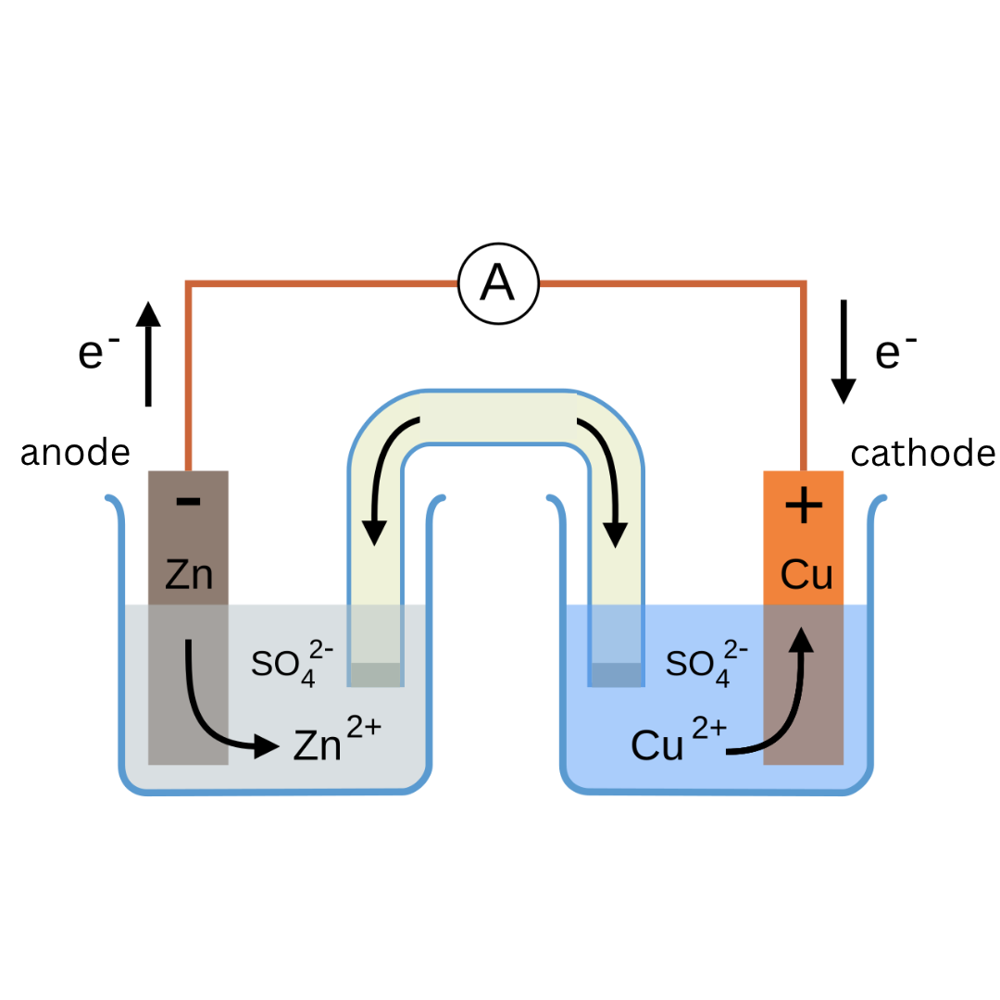
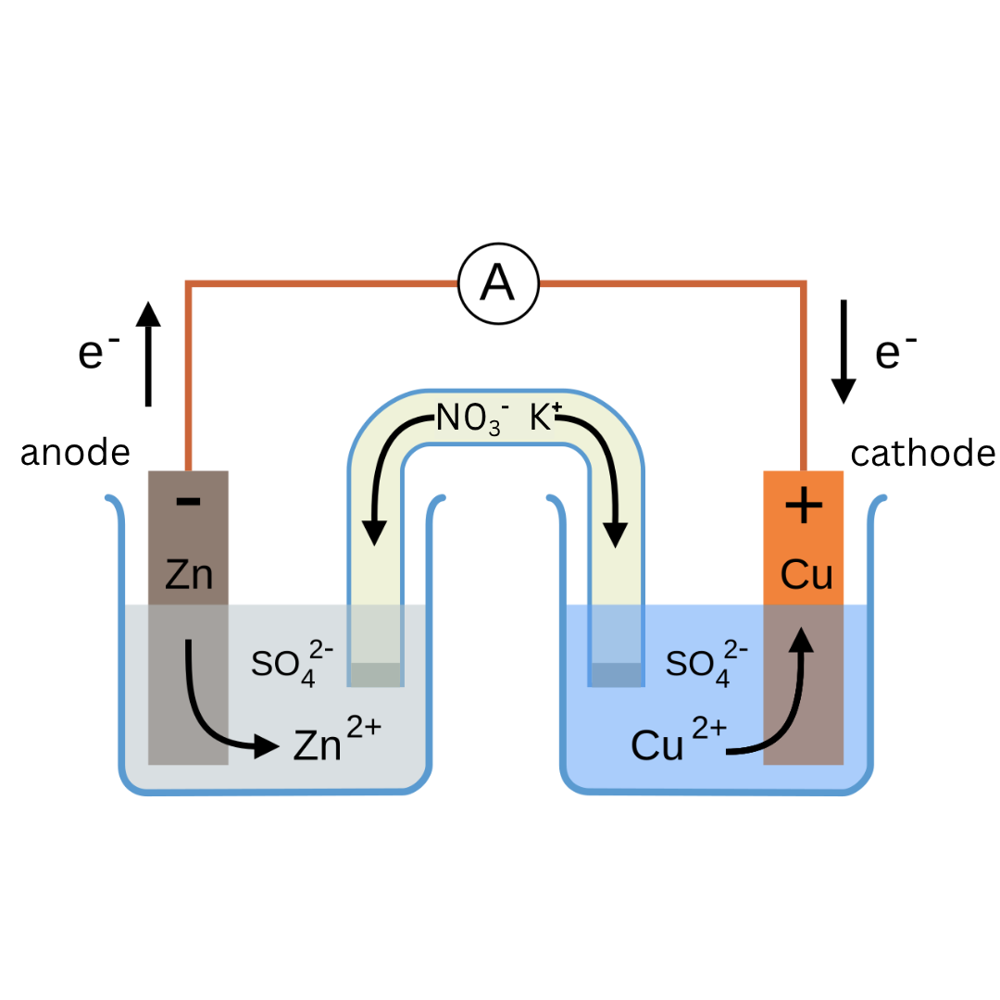

# Daniell Cell: Image Search Report and Chemistry

Result of running `scripts/image-agent.mjs` (model `gemini-3.5-flash-lite`) on a Daniell-cell diagram. The chemistry follows the project's Chemistry Module 1 notes (Nernst form and `0.0591` factor at 25 °C).

## 1. Reference image

Zn–Cu galvanic cell:

- Left beaker: colourless 1 M ZnSO₄, grey **Zn rod, marked −** (anode).
- Right beaker: blue 1 M CuSO₄, orange **Cu rod, marked +** (cathode).
- A **U-shaped salt bridge** joins the two beakers.
- An external wire runs through a **voltmeter (V)**, with **e⁻ arrows from Zn to Cu**.

## 2. Agent run

| Step | Detail |
|---|---|
| Description given | Daniell galvanic cell: two beakers, Zn in 1 M ZnSO₄ (anode, −), Cu in 1 M CuSO₄ (cathode, +), U-shaped salt bridge, voltmeter, e⁻ arrows Zn → Cu |
| Queries (planned by the model) | `Daniell cell`, `Daniell galvanic cell diagram`, `galvanic cell salt bridge`, `electrochemical cell diagram`, plus the full description |
| Sources searched | Wikimedia Commons and Openverse |
| Candidates | 44 found, first 20 reviewed |
| Rule | Download only if the model says the image matches and scores ≥ 8/10 |

### Verification results

| Score | Image | Verdict |
|---|---|---|
| 4 | Élément Daniell.jpg | Antique porous-pot cell, not two beakers |
| 3 | Daniell cell.svg | No external wire, voltmeter or e⁻ arrows |
| 3 | Daniell cell picture.JPG | Photo, single container with a porous barrier |
| 2 | NMAH-Daniell cell batteries 1836.JPG | Museum photo of old batteries |
| 4 | Daniell cell demonstration.jpg | Photo of a real setup, not a diagram |
| 1 | Daniell cell.jpg | Antique cross-section |
| 0 | NIE 1905 … electromotive force … .png | A graph, not a cell |
| 3 | NIE 1905 Daniell cell.png | Old concentric-cylinder illustration |
| **10** | **Daniell cell with non-specific salt bridge.png** | **PASS, downloaded** |
| **10** | **Daniell cell with KNO3 salt bridge.png** | **PASS, downloaded** |

### Downloaded files (`data/image-agent/test2/`)

| File | Source page | License | Author |
|---|---|---|---|
| `daniell-galvanic-cell-diagram-two-beakers-zn-rod-0939af2d.png` | [Commons: non-specific salt bridge](https://commons.wikimedia.org/wiki/File:Daniell_cell_with_non-specific_salt_bridge.png) | CC0 | Dubito, ergo quaero |
| `daniell-galvanic-cell-diagram-two-beakers-zn-rod-b4c29ae9.png` | [Commons: KNO3 salt bridge](https://commons.wikimedia.org/wiki/File:Daniell_cell_with_KNO3_salt_bridge.png) | CC0 | Dubito, ergo quaero |





Each image has a sidecar `.json` with the full review.

## 3. Chemistry of the cell

### Cell notation

$$\text{Zn}_{(s)} \mid \text{Zn}^{2+}_{(aq)}\,(1\,\text{M}) \;\|\; \text{Cu}^{2+}_{(aq)}\,(1\,\text{M}) \mid \text{Cu}_{(s)}$$

### Half-reactions

| Electrode | Process | Reaction | Sign |
|---|---|---|---|
| Zn rod (anode) | Oxidation | $\text{Zn}_{(s)} \rightarrow \text{Zn}^{2+}_{(aq)} + 2e^-$ | − |
| Cu rod (cathode) | Reduction | $\text{Cu}^{2+}_{(aq)} + 2e^- \rightarrow \text{Cu}_{(s)}$ | + |

Overall:

$$\text{Zn}_{(s)} + \text{Cu}^{2+}_{(aq)} \rightarrow \text{Zn}^{2+}_{(aq)} + \text{Cu}_{(s)}$$

Electrons flow through the external wire from Zn to Cu. Conventional current flows from Cu to Zn.

### Role of the salt bridge

- It completes the internal circuit by letting ions migrate.
- Anions (e.g. $\text{SO}_4^{2-}$, $\text{NO}_3^-$) move towards the Zn half-cell, which is gaining $\text{Zn}^{2+}$.
- Cations (e.g. $\text{K}^+$) move towards the Cu half-cell, which is losing $\text{Cu}^{2+}$.
- It keeps each half-cell electrically neutral and prevents the solutions from mixing.

### Standard cell potential

By the IUPAC reduction convention:

$$E^\circ_{\text{Cu}^{2+}/\text{Cu}} = +0.34\ \text{V}, \qquad E^\circ_{\text{Zn}^{2+}/\text{Zn}} = -0.76\ \text{V}$$

$$E^\circ_{\text{cell}} = E^\circ_{\text{cathode}} - E^\circ_{\text{anode}} = 0.34 - (-0.76) = 1.10\ \text{V}$$

This is the reading expected on the voltmeter at 1 M, 25 °C.

### Nernst equation (as in the project notes)

$$E_{\text{cell}} = E^\circ_{\text{cell}} - \frac{0.0591}{n}\log\frac{[\text{Zn}^{2+}]}{[\text{Cu}^{2+}]}, \qquad n = 2$$

**At 1 M and 1 M:** the log term is $\log 1 = 0$, so $E_{\text{cell}} = 1.10$ V.

**Worked example.** $[\text{Zn}^{2+}] = 0.10$ M and $[\text{Cu}^{2+}] = 1.0$ M:

$$E_{\text{cell}} = 1.10 - \frac{0.0591}{2}\log\frac{0.10}{1.0} = 1.10 - 0.02955(-1) = 1.10 + 0.0296 = 1.13\ \text{V}$$

Lower $[\text{Zn}^{2+}]$ raises the EMF, so the reaction is driven forward more strongly.

### Free energy and equilibrium

$$\Delta G^\circ = -nFE^\circ_{\text{cell}} = -(2)(96485)(1.10) \approx -2.12\times10^{5}\ \text{J mol}^{-1} \approx -212\ \text{kJ mol}^{-1}$$

At equilibrium $E_{\text{cell}} = 0$:

$$\log K = \frac{nE^\circ_{\text{cell}}}{0.0591} = \frac{2(1.10)}{0.0591} \approx 37.2 \;\Rightarrow\; K \approx 10^{37}$$

The reaction goes essentially to completion, and the cell is spontaneous because $E^\circ_{\text{cell}} > 0$ and $\Delta G^\circ < 0$.

## 4. Notes on fit

- Both downloaded images match the structure of the reference image but not its exact style. The reference looks custom or generated, with a blue CuSO₄ solution and labelled concentrations.
- The CC0 license means no attribution is required, but keeping the source link is good practice.
- Search recall improved after two changes: the plan now starts with a short core-subject query, and the candidate cap was raised from 12 to 20.

## 5. Reproduce

```bash
node scripts/image-agent.mjs "Daniell galvanic cell diagram with two beakers, salt bridge, voltmeter" --out data/image-agent/test2 --min-score 8 --count 2
```
