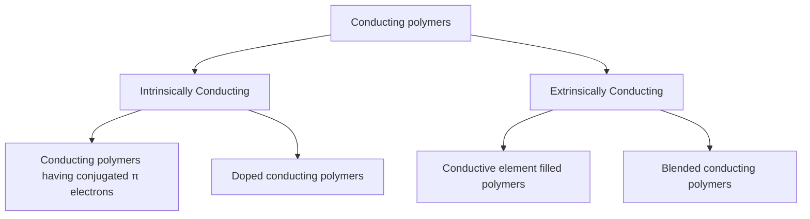

<!-- page 1 | Start here -->

## Engineering Materials and Chemistry

Master fundamental engineering materials, including solid and liquid fuels, calorific value calculations, cement chemistry, advanced polymers, carbon nanomaterials, and specialized engineering lubricants.

**Before you start:** Basic stoichiometry and chemical reactions; Fundamental organic chemistry functional groups and bonding; General thermodynamics and heat transfer principles.

### Your path through this module

1. **Fundamentals of Fuels and Calorific Values**: Calorific value represents the total thermal energy released upon complete combustion, differentiated into gross and net values based on water vapor condensation.
2. **Calorific Value Calculations and Experimental Determination**: Experimental heat absorption by water and apparatus equates to fuel heat release, adjusted via rigorous cooling, acid, and fuse corrections.
3. **Fossil Fuels and Coal Analysis**: Proximate analysis provides empirical parameters regarding moisture, volatile matter, ash, and fixed carbon to assess industrial coal utility.
4. **IC Engine Fuels: Knocking, Octane, and Cetane Numbers**: Octane and cetane numbers quantify the anti-knock characteristics and ignition delay of petrol and diesel fuels, respectively.
5. **Biofuels and Green Hydrogen**: Sustainable energy carrier production relies on biological lipid transesterification and renewable-powered water electrolysis.
6. **Lubricants and Their Physico-Chemical Properties**: Lubricant performance is governed by specialized rheological and thermal properties including high viscosity index, flash/fire points, and aniline point.
7. **Cement: Chemistry and Manufacturing**: Cement manufacturing involves high-temperature clinkering of calcareous and argillaceous mixes followed by controlled hydration to build crystalline strength.
8. **Advanced Engineering Polymers: ABS and Kevlar**: High-performance engineering polymers achieve exceptional tensile strength and impact resistance through tailored monomer blending and directional hydrogen bonding.
9. **Conducting Polymers**: Polymeric electrical conductivity is enabled by conjugated backbones and enhanced via oxidation (p-doping) or reduction (n-doping) charge carriers.
10. **Nanomaterials and Synthesis Techniques**: Nanomaterial synthesis relies on bottom-up sol-gel transformations and chemical reduction techniques to control ultra-fine particle dimensions.
11. **Carbon Nanostructures: Graphene, CNTs, and Fullerenes**: Graphitic carbon allotropes like graphene, CNTs, and fullerenes provide superior electrical mobility, thermal conductivity, and structural strength for next-generation devices.

<!-- page 2 | Fundamentals of Fuels and Calorific Values -->

## Fundamentals of Fuels and Calorific Values

### Introduction to Fuels
A fuel is defined as any combustible substance that, upon combustion, yields a large amount of industrially and domestically useful heat. During combustion, the carbon and hydrogen atoms present in the fuel combine with oxygen to form carbon dioxide ($\text{CO}_2$) and water ($\text{H}_2\text{O}$), accompanied by a rapid liberation of heat.

$$\text{Fuel} + \text{O}_2 \rightarrow \text{Products} + \text{Heat}$$

The resulting products possess lower internal energy compared to the reactants; the difference in energy is emitted as thermal energy.

### Calorific Value
The calorific value of a fuel is defined as the total quantity of heat liberated when a unit mass or unit volume of the fuel is completely burned in air or oxygen. A calorie is the unit of heat, defined as the amount of heat required to raise the temperature of one gram of water by one degree Celsius.

#### Higher or Gross Calorific Value (HCV)
Gross or Higher Calorific Value is the total amount of heat liberated when a unit mass or unit volume of fuel is burned completely, and the combustion products are cooled to room temperature.

*Note:* Most fuels contain a substantial percentage of hydrogen. During combustion, this hydrogen is oxidized to steam. When the combustion products are cooled down to room temperature, the steam condenses into liquid water. Consequently, the latent heat of condensation of the steam is included in the measured heat output, yielding the higher or gross calorific value.

#### Lower or Net Calorific Value (LCV)
Lower or Net Calorific Value is the amount of heat liberated when a unit mass or unit volume of fuel is burned completely, and the products of combustion are allowed to escape without condensing the water vapor.

$$\text{LCV} = \text{HCV} - \text{Latent heat of water vapour formed}$$

Since 1 part by mass of hydrogen yields 9 parts by mass of water via the combustion reaction:

$$2\text{H}_2 + \text{O}_2 \rightarrow 2\text{H}_2\text{O}$$

The relationship between LCV and HCV can be expressed as:

$$\text{LCV} = \text{HCV} - 0.09H \times 587 \text{ cal/g}$$

Where:
- $H$ = percentage of hydrogen in the fuel
- $587 \text{ cal/g}$ = latent heat of steam

### Determination of Calorific Value of Solid Fuel Using Bomb Calorimeter
The calorific value of solid and non-volatile liquid fuels is experimentally measured using a Bomb Calorimeter.

#### Construction and Components
A bomb calorimeter consists of the following key assemblies:
- **Stainless Steel Bomb:** A strong, cylindrical vessel where combustion of the fuel takes place.
- **Gas-Tight Lid:** Fitted with an oxygen inlet valve and two stainless steel electrodes.
- **Crucibles:** A small ring attached to one electrode to support a nickel or stainless steel crucible containing the fuel sample.
- **Copper Calorimeter:** Houses the bomb and a known mass of water, equipped with an electrical stirrer and a Beckmann thermometer capable of measuring temperature differences down to $0.01^\circ\text{C}$.
- **Insulating Jackets:** The copper calorimeter is surrounded by an air jacket and a water jacket to minimize heat loss via radiation.

> **Figure: Diagram of a Bomb Calorimeter**
>
> Diagram of a Bomb Calorimeter. Schematic diagram showing various components: Beckmann's thermometer on the left inserted into the copper calorimeter, Oxygen valve at the top center leading into the bomb, 6V Battery connected via wires to the electrodes for the fuse wire, Electrically operated stirrer at the top right, Electrodes extending into the bomb, Copper calorimeter containing water, Stainless steel bomb in the center, Solid fuel inside the crucible, Fuse wire dipping into the solid fuel in the crucible, Stainless steel crucible, Air jacket surrounding the calorimeter, and Water jacket surrounding the air jacket.

<!-- page 3 | Calorific Value Calculations and Experimental Determination -->

## Calorific Value Calculations and Experimental Determination

Bridge: Having defined calorific values, we now explore how experimental devices like the bomb calorimeter measure them and how theoretical formulas estimate them.

The new idea: Experimental heat absorption by water and apparatus equates to fuel heat release, adjusted via rigorous cooling, acid, and fuse corrections.

Objectives: Calculate HCV and LCV using Bomb Calorimeter data; Apply Dulong's formula for theoretical calorific value estimation; Account for acid, fuse wire, and cooling corrections.

Concepts to teach: Bomb calorimeter construction and working; Water equivalent calculation ($w$); Dulong's formula for theoretical HCV; Correction factors for precise calorimetry.

### Experimental Determination Using Bomb Calorimeter

A known mass of the given fuel (about $0.5$ to $1\text{ g}$) is taken in a clean crucible supported over the rings. A fine Mg wire is stretched across the electrodes touching the fuel sample. The lid of the bomb is tightly screwed and bomb is filled with oxygen at $25-30$ atmospheric pressure. The bomb is then lowered into copper calorimeter, containing a known mass of water. The initial temperature of water is noted after thorough stirring. The electrodes are then connected to $6\text{V}$ battery and the circuit is completed. The sample burns and heat liberated is transferred to water. Uniform stirring of water is continued and the maximum temperature attained is recorded.

#### Calculations

$$\text{Mass of fuel sample taken} = X\text{ g}$$
$$\text{Mass of water in calorimeter} = W\text{ g}$$
$$\text{Water equivalent of calorimeter, stirrer, thermometer, bomb etc.} = w$$

*Note:* $w = \text{Wt. of apparatus} \times \text{Sp. Heat of the metal}$

$$\text{Initial temperature of water} = T_1$$
$$\text{Final temperature of water} = T_2$$
$$\text{Gross or Higher calorific value} = L$$
$$\text{Heat liberated by burning of the fuel} = XL$$
$$\text{Heat absorbed by water and apparatus} = (W + w) \times \text{specific heat of water} \times (T_2 - T_1) = (W + w)(T_2 - T_1)$$

*Note:* Specific heat of water $= 1\text{ cal/g}^\circ\text{C}$

Since heat liberated by fuel equals heat absorbed by water and apparatus:

$$XL = (W + w)(T_2 - T_1)$$

$$\text{HCV or } L = \frac{(W + w)(T_2 - T_1)}{X}\text{ cal/g}$$

### Net or Low Calorific Value (LCV)

Let percentage of hydrogen in fuel $= H$. Therefore, the grams of hydrogen present in $1\text{ g}$ of fuel $= 1 \times \frac{H}{100}$.

Hydrogen is converted to steam according to the equation:

$$\text{H}_2 + \frac{1}{2}\text{O}_2 \longrightarrow \text{H}_2\text{O}$$

Stoichiometrically:
- $2\text{ g}$ of $\text{H}_2$ yields $18\text{ g}$ of $\text{H}_2\text{O}$
- $1\text{ g}$ of $\text{H}_2$ yields $9\text{ g}$ of $\text{H}_2\text{O}$

Therefore:
- Wt. of water produced from $1\text{ g}$ of $\text{H}_2 = 9\text{ g}$
- Wt. of water produced from $\frac{H}{100}\text{ g}$ of $\text{H}_2$ (or $1\text{ g}$ of fuel) $= 9 \times \frac{H}{100} = 0.09H\text{ g}$

Given that the latent heat of steam $= 587\text{ cal/g}$:

$$\text{Latent heat of water vapour} = 0.09H \times 587\text{ cal}$$
$$\text{LCV or Net calorific value} = \text{HCV} - 0.09H \times 587\text{ cal/g}$$

### Experimental Corrections

To obtain accurate results, several correction factors must be applied:

1. **Fuse wire correction:** The measured heat includes the heat given out by ignition of the fuse wire and must be subtracted.
2. **Acid correction:** During combustion, sulphur and nitrogen present in the fuel are oxidized to their corresponding acids under the temperature and pressure of ignition.
   $$\text{S} + \text{O}_2 \longrightarrow \text{SO}_2$$
   $$\text{SO}_2 + \frac{1}{2}\text{O}_2 + \text{H}_2\text{O} \longrightarrow \text{H}_2\text{SO}_4$$
3. **Cooling correction:** If the time taken for the water in the calorimeter to reach maximum temperature from room temperature is $x$ minutes and the rate of cooling is $\frac{dT}{dt}$, then the cooling correction is given by $x \cdot \frac{dT}{dt}$. This value is added to the observed rise in temperature.

Applying all corrections, the corrected Gross Calorific Value formula is:

$$\text{Gross calorific value} = \frac{(W + w)(T_2 - T_1 + \text{cooling correction}) - (\text{acid} + \text{fuse correction})}{X}$$

### Theoretical Calculation of Calorific Value (Dulong's Formula)

According to Dulong, the calorific value of a fuel is the sum of the calorific values of its constituent elements ($\text{C}, \text{H}, \text{S}$).

> **Figure: Table 1.2: Calorific value of the fuel**
>
> Table 1.2: Calorific value of the fuel. A table with two rows. Row 1 has the header Constituents with three columns: C, H, and S. Row 2 has the header HCV (kcal/kg) with the corresponding values for the constituents: 8080 for C, 34500 for H, and 2240 for S.

If oxygen is present in the fuel, it is assumed to be in combined form with hydrogen (as fixed hydrogen, $\text{H}_2\text{O}$), which is unavailable for combustion. According to the reaction:

$$\text{H}_2 + \frac{1}{2}\text{O}_2 \longrightarrow \text{H}_2\text{O}$$

One part of hydrogen combines with $8$ parts of oxygen by mass. Therefore, the amount of hydrogen available for combustion is:

$$\text{Available Hydrogen} = \left[\text{H} - \frac{\text{O}}{8}\right]$$

Dulong's formula for calculating the theoretical higher calorific value (HCV) is:

$$\text{HCV} = \frac{1}{100} \left[ 8080\text{C} + 34500\left(\text{H} - \frac{\text{O}}{8}\right) + 2240\text{S} \right] \text{ kcal/kg}$$

### Introduction to Fossil Fuels

* Fossil fuels are non-renewable energy sources formed from the remains of vegetable matter buried in the earth's crust for millions of years.
* They are mainly composed of carbon ($\text{C}$), hydrogen ($\text{H}$), and oxygen ($\text{O}$), along with minor amounts of nitrogen ($\text{N}$), sulphur ($\text{S}$), and moisture.

<!-- page 4 | Fossil Fuels and Coal Analysis -->

## Fossil Fuels and Coal Analysis

Bridge: Building on general fuel definitions, we examine solid fossil fuels and standardized methods to grade their quality.

The new idea: Proximate analysis provides empirical parameters regarding moisture, volatile matter, ash, and fixed carbon to assess industrial coal utility.

### Classification of Coal Ranks

Important fossil fuels include coal, petroleum, and natural gas. Coal is a black or brownish-black combustible sedimentary rock composed primarily of carbon. It forms from plant remains buried under earth and rock, subjected to high heat and pressure over millions of years. Coal is classified by rank, representing the degree of alteration from the parent material wood:

1. **Peat**: The first stage of coal formation. It is brown or black, contains 80–90\% moisture, and serves as a low-energy fuel with a calorific value of approximately $5400 \text{ kcal/kg}$ when dried.
2. **Lignite (Brown Coal)**: Known as immature coal, containing 30–60\% moisture. It is soft, light brown to black, ignites easily after air drying, burns with a long, smoky flame, and has a calorific value of $6500–7100 \text{ kcal/kg}$.
3. **Bituminous Coal**: The most commonly used commercial coal. It is hard, dark black, burns with a smoky yellow flame, contains a good amount of fixed carbon, and possesses a calorific value of approximately $8000 \text{ kcal/kg}$.
4. **Anthracite**: The final, most mature stage of coal formation. It is a hard, shiny, black coal that burns with a blue, smokeless flame. It contains the highest fixed carbon content ($92–98\%$) with very low volatile matter and moisture, and a calorific value of approximately $8600 \text{ kcal/kg}$, making it the cleanest and most efficient coal.

### Proximate Analysis of Coal

The composition of coal varies by source and age. Proximate analysis evaluates the practical utility of coal through empirical determinations that depend strictly on procedural parameters such as temperature, duration of heating, and crucible material.

#### Determination Procedures and Formulas

1. **Moisture**: A known amount of finely powdered coal is heated in a silica or porcelain crucible at $105-110^\circ\text{C}$ for about 1 hour in an electric oven, cooled in a desiccator, and weighed.
$$\% \text{ moisture} = \frac{\text{Loss in weight} \times 100}{\text{Weight of coal taken}}$$

2. **Volatile Matter**: Composed of combustible gases like $\text{H}_2$, $\text{CO}$, $\text{CH}_4$, and hydrocarbons. The moisture-free coal left in the crucible is covered with a lid and heated in a muffle furnace at ~950 $^\circ\text{C}$ under an inert atmosphere for 7 minutes. It is then cooled and weighed.
$$\% \text{ volatile matter} = \frac{\text{Loss in weight due to removal of volatile matter} \times 100}{\text{Weight of coal taken}}$$

3. **Ash**: Non-combustible matter left after burning off all combustible substances. It is determined by heating the residual coal from the volatile matter test in an open crucible at $700-750^\circ\text{C}$ for half an hour in a muffle furnace until constant weight is reached.
$$\% \text{ ash} = \frac{\text{Weight of ash formed} \times 100}{\text{Weight of coal taken}}$$

4. **Fixed Carbon**: The solid carbon material left behind after moisture, volatile matter, and ash have been accounted for.
$$\% \text{ of fixed carbon} = 100 - \% \text{ of (Moisture} + \text{Volatile matter} + \text{Ash)}$$

### Significance of Coal Constituents

- **Moisture Content**: Water lowers usable energy because thermal energy is wasted evaporating the moisture. Lower moisture yields higher useful energy.
- **Volatile Matter**: High volatile matter causes coal to burn with a long, smoky flame, resulting in unburnt gas losses and requiring larger furnace volumes. Lower volatile matter is generally preferred for high-efficiency systems.
- **Ash Content**: Ash is non-combustible residue that lowers net heating value, blocks airflow and heat transfer, reduces furnace efficiency, and damages equipment. Lower ash content is ideal.
- **Fixed Carbon**: The primary combustible solid yielding heat. Higher fixed carbon corresponds to higher energy density and superior coal quality, aiding in efficient furnace design.

### IC Engine Fuels: Knocking, Octane, and Cetane Numbers

- **Knocking**: A sharp, rattling noise in an engine caused by premature or uneven ignition of the fuel-air mixture. In petrol engines, it occurs when the mix explodes before the spark plug fires; in diesel engines, delayed burning of certain branched or aromatic compounds causes rough pressure spikes. Knocking disturbs piston movement, damages components, wastes fuel, and reduces efficiency.
- **Cetane Number**: A metric quantifying the ignition delay and ease of ignition for diesel fuel inside a diesel engine. Higher cetane numbers indicate faster ignition upon injection, ensuring smooth engine operation and minimized knocking.

<!-- page 5 | IC Engine Fuels: Knocking, Octane, and Cetane Numbers -->

## IC Engine Fuels: Knocking, Octane, and Cetane Numbers

Bridge: Moving from solid coal combustion, we transition to liquid fuel performance criteria in internal combustion engines.

The new idea: Octane and cetane numbers quantify the anti-knock characteristics and ignition delay of petrol and diesel fuels, respectively.

### Objectives and Concepts
- Explain the mechanism of engine knocking in petrol and diesel engines.
- Define octane number and reference hydrocarbons.
- Define cetane number and ignition delay.
- Concepts to teach: Engine knocking causes and effects; Octane number (iso-octane vs. n-heptane); Cetane number (n-hexadecane vs. 1-methylnaphthalene).

### Diesel Fuels and Cetane Number

A lower cetane number means the fuel takes longer to ignite, causing engine noise and less efficiency. Therefore, a higher cetane number corresponds to a better quality diesel fuel.

> **Figure: Chemical structures of n-hexadecane (cetane) and 1-methylnaphthalene**
>
> Chemical structures of n-hexadecane and 1-methylnaphthalene shown side by side. On the left: the linear chemical formula CH3-(CH2)14-CH3, with the text 'n-hexadecane or cetane' centered underneath. On the right: a skeletal structure of a bicyclic aromatic naphthalene ring with a methyl group (-CH3) attached to the top position, with the text '1-methylnaphthalene' centered underneath.

Chemical structures of n-hexadecane (cetane) and 1-methylnaphthalene. Chemical structures of n-hexadecane and 1-methylnaphthalene shown side by side. On the left: the linear chemical formula $\text{CH}_3-(\text{CH}_2)_{14}-\text{CH}_3$, with the text 'n-hexadecane or cetane' centered underneath. On the right: a skeletal structure of a bicyclic aromatic naphthalene ring with a methyl group ($-\text{CH}_3$) attached to the top position, with the text '1-methylnaphthalene' centered underneath.

The hydrocarbon cetane ($n$-hexadecane) has a very short ignition delay and an arbitrary cetane value of 100 has been assigned to it. On the other hand, 1-methylnaphthalene has a very long ignition delay and hence, a value of 0 has been assigned to it.

**Definition:** The cetane number of a diesel fuel is defined as the percentage of cetane in a mixture of cetane and 1-methylnaphthalene which will have the same ignition characteristics as the fuel under examination and under the same set of conditions.

### Petrol Fuels and Octane Number
- Octane number indicates how well petrol (gasoline) resists knocking in an engine.
- Knocking happens when petrol burns too early or unevenly, causing noise and mechanical damage.
- A higher octane number means the petrol can withstand more compression without knocking.
- Higher octane fuel results in smoother engine running and less knocking.

Since $n$-heptane knocks very badly, its antiknock value is given the arbitrary value of 0, whereas 2,2,4-trimethylpentane (iso-octane) has very little knocking and is assigned an antiknock value of 100.

**Definition:** The octane number of a gasoline is defined as the percentage of iso-octane present in a mixture of iso-octane and $n$-heptane, which matches the fuel under test in knocking characteristics.

$$\text{Higher Octane Number} \implies \text{Greater Anti-Knock Property}$$

### Biofuels
Biofuels are biologically produced fuels. Production of biofuels involves the conversion of relatively diffuse and inconvenient-to-use sources of energy, such as biomass and sunlight, into dense and conveniently usable fuels. This process constitutes fuel biotechnology.

*Examples:* Bioethanol, biodiesel, biogas, and biohydrogen.

<!-- page 6 | Biofuels and Green Hydrogen -->

## Biofuels and Green Hydrogen

Bridge: With traditional fossil fuel metrics established, we investigate sustainable alternatives including biofuels and green hydrogen.
The new idea: Sustainable energy carrier production relies on biological lipid transesterification and renewable-powered water electrolysis.
Objectives: Describe biodiesel production and properties; Classify hydrogen types based on production methods; Explain electrolytic water splitting using renewable energy
Concepts to teach: Biodiesel synthesis via transesterification; Hydrogen classification (Green, Blue, Grey, Brown, Pink); Electrolyzer technologies (AWE, PEMWE, SOWE)

### Fundamentals of Biofuels

Biofuels are derived from biomass, offering renewable energy with low cost and high availability. Unlike fossil fuels, biofuels do not increase atmospheric $\text{CO}_2$ levels net-wise, and they do not produce pollutant gases such as sulphur dioxide.

**Biodiesel**
Biodiesel is a non-petroleum-based fuel consisting of short-chain alkyl esters. It is a diesel-like fluid obtained from biological lipid sources such as plant and algal oils or animal fats. Specifically, fatty acid methyl esters (FAME) derived from vegetable oils share similar physical and chemical properties with conventional diesel.

### Production and Properties of Biodiesel

Biodiesel can be prepared from lipid oils such as rapeseed, rubber seed, jatropha, or animal fat. The production of biodiesel from rapeseed involves the following steps:

1. **Extraction and Drying:** Rapeseed oil is produced by crushing rapeseed. The resulting oil is heated to $100^\circ\text{C}$ to remove all moisture.
2. **Transesterification:** The dried rapeseed oil is heated with methanol at $50^\circ\text{C}$ in the presence of sodium hydroxide ($\text{NaOH}$) catalyst to form glycerol and fatty acid methyl esters.

$$\text{Rapeseed oil} + \text{Methanol} \xrightarrow{\text{NaOH}} \text{fatty acid methyl ester} + \text{glycerol}$$

3. **Purification:** The heavier glycerol layer is allowed to settle and is separated. The fatty acid methyl ester layer is purified to yield the final biodiesel product.

**Advantages of Biodiesel:**
* It is $98\%$ biodegradable.
* It is nontoxic.
* The raw material is renewable.
* Its contribution to the greenhouse effect is significantly lower than that of conventional diesel.
* It provides a high energy yield.

### Hydrogen Energy and Classification

With the rapid depletion of fossil fuels and the resulting environmental degradation, hydrogen energy has emerged as an effective solution for the global energy crisis. Worldwide hydrogen production is approximately 80 million tons per annum, mostly derived from fossil fuels.

Based on production methods and environmental impact, hydrogen is classified into several types:

* **Blue Hydrogen:** Produced through the partial oxidation of methane with $\text{O}_2$, where the generated carbon dioxide is captured and stored (CCS).
* **Grey Hydrogen:** Produced through the partial oxidation of methane with oxygen, but the generated carbon dioxide is released into the atmosphere without capture.
* **Brown Hydrogen:** Produced via the partial oxidation of coal, yielding both hydrogen and carbon dioxide.
* **Pink Hydrogen:** Produced by the electrolysis of water using nuclear energy as the power source.
* **Green Hydrogen:** Produced by the electrolysis of water using renewable energy sources (such as solar or wind). This process generates zero greenhouse gas emissions, making it completely sustainable.

### Electrolytic Water Splitting and Electrolyzers

The core process in green hydrogen production is water electrolysis, where water is decomposed into hydrogen and oxygen by passing an electric current:

$$\text{H}_2\text{O}(\text{l}) \rightarrow \text{H}_2(\text{g}) + \text{O}_2(\text{g})$$

A water electrolysis cell (electrolyzer) consists of an electrolyte and two electrodes (cathode and anode). Hydrogen gas evolves at the cathode, while oxygen gas evolves at the anode. Electrolyzers are classified into three primary types based on the electrolyte-separator used:

1. **Alkaline Water Electrolyzer (AWE):** Uses liquid alkaline electrolytes such as $\text{KOH}$ or $\text{NaOH}$.
2. **Proton Exchange Membrane Water Electrolyzer (PEMWE):** Uses a solid polymer electrolyte membrane, such as perfluorosulfonic acid, to conduct protons.
3. **Solid Oxide Water Electrolyzer (SOWE):** Uses a solid oxide or ceramic electrolyte operating at high temperatures.

**Applications of Green Hydrogen:**
1. Utilized in fuel cells for sustainable electricity generation.
2. Used to produce eco-friendly ammonia (green ammonia).
3. Employed in power plants to produce synthetic natural gas while lowering overall carbon intensity.

<!-- page 7 | Lubricants and Their Physico-Chemical Properties -->

## Lubricants and Their Physico-Chemical Properties

Bridge: Moving from energy generation fuels, we study mechanical preservation substances designed to reduce friction and wear.

The new idea: Lubricant performance is governed by specialized rheological and thermal properties including high viscosity index, flash/fire points, and aniline point.

### Introduction to Lubricants and Lubrication

Any substance introduced between two relatively moving surfaces for reducing friction and wear is called a lubricant. The process of reducing frictional resistance between moving surfaces by the application of lubricants is called lubrication.

**Functions of lubricants:**
1. It reduces the loss of energy in the form of heat.
2. It increases the efficiency of machine.
3. It prevents the interlocking or inter-joints welding at the surface asperities.
4. It protects the materials from corrosion.
5. Sometimes it stops the leakage of gases or pressures from the cylinder.

### Classification of Greases

Greases are semisolid lubricants made by combining lubricating oils with metallic soaps. They are classified based on the soap used in their manufacture:

**a. Lime or Calcium Soap Grease (Cup Grease)**
- Made by emulsifying petroleum oil with calcium soap.
- Water resistant (insoluble in water).
- Cannot be used above $65^{\circ}\text{C}$ (oil and soap separate).
- Commonly used in ball bearings.
- Cheap and widely available.

**b. Lithium Soap Grease**
- Made by thickening petroleum oil with lithium soap.
- Water resistant and withstands high temperatures.
- Good mechanical stability and low oxidation tendency.
- Suitable for low temperatures (about $-15^{\circ}\text{C}$).
- Used as multipurpose grease.

**c. Sodium Soap Grease**
- Made by dispersing sodium soap in petroleum oil.
- Water soluble (not water resistant).
- Can be used up to $175^{\circ}\text{C}$.
- Fibrous structure helps in high-temperature applications.
- Suitable where lubricants heat up due to friction.

**d. Aluminum Soap Grease**
- Made by dispersing aluminum soaps in oils.
- Waterproof due to low soap content.
- Not suitable above $90^{\circ}\text{C}$.
- Limited to moderate temperature applications.

**e. Axle Grease (Resin Grease)**
- Made by reacting slaked lime with resin oil and fatty oils at $58^{\circ}\text{C}$.
- Fillers like talc and mica are added.
- Water resistant.
- Suitable for heavy equipment use.

### Liquid Lubricants

Liquid lubricants are widely used in internal combustion engines. Apart from reducing friction and wear, they prevent gas leakage between piston and cylinder.

**a. Vegetable Oils & Animal Oils**
- Natural lubricants.
- Have good oiliness (stick well to metal surfaces).
- Tend to oxidize easily and decompose at high temperatures.
- Form acidic and thick products on exposure to air.
- Usually blended with mineral oils to improve performance.

**b. Mineral Oils**
- Obtained by fractional distillation of petroleum.
- Most widely used lubricants.
- Cheap, abundant, and stable under working conditions.
- Poor oiliness compared to vegetable/animal oils.
- Oiliness improved by adding oleic acid, stearic acid, etc.

**c. Synthetic Oils**
- Man-made lubricants (not derived directly from natural sources).
- Made from chemical compounds like poly alpha olefins, polyesters, etc.
- Designed to offer high performance, especially under extreme conditions.

### Physico-Chemical Properties of Lubricants

#### Viscosity and Viscosity Index
Viscosity is the property of a liquid or fluid by virtue of which it offers resistance to its own flow. When a liquid is flowing steadily over a fixed horizontal surface, its layer in immediate contact with the fixed surface is stationary and velocity of the layers increases with the distance from the fixed surface.

**Viscosity Index (V.I.):** The variation of viscosity with respect to temperature is indicated by viscosity index. The viscosity index is a measure of the rate at which the viscosity of an oil changes with temperature. For a good lubricating oil, the variation of viscosity with temperature should be small, i.e., viscosity index is high.

**Measurement of Viscosity Index**
For the measurement of viscosity index, two types of standard oils are used:
1. Paraffin-based Pennsylvanian oils ($\text{V.I} = 100$, designated as 'H' oils).
2. Naphthenic-based Gulf oils ($\text{V.I} = 0$, designated as 'L' oils).

Pennsylvanian oils show a small decrease in viscosity whereas Gulf oils show a large decrease in viscosity with increase of temperature. The viscosity of lubricating oil is measured by Redwood viscometer. The viscosity of the oil under test is measured at $100^{\circ}\text{F}$ and also at $210^{\circ}\text{F}$. Let these values be '$U$' and '$V$' respectively. The difference between the two values should be low if the oil is good.

From the list of 'H' oils, the oil which has the same viscosity at $210^{\circ}\text{F}$ is selected and its viscosity is measured at $100^{\circ}\text{F}$ (let it be '$H$'). From the list of 'L' oils, the oil which has the same viscosity at $210^{\circ}\text{F}$ is selected and its viscosity is measured at $100^{\circ}\text{F}$ (let it be '$L$'). The viscosity index of the oil under test is given by:

$$\text{V.I} = \frac{L - U}{L - H} \times 100$$

#### Flash and Fire Point
- **Flash Point:** Lowest temperature at which oil gives off vapors that ignite briefly. The flame appears for a moment and then goes out. It indicates the starting point of flammability and is used to check the safety of storage and handling.
- **Fire Point:** Lowest temperature at which oil gives off vapors that keep burning. The flame continues to burn for at least 5 seconds. It indicates when the oil can sustain a fire and is used to assess fire risk during operation.

#### Cloud and Pour Point
Lubricating oils are often made from petroleum, which contain impurities like paraffin wax, asphalt, and resinous substances. At low temperatures, these impurities can separate out from the oil.
- **Cloud Point:** The temperature at which the oil starts to look cloudy or hazy.
- **Pour Point:** The temperature at which the oil stops flowing (becomes too thick to pour).

Both cloud point and pour point show how stable the oil is in cold conditions. The pour point helps determine if the lubricant is suitable for machines operating in low temperatures.

#### Aniline Point
The Aniline Point of an oil is the lowest temperature at which the oil is completely miscible with aniline (an organic compound) in equal volumes.

- **Importance of Aniline Point:** It indicates the aromatic content of the oil.
  - Low aniline point $\rightarrow$ High aromatic content
  - High aniline point $\rightarrow$ High paraffinic (alkane) content

**Determination Procedure:**
1. **Equal Mixing:** Take equal volumes of the oil and fresh, dry aniline in a clear glass test tube or bottle.
2. **Heating:** Heat the mixture gently with stirring until a clear, homogeneous (single-phase) solution is formed.
3. **Cooling:** Allow the mixture to cool slowly, while continuing to stir.
4. **Observation:** The temperature at which the mixture just becomes cloudy (or separates into two layers) is noted as the Aniline Point of the oil.

### Characteristics of a Good Liquid Lubricant
1. It should have a high viscosity index.
2. It should have a higher flash and fire point greater than the operating temperature of the machine.
3. It should have a higher aniline point.
4. The cloud and pour points should be lower than the atmospheric temperature.

<!-- page 8 | Cement: Chemistry and Manufacturing -->

## Cement: Chemistry and Manufacturing

Transitioning from machinery lubricants, we examine construction materials capable of hydraulic binding and hardening. Cement manufacturing involves high-temperature clinkering of calcareous and argillaceous mixes followed by controlled hydration to build crystalline strength.

### Classification of Cement

Cement is a light greenish heavy powder described as a material possessing adhesive and cohesive properties capable of binding materials like stones and bricks. Cements are hydraulic in nature, meaning they possess the property of setting and hardening under water. The essential constituents of cement are compounds of calcareous ($\text{Ca}$) and argillaceous ($\text{Al}+\text{Si}$) materials.

#### 1. Natural Cement
- Made by heating natural limestone containing some clay without adding extra materials.
- Sets quickly but exhibits low strength and is largely obsolete.

#### 2. Puzzolana Cement
- One of the oldest types, made by mixing volcanic ash (puzzolana) with lime without requiring high-temperature heating.
- Possesses hydraulic properties and is typically mixed with Portland cement to enhance performance.

#### 3. Slag Cement
- Formed from blast furnace slag (a steel production waste) and lime. Slag is rapidly quenched in water, dried, blended with lime, and ground.
- Sets slowly with low strength and durability, utilized in large concrete works where ultra-high strength is unneeded.

#### 4. Portland Cement
- The most common and vital modern cement, produced by firing limestone and clay together at approximately $1500^{\circ}\text{C}$.
- Gypsum is added post-cooling to regulate setting times. It provides exceptional strength and versatility.

#### 5. Special Cements

| Type | Simple Use / Feature |
| :--- | :--- |
| White Cement | Utilized for decorative work and tiles due to its white appearance. |
| Rapid Hardening Cement | Sets and gains strength rapidly, ideal for urgent repair work. |
| Low Heat Cement | Evolves lower thermal energy during hydration, critical for massive structures like dams. |
| High Alumina Cement | Exhibits extreme strength and heat resistance, suited for furnace linings. |
| Coloured Cement | Formed by blending white cement with tailored color pigments. |
| Sulphate Resisting Cement | Withstands harsh chemical attacks, deployed in sewage systems and marine environments. |

### Raw Materials and Functions

The principal raw materials for cement production include:
1. Calcareous materials ($\text{CaCO}_3$), such as limestone and chalk.
2. Argillaceous materials ($\text{Al}_2\text{O}_3$ and $\text{SiO}_2$), such as clay, shales, and slate.
3. Powdered coal or fuel oil.
4. Gypsum.
5. Iron oxide.

#### Functions of Ingredients:
- **Lime ($\text{CaO}$):** Principal constituent. Excess or deficiency reduces overall strength.
- **Silica ($\text{SiO}_2$):** Imparts mechanical strength.
- **Alumina ($\text{Al}_2\text{O}_3$):** Promotes rapid setting.
- **Gypsum ($\text{CaSO}_4$):** Acts as a retarder to slow down the setting action.
- **Iron Oxide ($\text{Fe}_2\text{O}_3$):** Provides characteristic color, strength, and hardness.
- **Sulfur Trioxide ($\text{SO}_3$):** In trace amounts, imparts structural soundness.

### Manufacturing Processes

#### Step A: Mixing Raw Materials
- **Dry Process:** Employed when raw limestone and clay are hard. Limestone is crushed, blended with clay in a $3:1$ ratio, pulverized into a fine powder, and fed directly into a rotary kiln.
- **Wet Process:** Employed when raw materials are soft. Limestone is crushed and powdered, while clay is washed with water to eliminate impurities. The clay paste and powdered limestone are mixed in a $3:1$ ratio and wet-ground into a slurry containing roughly $40\% \text{water}$ before feeding into the rotary kiln.

#### Step B: Calcination in a Rotary Kiln
The rotary kiln is a long, inclined, rotating steel cylinder lined internally with refractory firebricks operating up to $1750^{\circ}\text{C}$, where raw feed resides for $2$ to $3$ hours.

> **Figure: Diagram of a rotary kiln used for cement manufacturing**
>
> Diagram of a rotary kiln used for cement manufacturing. Key labels include: Chimney, Flue gases, Dry mix or slurry feed tank, Drying zone, Revolving kiln, Calcination zone, Refractory bricks lining, Clinkering zone, Hot flame, Fuel oil or powdered coal, Roller bearings, Concrete support, Trolley, Air inlet, Clinker, Hot air blower, Dust catcher.

**Zones Inside the Kiln:**
1. **Drying Zone ($\sim 750^{\circ}\text{C}$):** Water evaporates from the slurry, and clay dissociates into basic oxides: $\text{Al}_2\text{O}_3$, $\text{SiO}_2$, and $\text{Fe}_2\text{O}_3$.
2. **Calcination Zone ($\sim 1000^{\circ}\text{C}$):** Limestone undergoes thermal decomposition to release carbon dioxide and form calcium oxide:
$$\text{CaCO}_3 \xrightarrow{\Delta} \text{CaO} + \text{CO}_2$$
3. **Clinkering Zone ($\sim 1600^{\circ}\text{C}$):** High-temperature fusion reactions occur between lime and clay components to generate calcium silicates and aluminates:
$$\text{Di-calcium silicate } (C_2S): \quad 2\text{CaO} + \text{SiO}_2 \rightarrow 2\text{CaO}\cdot\text{SiO}_2$$
$$\text{Di-calcium aluminate } (C_2A): \quad 2\text{CaO} + 2\text{Al}_2\text{O}_3 \rightarrow 2\text{CaO}\cdot\text{Al}_2\text{O}_3$$

#### Step C: Formation of Clinkers
The fused silicates and aluminates agglomerate into small, hard, grey-colored spherical nodules termed clinkers, exiting the kiln at high temperatures before cooling.

#### Step D: Mixing with Gypsum
Cooled clinkers are pulverized in a ball mill alongside $2\text{--}3\% \text{gypsum}$ ($\text{CaSO}_4\cdot 2\text{H}_2\text{O}$), which acts as a retarder to prevent flash setting. The final product is Portland cement.

### Setting and Hardening of Cement

When water is added to cement, hydration reactions occur:
$$\text{Cement} + \text{Water} \rightarrow \text{Hydration Products}$$

This process dictates three sequential physical stages:
1. **Stiffening:** Initial thickening of the paste.
2. **Setting:** Transition to a rigid solid matrix.
3. **Hardening:** Continuous development of mechanical strength over time.

#### Microstructural Formation:
Hydration yields interlocking gels and crystalline hydrates that fill interstitial voids between cement grains. As these crystals propagate, the hardened paste gains structural integrity and load-bearing capacity.

### Advanced Engineering Polymers: ABS

Polymers are high-molecular-mass macromolecules constructed via covalent linking of repeating monomer units.

#### ABS (Acrylonitrile Butadiene Styrene)
ABS is made by polymerizing styrene and acrylonitrile in the presence of polybutadiene rubber. In a common structure, styrene-acrylonitrile (SAN) chains are grafted onto polybutadiene particles and are also present as the surrounding matrix. It is therefore misleading to depict ABS as one simple, uniform chain made by joining three monomers in a single row.

**Preparation, schematically:** polybutadiene rubber + styrene + acrylonitrile $\longrightarrow$ polybutadiene toughening phase with grafted SAN and SAN matrix (ABS).

The components contribute complementary properties: acrylonitrile improves chemical and heat resistance, styrene contributes rigidity and surface finish, and the rubber phase absorbs impact energy. The exact phase structure depends on the commercial grade and manufacturing process.

<!-- page 9 | Advanced Engineering Polymers: ABS and Kevlar -->

## Advanced Engineering Polymers: ABS and Kevlar

Bridge: Building on structural inorganic materials, we explore synthetic macromolecules engineered for extreme mechanical resilience.

The new idea: High-performance engineering polymers achieve exceptional tensile strength and impact resistance through tailored monomer blending and directional hydrogen bonding.

### Objectives
- Describe the preparation and properties of ABS polymer.
- Explain the condensation polymerization and bonding of Kevlar.
- Identify industrial applications of high-performance polymers.

### Concepts to Teach
- Acrylonitrile Butadiene Styrene (ABS) synthesis.
- Poly-para-phenylene terephthalamide (Kevlar).
- Anisotropy and hydrogen bonding in aramid fibers.

### Acrylonitrile Butadiene Styrene (ABS)

ABS is a thermoplastic terpolymer produced by polymerizing styrene and acrylonitrile in the presence of polybutadiene. It combines the strength and rigidity of acrylonitrile and styrene with the toughness of the polybutadiene rubber.

#### Properties of ABS
- Very hard, rigid, and tough material.
- Resistive to impact, stretching, and bending.
- Possesses high tensile strength and stiffness.
- Excellent chemical resistance and heat resistance.
- Exhibits ductile characteristics under mechanical stress.

#### Uses of ABS
- Manufacturing automobile parts and components.
- Producing robust building and construction materials.
- Fabricating houseware items such as refrigerator liners, microwave oven components, and coffee maker housings.

### Kevlar

Kevlar is a specialized aramid fiber chemically known as poly-para-phenylene terephthalamide. It is synthesized via the condensation polymerization of $p$-phenylenediamine and terephthaloyl chloride, eliminating hydrochloric acid ($\text{HCl}$) as a byproduct.

> **Figure: Chemical reaction for the synthesis of Kevlar from para-phenylene diamine and terephthaloyl chloride**
>
> Chemical reaction showing the condensation polymerization synthesis of Kevlar. Reactants: n molecules of para-phenylene diamine (H2N-C6H4-NH2) and n molecules of terephthaloyl chloride (Cl-CO-C6H4-CO-Cl) enclosed in large brackets with subscript n. Arrow pointing right labeled with '- 2n HCl'. Product: repeating unit of poly-para-phenylene terephthalamide enclosed in large brackets with subscript n, showing amide linkages (-NH-CO-) connecting the benzene rings.

#### Bonding in Kevlar
The exceptional mechanical properties of Kevlar arise from three distinct types of bonding within its structural hierarchy:

1. **Covalent bonding**: Forms the primary backbone of the polymer chains, representing the strongest intramolecular bonding.
2. **Van der Waals forces of interaction**: Weak intermolecular interactions that assist in organizing parallel polymer chains.
3. **Hydrogen bonding**: Strong secondary interactions occurring between adjacent amide ($\text{-CO-NH-}$) linkages along neighboring chains.

Due to the significant difference in strength between the strong covalent backbone and the weaker transverse van der Waals and hydrogen bonds, Kevlar exhibits pronounced **anisotropy** (direction-dependent mechanical properties).

#### Properties of Kevlar
- Approximately five times stronger than structural steel on an equal-weight basis.
- Possesses extraordinarily high tensile strength and chemical resistance.
- Extremely lightweight material.
- High thermal and heat resistance.

#### Uses of Kevlar
- Fabrication of ballistic protection gear such as bulletproof vests and helmets.
- Manufacturing protective industrial gloves and body pads.
- Utilization in aerospace structural applications.
- Production of high-pressure industrial hoses.

### Conducting Polymers

Recently synthesized organic polymers functioning as semiconductors or conductors are termed organo-electronic compounds. While conventional polymers act as electrical insulators due to localized valence electrons and the absence of free charge carriers, **conducting polymers** possess extended conjugated $\pi$-electron backbones that permit charge mobility.

Examples include polyacetylene, polyaniline, and polypyrrole.

#### Classification of Conducting Polymers

Conducting polymers are systematically classified based on their synthetic origin and doping mechanisms into intrinsic and extrinsic types.

<!-- page 10 | Conducting Polymers -->

## Conducting Polymers

Bridge: Having studied insulating structural polymers, we now examine organic materials capable of electrical conduction. The new idea: Polymeric electrical conductivity is enabled by conjugated backbones and enhanced via oxidation (p-doping) or reduction (n-doping) charge carriers.

### Intrinsically Conducting Polymers

These conducting polymers contain conjugated electrons along the polymeric chain. The orbitals of conjugated electrons overlap over the entire polymeric back-bone, resulting in the formation of a valence band and a conduction band, which extends over the entire polymeric backbone. These bands are separated by a very small band gap. Thus, electrical conduction occurs when electrons from the valence band are excited to the conduction band either thermally or photolytically. An example of this is polyacetylene.

> **Figure: Addition polymerisation of acetylene to form polyacetylene**
>
> Chemical reaction showing the addition polymerisation of n molecules of acetylene (n HC=CH) to form polyacetylene. An arrow pointing right is labelled Addition polymerisation. The product is a polymer chain with alternating single and double bonds, flanked by wavy lines indicating continuation, labelled polyacetylene.

 Addition polymerisation of acetylene to form polyacetylene
  Chemical reaction showing the addition polymerisation of n molecules of acetylene ($n\text{HC}\equiv\text{CH}$) to form polyacetylene. An arrow pointing right is labelled Addition polymerisation. The product is a polymer chain with alternating single and double bonds, flanked by wavy lines indicating continuation, labelled polyacetylene.

### Doped Conducting Polymers

Conductivity of intrinsically conducting polymers can be increased by creating a positive charge or negative charge by oxidation or reduction. This process is called **doping**, and the resulting materials are called **doped conducting polymers**. Doping is classified into two types: \(\text{p}\)-doping and \(\text{n}\)-doping.

#### Mechanism of Conduction by \(\text{p}\)-Doping

\(\text{p}\)-Doping is done via an oxidation process. In this process, some electrons of the \(\text{pi}\)-bonds of the conjugated double bonds are removed, and holes are created which can move along the polymer, rendering it electrically conductive. The radical cation produced is called a **polaron**. Polarons are mobile and can move along the polymer chain by the rearrangement of double and single bonds. The oxidation process is typically brought about by Lewis acids like \(\text{FeCl}_3\).

> **Figure: Propagation of poloron through the conjugated polymer chain by shifting of double bonds**
>
> Reaction scheme showing the mechanism of conduction by p-doping in polyacetylene. A polyacetylene chain loses an electron (-1 e-) resulting in a radical cation (poloron) with a positive charge and a radical dot. A second step below shows the propagation of the poloron through the conjugated polymer chain by the shifting of double bonds, indicated by curved arrows pointing between adjacent single and double bonds.

 Propagation of poloron through the conjugated polymer chain by shifting of double bonds
  Reaction scheme showing the mechanism of conduction by p-doping in polyacetylene. A polyacetylene chain loses an electron ($-1e^-$) resulting in a radical cation (polaron) with a positive charge and a radical dot. A second step below shows the propagation of the poloron through the conjugated polymer chain by the shifting of double bonds, indicated by curved arrows pointing between adjacent single and double bonds.

#### Mechanism of Conduction by \(\text{n}\)-Doping

\(\text{n}\)-Doping is done via a reduction process. In this process, electrons are introduced into the polymer having conjugated double bonds. Reduction can be accomplished using Lewis bases such as sodium naphthalide. This leads to the formation of polarons and bipolarons in stepwise reactions.

> **Figure: Poly acetylene reduction mechanism step 1**
>
> Chemical reaction diagram showing Polyacetylene undergoing n-doping via reduction by adding +1e-. Curved arrows indicate the shifting of electrons along the conjugated double bond backbone to form a radical/polaron intermediate species. The label 'Poly acetylene' is centered below the starting structure, and an arrow labeled '+1e-' points to the resulting polymer chain structure with radical and ionic markers.

 Poly acetylene reduction mechanism step 1
  Chemical reaction diagram showing Polyacetylene undergoing n-doping via reduction by adding $+1e^-$. Curved arrows indicate the shifting of electrons along the conjugated double bond backbone to form a radical/polaron intermediate species. The label 'Poly acetylene' is centered below the starting structure, and an arrow labeled '+1e-' points to the resulting polymer chain structure with radical and ionic charges.

> **Figure: Propagation of bipoloron through conjugated polymer chain**
>
> Chemical structure diagram showing the propagation of a bipolaron through the conjugated polymer chain by the shifting of double bonds. The reaction has a '-1e-' label above the reaction arrow pointing to the modified polymer chain, with curved arrows indicating the internal electron redistribution along the conjugated backbone. Below the figure is the text 'Propagation of bipoloron through the conjugated polymer chain by shifting of double bonds'.

 Propagation of bipoloron through conjugated polymer chain
  Chemical structure diagram showing the propagation of a bipolaron through the conjugated polymer chain by the shifting of double bonds. The reaction has a '$-1e^-$' label above the reaction arrow pointing to the modified polymer chain, with curved arrows indicating the internal electron redistribution along the conjugated backbone. Below the figure is the text 'Propagation of bipoloron through the conjugated polymer chain'.

### Extrinsically Conducting Polymers

These are conducting polymers whose conductivity is due to the presence of externally added ingredients. They are classified into two major categories:

1. **Conducting Element Filled Conducting Polymers:** These are polymers filled with conducting elements such as carbon black, metallic fibers, or metal oxides. Here, the polymer acts as a binder to hold the conducting elements together. These polymers are low cost, lightweight, mechanically durable, strong, and easily processed into different shapes and sizes.
2. **Blended Conducting Polymers:** These are obtained by blending conducting polymers with conventional polymers, yielding improved physical, chemical, and mechanical properties.

### Nanomaterials Introduction

Nanomaterials are materials whose characteristic length scale lies within the nanometric range ($1-100\text{ nm}$) at least in one dimension. The behavior of these materials depends more on surface area than on the particle composition itself.

<!-- page 11 | Nanomaterials and Synthesis Techniques -->

## Nanomaterials and Synthesis Techniques

Bridge: Transitioning from macro-scale polymers, we scale down to nanoscale structures exhibiting unique quantum and surface-area behaviors.

The new idea: Nanomaterial synthesis relies on bottom-up sol-gel transformations and chemical reduction techniques to control ultra-fine particle dimensions.

### Classification of Nanomaterials

Nanomaterials are broadly classified based on their structural dimensions and their chemical composition.

#### Dimensional Classification
- **Zero dimension (0-D):** All three dimensions are in the nanometric range. Examples include nanoparticles.
- **One dimension (1-D):** One dimension is outside the nanometric range and the other two are within the range. Examples include nanowires and fibers.
- **Two dimension (2-D):** Two dimensions are outside the nanometric range and one is within the range. Examples include nanofilms and layers.
- **Three dimension (3-D):** All dimensions are outside the nanometric range. Examples include bundles of nanowires and tubes.

#### Classification Based on Materials
- **Carbon-based nanomaterials:** Pure carbon nanocomponents such as carbon nanotubes, wires, and spheres.
- **Metal-based nanomaterials:** Materials made of metallic nanoparticles like gold, silver, and metal oxides like titanium dioxide.
- **Nanocomposites:** A mixture of simple nanoparticles or compounds (such as nanosized clays) within a bulk material to enhance physical, mechanical, or chemical properties.
- **Nanopolymers or Dendrimers:** Nanosized polymers built from branched units. These are tree-like molecules with defined cavities that can be functionalized at the surface and encapsulate molecules (e.g., for drug delivery).
- **Biological nanomaterials:** Biological origin materials featuring self-assembly properties and specific molecular recognition, such as DNA nanoparticles and nanostructured peptides.

### Synthesis of Nanoparticles

#### 1. Sol-Gel Method
The sol-gel method relies on the phase transformation of a sol into a gel.
- **Sol:** A colloidal system of nano-solid particles dispersed in a liquid.
- **Gel:** A colloidal system in which liquid droplets are dispersed in a network of solid nanoparticles.

Hydrolysis of metallic alkoxides or metal salts yields a sol at suitable temperatures and pH. Adjusting the pH transforms the sol into a gel, which is subsequently purified by filtration and washing. Drying the purified gel yields solid nanoparticles. For example, aluminium oxide nanoparticles are obtained via the hydrolysis of aluminium alkoxide:

$$\text{Al(OR)}_3 + 3\text{H}_2\text{O} \rightarrow \text{Al(OH)}_3 + 3\text{ROH}$$

#### 2. Chemical and Electrochemical Reduction
Metal nanoparticles such as gold and silver are prepared by reducing their respective salt solutions using reducing agents (e.g., sodium borohydride, ascorbic acid, glucose) alongside a protective stabilizing agent (e.g., thiol, glucose).

*(a) Reduction using reducing agents (Silver Nanoparticles Synthesis):*
- **Given/Setup:** Take $60\text{ mL}$ of $1\text{ mM } \text{AgNO}_3$ in a beaker.
- **Procedure:** Cover with a watch glass and heat on a hot plate while stirring with a magnetic stirrer. Once boiling, add $6\text{ mL}$ of $10\text{ mM}$ trisodium citrate dropwise ($1\text{ drop/second}$), acting as a reducing and stabilizing agent. Re-cover the beaker until the solution turns light golden, indicating nanoparticle formation. Freeze-dry to remove the solvent and collect silver nanoparticles.

*(b) Electro-reduction:* Copper nanoparticles can be prepared via electro-reduction using a copper plating bath containing a homogeneously acidified copper sulphate solution. Spongy black-colored layers of ball structures form at the cathode and are easily separated to yield fine copper particles.

### Applications of Nanomaterials
- Nanostructured semiconductors serve as window layers in solar cells.
- Nanosized metallic powders are used to produce gas-tight materials, dense parts, and porous coatings.
- Carbon nanotube-based transistors enable the miniaturization of electronic devices and the fabrication of paper batteries.
- Carbon-based nanoparticles are widely utilized as electrode materials in supercapacitors.

### Graphene

> **Figure: Graphene hexagonal honeycomb structure**
>
> Graphene hexagonal honeycomb structure. A 2D molecular structure of graphene showing a hexagonal honeycomb lattice of carbon atoms connected by bonds, with arrows labelled V (pointing up) and U (pointing right) at the bottom left.

Graphene hexagonal honeycomb structure. A 2D molecular structure of graphene showing a hexagonal honeycomb lattice of carbon atoms connected by bonds, with arrows labelled V (pointing up) and U (pointing right) at the bottom left.

#### Structure
- Graphene is an allotrope of carbon consisting of a monolayer of carbon atoms arranged in a two-dimensional honeycomb lattice, serving as the fundamental building block of all graphitic materials (fullerenes, nanotubes, graphite).
- Carbon atoms are $\text{sp}^2$ hybridized and bonded in a hexagonal arrangement.

#### Properties
- Exhibits extraordinary charge transport, thermal, optical, and mechanical properties.
- Known as the lightest, thinnest, and strongest material that conducts heat and electricity.
- Stronger than diamond and ten times more conductive than copper.

<!-- page 12 | Carbon Nanostructures: Graphene, CNTs, and Fullerenes -->

## Carbon Nanostructures: Graphene, CNTs, and Fullerenes

Bridge: Building upon general nanomaterials, we focus specifically on advanced carbon allotropes with extraordinary electronic and mechanical properties. The new idea: Graphitic carbon allotropes like graphene, CNTs, and fullerenes provide superior electrical mobility, thermal conductivity, and structural strength for next-generation devices.

### Graphene: Structure and Properties
Graphene is a two-dimensional allotrope of carbon consisting of a single layer of carbon atoms arranged in a honeycomb lattice with $\text{sp}^2$ hybridization.

- **Electrical Conductivity:** Graphene possesses exceptionally high electrical conductivity. Charge carriers behave as massless relativistic particles (Dirac fermions), yielding electron velocities comparable to the speed of light and vastly outperforming conventional metals.
- **Mechanical Strength and Elasticity:** It has an extremely high elastic modulus and tensile strength, measuring up to 200 times stronger than steel. Graphene is highly flexible, sustaining structural stretching of up to $20\%$ of its original length.
- **Thermal Conductivity:** It exhibits superior thermal conductivity, making it highly efficient for thermal management and heat dissipation.
- **Optical Properties:** Graphene absorbs only $2.3\%$ of incident light across a broad optical wavelength range, making it ideal for transparent electrodes in displays, touch screens, and solar cells.
- **Surface Area:** Due to its single-atom thickness, it exhibits an ultra-high theoretical surface area, highly advantageous for energy storage devices.
- **Chemical Stability:** Graphene is chemically inert, highly stable, and biocompatible.

### Graphene Applications
1. **Electronics:**
   - Graphene thin films replace indium tin oxide in touchscreens due to superior transparency and lower electrical resistance.
   - Enables the fabrication of ultra-small, high-performance transistors.
2. **Energy Storage:**
   - Integrated into lithium-ion batteries to enhance lifespan, charging speed, and capacity.
   - Suppresses fuel crossover in hydrogen fuel cells, thereby improving operating efficiency.
   - Deployed in supercapacitors to maximize energy density.
3. **Biomedical:**
   - Functionalized graphene acts as targeted carriers for chemotherapy drugs.
   - Utilized in high-sensitivity biosensors for detecting DNA, ATP, and dopamine.
4. **Composites and Coatings:**
   - Graphene-infused anti-corrosion paint coatings prevent metal rusting.
   - Carbon-fiber aircraft wing coatings resist mechanical impact while reducing structural fuel burn.
   - Reinforces sporting goods such as skis and bicycle frames.
5. **Environmental:**
   - Forms advanced, energy-efficient filtration membranes for water purification.
   - Incorporated into air purification filters to capture airborne pollutants and toxins.

---

### Carbon Nanotubes (CNTs)
Carbon nanotubes are one-dimensional carbon allotropes formed by rolling graphene sheets into cylindrical nanostructures. Diameters typically range between $1\text{--}50\text{ nm}$ with lengths spanning several micrometres.

- **Classification:**
  - **Single-Walled Nanotubes (SWNTs):** Cylindrical tubes formed from a single continuous layer of carbon atoms in a hexagonal lattice.
  - **Multi-Walled Nanotubes (MWNTs):** Cylindrical structures containing multiple concentric layers of carbon atoms.
- **Mechanical Properties:** CNTs are at least $100$ times stronger than structural steel while possessing only one-sixth of its density. SWNTs are applied in ultra-hard composite synthesis, while MWNTs without interconnected inner shells exhibit a unique "telescoping" mechanical property.
- **Electrical and Thermal Properties:** Electrical conductivity significantly surpasses metals. MWNTs featuring interconnected inner shells exhibit high-temperature superconductivity. Thermal stability reaches up to $2800^{\circ}\text{C}$ in a vacuum and approximately $750^{\circ}\text{C}$ in air.

### Carbon Nanotube Applications
1. **Electrical Circuits:** Used to fabricate room-temperature nanotube-based transistors for microscale electronic device miniaturization.
2. **Energy Storage:**
   - **Paper Batteries:** Cellulose sheets infused with aligned carbon nanotubes providing steady power outputs alongside supercapacitor-like high-energy bursts.
   - **Solar Cells:** CNT-fullerene hybrid cells where sunlight excites electrons trapped within fullerene cages, creating directional electrical currents facilitated by CNT conductive pathways.
   - **Ultra-capacitors:** Exploits high surface areas for rapid electrical charge storage.
3. **Aerospace and Automotive:** Moldable, lightweight, high-strength CNT-polymer composites are heavily utilized in structural vehicle and aircraft engineering.

---

### Fullerenes
Fullerenes are zero-dimensional, hollow, closed-cage nanoparticles composed entirely of carbon atoms.

> **Figure: Structure of a fullerene molecule**
>
> Structure of a fullerene molecule. A spherical fullerene molecular structure consisting of pentagons and hexagons formed by carbon atoms linked in a cage-like network.

Structure of a fullerene molecule. A spherical fullerene molecular structure consisting of pentagons and hexagons formed by carbon atoms linked in a cage-like network.

- **Geometry and Bonding:** Denoted by the total carbon count (most notably buckminsterfullerene, $\text{C}_{60}$), fullerenes feature a spherical soccer-ball-like geometry. Each carbon atom forms three covalent bonds and is $\text{sp}^2$ hybridized.
- **Physical Properties:** Exhibiting extreme compressive resilience, $\text{C}_{60}$ bounces back to its original configuration after enduring pressures exceeding $3,000$ atmospheres, rendering it harder than diamond and steel under specialized constraints.
- **Solubility:** Sparingly soluble in polar media, but dissolves moderately in aromatic solvents (such as toluene) and carbon disulfide, producing deep purple solutions.
- **Electrical Properties:** Intrinsic electrical insulators, though crystallization with alkali metals yields conductive or superconducting crystalline phases.
- **Light Absorption:** Exhibits intense optical absorption in the ultraviolet spectrum and moderate absorption in the visible spectrum.

### Fullerene Applications
1. **Coatings and Lubricants:** Form wear-resistant, anti-corrosive high-performance coatings. Acting as microscopic molecular "ball bearings", $\text{C}_{60}$ serves as an effective solid lubricant and catalyst.
2. **Biomedical:** Forms stable inclusion complexes for targeted drug delivery systems and operates as diagnostic contrast agents in magnetic resonance imaging (MRI) or ultrasound.
3. **Energy Storage:** Employed in specialized energy storage architectures and hydrogen gas adsorption media.
4. **Environmental:** Utilized in advanced water treatment pollutant filtration and chemical sensor arrays for detecting environmental toxins.
