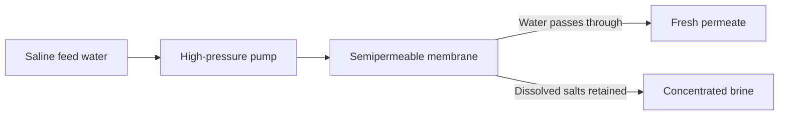

<!-- page 1 | Start here -->

## Environmental Chemistry and Engineering

Master the principles of water quality assessment, wastewater treatment technologies, air pollution control, and solid waste management. Learn to evaluate hardness, calculate BOD/COD, and understand environmental remediation techniques.

**Before you start:** Basic stoichiometry and solution concentration units; Fundamental organic chemistry functional groups; General principles of chemical equilibrium and oxidation-reduction reactions.

### Your path through this module

1. **Introduction to Water Quality and Hardness Units**: Expressing diverse mineral impurities into a unified scale of calcium carbonate equivalence for standardized water analysis.
2. **Water Softening and Desalination Methods**: Using synthetic cross-linked organic polymers to selectively swap undesirable mineral ions for hydrogen and hydroxyl ions.
3. **Water Disinfection and Break-point Chlorination**: Using break-point chlorination to fully oxidize reducing agents and ammonia, ensuring a stable residual of free chlorine for ongoing pathogen control.
4. **Sewage Characteristics: DO, BOD, and COD**: Quantifying water pollution by measuring the exact oxygen consumed by microbes (BOD) or chemical oxidants (COD) to degrade wastes.
5. **Municipal Sewage Treatment Processes**: Combining physical settling, biological microbial degradation, and advanced chemical polishing to systematically clean complex wastewater streams.
6. **Air Pollution, Climate Change, and Ozone Depletion**: Tracking catalytic free-radical chain reactions in the stratosphere where single CFC-derived chlorine atoms destroy thousands of ozone molecules.
7. **Solid Waste Management and Disposal Technologies**: Balancing thermal volume reduction via incineration against engineered containment in sanitary landfills to manage municipal solid waste.

<!-- page 2 | Introduction to Water Quality and Hardness Units -->

## Introduction to Water Quality and Hardness Units

Bridge: Having studied basic chemical solutions, we now examine water quality parameters and learn how to quantify mineral hardness using standardized equivalents.

The new idea: Expressing diverse mineral impurities into a unified scale of calcium carbonate equivalence for standardized water analysis.

### Objectives
- Distinguish between temporary and permanent hardness.
- Convert between various units of hardness including ppm, mg/L, Clarke's degree, French degree, and meq/L.
- Explain why calcium carbonate equivalent is used as the standard measure of hardness.

### Hard Water and Types of Hardness

Water described as "hard" is high in dissolved minerals, specifically calcium and magnesium. Hard water is not a health risk, but a nuisance because of mineral buildup on fixtures, poor soap and detergent performance, and the formation of scales in boilers. Hardness is classified into two types: temporary and permanent hardness.

> **Figure: Table comparing temporary and permanent hardness of water**
>
> A table comparing temporary and permanent hardness of water with two columns: Temporary Hardness and Permanent Hardness. Row 1: Temporary hardness is due to the presence of bicarbonates of calcium and magnesium. | It is due to the presence of chlorides of Sulfates of Calcium and Magnesium. Row 2: Can be removing by boiling. | Can't be removing by boiling. Row 3: Hardness removal is cheap. | Hardness removal is expensive. Row 4: H2O(l) + CO2(g) + CaCO3(s) -> Ca(HCO3)2(aq) | aq. + CaSO4(s) -> Ca2+(aq) + SO4 2-(aq).

*A table comparing temporary and permanent hardness of water with two columns: Temporary Hardness and Permanent Hardness.*
- Temporary hardness is due to the presence of bicarbonates of calcium and magnesium. Permanent hardness is due to the presence of chlorides and sulfates of calcium and magnesium.
- Temporary hardness can be removed by boiling. Permanent hardness cannot be removed by boiling.
- Temporary hardness removal is cheap. Permanent hardness removal requires specialized chemical or physical treatments.

### Units of Hardness

There are five units commonly used in hardness measurements:

1. **Parts per million (ppm)**: It is the number of parts of $\text{CaCO}_3$ equivalent hardness present in $10^6$ parts of water.
$$\text{1 ppm} = \frac{1 \text{ part of CaCO}_3 \text{ equivalent hardness}}{10^6 \text{ parts of water}}$$

2. **Milligram per litre (mg/L)**: It is the number of milligrams of $\text{CaCO}_3$ equivalent hardness present in one litre of water.
$$\text{1 mg/L} = \frac{1 \text{ mg of CaCO}_3 \text{ equivalent hardness}}{1 \text{ L of water}}$$
Since $1 \text{ L} = 1000 \text{ g} = 10^6 \text{ mg}$, we have $\text{1 mg/L} = \text{1 ppm}$.

3. **Clarke's Degree ($^{\circ}\text{Cl}$)**: It is the number of parts of $\text{CaCO}_3$ equivalent hardness in 70,000 parts of water.
$$1^{\circ}\text{Cl} = \frac{1 \text{ part of CaCO}_3 \text{ equivalent hardness}}{70,000 \text{ parts of water}}$$

4. **Degree French ($^{\circ}\text{Fr}$)**: It is the number of parts of $\text{CaCO}_3$ equivalent hardness in $10^5$ parts of water.
$$1^{\circ} \text{Fr} = \frac{1 \text{ part of CaCO}_3 \text{ equivalent hardness}}{10^5 \text{ parts of water}}$$

5. **Milliequivalents per litre (meq/L)**: It is the number of milliequivalents of $\text{CaCO}_3$ equivalent hardness in one litre of water.
$$1 \text{ meq/L} = \frac{1 \text{ meq of CaCO}_3 \text{ equivalent hardness}}{1 \text{ L of water}}$$
$$1 \text{ meq/L} = 50 \text{ mg/L of CaCO}_3 \text{ equivalent hardness} = 50 \text{ ppm}$$

### Relationship Between Various Units of Hardness

The conversion factors between the different units of hardness are summarized as follows:
$$1 \text{ ppm} = 1 \text{ mg/L} = 0.1^{\circ}\text{Fr} = 0.07^{\circ}\text{Cl} = 0.02 \text{ meq/L}$$

### Degree of Hardness and Calcium Carbonate Equivalent Standard

The hardness of water is expressed as weight in grams of $\text{CaCO}_3$ in one million grams of water (ppm) or as the number of milligrams of $\text{CaCO}_3$ present in one liter of water. Calcium carbonate is chosen as the standard for expressing hardness due to the following reasons:

1. $\text{CaCO}_3$ is found to be the most insoluble salt that can be precipitated during water treatment.
2. A standard solution of hard water can be prepared by weighing a fixed amount of $\text{CaCO}_3$, dissolving it in $\text{dil. HCl}$, and making it up to a known volume.
3. The molecular weight of $\text{CaCO}_3$ is 100 (equivalent weight = 50), which makes stoichiometric calculations simple and straightforward.

### Disadvantages of Hard Water

- It does not form lather easily with soap solution, instead producing sticky precipitates of calcium and magnesium soaps, leading to the wastage of soap.
- Hard water used in boilers causes problems such as boiler corrosion, scales and sludges, priming and foaming, and caustic embrittlement.
- The boiling point of hard water is elevated, leading to a wastage of fuel.
- Tea and coffee prepared with hard water have an unpleasant taste.
- It cannot be used in the paper industry because mineral impurities affect the smoothness, glossiness, and color of the paper.

### Water Softening Methods

The process by which hard water is converted into soft water is called water softening. One of the most important methods of water softening is the ion exchange process, where synthetic cross-linked organic polymers selectively swap undesirable mineral ions for hydrogen and hydroxyl ions.

<!-- page 3 | Water Softening and Desalination Methods -->

## Water Softening and Desalination Methods

Bridge: Now that we can quantify hardness, we learn industrial methods to convert hard water into soft water via ion exchange and remove salts through reverse osmosis.

The new idea: Using synthetic cross-linked organic polymers to selectively swap undesirable mineral ions for hydrogen and hydroxyl ions.

### Objectives
- Describe the operation and chemistry of ion exchange resin columns
- Explain the regeneration process for exhausted cation and anion resins
- Apply the principles of reverse osmosis for brackish water desalination

### Concepts to Teach
- Cation and anion exchange resins
- Resin exhaustion and regeneration
- Osmosis and reverse osmosis
- Semipermeable membranes for desalination

---

### Ion Exchange Process

Ion exchange resins are insoluble, cross-linked, long-chain organic polymers having a microporous structure, where the functional groups attached to the chain are responsible for their ion exchange capacity.

- **Cation exchange resin ($RH^+$)** contains acidic functional groups like $-\text{COOH}$, $-\text{SO}_3\text{H}$, etc. They are basically styrene-divinylbenzene copolymers which, upon sulphonation or carboxylation, attain the capability to exchange their $\text{H}^+$ ions with cations present in water.
- **Anion exchange resin ($ROH^-$)** contains basic functional groups like $-\text{OH}$, $-\text{NH}_2$. They are basically styrene-divinylbenzene or amine-formaldehyde copolymers containing quaternary ammonium groups, which upon treatment with $\text{NaOH}$ attain the capability to exchange their $\text{OH}^-$ ions with anions of water.

> **Figure: Cation exchange resin chemical structure**
>
> Chemical structure of cation exchange resin showing a polymer backbone with a benzene ring attached, substituted with SO3H. Labelled at the bottom as Cation exchange resin.

Cation exchange resin chemical structure. Chemical structure of cation exchange resin showing a polymer backbone with a benzene ring attached, substituted with $\text{SO}_3\text{H}$. Labelled at the bottom as Cation exchange resin.

> **Figure: Anion exchange resin chemical structure**
>
> Chemical structure of anion exchange resin showing a polymer backbone with a benzene ring attached, substituted with CH2N(Me)3OH. Labelled at the bottom as anion exchange resin.

Anion exchange resin chemical structure. Chemical structure of anion exchange resin showing a polymer backbone with a benzene ring attached, substituted with $\text{CH}_2\text{N(Me)}_3\text{OH}$. Labelled at the bottom as anion exchange resin.

#### Procedure

Initially, hard water is allowed to pass through a cation exchange resin column to remove all cations like $\text{Ca}^{2+}$, $\text{Mg}^{2+}$, etc.:

$$2\text{R}^-\text{H}^+ + \text{Ca}^{2+} \rightarrow \text{R}_2\text{Ca} + 2\text{H}^+$$

$$2\text{R}^-\text{H}^+ + \text{Mg}^{2+} \rightarrow \text{R}_2\text{Mg} + 2\text{H}^+$$[Note: The equation text above appears as printed on the page]

Then, the water is allowed to pass through an anion exchange resin column to remove all anions like $\text{SO}_4^{2-}$, $\text{Cl}^-$:

$$2\text{R}^+\text{OH}^- + \text{Cl}^- \rightarrow 2\text{RCl} + 2\text{OH}^-$$

$$2\text{R}^+\text{OH}^- + \text{SO}_4^{2-} \rightarrow 2\text{RCl} + 2\text{OH}^-$$[Note: The equation text above appears as printed on the page]

The $\text{H}^+$ ions and $\text{OH}^-$ ions produced from the cation and anion exchange resin columns combine to form water:

$$\text{H}^+ + \text{OH}^- \rightarrow \text{H}_2\text{O}$$

#### Resin Regeneration

When the exchanger becomes exhausted, i.e., its capacity to exchange $\text{H}^+$ and $\text{OH}^-$ ions is lost, it must be regenerated:

- **Cation exchangers** are regenerated by passing $\text{dil. HCl}$ or $\text{dil. H}_2\text{SO}_4$ through the column:
$$\text{R}_2\text{Ca} + 2\text{H}^+ \rightarrow 2\text{RH}^+ + \text{Ca}^{2+}$$

- **Anion exchangers** are regenerated by passing $\text{dil. NaOH}$ through the column:
$$\text{R}_2\text{SO}_4 + 2\text{OH}^- \rightarrow 2\text{R}^+\text{OH}^- + \text{SO}_4^{2-}$$

#### Advantages and Disadvantages

**Advantages:**
1. Even highly acidic or alkaline water can be softened by this method.
2. Gives water of very low hardness ($2\text{ ppm}$).
3. Water obtained by this method can be used even in high-pressure boilers because of its low hardness.
4. No sludge is formed.

**Disadvantages:**
1. Equipment and chemicals used are costly.
2. Turbid water cannot be treated by this method.

---

### Desalination of Brackish Water

Water containing high concentrations of dissolved salts with a brackish taste is called brackish water (e.g., brine). Brackish water is unfit for drinking and needs desalination. Reverse osmosis is the primary method used for this purpose.

#### Reverse Osmosis
- **Osmosis:** When two solutions of unequal concentrations are separated by a semipermeable membrane, the solvent flows from the dilute to the concentrated solution.
- **Reverse Osmosis:** If a hydrostatic pressure greater than the osmotic pressure is applied, the solvent flows through the semipermeable membrane in the opposite direction (from the concentrated to the dilute solution).
- In this process, a pressure of the order of $15$ to $40\text{ kg/cm}^2$ is applied to seawater to force pure water out through the semipermeable membrane, leaving behind dissolved solids. Commonly used membranes are made of polymethacrylate, polysulphones, etc.

Pressure applied to the saline side must exceed the osmotic pressure to drive water through the membrane. The salt-rich reject stream leaves separately; dissolved salts do not pass through with the permeate in the idealized model.

#### Advantages and Disadvantages of Reverse Osmosis

**Advantages:**
- Simple, low cost, and the best method to convert seawater to fresh water.
- Removes ionic matter, non-ionic matter, colloidal matter, and high molecular weight organic matter.
- High lifetime of semipermeable membranes (about 2 years).

**Disadvantages:**
- High pressure must be maintained continuously, which is technically demanding.

---

### Water Disinfection Methods

Water from rivers, canals, etc., cannot be directly used for domestic purposes as it contains various impurities. Drinking water should be colorless, odorless, with a pleasant taste, free from dissolved gases, and possess low turbidity. The $\text{pH}$ should be about $8.0$, and microorganisms must be absent.

#### Removal of Microorganisms (Disinfection)

The process of removing bacteria and microorganisms from water is called disinfection, and the chemicals used are called disinfectants.

**1) Chlorination:**
- Chlorine is added to water either in gaseous form or as a concentrated solution, which produces $\text{HOCl}$ (Hypochlorous acid).
- A **chlorinator** is the apparatus used for chlorination, which uses liquid chlorine.

<!-- page 4 | Water Disinfection and Break-point Chlorination -->

## Water Disinfection and Break-point Chlorination

Bridge: Having softened our water supply, we now study how to eliminate pathogenic microorganisms to ensure safe drinking water standards.

The new idea: Using break-point chlorination to fully oxidize reducing agents and ammonia, ensuring a stable residual of free chlorine for ongoing pathogen control.

### Chlorination and HOCl Formation

Chlorination is one of the most widely applied disinfection methods in water treatment. When molecular chlorine is added to water, it hydrolyses to form hypochlorous acid (HOCl) and hydrochloric acid (HCl):

$$\text{H}_2\text{O} + \text{Cl}_2 \rightarrow \text{HOCl} + \text{HCl}$$

**Advantages of Chlorination:**
- It is very effective and economical.
- Storage is easy.
- It can be used at low and high temperatures.
- No salt impurities are added to the treated water.

**Disadvantages of Chlorination:**
- Excess chlorine produces an unpleasant taste and odour in water.
- It causes irritation to mucous membranes.
- It is not an effective disinfectant above $\text{pH } 6.5$.

### Break-Point Chlorination Curve

Break point of chlorination is defined as the addition of a sufficient amount of chlorine to kill microorganisms completely through the oxidation of reducing matter, organic matter, and free ammonia, leaving behind a free residual chlorine to continue further disinfection.

If we plot residual chlorine against applied chlorine, we obtain a characteristic curve. The dip in the curve shows the break point.

> **Figure: Break point of chlorination graph showing residual chlorine vs applied chlorine**
>
> Line graph representing the Break point of chlorination. The y-axis represents 'Chlorine residuals (mg/L)' with values from 0 to 5. The x-axis represents 'Applied chlorine' with values from 0 to 11. The curve starts at the origin, rises with a section labelled 'Destruction of chlorine residual by reducing compounds' (around point A), passes through 'Formation of chloro-organic and chloramine compounds' and 'Combined residuals', reaches a peak labelled 'B' ('Destruction of chloramines and chloro organic compounds'), dips to a local minimum labelled 'Breakpoint' at point 'C', and then rises linearly as 'Free and combined residuals' and 'Free residual'.

At the break point, all colour, odour, and taste disappear, and all disease-causing microorganisms are destroyed. After the break point, any further addition of chlorine appears as free residual chlorine, which ensures continuous ongoing disinfection.

**Advantages of Break-Point Chlorination:**
- It removes colour, odour, and taste from water.
- It destroys all disease-producing bacteria.
- It prevents the growth of weeds in water.

### De-chlorination and Alternative Disinfection Methods

The amount of free chlorine required for continuing further disinfection is $0.1-0.2\text{ ppm}$. If over-chlorination occurs, excess chlorine can be removed by passing the water through a molecular sieve, stirring it with activated carbon followed by filtration, or adding dechlorinating agents like $\text{SO}_2$, $\text{Na}_2\text{SO}_3$, or sodium thiosulphate.

#### 3. Using Ozone

Ozone is an excellent disinfectant used in gaseous form. It is produced by passing a silent electric discharge through cold and dry oxygen. Unstable ozone breaks down to liberate nascent oxygen, a powerful oxidizing agent that destroys bacteria and oxidizes organic matter.

> **Figure: Chemical reactions for the production and decomposition of ozone**
>
> Two chemical reaction equations. The first equation shows 3O2 reacting over an arrow labeled 'silent eletric discharge' to yield 2O3 (labeled 'ozone'). The second equation shows O3 yielding O2 + [O] (labeled '(nascent oxygen)').

**Advantages:**
- Simultaneous removal of colour, odour, and taste without leaving chemical residuals.
- Excess ozone does not cause harm since nascent oxygen is unstable and readily converts to molecular oxygen.

#### 5. Disinfection by UV Light

Disinfection can be brought about by exposing water to UV light using a quartz tube containing an $\text{Hg}$-lamp.

**Advantages:**
- No chemicals are used in this treatment.
- No taste or odour is imparted to water.
- Mainly employed in swimming pools to prevent chemical skin irritations.

**Disadvantages:**
- Requires costly equipment.
- Technical skill is required for operation.

### Sewage (Wastewater)

Sewage is liquid waste including human waste, household waste, and industrial waste. It contains $99.99\%$ water and $0.01\%$ organic matter, inorganic matter, suspended impurities, and colloidal impurities. Sewage contains both aerobic and anaerobic bacteria that drive the oxidation of organic compounds.

> **Figure: Table distinguishing between aerobic and anaerobic oxidation**
>
> A comparison table titled 'Distinguish between aerobic and anaerobic oxidation' with two columns. Left column heading: 'Aerobic oxidation', containing points: It occurs in presence of excess oxygen; Oxidation by aerobic bacteria; The products of oxidation are CO2, nitrates, phosphates, sulphates; The products are non-offensive smelling; During decomposition, carbohydrates are converted as CO2 and water; Energy released is more and rate of decomposition is slow; No bio-gas fuel is produced. Right column heading: 'Anaerobic oxidation', containing points: It occurs in presence of limited quantity oxygen; Oxidation by anaerobic bacteria; The products of oxidation are acetic acid, methane, H2S, NH3, phosphine; The products are offensive smelling; During decomposition, carbohydrates are converted as CO2 and methane; Energy released is less and rate of decomposition is fast; Bio-gas fuel like methane is produced.

<!-- page 5 | Sewage Characteristics: DO, BOD, and COD -->

## Sewage Characteristics: DO, BOD, and COD

Bridge: With disinfection mastered, we shift to wastewater characterization by examining oxygen parameters to measure organic pollution levels.

The new idea: Quantifying water pollution by measuring the exact oxygen consumed by microbes (BOD) or chemical oxidants (COD) to degrade wastes.

### Dissolved Oxygen (DO)

Dissolved oxygen refers to the free, uncombined oxygen ($\text{O}_2$) present in water. The oxygen that is part of the water molecule ($\text{H}_2\text{O}$) is chemically bonded and does not count as dissolved oxygen. DO is crucial for assessing water quality and supporting aquatic life.

Factors affecting Dissolved Oxygen include:
1. **Temperature:** Cold water holds more DO, whereas warm water holds less DO.
2. **Altitude / Atmospheric Pressure:** Higher altitudes have lower air pressure, resulting in less dissolved oxygen.
3. **Salinity (Salt Level):** Higher salt content reduces dissolved oxygen; freshwater holds more DO than seawater.
4. **Temperature Discharge (Thermal Pollution):** Warm water effluents from industries or power plants reduce DO levels.
5. **Organic Waste / Pollution:** Organic matter (sewage, food waste, plant decay) is broken down by bacteria, a process that consumes oxygen and depletes DO.
6. **Aquatic Plants and Photosynthesis:** During the day, plants produce oxygen, increasing DO. At night, plants respire, consuming oxygen and decreasing DO.

### Biological Oxygen Demand (BOD)

Biological Oxygen Demand is defined as the amount of oxygen needed by aerobic microorganisms to break down biodegradable organic matter present in $1\text{ litre}$ of water over $5\text{ days}$ at $20^\text{o}\text{C}$.

High BOD indicates heavy organic pollution. Microorganisms consume large amounts of oxygen to break down this waste, causing the dissolved oxygen in the water body to drop sharply, endangering aquatic life. BOD serves as a primary indicator of water pollution in lakes, rivers, and ponds.

### Chemical Oxygen Demand (COD)

Chemical Oxygen Demand is defined as the amount of oxygen required for the complete chemical oxidation of both biologically active and biologically inert organic materials present in one litre of wastewater using strong chemical oxidizing agents such as potassium dichromate ($\text{K}_2\text{Cr}_2\text{O}_7$).

The COD test takes only about $3\text{ hours}$ to complete compared to the $5\text{ days}$ required for BOD. Because chemical oxidants break down both biodegradable and non-biodegradable compounds, COD values are always greater than BOD values.

> **Figure: Table comparing BOD and COD**
>
> Table comparing BOD and COD. It has two main columns titled BOD and COD, and three rows of comparisons covering what they measure, test duration, and relative values.

Table comparing BOD and COD. It has two main columns titled BOD and COD, and three rows of comparisons covering what they measure, test duration, and relative values.

| BOD | COD |
| :--- | :--- |
| BOD measures the oxygen required by microorganisms to decompose biodegradable organic matter. | COD measures the oxygen required to chemically oxidize both biodegradable and non-biodegradable matter. |
| Test takes 5 days to complete. | Test takes about 3 hours. |
| BOD value is always lower. | COD value is always higher. |

### Sewage Treatment Overview

Sewage treatment is carried out using an engineered process called sewerage, which is structured in sequential phases, beginning with primary treatment.

<!-- page 6 | Municipal Sewage Treatment Processes -->

## Municipal Sewage Treatment Processes

Bridge: Having defined sewage pollution metrics like BOD and COD, we now study multi-stage treatment plants designed to purify wastewater before release.

The new idea: Combining physical settling, biological microbial degradation, and advanced chemical polishing to systematically clean complex wastewater streams.

### Flow diagram of sewage (Wastewater) treatment

> **Figure: Flow diagram of sewage wastewater treatment**
>
> Flow diagram of sewage (Wastewater) treatment. Raw sewage goes to Screening, producing Residue (bottom) and Filtrate (right). Filtrate goes to Sedimentation, which also receives Coagulants from above. Screening and Sedimentation together form Primary treatment. The output of Sedimentation splits into three parallel secondary treatment processes: Trickling filter process, Activated sludge process, and UASB process, all collectively labelled Secondary treatment. Their outputs feed into three parallel tertiary treatment processes: Precipitation, N2 stripping, and Chlorination, collectively labelled Tertiary treatment.

### *1. Primary treatment*

In this process, large solids and inorganic matter, which are suspended in the sewage, are removed. This can be done by:

a) Screening

b) Sedimentation

#### Screening
In this process, sewage is passed through bar screen or mesh screen which removes the suspended impurities.

#### Sedimentation
Majority of suspended impurities present in the sewage can be removed by this process. In this process, sewage is taken in sedimentation tank. Along with sewage, some coagulants like alums, $\text{Al}_2(\text{SO}_4)_3$, $\text{NaAlO}_2$, etc. are added before sedimentation. Coagulants form gelatinous precipitate, which can entrap small sized organic matter to form bigger precipitate. Then settling occurs rapidly.

$$\text{Al}_2(\text{SO}_4)_3 + 6\text{H}_2\text{O} \rightarrow 2\text{Al}(\text{OH})_3 + 6\text{H}_2\text{SO}_4$$

### *2. Secondary treatment or biological treatment*

Secondary treatment is the biological treatment. In this process, aerobic oxidation of sewage occurs. During this process, carbon and nitrogen in the sewage get oxidised to $\text{CO}_2$ and $\text{NH}_3$. Ammonia on further oxidation produces nitrites and nitrates.

$$\text{NH}_2\text{-CO-NH}_2 \xrightarrow{\text{Aerobic oxidation}} 2\text{NH}_3 + \text{CO}_2$$
$$\text{NH}_3 \xrightarrow{\text{Oxidation}} \text{HNO}_2 + \text{HNO}_3$$
$$\text{HNO}_2 + \text{HNO}_3 \xrightarrow{\text{Bases present in soil}} \text{NH}_4\text{NO}_2 + \text{NH}_4\text{NO}_3$$

#### a. Trickling filter process
- Trickling filter is a biological treatment method used to treat sewage.
- The filter is rectangular and about 2 meters deep.
- It is filled with crushed stones, broken bricks or similar materials.
- Microorganisms grow on the surface of these stones/bricks.
- A rotating distributor spreads sewage over the filter bed.
- The sewage trickles down through the filter material.
- As it moves down, microorganisms feed on and break down the organic matter.
- The treated (clearer) water is collected at the bottom through the drainage system.
- This process reduces organic impurities and improves water quality.

> **Figure: Diagram of a trickling filter system**
>
> Cross-section diagram of a Trickling Filter apparatus. Features a central rotating sewage distributor at the top, a container filled with filtering media (crushed stones) in the middle, and an under drainage system at the bottom. Labels point to: Sewage distributor, Ground level, Sewage inlet, Filtering media, Under drainage System, and Effluent outlet. The bottom center is labelled Trickling Filter.

#### c. Upflow Anaerobic Sludge Blanket (UASB) (USAB) process
- It is an anaerobic wastewater treatment method.
- The effluent enters from the bottom of the reactor.
- Inside, there is a sludge blanket made of biological granules containing many anaerobic bacteria.
- As the wastewater flows upward, the bacteria break down the organic matter.
- During this process, gases such as methane ($\text{CH}_4$) are produced.
- The gas bubbles carry granules upward, but only gases escape at the top, while granules settle back forming the sludge blanket again.
- The gases are collected in a gas collector dome at the top.
- This method reduces organic waste and produces biogas which can be used as fuel.

> **Figure: USAB reactor diagram showing wastewater flow, sludge blanket, gas collectors, treated effluent, and biogas collection.**
>
> Diagram of a USAB reactor showing a rectangular tank with 'Feed in' at the bottom left with an arrow pointing right. Inside the tank, a textured sludge layer occupies the lower middle portion labeled 'Sludge'. Above the sludge, there are three funnel-shaped gas collector domes with arrows indicating gas rising into them. At the top right, an arrow points out labeled 'Biogas'. Another arrow near the top right points out labeled 'Treated effluent'. At the bottom center, the label reads 'USAB reactor'.

### *3. Tertiary treatment*

This is the advanced phase of sewage treatment. By this process, nitrogen and phosphorous content in the effluent get reduced. Three important processes employed for this purpose are:

a) **Precipitation**
In this process, effluent obtained after the secondary treatment is treated with $\text{CaO}$, so that phosphorous get precipitated as $\text{Ca}_3(\text{PO}_4)_2$.

b) **Nitrogen stripping**
By this process, ammonia gas can be removed by passing the effluent through a series of baffle plates, since ammonia has a lower density than air.

c) **Chlorination**
Disinfection of effluent is done by treating it with chlorine.

$$\text{H}_2\text{O} + \text{Cl}_2 \rightarrow \text{HOCl} + \text{HCl}$$

The hypochlorous acid produced is a powerful germicide. It reacts with enzymes in the cells of microorganisms, deactivating them and killing them.

<!-- page 7 | Air Pollution, Climate Change, and Ozone Depletion -->

## Air Pollution, Climate Change, and Ozone Depletion

### Air Pollution and Pollutant Classification

Air pollution is the excessive discharge of undesirable foreign substances into the atmospheric air, adversely affecting air quality and causing damage to human, plant, and animal life. Air pollutants are broadly divided into two major groups: **gases** and **particulates**.

#### Major Gaseous Pollutants and Their Effects

1. **Sulphur Dioxide ($\text{SO}_2$)**
   - *Sources:* Formed by burning coal and diesel.
   - *Effects:* Causes asthma, bronchitis, and damages crops.

2. **Sulphur Trioxide ($\text{SO}_3$)**
   - *Sources:* Formed from the oxidation of $\text{SO}_2$.
   - *Effects:* Causes breathing irritation and leads to acid rain.

3. **Hydrogen Sulphide ($\text{H}_2\text{S}$)**
   - *Sources:* Produced from the decomposition of sewage and organic wastes.
   - *Effects:* Poisonous gas with a characteristic foul odor; corrodes metals.

4. **Nitrogen Oxides ($\text{NO}$, $\text{NO}_2$, etc.)**
   - *Sources:* Released from vehicle exhausts and industrial processes.
   - *Effects:* Cause eye and respiratory problems; precursors to photochemical smog.

5. **Carbon Dioxide ($\text{CO}_2$)**
   - *Sources:* Produced from burning fossil fuels and cellular respiration.
   - *Effects:* Excess $\text{CO}_2$ reduces oxygen availability in enclosed spaces and contributes to the greenhouse effect.

6. **Carbon Monoxide ($\text{CO}$)**
   - *Sources:* Formed by the incomplete combustion of fuels in motor vehicles.
   - *Effects:* Highly toxic; binds strongly to hemoglobin in the blood, reducing oxygen transport to body cells and leading to **anoxia** (oxygen starvation) which can cause death.

7. **Ozone ($\text{O}_3$)**
   - *Stratospheric Ozone:* Formed naturally by the action of UV light on oxygen:
     $$3\text{O}_2 \rightarrow 2\text{O}_3$$
     It absorbs harmful UV rays, protecting life on Earth.
   - *Tropospheric (Ground-Level) Ozone:* Formed via photochemical reactions involving automobile exhaust and electric sparks:
     $$2\text{O}_2 + \text{NO} \rightarrow \text{NO}_2 + \text{O}_3$$
     Tropospheric ozone is a harmful pollutant that damages rubber (especially electrical insulation), fabrics, and crops.

8. **Volatile Organic Compounds (VOCs) and Hydrocarbons**
   - *Sources:* Incomplete fuel burning and solvent evaporation.
   - *Effects:* Undergo sunlight-driven reactions to form harmful secondary pollutants. Certain VOCs (benzene, toluene, formaldehyde, chloroform) are carcinogenic.

#### Particulate Air Pollutants

- **Dust:** Arises from factories, mines, vehicles, winds, and farming. Causes breathing problems, allergies, and material corrosion.
- **Smoke:** Formed by incomplete fuel combustion in vehicles, industries, and furnaces. Causes lung diseases and cancer.
- **Smog:** A mixture of smoke and fog that causes eye/throat irritation, breathing difficulties, reduced visibility, and plant damage.
- **Asbestos:** Used in construction for heat resistance; long-term exposure causes lung damage and asbestosis/cancer.
- **Lead:** A toxic metal from fuels, paints, and batteries; affects blood, bones, and the nervous system (causing anemia).
- **Mercury:** Liquid mercury is relatively safe, but mercury vapors are highly dangerous, causing lung damage and neurological disorders.

### Air Pollution Control Methods

- **Catalytic Converters:** Fitted in vehicle exhausts to reduce toxic gas emissions.
- **Tall Chimneys:** Disperse pollutants high into the atmosphere, reducing ground-level concentrations.
- **Cottrell Electrostatic Precipitators:** Remove dust and particulate matter from industrial smoke.
- **Afforestation:** Trees absorb $\text{CO}_2$, $\text{CO}$, $\text{H}_2\text{S}$, $\text{NO}_2$, and dust particles, helping restore atmospheric balance.

---

## Climate Change and Greenhouse Effects

Climate change denotes long-term shifts in temperature and weather patterns, evidenced by rising sea levels, changing precipitation, droughts, and extreme weather events. The primary driver is the emission of anthropogenic greenhouse gases.

### Greenhouse Gases and the Greenhouse Effect

Major greenhouse gases include Carbon dioxide ($\text{CO}_2$), Methane ($\text{CH}_4$), Nitrous oxide ($\text{N}_2\text{O}$), Ozone ($\text{O}_3$), Water vapor ($\text{H}_2\text{O}$), and Chlorofluorocarbons ($\text{CFCs}$).

The **greenhouse effect** is the natural warming of the Earth's surface caused by these atmospheric gases trapping outgoing thermal radiation. While a natural greenhouse effect is essential for life, excess accumulation from human activities accelerates global warming and climate change.

---

## Ozone Depletion Mechanics

### Stratospheric Ozone Cycle

Normally, ozone is continuously created and destroyed in the stratosphere, maintaining a dynamic equilibrium:
$$\text{O}_2 \rightarrow \text{O} + \text{O}$$
$$\text{O}_2 + \text{O} \rightarrow \text{O}_3$$

### Catalytic Destruction by Chlorofluorocarbons (CFCs)

Chlorofluorocarbons (CFCs or Freons) are extremely stable, non-toxic, and long-lived compounds (lifetimes $>100$ years) used in refrigerators, air conditioners, aerosol sprays, and fire extinguishers. Because of their stability, they drift intact into the stratosphere, where high-energy UV radiation photolyzes them to release reactive chlorine radicals ($\text{Cl}^{\bullet}$):

$$\text{CF}_2\text{Cl}_{2(g)} \rightarrow \text{CF}_2\text{Cl}_{(g)}^{\bullet} + \text{Cl}_{(g)}^{\bullet}$$

Once liberated, chlorine radicals initiate a destructive catalytic chain reaction:

$$\text{O}_{3(g)} + \text{Cl}^{\bullet} \rightarrow \text{O}_{2(g)} + \text{ClO}_{(g)}^{\bullet}$$
$$\text{ClO}_{(g)}^{\bullet} + \text{O}_{3(g)} \rightarrow 2\text{O}_{2(g)} + \text{Cl}^{\bullet}$$

Each released chlorine atom can destroy up to $10^5$ ozone molecules before being deactivated, severely thinning the ozone shield and allowing increased UV radiation to reach the Earth's surface.

### Other Ozone-Depleting Agents

- **Nitric Oxide ($\text{NO}$) and Nitrous Oxide ($\text{N}_2\text{O}$):** Emissions from supersonic aircraft and the stratospheric photodissociation of $\text{N}_2\text{O}$ yield $\text{NO}$, which catalytically consumes ozone:
  $$\text{NO} + \text{O}_3 \rightarrow \text{NO}_2 + \text{O}_2$$

<!-- page 8 | Solid Waste Management and Disposal Technologies -->

## Solid Waste Management and Disposal Technologies

Bridge: Having evaluated air and water protection, we conclude our module by analyzing methods for solid waste treatment and safe disposal.

The new idea: Balancing thermal volume reduction via incineration against engineered containment in sanitary landfills to manage municipal solid waste.

### Solid Waste Classification and Composting

Solid wastes are categorized based on their origin (residential, commercial, industrial, agricultural) and hazard potential (hazardous, non-hazardous, infectious). Biological treatment methods convert biodegradable organic waste into stable, nutrient-rich products.

- **Aerobic Composting:** A process where microorganisms break down organic matter in the presence of oxygen. Over a few weeks, the waste stabilizes into a brown, earthy-smelling compost used as a natural fertilizer.
- **Vermicomposting:** A specialized method using earthworms (mainly red worms) to decompose organic waste. Food scraps are placed at the top layer, and worms move upward, producing nutrient-rich worm castings at the bottom. Under optimal conditions, red worms can convert half of their body weight of waste into compost daily.

$$\text{Organic Waste} + \text{Microorganisms/Earthworms} + \text{O}_2 \rightarrow \text{Nutrient-Rich Compost} + \text{CO}_2 + \text{H}_2\text{O}$$

### Landfills and Leachate Management

Traditional landfills involve digging a pit, dumping garbage, and covering it daily with soil to prevent pests. When rainwater percolates through waste, it generates a polluted liquid called **leachate**, which contaminates soil and groundwater. Landfills also produce methane gas ($\text{CH}_4$), posing explosion risks and contributing to global warming.

**Sanitary Landfills** are engineered improvements over traditional dumps:
- Equipped with impermeable bottom liners (plastic or clay) to prevent groundwater contamination.
- Installed with drainage systems to collect and treat leachate.
- Methane gas is frequently captured and utilized as fuel.

### Incineration and Energy Recovery

Incineration is a high-temperature thermal treatment process conducted in large furnaces to burn solid waste.

$$\text{Solid Waste} + \text{O}_2 \xrightarrow{\Delta} \text{Ash} + \text{Flue Gases} + \text{Heat (Energy Recovery)}$$

- **Key Features:** Destroys pathogens and hazardous medical waste; significantly reduces waste volume; enables energy recovery via electricity or steam generation.
- **Drawbacks:** Releases toxic flue gases, heavy metals, and dioxins; produces ash that requires secure disposal; highly costly, making it a last-resort option due to air pollution concerns.
