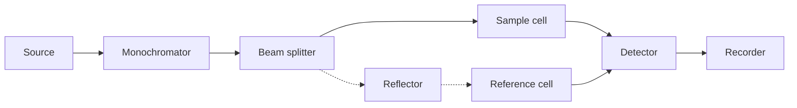

<!-- page 1 | Start here -->

## Molecular Spectroscopy and Analytical Techniques

Master fundamental spectroscopic principles, Beer-Lambert law calculations, UV-Visible and IR electronic-vibrational transitions, Scanning Electron Microscopy (SEM), and Dielectric Thermal Analysis (DETA).

**Before you start:** Basic quantum mechanical energy states; Fundamental organic chemistry functional groups; Basic calculus and logarithmic properties.

### Your path through this module

1. **Fundamentals of Spectroscopy**: Quantization of molecular energy levels and their interaction with electromagnetic radiation leading to absorption and emission spectra.
2. **Beer-Lambert Law and Quantitative Analysis**: Mathematical formulation of the Beer-Lambert law enabling the precise determination of unknown chemical concentrations.
3. **UV-Visible Spectroscopy and Electronic Transitions**: Classification of electronic transitions and how extended pi-system conjugation shifts absorption into the visible region.
4. **Infrared Spectroscopy and Molecular Vibrations**: Vibrational selection rules and normal mode analysis enabling functional group identification and force constant calculation.
5. **Scanning Electron Microscopy (SEM)**: Utilization of scattered electron signals and X-rays to generate high-resolution three-dimensional topological and compositional images.
6. **Dielectric Thermal Analysis (DETA)**: Simultaneous measurement of dielectric properties and temperature to detect elusive phase transitions and monitor polymer curing.

<!-- page 2 | Fundamentals of Spectroscopy -->

## Fundamentals of Spectroscopy

Bridge: Having reviewed basic physical chemistry, we now examine how electromagnetic radiation interacts with atomic and molecular energy states.

The new idea: Quantization of molecular energy levels and their interaction with electromagnetic radiation leading to absorption and emission spectra.

Spectroscopy deals with the interaction of atoms, molecules, or matter with electromagnetic radiation. Molecules possess different quantum mechanical energy states such as electronic, vibrational, rotational, and nuclear. Transitions occur between these states by the absorption or emission of radiation.

Spectroscopy involves the production, measurement, and interpretation of electromagnetic spectra arising from the emission or absorption of electromagnetic radiation by atoms or molecules. Detailed information regarding structure, bonding, and inter- and intramolecular processes is obtained through spectroscopic analysis using instruments known as spectrometers.

## Types of Spectra

Based on the nature of interaction, spectra are divided into absorption and emission spectra:

1. **Absorption Spectrum:** When an atom or molecule undergoes a transition from a lower energy level $E_i$ to a higher energy level $E_f$ with the absorption of a photon of energy $h\nu$, an absorption spectrum is obtained. Techniques such as UV-Visible, IR, Microwave, and NMR belong to absorption spectroscopy.

> **Figure: Absorption spectrum energy level diagram**
>
> Absorption spectrum energy level diagram showing a lower horizontal line labeled E_i and an upper horizontal line labeled E_f. An upward vertical arrow points from the E_i level to the E_f level. A straight arrow points toward the vertical transition from the left, representing an incoming photon labeled with the symbol h nu.

2. **Emission Spectrum:** When an atom or molecule undergoes a transition from a higher energy level $E_i$ to a lower energy level $E_f$ with the emission of a photon of energy $h\nu$, an emission spectrum is obtained. For emission to be observed, higher energy states must be more populated than lower energy states. Hydrogen spectra, atomic emission spectra (AES), and fluorescence spectra belong to this class.

> **Figure: Emission spectrum energy level diagram**
>
> Emission spectrum energy level diagram showing an upper horizontal line labeled E_i and a lower horizontal line labeled E_f. A downward vertical arrow points from the E_i level to the E_f level. A wavy arrow points away to the right from the vertical transition, representing an emitted photon labeled with the symbol h nu.

Based on the nature of the interacting species, spectra are categorized into:

1. **Atomic Spectrum:** Deals with the interaction of electromagnetic radiation with atoms, causing atoms to absorb radiation and transition from the ground electronic energy level to an excited state.
2. **Molecular Spectrum:** Deals with the interaction of electromagnetic radiation with molecules, resulting in transitions between rotational, vibrational, and electronic energy levels. UV-Visible, IR, Microwave, and NMR spectra belong to this category.

## Differences Between Atomic and Molecular Spectra

| Sl.No. | Atomic Spectra | Molecular Spectra |
|---|---|---|
| 1 | Interaction of atom + electromagnetic radiation | Interaction of molecules + electromagnetic radiation |
| 2 | Atomic spectra is a line spectrum | Molecular spectra is a complicated spectrum |
| 3 | Due to electronic transition in an element | Due to vibrational, rotational, and electronic transition in a molecule |

## Electromagnetic Spectrum

The range of photon energies is called the electromagnetic spectrum, representing the systematic arrangement of electromagnetic waves in increasing or decreasing order of their properties.

The entire range consists of radio waves, microwaves, infrared radiation, visible light, ultraviolet radiation, X-rays, gamma rays, and cosmic rays in the increasing order of frequency and decreasing order of wavelength.

> **Figure: Electromagnetic spectrum diagram**
>
> Electromagnetic spectrum diagram. A horizontal spectrum axis shows regions from left to right: gamma ray, X-ray, ultraviolet, visible (indicated with a small rainbow colored box), infrared, microwave, and radio. Two horizontal directional arrows below the spectrum indicate that going left corresponds to shorter wavelength, higher frequency, and higher energy, whereas going right corresponds to longer wavelength, lower frequency, and lower energy. At the bottom, a continuous wavy sine-like waveform is depicted.

## Molecular Energy Levels

A molecule possesses four types of energies:

1. **Electronic energy ($E_{el}$):** Associated with electrons in a molecule occupying various molecular energy levels (bonding or antibonding). Energy gaps between electronic levels fall in the UV-visible region.
2. **Vibrational energy ($E_{vib}$):** Associated with the vibration of atoms in a molecule while keeping the center of mass constant. Energy gaps fall in the infrared region.
3. **Rotational energy ($E_{rot}$):** Associated with the rotation of a molecule in space about an axis passing through its center of mass. Energy gaps fall in the microwave region.
4. **Translational energy ($E_{trans}$):** Associated with the change in position of the center of mass with time.

The total energy is given by:

$$E_{total} = E_{el} + E_{vib} + E_{rot} + E_{trans}$$

> **Figure: Electronic, vibrational, and rotational energy levels**
>
> Energy level diagram showing Electronic ground state and Electronic excited state. The ground state contains vibrational levels labeled v0, v1, v2, v3, v4, with rotational levels depicted inside them. The excited state also contains vibrational levels v0, v1, v2, v3, v4 with rotational levels. Vertical arrows labeled a, b, c, d indicate various transitions between the levels. The vertical axis is labeled 'Energy', and the horizontal labels include 'Rotational levels', 'Vibrational levels', 'Electronic ground state', and 'Electronic excited state'.

Electronic transitions in a molecule are always accompanied by vibrational and rotational transitions. Consequently, UV spectra always appear as broad bands.

## Beer-Lambert's Law

When a beam of monochromatic radiation is passed through a solution of an absorbing substance, the rate of decrease of intensity of radiation ($-dI$) with thickness of the absorbing solution ($dx$) is proportional to the intensity of incident radiation ($I$) as well as the concentration of the solution ($C$).

$$\frac{-dI}{dx} \propto I C$$

$$\frac{-dI}{dx} = k I C$$

$$\boxed{A = \varepsilon C x}$$

Where:
- $\log \frac{I_0}{I} = A = \text{absorbance (or Optical density)}$
- $\frac{k}{2.303} = \varepsilon = \text{molar absorptivity coefficient}$

This equation is the Beer-Lambert's law, demonstrating that absorbance ($A$) is directly proportional to molar concentration ($C$) and path length ($x$).

> **Figure: Beer-Lambert Law equations box**
>
> Boxed formula for Beer-Lambert's law containing two lines inside a rectangle: A = ̀Ε C x and log(I_0 / I) = A = absorbance (or) Optical density.

<!-- page 3 | Beer-Lambert Law and Quantitative Analysis -->

## Beer-Lambert Law and Quantitative Analysis

Bridge: Building on the concept of light absorption, we now quantify the relationship between light attenuation, concentration, and path length.

The new idea: Mathematical formulation of the Beer-Lambert law enabling the precise determination of unknown chemical concentrations.

Objectives: State and apply the Beer-Lambert law; Calculate absorbance, transmittance, molar absorptivity, and concentration; Solve quantitative spectroscopic problems.

Concepts to teach: Beer-Lambert law; Absorbance ($A$); Transmittance ($T$ and $\%T$); Molar absorptivity / extinction coefficient ($\varepsilon$); Path length ($x$).

### Fundamental Relations

$$\begin{aligned}
T &= \frac{I_t}{I_0} \\
\%T &= \frac{I_t}{I_0} \times 100 \\
A &= \log \frac{1}{T} = -\log T = \varepsilon C x
\end{aligned}$$

### Solved Numerical Problems

#### Problem 1
Find out the absorbance (or) optical density of a solution, if the transmittance of a solution is $18.5\%$.

**Solution**

**Given:** Percentage of transmittance $(\%T) = 18.5\%$ (or) Transmittance $(T) = 0.185$.

$$\text{Absorbance (or) optical density, } A = \log \frac{1}{T} = - \log T$$

$$A = - \log 0.185 = 0.733$$

---

#### Problem 2
The percentage transmittance of $5 \times 10^{-4}\text{ M}$ solution of disodium fumarate in a $1\text{ cm}$ cell is $19.2\%$. Calculate (i) the absorbance ($A$), (ii) the molar absorption coefficient ($\varepsilon$).

**Solution**

**Given:** $\%T = 19.2\%$ (or) $T = 0.192$; $C = 5 \times 10^{-4}\text{ M}$; $x = 1\text{ cm}$.

(i) Absorbance:
$$A = -\log T = -\log 0.192 = 0.717$$

(ii) Molar absorption coefficient:
$$\varepsilon = \frac{A}{Cx} = \frac{0.717}{5 \times 10^{-4} \times 1} = 1.434 \times 10^3\text{ dm}^3\text{ mol}^{-1}\text{cm}^{-1}$$

---

#### Problem 3
A solution shows a transmittance of $20\%$ when taken in a cell of $2.5\text{ cm}$ thickness. Calculate its concentration if the molar absorption coefficient is $12,000\text{ dm}^3\text{ mol}^{-1}\text{ cm}^{-1}$.

**Solution**

**Given:** $\%T = 20\%$; $T = 0.20$; $x = 2.5\text{ cm}$; $\varepsilon = 12,000\text{ dm}^3\text{ mol}^{-1}\text{ cm}^{-1}$.

$$A = -\log T = -\log 0.20 = 0.699$$

We know that $A = \varepsilon Cx$, hence:
$$C = \frac{A}{\varepsilon x} = \frac{0.699}{12,000 \times 2.5} = 2.33 \times 10^{-5}\text{ mol dm}^{-3}$$

---

#### Problem 4
Calculate the molar absorption of a $1 \times 10^{-4}\text{ M}$ solution whose absorbance is $0.20$, when the path length is $2.5\text{ cm}$.

**Solution**

**Given:** $A = 0.20$; $C = 1 \times 10^{-4}\text{ M}$; $x = 2.5\text{ cm}$.

$$\text{Molar absorptivity, } \varepsilon = \frac{A}{Cx} = \frac{0.20}{1 \times 10^{-4} \times 2.5} = 800\text{ dm}^3\text{ mol}^{-1}\text{ cm}^{-1}$$

---

#### Problem 5
A monochromatic radiation is incident on a solution of $0.05\text{ M}$ concentration of an absorbing substance. The intensity of the radiation is reduced to one-fourth of the initial value after passing through $10\text{ cm}$ length of the solution. Calculate the molar extinction co-efficient of the substance.

**Solution**

According to Beer-Lambert law:
$$\log \frac{I_0}{I} = \varepsilon Cx$$

**Given:** $C = 0.05\text{ M}$; $x = 10\text{ cm}$; $I / I_0 = 1/4$. Rearranging for $\varepsilon$:
$$\varepsilon = \frac{-\log (I/I_0)}{Cx} = \frac{-\log \left[ \frac{1/4}{1} \right]}{0.05 \times 10} = \frac{-(-0.6020)}{0.5} = 1.204\text{ dm}^3\text{ mol}^{-1}\text{ cm}^{-1}$$

---

#### Problem 6
A solution of thickness $2\text{ cm}$ transmits $40\%$ incident light. Calculate the concentration of the solution, given that $\varepsilon = 6000\text{ dm}^3\text{ mol}^{-1}\text{ cm}^{-1}$.

**Solution**

**Given:** $\%T = 40\%$; $T = 0.40$; $x = 2.0\text{ cm}$; $\varepsilon = 6000\text{ dm}^3\text{ mol}^{-1}\text{ cm}^{-1}$.

$$A = -\log T = -\log 0.40 = 0.3980$$

$$C = \frac{A}{\varepsilon x} = \frac{0.3980}{6000 \times 2} = 3.316 \times 10^{-5}\text{ mol dm}^{-3}$$

---

#### Problem 7
At a definite wavelength, an absorber when placed in a cell of $1\text{ cm}$ path length absorbs $20\%$ of the incident light. If the absorptivity of the absorber at this wavelength is $2.0$, find out its concentration.

**Solution**

**Given:** $I = 100 - 20 = 80$; $I_0 = 100$; $\varepsilon = 2$; $x = 1\text{ cm}$.

$$\log \frac{I_0}{I} = \varepsilon x C$$

$$\log \frac{100}{80} = 2 \times 1 \times C$$

$$\log 1.25 = 2C \implies 0.0969 = 2C \implies C = 0.04845\text{ g/lit}$$

---

#### Problem 8
A solution of thickness $2\text{ cm}$ transmits $40\%$ incident light. Calculate the concentration of the solution, given that $\varepsilon = 5842\text{ dm}^3\text{ mol}^{-1}\text{ cm}^{-1}$.

**Solution**

**Given:** $\%T = 40\%$; $T = 0.40$; $x = 2\text{ cm}$; $\varepsilon = 5842\text{ dm}^3\text{ mol}^{-1}\text{ cm}^{-1}$.

$$A = -\log T = -\log 0.40 = 0.398$$

$$C = \frac{A}{\varepsilon \times x} = \frac{0.398}{5842 \times 2} = 3.4 \times 10^{-5}\text{ mol dm}^{-3}$$

## UV-VISIBLE SPECTROSCOPY

### Principle

Ultraviolet (UV) Visible spectra arises from the transition of valence electrons within a molecule or ion from a lower electronic energy level (ground state $E_0$) to a higher electronic energy level (excited state $E_1$). This transition occurs due to the absorption of UV ($100 - 400\text{ nm}$) or visible ($400 - 800\text{ nm}$) radiation. The actual amount of energy required depends on the difference in energy between the ground state and the excited state:

$$\Delta E = E_1 - E_0 = h\nu$$

### Types of Transitions Involved in Organic Molecules

Energy absorbed in the visible and UV region causes transitions of valence electrons. These transitions include $\sigma \rightarrow \sigma^*$, $n \rightarrow \sigma^*$, $n \rightarrow \pi^*$, and $\pi \rightarrow \pi^*$. The relative energy values for these different transitions follow the order:

$$n \rightarrow \pi^* < \pi \rightarrow \pi^* < n \rightarrow \sigma^* < \sigma \rightarrow \sigma^*$$

> **Figure: Energy level diagram for electronic transitions showing sigma, n, pi, pi*, sigma* levels**
>
> Energy level diagram for electronic transitions showing sigma, n, pi, pi*, sigma* levels. An energy level diagram with vertical axis labelled energy and increasing energy upwards with arrow, and increasing delta E sideways. Horizontal lines representing energy levels from bottom to top: sigma (bonding) at the bottom, pi (bonding), n (non-bonding), pi* (antibonding), and sigma* (antibonding) at the top. Transitions shown with vertical arrows between levels: sigma to sigma* (sigma -> sigma*), n to sigma* (n -> sigma*), pi to pi* (pi -> pi*), and n to pi* (n -> pi*). Fig. 1.1 Types of transition.

Fig. 1.1 Types of electronic transitions showing relative energy levels.

### 1. $\sigma \rightarrow \sigma^*$ Transitions

These transitions occur in compounds where all valence electrons are involved in single bonds and there are no lone pairs of electrons (e.g., saturated hydrocarbons). The energy required for a $\sigma \rightarrow \sigma^*$ transition is very large, typically occurring below $150\text{ nm}$. Standard laboratory UV-Visible spectrophotometers operate within the $200 - 700\text{ nm}$ range, meaning saturated hydrocarbons do not absorb in the accessible region.

<!-- page 4 | UV-Visible Spectroscopy and Electronic Transitions -->

## UV-Visible Spectroscopy and Electronic Transitions

Bridge: Having learned how to quantify absorption, we now explore how valence electrons undergo electronic transitions under UV-Vis radiation.

The new idea: Classification of electronic transitions and how extended pi-system conjugation shifts absorption into the visible region.

Objectives: Identify electronic transition types in organic molecules; Explain the effect of conjugation on absorption maxima; Describe instrumentation and applications of UV-Vis spectrophotometers.

Concepts to teach: $\sigma \rightarrow \sigma^*$; $n \rightarrow \sigma^*$; $\pi \rightarrow \pi^*$; $n \rightarrow \pi^*$; HOMO and LUMO; Chromophore and conjugation; Instrumentation of UV-Vis spectrophotometer.

### Classification of Electronic Transitions

When molecules absorb ultraviolet or visible radiation, valence electrons are excited from lower-energy molecular orbitals to higher-energy antibonding molecular orbitals. The principal electronic transitions are:

1. **$\sigma \rightarrow \sigma^*$ Transitions**
These transitions occur in saturated hydrocarbons where only $\sigma$ bonds are present (e.g., $\text{CH}_4$, $\text{CH}_3-\text{CH}_3$). The energy required for this transition is large, and absorption bands appear in the far UV region ($120-136\text{ nm}$). For methane ($\text{CH}_4$), $\lambda_{\text{max}} = 121.9\text{ nm}$.

2. **$n \rightarrow \sigma^*$ Transitions**
These transitions occur in saturated compounds containing heteroatoms with non-bonding lone pairs of electrons (N, O, S, halogens), such as amines (e.g., $(\text{CH}_3)_3\text{N}$). The energy required is less than that for $\sigma \rightarrow \sigma^*$ transitions, and absorption bands appear in the near UV region ($180-200\text{ nm}$). These are generally forbidden transitions.

3. **$\pi \rightarrow \pi^*$ Transitions**
These transitions occur in unsaturated systems containing double or triple bonds where electrons move from a bonding $\pi$ orbital to an antibonding $\pi^*$ orbital. In molecules with conjugated double bonds, these transitions take place from the Highest Occupied Molecular Orbital (HOMO) to the Lowest Unoccupied Molecular Orbital (LUMO).

> **Figure: Ethylene molecule and energy level transition diagram**
>
> Ethylene molecule structure and energy level diagram. Left: chemical structure showing H2C=CH2 with carbon-carbon double bond and four hydrogens. Right: energy level diagram with lower level pi (HOMO) containing two opposing spin electron arrows and upper level pi* (LUMO) empty. An energy gap arrow shows delta E = 173 kcal/mol. A curved arrow above indicates absorption of UV light at 165 nm.

- **Ethylene ($\text{C}_2\text{H}_4$):** Contains an isolated $\text{C}=\text{C}$ bond giving an absorption maximum at $169\text{ nm}$.
- **1,3-Butadiene:** Contains four $\pi$ molecular orbitals ($\Psi_1, \Psi_2, \Psi_3, \Psi_4$). $\Psi_1$ and $\Psi_2$ are bonding, while $\Psi_3$ and $\Psi_4^*$ are antibonding. The transition from HOMO ($\Psi_2$) to LUMO ($\Psi_3$) yields an absorption maximum at $\lambda_{\text{max}} = 217\text{ nm}$.

> **Figure: 1,3-butadiene structure and molecular orbital transition diagram**
>
> 1,3-butadiene chemical structure and molecular orbital energy level transition diagram. Left: chemical structure of CH2=CH-CH=CH2. Middle: energy level diagram showing four pi molecular orbitals: psi_1 (bonding, occupied by two opposing-spin arrows), psi_2 (bonding, HOMO, occupied by two opposing-spin arrows), psi_3* (antibonding, LUMO, empty), and psi_4* (antibonding, empty). An energy gap arrow indicates delta E = 132 kcal/mol. A horizontal arrow points right, labeled 217 nm, leading to a final state diagram showing an electron excited from psi_2 to psi_3*.

- **1,3,5-Hexatriene:** Contains six $\pi$ molecular orbitals ($\Psi_1$ to $\Psi_6$). The transition takes place from HOMO ($\Psi_3$) to LUMO ($\Psi_4$) with an absorption maximum at $\lambda_{\text{max}} = 247\text{ nm}$.

> **Figure: Molecular energy level diagram of 1,3,5-hexatriene and benzene**
>
> Molecular energy level diagrams. Diagram (a) shows 1,3,5-hexatriene with six horizontal energy levels labeled Psi_1 to Psi_6 from bottom to top. Psi_1, Psi_2, and Psi_3 contain pairs of electrons represented by vertical arrows. An arrow points from the HOMO (Psi_3) to the LUMO (Psi_4), labeled lambda = 247nm. Diagram (b) shows benzene with six energy levels Psi_1 to Psi_6, with Psi_2 and Psi_3 as degenerate levels containing electrons, and Psi_4 and Psi_5 as degenerate antibonding levels. An arrow points from HOMO to LUMO labeled lambda = 255nm. Next to (b) is a hexagon chemical structure representing benzene.

- **Benzene:** Possesses six $\pi$ molecular orbitals where $\Psi_1, \Psi_2,$ and $\Psi_3$ are bonding and $\Psi_4, \Psi_5,$ and $\Psi_6$ are antibonding. $\Psi_2$ and $\Psi_3$ are degenerate, as are $\Psi_4$ and $\Psi_5$. The HOMO-to-LUMO transition occurs with an absorption maximum at $\lambda_{\text{max}} = 255\text{ nm}$.

As the extent of conjugation increases, the energy gap between the HOMO and LUMO decreases, shifting absorption to longer wavelengths (bathochromic shift). For example, lycopene, a natural red dye in tomatoes with $11$ conjugated double bonds, absorbs strongly in the visible region with $\lambda_{\text{max}} = 505\text{ nm}$.

> **Figure: Chemical structure of lycopene**
>
> Chemical structure of lycopene showing a long carbon chain with 11 conjugated double bonds, with methyl groups (CH3) attached at various positions along the chain.

4. **$n \rightarrow \pi^*$ Transitions**
These transitions are characteristic of unsaturated molecules containing heteroatoms with lone pairs (such as carbonyl groups, $\text{C}=\text{O}$, and nitrogen or sulfur heteroatoms). Non-bonding electrons are promoted to antibonding $\pi^*$ orbitals. These give weak absorption bands at longer wavelengths.

> **Figure: Chemical structure for aldehyde and ketone example**
>
> Chemical structures showing a carbon double-bonded to an oxygen atom with two lone pairs of electrons represented as dots, along with a hydrogen atom attached.

- **Aldehydes and Ketones (no $\text{C}=\text{C}$ or $\text{C}\equiv\text{C}$):** $n \rightarrow \pi^*$ transitions occur in the range of $270-300\text{ nm}$.
- **$\alpha,\beta$-Unsaturated Aldehydes and Ketones:** $n \rightarrow \pi^*$ transitions occur in the range of $300-350\text{ nm}$.

> **Figure: Chemical structure with carbonyl group**
>
> Chemical structure showing a carbonyl group with an oxygen atom double-bonded to a carbon atom, featuring two lone pairs of electrons indicated by dots.

---

## Instrumentation of UV-Vis Spectrophotometer

A spectrophotometer measures the percentage transmittance or absorbance of light when radiation passes through a sample, comparing the intensity of transmitted light with that of incident light.

### Core Components

1. **Radiation Source:** Hydrogen or deuterium discharge lamps are commonly used to provide continuous UV-Vis radiation.
2. **Monochromators:** Disperse radiation according to wavelength using a prism, diffraction grating, or filter, bounded by an entrance slit and an exit slit.
3. **Cells (Sample and Reference):** Transparent containers holding either the analyte solution (sample cell) or pure solvent (reference cell).
4. **Detectors:** Convert optical radiation into an electrical current proportional to the light intensity and solution concentration.
5. **Recording System:** Receives signals from the detector and plots the output spectrum.

### Working Principle

Radiation from the source enters the monochromator, which selects a narrow band of wavelengths. The emergent beam is split into two equal paths: one passing through the sample cell containing the analyte dissolved in a solvent, and the other passing through the reference cell containing pure solvent. The instrument compares the transmitted sample intensity ($I$) with the incident reference intensity ($I_0$). The output is an absorption spectrum plotting absorbance ($A$) against wavelength ($\lambda$).

### UV-Visible Absorption Spectrum

The spectrum is a plot of Absorbance ($A$) versus Wavelength ($\lambda$). The wavelength of maximum absorption ($\lambda_{\text{max}}$) is a distinct physical property used for identification.

> **Figure: UV-Vis absorption spectrum graph showing absorbance vs wavelength (nm)**
>
> Line graph showing absorbance on the y-axis ranging from 0 to 1.0 with ticks at 0, 0.2, 0.4, 0.6, 0.8, and 1.0, and wavelength in nm on the x-axis ranging from 200 to 300 with ticks at 200, 220, 240, 260, 280, and 300. A peak curve rises and falls, with an arrow pointing to the peak labeled Maximum absorption at this wavelength and lambda_max = 217 nm.

---

## Applications of UV-Visible Electronic Spectroscopy

1. **Detection of Functional Groups:** Identifies aromatic compounds, conjugated dienes, and chromophores.
2. **Characterization of Dyes and Colorants:** Evaluates electronic structural properties of dyes.
3. **Detection of Impurities:** Detects trace impurities in solvents (e.g., benzene in cyclohexane via its $255\text{ nm}$ absorption band).
4. **Quantitative Analysis:** Determines unknown concentrations using the Beer-Lambert law by comparing sample absorbance against standard solutions.
5. **Kinetics Study:** Monitors reaction rates by tracking changes in absorption intensity over time.
6. **Clinical Diagnostics:** Quantifies biochemicals such as blood sugar and cholesterol levels using colorimetric assays.

---

# INFRARED SPECTROSCOPY

Infrared (IR) spectroscopy investigates molecular vibrations induced by radiation in the frequency range of $12500$ to $50\text{ cm}^{-1}$. The IR region is subdivided into:

1. **Near Infrared:** $12500$ to $4000\text{ cm}^{-1}$
2. **Mid Infrared (Ordinary IR):** $4000$ to $667\text{ cm}^{-1}$
3. **Far Infrared:** $667$ to $50\text{ cm}^{-1}$

## Principle

IR spectroscopy involves transitions between vibrational energy levels of a molecule. These transitions require a net change in the molecular dipole moment during the vibration. Absorbed IR radiation falls in the range of $500-4000\text{ cm}^{-1}$.

### Origin of IR Spectra

IR photons lack the energy required for electronic transitions; instead, absorption promotes molecules into higher vibrational and rotational states (vibrational-rotational spectra). The absorption causes periodic changes in bond length (stretching) or bond angle (bending).

For a heteronuclear diatomic molecule like $\text{HCl}$, stretching vibrations alter the internuclear distance, producing a change in dipole moment ($\mu = q \times d$), making the molecule IR-active. Conversely, homonuclear diatomic molecules like $\text{H}_2$, $\text{O}_2$, and $\text{N}_2$ do not experience a change in dipole moment during vibration and are IR-inactive.

<!-- page 5 | Infrared Spectroscopy and Molecular Vibrations -->

## Infrared Spectroscopy and Molecular Vibrations

### Introduction and Criteria for IR Activity

Moving from electronic transitions to lower-energy molecular motions, we investigate how infrared radiation induces characteristic bond vibrations. When energy in the form of infrared (IR) radiation is applied, it causes the vibration of atoms in a molecule under two strict criteria:

1. **Correct Wavelength of Radiation:** The frequency of the incident radiation must exactly correspond to the frequency of a particular vibration mode of the molecule.
2. **Change in Dipole Moment:** The dipole moment of the molecule (defined as charge multiplied by distance, $\mu_d = q \times r$) must vary during the vibration so that interaction with the electric vector of the radiation is possible. If there is no change in dipole moment with a vibrational motion, the vibration is IR inactive.

### Molecular Vibrations

Because atoms in a molecule are continuously vibrating, molecules exhibit fundamental vibrations divided into two main categories:

1. **Stretching Vibrations:** During stretching, the distance between two atoms increases or decreases, but the bond angle remains unaltered.
   - *(a) Symmetric Stretching:* The movement of atoms with respect to a central atom is in the same direction, causing bond lengths to simultaneously increase or decrease.
   - *(b) Asymmetric Stretching:* One atom approaches the central atom while the other departs from it.
2. **Bending (Deformation) Vibrations:** During bending, bond angles increase or decrease while bond distances remain unaltered.
   - *(a) Scissoring:* Atoms move away and come close to each other in the same plane, like the blades of a scissor.
   - *(b) Rocking:* The movement of atoms takes place in the same direction within the plane.
   - *(c) Twisting:* One atom moves up the plane while the other moves down the plane with respect to the central atom.
   - *(d) Wagging:* Two atoms move up and below the plane simultaneously with respect to the central atom.

> **Figure: Types of molecular vibrations including symmetric stretch, asymmetric stretch, scissoring, rocking, wagging, and twisting.**
>
> A table showing different types of molecular vibrations. Row 1 contains Symmetric Stretch (two green/red atoms moving symmetrically relative to a central blue atom with arrows) and Asymmetric Stretch (atoms moving in opposite directions). Row 2 contains In-plane Bending showing Scissoring and Rocking with directional arrows. Row 3 contains Out of Plane Bending showing Wagging and Twisting with 3D perspective arrows indicating out-of-plane motion.

### Number of Fundamental Vibrational Modes

The total number of fundamental (normal) vibrational modes of a molecule containing $n$ atoms depends on its geometry:

1. **Non-linear Molecules:** Have $3n - 6$ fundamental vibrational modes.
2. **Linear Molecules:** Have $3n - 5$ fundamental vibrational modes.

#### Illustrations

1. **Water ($\text{H}_2\text{O}$), $n = 3$ (Non-linear):**
   Water is a bent triatomic molecule with $3(3) - 6 = 3$ fundamental vibrational modes: symmetric stretching, asymmetric stretching, and a bending mode. Stretching frequencies are much higher than bending frequencies because more energy is required to stretch a bond than to bend it. All three vibrations involve a change in dipole moment and are IR active, producing absorption bands at $3652\text{ cm}^{-1}$ (symmetric stretch), $3756\text{ cm}^{-1}$ (asymmetric stretch), and $1596\text{ cm}^{-1}$ (bending).

> **Figure: Vibrational modes of H2O**
>
> Fig. 1.4 Vibrational modes of H2O showing three modes: (i) Symmetric stretching vibration with v1 = 3652 cm^-1, showing arrows pointing outwards along the O-H bonds; (ii) Asymmetric stretching vibration with v2 = 3756 cm^-1, showing arrows in opposite directions; (iii) Bending stretching vibration with v3 = 1596 cm^-1, showing arrows bending outward.

2. **Carbon Dioxide ($\text{CO}_2$), $n = 3$ (Linear):**
   Carbon dioxide is a linear triatomic molecule with $3(3) - 5 = 4$ fundamental vibrational modes: symmetric stretching, asymmetric stretching, and two bending vibrations in mutually perpendicular planes. The asymmetric stretch and the two degenerate bending vibrations involve a change in dipole moment and are IR active. The symmetric stretch involves no change in dipole moment and is IR inactive. Because the two bending vibrations share the same frequency, the IR spectrum exhibits only two bands: $666\text{ cm}^{-1}$ (bending) and $2350\text{ cm}^{-1}$ (asymmetric stretching).

> **Figure: Vibrational modes of CO2**
>
> Fig. 1.5 Vibrational modes of CO2 showing four modes: (i) Symmetric stretching with v = 1340 cm^-1, showing O=C=O with arrows pointing outwards from central C; (ii) Asymmetric stretching with v = 2350 cm^-1, showing O=C=O with arrows pointing to the right; (iii) In-plane bending with v = 666 cm^-1, showing vertical arrows on O atoms and opposite vertical arrow on central C; (iv) Out-of-plane bending with v = 666 cm^-1, showing circled plus and minus signs for out of plane motion.

### Applications of IR Spectroscopy

1. Establishing the identity of a compound.
2. Detection of specific functional groups.
3. Testing the purity of a sample.
4. Studying the progress of a chemical reaction.
5. Determining the shape or symmetry of a molecule.
6. Determining the force constant ($k$) of a chemical bond.

### Harmonic Oscillator Model and Force Constant Calculation

A simple harmonic oscillator serves as a model for a vibrating diatomic molecule. Consider two atoms of masses $m_1$ and $m_2$ connected by a chemical bond of force constant $k$. According to classical mechanics, the fundamental vibrational frequency $\nu_0$ is given by:

$$\nu_0 = \frac{1}{2\pi} \sqrt{\frac{k}{\mu}}$$

where $\mu$ is the reduced mass of the system:

$$\mu = \frac{m_1 m_2}{m_1 + m_2}$$

Rearranging for the force constant $k$:

$$k = 4 \pi^2 \nu_0^2 \mu$$

In IR spectroscopy, wavenumber $\bar{\nu}$ is commonly used where $\nu = c\bar{\nu}$ (with $\nu_0 = \nu$). Thus:

$$k = 4 \pi^2 c^2 (\bar{\nu})^2 \mu$$

#### Numerical Problem

**Problem:** The $\text{CO}$ molecule absorbs an infrared frequency of $2140\text{ cm}^{-1}$. Calculate the force constant of the chemical bond, given that atomic masses of $\text{C} = 12\text{ amu}$ and $\text{O} = 16\text{ amu}$ ($1\text{ amu} = 1.66 \times 10^{-27}\text{ kg}$).

**Given:**
- Wavenumber $\bar{\nu} = 2140\text{ cm}^{-1} = 2140 \times 10^2\text{ m}^{-1}$
- Mass of Carbon, $m_1 = 12 \times 1.66 \times 10^{-27}\text{ kg}$
- Mass of Oxygen, $m_2 = 16 \times 1.66 \times 10^{-27}\text{ kg}$
- Speed of light, $c = 3 \times 10^8\text{ ms}^{-1}$

**Find:**
- Force constant ($k$)

**Formula:**
$$\mu = \frac{m_1 m_2}{m_1 + m_2}$$
$$k = 4 \pi^2 c^2 \bar{\nu}^2 \mu$$

**Substitution and Calculation:**
$$\mu = \frac{(12 \times 1.66 \times 10^{-27}\text{ kg}) \times (16 \times 1.66 \times 10^{-27}\text{ kg})}{(12 \times 1.66 \times 10^{-27}\text{ kg}) + (16 \times 1.66 \times 10^{-27}\text{ kg})} = 1.14 \times 10^{-26}\text{ kg}$$

$$k = 4 \times (3.14)^2 \times (3 \times 10^8\text{ ms}^{-1})^2 \times (2140 \times 10^2\text{ m}^{-1})^2 \times (1.14 \times 10^{-26}\text{ kg})$$

**Final Answer:**
$$k = 1853\text{ Nm}^{-1}$$

----

## Scanning Electron Microscopy (SEM)

Scanning Electron Microscopy (SEM) is a primary surface characterization technique used in nanotechnology. It utilizes a focused beam of high-energy electrons to scan the surface of a specimen and generate high-resolution three-dimensional topological and compositional images.

- **High Resolution Power:** Because electrons are used for illumination instead of visible light (electron wavelengths are roughly $10^5$ times shorter than light wavelengths), SEM achieves very high resolution ($\approx 10\text{ nm}$), allowing nano-sized particles to be clearly imaged.

<!-- page 6 | Scanning Electron Microscopy (SEM) -->

## Scanning Electron Microscopy (SEM)

Bridge: Having analyzed molecular structure using photon absorption, we now transition to surface characterization using focused electron beams.

The new idea: Utilization of scattered electron signals and X-rays to generate high-resolution three-dimensional topological and compositional images.

Objectives: Explain the principle and high-resolution capability of electron microscopy; Differentiate between secondary electrons, backscattered electrons, and X-rays; Describe SEM instrumentation and surface characterization applications.

Concepts to teach: Electron source and acceleration; Secondary electrons (SE) and topography; Backscattered electrons (BSE) and composition; X-rays and elemental analysis; Electromagnetic lenses and vacuum chamber.

### Principle and Signal Generation

SEM produces images of a sample by scanning the surface with a focused beam of electrons. The interaction of the electron beam with the atoms near the surface of the sample results in the production of secondary electrons (SE), backscattered electrons (BSE), and X-rays. These signals are detected by appropriate detectors and used to obtain information about surface topography and composition.

> **Figure: Diagrams of Secondary Electrons, Backscattered Electrons, and Auger Electrons or X-Ray Fluorescence**
>
> Three diagrams showing electron interactions in an atom. Left diagram is labeled 'Secondary Electrons' showing concentric circular electron shells labeled M, L, K from outside to inside, a central nucleus, an incident electron coming in, and a secondary electron knocked out of the shell. Middle diagram is labeled 'Backscattered Electrons' showing concentric shells M, L, K, a nucleus, and an incidental electron that is reflected backwards. Right diagram is labeled 'Auger Electrons or X-Ray Fluorescence' showing concentric shells M, L, K, a nucleus, an emitted X-ray arrow, and an ejected Auger electron arrow labeled 'Auger'.

- **Secondary Electrons (SE):** Electrons directly knocked out from the atom by the primary/incident electron beam. They possess low energy ($< 50\text{ eV}$) and provide detailed information about surface topography.
- **Backscattered Electrons (BSE):** Incident electrons that are reflected backwards. They have high energy ($> 50\text{ eV}$) compared to SE and provide information about both topography and composition. BSE originate from deeper regions of the sample, whereas SE originate strictly from the topmost surface layers.
- **X-rays:** Emitted from beneath the sample surface, providing elemental and mineral information.
- **Auger Electrons:** When core electrons are removed, leaving a vacancy, an electron from a higher energy level may fall into the vacancy, resulting in the release of energy. Mostly this energy emission is in the form of a photon, but it can also transfer its energy to another valence shell electron which is then ejected from the atom as an Auger electron.

### Instrumentation

SEMs consist of several key components working under high vacuum:

1. **Electron Source:** Generates a beam of energetic electrons. Types include:
   a. Thermionic gun (produces electron beam at high temperature, e.g., W filament, $\text{LaB}_6$)
   b. Field emission gun (produces electron beam under a strong electric field)
2. **Anode:** Accelerates the electron beam. As the velocity of the electron increases, its wavelength decreases according to the De Broglie relation:
   $$\lambda = \frac{h}{mV}$$
   This reduction in wavelength enhances the resolving power of the microscope.
3. **Vacuum Chamber:** Maintains a high vacuum to minimize unwanted scattering of the electron beam by gas molecules.
4. **Condenser Lens:** An electromagnetic lens (typically wire-wrapped solenoids) used to focus the electron beam into a small, thin, and coherent beam.
5. **Objective Lens:** An electromagnetic lens equipped with scanning coils that deflect the electron beam in a raster fashion over a rectangular area of the sample surface.
6. **Sample Chamber:** Houses the solid sample on an adjustable stage.
7. **Detectors:** Specialized sensors designed to detect SE, BSE, and X-rays.
8. **PC Control:** Processes detected signals to construct the final SEM image.

> **Figure: Diagram of a Scanning Electron Microscope (SEM)**
>
> Diagram of a Scanning Electron Microscope (SEM) showing components vertically aligned: Electron source at the top, Anode, Condenser lens, Scan coils, and Objective lens, with the Sample at the bottom. A Secondary electron detector is on the left side pointing at the sample location. Straight and crossed lines indicate the electron beam path from the source through the lenses and coils to the sample.

### Working Mechanism

The electron gun generates a beam of energetic electrons, which are subsequently accelerated using the anode. The accelerated electrons are focused into a coherent beam using the condenser lens. The objective lens then focuses the beam onto the stage where the solid sample is positioned. SE, BSE, and X-rays produced by the sample interaction are collected by suitable detectors, processed electronically, and displayed as black-and-white, three-dimensional topological images. SEM data reveals details regarding size, shape, texture, and composition, with image magnification reaching down to the nanometer scale.

### Applications

1. Characterization of solid materials and microstructures.
2. Detection and analysis of surface fractures and surface contamination.
3. Determination of spatial variations in chemical composition and identification of crystalline structures.
4. Essential research tool in life sciences, nano-science, gemmology, medical, and forensic sciences.
5. Industrial and technological applications such as semiconductor inspection, miniscule product manufacturing, and microchip assembly.

<!-- page 7 | Dielectric Thermal Analysis (DETA) -->

## Dielectric Thermal Analysis (DETA)

### Thermal Analysis and Dielectric Measurements
Thermal analysis encompasses a group of techniques used to study the physical and chemical properties of materials as a function of temperature. These methods measure the dynamic relationship between temperature and properties such as mass change, heat change, mechanical properties, and phase transitions. Common techniques include Thermogravimetric Analysis (TGA), Differential Thermal Analysis (DTA), and Dielectric Thermal Analysis (DETA).

Dielectric analysis measures the dielectric properties of a material as a function of time, temperature, or frequency. In Dielectric Thermal Analysis (DETA), the change in dielectric properties under an applied alternating voltage is recorded continuously as the temperature is varied. This allows for the simultaneous study of thermal and dielectric behavior.

### DETA Instrumentation
The experimental setup for Dielectric Thermal Analysis consists of several key components:

1. **Sample Holder / Capacitor:** The sample (prepared as a thin film, powder, sheet, or pellet) is placed between two parallel metal plate electrodes. Proper electrical contact must be maintained. A grounded electrode called a **guard ring** is sometimes used around one plate to eliminate stray electric fields and improve measurement accuracy. Known standard materials (e.g., low-density polyethylene, alumina) serve as references for calibration.
2. **Programmable Furnace:** Ramps the sample temperature up or down at a controlled heating rate.
3. **Temperature Sensor:** Thermocouples record the sample temperature.
4. **Frequency Generator:** Supplies a sinusoidal alternating current (AC) voltage, allowing dielectric properties to be evaluated across different frequencies.
5. **Environment Control Equipment:** Maintains the desired sample atmosphere (such as air or an inert gas).
6. **Temperature Control Equipment:** Prevents sample overheating.
7. **Dielectric Analyzer:** The core detection component (typically containing an impedance analyzer or LCR meter) that measures relative permittivity (\(\varepsilon'\)) and dielectric loss (\(\varepsilon''\)).
8. **Recorder:** A computer system that logs data to generate DETA profiles (plots of temperature vs. relative permittivity or dielectric loss).

> **Figure: Block diagram of DETA experimental setup**
>
> Block diagram of a Dielectric Thermal Analysis (DETA) experimental setup. A programmable furnace (enclosed by a dashed box) contains a sample placed between two electrodes. An AC source is connected across the sample and electrodes. External components connected via lines include: Environmental control equipment, Dielectric analyzer, Recorder/PC, Thermocouple/Temperature sensor, and Temperature control equipment.

### Working Principle
The sample is positioned between the two parallel plate electrodes inside the programmable furnace. An alternating electric field (sinusoidal voltage) is applied to the first electrode, and the response signal is measured at the second electrode. While the temperature is ramped at a controlled rate, a dielectric analyzer records changes in relative permittivity (\(\varepsilon'\)) and dielectric loss (\(\varepsilon''\)) at constant frequency.

For example, in the DETA profile of Polyethylene terephthalate (PET), the glass-rubber transition of the polymer appears as a characteristic step increase in relative permittivity (\(\varepsilon'\)) and a corresponding peak in dielectric loss (\(\varepsilon''\)) around \(150^\circ\text{C}\).

### Applications and Advantages

**Applications:**
1. Analysis of polymers, plastics, glasses, ceramics, pharmaceuticals, foods, and proteins.
2. Identification of phase transition temperatures, particularly the glass-rubber transition (\(T_g\)) in polymers that may remain undetected by conventional thermal techniques.
3. Monitoring the curing profiles, flow behavior, melting, and crystallization of thermosetting polymers and composite materials.
4. Studying epoxy resin curing processes and associated rheological properties during composite fabrication.
5. Developing novel electrical insulating materials and energy storage systems based on high-temperature dielectric performance.

**Advantages:**
1. Applicable to solid, semi-solid, and liquid sample states.
2. Exhibits superior sensitivity compared to many standard thermal analysis methods.
