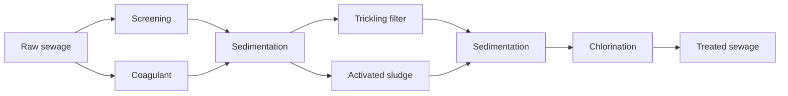

<!-- page 1 | Start here -->

## Module 4 - Environmental Chemistry

Master the principles of water hardness, water softening techniques, disinfection methods, and sewage treatment processes, along with numerical calculations for water analysis.

**Before you start:** Basic knowledge of chemical reactions and stoichiometry; Understanding of solution concentration units like ppm, normality, and molarity.

### Your path through this module

1. **Introduction to Hardness, Types, and Disadvantages**: Hard water prevents soap lathering by forming insoluble scum and causes serious scaling, priming, and foaming in boilers.
2. **Expression of Hardness and Numerical Problems**: Hardness of any salt is expressed in terms of calcium carbonate equivalents using the ratio of molecular weights or equivalent weights.
3. **Water Softening, Ion Exchange, and Desalination**: Ion-exchange resins remove both cations and anions completely, while reverse osmosis separates pure water from saline water under high pressure.
4. **Sterilization, Chlorination, and Break Point Chlorination**: Break point chlorination ensures that all bacteria and reducing substances are completely destroyed while free residual chlorine begins to appear.
5. **Sewage Characteristics: DO, BOD, and COD**: BOD measures the oxygen required by bacteria for biological oxidation, whereas COD measures both biologically oxidizable and inert organic matter.
6. **Sewage Treatment: Primary, Secondary, and Tertiary Methods**: Sewage treatment progresses through physical primary screening, biological secondary oxidation (trickling filters or UASB), and chemical tertiary polishing.

<!-- page 2 | Introduction to Hardness, Types, and Disadvantages -->

## Introduction to Hardness, Types, and Disadvantages

Bridge: Having a basic understanding of solution chemistry, we now examine what makes water hard and why hard water causes problems in industries and households.

The new idea: Hard water prevents soap lathering by forming insoluble scum and causes serious scaling, priming, and foaming in boilers.

### Hard Water and Soft Water

Water hardness is the property or characteristic of water that prevents it from producing lather with soap. Depending on the behavior towards soap, water is classified into two categories:

1. **Hard Water**: Water that does not produce lather with soap solution, but instead produces a white precipitate (scum). This behavior is caused by the presence of dissolved calcium ($\text{Ca}^{2+}$) and magnesium ($\text{Mg}^{2+}$) salts.

$$\text{2C}_{17}\text{H}_{35}\text{COONa} + \text{Ca}^{++} \longrightarrow (\text{C}_{17}\text{H}_{35}\text{COO})_{2} \text{Ca} \downarrow + 2\text{Na}^{+}$$
$$\begin{bmatrix} \text{sodium soap} \\ (\text{water soluble}) \end{bmatrix} \begin{bmatrix} \text{hardness} \\ \text{causing} \\ \text{ion} \end{bmatrix} \begin{bmatrix} \text{calcium soap} \\ (\text{water insoluble}) \\ (\text{scum}) \end{bmatrix}$$

2. **Soft Water**: Water that produces lather readily with soap solution due to the absence of dissolved calcium and magnesium salts.

### Detection of Hardness

Hardness in water can be detected by two primary methods:

1. **Soap Test**: When hard water is treated with soap solution, it prevents lathering and yields a white scum.

$$\text{2C}_{17}\text{H}_{35}\text{COONa} + \text{CaCl}_{2} \longrightarrow (\text{C}_{17}\text{H}_{35}\text{COO})_{2}\text{Ca} + 2\text{NaCl}$$
$$\text{soap} \quad \quad \quad \text{hardness} \quad \quad \quad \text{hard soap}$$
$$\text{causing} \quad \quad \quad (\text{scum})$$
$$\text{substance}$$

2. **Indicator Test**: Water containing hardness produces a wine-red color when treated with Eriochrome Black-T (EBT) indicator at a $\text{pH}$ range of $9-10$.

### Types of Hardness

Hardness of water is classified into two main types based on the dissolved salts present:

1. **Temporary Hardness (Carbonate Hardness / Alkaline Hardness)**
   Caused by the presence of dissolved bicarbonates of calcium, magnesium, and other heavy metals. Temporary hardness can be removed by:
   - Boiling the water
   - Adding lime to the water

   These processes convert soluble bicarbonates into insoluble carbonates and hydroxides, which can then be filtered out.

   $$\text{Ca(HCO}_3)_2 \xrightarrow{\Delta} \text{CaCO}_3 \downarrow + \text{H}_2\text{O} + \text{CO}_2$$
   $$\text{Mg(HCO}_3)_2 + 2\text{Ca(OH)}_2 \longrightarrow \text{Mg(OH)}_2 \downarrow + 2\text{CaCO}_3 \downarrow + 2\text{H}_2\text{O}$$

2. **Permanent Hardness (Non-Carbonate Hardness / Non-Alkaline Hardness)**
   Caused by the presence of chlorides and sulfates of calcium, magnesium, iron, and other heavy metals. It cannot be removed by boiling, but requires chemical treatments such as the Lime-Soda process, Zeolite process, or Ion-Exchange process.

   $$\text{CaCl}_2 + \text{Na}_2\text{CO}_3 \longrightarrow \text{CaCO}_3 \downarrow + 2\text{NaCl}$$
   $$\text{CaSO}_4 + \text{Na}_2\text{Ze} \longrightarrow \text{CaZe} + \text{Na}_2\text{SO}_4$$

**Total Hardness**: Defined as the sum of temporary hardness and permanent hardness.

### Disadvantages of Using Hard Water

#### For Industrial Purposes

1. **Scale and Sludge Formation in Boilers**: In industrial boilers used for high-temperature steam generation, continuous water evaporation increases dissolved salt concentration until saturation is reached. Salts precipitate out and adhere to inner boiler walls.
   - **Sludge**: Loose, slimy, and non-adhering precipitates.
   - **Scales**: Hard, strongly adhering coatings.

   *Consequences*: Scales reduce heat transfer efficiency, cause fuel wastage, and can lead to dangerous boiler explosions.

2. **Priming and Foaming in Boilers**:
   - **Priming**: The rapid production of steam carries liquid water droplets along with it (wet steam formation).
   - **Foaming**: The formation of persistent bubbles or foam at the water surface in boilers caused by oils, alkalis, etc.

   *Consequences*: Priming and foaming cause dissolved salts to deposit on turbine blades and superheaters, lowering overall system efficiency.

3. **Boiler Corrosion**: Hard water can cause corrosion of metallic boiler components.
4. **Dyeing Problems**: Hard water interferes with uniform dye uptake in the textile industry.

#### For Domestic Purposes

Hard water wastes soap due to scum formation, forms crusty deposits on kettles and plumbing fixtures, and is unsuitable for cooking and drinking applications where mineral buildup is undesirable.

<!-- page 3 | Expression of Hardness and Numerical Problems -->

## Expression of Hardness and Numerical Problems

Bridge: Now that we know the salts responsible for water hardness, we learn how to quantify hardness uniformly using calcium carbonate equivalents.

The new idea: Hardness of any salt is expressed in terms of calcium carbonate equivalents using the ratio of molecular weights or equivalent weights.

### Objectives
- Express hardness equivalents in terms of $\text{CaCO}_3$
- Calculate carbonate and non-carbonate hardness from salt concentrations
- Solve complex normality and PPM hardness problems

### Concepts to Teach
- $\text{CaCO}_3$ equivalent formula
- Molecular weight table of hardness salts
- Carbonate hardness calculation
- Non-carbonate hardness calculation

### Characteristics and Effects of Hardness
1. It tastes bitter, but it provides calcium ions for the healthy growth of bones and teeth. Hardness level between 60 to 100 ppm is recommended for drinking water.
2. It produces bathroom stains in bathroom fittings.
3. It causes the wastage of soap in laundry.

### Degree of Hardness: Expression of Hardness in Terms of Equivalents of $\text{CaCO}_3$

The concentration of hardness producing salts is usually expressed in terms of an equivalent amount of $\text{CaCO}_3$. $\text{CaCO}_3$ is chosen as a standard because:
1. Its molecular weight (100) and equivalent weight (50) is a whole number, so the calculations in water analysis can be simplified.
2. It is the most insoluble salt, which can be precipitated in water treatment.

If the concentration of hardness producing salt is $x$ mg/lit, then:

$$\text{Amount equivalent to } \text{CaCO}_3 = \frac{\text{Amount of hardness producing salt} \times \text{molecular weight of } \text{CaCO}_3}{\text{Molecular weight of hardness producing salt}}$$

$$\text{Amount equivalent to } \text{CaCO}_3 = \frac{\text{Amount of hardness producing salt} \times \text{Equivalent weight of } \text{CaCO}_3}{\text{Equivalent weight of hardness producing salt}}$$

**Example:** If the concentration (or) weight of $\text{CaSO}_4$ is $43$ mg/lit, then:

$$\text{weight equivalent to } \text{CaCO}_3 = \frac{43 \times 100}{136} \text{ mg/lit}.$$

### Molecular Weights of Some Hardness Producing Salts

> **Figure: Table of molecular weights of hardness producing salts**
>
> Table of molecular weights of hardness producing salts containing four columns: Hardness producing salt, Molecular weight, Hardness producing salt, and Molecular weight. Row 1: Ca(HCO3)2, 162, MgSO4, 120. Row 2: Mg(HCO3)2, 146, CaSO4, 136. Row 3: CaCl2, 111, Ca2+, 40. Row 4: MgCl2, 95, Mg2+, 24. Row 5: CaCO3, 100, HCO3-, 61x2=122. Row 6: CaSO4, 136, empty, empty.

### Solved Numerical Problems

**Problem 1:** Calculate the carbonate and non-carbonate hardness of a sample of water containing the dissolved salts as given below in mg/lit $\text{Mg(HCO}_3)_2 = 7.3$; $\text{Ca(HCO}_3)_2 = 40.5$; $\text{CaSO}_4 = 13.6$; $\text{MgCl}_2 = 21.75$ and $\text{NaCl} = 50$.

> **Figure: Table header for Problem 1 solution**
>
> Table header for Problem 1 solution containing four columns: Name of the hardness, Amount in, Molecular, Amounts equivalent to.

> **Figure: Table of hardness calculations for various salts**
>
> Table showing hardness calculations for various salts with columns: producing salt, mgs/lit, weight, and CaCO3 equivalent. Row 1: Mg(HCO3)2, 7.3, 146, 7.3x100/146 = 5mgs/lit. Row 2: Ca(HCO3)2, 40.5, 162, 40.5x100/162 = 25mgs/lit. Row 3: CaSO4, 13.6, 136, 13.6x100/136 = 10mgs/lit. Row 4: MgCl2, 21.75, 95, 21.75x100/95 = 22.9mgs/lit. Row 5: NaCl, 50, NaCl does not contribute any hardness to water, hence it is ignored.

Carbonate hardness = $\text{Mg}(\text{HCO}_3)_2 + \text{Ca}(\text{HCO}_3)_2 = 5 + 25 = 30\text{ mgs/lit}$

Non-carbonate hardness = $\text{CaSO}_4 + \text{MgCl}_2 = 10 + 22.9 = 32.9\text{ mgs/lit}$

Total hardness = $\text{Carbonate hardness} + \text{Non-carbonate hardness}$

$= 30 + 32.9 = 62.9\text{ mgs/lit}$

**Problem 2:** Water sample on analysis give the following data $\text{Ca}^{2+} = 20\text{ ppm}$, $\text{Mg}^{2+} = 25\text{ ppm}$, $\text{CO}_2 = 30\text{ ppm}$, $\text{HCO}_3^- = 150\text{ ppm}$, $\text{K}^+ = 10\text{ ppm}$. Calculate temporary and permanent hardness.

> **Figure: Table of hardness calculations for Problem 2**
>
> Table for Problem 2 showing hardness calculations with columns: Name of the hardness producing salt, Amounts in ppm, Molecular weight, Amounts equivalent to CaCO3. Row 1: Ca2+, 20, 40, 20x100/40 = 50ppm. Row 2: Mg2+, 25, 24, 25x100/24 = 104.17ppm. Row 3: HCO3, 150, 122, 150x100/122 = 122.95ppm.

(i) $\text{K}$ and $\text{CO}_2$ will not cause any hardness, so it is ignored.

(ii) $\text{Ca}^{2+}$ and $\text{Mg}^{2+}$ will cause temporary and permanent hardness.

(iii) Molecular weight of $(\text{HCO}_3)_2 = 122$.

Permanent hardness = Total amount of $\text{Mg}^{2+} + \text{Ca}^{2+}$ - Total amount of $\text{HCO}_3^-$

(Responsible for temporary hardness) = $(104.17 + 50) - (122.95)$

**Problem 3:** Calculate the hardness of (a) $0.08\text{ N MgSO}_4$ solution (b) $0.05\text{ M CaCl}_2$ solution (c) $0.02\text{ m Al}_2\text{(SO}_4)_3$ solution.

*Ans:*

(a) Hardness due to $\text{MgSO}_4 = \text{Normality} \times \text{Eq. Wt. of CaCO}_3 \times 1000$
$$\quad= 0.08 \times 50 \times 1000 = 4000\text{ ppm}$$

(b) Normality of $\text{CaCl}_2 = \text{Molarity} \times \text{charge of positive ion} = 0.05 \times 2 = 0.1\text{ N}$

Hardness due to $\text{CaCl}_2 = 0.1 \times 50 \times 1000 = 5000\text{ ppm}$

(c) Normality of $\text{Al}_2\text{(SO}_4)_3 = 0.02 \times 6 = 0.12\text{ N}$

Hardness due to $\text{Al}_2\text{(SO}_4)_3 = 0.12 \times 50 \times 1000 = 6000\text{ ppm}$

**Problem 4:** Calculate the hardness of solution obtained after mixing $200\text{ ml } 0.3\text{M CaSO}_4$ with $300\text{ ml } 0.7\text{M Al}_2\text{(SO}_4)_3$.

Total no. of equivalence of ions = $200 \times 0.3 \times 2 + 300 \times 0.7 \times 6 = 1380\text{ milliequivalence}$

Total volume of solution = $200 + 300 = 500\text{ ml}$

Normality of mixture = $\frac{\text{no. of equivalence}}{\text{volume of solution}} = \frac{1380}{500} = 2.76\text{ N}$

Hardness = $\text{Normality} \times 50 \times 1000 = 138000\text{ mg/l}$.

## Softening (or) Conditioning Methods (or) Treatment of Boiler Feed Water

The process of removing hardness producing salts from water is known as softening (or) conditioning of water.

## Ion Exchange (or) Demineralisation Process (or) Polymer Ion Exchange Process

This process removes almost all the ions (both anions and cations) present in hard water.

The soft water, produced by zeolite processes, does not contain hardness producing $\text{Ca}^{2+}$ and $\text{Mg}^{2+}$ ions, but it contains other ions like $\text{Na}^+, \text{K}^+, \text{SO}_4^{2-}, \text{Cl}^-$ etc. On the other hand, D.M. (Demineralized) water does not contain both anions and cations. Thus, soft water is not demineralized water, whereas demineralized water is soft water.

Demineralization process is carried out by using ion exchange resins, which are long chain, cross linked, insoluble organic polymers with a microporous structure. The functional groups attached to the chains are responsible for the ion exchanging properties. The following two types of ion exchange resins are used:
1. Cation exchange resin (or) Cation exchanger
2. Anion exchange resin (or) Anion exchanger

### 1. Cation Exchanger
Resins containing acidic functional groups ($\text{-COOH}$ or $\text{-SO}_3\text{H}$) are capable of exchanging their $\text{H}^+$ ions with the cations present in hard water.

<!-- page 4 | Water Softening, Ion Exchange, and Desalination -->

## Water Softening, Ion Exchange, and Desalination

Bridge: Having learned to measure hardness, we now explore methods to remove hardness-producing ions and dissolved salts to produce pure boiler feed water.

The new idea: Ion-exchange resins remove both cations and anions completely, while reverse osmosis separates pure water from saline water under high pressure.

### Objectives
- Explain the demineralization process using ion exchange resins.
- Describe resin regeneration methods.
- Explain reverse osmosis for water desalination.

### Concepts to Teach
- **Demineralized water vs soft water:** Soft water has its calcium and magnesium ions replaced by sodium ions, whereas demineralized (deionized) water is completely free from all cations and anions.
- **Cation and anion exchange resins:** Insoluble cross-linked organic polymers with acidic or basic functional groups capable of exchanging ions.
- **Resin regeneration:** Restoring the exchange capacity of exhausted resins using dilute acids and bases.
- **Reverse Osmosis (RO) and semi-permeable membranes:** A separation process where solvent flows from a concentrated solution to a dilute solution under a hydrostatic pressure exceeding the osmotic pressure.
- **Super-filtration:** Another term for reverse osmosis due to its ability to filter out non-ionic, ionic, and colloidal molecules.

---

### 1. Ion-Exchange Resins (Demineralization Process)

Ion exchange resins are cross-linked, insoluble, high molecular weight organic polymers possessing acidic or basic functional groups. The process completely removes all dissolved mineral salts, yielding demineralized or deionized water.

#### Cation Exchanger
Resins containing acidic functional groups ($-\text{COOH}$, $-\text{SO}_3\text{H}$) are capable of exchanging their $\text{H}^+$ ions with other cations of hard water. Cation exchanger resin is represented as $\text{RH}_2$.

*Examples:*
1. Amberlite IR-120
2. Dowex-50

#### Anion Exchanger
Resins containing basic functional groups ($-\text{NH}_2$, $-\text{OH}$) are capable of exchanging their anions with other anions of hard water. Anion exchange resin is represented as $\text{R}'(\text{OH})_2$.

*Examples:*
1. Amberlite IR-400
2. Urea formaldehyde resin
3. Dowex-3

#### Process Flow
The hard water is first passed through a cation exchange column, which adsorbs all the cations like $\text{Ca}^{2+}$, $\text{Mg}^{2+}$, $\text{Na}^+$, $\text{K}^+$, etc., present in the hard water.

$$\text{RH}_2 + \text{CaCl}_2 \rightarrow \text{RCa} + 2\text{HCl}$$

$$\text{RH}_2 + \text{MgSO}_4 \rightarrow \text{RMg} + \text{H}_2\text{SO}_4$$

> **Figure: Demineralization of water apparatus showing cation and anion exchange columns**
>
> Demineralization of water apparatus showing a schematic diagram with two main columns: a cation exchanger and an anion exchanger. Raw water enters at the top left and goes into the cation exchanger column. Acid for regeneration (Dil HCl container) is connected above the cation exchanger via valves. The treated water flows from the bottom of the cation exchanger to the top of the anion exchanger column. Alkali for regeneration (Dil NaOH container) is connected above the anion exchanger via valves. Bottom outlets provide Wash and Deionised water streams.

The cation-free water is then passed through an anion exchange column, which adsorbs all the anions like $\text{Cl}^-$, $\text{SO}_4^{2-}$, $\text{HCO}_3^-$, etc., present in the water.

$$\text{R}'(\text{OH})_2 + 2\text{HCl} \rightarrow \text{R}'\text{Cl}_2 + 2\text{H}_2\text{O}$$

$$\text{R}'(\text{OH})_2 + \text{H}_2\text{SO}_4 \rightarrow \text{R}'\text{SO}_4 + 2\text{H}_2\text{O}$$

The water coming out of the anion exchanger is completely free from cations and anions, known as **demineralized water**.

*Note on Sequence:* Water is first passed through the cation exchanger and then through the anion exchanger because cation exchangers are easily attacked by alkalis, whereas ion exchangers generally tolerate acids well.

---

### Regeneration of Resins

When the ion-exchange resins become exhausted (unable to exchange ions further), they must be regenerated:

- **Cation Exchanger Regeneration:** Exhausted resin is treated with dilute $\text{HCl}$ or dilute $\text{H}_2\text{SO}_4$.
  $$\text{RCa} + 2\text{HCl} \rightarrow \text{RH}_2 + \text{CaCl}_2$$

- **Anion Exchanger Regeneration:** Exhausted resin is treated with dilute $\text{NaOH}$.
  $$\text{R}'\text{Cl}_2 + 2\text{NaOH} \rightarrow \text{R}'(\text{OH})_2 + 2\text{NaCl}$$

### Advantages of Ion-Exchange Process
1. Highly acidic or alkaline water can be treated.
2. The water obtained has very low residual hardness (nearly $2\text{ ppm}$).

### Disadvantages of Ion-Exchange Process
1. Water containing turbidity, $\text{Fe}$, and $\text{Mn}$ cannot be treated directly; turbidity reduces output, and $\text{Fe}$ and $\text{Mn}$ form stable compounds with the resin.
2. The equipment is costly and requires expensive regeneration chemicals.

---

### 2. Desalination

The process of removing dissolved common salt (sodium chloride) and other minerals from saline or brackish water is known as desalination. It is primarily carried out via reverse osmosis or electrodialysis.

#### Reverse Osmosis (RO)
When two solutions of different concentrations are separated by a semi-permeable membrane, and a hydrostatic pressure in excess of the osmotic pressure is applied on the higher concentration side, the solvent (water) flows from the higher concentration to the lower concentration. This process is called **reverse osmosis** or **super-filtration**.

> **Figure: Diagram of Reverse Osmosis process**
>
> Diagram illustrating the Reverse Osmosis process. It shows a horizontal cylindrical vessel containing Saline water on the left and Fresh water on the right, separated vertically by a shaded Semipermeable membrane. A Piston with a cross-hatched face is positioned on the left side of the saline water chamber, with three horizontal arrows pointing to the right labeled 'Pressure'. Horizontal arrows pointing to the right across the membrane are labeled 'Direction of reverse osmosis'. Horizontal arrows pointing to the left across the membrane are labeled 'Direction of osmosis'.

Common semi-permeable membranes used include cellulose acetate and cellulose butyrate.

#### Method
Seawater is separated from pure water using a semi-permeable membrane. A high pressure of the order of $15$ to $40\text{ kg/cm}^2$ is applied to the seawater side using a piston to force pure water molecules through the membrane, leaving dissolved salts behind.

#### Advantages / Significance of Reverse Osmosis
1. The lifetime of the membrane is high, and it can be replaced within minutes.
2. It removes ionic, non-ionic, and colloidal impurities simultaneously.
3. Due to its simplicity and low operating cost, it is widely used to convert seawater into portable drinking water.

---

### 3. Sterilization (Disinfection)

The process of destroying harmful pathogenic bacteria in water is known as sterilization or disinfection.

#### By Using Ultraviolet (UV) Radiations
UV rays are produced by passing an electric current through a mercury vapor lamp. Microorganisms are inactivated by UV light due to damage sustained by their nucleic acids.

*Advantages:*
1. Chemical-free and environmentally friendly process.
2. Rapid and highly effective against a wide range of microorganisms.
3. Requires very little contact time.
4. Destroys organic and toxic contaminants (e.g., pesticides, industrial solvents).

*Disadvantages:*
1. Capital and operational costs are relatively high.

<!-- page 5 | Sterilization, Chlorination, and Break Point Chlorination -->

## Sterilization, Chlorination, and Break Point Chlorination

With softened water available, we must ensure it is free from harmful disease-causing microorganisms through disinfection. Sterilization and disinfection processes destroy pathogenic bacteria and microorganisms, ensuring that the water supply is safe for domestic and industrial consumption.

### Water Disinfection Methods

Various methods are employed to disinfect water, among which chlorination, ozonization, and ultraviolet (UV) radiation are the most prominent.

### 2. Chlorination

Chlorine is one of the most widely used disinfectants because it is economical, stable, and highly effective. The process of adding chlorine to water is called chlorination. Chlorination can be performed using several methods:

**(a) By adding chlorine gas**

Chlorine gas can be bubbled directly into water as a very strong disinfectant. The chemical reactions involved are:

$$\text{Cl}_2 + \text{H}_2\text{O} \rightarrow \text{HCl} + \text{HOCl}$$

$$\text{HOCl} + \text{Bacteria} \rightarrow \text{Bacteria killed}$$

**(b) By adding chloramine**

When chlorine and ammonia are mixed in a 2:1 ratio, chloramine is formed. It decomposes slowly in water to release hypochlorous acid:

$$\text{Cl}_2 + \text{NH}_3 \rightarrow \text{NH}_2\text{Cl} + \text{HCl}$$
$$\text{Chloramine}$$

$$\text{NH}_2\text{Cl} + \text{H}_2\text{O} \rightarrow \text{HOCl} + \text{NH}_3$$
$$\text{Disinfectant}$$

Chloramine is a better long-term disinfectant than chlorine alone and imparts a better taste to treated water.

**(c) By adding bleaching powder**

When bleaching powder (calcium oxychloride) is added to water, it produces hypochlorous acid (\text{HOCl}), which acts as a powerful germicide:

$$\text{CaOCl}_2 + \text{H}_2\text{O} \rightarrow \text{Ca(OH)}_2 + \text{Cl}_2$$
$$\text{Bleaching Powder}$$

$$\text{Cl}_2 + \text{H}_2\text{O} \rightarrow \text{HCl} + \text{HOCl}$$
$$\text{Hypochlorous acid}$$

### Break Point Chlorination

Raw water typically contains impurities such as bacteria, organic impurities, reducing substances (like $\text{Fe}^{2+}$, $\text{H}_2\text{S}$, etc.), and free ammonia.

Break point chlorination is the addition of chlorine to water to such an extent that it kills all microorganisms, completely oxidizes all reducing substances and organic impurities, and allows free residual chlorine to begin appearing.

> **Figure: Break point chlorination graph showing residual chlorine vs applied chlorine**
>
> A line graph showing breakpoint chlorination. The horizontal axis represents 'Applied chlorine' with an arrow pointing right. The vertical axis represents 'Residual chlorine' with an arrow pointing up. The curve starts at the origin, rises straight up along a vertical dashed line labeled vertically on the left as 'Kill the bacteria, and oxidation of reducing substances by chlorine', then continues rising to a peak labeled 'Formation of chloramine & chloro compounds', drops down to a minimum point labeled 'Destruction of chloramine & chloro compounds' with a vertical dashed line separating the peak and the minimum, and finally rises upward with a solid line labeled 'Free residual chlorine'.

 Break point chlorination graph showing residual chlorine vs applied chlorine

The graph illustrates the relationship between the amount of applied chlorine and the resulting residual chlorine. Initially, applied chlorine is consumed entirely in killing bacteria and oxidizing reducing substances, resulting in zero free residual chlorine. As more chlorine is added, combined residual chlorine rises due to the formation of chloramines and chloro compounds. Eventually, further chlorination initiates the oxidation of these chloramines and impurities, causing a sharp dip in the curve. The minimum point reached where all impurities and chloramines are fully oxidized, and free residual chlorine finally begins to appear, is known as the **break point**.

### De-chlorination

Over-chlorination past the break point produces an unpleasant taste and odor in water. These objectionable qualities can be removed through de-chlorination methods:

- Filtering over-chlorinated water through a bed of activated or molecular carbon.
- Adding a small percentage of activated carbon directly to the water followed by filtration.
- Adding chemical reducing agents such as sulfur dioxide ($\text{SO}_2$) or sodium sulfite ($\text{Na}_2\text{SO}_3$):

$$\text{SO}_2 + \text{Cl}_2 + \text{H}_2\text{O} \rightarrow \text{H}_2\text{SO}_4 + 2\text{HCl}$$

$$\text{Na}_2\text{SO}_3 + \text{Cl}_2 + \text{H}_2\text{O} \rightarrow \text{Na}_2\text{SO}_4 + 2\text{HCl}$$

### Factors Affecting Chlorination

- **Temperature of water:** Disinfection efficiency increases with an increase in temperature.
- **Time of contact:** The microbial death rate is highest initially and decreases with time.
- **pH of water:** The optimum pH range for effective chlorination is 5 to 6.5.

### Advantages of Chlorination
- Very effective and economical.
- Stable; requires minimal storage space and does not deteriorate upon long-term storage.
- Operates effectively at both low and high temperatures.
- Does not introduce undesirable chemical impurities into the treated water.

### Disadvantages of Chlorination
- Excess chlorine imparts an unpleasant taste and odor to water.
- Becomes less effective at higher pH levels (above 6.5).
- Excess chlorine irritates mucous membranes (noticeable at 0.1–0.2 ppm levels).

---

### 3. Use of Ozone (Ozonization)

Ozone is an exceptionally powerful disinfectant that is readily absorbed by water. Because ozone is highly unstable, it spontaneously breaks down to release nascent oxygen:

$$\text{O}_3 \rightarrow \text{O}_2 + [\text{O}]$$

The nascent oxygen ($\text{[O]}$) is a potent oxidizing agent that rapidly destroys bacteria and organic contaminants.

#### Advantages of Ozonization
- Effective over a wide pH range.
- Possesses powerful oxidizing capabilities with a short reaction time.
- Does not add residual chemical compounds to the water.
- Eliminates a wide variety of inorganic, organic, microbial, taste, and odor problems.

#### Disadvantages of Ozonization
- The process is costly and difficult to implement on a massive scale.
- Ozone is unstable and cannot be stored for long periods.
- Ozone has low solubility in water, necessitating specialized mixing techniques.

---

## SEWAGE

The wastewater generated from domestic, municipal, and industrial sources is called sewage. Sewage is composed of approximately 99.95% water and 0.05% dissolved and suspended waste materials. The strength of sewage is evaluated using parameters like Dissolved Oxygen (DO), Biochemical Oxygen Demand (BOD), and Chemical Oxygen Demand (COD).

<!-- page 6 | Sewage Characteristics: DO, BOD, and COD -->

## Sewage Characteristics: DO, BOD, and COD

Having studied drinking water treatment, we now shift our focus to waste water and sewage characteristics before disposal. The new idea is that BOD measures the oxygen required by bacteria for biological oxidation, whereas COD measures both biologically oxidizable and inert organic matter. The objectives are to define sewage and express its strength, differentiate between Dissolved Oxygen, Biological Oxygen Demand, and Chemical Oxygen Demand, and interpret BOD and COD values for water quality assessment.

### (i) Dissolved Oxygen (DO)

Dissolved oxygen is the level of free non-compounded oxygen present in water or other liquid.

#### Factors affecting DO

The solubility of oxygen decreases as temperature increases.

DO will increase as pressure increases.

DO decreases exponentially as salt level increases.

#### Significance of DO

1. DO is an important parameter in assessing the quality of water because of its influence on the organisms living within a body of water.
2. The DO level that is too high or too low can harm aquatic life and affect water quality.
3. When DO is present in water, corrosion rate, on iron, is more.

### (ii) Biological Oxygen Demand (BOD)

BOD is defined as, "the amount of free oxygen required by bacteria for the biological oxidation of the organic matter under aerobic conditions at $20^{\circ}\text{C}$ for a period of 5 days".

#### Significance of BOD

(i) It indicates the amount of decomposable organic matter present in the sewage.

(ii) It enables us to determine the degree of pollution at any time in the sewage stream.

(iii) Lesser the BOD, better is the quality of water, i.e. the water sample with BOD of less than $3\text{ ppm}$ is considered as pure water, whereas the water more than $4\text{ ppm}$ is considered as polluted water.

### (iii) Chemical Oxygen Demand (COD)

COD is defined as, "the measure of amount of oxygen required to chemically oxidize all the oxidizable impurities present in the sewage using an oxidising agent like acidified $\text{K}_2\text{Cr}_2\text{O}_7$"

#### Significance of COD

(i) Determination of COD is carried out only in 3 hours, but determination of BOD is carried out after 5 days.

(ii) It measures both the biologically oxidizable and biologically inert organic matter.

## SEWAGE TREATMENT

The main objectives of sewage treatment are safe disposal and environmental protection.

<!-- page 7 | Sewage Treatment: Primary, Secondary, and Tertiary Methods -->

## Sewage Treatment: Primary, Secondary, and Tertiary Methods

Bridge: With sewage oxygen demands understood, we study engineering processes used to safely treat and discharge wastewater into natural water bodies.

The new idea: Sewage treatment progresses through physical primary screening, biological secondary oxidation (trickling filters or UASB), and chemical tertiary polishing.

Objectives: Explain the steps involved in primary, secondary, and tertiary sewage treatment; Compare trickling filter and UASB aerobic/anaerobic processes; Discuss advanced tertiary treatment methods.

### Objectives of Sewage Treatment

(i) To convert harmful compounds into harmless compounds.

(ii) To eliminate the offensive smell.

(iii) To remove the solid content of the sewage.

(iv) To destroy the disease-producing microorganisms so that it can be safely discharged into water bodies.

**Steps involved in treatment process**

The sewage or wastewater treatment process involves the following steps:

1. **Primary (preliminary) process**
   - a) Screening
   - b) Sedimentation
2. **Secondary process or Biological oxidation process**
   - a) Trickling Filter method - Aerobic oxidation
   - b) UASB method - Anaerobic oxidation
3. **Tertiary process**
   - a) Precipitation
   - b) Nitrogen stripping
   - c) Chlorination

### I. Preliminary Treatment (Primary)

a) **Screening**

In this treatment, wastewater is passed through a bar screen and then mesh screens to remove suspended solids.

b) **Sedimentation or Settling Process**

The suspended organic and inorganic matters are removed by this process. For this, sewage water is stored in a large tank for some time where the suspended particles settle down due to gravity. To accelerate the process, coagulants like alum are added. These produce large gelatinous precipitates, which entrap finely divided organic matter and settle rapidly.

$$\text{Al}_2(\text{SO}_4)_3 + 6\text{H}_2\text{O} \rightarrow 2\text{Al(OH)}_3\downarrow + 3\text{H}_2\text{SO}_4$$

### II. Secondary or Biological Treatment

This process is used for treating the filtrate obtained in the primary process. It involves the biological oxidation of organic compounds under aerobic or anaerobic conditions, during which the conversion of carbon to $\text{CO}_2$, nitrogen to $\text{NH}_3$, and finally to nitrites and nitrates occurs.

- Aerobic treatment process by **trickling filter process**
- Anaerobic treatment process by **UASB process**

#### (a) Trickling Filter Process (Aerobic Filtration Method)

It is a circular tank filled with material like broken bricks, crushed rocks, etc., and fitted with a rotating distributor. Sewage is trickled over this filter with the help of the rotating distributor.

> **Figure: Trickling filter process diagram**
>
> Diagram of a Trickling filter process showing a circular tank filled with filtering medium (broken bricks/crushed rocks). Labeled parts include: Effluent from primary treatment entering from the left, a central vertical pipe with Rotary arms at the top, air flow arrows pointing up and down through the filtering media, treated effluent flowing to a settling tank on the right with a chlorination arrow pointing down, an Effluent output, and a Sludge output at the bottom of the settling tank.

When sewage moves down through the filtering medium, microorganisms start consuming the organic matter in the sewage. They grow over the surface of the filtering media and a more or less clear effluent is collected. After completion of aerobic oxidation, the treated sewage is taken to the settling tank and the sludge is removed. This process removes about 80-85% of BOD.

**Advantages:**
* Trickling filters efficiently reduce organic matter.
* These filters are compact and are capable in densely populated urban settings.
* Small land areas are required compared to constructed wetlands.

**Disadvantages:**
* High capital cost.
* Requires operation and maintenance by skilled personnel.
* Requires continuous electrical power and constant wastewater flow.
* Pre-treatment and treatment of excess sludge required.

#### (b) UASB (Upflow Anaerobic Sludge Blanket) Process

The reactor of an upflow anaerobic sludge blanket (UASB) is a single tank process used to treat industrial wastewater. It mainly removes organic pollutants.

**Process:**

UASB reactors are constructed in concrete or another watertight material and are designed in a circular way. Wastewater is allowed to enter into the reactor from the bottom and flows upward through a sludge blanket. The suspended sludge blanket filters and treats the wastewater as it flows through it.

Bacteria (microorganisms) living in the sludge break down the organic matter by anaerobic digestion, transforming it into biogas. The gases are collected through the gas collector dome at the top of the reactor.

> **Figure: Diagram of UASB reactor**
>
> Diagram of a UASB (Upflow Anaerobic Sludge Blanket) reactor showing labels for Overflow weir, Gas collector (Biogas), Gas/liquid/solid separator, Effluent, Baffles, Gas bubbles, Sludge granule, Sludge bed, Influent, and Distributor. Upward arrows indicate the flow of wastewater from the distributor at the bottom through the sludge bed and sludge granule zones.

Baffles at the top of the reactor allow gases to escape and prevent an outflow of the sludge blanket. As with all aerobic treatments, UASB also requires post-treatment to remove pathogens, but due to a low removal of nutrients, the effluent water as well as the stabilized sludge can be used in agriculture.

**Advantages:**
1. High reduction of BOD.
2. Low sludge production.
3. No aeration system is required.
4. Low $\text{CH}_4$ and $\text{CO}_2$ emissions.

**Disadvantages:**
1. Requires operation and maintenance by skilled personnel.
2. Needs a long start-up time to work.
3. A constant source of electricity is required.
4. Effluent and sludge require further treatment.

### III. Tertiary Treatment

This is the advanced phase of sewage treatment. By this process, the amount of nitrogen and phosphorous compounds present in the effluent can be reduced. The three steps involved are:

a) **Precipitation:** Effluent from the secondary process is treated with $\text{CaO}$ so that calcium phosphate will be precipitated.

b) **Nitrogen stripping:** Ammonia gas is removed by passing the effluent through a series of baffle plates.

c) **Chlorination:** Disinfection of sewage is done by treating with chlorine, when pathogenic bacteria are killed.

After tertiary treatment, the water can be sent to ponds or water bodies.
