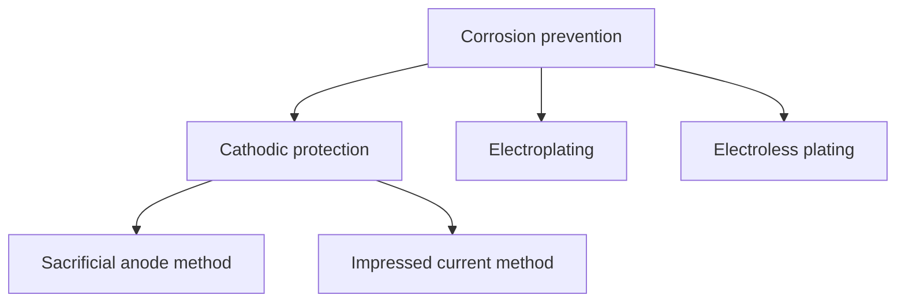
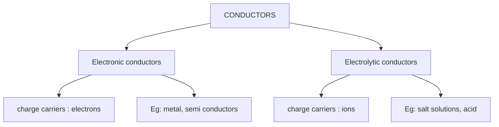
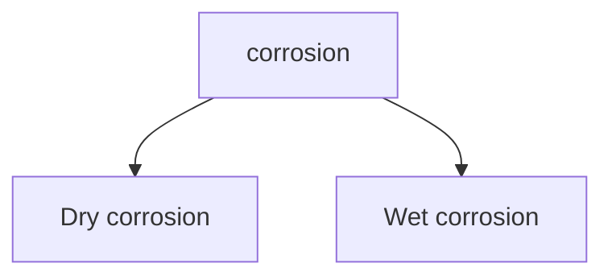

<!-- page 1 | Electrochemistry, corrosion and materials · source page 2 -->

# MODULE 1

## ELECTROCHEMISTRY AND CORROSION

### Study map

Follow redox reactions through cell potential and the Nernst equation, then apply electrochemistry to electrodes, batteries, conductivity, corrosion protection, and metal plating.

### Electrochemistry

Electro Chemistry deals with the chemical reactions produced by passing electric current through an electrolyte or the production of electric current through chemical reactions.

### Differences between Electrochemical cells & Electrolytic cells

| Electrochemical cells | Electrolytic cells |
| --- | --- |
| **A device which converts chemical energy to electrical energy** | **A device which converts electrical energy to chemical energy.** |
| **Consists of two electrodes immersed in one or more suitable electrolyte and the electrodes are connected externally** | Both the electrodes are inserted in the same electrolyte solution. |
| Anode is -ve **(LOAN)** | Anode is +ve |
| Free energy change ($\Delta$G ) is-ve (Spontaneous) | Free energy change ($\Delta$G ) is +ve |
| Salt bridge is used | Salt bridge is not used. |
| Eg : Daniell Cell | Eg : Electrolysis |

### Daniell Cell

A Daniell cell is a galvanic cell that converts chemical energy into electrical energy. It uses zinc and copper electrodes, each in contact with a solution containing its own ions: zinc sulfate and copper sulfate, respectively.

The Daniell cell can be conventionally represented as $\text{Zn}/\text{Zn}^{2+} \| \text{Cu}^{2+}/\text{Cu}$

- In a Daniell cell electrons flow from zinc electrode to copper electrode through an external circuit, while metal ions form one half cell to the other through the salt bridge.
- Here current flows from copper electrode to zinc electrode that is cathode to anode via an external circuit.
- Daniell cell is a reversible cell

### Cell Reactions

Ion $\text{Zn}/\text{ZnSO}_4$ half-cell, oxidation reaction occurs. (anode)

$\text{Zn} \rightarrow \text{Zn}^{2+} + 2\text{e}^-$

---

---

<!-- page 2 | Electrochemistry, corrosion and materials · source page 3 -->

Ion $\text{Cu/CuSO}_4$ half-cell, reduction reaction occurs. (cathode)

$$\text{Cu}^{2+} + 2\text{e}^- \rightarrow \text{Cu}$$

The net cell reaction is

$$\text{Zn} + \text{Cu}^{2+} \rightleftharpoons \text{Zn}^{2+} + \text{Cu}$$

Cell is represented as $\text{Zn}/\text{Zn}^{2+} \parallel \text{Cu}^{2+}/\text{Cu}$

$$\text{Zn(s)} \mid \text{ZnSO}_4(\text{aq}) \parallel \text{CuSO}_4(\text{aq}) \mid \text{Cu(s)}$$

**SALT BRIDGE:** Salt bridge is an inverted U tube. Containing inert electrolytes salts like KCl or $\text{NH}_4\text{NO}_3$ in agar-agar or gelatine. The ions of $\text{K}^+$ and $\text{Cl}^-$ have equal mobility.

**Functions of Salt bridge**

* A salt bridge maintains the electrical neutrality of each half cells.
* It prevents the accumulation of charges.
* Salt bridge also prevents the diffusion of interfering ions from one compartment to another.
* A salt bridge minimizes or eliminates the liquid junction potential.
* Salts like KCl, $\text{NH}_4\text{NO}_3$ are used for making salt bridge. Ions like $\text{K}^+$ and $\text{Cl}^-$ has equal mobility and get drifted to cathode and anode compartments respectively under the potential difference.

### Single Electrode Potential

It is measure of tendency of an electrode to lose or gain electron. Tendency of electrode for

---

---

<!-- page 3 | Electrochemistry, corrosion and materials · source page 4 -->

oxidation (loose electrons) is oxidation potential and tendency for reduction (gain electrons) is reduction potential $E_{\text{red}}$. $E_{\text{red}} = - E_{\text{oxd}}$

Factors affecting electrode potential

1. Concentration of metal irons in the solution
2. Temperature of the solution
3. Nature of the metal

## REVERSIBLE AND IRREVERSIBLE CELLS

A cell is said to be reversible if it satisfies the following conditions , ______

1) If an emf exactly equal to that of a cell is applied the chemical reaction taking place in the cell will stops

2) If the external emf is slightly greater than the actual emf of the cell applied, the cell reaction gets reversed.

Eg : Daniell cell

If a cell does not obey the following conditions it is said to be irreversible. Eg : Dry cell

## NERNST EQUATION

**The relation between the electrode potential and the concentration of the electrolyte solution is given by Nernst equation.**

Walter Nernst derived a mathematical relationship which enables us to calculate **the effect of electrolyte concentration on electrode potential.**

For a half cell,

$$E = E^0 - \frac{2.303RT}{nF} \log \frac{1}{[M^{n+}]}$$

$$E = E^0 - \frac{0.0591}{n} \log \frac{1}{[M^{n+}]} \text{ at } 25^\circ\text{C}$$

where, $E^0$=Standard electrode potential $R$=gas constant; $T$= temperature in K
$n$=number of electrons transferred in the half cell reaction; $F$=faraday of electricity;
$[M^{n+}]=$ concentration of electrolyte.

## DERIVATION

Nernst equation gives us the effect of electrolyte concentration on electrode potential.

Consider a general reduction reaction, taking place at the electrode $M^{n+} + ne \rightarrow M$

The decrease in free energy, $\Delta G$ accompanying this process is given by the well-known thermodynamic equation (Vant Hoff's equation)

$$\Delta G = \Delta G^0 + RT \ln Q \dots \text{(1)}$$

$R = \text{gas constant } , Q \text{ is the reaction quotient} = \text{Conc of Products} / \text{conc of reactant } [P]/[R]$

---

---

<!-- page 4 | Electrochemistry, corrosion and materials · source page 5 -->

In a reversible cell, electrical energy is produced at the expense of decrease in free energy, and free energy is related with EMF of the cell as follows

$$\Delta G = -nFE, \quad \Delta G^0 = -nFE^0$$

Substitute in (1) $-nFE = -nFE^0 + RT \ln Q$

Dividing by $-nF$

$$E = E^0 - \frac{RT}{nF} \ln Q \dots (2)$$

Substituting the values of constants at the temperature $\text{T} = 298\text{ K}$, $\text{R} = 8.314\text{ JK}^{-1}\text{mol}^{-1}$, $\text{F} = 96500\text{ C}$, $\text{Q} = [\text{M}] / [\text{M}^{n+}]$ and converting in to natural log

$$E = E^0 - \frac{2.303RT}{nF} \log [\text{M}] / [\text{M}^{+}]$$

Pure solid $[\text{M}]$ is taken as one $E = E^0 - \frac{2.303RT}{nF} \log 1 / [\text{M}^{n+}]$

This equation is called Nernst equation. It's clear that electrode potential is directly proportional to molar concentration of ions in the same solution and temperature.

### Nernst Equation for a complete cell

For a cell reaction $a\text{ A} + b\text{ B} \longrightarrow c\text{ C} + d\text{ D}$ The reaction quotient Q can be written as Q

$$= \frac{[\text{C}]^c[\text{D}]^d}{[\text{A}]^a[\text{B}]^b}$$

Thus the Nernst equation for a complete cell is given by

$$E_{\text{cell}} = E^0_{\text{cell}} - \frac{0.0591}{n} \log Q$$

$$E_{\text{cell}} = E^0_{\text{cell}} - \frac{0.0591}{n} \log \frac{[\text{C}]^c[\text{D}]^d}{[\text{A}]^a[\text{B}]^b}$$

**For a Daniell cell , $\text{Cu}^{2+} + \text{Zn} \longrightarrow \text{Zn}^{2+} + \text{Cu}$**

$$Q = [\text{Zn}^{2+}] [\text{Cu}] / [\text{Cu}^{2+}][\text{Zn}]$$

$$E_{\text{cell}} = E^0_{\text{cell}} - \frac{0.0591}{n} \log Q$$

Here concentration of pure solids are taken as one then,

$$Q = [\text{Zn}^{2+}] / [\text{Cu}^{2+}]$$

$$E_{\text{cell}} = E^0_{\text{cell}} - \frac{2.303RT}{nF} \log [\text{Zn}^{2+}] / [\text{Cu}^{2+}]$$

$$E_{\text{cell}} = E^0_{\text{cell}} - \frac{0.0591}{n} \log [\text{Zn}^{2+}] / [\text{Cu}^{2+}]$$

**free energy and EMF:** In a reversible cell, electrical energy is produced at the expense of decrease in free energy $\Delta G$,

Electrical energy produced per mol = $nFE$

$$\Delta G = -nFE$$

where F is called Faraday which is the charge of one mole of electrons. ($\text{F} = 6.023 \times 10^{23} \times 1.6 \times 10^{-19} = 96500\text{ C}$); $n$ is number of electrons; $E$ is EMF

### Variation of EMF of Hydrogen Electrode with pH of a solution

---

---

<!-- page 5 | Electrochemistry, corrosion and materials · source page 6 -->

For a Hydrogen Electrode at $25^\circ\text{C}$ $\text{H}^+ + 1\text{e} \longrightarrow \frac{1}{2}\text{H}_2$

Nernst equation can be written as,

$$E = E^0 + 0.0591/n \log [\text{H}^+] \quad \text{pH} = -\log[\text{H}^+]$$

$$\mathbf{E = - 0.0591\text{pH}}$$

**Case 1: When pH = 0 i.e. E= -0.0591\*0= 0 V (acidic condition)**

**Case 2: When pH = 7 i.e. E= - 0.0591\*7 = - 0.414V(Neutral)**

**Case 3: When pH =14 i.e. E= -0.0591\*14=-0.825 V (Alkaline)**

**Variation of EMF of Oxygen Electrode with pH of a solution**

For oxygen electrode at $25^\circ\text{C}$ $\text{O}_2 + 4\text{H}^+ + 4\text{e} \longrightarrow 2\text{H}_2\text{O}$ Nernst equation can be written as,

$$E = E^0 + 0.0591/n \log [\text{H}^+]^4 \quad n=4 \quad E^0 = 1.23\text{V}$$

$$E = E^0 + 0.0591/4 \log [\text{H}^+] *4$$

$$E = 1.23 - 0.0591 \log \text{pH}$$

**Case 1: When pH = 0 i.e. E=1.23-0.0591\*0= 1.23V**

**Case 2: When pH = 7 i.e. E=1,23-0.0591\*7= 0.81V**

**Case 3: When pH =14 i.e. E=1.23-0.0591\*14=0.40V**

**Applications of Nernst equation**

1. To study the effect of electrolyte concentration on electrode potential.
2. Calculation of equilibrium constant of a reaction.

At equilibrium, anodic and cathodic reactions become equal. So $\text{E}_{\text{cell}}$ become 0.

So the Nernst equation is, $\text{E}_{\text{cell}} = \text{E}^0_{\text{cell}} - 0.0591/n \log \text{Q}$ ( at equilibrium $\text{Q= K}$ the equilibrium constant)

**So at equilibrium , $0 = \text{E}^0_{\text{cell}} - 0.0591/n \log \text{K}$ , $\text{E}^0_{\text{cell}} = ( 0.0591/n ) \log \text{K}$ $\text{Log K} = \text{n } \text{E}^0\text{cell} /0.0591$**

3. Determination of EMF of a Cell
4. Determination of unknown concentration.
5. Determination of a p H of a solution.
6. Used for finding out valency of an ion

**NUMERICALS**

1. The standard electrode potential of zinc ions is $0.76\text{V}$. What will be the potential of a $2\text{M}$ solution at $300\text{K}$?

---

---

<!-- page 6 | Electrochemistry, corrosion and materials · source page 7 -->

The Nernst equation for the given conditions can be written as follows;

$$\text{EM}^{n+}/\text{M} = \text{E}^\circ + [(2.303\text{RT})/n\text{F}] \times \log [\text{Mn}^+]$$

Here, $\text{E}^\circ = 0.76\text{V}$ $n = 2$ $\text{F} = 96500\text{ C/mole}$ $[\text{Mn}^+] = 2\text{ M}$ $\text{R} = 8.314\text{ J/K mole}$ $\text{T} = 300\text{ K}$

Substituting the given values in Nernst equation we get,

$$\text{EZn}^{2+}/\text{Zn} = 0.76 + [(2.303 \times 8.314 \times 300)/(2 \times 96500)] \times \log 2 = 0.76 + [0.0298 \times (0.301)] = 0.76 + 0.009 = \mathbf{0.769V}$$

Therefore, the potential of a 2M solution at 300K is 0.769V.

**2.What is the Cell Potential of the electrochemical cell in which the cell reaction is: $\text{Pb}^{2+} + \text{Cd} \rightarrow \text{Pb} + \text{Cd}^{2+}$; Given that $\text{E}^\circ{}_{\text{cell}} = 0.277\text{ volts}$, $\text{temperature} = 25^\circ\text{C}$, $[\text{Cd}^{2+}] = 0.02\text{M}$, and $[\text{Pb}^{2+}] = 0.2\text{M}$.**

Since the temperature is equal to $25^\circ\text{C}$, the Nernst equation can be written as follows;

$$\text{E}_{\text{cell}} = \text{E}^\circ{}_{\text{cell}} - (0.0592/n) \log_{10} \text{Q}$$

Here, two moles of electrons are transferred in the reaction. Therefore, $n = 2$. The reaction quotient (Q) is given by $[\text{Cd}^{2+}]/[\text{Pb}^{2+}] = (0.02\text{M})/(0.2\text{M}) = 0.1$.

The equation can now be rewritten as:

$$\text{E}_{\text{cell}} = 0.277 - (0.0592/2) \times \log_{10}(0.1) = 0.277 - (0.0296)(-1) = \mathbf{0.3066\text{ Volts}}$$

Thus, the cell potential of this electrochemical cell at a temperature of $25^\circ\text{C}$ is $0.3066\text{ volts}$.

**3.The $\text{Cu}^{2+}\text{ion}$ concentration in a copper-silver electrochemical cell is $0.1\text{M}$. If $\text{E}^\circ(\text{Ag}^+/\text{Ag}) = 0.8\text{V}$, $\text{E}^\circ(\text{Cu}^{2+}/\text{Cu}) = 0.34\text{V}$, and Cell potential (at $25^\circ\text{C}$) = $0.422\text{V}$, find the silver ion concentration.**

Here, the silver electrode acts as a cathode whereas the copper electrode serves as the anode. This is because the standard electrode potential of the silver electrode is greater than that of the copper electrode. The standard electrode potential of the cell can now be calculated, as shown below.

$$\text{E}^\circ{}_{\text{cell}} = \text{E}^\circ{}_{\text{cathode}} - \text{E}^\circ{}_{\text{anode}} = 0.8\text{V} - 0.34\text{V} = 0.46\text{V}$$

Since the charge on the copper ion is $+2$ and the charge on the silver ion is $+1$, the balanced cell reaction is:

$$\text{Cu} \longrightarrow \text{Cu}^{2+} + 2\text{e}$$

$$2\text{Ag}^+ + 2\text{e} \longrightarrow 2\text{Ag}$$

$$2\text{Ag}^+ + \text{Cu} \rightarrow 2\text{Ag} + \text{Cu}^{2+}$$

Since two electrons are transferred in the cell reaction, $n = 2$. Now, the Nernst equation for this electrochemical cell can be written as follows.

$$\text{E}_{\text{cell}} = \text{E}^\circ{}_{\text{cell}} - (0.0592/2) \times \log (0.1/[\text{Ag}^+]^2)$$

$$0.422\text{V} = 0.46 - 0.0296 \times (-1 - 2\log [\text{Ag}^+])$$

Therefore, $-2\log [\text{Ag}^+] = 1.283 + 1 = 2.283$

Or, $\log [\text{Ag}^+] = -1.141$

---

---

<!-- page 7 | Electrochemistry, corrosion and materials · source page 8 -->

$$[\text{Ag}^+] = \text{antilog } (-1.141) = \mathbf{0.0722 \text{ M}}$$

4. Find the cell potential of a <u>galvanic cell</u> based on the following reduction half-reactions at $25\,^\circ\text{C}$
$\text{Cd}^{2+} + 2\text{ e}^- \rightarrow \text{Cd } E^0 = -0.403 \text{ V}$
$\text{Pb}^{2+} + 2\text{ e}^- \rightarrow \text{Pb } E^0 = -0.126 \text{ V}$
where $[\text{Cd}^{2+}] = 0.020 \text{ M}$ and $[\text{Pb}^{2+}] = 0.200 \text{ M}$.

**5. Calculate the emf of the cell. $\text{Zn}|\text{Zn}^{2+}(0.001\text{M})||\text{Cu}^{2+}(0.1\text{M})|\text{Cu}$ The standard potential of $\text{Cu}/\text{Cu}^{2+}$ half-cell is $+0.34$ and $\text{Zn}/\text{Zn}^{2+}$ is $-0.76\text{ V}$.**

Given $\text{Zn}|\text{Zn}^{2+}(0.001\text{M})||\text{Cu}^{2+}(0.1\text{M})|\text{Cu}$
Overall cell reaction:
$\text{Zn} \rightarrow \text{Zn}^{2+} + 2\text{e}^- \quad \text{Cu}^{2+} + 2\text{e}^- \rightarrow \text{Cu}$
$\text{Zn} + \text{Cu}^{2+} \rightarrow \text{Zn}^{2+} + \text{Cu}$
$E^0_{\text{cell}} = \text{standard reduction potential of cathode} - \text{standard oxidation potential of anode}$
$E^0_{\text{cell}} = 0.34 + 0.76 \text{ V}$
$E^0_{\text{cell}} = 1.1 \text{ V}$

$K_c = [\text{Cu}^{2+}] / [\text{Zn}^{2+}] = 10^{-1} / 10^{-3} = 10^2$
EMF of the cell at any electrode concentration is:
$E = E^0 - 0.059/n \log (K_c) = 1.1 - 0.0295 \log(10^2) = 1.1 - 0.02951 \times (2) = 1.1 - 0.059 = 1.041\text{V}$

6. What will be the standard electrode potential of $\text{Ni}^{2+} / \text{Ni}$ electrode if the cell potential of the cell

$\text{Ni} / \text{Ni}^{2+} (0.1\text{M}) // \text{Cu}^{2+}(0.01\text{M}) / \text{Cu}$ is $0.59\text{ V}$ at $25^\circ\text{C}$? $E^0\text{ Cu}^{2+}/\text{Cu} = 0.34\text{ V}$. $E\text{ cell} = E^0_{\text{cell}} - (0.0591/n) \log [\text{Ni}^{2+}] / [\text{Cu}^{2+} ]$

$0.59 = E^0_{\text{cell}} - (0.0591/2) \log 0.1 / 0.01, \quad E^0_{\text{cell}} = 0.59 + 0.02955 = 0.61955 \text{ V}$

$E^0_{\text{cell}} = E^0_{\text{cathode}} - E^0_{\text{anode}} \quad E^0_{\text{cell}} = E^0_{\text{Cu}^{2+}/\text{Cu}} - E^0_{\text{Ni}^{2+}/\text{Ni}}$

$0.61955 = +0.34 - E^0_{\text{Ni}^{2+}/\text{Ni}}$

$E^0_{\text{Ni}^{2+}/\text{Ni}} = -0.27955 \text{ V}$

At anode $\text{Ni (s)} \rightarrow \text{Ni}^{2+} + 2\text{e}$
At cathode $\text{Cu}^{2+} + 2\text{e} \rightarrow \text{Cu(s)}$

### Electrochemical Series

A series which represents an arrangement of various metal electrodes in the increasing order of their standard reduction potentials or decreasing order of oxidation potential is called electrochemical series.

$\text{Li, K, Na, Mg, Al, Zn, Fe, Ni, H}_2\text{, Ag, Hg, Cu, Au, F}$ (Increasing order of reduction potential)

#### Applications of Electrochemical Series

1. **Reactivity of Metals:**

Electrodes having negative values of standard electrode potential with respect to hydrogen

---

---

<!-- page 8 | Electrochemistry, corrosion and materials · source page 9 -->

have tendency to undergo oxidation and act as anode. whereas electrodes having positive values have tendency to undergo reduction and act as cathode in aqueous solution.

**2. Displacement reaction:**

a) To predict whether a given metal will displace another from its salt solution.

Metals having lower reduction potential will always displace metals having higher reduction potential.

E.g.: Zn metal can displace Cu from CuSO4

b) Metals having negative electrode potentials can displace hydrogen gas from acids.

e.g.: Metals like Fe, Zn, Al etc. Can liberate H2 gas when react with acids.

**3.Spontaneity of a redox reaction:**

The emf of the cell is positive, the cell reaction is spontaneous. If emf of a cell is negative, the reaction will not occur at all.

**4. Calculation of EMF of a cell:**

EMF of the cell can be readily calculated from the relation

$\text{Ecell} = \text{E}^0_\text{R} - \text{E}^0_\text{L}$

**5.Predicting the anode and cathode:**
The electrode with higher reduction potential will act as cathode and the electrode having lower electrode potential will act as anode

**6. Prediction of relative oxidising and reducing tendency.**

**7.Corrosion:**

The metal higher in the series is anodic or more active and they are more prone to corrosion. The metals lower in the series are noble metals and they are less prone to corrosion.

**8. Predicting the Product of Electrolysis.**

**Problems**

1. Write the product of electrolysis when we electrolyse the acidified mixture of NaCl and KI in aqueous solution? Given that $\text{E}^0\text{Cl}_2/\text{Cl}^- = 1.36\text{ V}$ $\text{E}^0\text{I}2/\text{I}^-=0.54\text{V}$ $\text{E}^0\text{K}^+/\text{K}^-=-2.93\text{V}$ $\text{E}^0\text{Na}+/\text{Na}= -2.71$

During electrolysis the cell behaves like an electrolytic cell. So anode is positive

The ions going to anode are Cl$^-$, I$^-$ From electrochemical series the electrode potential of I$^-$is less than the electrode potential of Cl so I$^-$goes to anode and the reaction is

At anode (Oxidation) 2I $\longrightarrow$ I$_2$ + 2e

Cathode is positive and the ions goes to cathode are H$^+$,Na$^+$ & K$^+$ The electrode potential of H$^+$is higher than Na$^+$ & K$^+$the H+ goes in to cathode.

---

---

<!-- page 9 | Electrochemistry, corrosion and materials · source page 10 -->

At Cathode (Reduction) $2\text{H}^+ + 2\text{e} \longrightarrow \text{H}_2$

### REFERENCE ELECTRODES

A reference electrode is an electrode which has a stable electrode potential with which we can compare the electrode potential of other electrodes.

Reference electrodes are of two types. Primary reference electrode and secondary reference electrode.

**Primary reference electrode:** Electrodes whose electrode potential is taken as zero at all temperatures. **Eg: Standard Hydrogen Electrode (SHE)**

### Standard Hydrogen Electrode (SHE)

The standard hydrogen electrode is a gas electrode, used as primary reference electrode..Its electrode potential is taken as 0.

**Construction:**

- It is a primary reference electrode.
- A small $\text{Pt}$ plate coated with $\text{Pt}$ black is connected to a $\text{Pt}$ wire which is sealed in a glass jacket.
- Glass jacket having an inlet for Hydrogen gas (at $1\text{atm}$ pressure and $298\text{K}$) and a number of small holes at the bottom for the escape of Hydrogen gas
- It is dipped in $1\text{M } \text{HCl}$ solution at $298\text{K}$.

**Working**

- SHE is a reversible electrode which can act as cathode or anode, depending on the potential of electrode to which it is coupled.

If it act as anode the electrode can be represented as, The electrode can be represented as $\text{Pt}, \text{H}_2\text{ (g) } 1\text{atm}/, \text{H}^+(1\text{M})$

If it act as cathode the electrode can be represented as, $\text{H}^+(1\text{M})/ \text{H}_2\text{ (g) } 1\text{atm}, \text{Pt}$

- At the cathode,
  $2\text{H}^+ + 2\text{e} \longrightarrow \text{H}_2(\text{g})$ (reduction), If the potential of coupled electrode is less than zero (Eg: Zn, Mg)

- At the anode,
  $\text{H}_2(\text{g}) \longrightarrow 2\text{H}^+ + 2\text{e}^-$ (oxidation) If the potential of coupled electrode is greater than zero (Eg:CU, Ag)

**Limitations**

- It is readily affected by compounds of $\text{Hg}$, $\text{As}$ and $\text{S}$ and it cannot be used in

---

---

<!-- page 10 | Electrochemistry, corrosion and materials · source page 11 -->

solution Containing these ions.
- It cannot be used in presence of strong oxidizing and reducing agents.
- It is expensive due to Pt.
- The Pt surface must be specially prepared and maintained or it is difficult to maintain Pt surface.

**Applications**
- Used as a reference electrode for measuring the electrode potential of other electrodes.
- Used in the determination of pH
- it can be used over the entire pH range

**Secondary reference electrode**: Electrodes with known or constant electrode potential

E.g.: Calomel electrode, glass electrode, quinhydrone electrode

**CALOMEL ELECTRODE**

---

---

<!-- page 11 | Electrochemistry, corrosion and materials · source page 12 -->

Saturated calomel electrode is a secondary reference electrode. This is an example of metal -metal insoluble metal salt electrode and solution of its common ion.

**Construction**

* It consists of a glass tube in the bottom of which is a layer of Hg.
* Over the Hg layer, there is a layer of solid mercurous chloride. ($\text{Hg}_2\text{Cl}_2$)
* The remaining portion is filled with normal, decinormal or saturated $\text{KCl}$
* A Pt wire is dipped in to the Hg- layer is used for making electrical contact.
* The side tube is used for making contact with a salt bridge.

**Working**

It can act as an anode or cathode depending on the electrode potential of the coupled electrode.

* If it can act as anode,

  $$2\text{Hg} + 2\text{Cl}^- \rightarrow \text{Hg}_2\text{Cl}_2 + 2\text{e}$$

  Here the electrode potential of the coupled electrode is greater than calomel electrode. Can be represented as, $\text{Hg} / \text{Hg}_2\text{Cl}_2, \text{KCl}$

* If it can act as cathode,

  $$\text{Hg}_2\text{Cl}_2 + 2\text{e}^- \rightarrow 2\text{Hg} + 2\text{Cl}^-$$

  Here the electrode potential of the coupled electrode is less than that of calomel electrode. Can be represented as $\text{KCl}, \text{Hg}_2\text{Cl}_2 / \text{Hg}$

Applying Nernst Equation to reduction reaction,

$$E_{\text{calomel}} = E^0_{\text{calomel}} - 2.303RT / nF \log [\text{Hg}]^2[\text{Cl}^-]^2 / [\text{Hg}_2\text{Cl}_2]$$

**For solids concentration is taken as 1**

$$E_{\text{calomel}} = E^0_{\text{calomel}} - 2.303RT / 2F \log [\text{Cl}^-]^2$$

---

---

<!-- page 12 | Electrochemistry, corrosion and materials · source page 13 -->

$$\mathbf{E_{calomel} = E^0_{calomel} - 2.303RT / F \log[Cl^-] }$$

From the above equation it is seen that the potential of the calomel electrode varies with the concentration of the KCl solution used,

Electrode potential of Calomel electrode at different concentrations are

| **KCl concentration** | **0.1N (DNCE)** | **1N (NCE)** | **Saturated (SCE)** |
| :--- | :--- | :--- | :--- |
| **Electrode potential in Volt** | 0.335V | 0.2810V | 0.2422V |

**Applications**

1. Used for determination of electrode potential.
2. Used to find out pH of an unknown solution.

**Limitations**

1. Toxic nature of mercury
2. cannot be used above 500 c because the mercurous chloride breakdowns yielding an unstable reading.

# GLASS ELECTRODE

Glass electrode is a secondary reference electrode which produces a constant and reproducible electrode potential. It is ion selective electrodes and used for the pH measurements.

**Construction and Working •**

It is made up of a special type of glass relatively low melting point and high electrical conductivity

Long glass tube with a thin glass bulb filled with 0.1M HCl.

A Pt wire or silver wire coated with a layer of AgCl is inserted into it to make electrical contact.

Composition: $\text{Si O}_2 = 72\%$, $\text{CaO} = 6\%$, $\text{Na}_2\text{O} = 22\%$

Electrode representation is, **Pt/0.1MHCl, glass/Test H+ solution**

The electrode potential of glass electrode is

$$\mathbf{E_G = E_G^0 + 0.0591 \log [H+]}$$

$\mathbf{E_G = EG^0 - 0.0591[pH]}$ $\text{E}_\text{G}^0$ is a constant depending upon nature of the glass and pH of the solution taken inside the glass tube .$\text{E}_\text{G}^0$ is 0.6V or 0.5V depending om the variety of the

---

---

<!-- page 13 | Electrochemistry, corrosion and materials · source page 14 -->

class

**Advantages**

1. It is simple and easily be used.

2. Used in pH range 0 -12.

3. The results are accurate.

4. Can be used in presence of strong oxidising and reducing agents.

5. It can be used in coloured, turbid and colloidal solutions

**Determination of pH by using glass electrode**

**Principle:**

The H+ ion concentration inside the electrode is constant. When this electrode is dipped in to solution of unknown H+, it becomes sensitive to the outside concentration in the solution. The potential difference is **developed** across the membrane. By measuring that potential difference, we can find out pH.

**Procedure**

In order to measure the potential of glass electrode the unknown solution is taken in beaker, Glass electrode is dipped in it. It is connected to a saturated calomel electrode. emf of the cell is measured. The cell formed is represented as ,

**Hg / Hg$_2$Cl$_2$ KCl// [H$^+$]$_{(c=?)}$/Glass/ H$^+_{(0.1	ext{M})}$,Pt,**

**Ecell=E$_C$-E$_A$**

$$\text{Ecell} = \text{Eglass} - \text{Ecalomel}$$

$$\text{Ecell} = [\text{E}^\circ_\text{G} - 0.0591\text{pH}] - 0.2422$$

$$\text{Ecell} = [\text{E}^\circ_\text{G} - 0.0591\text{pH}] - 0.2422$$

$$\text{Ecell} = (\text{E}^\circ_\text{G} - 0.2422) - 0.0591\text{pH}$$

---

---

<!-- page 14 | Electrochemistry, corrosion and materials · source page 15 -->

This equation has the form Y= C+mX the equation of a straight line having Y intercept C and slope m,when we plot a graph between emf on the Y-axis and pH on the X-axis.

The constants C and m can be determined by calibrating the pHmeter with two buffer solutions of known pH.The intercept $\text{C} = \text{E}^0_\text{G} - 0.2422$ and the slope is -0.0591 at $25^0\text{C}$. The pH of the test solution can be calculated by noting the Ecell with test solution and knowing the values of C and m.

**Determination of pH using glass electrode**

**Limitations**
1. As the glass electrode has very high electrical resistance, electronic potentiometer must be used to find EMF.

2. Due to highly absorptive nature a lot of working is required

**1)A pH buffer solution shows an emf of 208 mV with pH 4 buffer solution and -32 mV with pH 9.2 buffer solution. Find the pH of test solution if it shows an emf of 78 mV.**

**Ans: The equation has the form y=c+mx. The equation for a straight line having intercept c and slope m when we plot a graph between emf (y-axis) and pH (x-axis).**

208 = c + 4m 				(1)

-32 = c + 9.2m 				(2)

equation (1)-(2) gives

240 = -5.2m 		**m = -46.15**

---

---

<!-- page 15 | Electrochemistry, corrosion and materials · source page 16 -->

substituting in (1)

**208 = c + 4 x -46.15          c = 392.6       Emf of the test solution is**

**78 = c\*m\*pH Knowing c and m unknown pH can be determined by substituting .**

**78= 392.6+-46.15 \*pH    pH    = 6.81**

**TYPES OF CELLS**

Commercial cells are used as a source of electrical energy.

There are of three types.

1. **Primary cells-** In which cell reactions cannot be reversed. So, it cannot be recharged.

Eg: Daniell cell, Weston cadmium cell

2.**Secondary cells** (storage or accumulation cell)- In which cell reaction can be reversed by applying an external source of current.

Eg: Lithium-ion cell, Lead storage battery, Ni-Cd battery.

**LITHIUM-ION CELL**
* It is a rechargeable battery in which Li ion moves between anode and cathode during charging and discharging.

It is more popular than other batteries because, Li has higher negative value for reduction potential and a lower atomic mass than any other metal.

**CONSTRUCTION**

**In a typical Li ion cell , The positive electrode is made up of crystalline Li metal oxide (LiMO2) Eg : LiCoO$_2$ or LiMnO$_2$..**

**The negative electrode is made up of lithiated graphite or lithiated carbon (Li $_x$C $_G$)**
**Lithium ions are inserted in between the layer of carbon atoms.**

**Electrolyte is the solution of lithium salt in an organic solvent.(LiBF$_4$)**

**A solid electrolyte separator (SEI)separates the anode and cathode.**

**WORKING**

The lithium ion moves from the anode to cathode during discharging and from cathode to anode while charging.

**Charging**

During Charging the cell act as an electrolytic cell the electrical energy is converted in to chemical energy.

**Anode (+)**

$$\text{LiMO}_2 \rightarrow \text{Li}_{(1-x)}\text{MO}_2 + x\text{Li}^+ + x\text{e}$$

**Cathode (-)**

---

---

<!-- page 16 | Electrochemistry, corrosion and materials · source page 17 -->

$$\text{C}_G + x\text{Li}^+ + xe^- \rightarrow \text{Li}_x \text{C}_G$$

The net cell Reactions is,

$$\text{LiMO}_2 + \text{C}_G \rightarrow \text{Li}_x \text{C}_G + \text{Li}_{(1-X)} \text{MO}_2$$

**Discharging:**

During discharging the cell act as an electrochemical cell where the chemical energy is converted to electrical energy. When the cell acts as an electrochemical cell, $\text{LiMO}_2$ is the cathode and graphite is the anode.

**Anode (-)**

$$\text{Li}_x \text{C}_G \rightarrow x\text{Li}^+ + xe^- + \text{C}_G \text{ (Oxidation)}$$

These $\text{Li}^+$ ions produced during oxidation diffuses through the electrolyte and reaches at the cathode for reduction.

**Cathode (+)**

$$\text{Li}_{(1-x)}\text{MO}_2 + x\text{Li}^+ + xe^- \rightarrow \text{LiMO}_2$$

The net cell Reactions is,

$$\text{Li}_x\text{C}_G + \text{Li}_{(1-x)}\text{MO}_2 \rightarrow \text{LiMO}_2 + \text{C}_G$$

**During discharging the Li cell is represented as,**

**Advantages**

* Li-ion batteries are lighter than other equivalent batteries.
* Can handle hundreds of charge discharge cycles
* They do not use poisonous materials like Pb, Hg,Cd etc

---

---

<!-- page 17 | Electrochemistry, corrosion and materials · source page 18 -->

* Available in different size and shape.
* They have no memory effect-which means that if do not have completely discharge them before recharging.

### Disadvantages

* They will be destroyed 2 or 3 years from the date of manufacture whether you used them or not.
* They are extremely sensitive to high temperature.
* Expensive to manufacture.
* If they get completely discharged, then destroyed

### Applications

* Used in notebook computers • Mobile phone and other electronic devices. • Used in small digital music devices, MP3 player. • Digital camera. • Laptops. • Military applications.

**Li ion cell cannot be charged 100% because when battery is charged to 100 the reaction becomes, $\text{LiMO}_2 \rightarrow \text{Li}_{(1-1)} \text{MO}_2 + \text{xLi}^+ + \text{xe}^-$ i.e. $\text{LiMO}_2 \rightarrow \text{LiMO}_2 + \text{xLi}^+ + \text{xe}$ metal oxides are highly explosive. Hence automatic circuit breakers in Li-ion battery.**

### Fuel Cells:

A fuel cell is a galvanic cell that converts chemical energy of a fuel and an oxidant directly into electrical energy.A fuel cell can be generally represented as Fuel/-ve electrode/electrolyte/+ve electrode/oxidant.

It is an electrochemical conversion device.It produces electricity by converting the chemical energy of a fuel and an oxidant which reacts in the presence of an electrolyte .

Fuel cells differ from ordinary electrochemical cell because here the reactants are supplied from outside rather than being an integral part of the cell and the energy can be withdrawn indefinitely from a fuel cell as long as the outside supply of fuel is maintained.

It is similar to the electricity generator set, which converts the chemical energy of petrol and air into electricity. It is a power generator rather than a rechargeable battery. The most successful and important fuel cell is hydrogen-oxygen fuel cell.

### Hydrogen-Oxygen Fuel Cell(acid electrolyte)

The most successful fuel cell is the hydrogen-oxygen fuel cell. It produces electricity based on the reaction:
$$2\text{H}_2(\text{g}) + \text{O}_2(\text{g}) \rightarrow 2\text{H}_2\text{O(l)}$$
It uses hydrogen as the fuel and oxygen as the oxidant.

### Construction

* It consists of two porous graphite electrodes with metal catalysts (like platinum).
* Phosphoric acid is used as the electrolyte. Hydrogen and oxygen gas under pressure (50atm) are continuously passed through the anodic and cathodic chambers.
* The cell operates at a temperature of about 150-200°C because the ionic conductivity of phosphoric acid is very low at low temp.

---

---

<!-- page 18 | Electrochemistry, corrosion and materials · source page 19 -->

Heat is generated during the reaction of $\text{H}_2$ and $\text{O}_2$ so cooling plates are used to maintain the temperature.
The Electrode Reactions are
**At anode:**
$\text{2H}_2(\text{g}) \rightarrow 4\text{H}^+(\text{aq}) + 4\text{e}^-$ (oxidation of hydrogen)
**At cathode:**
$\text{O}_2(\text{g}) + 4\text{H}^+(\text{aq}) + 4\text{e}^- \rightarrow 2\text{H}_2\text{O}(\text{l})$ (reduction of oxygen)
**Overall reaction: $2\text{H}_2(\text{g}) + \text{O}_2(\text{g}) \rightarrow 2\text{H}_2\text{O}(\text{l})$**

**Advantages**

1. The fuel cell has high efficiency and can convert about 80% of available chemical energy to electrical energy.
2. **Environmentally Friendly:** The only byproduct is water, making them free from pollution, noise, vibration, and heat transfer.
3. **Continuous Energy Supply:** They can provide continuous energy as long as reactants are supplied.
4. **Space Applications:** Lightweight and the byproduct water is used for drinking in space stations.
5. **Constant Electrolyte Concentration:** The concentration of the electrolyte remains unchanged.
6. **Simple and Easy to Operate:** They are relatively easy to operate.

**Disadvantages of Hydrogen-Oxygen Fuel Cells:**

1. **Electro-catalyst Issues:** Difficulty in finding a suitable electro-catalyst that functions efficiently for long periods without contamination or deterioration.
2. **Gaseous Fuel Storage and Handling:** Gaseous fuels are difficult to store and handle.
3. **Corrosive Electrolyte:** The electrolyte used is highly corrosive.
4. **Fuel Purity Requirements:** Fuels used must be extremely pure.
5. **High Cost:** The technology is expensive.

---

---

<!-- page 19 | Electrochemistry, corrosion and materials · source page 20 -->

# CONDUCTIVITY

**Conductors :** A substance or material that allows the passage of electricity, such substances are called conductors.
- Substance or material that does not allow the passage of electricity, are called **non-conductors or insulators.**

**Types of conductors**
Conductors are two types
1. **Metallic conductor**-Conduct electric current due to movement of electrons
   E.g.: metals, semiconductors.
2. **Electrolytic conductors**-Conduct electric current due to movement of ions .
   Eg: salt solutions.

**Conductance(C)**
-Reciprocal of resistance
. C=1/R, Units are ohm-1 (mho) and siemen(s).

**Specific resistance or resistivity (ρ)**
We know that Resistance (R) is directly proportional to length,l
Inversely proportional to area a, i.e R ∝ l/a
**R=ρ l/a**

**Specific resistance ( ρ )** is the resistance of a conductor of unit length and unit area of cross section. Unit is $\Omega$cm. **ρ= R a/ l**

**Specific conductance or conductivity (κ)** It is the reciprocal of specific resistance. It is defined as the conductance of $1\text{cm}^3$ of a conductor held between two electrodes of $1\text{cm}^2$ area.

**K = 1 /ρ i.e. K = 1 /R * l/a**

**K= C*l/a conductance * l/a**

**Cell constant** It is the ratio of distance between two electrodes (l) and area of the electrodes (a)
Cell constant = l/ aunit - m-1or cm-1
**Or K=conductance*cellconstant**

**Conductivity cell**
It consists of two electrode plates coated with Pt black. It is connected to Pt wire, which are sealed through two glass tubes. The tubes are strongly fixed such that distance between electrodes remains unchanged

---

---

<!-- page 20 | Electrochemistry, corrosion and materials · source page 21 -->

**Determination of the Cell constant**
**Cell constant may be obtained by measuring ‘l’ and ‘a’. But it is very difficult to measure the actual area precisely in this type of small cells. Thus in actual practice cell constant is measured by filling the conductivity cell with a solution of known conductivity like 0.1M KCl solution . The conductivity of 0.1M KCl solution is $0.01288\text{ Scm}^{-1}$ at 298K.**
**Conductivity of 0.1M KCl solution (K) = Conductance * Cell constant**
**By measuring the conductance of 0.1M KCl solution in the given cell the cell constant can be determined.**
**Cell constant = Conductivity of 0.1M KCl solution (K) /Conductance of 0.1M KCl**

**Measurement of Conductivity with a Digital Conductivity Meter:**
* The conductivity cell is connected to the digital conductivity meter and appropriate temperature is selected.
* The conductivity cell is immersed in the sample solution taken in a beaker.Make sure that the cell is fully immersed in the solution .
* The meter measures the conductance by selecting the proper range switch.
The digital conductivity meter directly reads the conductance.
* Conductivity is calculated as: Conductivity = Conductance x Cell constant

3. Problem 1.3.1:
* Calculates the conductivity of a water sample given its conductance ($560\text{ }\mu\text{S}$) and the cell constant determined using $0.1\text{ M KCl}$ (conductivity $= 0.01288\text{ S/cm}$, conductance $= 12.34\text{ mS}$).

**Problem 1.** Calculate the conductivity of given sample of water at 298K ,which shows a conductance of 560 micro mho in the given cell at 298K.A standard solution of 0.1M KCl shows a conductance of 12.34 mSin that cell.( Given that conductivity of 0.1M KCl at 298 K is 0.001288 ohm-1 cm-1 .

Specific conductance of KCl solution = conductance × cell constant

Cell constant = Sp. conductance of standard KCl solution /conductance of standard KCl in the given
$0.01288 / 12.34 \times 10^{-3} = 1.043\text{ cm}^{-1}$

---

---

<!-- page 21 | Electrochemistry, corrosion and materials · source page 22 -->

Conductivity of given solution = $\text{conductance} \times \text{cell constant} = 560 \times 10^{-6} \times 1.043 = 583 \times 10^{-6}\text{ cm}^{-1}$

2. The specific conductivity of $0.3N\text{ KCl}$ at $27^{\circ}\text{C}$ is $0.028\text{ S cm}^{-1}$. The resistance of the cell containing this solution is $300\text{ ohm}$. Determine cell constant?

Given that $K = 0.028\text{ S cm}^{-1}$, $R = 300\text{ ohm}$

$\text{specific conductivity}(K) = 1/R * \text{Cell constant}$

**Cell constant = $K * R = 0.028 * 300 = 8.4\text{ cm}^{-1}$**

3. A conductivity cell is found to have two parallel plates of area $1.5\text{ cm}^2$ kept at $9.8\text{ cm}$ apart. It gives a resistance of $1500\text{ ohm}$ when filled with solution ? Find out the cell constant and conductivity of the solution?

$\text{Cell constant} = l/a = 9.8/1.5 \quad 6.53\text{ cm}^{-1}$

Specific conductance of $\text{KCl}$ solution = $\text{conductance} \times \text{cell constant}$

**$= 1/1500 * 6.53 = 4.35 * 10^{-3}\text{ ohm}^{-1}\text{ cm}^{-1}$**

# CORROSION

Corrosion is a process which involves the slow destruction of a metal as a result of its reaction with moisture and other gases present in the atmosphere.

Corrosion always occurs at anodic areas. More reactive metals are corroded more easily.

All metals and alloys are susceptible to corrosion. $\text{Au}$ shows excellent resistance under atmosphere condition, but gets corroded when exposed to $\text{Hg}$ at ambient temperature.

Corrosion is enhanced by the presence of
a) impurities b) air and moisture c) electrolytes and strains in metals like dents, scratches etc.

Corrosion of iron is called rusting.

Rust is a hydrated form of ferricoxide, .

Tarnishing of silver, formation of green coating on copper and bronze etc are other examples of corrosion.

## TYPES OF CORROSION

Based on environment corrosion is classified into Two types.

1. Dry or Chemical Corrosion

2. Wet or Electrochemical Corrosion

### Dry or Chemical Corrosion

Direct chemical action of environment/atmosphere gases such as $\text{O}_2$, halogen, $\text{H}_2\text{S}$, $\text{SO}_2$, $\text{N}_2$

---

---

<!-- page 22 | Electrochemistry, corrosion and materials · source page 23 -->

or Corrosion by other gases.

### Wet or Electrochemical Corrosion

The corrosion of metals in aqueous environment is more common than dry corrosions. This type of corrosion takes place when

- A metal is in contact with a conducting liquid
- Two dissimilar metals or alloys are immersed or dipped partially in a conducting solution.

**According to electrochemical theory**

- Separate anodic and cathodic areas are developed, between which current flows through the conducting medium.
- At the anodic area (in the metal part) oxidation and generation of electrons takes place.
- These electrons formed in anodic area moves through the conducting medium, and it is called corrosion current.
- Environment is the cathodic area where the electrons are received(reduction)non-metallic ions like OH- are formed.
- Diffusion towards the metallic ions formed in the anodic area and non-metallic ions in the cathodic area takes place and the corrosion product is formed in between the anodic and cathodic area. .

### Mechanism of corrosion (Rusting)

In this type of corrosion one part of the metal becomes anode, flow of electronic current between the anodic and cathodic areas takes place in through an electrolyte in contact with it.

#### 1)Hydrogen evolution corrosion in acidic medium

**This Occurs when metals are in contact with acidic solutions in the absence of sufficient oxygen.**
**Eg: Fe or Al in contact with HCl.**

**Hydrogen evolution corrosion takes place in the case of Iron immersed in acid medium this is due to the fact that hydrogen electrode potential in acid medium ($\text{E}^0\text{H}^+/\text{H}_2)=0\text{V}$) is higher than electrode potential of iron($\text{E}^0\text{ Fe}^{2+}/\text{Fe} = -0.44\text{V}$).**

**Reactions:**

$$\begin{array}{rll}
\textbf{Anode} & \text{Fe} \rightarrow \text{Fe}^{2+} + 2\text{e} & \text{E}^0\text{Fe}^{2+}/\text{Fe} = -0.44\text{V} \\[4pt]
\textbf{Cathode:} & 2\text{H}^+ + 2\text{e} \rightarrow \text{H}_2 & \text{E}^0 = 0\text{V} \\[4pt]
\textbf{Net Reaction:} & \text{Fe} + 2\text{H}^+ \rightarrow \text{Fe}^{2+} + \text{H}_2 & \text{E}^0\text{cell} = 0 - (-0.44) = 0.44\text{V}
\end{array}$$

**This type of corrosion occurs when a metal displaces hydrogen ions (H+) from an acidic solution.**

**Metals with higher negative reduction potentials, like iron (Fe), zinc (Zn), and aluminum (Al), act as the anode and corrode.**

**Metals with positive reduction potentials, like copper (Cu) and silver (Ag), act as the cathode and**

---

---

<!-- page 23 | Electrochemistry, corrosion and materials · source page 24 -->

receive some galvanic protection.

2) Hydrogen Evolution in Alkaline Medium:

Iron doesn't undergo hydrogen evolution corrosion in an alkaline medium because the hydrogen electrode potential in alkaline conditions (-0.828 V) is lower than iron's electrode potential (-0.44 V).

However, metals like aluminum can experience hydrogen evolution in alkaline environments because hydrogen electrode potential in alkaline conditions (-0.828 V) is higher than the electrode potential of Aluminium (-1.66V)

Anode, $\text{Al} \rightarrow \text{Al}^{3+} + 3\text{e} \quad \text{E}^0 = -1.66\text{V}$

Cathode . $2\text{H}_2\text{O} + 2\text{e} \rightarrow \text{H}_2 + 2\text{OH}^- \quad \text{E}^0 = -0.828\text{V}$

Corrosion cell potential is $E_{\text{cell}} = E_{\text{cathode}} - E_{\text{anode}} = 0.832\text{V}$

3) Oxygen Absorption Corrosion in Acidic Medium:

This happens when metals come into contact with water containing dissolved oxygen in acidic or neutral conditions Eg : Rusting of iron.

Reactions:

Anode $\qquad \text{Fe} \rightarrow \text{Fe}^{2+} + 2\text{e} \quad \text{E}^0_{\text{Fe}^{2+}/\text{Fe}} = -0.44\text{V}$

Cathode $\qquad \text{O}_2 + 4\text{H}^+ + 4\text{e} \rightarrow 2\text{H}_2\text{O} \quad \text{E}^0 = 1.23\text{V}$

$\text{E}^0\text{ cell} = \text{E}_{\text{cathode}} - \text{E}_{\text{anode}} = 1.67\text{V}$

$\text{Fe}^{2+}$ produced can be further oxidized to $\text{Fe}^{3+}$ in acidic or neutral environments. $\text{Fe}^{3+}$ produced forms an insoluble precipitate of $\text{Fe(OH)}_3$ which is called yellow rust.

In presence of limited supply of oxygen the corrosion product is the black rust **$\text{Fe}_3\text{O}_4$**(black rust).

The rust formation leads to intense localized corrosion called **pitting corrosion**

4) Oxygen Absorption Corrosion in alkaline Medium:

This happens when metals come into contact with water containing dissolved oxygen in alkaline environment. Eg : Rusting of iron.

---

---

<!-- page 24 | Electrochemistry, corrosion and materials · source page 25 -->

**Anode** $\quad\quad\quad\quad \text{Fe} \rightarrow \text{Fe}^{2+} + 2\text{e} \quad\quad \text{E}^0\text{Fe}^{2+}/\text{Fe} = -0.44\text{V}$

**Cathode:** $\quad \text{O}_2 + 2\text{H}_2\text{O} + 4\text{e} \rightarrow 4\text{OH}^- \quad \text{E}^0 = +0.40\text{V}$

**Here corrosion cell potential in acid medium is:**

**Ecell = Ecathode - Eanode = 0.40 - (- 0.44) = 0.84V**

**The variation of potential with pH of oxygen electrode is given by $\text{E} = 1.23 - 0.0591\text{pH}$**

**For alkaline solution pH can be taken as 14 and therefore $\text{E} = 1.23 - (0.0591 \times 14) = +0.40\text{V}$**

**$\text{Fe}^{2+}$ produced here cannot further oxidized to $\text{Fe}^{3+}$ in alkaline environments, since oxygen electrode potential is less than $(\text{E}^0\, \text{Fe}^{3+}/\text{Fe}^{2+} = +0.77\text{ V})$ in alkaline medium.**

**Here no insoluble precipitate of $\text{Fe(OH)}_3$ is produced, thus no intense localized corrosion**

### Galvanic series

Galvanic series which gives real and useful information regarding corrosion behaviour of metals and alloys in a given environment. It is a series obtained by arranging metals and alloys in the order of corrosion tendencies.

**Mg, Mg alloys, Zn, Al, Cd, Mild Steel, Cast iron, Solder, Pb, Sn, Brass, Cu, Ni, Stainless steel, Cr, Ag, Ti, Au, Pt** $\xrightarrow{\hspace{4cm}}$ **decreasing order of corrosion (Galvanic Series)**

| ELECTROCHEMICAL SERIES | GALVANIC SERIES |
| :--- | :--- |
| A series in which the metals and arranged in the increasing order of their Standard Reduction Potential | A series in which the metal electrodes are nonmetals are arranged in the increasing order of their corrosion tendency. |
| The position of a given metal in electrochemical series is fixed | Position may shift. |
| $\text{E}^0$ is measured for metals and non-metals. | No information regarding position of alloys |
| It tells the relative displacement tendencies. | Predicts relative corrosion tendencies |
| Electrode potential is measured by using SHE as reference electrode. | Electrode potential is measured by using SCE as reference electrode |
| $\text{E}^0$ is measured by dipping pure metals in their 1M salt solution | $\text{E}^0$ is measured by dipping metals and non-metals in unpolluted sea water |

### CATHODIC PROTECTION

---

---

<!-- page 25 | Electrochemistry, corrosion and materials · source page 26 -->

Cathodic protection is a method of preventing a metallic object from corrosion. It is an electrochemical process in which the metal which is to be protected is forced to act as cathode.

A metal surface buried or immersed can contain anodic and cathodic areas. Corrosion occurs only in the anodic area. Therefore the entire surface of the metal can be turned into a cathode, then the corrosion can be prevented.

Two main methods of applying cathodic protection are
**i. Sacrificial anode protection**
**ii. Impressed current cathodic protection**

**(1)Sacrificial anode protection**

In this method, the metallic structure which is to be is protected is connected to a more anodic metal through a wire, so the entire corrosion is concentrated on the anodic metal, and the metallic structure is protected sacrificially. Example for anodic metals; Mg ,Zn ,Al and its alloys.

**Sacrificial anode systems are based on the position of the metal in the galvanic series.** Metals at the top of the series are more prone to corrosion. Sacrificial anode systems are more reliable than the impressed current system because lesser quantity of the component is destroyed and no power supply is required.

**Advantages**

---

---

<!-- page 26 | Electrochemistry, corrosion and materials · source page 27 -->

1. No external power is required 2. Easy to install and inexpensive 3. Minmum maintenance required

**Applications**

Protection of buried pipelines, underground cables, marine structures, ship body, open water tank coolers, condensers etc.

**(2) Impressed current cathodic protection**

This widely used system is usually developed to protect a structure which is immersed in a high resistivity electrolyte such as fresh water or sandy soils.

This method requires large amount of current. As a result of corrosion an electric flow occurs from the anodic region to the cathodic part, which is known as corrosion current.

**An impressed current is applied in opposite direction to neutralize corrosion current and convert the corroding metal from anode to cathode.** Usually impressed current is derived from a battery or DC source with an insoluble anode like graphite or silica

**Applications**

Impressed current cathodic protection is applied to

(i) Open water boxes, coolers, water tanks etc.

(ii) Concrete buildings, bridges etc.

(iii) Vessels, pipelines and tanks which are used to store or transport liquids.

(iv) Marine cathodic protection covers many areas jetties, harbours, offshore structures etc.

**Electroplating**

Electroplating is a process by which the coating metal is deposited on the base metal by

---

---

<!-- page 27 | Electrochemistry, corrosion and materials · source page 28 -->

passing a direct current through an electrolytic solution containing the soluble salt of the

coating metal

**Theory of electroplating**

The object to be plated is the cathode of the electrolytic cell and the anode is either the plating metal or an inert material of good electrical conductivity like graphite. The electrolyte is a soluble salt solution of the coating metal.

When DC current is passed through the electrolyte electrolysis occurs and the metal is coated on the surface of the solution.

**Objectives of Electroplating:**

* **To improve corrosion resistance**
* **To increase chemical attack and wear resistance**
* **To enhance physical appearance and hardness**
* **To improve surface properties**
* **To increase decorative and commercial value**

**Copper Electroplating:**

**The article to be plated is cleaned to remove oil, grease, and surface impurities. It is then treated with dilute acid (like $\text{HCl}$ or $\text{H}_2\text{SO}_4$) to remove oxides and scales. The cleaned article is then made as cathode of the electrolytic cell. Pure copper metal rode is taken as anode. Both the electrodes are dipped in copper sulphate solution. DC current is passed through the electrolyte electrolysis occurs and $\text{Cu}^{2+}$ move towards the cathode and gets deposited there.**

**Anode** $\quad \text{Cu} \rightarrow \text{Cu}^{2+} + 2\text{e}$

**Cathode** $\quad \text{Cu}^{2+} + 2\text{e} \rightarrow \text{Cu}$

---

---

<!-- page 28 | Electrochemistry, corrosion and materials · source page 29 -->

f the anode is made of some inert material like graphite, then electrolytic salt is added continuously in order to maintain proper coating metal ion concentration in the electrolytic bath.

Moreover, the process of electroplating goes on non-stop, since the anode is not consumed and its replacement is not required. When inert electrode is used, anode reaction can be represented as

$$\text{H}_2\text{O} \rightarrow 2\text{H}^+ + 1/2 \text{ O}_2 + 2\text{e}$$

**For brighter and smooth deposits, favorable conditions such as low temperature, medium current density and low metal ion concentration are used.**

**Applications of copper electroplating**

1. **Steel articles used in automobile industry are generally given three successive coatings of Cu, Ni and Cr. This is done for corrosion protection and to impart shining and clear metal appearance.**
2. **Copper electroplating is used in decorative items, kitchen wares, jewelry etc. to enhance the aesthetic appearance.**

### Electroless plating

Electroless plating is a chemical, autocatalytic, metal coating process without the use of electricity.

**Principle**

In this process metal piece, which is to be plated is immersed in a mixture of a reducing agent and a complex compound. It produces a deposition of continuous coating layer, on the surface, by a controlled chemical reduction that is catalysed by the metal or alloy being deposited

**Metal ions + Reducing agent** $\rightarrow$ **Metal plated over a catalytically active surface + oxidised product.**

Electroless plating is used to deposit a conductive surface on a non- conductive object to improve its electroplating

**Process of Electroless plating**

Process of Electroless plating involves the following steps

1. **Preparation of the surface to be plated:** In this step the surface is activated by,

   **The surface of the metal which is to be washed thoroughly,**
   a) **Etching:** Removal of impurities by acid treatment
   b) **Electroplating:** A thin layer of the metal to be plated or any other suitable metal is coated on the surface of the object
   c) **Chemical treatment:** The plastic objects and printed circuit boards are treated with $\text{SnCl}_2$ and $\text{PdCl}_2$

---

---

<!-- page 29 | Electrochemistry, corrosion and materials · source page 30 -->

### 2. Preparation of Plating bath : The plating bath should include the following

**a) A soluble salt of the metal (chlorides and sulphates)**
**b) Complexing Agents like EDTA, tartrate citrate etc to prevent excess deposition**
**c) Reducing agents like Sodium thio Sulphate, Formaldehyde etc**
**d) Accelerators like succinates, glycinates, fluorides etc to increase the plating rate.**
**e) Stabilizers like Calcium ions, lead ions, thio urea etc to prevent decomposition of the bath and to impart stability to the solution**
**f) Buffer solution like Rochelle salt, Boric acid to maintain pH**

### 3. Procedure:
The article to be plated is immersed in the bath containing the metal salt and reducing agent. The plating is carried out in a series of tanks .The rate of deposition is controlled by the amount of reducing agent and the type of complexing agent

**Advantages**

1. No electricity required.
2. Can be used to obtain uniform coating on irregular shaped articles.
3. The deposits are more compact and highly adherent.
4. No elaborate arrangements are required.
5. Coating provides better wear resistance
6. The coating is less porous and provides better corrosion resistance.
7. Improved hardness, strength, ductility

**Electroless -Copper plating.**

Electroless copper plating is used to deposit a layer of copper on substrate without the use of electricity.

The object which is to be plated is degreased using organic solvents followed by acid treatment .This object is then immersed in plating bath containing cupric salt ,reducing agents,buffer and complexing agent.

**Soluble salt is the Copper sulphate, formaldehyde is the reducing agent a. buffer (NaOH )complexing agent EDTA** is taken in the plating bath. Metal surface(metal)which is to be plated is introduced into the bath and then heated. The electroless plating of copper take place as follows.

At cathode

$$\text{Cu}^{2+} + 2\text{e}^- \rightarrow \text{Cu}$$

At anode

$$2\text{HCHO} + 4\text{OH}^- \rightarrow 2\text{HCOO}^- + 2\text{H}_2\text{O} + \text{H}_2 + 2\text{e}^-$$

---

---

<!-- page 30 | Electrochemistry, corrosion and materials · source page 31 -->

Over all reaction is

$$\text{Cu}^{2+} + 2\text{HCHO} + 4\text{OH}^- \rightarrow \text{Cu} + 2\text{ HCOO}^- + 2\text{H}_2\text{O} + \text{H}_2$$

**Applications of electroless copper plating**

1. This type of coating is mainly used in double or multilayered printed circuit boards in which plating through holes is required.
2. This is used as base coating for subsequent electroplating.
3. Numerous consumer goods are coated by this method to create durable and attractive surfaces.

**Limitations**

1. The complexing agent creates difficulties.
2. Formaldehyde is a human health hazard.

1. Calculate the emf for the cell, $\text{Zn}/\text{Zn}^+ \text{ //} \text{ Ag}^+ /\text{Ag}$ given $\text{E}^0\text{ Zn } 2+ / \text{Zn} = -0.762\text{v}$ and $\text{E}^0\text{Ag}+/\text{Ag} = 0.8\text{ v}$
   A: Given cell is $\text{Zn}/\text{Zn}^{2+}//\text{Ag}^+ /\text{Ag}$. $\text{E } 0\text{ Zn}2+/\text{Zn} = -0.762\text{ v}$ $\text{E } 0\text{ Ag}+/\text{Ag} = 0.8\text{ v}$ $\text{E } 0\text{ cell} = \text{E}0\text{ right} - \text{E } 0\text{ left} = 0.8 - (-0.762) = 1.562\text{ v}$

   Applying Nernst eqn

   $\text{E}_{\text{cell}} = \text{E}^0\text{cell} - 0.0591/\text{n} \log [\text{p}]/[\text{R}] \quad \text{n}=2$

2. Calculate the $\text{E}0\text{ cu } 2+/\text{cu}$, given $\text{E}^0\text{cu } 2+ /\text{cu} = 0.296\text{ v}$ and $[\text{cu}+2] = 0.015\text{M} \quad \text{E} =$

   $$\text{E}^0 + 0.0591/2 \log 0.296$$

3. Write the half cell and net cell reactions for the following cell, $\text{Zn} / \text{Znso}_4\text{ (aq)} // \text{cuso}_4\text{ (aq)} / \text{cu}$. Calculate the standard emf of the cell given, $\text{E } 0\text{ Zn }+2 /\text{Zn} = -0.76\text{ v}$ and $\text{E}0\text{ cu}+2/\text{cu} = +0.34\text{ v}$.

   A: Half cell reactions At anode:
   $\text{Zn} \quad \text{Zn}+2 + \text{Ze}$

   At cathode:
   $\text{cu}+2 + \text{e}- \quad \text{cu.}$

   Net cell reaction $= \text{Zn} + \text{cu}+2 \quad \text{Zn}+2 + \text{cu.}$

   $\text{E } 0\text{ cell} = \text{E}0\text{ Cathode} - \text{E } 0\text{ Anode.} = \text{E}0\text{ cu }+2 /\text{cu} - \text{E } 0\text{ Zn }+2 / \text{Zn} = 0.34 - (-0.76) = 1.1\text{ v.}$

**UNIVERSITY QUESTIONS**

Calculate the equilibrium constant for the following reaction at 250C $\text{Fe(s)} + \text{Cu}^{2+}(\text{aq}) = \text{Fe}^{2+}(\text{aq}) + \text{Cu (s)}$ Given $\text{E}^0\text{ Fe}^{2+}/\text{Fe}= -0,44\text{ V}$, $\text{E}0\text{Cu}^{2+}/\text{Cu} = 0.34\text{ V}$.

$\text{Log K} = \text{nE}^0\text{cell} / 0.0591 \quad \text{E}^0\text{cell} = 0.34 - (-0.44) = 0.78\text{V}$

$$2 * 0.78/0.0591 = 26.39 \quad \text{K} = \log^{-1} 26.39$$

2 . Give the electrochemical reaction taking place when an iron nail is dipped in dil.HCl.
$\text{E}^0\text{Fe}^{2+}/\text{Fe}= -0,44\text{ V}$, $\text{E}0\text{Fe}^{3+}/\text{Fe}= -0,04\text{ V}$, $\text{E}0\text{H}^+/\text{H}_2= 0\text{ V}$.

---

---

<!-- page 31 | Electrochemistry, corrosion and materials · source page 32 -->

When an iron nail is dipped in $\text{HCl}$ two cells are developed. ($\text{Fe}^{2+}$ and $\text{Fe}^{3+}$)

Emf of the first cell ($\text{Fe}^{2+}/\text{Fe}//\text{H}^+/\text{H}$) $= E_{\text{cathode}} - E_{\text{anode}} = 0 - (-0.44) = 0.44\text{ V}$ Emf of the second cell ($\text{Fe}^{3+}/\text{Fe}/\text{H}^+/\text{H}$) $= 0 - (-0.04) = 0.04\text{ V}$

The emf of the first cell is higher so the reaction takes place in $\text{Fe}^{2+}$

So $\text{Fe}^{2+} + 2\text{ HCl}$ ___________ $\text{FeCl}_2 + \text{H}_2$

4. Why Mg corrodes in both acidic and alkaline oxygen deficient conditions, whereas Fe does not corrode in alkaline oxygen deficient condition? $\text{Mg}^{2+} + 2e^- \rightarrow \text{Mg}$, $E^0 = -2.36\text{ V}$, $\text{Fe}^{2+} + 2e^- \rightarrow \text{Fe}$, $E^0 = -0.44\text{ V}$, $\text{H}^+ + e^- \rightarrow 1/2\text{H}_2$, $E^0 = 0$

The electrode potential of $\text{H}_2$ electrode ($E$) $= -0.0591\text{pH}$ ($\text{O}_2$ deficient)

When $\text{pH} = 0$, $E = 0$ (acidic condition)

When $\text{pH} = 14$, $E = -0.0591 \times 14 = -0.8274\text{ V}$

In the case of $\text{Mg}$, both in acid and alkaline condition $E^0$ of $\text{Mg}(-2.36)$ is less than the electrode potential of $\text{H}_2$. So $\text{Mg}$ corrode in both acidic and alkaline conditions. But in the case of $\text{Fe}$, in alkaline condition the $E^0$ of $\text{Fe}$ ($-0.44\text{ V}$) is greater than $E^0$ of $\text{H}_2$ ($-0.82\text{ V}$) so $\text{Fe}$ do not corrode in alkaline condition.

---

---

<!-- page 32 | Electrochemistry, corrosion and materials · source page 2 -->

MODULE - 1

# ELECTRO CHEMISTRY & CORROSION

$\Rightarrow$ It is the conversion of electrical energy to chemical energy and vice versa.

*
| Electrochemical cell | Electrolytic cell |
| --- | --- |
| $\Rightarrow$ Discharge of lithium ion battery | $\Rightarrow$ charging of lithium ion battery |
| $\Rightarrow$ conversion of chemical energy into electrical energy | $\Rightarrow$ conversion of electrical energy into chemical energy |
| $\Rightarrow$ using a spontaneous chemical reaction, electricity can be generated.  eg: daniel cell | $\Rightarrow$ using electricity, non spontaneous chemical reaction can be conducted.  eg : electrolysis of metallurgic cell |
| $\rightarrow$ Anode is negatively charged while cathode is positively charged. | $\Rightarrow$ Anode is positively charged and cathode is negatively charged. |
| $\Rightarrow$ Generally salt bridge is used. | |

---

---

<!-- page 33 | Electrochemistry, corrosion and materials · source page 3 -->

$\rightarrow$ Generally anode & cathode are in different container

* Draw Daniell cell

$\rightarrow$ Generally anode & cathode are in same or different container.

* Draw electrolysis of $\text{Al}_2\text{O}_3$

$\Rightarrow \text{anode} =$ [illegible] $\text{Zn} \longrightarrow \text{Zn}^{2+} + 2e^{-}$

$\Rightarrow \text{cathode} = \text{Cu}^{2+} + 2e^{-} \longrightarrow \text{Cu}$

* what is salt bridge, write it's two uses.

A) Salt bridge is u tube shaped bridge.

<u>uses</u>

$\Rightarrow$ used to maintain electrical neutrality.

$\Rightarrow$ complete the circuit.

---

---

<!-- page 34 | Electrochemistry, corrosion and materials · source page 4 -->

# ELECTRODE POTENTIAL

$\rightarrow$ when a metal rod dipped in it's salt solution there are two possibilities

i : either oxidation will occur, By [illegible] lose of electron

$$\underset{(s)}{M} \longrightarrow \underset{(aq)}{M^{n+}} + n\bar{e}$$

ii, or reduction will occur. By gain of electron

$$\underset{(aq)}{M^{n+}} + n\bar{e} \longrightarrow \underset{(s)}{M}$$

---

### when zn rod dipped in $\text{znso}_4$ solution

$\rightarrow$ $\text{Zn}_{(s)} \longrightarrow \underset{(aq)}{\text{zn}^{2+}} + 2\bar{e}$

$\rightarrow$ metal surface is -vely charged and is atracted by positively charged ions.

### when cu rod dipped in $\text{cuso}_4$ solution

$\underset{(aq)}{\text{Cu}^{2+}} + 2\bar{e} \longrightarrow \text{Cu}_{(s)}$

$\Rightarrow$ metal surface is +vely charged and is atracted by negatively charged ions.

---

$\rightarrow$ These charged layers are called <u>Helmholts electrical double layer</u>.

---

---

<!-- page 35 | Electrochemistry, corrosion and materials · source page 5 -->

$\Rightarrow$ The potential difference associated with these charged layers are called <u>electrode potential</u>.

* The electrode potential is the tendency of metal to $\overset{\text{or lose}}{\text{gain}}$ of electrons when it is in contact with it's own salt solution.

### Standard electrode potential. [$E^0$]

unit = volt.

* It is the tendecy of an element to lose or gain electron when it is in contact with it's 1 molar salt solution at $25^{\circ}\text{c}$ [standard solutio]

### Electrochemical series & it's applications

* Different elements are listened on their standard reduction potential value.

* It is ~~the~~ measured based on SHE as refference electrode [$E^0_{\text{SHE}} = 0\text{v}$]

---

---

<!-- page 36 | Electrochemistry, corrosion and materials · source page 7 -->

$\Rightarrow$ electrode with high negative electrode potential
it can be easily oxidise and very good reducing
agent.

eg : Lithium electrode $[\text{Li}^+/\text{Li}]$

$\Rightarrow$ Hydrogen displacement reaction.

$\Rightarrow$ when $\text{Zn}$ rod dipped in $\text{H}_2\text{SO}_4$ solution
hydrogen displacement reaction occurs.

$$E^0_{\text{Zn}^{2+}/\text{Zn}} = -0.76\text{ V} < E^0_{\text{H}^+/\text{H}_2} = 0\text{ V} .$$

$\Rightarrow \text{H}_2\text{SO}_4 + \text{Zn} \longrightarrow \text{ZnSO}_4 + \text{H}_2 .$

$\Rightarrow$ when $\text{Cu}$ rod dipped in $\text{H}_2\text{SO}_4$ solution hydrogen
displacement reaction doesnot occurs .

$$E^0_{\text{Cu}^{2+}/\text{Cu}} > E^0_{\text{H}^+/\text{H}_2} .$$

$\Rightarrow$ metal displacement reaction.

when $\text{Zn}^{\text{rod}}$ dipped in $\text{CuSO}_4$ solution $\text{Zn}$ oxidise
and $\text{Cu}$ reduce . so metal displacement
reaction occurs .

$$E^0_{\text{Zn}^{2+}/\text{Zn}} = -0.76\text{ V}$$

---

---

<!-- page 37 | Electrochemistry, corrosion and materials · source page 8 -->

# ASSIGNMENT

* what is electrochemical series.

A The electrochemical series are also called the activity series, is a list of metals arranged in order of their standard electrode potentials.

* write it's applications.

A predicting redox reaction; corrosion preventation, metal reactivity, electroplating and electrorefining.

* explain Four applications of the electrochemical series with suitable examples.

A 1) Prediting spontanity of redox reaction.

zinc reduces copper ions to copper.

$$\text{Zn} + \text{Cu}^{2+} \longrightarrow \text{Zn}^{2+} + \text{Cu}$$

2) corrosion preventation.

To prevent corrosion, iron coated with a layer of zinc, which is more reactive and will sacrifies itself to protect iron eg: iron.

---

---

<!-- page 38 | Electrochemistry, corrosion and materials · source page 9 -->

3) designing electrochemical cell.

zinc is used as the anode and copper is used as the cathode. This combination generates a significant voltage due to their positions in the electrochemical series.

eg: zinc-copper battery.

4) Electroplating

silver can be electroplated in to copper, because silver is lower in the electrochemical series than copper. copper will not displace silver, ensuring a stable coating.

eg: silver.

---

<u>Nernst equation of a electrode.</u>

$\Rightarrow$ it is for to determine the electrode potential at any concentration.

$\infty$ consider an electrode reaction.

$$M^{n+}_{(aq)} + ne^- \longrightarrow M_{(s)}$$

---

---

<!-- page 39 | Electrochemistry, corrosion and materials · source page 10 -->

The free energy change associated with this electrode reaction is

$$\Delta G = \Delta G^\circ + RT \ln Q \quad \text{--- } (1)$$

$\Delta G =$ Gibbs free energy

$\Delta G^\circ =$ standard Gibbs free energy

$R =$ Gas constant ($8.314$)

$T =$ Temperature in Kelvin

$Q =$ Reaction quotient

$$Q = \frac{[pdt]}{[reactnt]} = \frac{M}{[M^{n+}][e^-]^n} = \frac{1}{[M^{n+}]}$$

$$\Rightarrow \Delta G = -nFE_{\text{cell}} \quad \text{--- } (a)$$

$$\Rightarrow \Delta G^\circ = -nFE^\circ_{\text{cell}} \quad \text{--- } (b)$$

$n =$ no. of electrons in mole

$F =$ Faraday's constant $[96500 \text{ C}]$

$eq (1) \Rightarrow$

$$-nFE_{\text{elec}} = -nFE^\circ_{\text{elec}} + RT \ln \left[\frac{1}{[M^{n+}]}\right] \quad \text{--- } (1)$$

$eq (1) \div \text{by } -nF$

$$E_{\text{elec}} = E^\circ_{\text{elec}} - \frac{RT}{nF} \ln \left[\frac{1}{[M^{n+}]}\right]$$

---

---

<!-- page 40 | Electrochemistry, corrosion and materials · source page 11 -->

$$\therefore \quad \boxed{E_{\text{ele}} = E^\circ_{\text{ele}} + \frac{RT}{nF} \ln [M^{n+}]}$$

$$E_{M^{n+}/M} = E^\circ_{M^{n+}/M} + \frac{RT}{nF} \ln [M^{n+}]$$

$$E_{M^{n+}/M} = E^\circ_{M^{n+}/M} + \frac{2.303 RT}{2F} \ln [M^{n+}]$$

$$\text{at } 25^\circ\text{C} = 298\text{ K.}$$

$$\boxed{E_{M^{n+}/M} = E^\circ_{M^{n+}/M} + \frac{0.0591}{n} \log [M^{n+}]}$$

* write the nernst equation for zinc electrode ?

$$\text{Zn}^{2+} + 2e^- \longrightarrow \text{Zn}.$$

$$E_{\text{Zn}^{2+}/\text{Zn}} = E^\circ_{\text{Zn}^{2+}/\text{Zn}} + \frac{2.303 RT}{nF} \log [\text{Zn}^{2+}].$$

* write nernst equation for zinc electrode at $25^\circ\text{C}.$

* $$E_{\text{Zn}^{2+}/\text{Zn}} = E^\circ_{\text{Zn}^{2+}/\text{Zn}} + \frac{0.0591}{2} \log [\text{Zn}^{2+}]$$

---

---

<!-- page 41 | Electrochemistry, corrosion and materials · source page 12 -->

calculate the electrode potential of zinc electrode the following conc. of $\text{ZnSO}_4$ solution.

(i) $0.1\text{ molar } \text{ZnSO}_4$
(ii) $1\text{ molar } \text{ZnSO}_4$
(iii) $10\text{ molar } \text{ZnSO}_4$

(i)
$$E_{\text{Zn}^{2+}/\text{Zn}} = E^{\circ}_{\text{Zn}^{2+}/\text{Zn}} + \frac{0.0591}{2} \log[\text{Zn}^{2+}]$$
$$= -0.76 + \frac{0.0591}{2} \log .1$$
$$= -0.76 + \frac{0.0591}{2} \times -1$$
$$= -0.79\text{ V}$$

(ii)
$$E_{\text{Zn}^{2+}/\text{Zn}} = E^{\circ}_{\text{Zn}^{2+}/\text{Zn}} + \frac{0.0591}{2} [\log 1]$$
$$= -0.76 + \left(\frac{0.0591}{2}\right) \times 0$$
$$= -0.76\text{ V}$$

(iii)
$$= E_{\text{Zn}^{2+}/\text{Zn}} = E^{\circ}_{\text{Zn}^{2+}/\text{Zn}} + \frac{0.0591}{2} [\log 10]$$
$$= -0.76 + \left(\frac{0.0591}{2}\right) \times 1$$
$$= -0.73\text{ V}$$

---

---

<!-- page 42 | Electrochemistry, corrosion and materials · source page 13 -->

=> electrochemical series can provide electrode potential at standard condition. [1 molar conc., $25^{\circ}\text{C}$, $1\text{ atm}$]

=> by using Nernst equation can calculate electrode potential at any concentration.

* write the Nernst equation for $\text{Cu}$ electrode at $25^{\circ}\text{C}$.

A) $$\text{Cu}^{2+} + 2e^- \longrightarrow \text{Cu}$$

$$E_{\text{Cu}^{2+}/\text{Cu}} = E^\circ_{\text{Cu}^{2+}/\text{Cu}} + \frac{0.0591}{2} \log \left(\text{Cu}^{2+}\right)$$

* IMP consider the electrode reaction $\text{Fe}^{3+} + 1e^- \longrightarrow \text{Fe}^{2+}$
write the Nernst equation at $25^{\circ}\text{C}$.

A) $$E_{\text{Fe}^{3+}/\text{Fe}^{2+}} = E^\circ_{\text{Fe}^{3+}/\text{Fe}^{2+}} + \frac{0.0591}{1} \log \left[\frac{\text{Fe}^{3+}}{\text{Fe}^{2+}}\right]$$

* write the electrode reaction $\text{Sn}^{4+} + 2e^- \longrightarrow \text{Sn}^{2+}$

A) $$E_{\text{Sn}^{4+}/\text{Sn}^{2+}} = E^\circ_{\text{Sn}^{4+}/\text{Sn}^{2+}} + \frac{0.0591}{2} \log \left[\frac{\text{Sn}^{4+}}{\text{Sn}^{2+}}\right]$$

---

---

<!-- page 43 | Electrochemistry, corrosion and materials · source page 14 -->

* Calculate the single electrode potential $pt / Fe^{3+} / Fe^{2+}$ electrode at $25^\circ\text{C}$ when the concentration of $Fe^{2+}$ is $0.01\text{ molar}$ and $Fe^{3+}$ is $0.1\text{ molar}$. Given that $E^0_{Fe^{3+}/Fe^{2+}} = +0.77\text{ V}$.

A)
$$Fe^{3+} + 1e \longrightarrow Fe^{2+}$$

$$\begin{aligned}
E_{Fe^{3+}/Fe^{2+}} &= E^0_{Fe^{3+}/Fe^{2+}} + \frac{0.0591}{1} \log \frac{[0.1]}{[0.01]}\\
&= 0.77\text{ V} + \frac{0.0591}{1} \log 1\\
&= \underline{0.82\text{ V}}
\end{aligned}$$

* Calculate the electrode potential of $Al$ electrode,
Given the conc. $Al^{3+} = 2\text{ molar}$ and $E^0_{Al^{3+}/Al} = -1.66\text{ V}$

A)
$$Al^{3+} + 3e \longrightarrow Al.$$

$$\begin{aligned}
E_{Al^{3+}/Al} &= E^0_{Al^{3+}/Al} + \frac{0.0591}{3} \log [Al^{3+}]\\
&= -1.66 + \frac{0.0591}{3} \log 2\\
&= -1.66 + \frac{0.0591}{3} \times 0.3\\
&= \underline{-1.65\text{ V}}
\end{aligned}$$

---

---

<!-- page 44 | Electrochemistry, corrosion and materials · source page 15 -->

Nernst equation for cell

eg : Daniell cell.

$\implies$ zinc electrode as anode.

$\implies$ cathode electrode as cathode.

$$\begin{aligned}
E_{\text{cell}} &= E_{\text{cathode}} - E_{\text{anode}} \\
&= E_{\text{Cu}^{2+}/\text{Cu}} - E_{\text{Zn}^{2+}/\text{Zn}} \\
&= \left[ E^{\circ}_{\text{Cu}^{2+}/\text{Cu}} + \frac{2.303 RT}{nF} \log \left[ \frac{[\text{Cu}^{2+}]}{1} \right] \right] - \left[ E^{\circ}_{\text{Zn}^{2+}/\text{Zn}} + \frac{2.303 RT}{nF} \log [\text{Zn}^{2+}] \right] \\
&= E^{\circ}_{\text{Cu}^{2+}/\text{Cu}} - E^{\circ}_{\text{Zn}^{2+}/\text{Zn}} + \frac{2.303 RT}{nF} \left[ \log [\text{Cu}^{2+}] - \log [\text{Zn}^{2+}] \right] \\
E_{\text{cell}} &= E^{\circ}_{\text{cell}} + \frac{2.303 RT}{nF} \log \frac{[\text{Cu}^{2+}]}{[\text{Zn}^{2+}]}
\end{aligned}$$

- at $25^{\circ}\text{C}$ :

$$E_{\text{cell}} = E^{\circ}_{\text{cell}} + \frac{0.0591}{n} \log \frac{[\text{Cu}^{2+}]}{[\text{Zn}^{2+}]}$$

---

---

<!-- page 45 | Electrochemistry, corrosion and materials · source page 16 -->

Imp

### Nernst equation for cu-Ag cell

$E^0_{\text{cu}^{2+}/\text{cu}} = +0.34\text{V} \cdot \text{ --- anode}$

$E^0_{\text{Ag}^+/\text{Ag}} = +0.80\text{V} \cdot \text{ --- cathode.}$

$\Rightarrow$ reaction at anode.
$$\text{Cu}_{(s)} \longrightarrow \underset{(aq)}{\text{Cu}^{2+}} + 2e^{-}$$

$\Rightarrow$ reaction at cathode.
$$\underset{(aq)}{\text{Ag}^+} + 1e^{-} \longrightarrow \text{Ag}_{(s)} \cdot \times 2$$

$$2\text{Ag}^+ + 2e^{-} \longrightarrow 2\text{Ag}$$

$$E_{\text{cell}} = E^0_{\text{cell}} + \frac{0.0591}{2} \log \frac{[\text{Ag}^+]^2}{[\text{Cu}^{2+}]}$$

* write the nernst equation for following cell at $25^\circ\text{c}$.
$$2\text{Al} + 3\overset{2+}{\text{Fe}}\text{O} \longrightarrow \overset{3+}{\text{Al}}_2\text{O}_3 + 3\text{Fe} :$$

*) $\Rightarrow$ reaction at anode. $(\text{oxd}^n)$.
$$\text{Al} \longrightarrow \text{Al}^{3+} + 3e^{-} \times 2 \qquad 2\text{Al} \longrightarrow 2\text{Al}^{3+} + 6e^{-}$$

$\Rightarrow$ reaction at cathode. $(\text{red}^n)$
$$\text{Fe}^{2+} + 2e^{-} \longrightarrow \text{Fe} \cdot \times 3 \qquad 3\text{Fe}^{2+} + 6e^{-} \longrightarrow 3\text{Fe} .$$

---

---

<!-- page 46 | Electrochemistry, corrosion and materials · source page 17 -->

$$E_{cell} = E_{cell}^\circ + \frac{0.0591}{6} \log \frac{[Fe^{2+}]^3}{[Al^{3+}]^2}$$

---

Calculate the potential of Daniell cell $[Zn^{2+}] = 0.5\text{ M}$, $[Cu^{2+}] = 2\text{ molar}$.

A)

$$\begin{aligned}
Zn &\longrightarrow Zn^{2+} + 2e^- \\
Cu^{2+} + 2e^- &\longrightarrow Cu
\end{aligned}$$

$$\begin{aligned}
E_{cell} &= E_{cell}^\circ + \frac{0.0591}{2} \log \frac{[Cu^{2+}]}{[Zn^{2+}]} \\
&= 1.1 + \frac{0.0591}{2} \log \frac{[2]}{[0.5]} \\
&= 1.1 + \frac{0.0591}{2} \times 0.60 = 1.11\text{ V}
\end{aligned}$$

Calculate EMF of the following cell:

$$Al / Al^{3+} (0.1\text{M}) \parallel Fe^{2+} / Fe (0.2\text{M})$$

$$E^\circ_{Al^{3+}/Al} = -1.66\text{ V}; \quad E^\circ_{Fe^{2+}/Fe} = -0.44\text{ V}$$

A)

$$\begin{aligned}
E_{cell} &= E_{cell}^\circ + \frac{0.0591}{n} \log \frac{(Fe^{2+})}{(Al^{3+})} \\
&= E^\circ_{Fe^{2+}/Fe} - E^\circ_{Al^{3+}/Al} = 1.22 \\
&\quad 1.22 + \frac{0.0591}{6} \log \frac{[Fe^{2+}]^3}{[Al^{3+}]^2}
\end{aligned}$$

---

---

<!-- page 47 | Electrochemistry, corrosion and materials · source page 18 -->

$$\text{anode} = \text{Al}^{3+} + 3e^{-} \longrightarrow \text{Al} \quad \times 2$$

$$\text{cathode} = \text{Fe} \longrightarrow \text{Fe}^{3+} + 2e^{-} \times 3$$

$$= 1.22 + \frac{0.0591}{6} \log \frac{(0.2)^{3}}{(0.1)^{1}}$$

$$= 1.22 + \frac{0.0591}{6} \times 0.30 - 0.096$$

$$= \underline{1.22 \text{ V}}$$

* Calculate the $E_{\text{cell}}$ of $\text{Fe} / \text{Fe}^{2+} \, (0.01) \parallel \text{Ag}^{+} / \text{Ag} \, (0.1)$ at $298 \text{ K}$.

$$\begin{aligned}
\text{anode} &= \text{Fe}/\text{Fe}^{2+} \quad \text{Fe}^{2+} + 2e^{-} \longrightarrow \text{Fe} \times 1 = \text{Fe}^{2+} + 2e^{-} \longrightarrow \text{Fe} \\
\text{cathode} &= \text{Ag} \longrightarrow \text{Ag}^{+} + 1e^{-} \times 2 = 2\text{Ag} \longrightarrow 2\text{Ag}^{+} + 2e^{-}
\end{aligned}$$

$$E_{\text{cell}} = E_{\text{cell}}^{\circ} + \frac{0.0591}{2} \log \frac{[\text{Ag}^{+}]^{2}}{\text{Fe}^{2+}}$$

$$\begin{aligned}
E_{\text{cell}}^{\circ} &= E_{\text{cathode}} - E_{\text{anode}} \\
&= 0.80 - (-0.44) \\
&= \underline{1.24 \text{ V}}
\end{aligned}$$

$$\begin{aligned}
E_{\text{cell}} &= 1.24 + \frac{0.0591}{2} \log \frac{(0.1)}{(0.01)} \\
&= 1.24 + \frac{0.0591}{2} \times 0 \\
&= \underline{1.24 \text{ V}}
\end{aligned}$$

---

---

<!-- page 48 | Electrochemistry, corrosion and materials · source page 19 -->

\*
imp

calculate the emf of the cell $Al / Al^{3+}(0.1m) \parallel Sn^{4+}(0.1m) / Sn^{2+}(0.01m)$. $E^0_{Al^{3+}/Al} = -1.66\text{ V} . E^0_{Sn^{4+}/Sn^{2+}} = [uncertain: ...]$

~~$Al + Sn^{4+} \longrightarrow Al^{3+} + Sn^{4+}$~~

A).
$$Al + Sn^{4+} \longrightarrow Al^{3+} + Sn^{4+}$$

$-)$ anode $= Al^{3+} + 3e^- \longrightarrow Al \times 2 \qquad 2 Al^{3+} + 6e^-$
$-)$ cathode $= Sn^{2+} \longrightarrow Sn^{4+} + 2e^- \times 3 \qquad 3 Sn^{2+} \longrightarrow [uncertain: 3 Sn^{4+} + 6e^-]$

$$E_{\text{cell}} = E^0_{\text{cell}} + \frac{0.0591}{6} \log \frac{(Sn^{4+})^3(Al)^2}{(Al^{3+})^2(Sn^{2+})^3}$$

$$E^0_{\text{cell}} = E_{\text{cathode}} - E_{\text{anode}}$$
$$= 1.81$$

$$E_{\text{cell}} = 1.81 + \frac{0.0591}{6} \log \frac{(0.1)^3}{(0.1)^2 (0.01)^3}$$
$$= 1.81 + \frac{0.0591}{6} \times 5$$
$$= \underline{\underline{1.85\text{ V}}}$$

---

---

<!-- page 49 | Electrochemistry, corrosion and materials · source page 20 -->

ELECTRODES

* Different types.

=> standard hydrogen electrode. (SHE) = primary reference electrode

=> saturated calomel electrode (SCE) = secondary "

=> Glass electrode = indicator electrode.

=> Standard Hydrogen electrode.

=> It is an gas electrode.

=> $H_2$ gas at 1 atm is bubbled through a platinum wire which is connected to a platinum foil. These are immersed in 1 molar $HCl$ solution at $298K$.

=> When SHE electrode as anode - $(oxd^n \text{ occurs})$

$$H_{2(g)} \longrightarrow 2H^+_{(aq)} + 2e^-$$

=> when SHE as cathode - $(red^n \text{ occur})$.

$$2H^+_{(aq)} + 2e^- \longrightarrow H_{2(g)}$$

---

---

<!-- page 50 | Electrochemistry, corrosion and materials · source page 21 -->

=> electrode representation.

$$H^+ / H_2 / Pt .$$

=> $E^\circ_{SHE} = 0\text{ V} \quad , \quad E^\circ_{H^+/H_2} = 0\text{ V}.$

* Limitations of SHE .

=> platinum wire get corroded in $\text{HCl}$ solution

=> It is difficult to maintain $H_2$ at $1\text{ atm}$ and $\text{HCl}$ ($1\text{ m conc.}$).

Saturated calomel electrode.

=> It is metal salt ion electrode having common anion

=> $\text{Hg}_2\text{Cl}_2$ (mercurous chloride). also called as calomel.

---

---

<!-- page 51 | Electrochemistry, corrosion and materials · source page 22 -->

solution.

$\Rightarrow$ It contains $0.1$ normal $\text{HCl}$, $\text{Ag/AgCl}$ electrode and special type of glass bulb with high elec[tric] conductance.

$\Rightarrow$ Glass bulb is made up of ~~$\text{sio}$~~ $\text{SiO}_2, \text{Al}_2\text{O}_3$, [uncertain: $\text{Na}_2\text{O}$, etc.]

$\Rightarrow$ Based on the percentage composition of the components electrode potential will be different.

* electrode reaction

$$\text{H}^+ + 1e \longrightarrow \frac{1}{2} \text{H}_2$$

* Nernst equation =

$$E_{\text{glass}} = E^\circ_{\text{glass}} + \frac{0.0591}{1} \log [\text{H}^+]$$

* $\text{PH} = -\log \text{H}^+$

$$\boxed{E_{\text{glass}} = E^\circ_{\text{glass}} - 0.0591 \text{ PH}}$$

---

---

<!-- page 52 | Electrochemistry, corrosion and materials · source page 23 -->

* Electrod representation.

$$\text{Glass} \mid 0.1 \text{ N HCl} \mid \text{Ag - AgCl}.$$

* Determination of pH.

$\Rightarrow$ A cell is developed in which glass electrode dipped in unknown solution. (PH to be determined). and is connected to a referrence electrode. (SCE)

* Cell representation.

$$\text{Ag - AgCl} \mid 0.1 \text{ N HCl} \mid \text{Glass} \mid \text{unknown sol}^n \longrightarrow \text{anode}.$$

$$\parallel \underset{(\text{sat})}{\text{KCl}} \mid \text{Hg}_2\text{Cl}_2 / \text{Hg} / \text{Pt} \longrightarrow \text{cathode}.$$

---

---

<!-- page 53 | Electrochemistry, corrosion and materials · source page 24 -->

* calculation.

$E_{cell} = E_{cathode} - E_{anode}.$

$E_{cell} = E_{sce} - E_{glass}.$

$E_{cell} = 0.2422 - [E^0_{glass} - 0.0591 pH]$

$E_{cell} = 0.2422 - E^0_{glass} + 0.0591 pH.$

$E_{cell} - 0.2422 + E^0_{glass} = 0.0591 pH.$

$$\frac{E_{cell} - 0.2422 + E^0_{glass}}{0.0591} = pH$$

$\implies$ Advantages:

* simple to operate.
* can be used to determine the pH of $0 \longrightarrow 10$.
* pH of coloured solution can be determined.

$\implies$ Disadvantage

* cannot be used for determination of the pH $11 \longrightarrow 14$.

---

---

<!-- page 54 | Electrochemistry, corrosion and materials · source page 25 -->

<u>Battery</u>

* Battery & fuel cell.

=> primary battery or cell.

Electrode or electrode reaction cannot be reversed by applying electricity. They are irreversible in nature. After the single usage it become dead.

eg: dry cell, Daniell cell

=> secondary battery / Reversible battery.

Electrode or electrode reaction can be reversed by applying electricity. They are reversible. can we use multiple time by charging and discharging.

eg: Lithium ion battery.

=> <u>Fuel cells</u>.

In Fuel cells reactants, products, and electrolytes are continously passing through the cell by this chemical energy converted to electrical energy.

eg: $H_2-O_2$ fuel cell.

---

---

<!-- page 55 | Electrochemistry, corrosion and materials · source page 26 -->

# Lithium Ion battery Imp

* It is a secondary battery or reversible battery
* electrode reaction can be reversed by applying electrical energy.
* $\text{Li}^+$ ions are responsible for charging & discharging
  it is a light weight metal ion.
* Following components are involved in lithium ion battery.

1) -ve electrode = graphite $(\text{C}_6)$ or lithiated graphite $(\text{LiC}_6)$.

2) +ve electrode = Lithium metal oxide.
   eg: $\text{LiCoO}_2$

3) An electrolyte - For the movement of $\text{Li}^+$ ions.
   eg: $\text{LiPF}_6$.

4) A seperator between positive & -ve electrode.
   eg - polymer gels are used.

---

---

<!-- page 56 | Electrochemistry, corrosion and materials · source page 27 -->

charging (electrolytic cell).

$\Rightarrow$ at anode $= \text{LiCoO}_2 \longrightarrow \text{Li}_{1-x}\text{CoO}_2 + x\text{Li}^+ + x\text{e}^-\ (\text{oxd}^n)$

$\Rightarrow$ at cathode $= \text{C}_6 + x\text{Li}^+ + x\text{e}^- \longrightarrow \text{Li}_x\text{C}_6$

$\Rightarrow$ overall reaction $= \text{LiCoO}_2 + \text{C}_6 \longrightarrow \text{Li}_{1-x}\text{CoO}_2 + \text{Li}_x\text{C}_6$

$\rightarrow$ During charging $\text{Li}^+$ ion battery act as electrolytic cell.

$\Rightarrow$ $\text{Li}^+$ ions flows from $+\text{ve} \rightarrow -\text{ve}$ electrode through the electrolyte and deposited as ~~$\text{Li}_x\text{C}_6$~~ $\text{Li}_x\text{C}_6$ (lithiated graphite)

$\Rightarrow$ By which $\text{Co}^{3+}$ is oxidise to $\text{Co}^{4+}$ ions.

---

---

<!-- page 57 | Electrochemistry, corrosion and materials · source page 28 -->

Discharging. (electrochemical cell)

=> at anode ($\text{oxd}^\text{n}$) = $\text{Li}_x\text{C}_6 \rightarrow \text{C}_6 + x\text{Li}^+ + x\text{e}^-$

=> at cathode ($\text{red}^\text{n}$) = $\text{Li}_{1-x}\text{CoO}_2 + x\text{Li}^+ + x\text{e}^- \rightarrow \text{LiCoO}_2$

=> Overall reaction = $\text{Li}_{1-x}\text{CoO}_2 + \text{Li}_x\text{C}_6 \rightarrow \text{LiCoO}_2 + \text{C}_6$.

=> During discharging $\text{Li}^+$ ion battery act as electrochemical cell.

=> $\text{Li}^+$ ion flow back to the +ve electrode, through the electrolyte and form $\text{LiCoO}_2$.

* The movement of lithium ions through the electrolytes are responsible for charging & discharging.

---

---

<!-- page 58 | Electrochemistry, corrosion and materials · source page 29 -->

Definition & working.

$\Rightarrow$ A $\text{H}_2 - \text{O}_2$ Fuel cell is an electrochemical device that convert chemical energy to electrical energy.

$\Rightarrow$ Hydrogen gas is fed into the anode.

$\Rightarrow$ oxygen gas is fed into the cathode.

$\Rightarrow$ The electrons flowing from the anode to the cathode through an external circuit. generate electricity.

Merit's & Demerit's of $\text{H}_2 - \text{O}_2$ Fuel cell.

### merits

$\rightarrow$ zero emissions

$\rightarrow$ High efficiency

$\rightarrow$ low noise

$\rightarrow$ Fuel flexibility.

### Demerits

$\rightarrow$ High cost.

$\rightarrow$ Durability

$\rightarrow$ storage and handling.

---

---

<!-- page 59 | Electrochemistry, corrosion and materials · source page 30 -->

Conductance, conductivity, & measurement of conductivity

$\Rightarrow$ write the definition equation & unit of the following

(1) Resistance.
(2) Resistivity / specific resistance.
(3) Conductance.
(4) conductivity / specific conductance.

$\Rightarrow$ Resistance $\Rightarrow$ It is the measure of the opposition to the flow of current in a electrical circuit.

$\Rightarrow R = V/I$ ($\Omega$)

$\Rightarrow$ Resistivity $\Rightarrow$ It is a property of a material that quantifies it's intrinsic ability to oppose the flow of electric current.

$\Rightarrow \rho = R \cdot A/l$ ($\Omega\text{cm}$)

$\Rightarrow$ Conductance $\Rightarrow$ It is a materials ability to allow the flow of electric charge or heat through it.

$\Rightarrow C = \frac{1}{R}$ ($\Omega^{-1}$, siemens)

$\Rightarrow$ conductivity $\Rightarrow$ The property of a material to allow the flow of electricity through it.

$\Rightarrow K = \frac{1}{\rho} = \frac{1}{R} \cdot \frac{l}{A}$ (S/m)

---

---

<!-- page 60 | Electrochemistry, corrosion and materials · source page 31 -->

Note $\Rightarrow$

* $C = \frac{1}{R} -$ $C =$ conductance, $R =$ Resistance.

* $R = \rho \frac{l}{a} =$ $\rho =$ specific resistance, $l =$ length, $a =$ area.

* $k = \frac{1}{\rho} =$ $k =$ conductivity, $\rho =$ resistivity.

* $\rho = R \times \frac{a}{l} = \text{unit} = \Omega \left(\frac{\text{cm}^2}{\text{cm}}\right) = \Omega \text{cm} / \Omega \text{m}$

* $k = \frac{1}{R \times \frac{a}{l}} = \frac{1}{R} \times \frac{l}{a} = \Omega^{-1} \text{cm}^{-1} = \text{S} \text{cm}^{-1}$

* calculate the specific conductance. The resistance of $0.1\text{ N}$ solution of a salt contain in a volume between two electrodes, $4\text{ cm}$ apart and $10.71\text{ cm}^2$ in area was found to be $70\ \Omega$.

A) $k = \frac{1}{\rho} = \frac{1}{R} \times \frac{l}{a}$

---

---

<!-- page 61 | Electrochemistry, corrosion and materials · source page 32 -->

$$\begin{aligned} &= \frac{1}{[illegible]} \times \frac{4}{10.7} \\ &= 5.94 \times 10^{-3} \text{ S cm}^{-1} \end{aligned}$$

$\rightarrow$ Measurement of conductivity using digital conductivity meter.

* conductivity of any solution can be measured using digital conductivity meter.

$$\text{conductivity of a solution} = \text{conductance of that sol}^\text{n} \times \text{cell constant}$$

$$\text{cell constant} = \frac{\text{conductivity of KCl}}{\text{conductance of KCl}}$$

$\Rightarrow$ conductivity of $0.1\text{ molar KCl}$

| Temperature ($^{\circ}\text{C}$) | conductivity ($\text{mS cm}^{-1}$) |
| :---: | :---: |
| 27 | 13.35 |
| 28 | 13.59 |
| ~~30~~ 29 | ~~13.59~~ 13.84 |
| 30 | 14.09 |
| 31 | 14.34 |

---

---

<!-- page 62 | Electrochemistry, corrosion and materials · source page 33 -->

# Electrochemistry & corrosion.

$\Rightarrow$ corrosion is the disintegration of metal by chemical or electrochemical reaction with the environment.

eg: Rusting of iron, tarnishing of silver etc..

$\Rightarrow$ course of corrosion $\Rightarrow$ most of the metal exist in as it's combined form such as oxide, carbonate, sulphate etc...

$\Rightarrow$ Extraction of metal from it's combined form needs special metallurgical processes. [simply combined forme is more stable than free state.

$\Rightarrow$ every metal will have a tendency to revert back to it's stable state - corrosion.

$\Rightarrow$ some metals like gold, platinum will exist in elemental state in nature have excellent corrosion resistance.

---

---

<!-- page 63 | Electrochemistry, corrosion and materials · source page 34 -->

Galvanic series.

$\Rightarrow$ It provides informations regarding reactivity of metals.

$\rightarrow$ It doesn't provide information in predicting corrosion behaviour.

$\Rightarrow$ metals having low reduction potential are anodic and undergoe reduction faster.

$\Rightarrow$ Galvanic series is a series in which metals ~~are~~ and alloys are arranged in order of their corrosion tendencys.

$\rightarrow$ series -
\begin{tabular}{ll}
$\left.\begin{array}{l}
\text{mg} \\
\text{zn}, \\
\text{Al} \\
\text{cd} \\
\text{mild steel} \\
\text{cast iron} \\
\text{solder.}
\end{array}\right\}\text{anodic}$ & $\left.\begin{array}{l}
\text{Pt} \\
\text{Au} \\
\text{Ti} \\
\text{Ag}
\end{array}\right\}\text{cathodic.}
\end{tabular}

$\Rightarrow$ why zinc is more corrosive than aluminium & silver is more corrosive than titanium.

A) It is expected that Ti is corrodes faster than Ag, but Ti is less reactive than Ag. also Al above Zn is found to be less reactive than Zn. This is because Ti and Al develops a heghly

---

---

<!-- page 64 | Electrochemistry, corrosion and materials · source page 35 -->

protective oxides film on their surface and
hence their effective $E^{\circ}$ is more positive.

* comparison of galvanic series & electrochemical:

| Galvanic series | electrochemical series |
|---|---|
| $\Rightarrow$ $E^{\circ}$ is measured for metals and alloys. | $\Rightarrow$ $E^{\circ}$ is measured for metals and non metals. |
| $\Rightarrow$ $E^{\circ}$ is measured by dipping metals and alloys in unpolluted sea water. | $\Rightarrow$ $E^{\circ}$ is measured by dipping pure metals in their $1M$ solution. |
| $\Rightarrow$ calomel electrode is used as reference electrode. | $\Rightarrow$ SHE is used as reference electrode. |
| $\Rightarrow$ position of metal and alloy may change it predicts the relative corrosion tendencies. | $\Rightarrow$ position of a metal is fixed. It predicts the relative displacement tendencies. |

---

---

<!-- page 65 | Electrochemistry, corrosion and materials · source page 36 -->

$$E_{\text{Fe}^{2+}/\text{Fe}}^\circ = -0.04\text{ V}$$

$$E_{\text{Zn}^{2+}/\text{Zn}}^\circ = -0.76\text{ V}$$

$$E_{\text{Cu}^{2+}/\text{Cu}}^\circ = 0.34\text{ V}$$

$$E_{\text{Ag}^+/\text{Ag}}^\circ = 0.80\text{ V}$$

Acid medium ($E^{\circ}_{\text{H}^+/\text{H}_2} = 0\text{ V}$).

$\Rightarrow$ Al, Fe, Zn can involve in corrosion. because their $E^\circ$ value is more negative than $0\text{ V}$.

$$2\text{Al} + 6\text{HCl} \longrightarrow 2\text{AlCl}_3 + 3\text{H}_2$$

$\Rightarrow$ In the case of iron $\text{FeCl}_2$ is formed instead of $\text{FeCl}_3$. because $E^\circ_{\text{Fe}^{2+}/\text{Fe}}$ is more negative $E^\circ_{\text{Fe}^{3+}/\text{Fe}}$.

$$\text{Fe} + 2\text{HCl} \longrightarrow \text{FeCl}_2 + \text{H}_2.$$

$\Rightarrow$
~~[illegible]~~
$\text{Cu}^{2+}/\text{Cu}$. NO reaction
cannot involve in reaction.

---

---

<!-- page 66 | Electrochemistry, corrosion and materials · source page 37 -->

2) Hydrogen evolution reaction in alkaline medium

$\to$ It takes place when metal is immersed in alkaline medium.

$\to$ alkaline medium $E^\circ_{H_2/OH} = -0.828\text{ V}$.

* predict the corrosion behaviour of the following metal in the alkaline medium. Al, Fe, Zn, Cu, Ag

1) Al can only involve in corrosion.

reaction at anode $\Rightarrow \text{Al} \longrightarrow \text{Al}^{3+} + 3e^-$.

reaction at cathode $\Rightarrow 2\text{H}_2\text{O} + 2e^- \longrightarrow \text{H}_2 + 2\text{OH}^-$

$E^\circ_{H_2/OH} = -0.0828\text{ V}$.

* write the cathodic & anodic reaction of electrochemical corrosion of zinc in acid medium.

A). reaction at anode $\Rightarrow \text{Zn} \longrightarrow \text{Zn}^{2+} + 2e^-$.

reaction at cathode $\Rightarrow 2\text{H}^+ + 2e^- \longrightarrow \text{H}_2$.

$$\text{Zn} + 2\text{H}^+ \longrightarrow \text{Zn}^{2+} + \text{H}_2 .$$

(3) oxygen absortion corrosion in acid medium -
$\to$ Rusting of Iron.

---

---

<!-- page 67 | Electrochemistry, corrosion and materials · source page 38 -->

* why iron rods inside a cement mixture not involve in corrosion.

A) Iron rods embeded in uncontaminated concrete don't corrode because the cement creates a highly alkaline environment which forms a protective passive layer of oxide on the steel's surface.

Corrosion prevention technique.

Sacrificial anodic protection.

Here the metalic structure (eg: underground pipe line, cables, ship hulls) to be protected is connected by a wire to a more anodic metal. so the

---

---

<!-- page 68 | Electrochemistry, corrosion and materials · source page 39 -->

anodic metal sacrifices and undergoes corrosion.
Metals like Mg, Zn and Al and their alloys are used as sacrificial anodes.

### Impressed current cathodic protection:

In this method an impressed current is applied to convert the coroding metal from anode to cathode.

A direct current from a DC source is applied to an anode which is buried inside the soil and to the corroding metal ~~surface~~ structure to be protected. A DC voltage applied such the corrosion current becomes zero or -ve. ships docked in harbour are protected by this method.

---

---

<!-- page 69 | Electrochemistry, corrosion and materials · source page 40 -->

Electroless plating
===================

$\Rightarrow$ It's a corrosion prevention technique.

$\Rightarrow$ Electroless plating is defined as a controlled auto cativitic [uncertain: autocatalytic] deposition of a continous layer of a noble metal From it's salt solution on a Surface of the base material by using suitable reducing agent without using electricity.

$\Rightarrow$ This method allow's the easy preparation of thin films using simple equipment.

$\Rightarrow$ The stability of electroless plating depends on the substrate material pree treatment method, type of $\text{sol}^n$ used, PH of the material and temperature.

---

---

<!-- page 70 | Electrochemistry, corrosion and materials · source page 41 -->

$\implies$ uses.

* Prevent corrosion.

### Electroplating of copper

$\implies$ It is the process of depositing a layer of metal over the surface of another metal by passing electricity.

$\implies$ It can be used for corrosion prevention method and for decoration purposes. in this method metal to be coated is taken as cathode.

$\implies$ Electrolyte as copper sulphate solution.

$\implies$ copper rod as anode.

---

---

<!-- page 71 | Electrochemistry, corrosion and materials · source page 42 -->

=> Reaction at anode
$$\text{Cu} \longrightarrow \text{Cu}^{2+} + 2e^{-}$$

=> Reaction at cathode.
$$\text{Cu}^{2+} + 2e^{-} \longrightarrow \text{Cu}.$$

=> Advantages & disadvantages.

1) Advantages

=> used for corrosion prevention.

=> used for decoration purpose.

2) disadvantages

=> using electricity.

---

---

<!-- page 72 | Electrochemistry, corrosion and materials · source page 2 -->

# Module - 1
## Electrochemistry and Corrosion

ELECTROCHEMISTRY :
It is the branch of chemistry which deals with conversion of chemical reaction to electrical energy or convert electrical energy to chemical energy.

CELL :
Device which consists of electrodes, suitable electrolyte, voltmeter and salt bridge.

TYPES OF CELL :
1. ELECTROCHEMICAL CELL
2. ELECTROLYTIC CELL

COMPARISON BETWEEN ELECTROCHEMICAL AND ELECTROLYTIC CELL.

| ELECTROCHEMICAL CELL | ELECTROLYTIC CELL |
| :--- | :--- |
| $\rightarrow$ convert chemical energy to electrical energy. | $\rightarrow$ converts electrical energy chemical energy. |
| $\rightarrow \Delta G = -ve$ | $\rightarrow \Delta G = +ve$ |
| $\rightarrow \text{EMF} = +ve$ | $\rightarrow \text{EMF} = -ve$ |
| $\rightarrow \text{Anode is } -ve$ | $\rightarrow \text{Anode is } +ve$ |
| $\rightarrow \text{Eg: Daniell cell}$ | $\rightarrow \text{Eg: Electroplating.}$ |

---

---

<!-- page 73 | Electrochemistry, corrosion and materials · source page 3 -->

REACTIONS:

* Zn acts as anode and readily lose two electrons and convert to $\text{Zn}^{2+}$.

$$\text{Zn} \longrightarrow \text{Zn}^{2+} + 2\bar{\text{e}}$$

* Cu acts as cathode. $\text{Cu}^{2+}$ ions from solution of $\text{CuSO}_4$ take up $2\bar{\text{e}}$ from anode and reduce to $\text{Cu}$.

$$\text{Cu}^{2+} + 2\bar{\text{e}} \longrightarrow \text{Cu}.$$

* Overall reaction products:

$$\begin{aligned}
\text{Zn} &\longrightarrow \text{Zn}^{2+} + 2\bar{\text{e}} \\
\text{Cu}^{2+} + 2\bar{\text{e}} &\longrightarrow \text{Cu} \\
\hline
\text{Zn} + \text{Cu}^{2+} &\longrightarrow \text{Zn}^{2+} + \text{Cu}
\end{aligned}$$

* $\text{E}_{\text{cell}} = 1.1\text{ V}$

$$\begin{aligned}
&= \text{E}_{\text{cathode}} - \text{E}_{\text{anode}} \\
&= \text{E}_{\text{Cu}^{2+}} - \text{E}_{\text{Zn}} \\
&= 0.34 - (-0.76) \\
&= 1.1\text{ V}
\end{aligned}$$

SALT BRIDGE:

It is an inverted U-shaped tube filled with gelatine or agar-agar and concentrated solution of inert electrolyte like $\text{KCl}$, $\text{KNO}_3$, $\text{NH}_4\text{NO}_3$, etc

---

---

<!-- page 74 | Electrochemistry, corrosion and materials · source page 4 -->

FUNCTIONS:

- completes electrical ~~neutrality~~ circuit
- maintains electrical neutrality.
- minimise liquid junction potential: ~~the~~
  - junction potential : Potential difference set up across the junction of two solutions of electrolytes when these are in direct contact of each other.

SINGLE ELECTRODE POTENTIAL:

When a metal is in contact with its own salt solution, it may undergo oxidation or reduction depending on its nature. Due to these reactions, metal attracts opposite charged ions from the solution. These ions create a layer around the metal. This layer is known as Helmholtz electrical double layer. This layer develope a potential difference between metal and solution. At equilibrium, this potential difference becomes a constant value. This is known as single electrode potential. It measures tendency of a metal to lose or gain electron

STANDARD ELECTRODE POTENTIAL:

Electrode potential is measured under standard conditions (298 K, 1M electrolytic solution, 1 atm pressure) relative to standard hydrogen electrode (SHE) is called standard electrode potential.

---

---

<!-- page 75 | Electrochemistry, corrosion and materials · source page 5 -->

$$E_{cell}^0 = E_{cathode}^0 - E_{anode}^0$$

$$E_{cell}^0 = E_{SHE}^0 - E_{Zn}^0$$

$$= 0 - E_{Zn}^0$$

$$E_{Zn}^0 = -E_{cell}^0$$

$$= -0.76 V$$

Q. Draw a neat sketch of $\text{Zn} / \text{Zn}^{2+} \parallel \text{Ag}^+ / \text{Ag}$ cell. Write chemical reactions. Find standard EMF ($E_{cell}^0$) given that $E_{\text{Zn}}^0 = -0.76 \text{V}$; $E_{\text{Ag}}^0 = 0.80 \text{V}$

$$\text{Anode: } \text{Zn} \longrightarrow \text{Zn}^{2+} + 2\bar{e}$$

$$\text{Cathode: } 2\text{Ag}^+ + 2\bar{e} \longrightarrow 2\text{Ag}$$

$$\text{Overall reaction: } \text{Zn} + 2\text{Ag}^+ \longrightarrow \text{Zn}^{2+} + 2\text{Ag}$$

$$E_{cell}^0 = E_{\text{Ag}}^0 - E_{\text{Zn}}^0$$

$$= 0.8 - (-0.76)$$

$$= 1.56 \text{V}$$

NERNST EQUATION:

$$E_{cell} = E_{cell}^0 - \frac{2.303RT}{nF} \log \frac{1}{[\text{M}^{n+}]}$$

Nernst derived an expression for single electrode potential is known as Nernst equation. This equation relates electrode potential and concentration of the solution.

---

---

<!-- page 76 | Electrochemistry, corrosion and materials · source page 6 -->

DERIVATION OF NERNST EQUATION:
consider a general reduction reaction.
$$M^{n+} + ne^- \rightleftharpoons M$$
For a reversible reaction, free energy change ($\Delta G$) and equilibrium constant ($K$) are related as
$$\Delta G = \Delta G^\circ + RT \ln K \quad -\text{①} \quad (\text{Vant Hoff's reaction isotherm})$$
$\Delta G^\circ \rightarrow$ standard free energy change
$R \rightarrow$ Gas constant ($8.314 \text{ J K}^{-1} \text{mol}^{-1}$)
$T \rightarrow$ temperature ($298 \text{ K}$)

In reversible reaction, electrical energy is produced, at the expense of free energy decrease. That is,
$$\Delta G = -nFE_{\text{cell}} \quad -\text{②}$$
$$\Delta G^\circ = -nFE^\circ_{\text{cell}} \quad -\text{③}$$
Substitute eq ② and ③ in eq ①.
$$-nFE_{\text{cell}} = -nFE^\circ_{\text{cell}} + RT \ln K$$
Divide throughout the equation by $-nF$.
$$E_{\text{cell}} = E^\circ_{\text{cell}} - \frac{RT}{nF} \ln K \quad -\text{⑤}$$
$$K = \frac{[\text{Product}]}{[\text{Reactant}]}$$
$$= \frac{[M]}{[M^{n+}]}$$
$$= \frac{1}{[M^{n+}]}$$
$$\therefore E_{\text{cell}} = E^\circ_{\text{cell}} - \frac{RT}{nF} \ln \frac{1}{[M^{n+}]} \quad -\text{⑥}$$

---

---

<!-- page 77 | Electrochemistry, corrosion and materials · source page 7 -->

$$E_{cell} = E^\circ_{cell} - \frac{2.303 RT}{nF} \log \frac{1}{[M^{n+}]} \quad \text{--- } ①$$

$n = \text{no. of electrons involved in the reaction}$
$F = \text{faraday constant } (96500\text{ C})$

Substitute the values of $R, T$ and $F$ in eq. ①

$$E_{cell} = E^\circ_{cell} - \frac{2.303 \times 8.314 \times 298}{n \times 96500} \log \frac{1}{[M^{n+}]}$$

$$E_{cell} = E^\circ_{cell} - \frac{0.0591}{n} \log \frac{1}{[M^{n+}]}$$

### DERIVATION OF NERNST EQUATION FOR DANIEL CELL:

Daniell cell reaction,
$$\text{Zn} + \text{Cu}^{2+} \longrightarrow \text{Zn}^{2+} + \text{Cu}$$

$$E_{cell} = E_c - E_a$$
$$= E_{Cu} - E_{Zn} \quad \text{--- } ①$$

$$E_{Cu} = E^\circ_{Cu} - \frac{2.303 RT}{nF} \log \frac{1}{[\text{Cu}^{2+}]} \quad \text{--- } ②$$

$$E_{Zn} = E^\circ_{Zn} - \frac{2.303 RT}{nF} \log \frac{1}{[\text{Zn}^{2+}]} \quad \text{--- } ③$$

Substitute ② and ③ in ①.

$$E_{cell} = E^\circ_{Cu} - \frac{2.303 RT}{nF} \log \frac{1}{[\text{Cu}^{2+}]} - \left(E^\circ_{Zn} - \frac{2.303 RT}{nF} \log \frac{1}{[\text{Zn}^{2+}]}\right)$$

$$E_{cell} = E^\circ_{Cu} - E^\circ_{Zn} - \frac{2.303 RT}{nF} \left(\log \frac{1}{[\text{Cu}^{2+}]} - \log \frac{1}{[\text{Zn}^{2+}]}\right)$$

$$= E^\circ_{cell} - \frac{2.303 RT}{nF} \log \frac{\frac{1}{[\text{Cu}^{2+}]}}{\frac{1}{[\text{Zn}^{2+}]}}$$

---

---

<!-- page 78 | Electrochemistry, corrosion and materials · source page 8 -->

$$E_{cell} = E^0_{cell} - \frac{2.303RT}{nF} \log \frac{[Zn^{2+}]}{[Cu^{2+}]}$$

$$E_{cell} = E^0_{cell} - \frac{0.0591}{n} \log \frac{[Zn^{2+}]}{[Cu^{2+}]}$$

### APPLICATIONS OF NERNST EQUATION :
1. EMF of the cell can be determined by NERNST Equation.
2. Ph of the solution can determined from EMF of cell.
3. It can be used in the calculation of number of electrons involved in the reaction, as well as determination of equilibrium constant of a reaction.

**Q.** Calculate the single electrode potential of $Zn$ at $25^{\circ}\text{C}$ and concentration of $[Zn^{2+}] = 0.01\text{M}$ (and $E^0_{Zn^{2+}/Zn} = -0.76\text{V}$.

$$\implies E_{cell} = E^0_{cell} - \frac{0.0591}{n} \log \frac{1}{[M^{n+}]}$$

$$Zn \rightarrow Zn^{2+} + 2\bar{e}$$
$$n = 2$$

$$\begin{aligned}
E_{cell} &= -0.76 - \frac{0.0591}{2} \log \frac{1}{0.01} \\
&= -0.76 - \frac{0.0591}{2} \log 10^2 \\
&= -0.76 - \frac{0.0591}{\cancel{2}} \times \cancel{2} \log 10 \\
&= -0.76 - 0.0591 \\
&= -0.8191\text{V}
\end{aligned}$$

---

---

<!-- page 79 | Electrochemistry, corrosion and materials · source page 9 -->

Q. Calculate the EMF of a daniel cell when the concentration of $\text{Zn}^{2+} = 0.01\text{M}$ and concentration of $\text{Cu}^{2+} = 0.1\text{M}$; given that $E^0_{\text{Zn}^{2+}/\text{Zn}} = -0.76\text{V}$ and $E^0_{\text{Cu}^{2+}/\text{Cu}} = 0.34\text{V}$.

$\Rightarrow$
$$
\begin{aligned}
E_{\text{cell}} &= E^0_{\text{cell}} - \frac{0.0591}{n} \log \frac{[\text{Zn}^{2+}]}{[\text{Cu}^{2+}]} & E^0_{\text{cell}} &= E^0_{\text{c}} - E^0_{\text{a}} \\
& && = 0.34 - (-0.76) \\
&= 1.1 - \frac{0.0591}{2} \log \left(\frac{0.01}{0.1}\right) & &= 1.1\text{V} \\
&= 1.1 - \cancel{\frac{0.0591}{2}} \ 0.02955 \times -1 && \\
&= 1.1 + 0.02955 && \\
&= 1.12955\text{V} &&
\end{aligned}
$$

Q. Write the cell reaction and cell representation of $\text{Cu}-\text{Ag}$ cell at $25^\circ\text{C}$. Given that $E^0_{\text{Ag}^+/\text{Ag}} = 0.80\text{V}$ and $E^0_{\text{Cu}^{2+}/\text{Cu}} = 0.34\text{V}$. Calculate the EMF of the cell when concentration of $\text{Ag}^+ = 0.1\text{M}$ and $[\text{Cu}^{2+}] = 0.01\text{M}$.

$\Rightarrow$

cell reaction:
$$
\text{Cu} + 2\text{Ag}^+ \longrightarrow \text{Cu}^{2+} + 2\text{Ag}
$$
$$
n = 2
$$
$$
\begin{aligned}
\text{Cu} &\longrightarrow \text{Cu}^{2+} + 2\bar{e} \\
2\text{Ag}^+ + 2\bar{e} &\longrightarrow 2\text{Ag}
\end{aligned}
$$

cell representation:
$$
\text{Cu} \mid \text{Cu}^{2+} \parallel \text{Ag}^+ \mid \text{Ag}
$$

$$
\begin{aligned}
E^0_{\text{cell}} &= E^0_{\text{c}} - E^0_{\text{a}} \\
&= \cancel{0.34 - 0.80} \quad 0.80 - 0.34 \\
&= +0.46
\end{aligned}
$$

---

---

<!-- page 80 | Electrochemistry, corrosion and materials · source page 10 -->

$$E_{cell} = E^0_{cell} -
rac{0.0591}{n}
rac{\log [\text{Cu}^{2+}]}{[\text{Ag}^+]^2}$$

$$= 0.46 -
rac{0.0591}{2} \log \left( \frac{0.01}{(0.1)^2} \right)$$

$$= 0.46 - 0.02955 \times 0$$

$$= \cancel{0.46 + 0.02955}$$

$$= \cancel{0.48955}$$

$$= \underline{0.46\text{ V}}$$

Q. Calculate the equilibrium constant of daniel cell reaction given that $E^0_{cell} = 1.1\text{ V}$.

$$\Rightarrow E_{cell} = E^0_{cell} - \frac{\overset{0.02955}{\cancel{0.0591}}}{\cancel{2}} \log K$$

\begin{align*}
\text{At equilibrium} & \\
\Delta G &= 0 \\
\therefore E_{cell} &= 0
\end{align*}

$$\log K = \frac{E_{cell} - E^0_{cell}}{-0.02955}$$

$$= \frac{-1.1}{-0.02955}$$

$$= \frac{1.1}{0.02955}$$

$$= \underline{37.225}$$

$$K = \cancel{e^{37.225}} \quad \text{Antilog}(37.225)$$

$$= \cancel{1.468 \times 10^{16}} \quad \underline{1.67 \times 10^{37}}$$

Q. Calculate $\overset{\text{Single}}{\cancel{\text{Zinc}}}$ electrode potential of zinc electrode when $[\text{Zn}^{2+}] = 0.1\text{ M}$ and temperature $50^\circ\text{C}$.

$$\Rightarrow E_{cell} = E^0_{cell} - \frac{2.303 RT}{nF} \log \frac{1}{[\text{Zn}^{2+}]} \qquad 50^\circ\text{C} = 323\text{ K}$$

$$= -0.76 - \frac{2.303 \times 8.314 \times \overset{323}{\cancel{50}}}{2 \times 96500} \log \left(\frac{1}{0.1}\right)$$

---

---

<!-- page 81 | Electrochemistry, corrosion and materials · source page 11 -->

$$= -0.76 - \frac{2.303 \times 8.314 \times \overset{323}{\cancel{\text{T}}}}{2 \times 9650} \log 10$$
$$\begin{aligned}
&= -0.76 - 0.032 \times 1 \\
&= -0.792\text{V}
\end{aligned}$$

REFERENCE ELECTRODES:

Reference electrodes are standard electrodes with which we can find out electrode potential of other electrodes. It is classified into two:

(i) Primary Reference electrode. (Eg: SHE or NHE (normal hydrogen electrode))
(ii) Secondary Reference electrode. (Eg: calomel electrodes, glass electrodes)

CONSTRUCTION AND WORKING OF SHE:

$\hookrightarrow$ SHE is a primary reference electrode.
$\hookrightarrow$ It belongs to gas-ion electrode.
$\hookrightarrow$ It is constructed by dipping platinum wire with foil in $1\text{ Molar}$ $\text{HCl}$ solution at $298\text{K}$.

$\hookrightarrow$ The Hydrogen gas at $1\text{ atm}$ pressure is continuously bubbled into the solution.
$\hookrightarrow$ The gas bubbles in contact with the ions function as reversible electrodes.

WORKING:
- If it acts as anode:
  $$\text{H}_2(g) \longrightarrow 2\text{H}^+ + 2\bar{\text{e}}$$
- If it acts as cathode:
  $$2\text{H}^+ + 2\bar{\text{e}} \longrightarrow \text{H}_2(g)$$

- Representation of SHE:
  $$\begin{array}{c} \text{H}^+ \\ (1\text{M}) \end{array} \mid \begin{array}{c} \text{H}_2(g) \\ (1\text{atm P}) \end{array} \mid \text{Pt}$$

---

---

<!-- page 82 | Electrochemistry, corrosion and materials · source page 12 -->

NERNST EQUATION OF SHE :

$$E_{\text{H}_2} = E^\circ_{\text{H}_2} - \frac{0.0591}{2} \log \frac{1}{[\text{H}^+]^2}$$

EMF of SHE is taken as zero at all temperature.

LIMITATIONS OF SHE :

* very difficult to set up SHE.
* It requires considerable volume of electrolyte solution.
* It cannot be used in redox systems.
* It is readily affected by compounds of sulphur, ~~compound~~ mercury, ~~and~~ Arsenic, $\text{Fe}^{3+}$ ions, $\text{MnO}_4^-$, etc.
* It is difficult to maintain pressure of the gas, $1\text{ atm}$, at concentration of the solution at $1\text{M}$.

CALOMEL ELECTRODE :

CONSTRUCTION :

* It is a secondary Reference electrode.
* It belongs to metal-metal sparingly soluble salt electrode.
* calomel electrode consists of long glass tube having two side tubes on each side.
* Hg metal is placed at the bottom of the glass tube.
* $\text{Hg}_2\text{Cl}_2$ is coated on Hg metal.
(sparingly soluble salt).
* Saturated KCl solution is filled inside the glass tube.
* Platinum wire with foil is dipped in that solution.

---

---

<!-- page 83 | Electrochemistry, corrosion and materials · source page 13 -->

WORKING :

- If it acts as anode :
  $$2\text{Hg} \rightarrow \text{Hg}_2^{2+} + 2\bar{e}$$
  $$\text{Hg}_2^{2+} + 2\text{Cl}^- \rightarrow \text{Hg}_2\text{Cl}_2$$
  ---
  $$2\text{Hg} + 2\text{Cl}^- \rightarrow \text{Hg}_2\text{Cl}_2 + 2\bar{e}$$

- If it acts as cathode :
  $$\text{Hg}_2^{2+} + 2\bar{e} \rightarrow 2\text{Hg}$$
  $$\text{Hg}_2\text{Cl}_2 \rightarrow \text{Hg}_2^{2+} + 2\text{Cl}^-$$
  ---
  $$\text{Hg}_2\text{Cl}_2 + 2\bar{e} \rightarrow 2\text{Hg} + 2\text{Cl}^-$$

- Representation of calomel electrode :
  $$\text{Cl}^- \,|\, \text{Hg}_2\text{Cl}_2 \,|\, \text{Hg}$$

NERSNT EQUATION OF CALOMEL ELECTRODE :

$$E_{\text{calomel}} = E_{\text{calomel}}^{\circ} - \frac{0.0591}{2} \log [\text{Cl}^-]^2$$
$$= 0.2422 - \frac{0.0591}{\cancel{2}} \times \cancel{2} \log [\text{Cl}^-]$$
$$E_{\text{calomel}} = 0.2422 - 0.0591 \log [\text{Cl}^-]$$

---

---

<!-- page 84 | Electrochemistry, corrosion and materials · source page 14 -->

CLASSIFICATION :

Calomel electrode is classified into 3 depending on the concentration of $\text{KCl}$.

(i) saturated Calomel electrode (SCE) :
$\rightarrow$ saturated $\text{KCl}$ used as electrolyte.
$\rightarrow \text{EMF} = 0.2422\text{V}$

(ii) Normal calomel electrode (NCE):
$\rightarrow 1\text{N KCl}$
$\rightarrow \text{EMF} = 0.2810\text{V}$

(iii) Decinormal calomel electrode (DCE):
$\rightarrow 0.1\text{N KCl}$
$\rightarrow \text{EMF} = 0.3335\text{V}$

APPLICATION OF SCE:

$\rightarrow$ To determine electrode potential of any electrode.
Eg: Determination of electrode potential of zinc electrode using SCE. In order to measure electrode potential of $\text{Zn}$ electrode, zinc is dipped $1\text{M}$ zinc sulphate ($\text{ZnSO}$
solution and connected to SCE through digit voltmeter.

Here, $\text{Zn}$ acts as anode and SCE acts as cathode.

---

---

<!-- page 85 | Electrochemistry, corrosion and materials · source page 15 -->

• Representation :
$$\text{Zn} \mid \text{Zn}^{2+} \parallel \text{Cl}^- \mid \text{Hg}_2 \text{Cl}_2 \mid \text{Hg}$$

• Anode:
$$\text{Zn} \longrightarrow \text{Zn}^{2+} + 2\bar{e}$$

• Cathode
$$\text{Hg}_2 \text{Cl}_2 + 2\bar{e} \longrightarrow 2\text{Hg} + 2\text{Cl}^-$$
$$\overline{\text{Zn} + \text{Hg}_2 \text{Cl}_2 \longrightarrow \text{Zn}^{2+} + 2\text{Hg} + 2\text{Cl}^-}$$

$$E_{\text{cell}} = E_c - E_a$$
$$= E_{\text{SCE}} - E_{\text{Zn}^{2+} \mid \text{Zn}}$$
$$= 0.2422 - E_{\text{Zn}^{2+} \mid \text{Zn}}$$

$$E_{\text{Zn}^{2+} \mid \text{Zn}} = 0.2422 - E_{\text{cell}}$$

: Determination of electrode potential of copper using SCE.

• Representation :
$$\text{Cl}^- \mid \text{Hg}_2 \text{Cl}_2 \mid \text{Hg} \parallel \text{Cu}^{2+} \mid \text{Cu}$$

• Anode :
$$2\text{Hg} + 2\text{Cl}^- \longrightarrow \text{Hg}_2 \text{Cl}_2 + 2\bar{e}$$

---

---

<!-- page 86 | Electrochemistry, corrosion and materials · source page 16 -->

* Cathode :
$$\text{Cu}^{2+} + 2e^- \rightarrow \text{Cu}$$
---
$$2\text{Hg} + 2\text{Cl}^- + \text{Cu}^{2+} \rightarrow \text{Hg}_2\text{Cl}_2 + \text{Cu}$$

$$E_{\text{cell}} = E_c - E_a$$
$$= E_{\text{Cu}^{2+}/\text{Cu}} - E_{\text{SCE}}$$
$$= E_{\text{Cu}^{2+}/\text{Cu}} - 0.2422$$

$$E_{\text{Cu}^{2+}/\text{Cu}} = E_{\text{cell}} + 0.2422$$

## GLASS ELECTRODE:

### CONSTRUCTION:

* It is a secondary Reference electrode
* It belongs to ion selective electrode.
* Ion selective electrode have the ability to respond to certain ions like $\text{H}^+, \text{Na}^+, \text{K}^+$ and develops a potential
* Glass electrode is made up of corning glass.
* Corning glass is a combination of $\text{Na}_2\text{O}$ ($22\%$) , $\text{CaO}$ ($6\%$) and $\text{SiO}_2$ ($72\%$).
* It is widely used as $\text{pH}$ meter.

* Glass electrode consists of a long glass tube with thin glass bulb.
* The glass bulb is filled with $0.1\text{M HCl}$.
* The inner surface of the glass is in contact with $\text{AgCl}$ coated with $\text{Ag}$ wire or platinum wire.

---

---

<!-- page 87 | Electrochemistry, corrosion and materials · source page 17 -->

* Representation:
  $$\text{Ag} / \text{AgCl} / 0.1\text{MHCl} / \text{glass}$$

* EMF of glass electrode
  $$E_G = E_G^\circ - 0.0591 \text{ pH}$$
  $E_G = \text{EMF of the glass electrode}$
  $E_G^\circ = \text{standard EMF of the glass electrode} \ (0.6 \text{ or } 0.5)$

APPLICATIONS:

* Determination of pH of an unknown solution using glass electrode.
  In order to measure pH of an unknown solution, the glass electrode is directly dipped into that solution and connected to a SCE through digital voltmeter. Here, glass electrode act as cathode and SCE act as anode.

* Representation:
  $$\text{Cl}^- / \text{Hg}_2\text{Cl}_2 / \text{Hg} \parallel \text{Ag} / \text{AgCl} / 0.1\text{MHCl} / \text{glass} / \text{unknown solution.}$$

* $E_{\text{cell}} = E_C - E_a$
  $$= E_G - E_{\text{SCE}}$$

---

---

<!-- page 88 | Electrochemistry, corrosion and materials · source page 18 -->

$$E_{\text{cell}} = (E_g^0 - 0.0591\text{ pH}) - 0.2422$$
$$E_{\text{cell}} - E_g^0 + 0.2422 = -0.0591\text{ pH}$$
$$\text{pH} = \frac{-E_{\text{cell}} + E_g^0 - 0.2422}{0.0591}$$

### CELL AND BATTERY

Battery is a combination of two or more cells.

#### TYPES:

* **PRIMARY CELL :**
  * cell reactions are irreversible.
  * Eg : Dry cell

* **SECONDARY CELL:**
  * cell reactions are reversible.
  * Eg : Lithium-ion Battery, Lead Acid Battery

### LITHIUM - ION BATTERY :

* **Characteristics of Li :**
  * Has higher negative value for reduction potential and lower atomic mass than any other metal.

* **Anode :**
  Lithium intercalated graphite $(\text{Li}_x\text{C})$

* **Cathode :**
  Lithium ion inserted transition metal oxide $(\text{LiCoO}_2 \mid \text{LiMnO}_2)$

* **Electrolyte :**
  Lithium salt $(\text{LiBF}_4 \text{ or } \text{LiClO}_4)$

* **Discharging (voltaic cell) :**
  * Anode :
    $$\text{Li}_x\text{C} \longrightarrow x\text{Li}^+ + x\bar{e} + \text{C}$$
  * Cathode :
    $$\text{Li}_{(1-x)}\text{CoO}_2 + x\text{Li}^+ + x\bar{e} \longrightarrow \text{LiCoO}_2$$

---

---

<!-- page 89 | Electrochemistry, corrosion and materials · source page 19 -->

↳ charging (Electrolytic cell):

↳ Anode:
$$\text{LiCoO}_2 \rightarrow \text{Li}_{(1-x)}\text{CoO}_2 + x\text{Li}^+ + x\bar{e}$$
↳ cathode:
$$x\text{Li}^+ + x\bar{e} + \text{C} \rightarrow \text{Li}_x\text{C}$$

↳ APPLICATIONS: used in mobiles, watches, digital cameras, etc.

↳ ADVANTAGES:
↳ Available in different size and shape.
↳ light - weight.
↳ Good cycle stability.
↳ High energy density.
↳ Low self discharge rate.

Q Why Lithium -ion cell is not allowed to charge completely?
ans. When lithium-ion cells are allowed to charge completely the anodic material ($\text{LiCoO}_2$) is converted to $\text{CoO}_2$ (cobalt oxide) which is an explosive material. Therefore, automatic built-in circuit breakers are inside the battery which allows charging only upto 90%.

---

---

<!-- page 90 | Electrochemistry, corrosion and materials · source page 20 -->

# $\text{H}_2 - \text{O}_2$ FUEL CELL (ACID ELECTROLYTE):

↳ Hydrogen fuel cell produces electricity based on following exothermic reaction.

$$2\text{H}_2(g) + \text{O}_2(g) \longrightarrow 2\text{H}_2\text{O}(l)$$

$\text{H}_2$ act as fuel and $\text{O}_2$ gas act as oxidant. So, it is known as $\text{H}_2 - \text{O}_2$ fuel cell.

↳ CONSTRUCTION:

↳ Fuel cell consist of two rods of porous graphite.

↳ Phosphoric acid (${\text{H}_3\text{PO}_4}$) is used as electrolyte.

↳ Hydrogen and Oxygen gas under $50\text{ atm}$ pressure is continously passed through anodic and cathodic compartments respectively.

↳ The cell operating temperature is maintained upto $200^\circ\text{C}$.

↳ WORKING:

↳ Anode:

$$2\text{H}_2(g) \longrightarrow 4\text{H}^+ + 4\bar{e} \quad (E = 0\text{V})$$

↳ Hydrogen gas is oxidised to $\text{H}^+$ ions and the electrons formed will flow to the anode through the external circuit.

↳ Cathode:

$$\text{O}_2 + 4\bar{e} + 4\text{H}^+ \longrightarrow 2\text{H}_2\text{O} \quad (E = 1.23\text{V})$$

↳ Oxygen is getting reduced to water at the cathode by consuming $\text{H}^+$ ions from the electrolyte. $\text{H}^+$ ions deficiency at the electrolyte side is balanced by $\text{H}^+$ ions formed at anode.

---

---

<!-- page 91 | Electrochemistry, corrosion and materials · source page 21 -->

$\hookrightarrow$ Overall Reaction : $(E = 1.23\text{ V})$

$$\text{2H}_2 + \text{O}_2 \longrightarrow \text{2H}_2\text{O}$$

$\llcorner$ APPLICATION :
    $\quad \hookrightarrow$ used in space crafts
    $\quad \hookrightarrow$ military applications
    $\quad \hookrightarrow$ stationary power generations.

$\llcorner$ ADVANTAGES :
    $\quad \hookrightarrow$ High efficiency : converts $80\%$ chemical energy to electrical energy.
    $\quad \hookrightarrow$ Doesn't cause any pollution.
    $\quad \hookrightarrow$ simple and easy to operate.
    $\quad \hookrightarrow$ It can supply energy continuously as long as reactants are fed.
    $\quad \hookrightarrow$ concentration of the electrolyte remains unchanged.

$\llcorner$ DISADVANTAGES :
    $\quad \hookrightarrow$ Expensive
    $\quad \hookrightarrow$ The electrolyte used is highly corrossive
    $\quad \hookrightarrow$ gaseous fuel are difficult to handle and store.
    $\quad \hookrightarrow$ Fuels used must be extremely pure.

**CONDUCTIVITY :**

**CONDUCTORS :**

Substance which allows the passage of electricity.

**RESISTANCE (R) :**

Obstruction to the flow of current. Resistance of a conductor is directly proportional to length of conductor, and inversely proportional to area of cross section.

---

---

<!-- page 92 | Electrochemistry, corrosion and materials · source page 22 -->

$$R \propto \frac{l}{A}$$

$$R = \frac{\rho l}{A}$$

$$\rho = \frac{RA}{l} \qquad \rho = \text{Resistivity or specific resistance.}$$

$$\text{unit of } R = \Omega \text{ (ohms)}$$

## CONDUCTANCE (C)

$$C = \frac{1}{R} \qquad \text{unit} = \Omega^{-1} \text{ or Siemen (S)}$$

## SPECIFIC CONDUCTANCE OR CONDUCTIVITY (K)

$$\begin{aligned}
K &= \frac{1}{\rho} \\
&= \frac{1}{\frac{RA}{l}} \\
&= \frac{l}{RA} \qquad \text{unit} = S\text{cm}^{-1}
\end{aligned}$$

$$\begin{aligned}
\text{conductivity} &= \text{conductance} \times \text{cell constant} \\
&= C \times \text{cell constant}
\end{aligned}$$

## CONDUCTIVITY CELL:

$\hookrightarrow$ Consists of 2 rows of platinum welded with the end of platinum wire that are sealed in a glass tube. The rows are storngly fixed such that distance between electrodes remains unaltered.

conductivity cell.

$$\text{unit of cell constant} = \text{cm}^{-1}$$

---

---

<!-- page 93 | Electrochemistry, corrosion and materials · source page 23 -->

<u>Measurement of conductivity of solution using digital conductivity meter.</u>

conductivity cell is connected to the digital conductivity meter. conductivity cell is dipped into the sample solution taken in a beaker. Make sure that the cell is completely immersed in the solution. Measure the conductance of the soultion by measuring proper range. Digital conductivity meter readily reads out the conductance.

$$\text{conductivity of solution} = C \cdot \text{cell constant}$$

Q. Calculate the conductivity of given sample of water. at 298K which shows a conductance of $560\mu\text{S}$. A standard solution of $0.1\text{M KCl}$ shows a conductance of $12.34\text{ ms}$ in that cells, given that conductivity of $0.1\text{M KCl}$ is $0.01288\text{S cm}^{-1}$

ans. $\text{Conductivity} = \text{Conductance} \times \text{cell constant}$

$$\text{cell constant} = \frac{\text{Conductivity}}{\text{Conductance}}$$

$$= \frac{0.01288 \quad \text{S cm}^{-1}}{12.34 \times 10^{-3} \text{S}}$$

$$= 1.04376\text{ cm}^{-1}$$

$$\rho_{\text{water}} = c \times \text{cell constant}$$

$$= 560 \times 10^{-6} \times 1.04376$$

$$= 584.505 \times 10^{-6}\text{ S cm}^{-1}$$

---

---

<!-- page 94 | Electrochemistry, corrosion and materials · source page 24 -->

CORROSION:

Corrosion is the degradation of metallic surface by chemical or electrochemical reaction with the environment.

↳ TYPES:

- Dry corrosion
  1. Oxidation corrosion
  2. corrosion by gases
  3. Liquid metal corrosion
- Wet corrosion
  1. Hydrogen evolution corrosion
  2. Oxygen absorption corrosion.

↳ MECHANISM OF WET OR ELECTROCHEMICAL CORROSION:
- It takes place under moist condition.
- When the conducting liquid is in contact with the metal or two dissimilar metals are either immersed or partially dipped in a solution
- Oxidation Occurs at the ~~cathode~~ anode. The metal oxidise to metal ion.
  $$M \longrightarrow M^{n+} + n\bar{e}$$
- surrounding environment acts as ~~anode~~ cathode and reduce to non-metallic ions ($\text{OH}^-$ ions).
- Diffusion of metallic ions and non-metallic ions towards each other and the formation of corrosion product.

WET CORROSION UNDER VARIOUS ENVIRONMENT CONDITION:

(i) HYDROGEN EVOLUTION CORROSION: IN ACIDIC MEDIUM:
↳ Fe metal is immersed in a acidic solution:
↳ Anode:
  $$Fe \longrightarrow Fe^{2+} + 2\bar{e} \qquad (E^\circ = -0.44\text{V})$$
  $$\text{reduction potential}$$
↳ Cathode:
  $$2H^+ + 2\bar{e} \longrightarrow H_2(g) \qquad (E^\circ = 0\text{V})$$
↳ The electrode potential of Fe is lower than electrode potential of hydrogen in acidic medium.

---

---

<!-- page 95 | Electrochemistry, corrosion and materials · source page 25 -->

(ii) HYDROGEN EVOLUTION CORROSION : IN ALKALINE MEDIUM :
- Anode:
$$\text{Al} \longrightarrow \text{Al}^{3+} + 3\overline{e} \quad (E^\circ = -1.66\text{ V})$$
- Cathode:
$$2\text{H}_2\text{O} + 2\overline{e} \longrightarrow \text{H}_2(g) + 2\text{OH}^- \quad (E^\circ = -0.828\text{ V})$$
- Electrode Potential of Al ($-1.66\text{ V}$) is lower than electrode potential of Hydrogen ($-0.828\text{ V}$) in alkaline medium.
- Q Why Fe doesn't corrode in alkaline medium by hydrogen evolution corrosion?
- ans. In alkaline medium, electrode potential of Fe is higher than electrode potential of hydrogen.

(iii) OXYGEN ABSORPTION CORROSION : IN ACIDIC MEDIUM :
- Anode:
$$\text{Fe} \longrightarrow \text{Fe}^{2+} + 2\overline{e} \quad (E^\circ = -0.44\text{ V})$$
- Cathode:
$$\text{O}_2 + 4\text{H}^+ + 4\overline{e} \longrightarrow 2\text{H}_2\text{O} \quad (E^\circ = 1.23\text{ V})$$
- Fe metal is in contact with acidic medium containing sufficient amount of oxygen.
- $\text{Fe}^{2+}$ further oxidise to $\text{Fe}^{3+}$ because the reduction potential of $\text{Fe}^{2+}$ ($0.77\text{ V}$) is lower than reduction potential of Oxygen electrode ($1.23\text{ V}$) in acidic medium.
$$\text{Fe}^{2+} \longrightarrow \text{Fe}^{3+} + 1\overline{e} \quad (E^\circ = 0.77\text{ V})$$

(iv) OXYGEN ABSORPTION CORROSION : IN ALKALINE MEDIUM :
- Anode:
$$\text{Fe} \longrightarrow \text{Fe}^{2+} + 2\overline{e} \quad (E^\circ = -0.44\text{ V})$$
- Cathode:
$$2\text{H}_2\text{O} + \text{O}_2 + 2\overline{e} \longrightarrow 4\text{OH}^- \quad (E^\circ = 0.40\text{ V})$$
- Electrode potential of Fe ($-0.44\text{ V}$) is lower than electrode potential of oxygen ($0.40\text{ V}$) in alkaline medium.

---

---

<!-- page 96 | Electrochemistry, corrosion and materials · source page 27 -->

GALVANIC SERIES:

$\hookrightarrow$ The series in which the metals and alloys are arranged in the decreasing order of their corrosion tendency.

$\hookrightarrow$ A metal high in the series is more anodic and undergo corrosion easily.

$$
\begin{matrix}
\text{Anodic} & \left\{\begin{matrix}
\text{Mg} \\
\text{Mg alloys} \\
\text{Zn} \\
\text{Al} \\
\text{Cd} \\
\text{Cast iron} \\
\text{Solder} \\
\text{Pb} \\
\text{Sn}
\end{matrix}\right. & \left.\begin{matrix}
\text{Brass} \\
\text{Cu} \\
\text{Ni} \\
\text{Stainless steel} \\
\text{Cr} \\
\text{Ag} \\
\text{Ti} \\
\text{Au} \\
\text{Pt}
\end{matrix}\right\} & \text{Cathodic} \\
(\text{easily} & & & (\text{protected}) \\
\text{corroded}) & & &
\end{matrix}
$$

COMPARISON BETWEEN :

| ELECTROCHEMICAL SERIES | GALVANIC SERIES: |
| :--- | :--- |
| $\hookrightarrow$ $E^\circ$ is measured for metals and non-metals. | $\hookrightarrow$ $E^\circ$ is measured for metals and alloys. |
| $\hookrightarrow$ Position of metal is fixed. | $\hookrightarrow$ The position of metal may change. |
| $\hookrightarrow$ $E^\circ$ is measured by dipping metal in $1\text{M}$ salt solution. | $\hookrightarrow$ $E^\circ$ is measured by dipping metal in unpoluted sea water. |
| $\hookrightarrow$ SHE is used as reference electrode | $\hookrightarrow$ Calomel electrode is used as reference electrode. |
| $\hookrightarrow$ It can predict displacement tendency. | $\hookrightarrow$ It can predict corrosion tendency. |

CATHODIC PROTECTION:

$\hookrightarrow$ Principle of cathodic protection is to force the metal to be protected to behave as a cathode so that corrosion is prevented.

---

---

<!-- page 97 | Electrochemistry, corrosion and materials · source page 28 -->

$\rightarrow$ CLASSIFIED INTO TWO:

(i) SACRIFICIAL ANODIC PROTECTION:

$\rightarrow$ Underground metallic structures like cable, pipe, etc..., can be protected by this method.
$\rightarrow$ Here, the metal to be protected is connected to more anodic metal through a wire.
$\rightarrow$ So the anodic metal sacrifice and undergo corrosion.
$\rightarrow$ Metals like $\text{Mg}, \text{Zn}, \text{Al}, \dots$ are used as sacrificial anode.

(ii) IMPRESSED CURRENT CATHODIC PROTECTION:

$\rightarrow$ In this method an impressed current is applied to convert the corroding metal from anode to cathode.
$\rightarrow$ A current from dc source is applied to an anode (inert material like graphite, platinum, stainless steel, etc) and to the corroding metal to be protected. When dc voltage is applied, corrosion current becomes zero.
$\rightarrow$ Eg: Ships docked in harbour can be protected by this method.

ELECTROPLATING:
$\rightarrow$ most common and important industrial method used for production of metallic coating.
$\rightarrow$ In this process, the metal is deposited on base metal by passing electric current through an electrolyte solution.

---

---

<!-- page 98 | Electrochemistry, corrosion and materials · source page 29 -->

which contains soluble salt of the coating metal.

Electroplating of Copper:

$\hookrightarrow$ Anode:
$$\text{Cu} \longrightarrow \text{Cu}^{2+} + 2\bar{\text{e}}$$
$\hookrightarrow$ Cathode:
$$\text{Cu}^{2+} + 2\bar{\text{e}} \longrightarrow \text{Cu}$$

$\hookrightarrow$ The object to be coated is treated with organic solvents to remove grease and oil from the surface. After that the object is treated with acid to remove surface ~~scale~~ scales, oxides, etc.

$\hookrightarrow$ The cleansed article is then made to act as cathode.

$\hookrightarrow$ Pure copper rod act as anode.

$\hookrightarrow$ $\text{CuSO}_4$ is used as electrolyte.

$\hookrightarrow$ ~~A current~~

$\hookrightarrow$ Both these electrodes are dipped in $\text{CuSO}_4$ solution.

$\hookrightarrow$ current from dc source is applied to electrolyte, electrolysis occurs and $\text{Cu}^{2+}$ ions moves to the cathode and deposite on the object.

---

---

<!-- page 99 | Electrochemistry, corrosion and materials · source page 30 -->

## ELECTRO LESS PLATING:

It is a controlled auto-catalytic deposition of continuous layer of noble metal from a salt solution on a catalytic surface of base metal by using suitable reducing agent without the use of electric current.

Process:

1. Preparation of the substance
   (a) Etching: Substrate is treated with acid to remove surface impurity.
   (b) chemical treatment: plastic object or PCBs are treated with tin chloride ($\text{SnCl}_2$) and paladium chloride ($\text{PdCl}_2$). Then a thin layer of paladium is formed on the surface of the substrate.

2. Preparation of plating bath
   (a) Soluble salt of the metal (sulphate or chlorides)
   (b) Complexing agent - To avoid excess deposition (EDTA or citrate)
   (c) Reducing agent - formaldehyde or sodium hypophosphite
       ($\text{HCHO}$)
   (d) Buffer - To maintain $\text{pH}$
       - caustic soda ($\text{NaOH}$) or sodium acetate.

(A) Electroless plating of $\text{Cu}$.

(A.a) Soluble salt of $\text{Cu}$ - $\text{CuSO}_4$

(A.b) Complexing agent - $\text{EDTA}$

(A.c) Reducing agent - $\text{HCHO}$

(A.d) Buffer - $\text{NaOH}$

Anode:
$$2\text{HCHO} + 4\text{OH}^- \rightarrow 2\text{HCOO}^- + 2\text{H}_2\text{O} + \text{H}_2 + 2\bar{e}$$

---

---

<!-- page 100 | Electrochemistry, corrosion and materials · source page 31 -->

Cathode:
$$\text{Cu}^{2+} + 2\bar{\text{e}} \rightarrow \text{Cu}$$

IMPORTANT QUESTIONS:

Q. What is single electrode potential?

Q. Explain Helmholtz electrical double layer theory?

Q. What do you mean by reference electrode. Mention any two.

Q. Explain the applications of electrochemical series with suitable examples.

Q. what is glass electrode? Explain the construction and working of glass electrode used for pH measurement.

Q. what is a calomel electrode? Explain its working and write the electrode reaction when it act as an anode and a cathode

Q. Derive Nernst equation for the cell EMF of Daniell cell.

Q. Explain the construction and working of $\text{H}_2\text{O}_2$ fuel cell.

Q. Write a short note on the conttruction and working of lithium - ion cell.

Q. define conductivity. How cell constant is determined. How conductivity of water sample is determined.

Q. Explain the mechanism of electrochemical corrosion of Fe in different environmental condition.

Q. Explain various types of cathodic potection.

Q. Explain electroless copper plating. Explain electroplating of copper.

---

---
