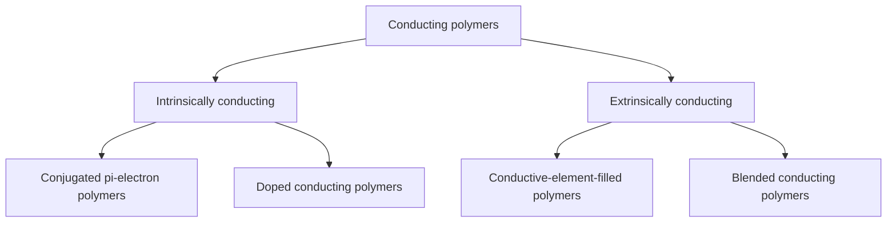
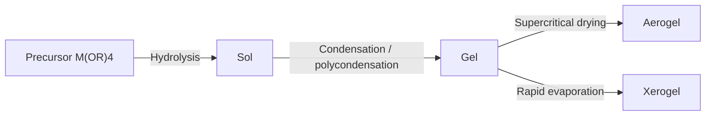

<!-- page 1 | Module 2 · source page 1 -->

[Non-content page]

---

---

<!-- page 2 | Module 2 · source page 2 -->

# MODULE 2

## MATERIALS FOR ELECTRONIC APPLICATIONS

### Study map

Begin with nanomaterials, their classification, and synthesis. Then explore carbon materials and conducting polymers, followed by applications in OLEDs, solar cells, and supercapacitors.

- Nanomaterials are materials whose characteristic length scale lies within the Nano metric range (1-100nm) at least in one dimension.
- Nanoparticles that are naturally occurring (e.g. volcanic ash, soot from forest fires) or are the incidental by-products of combustion processes (e.g. welding, diesel engines)
- Nanomaterials have a much greater surface area per unit mass compared with larger particles. Shows enhance properties such as reactivity, strength and electrical characteristics

### Classification

1. Classification based on dimension
2. Classification based on materials

### Classification based on dimension

a. **Zero dimensions (0-D):** Here all the three dimensions are in the nanometric range eg. Nano particle.

b. **One dimension (1-D):** Here one of the dimensions is outside the nanometric range and the other two are within the range eg. Nano wires, fibers and tubes.

c. **Two dimension (2-D):** Two of the dimensions are outside the Nano metric range and one is within the range eg. Nano films

d. **Three dimension (3-D):** All the dimensions are outside the nanometric range(>100nm) eg. Bundles of Nano wires and tubes.

### Classification based on materials

**(a) Carbon based nanomaterials**
- Materials in which the nano component is pure carbon eg. Carbon nano tubes (CNT), wires, spheres (fullerene) and graphene

**(b) Metal based nanomaterials**
- Materials made of metallic nanoparticles like gold, silver, metal oxides, etc. eg. Titanium dioxide ($\text{TiO}_2$).

**(c) Nano composites**
- It is a mixture of dissimilar nanoparticles or compounds (1D, 2D, 3D etc.) such as nano sized clays within a bulk material.
- They give better physical, mechanical and chemical properties to that of the initial bulk material.

---

---

<!-- page 3 | Module 2 · source page 3 -->

**(d) Nanopolymers or Dendrimers**
Dendrimers are nanosized polymers built from branched units. These are tree-like molecules with defined cavities and can hide molecules in their cavities. Important application is for drug delivery.

**(e) Biological nanomaterials**
These nanomaterials are of biological origin and are used for nanotechnological applications.
eg. DNA nanoparticles, nanostructured peptides and are used in drug delivery systems

**Synthesis of Nanoparticles**
The chemical methods are
a Hydrolysis b. Reduction

**<u>Hydrolysis</u>**
Nano particles of metal oxides can be prepared by the hydrolysis of their alkoxide solutions under controlled conditions. Commercially important nano particles of silica ($\text{SiO}_2$), titania ($\text{TiO}_2$), alumina ($\text{Al}_2\text{O}_3$) are prepared by this method.
$$\text{Ti(OR)}_4 + 2\text{H}_2\text{O} => \text{TiO}_2 + 4\text{ROH}$$

**Sol-Gel method**
- The sol-gel method is based on the phase transformation of a sol into a gel.
- A sol is colloidal system of nano-solid particles dispersed in a liquid.
- A gel is colloidal system in which liquid droplets are dispersed in a network of solid nanoparticles.
- The sol contains many other impurities. In order to remove impurities sol is transformed into a gel by changing the pH or other factors.
- The gel can be purified by filtration and washing with suitable solvents. The purified gel on drying gives solid nanoparticle.
- For example aluminium oxide nanoparticles are obtained by hydrolysis of aluminium alkoxide by sol gel technique.
$$\text{Al(OR)}_3 + 3\text{H}_2\text{O} \rightarrow \text{Al(OH)}_3 + 3\text{ROH}$$

**Reduction**
Nanoparticles of gold and silver can be prepared by the reduction method

**Reduction using reducing agents**
- Silver nanoparticles can be prepared by this method.

---

---

<!-- page 4 | Module 2 · source page 4 -->

- About $60\text{ mL}$ $\text{AgNO}_3$ solution is taken in a beaker, covered with a watch glass and heated in hot plate, then stirred using a magnetic stirrer. Add $6\text{ mL}$ of trisodium citrate drop wise to the boiling solution.
- The beaker is then closed and kept for some time till the colour of the solution changed to a light golden colour.
- Then it is allowed to cool and the solvent can be removed by freeze-drying.

### Applications

- Nano structured semi conductors are used as window layers in solar cells.
- Nano sized metal-oxides are used as gas sensors.
- Carbon nano tube are used for making paper batteries
- A mixture of Carbon nanotube and fullerenes is used for making solar cells.
- Nano cadmium telluride exhibit different colours and can be used dyeing fabrics.

### Graphene

- Graphene is an allotrope of carbon consisting of mono layer of carbon atoms arranged in a two dimensional honey comb lattice, which is the building block of graphite materials. Eg. Carbon nano tube, fullerene.
- It has charge transport, thermal, optical and mechanical properties. Different techniques such as electron microscope and optical microscope etc, are used to characterisation of graphene

### Structure

- In graphene the carbon atoms are $\text{Sp}^2$ hybridized and are arranged in hexagonal fashion.
- Graphene is two dimensional planar structures consisting of single layer of carbon atoms that are tightly bound together by strong covalent bonds with bond length $0.142\text{ nm}$.
- Each carbon atom is connected to its three nearest neighbours by $\sigma$-bonds, and a delocalized bond $(\pi - \pi*)$
- Free moving electrons are responsible for electronic properties of graphene
- Since graphene is flat, every atom is on the surface and is accessible from both sides, so there is more interaction with surrounding molecules.

### Properties

- Electrical conductivity: Graphene has high electrical conductivity
- Mechanical strength and elasticity: Graphene is 200 times stronger than steel. Graphene have great stability and a very high tensile strength (the force in which you can stretch something before it breaks).
- Optical: Graphene is suitable for transparent electrodes for displays, screens etc.

---

---

<!-- page 5 | Module 2 · source page 5 -->

- Surface area It has high surface area due to its single-atom thickness and applications in energy storage devices

**Applications**

1. Electronics: Graphene based thin film can be used in touchscreens. Smaller size transistors can be developed using graphene
2. Energy storage: Graphene incorporated lithium-ion batteries have longer life span, faster charging time and higher capacity. Graphene is used in supercapacitors to provide high energy density.
3. Biomedical: Used to carry chemotherapy drugs to cancer cells and biosensors
4. Environmental: Graphene based membranes can purify water in a more efficient
5. It can be used in filters and coatings to remove pollutants and toxins from the air.

### Carbon Nanotubes

Carbon nanotubes are tubular form of Carbon atom with diameter 1-3 nm and length few nm micrometers. CNT and made by rolling a one atom thick layer of graphite called graphene into a cylinder.

There are two types of CNTS. Single walled Single walled and multi wall nanotubes

**Single walled nanotubes (SWNT )**

SWNTs have a diameter close 1nm and tube length that can be many millions of time longer. The SWNT is formed by wrapping a one atom thick layer of graphite called graphene into seamless cylinder.

**Multiwall carbon nanotubes (MWNT )**

It consists of several multiple concentric nanotube cylinders, It Shows both metallic and semiconducting properties. It is used for staring fuel such as hydrogen and methane.

---

---

<!-- page 6 | Module 2 · source page 6 -->

Properties

1. Carbon nanotubes are very strong and have high thermal conductivity.
2. Due to the presence of delocalized electron they possess high electrical conductivity compared to metals.
3. Their tensile strength is 100 times greater than that of steel of same diameter.
4. They are light weight and density is about 1/4 of steel.

Applications

1. In the field of biomedicine CNT are used as capsules for drug delivery, biosensing, bioimaging, nanorobotics, gene therapy and tissue regeneration
2. Depending on their size they act as electrical conductors, semiconductors or capacitors.
3. It is used in battery technology and in industries as catalyst.
4. Used in solar panels, LEDs, sensors, transistors, field emitting devices, fuel cells etc.
5. It is used in water softening process as a filler
6. They are used as tips for analysis of DNA and Protein's by atomic force microscopy.

Fullerenes

- A fullerene is an allotrope of carbon whose molecules consist of carbon atoms connected by single and double bonds so as to form a closed or partially closed mesh, with fused rings of five to six atoms. Fullerene is zero dimensional, hollow, closed cage nanoparticles.
- The most common fullerene molecule is having a molecular formula C60

Preparation

- Fullerenes are prepared by vaporizing a graphite rod in helium atmosphere. Mixture of fullerene like C60, C70 etc. is formed, which are separated by solvent extraction. Pure C60 is isolated from this mixture by column chromatography.

Structure

- The C60 molecule has a perfect icosahedron geometry. An icosahedron is a polygon with 60 vertices and 32 faces, 12 of which are pentagonal and 20 hexagonal. A carbon atom is present at each vertex of the structure. The molecule is aromatic and has several resonance structures.

---

---

<!-- page 7 | Module 2 · source page 7 -->

* The valencies of each carbon atom are satisfied by two single and a double bond. $C_{60}$ is also known as bulky ball as it is a spherical cluster of carbon atoms arranged 5 and 6 member rings ball shape form a of soccer
* Carbon atom in fullerene molecule is $SP^{2} \& SP^{3}$ hybridized

**Properties**

1. Fullerene is black powdered material and forms deep magenta solution when dissolved in benzene.
2. Fullerene became harder than steel and diamond. Very tough and thermally stable and exists as discrete molecule, unlike other allotropic forms of carbon
3. Electrical: They are normally insulators; It can be used as a superconductor when doped with alkali metals.
4. They give absorption in UV region.

**Applications**

* **Coating & Lubricant:** It is suitable for use as a lubricant due to its spherical structure. The bulky balls, would act as a molecular ball bearing.
* Used in electronic and micro electronics devices.
* **Biomedical:** Fullerenes can be used to deliver drugs to specific cells or tissues. Used as contrast agents in imaging techniques such as MRI or ultrasound.
* **Energy storage:** Fullerenes and derivatives are used as storage devices for hydrogen
* Nonlinear optical devices.
* **Environment:** Sensors for detecting environmental toxins and pollutant

**Polymers**

* Polymers are molecule with large molecular masses obtained by the covalent linkage of small repeated units called monomers. The repeating chemicals unit may be same or different.
* **Homopolymers:** The polymer is made one type of monomer. Eg. Polyethylene, PVC.
* **Copolymers:** The polymer is made of different type of monomer (eg BS, ABS)

**Based on the types of polymerization, polymers can be divided into**

(i) Addition polymers eg. Polythene, PVC
(ii) Condensation polymers eg. Nylon 66, bakelite

---

---

<!-- page 8 | Module 2 · source page 8 -->

### Fire retardant polymers

* Fire retardant polymers are chemical compounds that are added to flammable polymers to make them less likely to catch fire. They can be used to: Reduce the rate of flame spread, Reduce smoke and fume emission, Reduce heat release, and Give more escape time.

  Eg. Nitrogen based polymers silicon polymers, novolac etc.

* Inorganic additives such as aluminium hydroxide, ammonium polyphosphate etc. and organophosphorus compounds can be incorporated into polymers to enhance their fire resistance.

* Halogenated polymers are also fire-retardant polymers. In the case of halogenated polymers like PVC, Poly brominated styrene etc halogen radical (Cl, Br) combines with H and OH radicals to form stable molecules like HCl and HOBr resulting in quenching of chain reaction. Among halogens Bromine is found to be more effective in quenching fire.
  Eg. Polyvinyl chloride (PVC), Poly(bromostyrene) and brominated butyl rubber.

### Conducting polymers

* Organic polymers having conjugated $\pi$ electron (alternate single and double bond system) can conduct electric current, such polymers are called conducting polymers

  Eg. poly acetylene, poly aniline, poly pyrrole

### Classification

### Intrinsically conducting polymers

* These polymers having conjugation in the back bone

---

---

<!-- page 9 | Module 2 · source page 9 -->

### Conductive polymers having conjugated $\pi$ electron

* Due to the presence of extensive conjugation in the back bone, overlapping of $\pi$ electron take place and results in the formation of valence and conduction band. Which extent over entire polymer.
* Highest occupied band is valence band and lowest unoccupied band is called conduction band. These bands are separated by distance called band gap.
* When electron from Valence band is excited to conduction band either thermally or photolytically electrical conductance occurs eg. Poly acetylene and poly aniline

### Doped conducting polymers

* Conducting polymers with conjugated-$\pi$ electrons in their backbone can be oxidized or reduced by creating positive or negative charge. This process is referred to as Doping.

Two types of doping are

a) P-type or oxidative doping

b) n-type or reduction doping

**p-doping:**

* It is done by oxidation process. In this process some electron from $\pi$ bond of the conjugated double bonds are removed by Lewis acids such as $\text{FeCl}_3$ and a positive charge (hole) created. The hole(+) can moved along the molecule and make the polymer conducting

**n-doping:** In this type of doping some electrons are introduced into the polymer having conjugated double bonds by reduction with Lewis bases like sodium naphthalide etc. Negative charge is created on the polymer chain and makes it conductive.

---

---

<!-- page 10 | Module 2 · source page 10 -->

### Extrinsically conducting polymers

* Conducting polymers whose conductivity is due to the presence of externally added ingredients in them.

* **Conductive element filled polymer:** polymers which are filled with conducting elements such as carbon black, metallic fibers, metal powders etc. These polymers are low cost, light weight, mechanically durable and strong.

### Blended conducting polymers:

* These polymers are obtained by blending conducting polymers with conventional polymers.

* These polymers possess better physical, chemical and mechanical properties.

### Applications of conducting polymers

* The conducting polymers can be used as cathode and solid electrolytes in rechargeable batteries for automotive and other applications.

* It can exhibit electro chromic property and can be used to produce "smart widows and electroluminescence OLED display in TV

* Used for making analytical sensors for pH, $\text{O}_2$, $\text{NO}_2$ and glucose detection.

* In electronics it can be used in LEDS, electromagnetic shielding etc.

### Polyaniline (PANI)

* The oxidative product of aniline under acidic conditions is known as aniline black

#### Chemical method

* Aqueous solution of ammonium per sulphate is added slowly to acidified aniline at a temperature of $5^{\circ}\text{C}$ with continuous stirring. After an hour a precipitate is formed, which can be removed by filtration. The polymer obtained is washed with ammonium hydroxide solution

#### Electrochemical method

* Platinum foil electrodes is dipped on acidified solution of aniline and a potential of $0.7\text{ V}$ applied, thin film of polyaniline is formed on the surface of the positive electrode.

---

---

<!-- page 11 | Module 2 · source page 11 -->

**Structure:** Polyaniline is found in three oxidation states in which emeraldine is conductive.
Emeraldine salt of polyaniline is highly electrically conducting.

**Properties:**

* Polyaniline (PANI) is stable in air, soluble in organic solvents, chemical resistance and good conductor of electricity by suitable dopant

**Applications:**

* As electrode material for rechargeable batteries.
* As shield in complex electronic circuits and electromagnetic radiations.
* In biosensors and solar energy absorption.

**Polypyrrole (PPy):**

* It is an intrinsic conducting polymers

**Chemical method:** Polypyrrole can be synthesized by oxidative polymerization. By mixing $0.1\text{M}$ aqueous solution of pyrrole and $0.1\text{M}$ of ammonium persulphate in 1:1 ratio in a beaker and kept for 3hrs. The precipitates formed are Polypyrrole, filtrate and dried.

**Electrochemical method:** By the electrolysis of pyrrole ($0.06\text{M}$) in aqueous acetonitrile solution using platinum electrodes and tetraethyl ammonium boron tetrafluoride as the supporting electrolyte ($0.01\text{M}$). The polymer will be precipitated as a blue-black film on the anode.

---

---

<!-- page 12 | Module 2 · source page 12 -->

### Properties

- PPy has excellent electrical, thermal and mechanical properties.
- It has good environmental stability and higher conductivity.
- The electrical resistance was found to decrease as temperature increases and hence conductivity increases.

### Applications of Polypyrrole (PPy)

- Poly pyrrole is used mostly in biosensors and immunosensors.
- Light weight and used in rechargeable batteries.
- It has applications in tissue engineering.
- It shows different colours in different oxidation state, hence used in electrochromic display.

### OLED (Organic Light Emitting Diode)

- OLED is a light-emitting diode (LED) in which emissive electroluminescent layer is a film of organic compound which emits light in response to an electric current.
- This layer of organic semiconductor is situated between two electrodes; at least one of these electrodes is transparent.
- There are two main families of OLED: (i) those employing conducting polymers
  (ii) Those based on small molecules.

### Principle

- In conjugated polymer OLED is HOMO-LUMO transition.
- In small molecule OLED is the creation of a light-emitting electrochemical cell (LEC) on adding mobile ions to an OLED

### Construction

The OLED consists of following parts

**Substrate:** Plastic or glass substrate, which supports OLED

**Anode:** Indum titanium oxide (ITO) is anode

**Conductive/Hole transport layer (HTL):** An organic layer that transport holes from anode
  eg. Polyaniline

**Emissive/electron transport layer (EML/ETL):** The emissive layer used in an OLED
  Polymer eg. Poly fluorene

**Cathode:** Metallic cathode such as silver copper etc.

---

---

<!-- page 13 | Module 2 · source page 13 -->

1. Cathode, 2. Emissive layer, 3. Emission of Radiation, 4. conductive layer, 5. Anode

**Working**

* To make an OLED light up, we simply attach a voltage (potential difference) across the anode and cathode.
* As the electricity flows, the cathode receives electrons from the power source and the anode loses them.
* An added electron makes the emissive layer negatively charged, while the conductive layer is becoming positively charged.
* Positive holes are much more mobile than negative electrons so they jump across the boundary from the conductive layer to the emissive layer.
* When a hole meets an electron enormous amount of energy is released in the form of a quantum of light or a photon.
* This process is called recombination, and it is happening many times a second, thus the OLED produces continuous light.

**Advantages of OLED**

* The manufacture of OLED is highly economical and is more efficient than LCD flat panel screens.
* There is much difference in watching a high-definition TV to a OLED display. As the contrast ratio of OLED is very high (even in dark conditions), it can be watches from an angle nearly 90 degrees without any difficulty.
* No backlight is produced by this device and the power consumption is also less.
* OLED has less response time than LCD.

**Dye sensitized solar cells (DSSC)**

Solar cells convert light energy directly into electricity by the principle of photovoltaic effect. Photon of light knocks electrons from atoms within the semi conducting materials, creating an electric current. A dye sensitized solar cell is a photochemical cell which converts solar energy absorbed by the dye to electrical energy.

---

---

<!-- page 14 | Module 2 · source page 14 -->

### Construction

**Substrate**: Glass or flexible transparent plastic in which transparent conductive oxide (TCO) is coated

**Transparent conductive oxide layer**: Thin film of Indium Tin Oxide act as TCO

**Semiconductor metal oxide nano particle**: semi conducting metal oxide with large surface area and wide band gap are used DSSCs eg. $\text{TiO}_2$, $\text{ZnO}$ etc

**Dye / Photosensitiser**: surface of the nanomaterial are coated with organic or inorganic dye molecules which absorb sunlight. Dye-sensitized metal oxide semiconductor act as anode, eg Ruthenium based complex, organic dyes, natural dyes extracted from plants etc.

**Electrolyte**: Redox couple iodide solution is used as electrolyte

**Counter electrode**: Platinum or graphite materials are used as counter electrode and it completes the circuit.

### Working of Dye-sensitized solar cells

* Sunlight passes through the transparent conductive oxide layer, the metal oxide semiconductor absorb the light.
* The electron in the dye molecules get excited and are injected into the conduction band of the semiconductor. These electrons travel through external circuit and generate current.
* The oxidised dye molecules get reduced by gaining electrons from electrolyte and return back to original form.

### Advantages

* The fabrication of DSSCs is simpler processes compared to conventional silicone cells.
* They are light weight which can be advantageous for application is on vehicles and pda devices.
* They are flexible in shape, and size and hence can be implemented on window, terraces etc.
* Since natural pigments and organic dyes are used, they are sustainable and eco-friendly

---

---

<!-- page 15 | Module 2 · source page 15 -->

### Applications

- They can be used in portable solar chargers for electronic devices
- They can be integrated into the fabric of bags and backpacks to charge electronic devices while on the travel.
- DSSC can be used to power illuminated signs and displays in locations where access electricity is limited or costly.

### Super capacitors

- A super capacitor, also known as an ultra-capacitor or double-layer capacitor, is an energy storage device having high-capacity than solid-state capacitors but with lower voltage limits.
- Super capacitors have a high power density and can release energy efficiently over a short time.
- Super capacitors can charge and discharge rapidly.

- Super capacitor generally consists of electrodes, electrolyte, separator and collector.
- It store charges at the interface between an electrode and an electrolytic solution.

### Electrodes

- Carbon-based materials are often used as super capacitor electrode materials eg. Carbon nanotubes, nanowires, metal oxide nano particles etc. Nano materials enhance the performance of the super capacitor.

### Electrolyte

- Capacity of the capacitor depends mainly on the dielectric constant of the electrolyte.
- Either solid or liquid can be used as the electrolyte.
- Generally, a solvent mixed with conductive salts such as tetra alkyl ammonium or lithium salts acts as the solid electrolyte.
- Sulphuric acid, KOH solution etc can act as the liquid electrolyte.

### Separator

- Electrolyte membranes will act as the separator.
- It prevents short-circuiting between the electrodes but allows the electrolyte ions to pass through.
- Polymer-based and paper-based are found to be durable and economical.

---

---

<!-- page 16 | Module 2 · source page 16 -->

**Collector**

* Electrons are collected at the collector. Carbon fibre, metal like Al, Pt, Cu etc are commonly used collectors.
* Binders, such as polyvinylidene fluoride (PVDF) and poly acrylonitrile (PAN), act as adhesives to hold the active material and current collectors together

**Advantages of super capacitor**

* Longer cycling time and higher service life compared to the battery.
* High efficiency, higher charging rates and high power density.
* Low resistance which enables them to produce high load currents.
* Small sizes and lightweight which makes them easily installed in small areas.
* Environment friendly.

**Quantum computing technology**

Quantum computing uses the principle of quantum theory. Quantum computers harness the properties such as

* superposition (quantum particles as combination of all possible states),
* Entanglement (ability of quantum particles to correlate their measurement results with each other) and
* Quantum interference (behaviour of a qubit, arising from superposition, which influences the probability of the qubit collapsing to one state or another upon measurement) for computing

In conventional computers using semiconductors, electrons represent binary states (0 or 1), but Quantum computing uses quantum bits (qubits), that are superpositions of 'spin up' and 'spin down' states, allowing them to represent all numbers between 0 and 255 simultaneously. This allows quantum computers to perform many calculations in parallel.

**Materials used for Quantum Computing**

* Quantum computing technology uses a variety of materials, including metals, semiconductors, and topological materials.
* Aluminum, niobium, and titanium nitride are used to create superconducting qubits.
* Silicon and other semiconductor materials are used in qubits based on electron or nuclear spins.
* Quantum dot materials like Indium Arsenide and Gallium Arsenide are used to produce photons. Photons are used as qubits in quantum communication.

**Spintronics**

* Spintronics or spin-electronics exploit the spin of electron in addition to charge, for data storage, processing and communication in solid devices (new generation transistors, lasers and magnetic sensors).
* Spin orientation lasts longer charge-based information, making them suitable for memory storage, magnetic sensor quantum computing
* Spintronics make use of the magnetoresistive effects for sensing and storing information.

---

---

<!-- page 17 | Module 2 · source page 17 -->

- Giant Magnetoresistance (GMR) is a phenomenon where a material's electrical resistance changes dramatically when exposed to a magnetic field. This effect is widely used in magnetic storage (eg: Magnetic random-access memory) and sensing technologies.
- GMR spin valve sensor has improved the capacity of hard disc drive by hundred fold times.

**Types of Spintronics**

**Metal based:** Electron spin in metallic materials eg. $\text{MgO}$, $\text{Al}_2\text{O}_3$

**Semiconductor based:** Ternary alloys such as InAs and GaAs alloyed with Mn. (Co, Fe, B), etc are used as semiconductor spintronic materials due to their tunable magnetic and electronic properties.

**Graphene based:** Spin depended physical properties of Graphenes are also used for development of Spintronics.

---

---

<!-- page 18 | Module 2 · source page 1 -->

[Non-content page]

---

---

<!-- page 19 | Module 2 · source page 2 -->

# MODULE-2

## MATERIALS FOR ELECTRONIC APPLICATIONS

### 1) Nano materials.

=> what are nano materials. Give example.

A). Any material having the size of 1 to 100 nano meter. are called nano materials.

- Nanomaterials are those which contain nanostructures as their component building block.

- Nano structures exhibit novel physical, chemical and biological properties and phenomena because of their characteristic size.

### Nano Chemistry

=> It is a new branch of nanoscience related with the production and reaction of particles at molecular level.

=> It presents a unique aproach to building devices with a molecular scale precision.

---

---

<!-- page 20 | Module 2 · source page 3 -->

- Nanochemistry offers the method of building objects and devices atom, by we can envision the advantages of nano devices is scientific exploration, computing, electronic and a host to other fields.

- It includes study of interaction of individual atoms, the way to manipulate them, and how to control chemical reactions at atomic level.

### Nano technology

- Nanochemistry is an integral part of the multidisplinary technology at the nanoscale which is known as nano tech.

- It is an interdisciplinary area where reaserchers overlap over various academic disciplines including chemistry, physics, bioscience, material science, computational engineering, colloidal science and even mechanical and electrical engineering.

### Nano science.

- Nano science is the newest find in science and of course, in business

- Nanoscience comprises of the study of matter at the ultimate scale at which nature designs the molecular scale.

- Advances in the field of nanoscience have led to nanotechnology

---

---

<!-- page 21 | Module 2 · source page 4 -->

classification of nano material.

1) Based on dimension.

(i) zero dimension

$\Rightarrow$ the dimensions are measured using nanoscale.

$\Rightarrow$ metalic nanoparticle include gold and silver.

$\Rightarrow$ semiconductors such as quantum dots.

$\Rightarrow$ most of the nanomaterials are spherical in size and the diameter of these particle is $1-50\text{ nm}$.

eg: Nanospheres, clusters.

(ii) one dimensional.

$\Rightarrow$ one dimension of the nanostructure will be outside the nanometer range.

$\Rightarrow$ includes nanowires, nanotubes, and nanorods.

$\Rightarrow$ These materials are long, but with diameter of only a few nanometers.

---

---

<!-- page 22 | Module 2 · source page 5 -->

eg: Nanotubes, wires, rods.

(III) Two dimensional nano materials.

$\Rightarrow$ These dimension are outside nanometer range.

$\Rightarrow$ Includes dfrnt kinds of nanofilms such as coatings and thin film - multiplayers, nanosheets, or nano walls.

$\Rightarrow$ The area of the nanofilms can be large, but the thickness always in nanoscales range

eg: Thin films, plates, layered structures.

(IV) Three dimensional nano materials.

$\Rightarrow$ All dimensions of these are outside the nanometer range.

$\Rightarrow$ These includes bulk materials composed of the individual blocks which are in the nanometer scale (1-100 nm), dispersions of nanoparticles, bundles of nanowires and nanotubes as well as multi-nano layers etc...

eg: Bulk NM, poly crystals.

---

---

<!-- page 23 | Module 2 · source page 6 -->

classification based on commercial purpose

$\Rightarrow$ carbon based nanomaterials.

$\Rightarrow$ composed of carbon

eg: hollowsphere, ellipsoids or tubes

$\Rightarrow$ spherical and ellipsoidal reffered as fullerenes

$\Rightarrow$ cylindrical one called carbon nanotubes.

$\Rightarrow$ metal based nano material

$\Rightarrow$ It includes nanometals (nanogold, nanosilver), metal oxide nanopowder (silica, ($SiO_2$), titania, $TiO_2$ etc) iron oxide ($Fe_3O_4, Fe_2O_3$...)

$\Rightarrow$ semiconductor nanocrystals or quantum dots - cadmium, [uncertain: uride] ($CdSe$) gallium arsenic ($GaAs$) etc...

$\Rightarrow$ Dendrimers.

$\Rightarrow$ nanosize polymers build from branched units.

$\Rightarrow$ polymer based tree-like that have size in the nano scale.

---

---

<!-- page 24 | Module 2 · source page 7 -->

It has interior cavities and surface have numerous chain ends to perform specific chemical functions.

composits.

$\Rightarrow$ Nanomaterials that combine one or more seperate components and which are designed to exhibit overall the best properties of each component.

$\Rightarrow$ They can be combination of nanomaterials with other nanomaterials or with bulk materials.

synthesize of nano material

$\Rightarrow$ These are two types:

1) Bottom up method $\Rightarrow$ sol-gel (${\nearrow}\text{solid in liquid}$, ${\nearrow}\text{liquid in solid}$) method, reduction method
2) Top down method $\Rightarrow$

1) Bottom up method - starting with small components such as atoms or molecules.

---

---

<!-- page 25 | Module 2 · source page 8 -->

2) Top down method $\Rightarrow$ starting with bulk material and breaking away to [uncertain: small parts] [illegible]

eg : lithography , Ball milling

Bulk material \qquad powder \qquad NPs

Reduction method for the synthesize of nano material

$\Rightarrow$ It's a bottom up method.

$\Rightarrow$ metal halides ($CrCl_3$, $MoCl_3$) can be reduced using $NaB(Et)_3H$. using toluene as solvent.

$\Rightarrow$ By this nano particles of chromium and molybdenum are prepared.

$$CrCl_3 + 3 NaB(Et)_3H \longrightarrow Cr + NaCl + 3 B(Et)_3 + 3/2 H_2$$
$$\downarrow$$
$$\begin{matrix} \text{chromium} \\ \text{nano particle} \end{matrix}$$

$$MoCl_3 + 3 NaB(Et)_3H \longrightarrow Mo + 3 NaCl + 3 B(Et)_3 + 3/2 H_2$$

---

---

<!-- page 26 | Module 2 · source page 9 -->

## sol-gel method

- It is a bottom up method.
- sol $\longrightarrow$ dispersed phase is solid & dispersed medium is liquid.
- gel $\longrightarrow$ dispersed phase is liquid & dispersed medium is [uncertain: sodium].
- It is a wet chemical method that use sol to produce integrated network called gel.
- 4 methods.
  1) Hydrolysis of precursor (starting molecule).
  2) condensation
  3) poly condensation & formation of gel.
  4) Drying

### Hydrolysis

- It ocurs by the addition of water to any one of the precursor material to form silanol (sioH) particles.

---

---

<!-- page 27 | Module 2 · source page 10 -->

condensation.

=> The self condensation of silanol groups produces siloxal linkages filled with by products of water and alcohols.

Poly condensation

=> The condensation process continues to form poly condensed silica gel with si-o-si linkages

---

---

<!-- page 28 | Module 2 · source page 11 -->

$\xrightarrow{n\text{H}_2\text{O}}$

<u>Drying</u>

$\Rightarrow$ The gels are subjected to super critical drying in an autoclave. The critical pressure and critical temp used are 78 bar and $241^\circ\text{C}$ respectively in order to remove liquid from silica gel to form the network structure of silica aerogel.

---

---

<!-- page 29 | Module 2 · source page 12 -->

# Applications of nanomaterials

- in electronics
- in optics
- in catalysis
- in medicine

### In electronics

- Carbon nano tubes, because of their novel and tunable mechanical, electrical, and thermal properties have great importance in nano electronics.
- They have found a range of potential applications such as semiconductor chips, sensors, and high resolution display device.
- Semiconductor nanocrystals called quantum dots, with their size-tunable energy levels and characteristic electronic properties, have already made their mark in several electronic appliances.

1) Miniaturization of components
2) Flexible electronics
3) High-performance display.
4) Improved data storage
5) Advanced transistors and circuits.

---

---

<!-- page 30 | Module 2 · source page 13 -->

<u>optics</u>

=> Reducing the size of material optical propertie will change.

=> Gold and cdse nanoparticles are used to impart different colouration to glass.

=> many fluorescent nanoparticles have been used for imaging applications and these include semiconductor quantum dots, fluorescent silica nanoparticles, silica coated fluroscent polymer particles etc...

1) LED (2) Non linear optics (3) photo voltaics (4) Biomedical imaging.

<u>Catalysis</u>

=> due to high surface to volume ratio.

=> Nanocatalysis include several materials like various forms of carbon (carbon black, fullerenes), inorganic nanotubes ( i.e, BN,) , metals (Al, Fe, co) and oxides ($Al_2O_3, Fe_2O_3$).

=> nanocatalyst are important in all kind of industries and researches because catalytic material show very great catalytic efficiency.

---

---

<!-- page 31 | Module 2 · source page 14 -->

1) Environmental remediation

2) industrial and chemical synthesize.

3) Rocket propellants.

4) Biofuel production.

In medicine.

=> $\checkmark$ Bio imaging and targeted drug delivery, [uncertain: diagnostic]

=> In such area involves bioimaging applications in which nanoparticles with size tunable light emission are employed to produce images of tumor sites.

=> Here nanomaterials are designed for specific diagnostic or theraputics medical uses.

- Tissue engineering, cancer therapy,

* what are the advantages of nano materials and nanoparticles is compared to bulk material / what are the properties of nano materials.

A)
Reducing the size of any materials to nano $(1-100\text{ nm})$.

---

---

<!-- page 32 | Module 2 · source page 15 -->

$\Rightarrow$ surface to volume ratio will be increase.

$\Rightarrow$ Optical propertie can be change.

$\Rightarrow$ IMP. magnetic, thermal, mechanical property can be change. (synthetic tyre have carbon nano material)

### 4 - Different types of nanomaterials.

1) Graphene
2) Fullerene [Foot ball type structure]
3) carbon nanotubes.
4) quantum dots.

* Explain these four material with applications.
[4 each].

$\Rightarrow$ **carbon quantum dots.**

- Novel class of carbon nanomaterial with prominent flurescence properties.
- CQDs are zero dimensional small carbon nanoparticles.
- It consists of ultrafine, distributed quasi-spherical carbon nanoparticles with size less than 10nm.

---

---

<!-- page 33 | Module 2 · source page 16 -->

## Applications

- biomedical applications
- optoelectronics
- lighting
- environmental

Carbon dots

## Graphene

- Graphene is a crystaline allotrope of carbon with two dimensional, atomic scale, hexagonal pattern.
- each carbon atom forms four bonds, three $\sigma$ with it's three neighbours and one 'p' bond.

### Applications

- it's nearly transparent
- It's 200 times stronger than steel by weight due to it's tightly packed carbon atoms.
- It conducts heat and electricity with great efficiency.

---

---

<!-- page 34 | Module 2 · source page 17 -->

$\rightarrow$ It is commonly used in semiconductors, batteries,
electronics etc...

Fullerenes

$\Rightarrow$ The Fullerenes (allotrops of carbon) are graphene sheets rolled into tubes or sphere.

$\Rightarrow$ It was named as buckministerfullerenes or bucky ball

Applications

$\Rightarrow$ Fullerenes and their derivatives have potential antiviral activity. and may be used for HIV infection treatment.

$\Rightarrow$ They are used as biological antioxidants.

$\Rightarrow$ They are also used as potential photosensitizers in photodynamic therapy and catalysts for hydrogenation.

$\Rightarrow$ They have potential medicinal applications as they can bind specific antibodies and target certain types of cancer cells such as melanoma.

---

---

<!-- page 35 | Module 2 · source page 18 -->

Nanotubes.

$\Rightarrow$ A carbon nanotube is a tube-shaped material made up of carbon, having a diameter ranging from $1\text{ nm}$ to $50\text{ nm}$.

$\Rightarrow$ simply we can say carbon nanotubes are cylinder of one or more layers of graphenes.

Applications

$\Rightarrow$ Nanotubes can potentially replace indium tin oxide in solar cells to generate photocurrent.

$\Rightarrow$ SWNT's are used [uncertain: tha] in transistors and solar panel.

$\Rightarrow$ Parallel CNTs have been used to create loudspeakers.

$\Rightarrow$ CNTs can be used to produce nanowires.

$\rightarrow$ $\text{SWNT} \Rightarrow$ single wall nano tube.

This may be zigzag, armchair and chiral depending on the manner in which graphene sheets are rolled.

---

---

<!-- page 36 | Module 2 · source page 19 -->

MWNT - Multi wall nano tube.

$\rightarrow$ It consist of several single walled nanotubes with different diameters. [illegible]

Conducting polymers

$\Rightarrow$ Some polymers shows remarkable ability to conduct current it is due to the presence of conjugated pi electrons in the back bone of polymer.

eg: polyacetylene, polypyrol, poly anelene.

Draw the structure.

1) $(-CH=CH-CH=CH-)_n \longrightarrow$ poly acetylene.

---

---

<!-- page 37 | Module 2 · source page 20 -->

3)

IMP

classification of conducting polymers.

---

---

<!-- page 38 | Module 2 · source page 21 -->

1) conducting polymers having conjugated pi electrons.

$\Rightarrow$ Repeat cp statement.

2) dopped conducting polymers

$\rightarrow$ The conductivity of conjugated polymers can be increased by dopping; either, ptype or n type dopping.

$\rightarrow$ p-type dopping.

$\Rightarrow$ It can be done by using lewis acids. such as $\text{FeCl}_3$ or $\text{AlCl}_3$

(bipolaron).

---

---

<!-- page 39 | Module 2 · source page 22 -->

N-type doping

$\Rightarrow$ It can be done by using lewis bases such as, Na [uncertain: ...]

Extrinsically conducting polymers.

1) conductive element filled polymer. (composites)

$\Rightarrow$ polymers which are filled with conducting elements such as carbon black, metalic fibres

---

---

<!-- page 40 | Module 2 · source page 23 -->

metal powders etc..

=> polymer act as a binder to hold the conducting elements together.

=> low in cost, light in weight.
   eg: pvc mixed with metal particle.

2. Blended conducting polymers. (blends)

=> obtained by blending conducting polymers with conventional polymers.

=> posses better physical, chemical and mechanical ppty.

   eg: pvc mixed with poly pyrol

* write the preparation, properties and applications of polypyrol, poly aniline, or conducting polymer.

A) <u>polypyrol</u>

It can be prepared by oxidative polymerisation. (chemical method) using ammonium per sulphate (aps).

---

---

<!-- page 41 | Module 2 · source page 24 -->

[Non-content page]

---

---

<!-- page 42 | Module 2 · source page 25 -->

v) It can be used as chemo sensor.

poly aniline

Preparation

can be prepared by oxidating polymeraisation of aniline monomer mixed with HCl, using ammonium per sulphate.

Properties

1) It has great stability in air and solubility in some organic solvent.
2) It exhibits dramatic changes in its electronic str and physical ppty.
3) The colour change in polyaniline in dfrnt oxd$^n$ states can be used in sensors and electronic devices.
4) more noble than copper and less noble than silver.

---

---

<!-- page 43 | Module 2 · source page 26 -->

Applications

1. As electrode material for rechargable batteries
2. In the dissipation of static electric charges in metallic containers
3. A shield in complex electronic circuits and electro magnetic induction
4. In biosensors and solar energy absorption.

Fire Retardant polymers

$\Rightarrow$ These are material design to resist ignition and slow the spread of fire $\Rightarrow$ They are crucial in application where fire safety is a priority such as in construction, aerospace, and electronics.

$\rightarrow$ The effectiveness of these materials depends on their ability to act in one or more of these ways.

---

---

<!-- page 44 | Module 2 · source page 27 -->

IMP !) 1) physical barrier $\longrightarrow$ formation of protective
char layer to prevent oxygen
axis .

2) chemical interference $\longrightarrow$ interfere in the chemical
reactions involved in combustion.

3) Heat absorption $\longrightarrow$ absorbs heat to lower the
temperature of the material,
delaying igniciant .

<u>properties</u>

- flame resistance
- High thermal stability
- Low smoke production.
- High chemical resistance.
- High physical barrier
- High chemical interference.
- High heat absorption.

$\rightarrow$ <u>Two types</u>

1) Halogenated fire retardant polymers.
- contains halogen atoms in polymer structures.
- which act as a fire retardant by inhibiting the

---

---

<!-- page 45 | Module 2 · source page 28 -->

Combustion process.

$\Rightarrow$ when polymers burns the halogen atoms release free radicles that reduce the burning process.

eg: poly brominated di phenyl ether.

poly chlorinated $\prime\prime$ .

$\rightarrow$ poly brominated.

$\longrightarrow$ poly chlorinated

Non halogenated Fire retardant polymers.

$\Rightarrow$ These materials do not contain halogen atom. They are environmental friendly material.

$\Rightarrow$ They cannot release or generate toxic material.

---

---

<!-- page 46 | Module 2 · source page 29 -->

eg : $\text{poly ethylene} = -(\text{CH}_2 - \text{CH}_2-)_n$
$\text{poly propylene} = -(\underset{\text{CH}_3}{\text{CH}} - \text{CH}_2-)_n$
$\text{poly stylene.} = -(\underset{\text{C}_6\text{H}_5}{\text{CH}} - \text{CH}_2-)_n$

IMP organic light emitting diode. [OLED]

$\Rightarrow$ ~~example for electro luminescence.~~

* OLED works based on electrolominiscense process.

* The conductive layer and emmisive layer in oled are made up off conducting polymers.

etc eg : poly phenylene vinylene, poly flurons.

* These are mainly used in display devices. It provides brighter thinner, eye contrast and flexible displays.

components in OLED

$\rightarrow$ metal cathode.

$\rightarrow$ Emmissive layer $\longrightarrow$ based on conducting polymer.

$\rightarrow$ conductive layer $\longrightarrow$ "

$\rightarrow$ ITO anode

---

---

<!-- page 47 | Module 2 · source page 30 -->

Diagram

working principle.

$\Rightarrow$ To make an oled light up, we simply attach a [illegible] across anode and cathode .

$\Rightarrow$ when electricity starts to flow, the cathode recieves electrons from power source and anode losses.

$\Rightarrow$ Added electron making n-type emmissive layer -vely charged and p-type conductive layer is +ve

$\Rightarrow$ +ve holes are more mobile than -ve so they jump from conductive to emmissive.

$\Rightarrow$ If a hole meets an electron two things cancel out and realease a energy in the form of a [illegible]

---

---

<!-- page 48 | Module 2 · source page 31 -->

quantum of light or a photon. This process is called recombination.

$\Rightarrow$ An OLED produces light for as long as current flows.

~~advantages~~ **Applications**

$\Rightarrow$ flexible
$\Rightarrow$ Light weight
$\Rightarrow$ Thin Form
$\Rightarrow$ durability
$\Rightarrow$ Brighter images.

**Disadvantages**

$\Rightarrow$ uv sensitivity
$\Rightarrow$ Less lifetime
$\Rightarrow$ Expensive manufacturing.
$\Rightarrow$ susceptable to water.

---

---

<!-- page 49 | Module 2 · source page 32 -->

<u>Features</u>

$\Rightarrow$ flexible.
~~applications~~

$\Rightarrow$ <u>Advantages</u>

* light weight & flexible plastic substrates.
* wider viewing angles & improved brightness.
* Better power efficiency.
* Response time.

<u>Dye-sensitized solar cell</u>

$\Rightarrow$ solar cell is a device that convert sunlight into electricity.

$\Rightarrow$ In DSSC, dye connected to metal substrate works as light harvesting material currently the efficiency is $15-16\%$.

$\Rightarrow$ The dye serves the task of light absorption and inject the electrons to the metal oxide semiconductor.

---

---

<!-- page 50 | Module 2 · source page 1 -->

[Non-content page]

---

---

<!-- page 51 | Module 2 · source page 2 -->

# Module-2

## Materials for Electronic Applications

NANOMETERIALS:

Materials whose characteristic length within nanometric range ($1-100\text{ nm}$) atleast in one dimension.

Example: fullerene, carbon nanotube, nanostructured DNA,
volcanic Ash.

Q. Why properties of nanomaterial differ from bulk material?

ans. Particle size decreases, surface area of the material increases. Hence, most of the atoms are found at the surface compared to those inside.

Example: Particle size of $30\text{ nm}$ has $5\%$ atoms on its surface. At $10\text{ nm}$, $20\%$ of atoms and at $3\text{ nm}$, $50\%$ of atoms.

CLASSIFICATION OF NANOMATERIALS:

$\Rightarrow$ Based on dimension :

1. zero dimension nanomaterial :-

$\hookrightarrow$ All the dimensions are in nanometric range.

$\hookrightarrow$ Eg: Nanoparticle - fullerene

2. one dimension nanomaterial :-

$\hookrightarrow$ one dimension outside the nanometric range, remaining two dimension are in nanometric range.

$\hookrightarrow$ Example: Nanowire, nanotube, - CNT (carbon nanotube)

3. TWO dimension nanomaterial :-

$\hookrightarrow$ Two dimensions are outside the nanometric range, remaining one is in nanometric range.

---

---

<!-- page 52 | Module 2 · source page 3 -->

$
aggedright$
$\hookrightarrow$ Eg: Nanofilm, nanosheet - graphene.

4. Three dimension nanomaterial :-
$\hookrightarrow$ All the three dimensions are outside the nanometric range
$\hookrightarrow$ Eg: Graphite

$\Rightarrow$ Based on Materials:
1. Carbon based nanomaterials:
$\hookrightarrow$ The base material is carbon.
$\hookrightarrow$ Its particle size lies in nanometric range.
$\hookrightarrow$ Eg: fullerene, CNT, graphene

2. Metal based nanomaterial :
$\hookrightarrow$ The base material is metal.
$\hookrightarrow$ Its particle size lies in nanometric range.
$\hookrightarrow$ Eg: Nano gold, nano silver, nanomolybdenum

3. Nanocomposites :
$\hookrightarrow$ It is the combination of bulk material with nanomaterial.
$\hookrightarrow$ The bulk material may be metal, polymer, ceramic, etc.
$\hookrightarrow$ Nanomaterial provides better physical, mechanical and chemical properties to the bulk material.
$\hookrightarrow$ Eg: Polyethylene nano $\text{SiO}_2$ composites

4. Nanopolymer or Dendrimer :
$\hookrightarrow$ Nanopolymer is known as dendrimer.
$\hookrightarrow$ Dendrimers are tree like structure with high branches of polymer molecules.
$\hookrightarrow$ It is prepared by addition polymerization under controlled conditions.
$\hookrightarrow$ It is mainly used in drug delivery applications.
$\hookrightarrow$ Eg: Polyamidoamine.

---

---

<!-- page 53 | Module 2 · source page 4 -->

5. Biological nanomaterials:
- These are of biological origin.
- These are used in nanotechnological applications.
- Eg; DNA nanowire, nano structured peptides.

SYNTHESIS OF NANOMATERIALS:

(i) HYDROLYSIS (SOL-GEL METHOD):
- This method is used for preparation of nano metal oxide.
  (nanoSiO$_2$ or NanoTiO$_2$ or Nano Alumina(Al$_2$O$_3$))

(ii) REDUCTION:
- Preparation of nano metal (nano gold or nanomolydenum)

EXAMPLE OF HYDROLYSIS (SOL-GEL METHOD)

SYNTHESIS OF nanoTiO$_2$

- Hydrolysis of alkoxide solution of titanium tetra isopropoxide.
$$\underset{\substack{\text{Titanium Tetra}\\\text{isopropoxide}}}{\text{Ti}(\text{OC}_3\text{H}_7)_4} + \underset{\text{water}}{4\text{H}_2\text{O}} \rightarrow \underset{\substack{\text{Titanium}\\\text{hydroxide}\\\text{(sol)}}}{\text{Ti}(\text{OH})_4} + \underset{\text{isopropanol}}{4\text{C}_3\text{H}_7\text{OH}}$$

- Polycondensation
$$\underset{\substack{\text{Titanium}\\\text{hydroxide}}}{\text{Ti}(\text{OH})_4} \xrightarrow{-\text{H}_2\text{O}} \underset{\substack{\text{Titaniumdioxide}\\\text{(gel)}}}{\text{TiO}_2}$$

- Calcination
$$\text{TiO}_2 \xrightarrow[350^\circ\text{C}-800^\circ\text{C}]{\Delta} \text{NanoTiO}_2$$

---

---

<!-- page 54 | Module 2 · source page 5 -->

EXAMPLE OF REDUCTION :

SYNTHESIS OF NANOMOLYBDENUM OF PARTICLE SIZE 1-5nm

$\rightarrow$ Molybdenum chloride ($MoCl_3$) in toluene treated with strong reducing agent like sodium boro triethyl hydride.

$$MoCl_3 + 3NaB(C_2H_5)_3H \longrightarrow NanoMo + 3NaCl + 3B(C_2H_5)_3 + H_2$$

APPLICATIONS OF NANOMATERIALS :

$\hookrightarrow$ Semiconductor
$\hookrightarrow$ Solar cell
$\hookrightarrow$ Battery
$\hookrightarrow$ Biomedical application
$\hookrightarrow$ Electronic device

PREPARATION, PROPERTIES AND APPLICATIONS OF GRAPHENE :

$\hookrightarrow$ Allotrope of Carbon.
$\hookrightarrow$ Monolayer of carbon atoms are arranged hexagonally in a two dimensional honey comb lattice.

$\hookrightarrow$ Graphene is defined as "the two-dimensional monolayer of carbon atoms, which is the basic building block of graphitic materials."
$\hookrightarrow$ The carbon atoms are $sp^2$ hybridized.
$\hookrightarrow$ Each carbon atom in graphene is bonded to three adjacent carbon atoms through a $\sigma$ bond with bond length of $0.142 \text{ nm}$.
$\hookrightarrow$ The remaining electrons in $P_z$ orbitals is perpendicular to the plane of graphene.
$\hookrightarrow$ These orbitals hybridize together to form two half filled bands of free moving electrons, $\pi$ and $\pi^*$ which are responsible for conductivity.

---

---

<!-- page 55 | Module 2 · source page 6 -->

PREPARATION:

1. Mechanical exfoliation method (Scotch tape method): Peeling of graphite layers using adhesive tape.
2. Chemical Vapour Deposition (CVD): Deposition of carbon atoms on to substrate (like Cu) in the presence of carbon containing precursor gas (methane).
3. Thermal decomposition of SiC: SiC substrate is heated under ultra-high vaccum which results sublimation of silicon atoms and decomposition of carbon atoms to form graphene.
4. Graphene oxide reduction method: The graphene is formed by the reduction of graphene oxide.

PROPERTIES:

- Chemically inert, stable and biocompatible.
- Lightest, thinnest, strongest material that conducts heat and electricity.
- Stronger than diamond and 10 times more conducting than copper.
- High elastic modulus and strength. 200 times stronger than steel.
- Excellent thermal conductivity.
- High surface area due to its single atom thickness.
- Transparrent material.

APPLICATIONS:

- Electronics: Due to lower resistance and higher transparency graphene based thin films can be used in touch screens.
- Energy Storage: Used in lithium-ion battery, Hydrogen fuel cell and supercapacitors.

---

---

<!-- page 56 | Module 2 · source page 7 -->

$\rightarrow$ Biomedical: Used to carry chemotherapy drugs to cancer cells, Used in biosensors.\
$\rightarrow$ composites and coatings: Used in paint, aircraft, sport equipments, etc.\
$\rightarrow$ Environmental: Membranes can purify water in more efficient, cheaper and environmentally friendly way.\
Used in filters to remove toxins and pollutants from air.\

### FULLERENES:

$\rightarrow$ Fullerenes are zero-dimensional, hollow closed cage nanoparticles made of carbon atoms.\
$\rightarrow$ Denoted based on number of carbon atoms in the spherical carbon ball. Eg: $C_{60}, C_{70}, C_{20}$.\
$\rightarrow$ Carbon atoms connected by single and double bonds so as to form a closed with fused rings of five to six atoms.\
$\rightarrow$ Fullerenes consists of 20 hexagonal and 12 pentagonal rings as the basis of an icosahedral symmetry of closed cage structure.\
$\rightarrow$ Each carbon atom is bonded to three others and is $sp^2$ hybridised.\
$\rightarrow$ $C_{60}$ fullerene has bond angles between $109^\circ$ and $120^\circ$.\
$\rightarrow$ $C_{60}$ has two bond length.\

### PROPERTIES:

$\rightarrow$ It is harder than steel and diamond.\
$\rightarrow$ Sparingly soluble in many solvents.\
$\rightarrow$ Electrical insulator, but when crystallized with alkali metals, the resultant compound can be conducting.

---

---

<!-- page 57 | Module 2 · source page 8 -->

- Fullerenes absorb strongly in UV and moderately in visible regions of spectrum.

APPLICATIONS
- Used for making durable, high performance coatings that resist wear corrosion.
- Used as lubricants and catalyst.
- Used to deliver drugs to specific cells or tissues.
- Used as contrasting agent in MRI.
- Used in energy storage device.
- Used in water treatment.
- Used in sensors.

CARBON NANOTUBES (CNT):
- CNT are one-dimensional nanoparticles with diameter $1-50\text{ nm}$.
- Allotrope of carbon.
- They are conceptually graphene sheet rolled into a tube.
- It is $10^5$ times thinner than human hair.
- It is classified in two:
  > Single-walled carbon nanotube (SWCNT)
  > Multi-walled carbon nanotube (MWCNT)
- SWCNT classified into three:
  (i) Armchair nanotubes: symmetrical arrangement where rolling axis align with the hexagonal lattice of graphene resulting equal edge length.
  (ii) zigzag nanotubes: Rolling axis along the zigzag pattern of the graphene lattice, leading to edges that consist of zigzag lines.
  (iii) chiral nanotubes: Rolling axis is oriented at an angle to the graphene lattice, resulting in unequal edge lengths and a helical structure.

---

---

<!-- page 58 | Module 2 · source page 9 -->

↳ MWCNT classified into three:

(i) Russian Doll model - A carbon nanotube contains another nanotube inside it.

(ii) Parchment or scroll model: A single graphene sheet is rolled around itself multiple times, resembling a rolled up a scroll of paper.

(iii) Mixed model: Mixture of both Russian doll and parchment model.

PREPARATION:

1. Arc discharge method
2. Laser ablation/evaporation method.
3. Chemical vapour deposition method.

PROPERTIES:

- Superior thermal properties
- light weight
- High optical properties
- Strongest and stiffest material
- Excellent tensile strength
- Relative transparency
- High electrical conductivity
- Impermeability to most gases and liquids.

APPLICATIONS:

- CNTs are used for miniaturizing electronic devices.
- Used in paper batteries, solar cells, ultra capacitors.
- CNT polymer composites are used for aerospace and

---

---

<!-- page 59 | Module 2 · source page 10 -->

automotive applications.
↳ Research is also carried out to assess the ability of CNT for the storage of hydrogen.

CARBON QUANTUM DOTS (CQDs)
↳ CQDs are zero-dimensional small carbon nanoparticles.
↳ carbon nanomaterial with prominent fluorescence properties.
↳ It consists of ultrafine, distributed, quasi-spherical carbon nanoparticles with size less than $10\text{ nm}$.

PREPARATION :
↳ <u>Top-Down</u> approach involves breaking down large carbon structure into small CQDs
↳ <u>Bottom-Up</u> method involves building CQDs from small carbon molecules

PROPERTIES :
↳ Exhibit strong fluorescence, photo luminescence and chemiluminescence.
↳ CQDs shows absorption mainly in the uv region.
↳ less toxicity.
↳ Biocompatible.
↳ Photostability.

APPLICATIONS :
↳ Biomedical applications
↳ Optoelectronics (Used in solar cell, supercapacitors, etc)
↳ Lighting (Used as LED material)
↳ Environmental
↳ Catalysis

---

---

<!-- page 60 | Module 2 · source page 11 -->

FIRE RETARDANT POLYMERS:
These resist ignition and slow the spread of flames.
They are classified into:

Non-halogenated fire retardant polymers.
Eg: 1. Novolac
2. Bakelite
3. Polyimide
4. Poly benzonazole

Halogenated fire retardant polymers.
Eg: 1. PVC
2. Neoprene
3. Poly bromostyrene
4. Brominated butyl rubber.

STRUCTURE OF NOVOLAC:

STRUCTURE OF BAKELITE:

STRUCTURE OF POLYIMIDE:

---

---

<!-- page 61 | Module 2 · source page 12 -->

STRUCTURE OF POLY BENZOXAZOLE:

STRUCTURE OF PVC:

STRUCTURE OF NEOPRENE:

STRUCTURE OF POLYBROMOSTYRENE:

STRUCTURE OF BROMINATED BUTYL RUBBER:

Q. How halogenated polymer quench the fire?

Ans. Fire is Free radical chain reaction, which contains $\dot{\text{H}}$, $\dot{\text{OH}}$, $\dot{\text{OOH}}$, $\dot{\text{CH}}_3$. In the case of halogenated polymer like PVC, polybromostyrene introduce $\dot{\text{Cl}}$ or $\dot{\text{Br}}$ into the fire, which combines with $\dot{\text{H}}$ or $\dot{\text{OH}}$ to form stable molecules like $\text{HCl}$, $\text{HBr}$, $\text{HOCl}$, etc.

---

---

<!-- page 62 | Module 2 · source page 13 -->

CONDUCTING POLYMERS:

The polymer which can conduct electricity is called conducting polymer. Eg:

$$-\text{CH}=\text{CH}-\text{CH}=\text{CH}-\text{CH}=\text{CH}-\text{CH}-$$

Polyacetylene

CLASSIFICATION OF CONDUCTING POLYMERS

INTRINSICALLY CONDUCTING POLYMER:

↳ These polymers have extensive conjugation of double bond which is responsible for conductance.

(A) CONJUGATED $\pi$ BOND CONDUCTING POLYMER:

↳ The key property of a conducting polymer is the presence of conjugated double bond along the polymer chain.

↳ The orbital of $\pi$ electrons overlap over entire polymer chain resulting in the formation of two bands - valence band and conduction band.

↳ Electrical conductance would occur when electrons are excited from V.B to C.B by thermally or photo electrically.

---

---

<!-- page 63 | Module 2 · source page 14 -->

(B) DOPED CONDUCTING POLYMER

↳ doping is the process in which polymer is treated with strong oxidising agent or reducing agent that either abstract electrons from the chain or donate electron to the chain through the formation of charge carriers on the polymer chain for enhancement of the conductance.

(i) p-type doping (oxidation - removal of electrons):
(ii) n-type doping (reduction - addition of electrons)

• p-type doping of polyacetylene :
mechanism :

↳ Polyacetylene is treated with ferric chloride (Lewis acid).
↳ One electron is removed from the chain.
↳ A polaron is formed on the chain.
↳ It can move along the chain by the rearrangement of double bond and single bond. Hence the polymer become conducting.

• n-type doping of polyacetylene :

↳ Polyacetylene is treated with sodium naphthalide (Lewis base).
↳ Electrons are added to the polymer chain. Polaron and bipolaron are formed on the chain. Hence conductance of the polymer enhances.

---

---

<!-- page 64 | Module 2 · source page 15 -->

EXTRINSICALLY CONDUCTING POLYMERS :

$\hookrightarrow$ These are conducting polymers whose conductivity is due to the presence of externally added ingredients in them.

(A) CONDUCTING ELEMENT FILLED POLYMER :

$\hookrightarrow$ These polymers are made by mixing conducting elements such as carbon black, metallic fibre, metal oxides, etc to the conventional polymer.

$\hookrightarrow$ These polymers are low in cost, light in weight, easily processable, mechanically durable and strong.

(B) BLENDED CONDUCTING POLYMERS :

$\hookrightarrow$ These are made by blending conducting polymer with conventional polymer.

$\hookrightarrow$ These polymers have excellent physical, mechanical and chemical properties.

POLYANILINE (PANI) :

$n$

Aniline $\xrightarrow[\text{Oxidation Polymerisation}]{[\text{O}]}$

Polyaniline $+ n/2\text{ H}_2\text{O}$

$\hookrightarrow$ Polyaniline is prepared by oxidative polymerisation of aniline monomer.

$\hookrightarrow$ It is an intrinsically conducting polymer.

$\hookrightarrow$ Preparation methods :

(i) chemical oxidation method -

- Ammonium persulphate is added slowly to the acidified solution of aniline in dil. $\text{HCl}$ at a temperature of $5^{\circ}\text{C}$ with continuously stirring.

- After some time polyaniline is precipitated out.

---

---

<!-- page 65 | Module 2 · source page 16 -->

(ii) Electrochemical Oxidation Method -
- well odered film form of polyaniline is prepared by this method.
- Platinum electrode is dipped in acidified aqueous solution of aniline and 0.7 V current applied.
- After sometime polyaniline is formed on the surface of the electrode.

$\hookrightarrow$ Properties of Polyaniline :
- Intrinsically conducting polymer.
- Air stable conducting polymer.
- Wide and controlable range of conductivity
- colour change associated with polyaniline due to different oxidation state
- Doped polyaniline is good conductor than copper.

$\hookrightarrow$ Applications of Polyaniline and Polypyrrole :
- used as electrode in rechargable battery.
- Used for making biosensor, PCB (printed circuit board), etc.
- used in electrical and optical applications.
- used in cellphone, calculators and LCD technology.

POLYPYRROLE (PPY) :

$\hookrightarrow$ Polypyrrole is prepared by oxidative polymerisation of pyrrole monomer.

$\hookrightarrow$ Preparation methods :

(i) chemical oxidation method -
- this method is carried out in a beaker by mixing 0.1M pyrrole solution and 0.1M ammonium per sulphate in 1:1 ratio.
- After sometime polypyrrole is precipitated out.

---

---

<!-- page 66 | Module 2 · source page 17 -->

(ii) Electrochemical oxidation method -
- By the electrolysis of pyrrole in aqueous acetonitrile solution using platinum electrodes and tetraethylammonium-borontetrafluoride used as supporting electrolyte.

$\hookrightarrow$ properties :
- It is an intrinsically conducting polymer
- It has excellent electrical, thermal and mechanical properties
- Polypyrrole films are yellow in colour but darkened due to oxidation in air.
- They are amorphous in nature.

$\hookrightarrow$ Applications :
- used as electrode in rechargable batteries.
- Used in biosensor and chemical sensors
- Used in dye sensitized solar cell.
- Used in tissue engineering applications.

ORGANIC LIGHT EMITTING DIODE (OLED)

$\hookrightarrow$ OLEDs are solid state devices that are made up of thin films of organic molecules.
$\hookrightarrow$ It can provide brighter display on electronic device by the application of voltage.

$\hookrightarrow$ construction of OLED :

<u>Parts</u>

1. Cathode - Metallic mirror of $\text{Ag/Al}$.
2. Emissive layer / Electron transport layer (ETL) | lowest unoccupied Molecular orbital (LUMO) - Poly (P- phenylene vinylene
or Polyfluorene.
3. Conductive layer / Hole transport layer (HTL) | Highest occupied Molecular orbit (HOMO) - Polyaniline.
4. Anode - Transparent layer of Indium Tin Oxide (ITO)

---

---

<!-- page 67 | Module 2 · source page 18 -->

↳ Working of OLED :
- As the voltage applied across anode and cathode, cathode receives electrons and anode loose electrons. The added electrons makes emissive layer negatively charged, simultaneously conductive layer becomes positively charged.
- Holes are much more mobile than electrons.
- They can jump across the barrier between emissive layer and conductive layer.
- When hole meets an electrons, charges are cancelled out and release brief burst of energy in the form of photon. This process is known as recombination.
- The principle of OLED is
Based on HOMO to LUMO transition
- Recombination takes place many times in a second.

↳ Applications :
- used as display in TV, watch, tablets, etc.

↳ Advantages :
- light weight
- flexible display can be constructed.
- use less power than LED and LCD.
- contrast ratio is very high even in dark condition.
- faster response time than LED and LCD.
- No backlight is produced.

---

---

<!-- page 68 | Module 2 · source page 19 -->

↳ Disadvantages :
- Limited life time of organic molecule.
- water can instantly damage organic molecule layers.

DYE - SENSITIZED SOLARCELL:
↳ DSSC is a photoelectrochemical cell which converts energy from sunlight absorbed by dye to electrical energy. It is also called thin film solar cell.
↳ Parts of DSSC
(i) It consist of: substrate - glass or flexible plastic
(ii) Transparent conductive oxide layer (TCO)
(iii) semiconductor nano metal oxide
(iv) Dye
(v) Electrolyte
(vi) counter electrode (cathode)

(i)substrate
$\rightarrow$ Made up of glass or flexible plastic
$\rightarrow$ TCO is coated on substrate

(ii) TCO
$\rightarrow$ Made up of metal oxide (like Indium Tin oxide or fluorine doped Indium Tin oxide)

(iii) semiconductor
$\rightarrow$ It has wide band gap and large surface area.
$\rightarrow$ commonly used semiconductor nano metal oxides are $\text{Nano TiO}_2$, $\text{nano SnO}_2$, $\text{nanoZrO}_2$, ...

(iv) DYE
$\rightarrow$ Ruthenium complexes are used as dye material.
$\rightarrow$ dye extracted from plants are also used.
$\rightarrow$ Dye material is coated on semiconductor nano metal oxi
$\rightarrow$ It act as anode.

---

---

<!-- page 69 | Module 2 · source page 20 -->

$\rightarrow$ The electrons in dye material gets excited by absorbing energy from sunlight and inject photoelectrons to the band of semiconductor.

(v) Electrolyte
$\rightarrow$ Redox couple of Iodide / Triodide solution is used as electrolyte.

(vi) counter electrode (cathode)
$\rightarrow$ Platinum or graphite material is used as counter electrode.

$\rightarrow$ Combination of DSSC

$\rightarrow$ Working :
$\rightarrow$ Sunlight passes through transparent conductive oxide layer and the dye molecules coated semiconductor nano metal oxide absorbs light.
$\rightarrow$ The electrons of the dye molecules then get excited and are injected to conduction band of semiconductor nano metal oxide.
$\rightarrow$ These electrons travel through metal oxide and move towards external circuit to generate electricity.
$\rightarrow$ The oxidised dye molecule will get reduced by gaining electrons from the electrolyte and come back to original form.
$\rightarrow$ The oxidised electrolyte diffuses towards cathode and get reduced. This process continues to produce current.

---

---

<!-- page 70 | Module 2 · source page 21 -->

$\hookrightarrow$ Advantages:
- light weight
- flexible in size and shape
- The fabrication of DSSC is simple compared to conventional silicon based solar cell.
- Natural pigments and organic dye can be employed which makes them more sustainable and eco-friendly.

$\hookrightarrow$ Applications:
- It can be used in windows, facade, terrace, etc.
- can be used in portable solar chargers for electronic devices.
- It can be fabricated on cloth, backpack, etc.
- It can be used to power illuminated signs and displays in locations where access to electricity is limited or costly.

---

---
