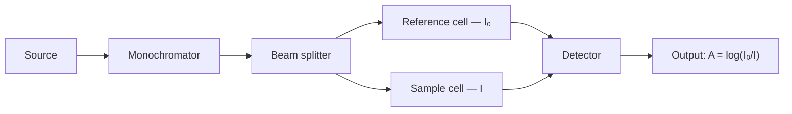
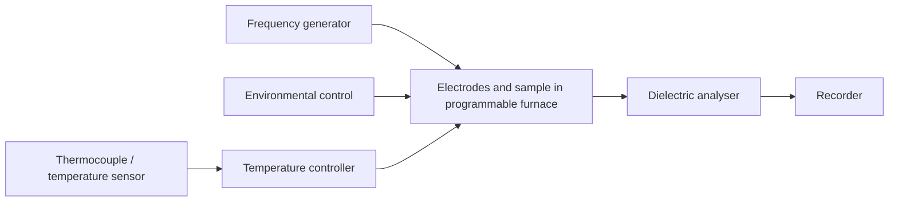
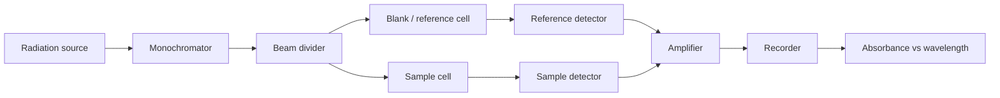

<!-- page 1 | Module 3 · source page 2 -->

# Module - 3

# Molecular Spectroscopy and Analytical Techniques

### Study map

Start with how electromagnetic radiation interacts with matter. The module then develops UV–visible and infrared spectroscopy, their instruments, and related analytical techniques.

## SPECTROSCOPY :

It is the branch of science which describes interaction of electromagnetic radiation within matter (ions, atoms, molecules).

$\hookrightarrow$ Due to the interaction, the spectrum is formed. The spectrum are classified into two :

1. Absorption spectrum
2. Emission spectrum

## ABSORPTION SPECTRUM

- A molecule undergoes transition from lowest energy level to highest energy level by absorbing energy from electromagnetic radiation.
- Then absorption spectrum is obtained.
- Eg : UV-visible spectroscopy ; InfraRed spectroscopy ; NMR spectroscopy.

## EMISSION SPECTRUM :

- A molecule undergoes transition from highest energy level to lowest energy level with an emission of energy in the form of photon, then emission spectrum is obtained.

---

---

<!-- page 2 | Module 3 · source page 3 -->

• Eg: Raman Spectroscopy ; Atomic force spectroscopy .

DIFFERENT TYPES OF MOLECULAR ENERGY LEVELS:

1. Electronic energy level ($E_{\text{ele}}$)
2. Vibrational energy level ($E_{\text{vib}}$)
3. Rotational energy level ($E_{\text{rot}}$)
4. Translational energy level ($E_{\text{trans}}$)

ELECTRONIC ENERGY LEVEL:
↳ Associated with electrons present in a molecule.
↳ The energy gap between electronic energy level fall in uv-visible region.

VIBRATIONAL ENERGY LEVEL:
↳ Associated with vibrational movement of molecule.
↳ The energy gap between vibrational energy level fall in infra red region.

ROTATIONAL ENERGY LEVEL:
↳ Associated with rotational movement of molecule.
↳ The energy gap between rotational energy level fall in microwave region.

TRANSLATIONAL ENERGY LEVEL:
↳ Associated with translational movement of molecule.
↳ The energy gap between translational energy level is considered negligibly small.

• Total energy = $E_{\text{ele}} + E_{\text{vib}} + E_{\text{rot}} + E_{\text{trans}}$

$E_{\text{ele}} > E_{\text{vib}} > E_{\text{rot}} >>> E_{\text{trans}}$

---

---

<!-- page 3 | Module 3 · source page 4 -->

PARAMETERS RELATED TO LIGHT:

TRANSMITTANCE (T):

It is the ratio of intensity of transmitted light to the intensity of incident light. (No unit)

$$
T = \frac{I}{I_0} \quad \text{where} \quad \begin{aligned} I &\rightarrow \text{intensity of transmitted light} \\ I_0 &\rightarrow \text{intensity of incident light} \end{aligned}
$$

ABSORBANCE (A):

It is the logrithmic ratio of intensity of incident light to the intensity of transmitted light. (No unit)

$$
\begin{aligned}
A &= \log \frac{I_0}{I} \\
&= \log \frac{1}{T} \\
\therefore A &= -\log T
\end{aligned}
$$

BEER-LAMBERT'S LAW:

---

---

<!-- page 4 | Module 3 · source page 5 -->

↳ The law states that, when a parallel beam of monochromatic electromagnetic radiation is passed through a coloured, dilute and homogeneous solution of known concentration, then absorbance 'A' is directly proportional to concentration of solution and thickness of the medium.

i.e $A ∓ c x$
$A = \varepsilon c x$ , where $A \rightarrow \text{Absorbance}$
$\varepsilon \rightarrow \text{molar absorption coefficient}$
$c \rightarrow \text{concentration of solution}$
$x \rightarrow \text{Thickness of the cuvette}$

$$\therefore \varepsilon = \frac{A}{c x}$$

unit of $A$ - nounit
unit of $C$ - $\text{mol/L or mol/dm}^3$ (M)
unit of $x = \text{dm}$
$\therefore \text{unit of } \varepsilon = \text{mol}^{-1}\text{dm}^2$

Q. Define Beer - Lambert's law and deduce integrated form. Discuss the plot of Absorbance versus concentration. What does the slope of the graph represent.

ans.

Beer lambert's law states that when a parallel beam of monochromatic electromagnetic radiation is passed through a coloured, dilute and homogeneous solution, the rate of decrease in ~~decrease~~ intensity of radiation ($-dI$) with the thickness of solution ($dx$) is directly proportional to intensity of the radiation and concentration of the solution.

---

---

<!-- page 5 | Module 3 · source page 6 -->

i.e., $-\frac{dI}{dx} \propto I C$

$-\frac{dI}{dx} = k I C$ where $k \to$ proportionality constant

$-\frac{dI}{I} = k C dx$

Integrating both sides,

$$\int_{I_0}^I \frac{-dI}{I} = \int_0^x k C dx$$

$$\ln \frac{I_0}{I} = k C x$$

$$2.303 \log \frac{I_0}{I} = k C x$$

$$\log \frac{I_0}{I} = \frac{k C x}{2.303}$$

$\because \log \frac{I_0}{I} = A$ and $\frac{k}{2.303} = \varepsilon$

$$A = \varepsilon C x$$

- The plot of absorbance versus concentration should be a straight line passing through the origin for a cell of thickness $x$ and slope is given by $\varepsilon x$

Q. The percentage transmittance of $0.01M$ dye solution in ethanol is $20$. In a $2\text{ cm}$ cell for a light of wavelength $5000\text{ \AA}$. Find the absorbance and molar absorption coefficient.

ans. Concentration $C = 0.01M = 0.01 \text{ mol}/\text{dm}^3$

Thickness $x = 2\text{ cm} = 0.2\text{ dm}$

---

---

<!-- page 6 | Module 3 · source page 7 -->

$$
I_0 = 100\ ,\ I = 20
$$
(% $T = 20$, means when $100\%$ light is incident, $20\%$ is transmitted).

- $A = \log \frac{I_0}{I}$
  $= \log \left(\frac{100}{20}\right)$
  $= \log (5)$
  $= \underline{0.69897}$

- $\varepsilon = \frac{A}{cx}$
  $= \frac{0.6989}{0.01 \times 0.2}$
  $= \underline{349.45}\text{ mol}^{-1}\text{dm}^2$

### APPLICATIONS OF BEER - LAMBERT'S LAW:

↳ If two solutions of concentration $c_1$ and $c_2$, where $c_1$ concentration is known and $c_2$ concentration is unknown, then absorbance of both solutions measured under same condition are :

$$A_1 = \varepsilon c_1 x \quad \text{and} \quad A_2 = \varepsilon c_2 x$$

$$\therefore \frac{c_1}{c_2} = \frac{A_1}{A_2}$$

↳ Absorbance is measured in terms of transmittance,
$$A = -\log T$$
$$-\log T_1 = \varepsilon c_1 x \quad \text{and} \quad -\log T_2 = \varepsilon c_2 x$$
$$\therefore \frac{c_1}{c_2} = \frac{\log T_1}{\log T_2}$$

---

---

<!-- page 7 | Module 3 · source page 8 -->

Q. Dye solution of concentration $0.04\text{ M}$ shows absorbance of $0.045$ at $530\text{ nm}$ while test solution of same dye solution shows $0.022$ absorbance.

$\Rightarrow$

$$C_1 = 0.04\text{ M}$$
$$A_1 = 0.045$$
$$A_2 = 0.022$$

$$C_2 = \frac{C_1 A_2}{A_1}$$

$$= \frac{0.04 \times 0.022}{0.045}$$

$$= \frac{0.04 \times 22}{45}$$

$$= \frac{4 \times 22}{4500}$$

$$= \frac{22}{1125}$$

$$= 0.0195\text{ M}$$

Q. A $50\text{ ppm}$ standard solution of $\text{Fe}^{3+}$ after developing red colour with ammonium thiocynate shows a transmittance of $0.2$ at $620\text{ nm}$ while an unknown solution of $\text{Fe}^{3+}$ after developing red colour with same amount of ammonium thiocynate gives a transmittance of $0.4$. Find the concentration of the unknown $\text{Fe}^{3+}$ solution

$\Rightarrow$

$$C_1 = 50\text{ ppm}$$
$$T_1 = 0.2$$
$$T_2 = 0.4$$

$$C_2 = \frac{C_1 \log T_2}{\log T_1}$$

---

---

<!-- page 8 | Module 3 · source page 9 -->

$$= 50 \times \frac{\log(0.4)}{\log(0.2)}$$
$$= 50 \times 0.56932$$
$$= 28.46\text{ ppm}$$

## LIMITATIONS OF BEER - LAMBERT'S LAW:

- The law is applicable to only dilute, coloured and homogeneous solution.
- It does not obey, if the light is not monochromatic.
- Deviations may occur, if impurity is present.
- Deviation may occur if temperature varies.

## UV - VISIBLE SPECTROSCOPY:

- It is an absorption spectroscopy.
- Principle:
  UV-visible spectrum or electronic spectrum arises due to transition of electrons from lower energy level to higher energy level by absorbing UV-visible radiation in the range of $200 - 800\text{ nm}$.
- The two groups which are responsible for UV-visible radiation absorption are chromophore and Auxochrome.

### CHROMOPHORE:

- It provides colour to a compound.
- It contains unsaturation in their structure ($C=C, C=O, \text{NO}_2, \text{N}=\text{N}$).

### AUXOCHROME:

- It does not produce colour, but it can enhance colour of a compound.
- It contains lone pair of electrons in their structure.
  ($\ddot{\text{O}}\text{H}, \ddot{\text{N}}\text{H}_2, \ddot{\text{N}}\text{R}_2$).

---

---

<!-- page 9 | Module 3 · source page 10 -->

$\lambda_{\max}$ : The wavelength at which maximum absorbance occurs.

Eg: $\text{CH}_2=\text{CH}_2$ ; $\text{CH}_2=\text{CH}-\text{CH}=\text{CH}_2$ ; $\text{CH}_2=\text{CH}-\text{CH}=\text{CH}-\text{CH}=\text{CH}_2$ ; 
$$
\begin{array}{ccccccc}
\text{Ethene} & < & 1,3\text{-butadiene} & < & 1,3,5\text{-hexatriene} & < & \text{benzene} \\
\lambda_{\max}=169\text{nm} & & \lambda_{\max}=217\text{nm} & & \lambda_{\max}=247\text{nm} & & \lambda_{\max}=255\text{nm}
\end{array}
$$

ROLE OF CONJUGATION IN ABSORPTION MAXIMUM:
- As more and more double bonds come into conjugation, the absorption comes to the visible region.
- In case of lycopene, a red coloured natural dye in tomatoes, there are 11 double bonds in conjugation. Therefore, $\lambda_{\max}$ is observed at $505\text{nm}$.

DIFFERENT TYPES OF ELECTRONIC TRANSITION:
1. $\sigma \rightarrow \sigma^*$ transition
2. $\pi \rightarrow \pi^*$ transition
3. $n \rightarrow \pi^*$ transition
4. $n \rightarrow \sigma^*$ transition.

1. $\sigma \rightarrow \sigma^*$ transition :
- Observed in all saturated hydrocarbons.
- This transition absorbs radiations below $150\text{nm}$. So this transition is uv visible inactive.

2. $\pi \rightarrow \pi^*$ transition :
- This type of transition is observed in unsaturated hydrocarbon.
- It absorbs radiation in the range of $200 - 800\text{nm}$. So this transition is uv-visible active.
- This transition is known as allowed transition. So the intensity is very high.

---

---

<!-- page 10 | Module 3 · source page 11 -->

3. $n \to \pi^*$ transition :
- observed in aldehydes and ketones.
- This transition absorb radiation in the range of $200-800\text{nm}$.
- This is a forbidden transition. So the intensity is very low.
- This transition is uv-visible active.

4. $n \to \sigma^*$ transition :
- observed in compounds containing nitrogen, oxygen, sulphur
- This transition absorbs radiation below $200\text{nm}$. This transition is uv-visible inactive.

Q. Draw the possible electronic transition in (i) ethane.

Ans. $\text{CH}_3-\text{CH}_3$
ethane

(ii) $\text{CH}_2=\text{CH}-\text{CH}=\text{CH}_2$
1,3-butadiene

(iv) Benzoic acid

(iii) benzene

(v) Salicylic acid

---

---

<!-- page 11 | Module 3 · source page 12 -->

(vi) Benzaldehyde : $\text{C}_6\text{H}_5-\text{CHO}$

(vii) Ethanol : $\text{CH}_3-\text{CH}_2-\text{OH}$

(viii) Propanol : $\text{CH}_3-\text{CO}-\text{CH}_3$

## UV - VISIBLE SPECTROPHOTOMETER:

- Commonly used sources are H filament lamb, tungsten filament lamp or Xe filament lamb.
- Prism or grating is used as monochromater. It disperses the light into desired wavelength.
- Beam splitter splits wave into two having same intensity.
- Reference cell or sample cell : It is made up of quartz. It must be inert and highly transparent.

---

---

<!-- page 12 | Module 3 · source page 13 -->

↳ Photo multiplier tube used as detector. It converts light signal to electrical signal.
↳ Output is a plot of Absorbance versus wavelength (uv-visible spectrum).

WORKING:
↳ A dilute solution of sample prepared in suitable solvent and taken in a cuvette which is called sample. A pure solvent taken in another cuvette is called reference.
↳ Source produce uv visible radiation which is allowed to prism, and it makes it monochromatic light.
↳ Beam splitter splits monochromatic light into two beams having same intensity.
↳ One beam is allowed to pass through sample and the other through reference.
↳ Reference doesn't absorb radiation, so intensity of radiation is considered as intensity of incident light.
↳ sample absorbs radiation, so intensity of radiation is considered as intensity of transmitted light.
↳ Detector detects both radiation and compares. The difference is analysed and recorded.
↳ uv visible spectrum is produced.

---

---

<!-- page 13 | Module 3 · source page 14 -->

APPLICATIONS OF UV- VISIBLE SPECTROSCOPY:

↳ determination of unknown concentration of a solution.
↳ determination of unknown compound.
↳ used to study kinetics of reaction.
↳ used to characterise dyes.
↳ used in quantitative estimation of blood sugar and cholestrol.

INFRARED SPECTROSCOPY:

↳ It is an absorption spectrum.
↳ Vibrational spectrum or IR spectrum arises due to transition of a molecule from lower vibrational energy level to higher vibrational energy level by absorbing IR radiation in the range of $400 - 5000\text{ cm}^{-1}$.
↳ The essential criteria for a molecule to show IR spectrum - dipole moment must change during vibration.
↳ Homonuclear diatomic molecules have no dipole moment, so they are IR inactive. Eg: $\text{H}_2, \text{N}_2, \text{Cl}_2, \text{O}_2$.
↳ Heteronuclear diatomic or polyatomic molecules have dipole moment, so they are IR active. Eg: $\text{HCl}, \text{CO}_2, \text{HCN}, \text{H}_2\text{O}$.

CALCULATION OF NUMBER OF MODES OF VIBRATION:

↳ For a linear molecule, number of modes of vibration is $3n-5$, where $n$ is the number of atoms.

Eg:
• carbon dioxide $-\text{CO}_2$
$$\text{O}=\text{C}=\text{O}$$
$$n=3$$
$$(3\times3)-5$$
$$=9-5$$
$$=4$$

• $\text{HCl}$
$$\text{H}-\text{Cl}$$
$$n=2$$
$$(3\times2)-5$$
$$=6-5$$
$$=\underline{1}$$

• $\text{HCN}$
$$\text{H}-\text{C}\equiv\text{N}$$
$$n=3$$
$$(3\times3)-5$$
$$=9-5$$
$$=\underline{4}$$

---

---

<!-- page 14 | Module 3 · source page 15 -->

For a non-linear molecule, number of modes of vibration is $3n - 6$.

Eg: $\cdot \text{H}_2\text{O}$

$n = 3$
$(3 \times 3) - 6$
$= 9 - 6$
$= \underline{\underline{3}}$

$\cdot$  $\text{C}_6\text{H}_6$
Benzene
$n = 12$
$(3 \times 12) - 6$
$= 36 - 6$
$= \underline{\underline{30}}$

$\cdot \text{CH}_4$ methane

$n = 5$
$= (3 \times 5) - 6$
$= 15 - 6$
$= \underline{\underline{9}}$

---

FUNDAMENTAL VIBRATION

- Stretching vibration
  - Symmetric stretching vibration
  - Asymmetric stretching vibration
- Bending vibration
  - In plane bending vibration
  - Out Plane bending vibration

Q. calculate number of vibrations modes in $\text{CO}_2$. draw the possible vibration and find out IR Active vibration.

$\Rightarrow \text{O} = \text{C} = \text{O}$

$n = 3$

$(3 \times 3) - 5 = \underline{\underline{4}}$

The possible vibration are symmetric stretching vibration, assymmetric stretching vibration, In plane bending vibration, out plane bending vibration.

1. symmetric stretching vibration :

: No change in dipole moment
$\therefore$ IR inactive

2. Asymmetric stretching vibration :

: change in dipole moment
$\therefore$ IR active.

---

---

<!-- page 15 | Module 3 · source page 16 -->

3. In plane bending vibration :

: change in dipole moment
$\therefore$ IR active.

4. out plane bending vibration :

: change in dipole moment
$\therefore$ IR active.

In $\text{CO}_2$ , out of 4 vibrations , 3 vibrations are IR active but 2 signals are observed in IR spectrum because in plane and out plane bending vibrations are degenerate (i.e, same energy).

(ii) HCN

$n = 3$

$(3\times 3) - 5 = 4$

In HCN, four vibrations are IR active.

(iii) $\text{H}_2\text{O}$

$n = 3$

$(3\times 3) - 6 = 3$

Three vibrations are : symmetric , asymmetric and inplane bending vibrations.

1. symmetric stretching vibration

: change in dipole moment
$\therefore$ IR active.

2. Asymmetric stretching vibration

: change in dipole moment
$\therefore$ IR active.

---

---

<!-- page 16 | Module 3 · source page 17 -->

3. Inplane bending vibration :

: change in dipole moment
$\therefore$ IR active

IR spectrum of $\text{H}_2\text{O}$ shows 3 signals.

CALCULATION OF FORCE CONSTANT (K) :
vibrational frequency depends on bond length and atomic masses.

$\therefore$ vibrational frequency $(\bar{\nu}) = \frac{1}{2\pi C} \sqrt{\frac{k}{\mu}} \text{ cm}^{-1}$,

where $C = \text{velocity of light } (3 \times 10^8 \text{ m/s})$
$k = \text{force constant}$
$\mu = \text{reduced mass}$

$$\text{i.e. }, \mu = \frac{m_1 m_2}{m_1+m_2} \text{ kg}$$

$$
\begin{aligned}
\bar{\nu}^2 &= \left(\frac{1}{2\pi C} \sqrt{\frac{k}{\mu}}\right)^2 \\
&= \frac{1}{4\pi^2 C^2} \frac{k}{\mu}
\end{aligned}
$$

$$\therefore k = 4 \pi^2 C^2 \mu \bar{\nu}^2 \text{ Nm}^{-1}$$

Q. CO molecule absorbs infrared frequency of $2140 \text{ cm}^{-1}$. Calculate force constant, given that atomic mass of $C = 12 \text{ amu}$, $O = 16 \text{ amu}$.

---

---

<!-- page 17 | Module 3 · source page 18 -->

$$\Rightarrow \quad \mu = \frac{12 \times 16}{12 + 16} = \frac{12 \times 16}{28}$$
$$= \frac{48}{7} = 6.857 \times 1.66 \times 10^{-27}\text{ kg}$$
$$= 1.138 \times 10^{-26}\text{ kg}$$

$$K = 4 \pi^2 c^2 \mu \bar{\nu}^2$$
$$= 4 \times (3.14)^2 \times 9 \times 10^{16} \times 6.857 \times 1.66 \times 10^{-27} \times (214000)^2$$
$$= 4 \times (3.14)^2 \times 9 \times 10^{16} \times 1.138 \times 10^{-26} \times (214000)^2$$
$$= 1849\text{ Nm}^{-1}$$

Q. calculate the force constant of $\text{HCl}$ if it gives IR absorption, $\bar{\nu} = 3050\text{ cm}^{-1}$. Given that $H = 1\text{amu } (m_1)$ and $\text{Cl} = 35\text{ amu } (m_2)$.

$$\Rightarrow \quad \mu = \frac{1 \times 35}{36}$$
$$= 0.972 \times 1.66 \times 10^{-27}$$
$$= 1.6139 \times 10^{-27}\text{ kg}$$

$$K = 4 \pi^2 c^2 \mu \bar{\nu}^2$$
$$= 4 \times (3.14)^2 \times 9 \times 10^{16} \times 1.6139 \times 10^{-27} \times (3050 \times 100)^2$$
$$= 4 \times (3.14)^2 \times 9 \times 10^{16} \times 1.6139 \times 10^{-27} \times (305000)^2$$
$$= 532.89\text{ Nm}^{-1}$$

---

---

<!-- page 18 | Module 3 · source page 19 -->

# APPLICATIONS OF IR SPECTROSCOPY:

* Determination of force constant of a molecule.
* Identification of functional groups in organic compounds.

  Eg:
  | Functional groups | stretching frequency |
  | :--- | :--- |
  | 1. $>C=O$ | $1700 - 1750\text{ cm}^{-1}$ |
  | 2. $\text{NH}_2$ | $3200 - 3300\text{ cm}^{-1}$ |
  | 3. $-\text{OH}$ | $3300 - 3500\text{ cm}^{-1}$ |
  | 4. $\text{C}=\text{C}$ in alkene | $1620 - 1650\text{ cm}^{-1}$ |
  | 5. $\text{C}-\text{H}$ | $2900 - 3000\text{ cm}^{-1}$ |

* Determination of unknown compounds.
* Determination of purity of a compound.
* To distinguish inter-molecular and intra-molecular hydrogen bonding.

## INTRAMOLECULAR HYDROGEN BONDING

$o$-hydroxy phenol

## INTERMOLECULAR HYDROGEN BONDING

$p$-hydroxy phenol

* $-\text{OH}$ stretching frequency does not change on dilution in the case of intramolecular hydrogen bonding.

* In $p$-hydroxy phenol, there exist intermolecular hydrogen bonding. The molecule gets separated on dilution and intermolecular hydrogen bond weakens and there is shift of absorption frequency with dilution.

* In $o$-hydroxy phenol, $\text{H}$ bonding is intramolecular which is not affected by dilution.

---

---

<!-- page 19 | Module 3 · source page 20 -->

DIELECTRIC THERMAL ANALYSIS (DETA)

- DETA is used to study dielectric and thermal properties of samples.
- It can give information about dielectric changes with temperature.
- In this technique, the change in dielectric properties of a material under an applied voltage is recorded with change in temperature.

Principle of DETA:

- In DETA technique, the sample under study is subjected to a electric field.
- The applied sinusoidal voltage (alternating current) will polarise the sample which forces the charge carriers inside the sample to move (positively charged particle migrate to negative pole and vice-versa).
- This movement results in a sinusoidal current with phase shift which is being measured.
- Here, the polarisation change of the material under varying temperature is measured at a fixed frequency.

- PERMITTIVITY ($\varepsilon'$)
  It is the ability of a material to store electrical energy under an applied electric field.

- DIELECTRIC LOSS ($\varepsilon''$):
  It is the energy dissipated as heat when a material is subjected to electric field.

- DISSIPATION FACTOR ($\tan \delta$):
  It represents efficiency of a material to convert electrical energy to heat energy under an electric field.

---

---

<!-- page 20 | Module 3 · source page 21 -->

$
\hookrightarrow$ Material with lower value of $\tan \delta$ is preferred as thermal insulator and capacitor applications.

$\hookrightarrow \quad \tan \delta = \frac{\varepsilon''}{\varepsilon'}$

INSTRUMENTATION OF DETA:

- Sample Holder : sample is placed between two parallel metal plates (electrodes).

- Temperature programmable furnace : Furnace with temperature programming facility is used to ramp up and down the temperature of the sample.

- Frequency Generator : Sinusoidal voltage (ac) is provided through the frequency generator.

- Temperature control unit/equipment : Prevents over heating of the sample.

- Environmental control equipment : It is used to provide suitable atmosphere (air or inert gas for the sample as per requirement.

---

---

<!-- page 21 | Module 3 · source page 22 -->

- Thermo couple / Temperature sensor: Used to measure temperature changes of sample.
- Dielectric Analyser: Key component of DETA instrumentation which acts as detector and detects permittivity and dielectric loss with change in temperature.
- Recorder: computer will record the data and DETA curve is obtained as a plot between permittivity versus temperature or dielectric loss versus temperature.

WORKING:
- Sample in the form of thin film, powder, pellet, etc is placed between two electrodes and then electric field is applied.
- The temperature of the sample is increased at a controlled rate using temperature programmable furnace under suitable environmental condition.
- The response signal is detected and analysed using dielectric analyser
- The dielectric response is recorded for every change in temperature under a constant frequency.
- Temperature of the sample is monitored by thermocouple.
- DETA plot is obtained between $\varepsilon'$ vs $T$ or $\varepsilon''$ vs $T$.

APPLICATIONS:
- Used to study dielectric and thermal properties of material
- It is used to analyse polymers, plastics, glasses, ceramic, etc.
- Used to identify phase transition temperature like glass transition temperature of polymers.

---

---

<!-- page 22 | Module 3 · source page 23 -->

$\hookrightarrow$ used to study curing profile of thermosets.
$\hookrightarrow$ used to study epoxy curing process.
$\hookrightarrow$ study of dielectric properties at different temperature is used for the development of new insulating material and energy storage material

SCANNING ELECTRON MICROSCOPE (SEM)

$\hookrightarrow$ SEM produce image of a sample by scanning the surface of the sample $\underset{\text{by}}{\text{using}}$ high energy electron beam.
$\hookrightarrow$ The interaction of electron beam with the atoms near the surface of the sample produce different signals — backscattered electrons, secondary electrons and X-ray
$\hookrightarrow$ These signals are detected by suitable detectors and can be used to obtain information about surface topography (size, shape and texture) and elemental composition

SECONDARY ELECTRONS:
$\hookrightarrow$ These are directly knocked out from the atom of the sample by incidental electron.

BACK SCATTERED ELECTRON:
$\hookrightarrow$ These are incidental electrons that are reflected backwards.

X-RAYS:
$\hookrightarrow$ Emitted from the sample

---

---

<!-- page 23 | Module 3 · source page 24 -->

# INSTRUMENTATION

- source : electron source generates high energy electron beam. Thermionic gun or field emission guns are used as electron source.
- Anode : Positively charged anodes are used. It can accelerate the electron beam.
- condenser lens : It is a electromagnetic lens. can be used to focus the electron beam into small, thin and coherent beam.
- scan coil : Deflects the electron beam horizontally and vertically over the surface of the sample and scan the surface in rectangular fashion.
- Objective lens : It is also an electromagnetic lens used to focus electron beam to the surface of the sample.
- Detectors : There are suitable detectors to detect secondary electrons and x-rays.
- sample : should be conductive and dehydrated.

---

---

<!-- page 24 | Module 3 · source page 25 -->

WORKING:

↳ Electron gun generates high energy electron beam which are accelerated by anode.

↳ Accelerated electron beam is focused by condenser lens.

↳ objective lens focus the beam onto sample where the solid sample is placed.

↳ scan coil scan the surface in raster fashion.

↳ secondary electrons and x-rays are produced from the sample and detected by suitable detectors.

↳ Black and white three dimensional image of the sample is obtained after processing.

APPLICATIONS

↳ used to characterise nanomaterials.

↳ used to detect and analyse surface fracture and contamination.

↳ used as an essential research tool in fields like lifescience, nanoscience, medical and forensic science.

---

---

<!-- page 25 | Module 3 · source page 2 -->

module - 3

# Spectroscopy and analytical technique.

## Advantages of spectroscopy technique.

* $\Rightarrow$ less sample quantities required.
* $\Rightarrow$ sample material remain unchanged during analysis and resuse.
* $\Rightarrow$ requires very less time.
* $\Rightarrow$ They give acurate result.
* $\rightarrow$ spectroscopy deals with the interaction of atoms or molecules or matter with the Electro magnetic radiation.

## Electromagnetic spectrum.

* $\Rightarrow$ Electro magnetic radiation arranged by wave length or frequency
* $\Rightarrow$ It includes radiowaves, microwaves, IR, VL, UV, X-Ray and gamma ray.
* $\Rightarrow$ wave length decreases and frequency increases from radio waves to gamma rays
* $\Rightarrow$ Energy of radiation increases from low - frequency to high frequency.

---

---

<!-- page 26 | Module 3 · source page 3 -->

Different energy levels in a molecule.

1) Electronic energy level ($E_{el}$)

$\Rightarrow$ Energy levels associated with the electrons present in
~the~^a molecules

$\Rightarrow$ These energy levels falls in uv visible region

$\Rightarrow$ The spectrum associated with electronic energy level

---

---

<!-- page 27 | Module 3 · source page 4 -->

is called uv visible spectroscopy.

2) vibrational energy level ($E_{vb}$)

=> The energy level associated with vibration is called vibrational energy.

=> Atoms in a molecule can vibrate by keeping the position of center of mass constant.

=> The energy gap betw $E_{vb}$ falls in infrared region.

3) Rotational energy levels ($E_{ROT}$)

=> The energy level associated with rotation is called rotational energy level.

=> If a molecule rotate in space about an axis passing through it centre of mass.

=> The energy gaps between rotational energy level falls in microwave region.

4) Translational Energy Level ($E_{TE}$)

=> The energy level associated with translational energy is called translational energy level.

=> If the position of centre of mass changes with time the molecule is said to possess the translational energy.

=> Translational energy of a molecule is usually not quantised

$E_{Total} = E_{ele} + E_{vb} + E_{RT} + E_{TE}$

$E_{el} > E_{vb} > E_{RT} \ggg (E_{TE})$ can be neglected.

---

---

<!-- page 28 | Module 3 · source page 5 -->

$$E_{total} = E_{ele} + E_{vib} + E_{rot}$$

Types of spectrum

1) Based on the nature of interaction.

| Emmision spectrum | Absorption spectrum. |
| --- | --- |
|  |  |
| $\Rightarrow$ when an atom or molecule undergoe transition from higher energy level to lower energy level with a absorption of photon of energy $h\nu$ is emmision spectrum. | $\Rightarrow$ when an atom or molecule undergoe transition from lower energy level to higher energy with an absorption of a photon is called absorption spectrum. |
| $\Rightarrow$ Hydrogen spectrum, atomic emmision spectrum, fluorescense spectrum etc... belongs to it. | $\Rightarrow$ It includes uv-visible, IR , Microwave and NMR. |

2) Based on interacting species.

| Atomic spectra | molecular spectra |
| --- | --- |
|  |  |

---

---

<!-- page 29 | Module 3 · source page 6 -->

$\Rightarrow$ which arise from the transition of electrons between the atomic energy levels.

$\Rightarrow$ which arise from the transition of electrons between different molecule energy levels.

$\Rightarrow$ uv visible, IR, microwave, NMR belongs in it.

^Imp **Beer-lamberts law.**

$$\frac{-dI}{dx} \propto I c$$

$$\frac{-dI}{dx} = k I c$$

$$\frac{-dI}{I} = k c \, dx$$

$$\int_{I_0}^I \frac{-dI}{I} = \int_{0}^{x} k c \, dx$$

$$\ln \frac{I_0}{I} = k c x$$

$$2.303 \log \frac{I_0}{I} = k c x$$

$$\log \frac{I_0}{I} = \frac{k}{2.303} c x$$

$$\boxed{\log \frac{I_0}{I} = \varepsilon c x}$$

$$\log \frac{I_0}{I} = \varepsilon c x = A$$

$$A = -\log \frac{I}{I_0}$$

$$= -\log T$$

$$\boxed{= \log \frac{1}{T}}$$

---

---

<!-- page 30 | Module 3 · source page 7 -->

=> when a parallel beam of monochromatic electromagnetic radiation is pass through an absorbing medium of given conc. $c$, the rate of decrease is intensity, $[-dI]$ of radiation, with thickness of the solution $(dx)$ is proportional to the intensity of incident radiation at that point and also the concentration of the solution.

$$\log \frac{I_0}{I} = \varepsilon c x.$$

Absorbance

=> it is the logarithmic ratio of intensity of incident radiation to the transmitted radiation.

Transmittence

=> it is the ratio of transmitted radiation to the incident radiation.

$I_0 \rightarrow$ intensity of incident radiation.

$I \rightarrow$ " transmitted radiation.

$\varepsilon \rightarrow$ molar absorption ~~constant~~ coefficient / absorbtivity / extinction.

$c \rightarrow$ conc. in mol/l $\rightarrow$ unit - mol/dm$^3$.

$x \rightarrow$ Thickness in decimeter.

$A \rightarrow$ Absorbance.

$T \rightarrow$ Transmittance.

---

---

<!-- page 31 | Module 3 · source page 8 -->

Q What is molar absorbtion coefficient ($\varepsilon_1$) write it's unit.

A)
$A = \varepsilon_1 c x$

$\varepsilon = \frac{A}{c x} =$

$\text{unit} = \text{mol}^{-1} \text{dm}^2$.

Q How can you determine the unknown concentration using Beer lamberts law [by graphical method].

A)

$\Rightarrow$ graph derived from unknown concentration.

$\Rightarrow$ Based on the graph derived from know concentration and absorbance, we can find out the unknown concentration using it's unk- absorbance value.

* The percentage transmittens of $0.01\text{M}$ dye solution in ethanol is $20$. in a $2\text{cm}$ cell for a light of wavelength $5000\text{ \AA}$

Find the absorbance and molar absorption constant.

---

---

<!-- page 32 | Module 3 · source page 9 -->

A)

$C = 0.01\text{ M}$

$I = 20$

$I_0 = 100$

$\lambda = 5000\text{ \AA} = 5000 \times 10^{-10}$

$A = \varepsilon c x = \log \frac{I_0}{I}$

$\phantom{A} = \log \frac{100}{20} = \log(5) = 0.69$

$\varepsilon = \frac{A}{c x} = \frac{0.69}{0.01 \times 2 \times 10^0} \simeq 345\text{ mol}^{-1}\text{dm}^3$

* A dye solution of concentration $0.04\text{ M}$ shows absorbance of $0.045$ at $530\text{ nm}$ while a test solution of same dye shows absorbance of $0.022$ under same conditions. Find the concentration of test solutions.

A)

$C_1 = 0.04\text{ M}.$

$A_1 = 0.045$

$\lambda = 530\text{ nm}$

$A_2 = 0.022$

$$
\begin{aligned}
&A_1 = \varepsilon c_1 x \\
&A_2 = \varepsilon c_2 x
\end{aligned}
\quad \because \frac{A_1}{A_2} = \frac{c_1}{c_2}
$$

$$\frac{0.045}{0.022} = \frac{0.04}{c_2}$$

$$c_2 = \frac{0.022 \times 0.04}{0.045} = 0.019\text{ M} = 0.02\text{ M}$$

---

---

<!-- page 33 | Module 3 · source page 10 -->

* A 50ppm standard solution of $\text{Fe}^{3+}$ after developing red colour with ammonium thiocyanate shows a transmittance of $0.2$ at $640\text{ nm}$. while an unknown solution of $\text{Fe}^{3+}$ after developing colour with same amount ammonium thiocyanate gives transmittance of $0.4$. Find the conc. of $\text{Fe}^{3+}$ solution?

$T_1 = 0.2$

$T_2 = 0.4$

$c_1 = 50\text{ ppm}$.

$-\log T_1 = \varepsilon_1 c_1 \times l$

$-\log T_2 = \varepsilon_1 c_2 \times l$.

$$\frac{-\log T_1}{-\log T_2} = \frac{c_1}{c_2} = \frac{-\log 0.2}{-\log 0.4} = \frac{50}{c_2}.$$

$$c_2 = \frac{+\log 0.4 \times 50}{+\log 0.2} = \text{sout}{[illegible]} \;\; 28.4\text{ ppm}$$

---

---

<!-- page 34 | Module 3 · source page 11 -->

# UV-visible spectroscopy IMP

* $0 - 200\text{ nm}$ far uv / vacuum uv.
* $200 - 400\text{ nm}$ neer uv
* $400 - 800\text{ nm}$ visible region

Principle
* If a material blue in colour it absorb the orange & red visible line.
* When a molecule interacts with uv-visible radiation, electronic transition will occur between electronic energy levels by absorbing the radiation.
* It is also called electronic spectrum — transition occurs between electronic energy level.
* It is a plot of absorbance or intensity v/s $\lambda$ in nm.

### Different transition observed in uv-visible spectroscopy

---

---

<!-- page 35 | Module 3 · source page 12 -->

=> In a molecule there are three types of electrons

- $\sigma$ electrons - bonding
- $\pi$ electrons - bonding
- $n$ " - ~~non~~ lone pairs - non bonding

=> $\sigma - \sigma^*$

$\to$ It is mainly observed in molecule with sigma bonds.
$\to$ Hydrocarbons can shows this type signal.
$\to$ It mainly occur at uv region, below $150\text{ nm}$

$\text{eg: } \text{CH}_4, \text{CH}_3-\text{CH}_3, \text{cyclohexane}$

=> $\pi - \pi^*$

$\to$ mainly it is observed by molecules containing double bond or tripple bond.
$\to$ it can be used for determine the organic functional grp.
$\to$ The value depends upon the conjugation of the molecule.

$\text{eg: Alkene } (\text{CH}_2=\text{CH}_2), \text{ Alkyne } (\text{CH}\equiv\text{CH}), \text{ benzene}.$

=> $n - \pi^*$

$\to$ mainly observed by molecules with lone pairs of electron and multiple bond
$\to$ It can be used for determine the functional group

$\text{eg: carboxylic acid}, \text{aldehydes}, \text{ketone}, \text{amide}, \text{ester}$

---

---

<!-- page 36 | Module 3 · source page 13 -->

$\Rightarrow \underline{n-\sigma^*}$

$\rightarrow$ mainly observed by molecule with $n$ electrons and sigma bond.
$\rightarrow$ It contains hetero atoms. such as, oxygen, [uncertain: nit...]

sulphur.

eg: $\text{CH}_3\text{NH}_2$, Alcohol, ether

\underline{Effect of conjugation in uv-visible spectroscopy}

$\Rightarrow$ on increasing the conjugation, stability of the molecule increases. so $\Delta E$ decreases and $\lambda_{max}$ increases.

$$\Delta E = \frac{hc}{\lambda}$$

1) $\text{CH}_2 = \text{CH}_2 \rightarrow$ ethene ($169\text{nm}$) //
2) Buta-1,3-diene - $\mathbb{N}$ ($217\text{nm}$)
3) hex-1,3,5-triene - $\mathbb{NN}$ ($247\text{nm}$).
4) benzene - $\langle \rangle$ - ($255\text{nm}$).

1) ethene

---

---

<!-- page 37 | Module 3 · source page 14 -->

a) buta-1, 3-diene

b) hexa-1, 3, 5-triene.

c) benzene.

* Arrange the increasing order of uv-visible absorbtion or $\lambda_{max}$ (or reverse to $\Delta E$).

a)

---

---

<!-- page 38 | Module 3 · source page 15 -->

2) List out the allowed transition observed in the following molecule ?

| compound | Main functional grp | transitions |
|---|---|---|
| Acetone | $C=O$ (carbonyl) | $n \rightarrow \pi^*$, $\pi \rightarrow \pi^*$, $\sigma \rightarrow \sigma^*$ |
| aniline | $-NH_2$ (aromatic ring) | $\pi \rightarrow \pi^*$, $n \rightarrow \pi^*$, $\sigma \rightarrow \sigma^*$ |
| phenol | $-OH$ (aromatic ring) | $\pi \rightarrow \pi^*$, $n \rightarrow \pi^*$, $\sigma \rightarrow \sigma^*$ |
| 1-butyne | $C \equiv C$ (alkyne) | $\pi \rightarrow \pi^*$, $\sigma \rightarrow \sigma^*$ |
| pentane | alkane | $\sigma \rightarrow \sigma^*$ |
| Ethanol | $-OH$ | $n \rightarrow \sigma^*$, $\sigma \rightarrow \sigma^*$ |
| methoxy methane | ether | $n \rightarrow \sigma^*$, $\sigma \rightarrow \sigma^*$ |

---

---

<!-- page 39 | Module 3 · source page 16 -->

Instrumentation of uv-visible spectroscopy

block diagram

Components in uv-visible spectroscopy

- Radiation source. $\implies$ Tungsten filament lamp. or H- discharge lamp. or senon flash lamp.
- monochromator.
- beam splitter.
- ~~Cuvette~~ ~~quvett~~ cubett For referrance and sample.
- blank detector, sample detector.
- Amplifier.
- Recorder.

---

---

<!-- page 40 | Module 3 · source page 17 -->

- monochromator $\rightarrow$ prism or grating

- Beam divider $\Rightarrow$ split in to two, one through reference & other through sample

- cuvette $\rightarrow$ container $\rightarrow$ sample cuvette $\Rightarrow$ molecule dissolved in suitable solvent.
  reference $\rightarrow$ solvent only

- $\left.\begin{aligned} &\text{blank detector} \\ &\text{sample detector} \end{aligned}\right\} \Rightarrow$ Generally electronic detectors are used.

* A beam of light split in to two equal beams & one is pass through sample ($I$) and other through reference ($I_0$). Then the intensity of these light beam are measured after passing through sample and reference by using electronic detectors and compared.

* If $I_0 = I \rightarrow$ light does not absorbed by sample

* If $I_0 > I \rightarrow$ light absorbed by sample and it's recorded in the plot of absorbance v/s wavelength in nm.

---

---

<!-- page 41 | Module 3 · source page 18 -->

Applications of uv-visible spectroscopy

* $\Rightarrow$ ~~light source~~ Different transitions absorbed
* $\Rightarrow$ Identifications of materials.
* $\Rightarrow$ To study about the molecules and materials by using it's $\lambda_{max}$ value.
* Identification of functional groups. using $n-\pi^*$ & $\pi-\pi^*$ transitions.
* $\Rightarrow$ To study about coloured materials and dyes
* $\Rightarrow$ To identifies the impurities present in a material by comparing the uv-visible absorption.
* $\Rightarrow$ To study about the kinetics of a reaction.
* $\Rightarrow$ To find out the unknown concentration by graphical representation.

IR-spectroscopy / vibrational spectroscopy

* $\Rightarrow$ It is a plot of percentage transmittance v/s wave numbers ($	ext{cm}^{-1}$)
* $\Rightarrow$ The range $500\text{ cm}^{-1} \longrightarrow 400\text{ cm}^{-1}$

---

---

<!-- page 42 | Module 3 · source page 19 -->

$\rightarrow$ principle

when a molecule interact with IR radiation vibrational transition will occur between vibrational energy level by absorbing IR-Radiation. It is also called vibration spectrum. since transition occur between vibrational energy level.

$\rightarrow$ The photons of IR radiations are not energetic enough to cause electronic transition.

$\rightarrow$ By absorbing IR radiation by a molecule, vibrations will occur (either stretching or bending).

---

---

<!-- page 43 | Module 3 · source page 20 -->

vibrations.

- Different types of bonds & different functional groups can be identified by this vibrational ~~methods~~ modes.

- IR absorbtion is followed,

$$\bar{\nu} = \frac{1}{2\pi c} \sqrt{\frac{K}{\mu}}$$
$$\mu = \frac{m_1 m_2}{m_1 + m_2}$$

$K =$ Force constant . (strength of a bond).

$\mu =$ reduced mass.

$m_1 \text{ \& } m_2 -$ masses of atom connected.

---

---

<!-- page 44 | Module 3 · source page 21 -->

$\rightarrow$ no. of vibrational ~~bands~~ modes in IR spectroscopy

$\rightarrow$ Then for a molecule of with 'n' no. of atoms, no. of degrees of freedom = $3n$.

<u>Linear molecule</u>

$\rightarrow$ No. of translational modes = 3

$\rightarrow$ No. of rotational modes = 2

$\rightarrow$ No. of vibrational modes = $3n - 5$

<u>example,</u>

$\rightarrow$ HCl. $n = 2$, linear molecule.

No. of vibrational modes = $3 \times 2 - 5$
$= 6 - 5 = 1 //$.

$\rightarrow$ HCl have only symmetric strecthing

$\rightarrow$ dipole moment will be change so IR active.

$\Rightarrow$ [uncertain: N_2] $n = 2$.

No. of vibrational modes = $2 \times 3 - 5 = 1 //$.

symmetric streching.

$\rightarrow$ No change in dipole moment. IR inactive.

---

---

<!-- page 45 | Module 3 · source page 22 -->

Homonucleus diatomic molecules are IR inactive.

eg : $H_2, O_2, Cl_2, N_2$.

$\rightarrow$ No change in dipole moment during vibration.

Hetero nucleus diatomic molecules are IR active.

eg: $HCl, HBr, HI$

$\rightarrow$ Change in dipole moment during vibration.

conclusion

$\rightarrow$ polynucleus molecules — all are IR active

eg : $CO_2, HCN, H_2O, CH_4, C_6H_6$

$\Rightarrow$ Change in dipole moment during vibration.

<u>Non linear molecules</u> — No. of vibrational modes

$\rightarrow$ No. of translational modes = 3.

$\rightarrow$ No. of to vibrational modes = $3n - 6$.

$\rightarrow$ No. of rotational modes = 3.

eg :

$\rightarrow$ $H_2O$ — non linear.

$\rightarrow$ No. of vibrational modes .

$= 3n - 6$

$= 3 \times 3 - 6$

$= 3 \parallel$.

---

---

<!-- page 46 | Module 3 · source page 23 -->

$\rightarrow$ No. of vibrational modes of $\text{CO}_2$ & $\text{H}_2\text{O}$ . IMP

1) $\underline{\text{CO}_2.}$

$\rightarrow$ Linear.

$n = 3$.

No. of vibrational modes .

$$3n - 5 = 3 \times 3 - 5 .$$

$$= 9 - 5 = 4 //$$

(1) $\overset{\leftarrow}{\text{O}} = \text{C} = \overset{\rightarrow}{\text{O}}$

$\rightarrow$ symmetric streching inactive.

$\rightarrow$ No change in dipole moment during this vibration.

$\rightarrow$ IR inactive.

(2) $\overset{\rightarrow}{\text{O}} = \text{C} = \overset{\rightarrow}{\text{O}}$

$\rightarrow$ There is change in dipole moment .

$\rightarrow$ assymmetric streching .

$\rightarrow$ IR active.

(3)

$\rightarrow$ in plane bending.

$\rightarrow$ dipole moment change in this vibration.

$\rightarrow$ IR active.

---

---

<!-- page 47 | Module 3 · source page 24 -->

4)

- out of plane bending.
- IR absorption at $\sim 650\text{ cm}^{-1}$
- change in dipole moment.
- IR inactive.

conclusion

- for $\text{CO}_2$ 4 vibrational modes - 3 are active but only 2 signals.

2) $\text{H}_2\text{O}$

- non linear molecules.

$n = 3$

No. of vibrational mode

$= 3n - 6$

$= 3 \times 3 - 6 = 3//$.

(1)

- change in dipole moment.
- symmetric stretching.
- IR active.

---

---

<!-- page 48 | Module 3 · source page 25 -->

(2).

$\rightarrow$ assymetric stretching.

$\rightarrow$ IR active.

$\rightarrow$ change in dipole moment.

(3)

$\rightarrow$ IR active.

$\rightarrow$ Bending vibration.

$\rightarrow$ change in dipole moment.

* Predict the following based on IR activity and give reason?

1) $CO_2$ $\rightarrow$ poly nuclear molecule.

$\rightarrow$ IR active.

2) cyclohexane ($C_6H_{12}$) $\rightarrow$ poly nuclear molecule

$\rightarrow$ IR active.

$\rightarrow$ change in dipole moment.

3) $F_2$ $\rightarrow$ IR inactive.

$\rightarrow$ NO change in [illegible]

---

---

<!-- page 49 | Module 3 · source page 26 -->

[illegible] $\longrightarrow$ poly nuclear.
$\longrightarrow$ IR active.

* How can you distinguish $c-c$ & $c=c$.

1) $c-c$, $c=c$ by using IR spectroscopy.

$$\bar{\nu} = \frac{1}{2\pi c} \sqrt{\frac{k}{\mu}}$$

$$
\left.\begin{matrix}
\mu - \text{same}\\
k - \text{diff}
\end{matrix}\right\} \text{IR absorption will be different.}
$$

b) $c-c$, $c=c$

$$\bar{\nu} = \frac{1}{2\pi c} \sqrt{\frac{k}{\mu}}$$

$$
\left.\begin{matrix}
k - \text{same}\\
\mu = \text{diff.}
\end{matrix}\right\} \text{IR absorption will be different.}
$$

<u>Applications</u>

* To study about molecules, materials by using IR absorption value $(\text{cm}^{-1})$
* Identification of Functional grps.

$$
\begin{aligned}
OH & \simeq 3400\text{ cm}^{-1} - 3600\text{ cm}^{-1} \\
C=O & \simeq 1700\text{ cm}^{-1} - 1800\text{ cm}^{-1}
\end{aligned}
$$

---

---

<!-- page 50 | Module 3 · source page 27 -->

$NH \simeq 3200\text{ cm}^{-1} - 3400\text{ cm}^{-1}$
$C=C \simeq 1560\text{ cm}^{-1} - 1650\text{ cm}^{-1}$

$\Rightarrow$ To identify the impurities present in a sample by comparing the IR absorption of value of pure component.

$\Rightarrow$ To study about the kinetics of chemical reaction.

$\Rightarrow$ To study about intra & inter molecular hydrogen bonding.

$\Rightarrow$ ortho hydroxy phenol
$\rightarrow$
$\rightarrow$ Intra molecular hydrogen bonding
on dilution no change in the strength of OH bond and hydrogen bonding. because IR absorption remain unchanged.

---

---

<!-- page 51 | Module 3 · source page 28 -->

- Para hydroxy phenol
- inter molecular hydrogen bonding.
- on dilution changes in strength of OH bond and IR absorption.

* Compare ortho nitrophenol & para nitrophenol with solution?

application
=> To study about force constant or the strength of the bond

$C-C < C=C < C\equiv C$
1300 \quad 1650 \quad 2150.

---

---

<!-- page 52 | Module 3 · source page 29 -->

SEM (scanning electron microscopy) IMP

-> It's a powerful magnification tools, that utilises focused beam of electrons to obtain informations.
-> It has high resolving power or resolution (1nm), high depth field (30m) and high magnification (300kx).
-> It provides topography, morphologic, compositional and crystollographic informations.

Principle

-> SEM scanes a Focus electron beam over a [uncertain: surface] to create an image. The electrons in the beam interact with the sample, producing various signals that can be used to obtain information about the surface of the material.
-> There mainly two types of electrons are [uncertain: generated]

---

---

<!-- page 53 | Module 3 · source page 30 -->

## secondary electron

$\rightarrow$ se is generated by a inelastic interactions.

$\rightarrow$ widely used for imaging the sample.

$\rightarrow$ Good topographic ~~resolution~~ inform$^n$ with good resolution.

## BSE (Back scattered electron)

$\Rightarrow$ BSE is generated by a inelastic interactions.

$\Rightarrow$ it can also be used for imaging.

$\Rightarrow$ mainly it is generated by heavier elements.

$\Rightarrow$ It gives the information of composition and topography of the sample.

## Instrumentation

### Components.

1) Electron source.

2) Electro magnetic and/or electrostatic lenses ~~or vacuum chamber~~

3) computer.

4) SE detector

5) BSE detector.

6) vacuum champer.

---

---

<!-- page 54 | Module 3 · source page 31 -->

electron source.

Anode.

condenser lens.

scan coils.

objective lens

Secondary electron detector.

sample

### Applications

- SEM helps in the characterisation of solid materials.
- It can detect and analyse surface structures, surface contamination, and provide Information in microstructures.
- It helps to reveal spacial variation in chemical compositions and to identify crystalline structures.
- It used as an essential research tool in field such as life science, nano science, medical, gemology and Forensic science.

---

---

<!-- page 55 | Module 3 · source page 32 -->

Dielectric thermal Analysis. (DETA) IMP.

- It is also known as dielectric analysis (DEA)
- The technique used to study dielectric property of mat
  as they undergoe changes in temperature.
- It is mainly used to study about dielectric behaviours of polymers, resins, and adhesives.
- mainly for polar or semipolar propertys.

Principle

- When applying an electric field to a sample placed btw two electrodes and monitoring how samples dielectric properties change with temperature.
- The mobile charge carrier (ions/dipoles) with in the sample aline with the electric field, resulte in a [illegible] which can be measured.
- These responses are directly ~~proportional to sample~~ related to the sample permitivity parameters.

---

---

<!-- page 56 | Module 3 · source page 33 -->

Instrumentation.

Components in DEA.

- Dielectric analyzer
- Furnace
- Sample holder.
- Frequency generator.
- Data acquisition system.

without external electrical field.

with external electrical field.

---

---
