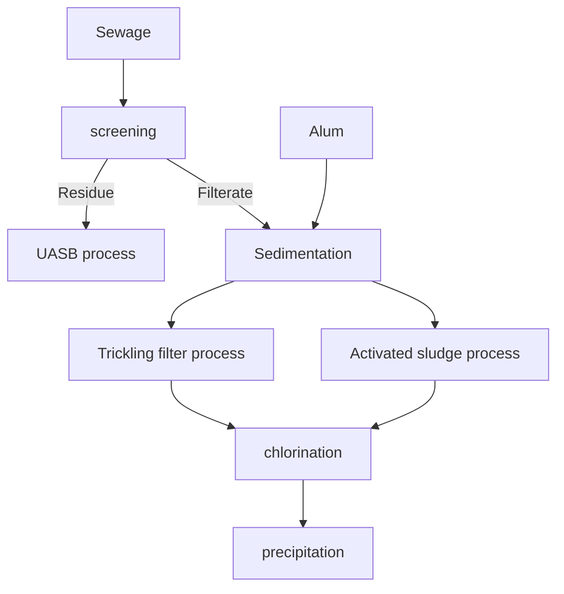
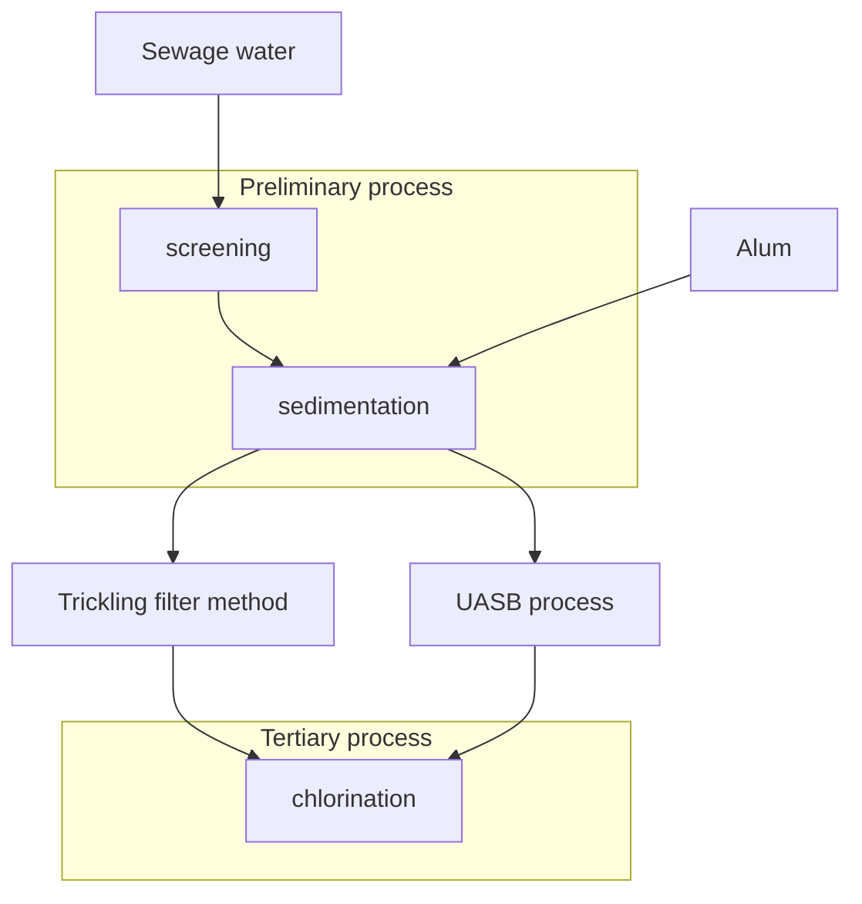

<!-- page 1 | Module 4 · source page 1 -->

[Non-content page]

---

---

<!-- page 2 | Module 4 · source page 2 -->

Module - 4
Environmental chemistry

Water Technology
* Water is used for various purposes such as industrial, domestic, drinking etc.
* It is a universal solvent.
* In industry water is used as a solvent and coolant for various purposes.

Hardness
* The property of water which prevent lather formation with soap.
* It occurs due to the presence of salt of Ca, Mg and other heavy metals dissolved in water.

Chemical explanation
A sample of hard water when treated with soap (sodium or potassium salt of fatty acids), insoluble salts of Ca or Mg forms and these salts appear as white precipitate.
$$2C_{17}H_{35}COONa + CaCl_2 \rightarrow \underbrace{(C_{17}H_{35}COO)_2Ca\downarrow}_{\text{calcium stearate}} + 2NaCl$$
$$\underset{\text{(soap)}}{\text{sodium stearate}}\quad\quad\quad\quad\quad\quad\quad\quad\quad\quad \text{scum}$$

Hard water and soft water

Hard water - Water which does not produce lather with soap solution readily, but forms a white sticky precipitate.

---

---

<!-- page 3 | Module 4 · source page 3 -->

Soft water - water which lathers easily on shaking with soap solution.

## Types of Hardness

| Temporary Hardness | Permanent Hardness |
| --- | --- |
| $
ightarrow$ bicarbonates of Ca and Mg | $
ightarrow$ sulphates and chlorides of Ca and Mg |
| $
ightarrow$ can be removed by boiling | $
ightarrow$ can be removed by chemical process. |
| $
ightarrow$ known as carbonate hardness or alkaline hardness | $
ightarrow$ known as non carbonate hardness or non alkaline hardness. |

## Disadvantages of Hardness

$
ightarrow$ Domestic purpose (drinking) not used for
$
ightarrow$ washing and bathing purpose because it leads to the
$
ightarrow$ Textile industry. It is not used
$
ightarrow$ sugar industry
$
ightarrow$ Concrete mixing it is not used
$
ightarrow$ If hard water is not used for in boilers because it cause boiler corrosion

$
ightarrow 	ext{CaCO}_3$ - the standard used to express hardness

- The most insoluble salt that can be precipitated in water treatment.
- A standard solution of hard water can be prepared by using $	ext{CaCO}_3$
- Molecular mass of $	ext{CaCO}_3$ is 100, so the calculations easy

---

---

<!-- page 4 | Module 4 · source page 4 -->

$\text{Ca}(\text{HCO}_3)_2 \xrightarrow{\Delta} \text{CaCO}_3 \downarrow + \text{H}_2\text{O} + \text{CO}_2 \uparrow$

$\text{Mg} (\text{HCO}_3)_2 \xrightarrow{}$

$\text{Mg}(\text{HCO}_3)_2 \xrightarrow{\Delta} \text{Mg}(\text{OH})_2 \downarrow + 2\text{CO}_2\uparrow$

1) Temporary hardness (carbonate)

2) Permanent

<u>Units of hardness</u>
1. ppm
2. mg/L
3. clarke's degree
4. Degree trench
5. Milliequivalent / L

$$\text{Hardness} = \frac{\text{Mass of hardness producing substance } \times \text{Eq. wt. of } \text{CaCO}_3 \text{ (50)}}{\text{Eqn. wt. of hardness producing substance}}$$

$\text{Ca} = 40$
$\text{H} = 1$
$\text{O} = 16$

---

---

<!-- page 5 | Module 4 · source page 5 -->

A water sample contains $408\text{ mg}$ of $\text{CaSO}_4$ per litre. Calculate the hardness in terms of $\text{CaCO}_3$ equivalence?

$$\begin{aligned}
\text{Eq. Wt} \\
\text{Molecular Wt} \\
\text{Eq. Wt. } \text{CaSO}_4 &= 40 + 32 + 1 \times 16 \times 4 \\
&= 72 + 64 \\
&= 136
\end{aligned}$$

$$\begin{aligned}
\text{Equivalent weight} \\
\text{Eq. Wt} \Rightarrow &= \frac{136}{2} = 68
\end{aligned}$$

$$\begin{aligned}
\text{Hardness} &= \frac{\text{Mass of hardness} \\
\text{producing substance}}{\text{Eq. Wt of hardness producing} \\
\text{substance}} \times \text{Eq. Wt. of } \text{CaCO}_3 \\
&= \frac{408 \times 50}{68} = 300\text{ ppm}
\end{aligned}$$

$$\begin{aligned}
\frac{408 \times 50}{68}
\end{aligned}$$

1. Calculate the temporary & permanent and total hardness of water having following compositions.

(i) $\text{Ca(HCO}_3)_2 = 4\text{ ppm}$

(ii) $\text{Mg(HCO}_3)_2 = 6\text{ ppm}$

(iii) $\text{CaSO}_4 = 8\text{ ppm}$

(iv) $\text{MgSO}_4 = 10\text{ ppm}$

---

---

<!-- page 6 | Module 4 · source page 6 -->

(i) $\text{Ca}(\text{HCO}_3)_2 = 40 + 1 \times 2 + 12 \times 3 + 16 \times$ [illegible]

$$\quad = 40 + (1 \times 2) + (12 + 16 \times 3) \times 2$$

$$\quad = 40 + 2 + (12 + 48) \times 2$$

$$\quad = 40 + 2 + 24 + 96$$

$$\quad = 42 + 24 + 96 = 66 + 96$$

$$\quad = 162$$

---

(i) $\text{Ca}(\text{HCO}_3)_2 = 40 + (1 \times 2) + (12 \times 2) + (16 \times 3 \times 2)$

$$\quad = 40 + 2 + 24 + 16 \times 6$$

$$\quad = 42 + 24 + 96$$

$$\quad = 162$$

$$\text{eq. wt} = \frac{162}{2} = 81$$

(ii) $\text{Mg}(\text{HCO}_3)_2 = 24 + (1 \times 2) + (12 \times 2) + (16 \times 3 \times 2)$

$$\quad = 24 + 2 + 24 + 96 = 146$$

$$\text{eq. wt} = \frac{146}{2} = 73$$

(iii) $\text{CaSO}_4 = 40 + 32 + (16 \times 4)$

$$\quad = 40 + 32 + 64 = 136$$

$$\text{eq. wt} = \frac{136}{2} = 68$$

(iv) $\text{MgSO}_4 = 24 + 32 + (16 \times 4)$

$$\quad = 24 + 32 + 64 = 120$$

$$\text{eq. wt} = \frac{120}{2} = 60$$

$$\text{Temp hardness} = \frac{4 \times 50}{81} + \frac{6 \times 50}{73} = 6.56 \text{ ppm}$$

$$\text{pernt. hardness} = \frac{8 \times 50}{81} + \frac{10 \times 50}{73} = 14.21 \text{ ppm}$$

$$\text{total hardness} =$$

$$6.56 + 14.21 =$$

$$= 20.77 \text{ ppm}$$

$$5.88$$

$$8.33$$

---

---

<!-- page 7 | Module 4 · source page 7 -->

Calculate the temporary, permanent and total hardness of water having

$	ext{Ca(HCO}_3)_2 = 4	ext{ ppm}$

$	ext{Mg(HCO}_3)_2 = 6	ext{ ppm}$

$	ext{CaSO}_4 = 8	ext{ ppm}$

$	ext{MgSO}_4 = 10	ext{ ppm}$

$	ext{NaHCO}_3 = 3	ext{ ppm}$

$$egin{aligned}
	ext{NaHCO}_3 &= 23 + 1 + 12 + (16 	imes 3) \ 
&= 24 + 12 + 48 \ 
&= 36 + 48 \ 
&= 84

display

	ext{eq wt} &= rac{84}{1} = 84

	ext{hardness of NaHCO}_3 &= rac{3 	imes 50}{84} = 1.78	ext{ ppm}

	ext{Temp hardness} &= 

	ext{Temporary hardness} &= 6.56 + 1.78 = 8.34	ext{ ppm}

	ext{permanent hardness} &= 14.21 - 1.78 = 12.43	ext{ ppm}

	ext{Total hardness} &= 8.34 + 12.43 = 20.77	ext{ ppm}

---

**NOTE:**

If sodium bicarbonate is present in water, temporary hardness increases but corresponding permanent hardness decreases and the total hardness remains same.

---

---

<!-- page 8 | Module 4 · source page 8 -->

Q. calculate the temporary and permanent hardness of water which contain $	ext{Ca}^{2+} = 200\text{ ppm}$, $	ext{Mg}^{2+} = 96\text{ ppm}$, $	ext{HCO}_3^- = 976\text{ ppm}$, $	ext{Cl}^- = 14.6\text{ ppm}$, $	ext{SO}_4^{2-} = 6\text{ ppm}$, $	ext{Na}^+ = 112\text{ ppm}$ [uncertain]

$- \text{ Total hardness}$,
$$\text{Ca}^{2+} = \frac{40}{2} = 20$$
$$\text{Mg}^{2+} = \frac{24}{2} = 12$$
$$\text{Total hardness} = \frac{200 \times 50}{20} + \frac{96 \times 50}{12}$$
$$= 500 + 400$$
$$= 900\text{ ppm}$$

$$\text{Temp hardness} = 20 + 12 = 32$$

$$\text{HCO}_3^- = 1 + 12 + 16 \times 3$$
$$= 13 + 48$$
$$= \underline{61}$$

$$\frac{61}{1} = 61$$

$- \text{permanent}$ [uncertain]
$$\text{Temp. hard} = \frac{976 \times 50}{61}$$
$$= \frac{48800}{61} = 800\text{ ppm}$$

$$\text{perm. hard} = 900 - 800 = 100\text{ ppm}$$

---

---

<!-- page 9 | Module 4 · source page 9 -->

A sample of water on analysis gave following results
$\text{Ca}^{2+} = 30 \text{ mg/L}, \text{Mg}^{2+} = 18 \text{ mg/L}, \text{HCO}_3^- = 244 \text{ mg/L}$
$\text{Na}^+ = 11.5 \text{ mg/L}$. Calculate the temporary and permanent hardness.

$$\text{Ca}^{2+} = \frac{40}{2} = 20$$

$$\text{Mg} = \frac{24}{2} = 12$$

$$\text{Total. hard} = \frac{30 \times 50}{20} + \frac{18 \times 50}{12}$$

$$= 75 + 75$$

$$= 150 \text{ ppm}$$

$$\text{HCO}_3^- = 1 + 12 + (16 \times 3)$$

$$= 61$$

$$\text{Temporary hardness} = \frac{244 \times 50}{61}$$

$$= \frac{12200}{61} = 200$$

$$\text{Permanent hardness} = 150-200$$

$$= -50$$

---

---

<!-- page 10 | Module 4 · source page 10 -->

Total hardness = $150\text{ ppm}$

Temp. hard = $200\text{ ppm}$

Temporary hardness never exied total hardness, i.e.,
here temporary hardness = Total hardness
$$
\begin{aligned}
\text{perm} \quad \text{temp. hard} &= 150 \\
\text{total. hard} &= 150
\end{aligned}
$$
Here, permanent hard = $0$

Q. Calculate the hardness of

(i) $.08\text{ normal } \text{MgSO}_4\text{ solution}$

$$
\text{Hardness} = \text{normality} \times \text{equivalent weight of } \text{CaCO}_3 \times 1000
$$

Ans := $.08 \times 50$

$$
\begin{aligned}
\text{Hardness} &= .08 \times 50 \times 1000 \\
&= 4000\text{ mg}
\end{aligned}
$$

(ii) $.05\text{ M } \text{CaCl}_2\text{ solution}$

Ans := \text{normality} = \text{Molarity} \times \text{charge of positive ion}

$$
\begin{aligned}
&= .05 \times 2 \\
&= 0.1\text{ ppm}
\end{aligned}
$$

$$
\text{Hardness} = 0.1 \times 50 \times 1000 = 5000\text{ mg}
$$

---

---

<!-- page 11 | Module 4 · source page 11 -->

(iii) $0.02 M \text{ } \text{Al}_2(\text{SO}_4)_3$

$$\text{normality} = 0.02 \times 3 \times 2 = \cancel{0.06} \text{ } 0.12$$

$$\text{Hardness} = 0.06 \times 50 \times 1000$$

$$= 0.12 \times 50 \times 1000$$

$$= 6000 \text{ mg/l}$$

## water softing Methode

## Ion exchange process

- It is a water softening method-method to remove hardness causing substances from water
- the ions present in hard water sample are exchanged with those present in ion exchange resins.

## Ion exchange resins

- Insoluble, cross linked long chain organic polymers with a micro porous structure.
- The functional groups attached to the chains are responsi-ble for the ion exchange properties
- Two types - cation exchange resin and Anion exchange resins

---

---

<!-- page 12 | Module 4 · source page 12 -->

cation exchange resins

- Resins containing acidic functional group
- able to exchange their $	ext{H}^+$ ions with other cations, when come in contact with it
- example : styrene-divinyl benzene copolymers

Anion exchange resins

- Resins containing basic functional groups
- Able to exchange their $	ext{OH}^-$ ions with other anions, when come in contact with it
- example : Amine-formaldehyde copolymers

Ion exchange process

Hard water is first passed through cation exchange column where all the cations like $	ext{Ca}^{2+}$ and $	ext{Mg}^{2+}$ are removed from it and equivalent amount of $	ext{H}^+$ ions are realeased from column to water.

$$2	ext{RH}^+ + 	ext{Ca}^{2+} 	o 	ext{R}_2	ext{Ca} + 2	ext{H}^+$$

$$2	ext{RH}^+ + 	ext{Mg}^{2+} 	o 	ext{R}_2	ext{Mg} + 2	ext{H}^+$$


cation free water
(Low pH)

Demineralized water
(Neutral pH)

---

---

<!-- page 13 | Module 4 · source page 13 -->

Then water is passed through anion exchange column where all the anions like $\text{SO}_4^{2-}$ and $\text{Cl}^-$ are removed from it and equivalent amount of $\text{OH}^-$ ions are released from column to water

$$\text{ROH}^- + \text{Cl}^- \longrightarrow \text{RCl} + \text{OH}^-$$

$$\text{2ROH}^- + \text{SO}_4^{2-} \longrightarrow \text{R}_2\text{SO}_4 + \text{2OH}^-$

Thus water coming out from exchanger is free from cation and anion other than $\text{H}^+$ and $\text{OH}^-$ and hence called demineralized or deionized water.

## Regeneration of column

When the capacities of cations and anions exchange columns to exchange ions are lost then the columns are said to be exhausted.

* Cation exchange column - by passing dilute acid
* Anion exchange column - by passing dilute alkali

During regeneration, the reaction will be reversed.

## Advantages

* Suitable for softening highly alkaline or acidic waters.
* No sludge is formed.
* Resins can be regenerated and reused.
* Deionised water has very low conductivity, so can be used in lead acid battery.

---

---

<!-- page 14 | Module 4 · source page 14 -->

Disadvantages

* Expensive chemicals and costly equipments are needed.
* Turbidity in water lowers the efficiency of softening.

Reverse osmosis

This process is used for removing excess soluble salts from water (desalination)

Osmosis :-

When two solutions of different concentrations are separated by a semi permeable membrane solvent molecules pass from low concentrated region to high concentrated region

Due to osmosis, osmotic pressure is developed in the liquid surface.

Reverse asmosis :-

When a pressure higher than osmotic pressure is applied on the concentrated side, osmosis takes place in the reverse direction.

---

---

<!-- page 15 | Module 4 · source page 15 -->

Desalination of sea water

The sea water which is to be purified is taken in a tank separated by a membrane with pure water. High pressure is applied to sea water to force the pure water out through the membrane, leaving behind the impurities.

Osmosis and Reverse Osmosis

### Osmosis


water moves to the side with higher salt content

### Reverse Osmosis


only the water to which external pressure is applied [illegible] through.

---

---

<!-- page 16 | Module 4 · source page 16 -->

## Advantages

$
ightarrow$ can remove $99\%$ ions and dissolved organic matter

$
ightarrow$ Low capital cost, maintenance cost is only the replacement of membrane.

$
ightarrow$ No need of regeneration as in the case of ion exchange methods

$
ightarrow$ can remove colloidal sillica which can not be removed by demineralization

$
ightarrow$ does not requires any thermal energy and manual attention

## Disadvantage

$
ightarrow$ High consumption of electricity

$
ightarrow$ Disposal of reject is a problem

## Purification of water

water purification hence two steps :

1. removal of suspended impurities

   (i) screning $
ightarrow$ In screaning process water is passed through a bar screen to remove the floating materials and large sized particle in

---

---

<!-- page 17 | Module 4 · source page 17 -->

(ii) Sedimentation $\rightarrow$ process water is taken in a big tank and kept undisturbed to 5 to 6 hrs during this time most of the dust particles settle down at the bottom. To speed up the sedimentation coagulant like alum is also added.

(iii) Filtration $\rightarrow$ In filteration process water is passed through a sand filter to remove the impurities present in water.

(iv) aeration $\rightarrow$ In aeration process the sufficient amount of air is provided to water oxydation of the impurity is carried out.

2. Removal of Micro-organism

The process of removing bacteria and other micro-organism present in water is called disinfection and the chemical is used for this parpase is called disinfection.

(i) Boiling $\rightarrow$ By boiling the water for 5-10 min most of the micro-organisms will be destroyed.

(ii) addition of bleaching powder $\rightarrow$ when bleaching powder is added to water hypo chlorous acid is formed and it act as a disinfectant.

$$\text{CaOCl}_2 + \text{H}_2\text{O} \longrightarrow \text{Ca(OH)}_2 + \text{Cl}_2$$

$$\text{Cl}_2 + \text{H}_2\text{O} \longrightarrow \text{HOCl} + \text{HCl}$$

---

---

<!-- page 18 | Module 4 · source page 18 -->

Disadvantages

$
ightarrow$ If bleaching powder added in excess it produce bad smell and taste of water
$
ightarrow$ Since calcium deposition takes place it effect the hardness of water
$
ightarrow$ It cannot stored it for a long time

(iii) chlorination $
ightarrow$ chlorin is the most commonly used disinfectant in water treatment. chlorin is added to water either in the gaseous form and conc. solution form and it produce HOCl which act has a disinfectant

$Cl_2 + H_2O 
ightarrow HOCl + HCl$

advantages

$
ightarrow$ It is very effective and economical
$
ightarrow$ Since chlorin is stable we can stored it for a long time
$
ightarrow$ No Ca deposition takes place, so it does not effect the hardness
$
ightarrow$ It can be used at low and high temperature

Disadvantages

$
ightarrow$ Excess chlorin produce bad taste and smell to water
- so in chlorination process chlorin is added to water upto a particular point that is upto break point of chlorination

---

---

<!-- page 19 | Module 4 · source page 19 -->

Break point...


$a$ - oxidation of reducing compound by chlorin

$b$ - Formation of chloro organic compound and chloramine

$c$ - Destruction of chloro organic compound and chloramine.

$d$ - Free residual $	ext{Cl}_2$

$
ightarrow$ Break point of chlorination is the addition of chlorin to water such am extent that it destroyes all the micro-organisms are other impurities present in water.

$
ightarrow$ The addition of $	ext{Cl}_2$ after break point is called over chlorination and it produce bad taste and smell to water

$
ightarrow$ over $	ext{Cl}_2$ is removed by passing the water to a bed of carbon is process is called dechlorination

$
ightarrow$ The addition of $	ext{Cl}_2$ at the deep or break is called break point of chlorination.

---

---

<!-- page 20 | Module 4 · source page 20 -->

Advantages of break point chlorination

- It completely oxidised the organic compound, $NH_3$ and othe reducing compound
- It remove colours, order and taste from $H_2O$
- It distoryes all the micro organism present in water
- It prevent the growth of any weed weedes in water

(iv) using ozone $
ightarrow$ ozone is obtained by discharge, since the ozone is unstable it decompose to $O_2$ and nascent $O_2$ the nascent $O_2$ is highly reactive and it act as a disinfectant

$$3 O_2 \xrightarrow{\text{electric discharge}} 2 O_3$$

$$O_3 \longrightarrow O_2 + [O]$$
$$\text{nascent } O_2$$

Since no chemical used in this process, it does not produce any taste and smell to water, but this methode is highly expensive.

(v) By passing uv radiation $
ightarrow$ uv race have very good dismfection action and distroy all the micro-organisms present in water. Since no-chemical used in this process, water does not have any bad smell or taste.

But this methode is highly expensive, and it requires technical skill

---

---

<!-- page 21 | Module 4 · source page 21 -->

treatment.

## water pollution

sources of water pollution :

1. Domestic water
The houshold waste, muncipal waste released through drains into canals and rivers etc. cause water pollution.

2. Industrial effluents
The industrial waste discharged into rivers without proper treatment may contain toxic chemicals. It cause industrial effluents.

3. Agricultural discharges
The agricultural dischargers containing several pestisides, fertilizer

## sewage

sewage is the liquid waste. it contains aerobic and unaerobic bacterias that bring out the oxidation of orgemic compounds present in it.

---

---

<!-- page 22 | Module 4 · source page 22 -->

| Aerobic | Un-aerobic |
| :--- | :--- |
| $\rightarrow$ It take place at presence of oxygen | $\rightarrow$ It take place at in the ab-sence of oxygen |
| $\rightarrow$ It is carried out by aerobic bacterias | $\rightarrow$ It is carried out by unaerobic bacteria |
| $\rightarrow$ Oxidation products are $CO_2$, [crossed out: $SO_4$] sulphate, nitrate etc. phosphate etc. | $\rightarrow$ Oxidation products are $CH_4$, $NH_3$, at $CH_3CO$, $H_2S$ etc. |
| $\rightarrow$ Non - offensive smell | $\rightarrow$ Offensive smell / pungent smell |
| $\rightarrow$ No biogas fuel is formed | $\rightarrow$ biogas fuel is formed |
| $\rightarrow$ Rate of decomposition is slow | $\rightarrow$ rate of decomposition is fast |

Dissolved oxygen (DO)

It is the level of free non-compound oxygen present in water .

It is the important parameter to determine the water quality. For pure water the D.O level is $6-8\text{ ppm}$.

Factors effecting D.O

1. Pressure $\rightarrow$ If pressure increases DO level also in-creases. So at higher altitude the water contains lower D.O, due to the lowering of atmospheric pressure.

---

---

<!-- page 23 | Module 4 · source page 23 -->

2. temperature $\rightarrow$ if temperature increases D.O decrease. cold water contain more water than warm $H_2O$.

3. oxidisable pollutants $\rightarrow$ if the amount of pollutense in water ~~less~~ increases D.O level $\downarrow$.

$\Rightarrow$ The D.O is determine by using winklers titration method or by using D.O meter

Biological oxygen Demand (BOD)

B.O.D is defined as the amount of oxygen required for the Biological oxidation of organic matters present in water under aerobic condition at $20^{\circ}\text{c}$ for a period of 5 days.

It is expressed in mg/L ppm

BOD is used to determine the extent of water pollution.

For seawage BOD value $100-150\text{ ppm}$

For pure water BOD value $<1\text{ ppm}$

---

---

<!-- page 24 | Module 4 · source page 24 -->

## Chemical Oxygen Demand (COD)

COD is defined as the amount of oxygen required for the complete oxidation of organic and inorganic matters present in water using a strong oxidizing agent that is $K_2Cr_2O_7, KMnO_4$.

The measurement of COD is 3 hours.

The COD value > BOD

## Sewage water treatment





The sewage water treatment have 3 steps:

1. Preliminary or $1^{\circ}$ treatment
2. Biological or $2^{\circ}$ treatment
3. Chemical or $3^{\circ}$ treatment

---

---

<!-- page 25 | Module 4 · source page 25 -->

1. Preliminary treatment or $1^0$

(i) screening :- The screening process the sewage is passed through bar screen to remove the floating materials and large sized particle present in the water.
The resedue obtained the process undergo anaerobic process (UASB process).
The filterate obtained in this process is allowed to sedimentation.

(ii) sedimentation/- In this step the sewage is coll
(setting process) ected in a sedimentation tank
and kept undisturbed for 5-6 hrs
so most of the suspended particle,
settle down at the bottom. To speed
up the sedimentation coagulant
like alum is also added

2. Biological treatemet or $2^0$

(i) trickling filter process: It involves the biological oxidation of orgemic compound at aerobic condition.

(ii) Trickling filter process (aerobic filteration method)
The biological treatment is carried out with the help of trickling filter. The filter is in rectengular in space with about 2m depth it is filled with brocken bricks crushed rocks etc. and fitted with a rotating distributer. This filtering media also contains aerobic bacteria.

---

---

<!-- page 26 | Module 4 · source page 26 -->

The sewage trickle trickles over the filter with rotating distributor, then it's moves down at the filtering media then the aerobic bacteria organic matters present in the sewage, and the effluent is collected from the bottom of the tank.


(ii) Activated sludge process

In this process the sludge is activated by passing sufficient amount of air so the oxidation of sewage is carried out fastly.

---

---

<!-- page 27 | Module 4 · source page 27 -->

3. [illegible]

# (i) Precipitation
The effluent from the $2^	ext{o}$ process is treated with $	ext{CaO}$ so that calcium phosphate get precipitated.

# (ii) Chlorination
In chlorination sufficient amount of chlorin is added so that micro organisms will be destroyed. After $3^	ext{o}$ process treatment the water is send to pond, river etc.

## UASB (Upflow Anaerobic sludge Bed) Process

In this methode the residue obtained in $1^	ext{o}$ process is passed from the bottom of the tank so that it moves upward to the sludge bed. The sludge bed contains anaerobic bacteria when the waste comes in contact with the bacterias the anaerobic oxidation of the impurities is carried out .Here, biogas fuel is obtained as a biproduct and is collected by using a pipeline and treated effluent collected by using an outlet.


---

---

<!-- page 28 | Module 4 · source page 1 -->

[Non-content page]

---

---

<!-- page 29 | Module 4 · source page 2 -->

# Module - 4
## Environmental Chemistry

HARD WATER:
- Water which does not produce lather with soap.
- Hard water contains salt of calcium or magnesium and heavy metals.

TYPES OF HARD WATER:

1. TEMPORARY HARDNESS
- It is due to the presence of bicarbonates of Ca or Mg. So this hardness is known as bicarbonate hardness.
- Salts are calcium bicarbonate ($\text{Ca(HCO}_3)_2$) and magnesium bicarbonate ($\text{Mg(HCO}_3)_2$).
- Temporary hardness can be removed by boiling method.
$$\text{Ca(HCO}_3)_2 \xrightarrow{\Delta} \text{CaCO}_3 + \text{CO}_2 + \text{H}_2\text{O}$$
$$\text{calcium carbonate}$$
$$\text{Mg(HCO}_3)_2 \xrightarrow{\Delta} \text{Mg(OH)}_2 + 2\text{CO}_2$$
$$\text{magnesium hydroxide}$$

2. PERMANENT HARDNESS:
- It is due to presence of chlorides and sulphates of calcium or magnesium.
- Salts are $\text{CaCl}_2$, $\text{CaSO}_4$, $\text{MgCl}_2$, $\text{MgSO}_4$.
- Permanent hardness can be removed by lime-soda process and ion-exchange process.

---

---

<!-- page 30 | Module 4 · source page 3 -->

REACTION OF SOAP WITH HARD WATER:

$$2\text{C}_{17}\text{H}_{35}\text{COONa} + \text{CaCl}_2 \longrightarrow (\text{C}_{17}\text{H}_{35}\text{COO})_2\text{Ca} + 2\text{NaCl}$$
$$\text{soap} \quad\quad\quad\quad \text{hard} \quad\quad\quad\quad \text{calcium sterate} $$
$$\quad\quad\quad\quad\quad\quad\quad\quad \text{water} \quad\quad\quad\quad (\text{scum})$$


$$2\text{C}_{17}\text{H}_{35}\text{COONa} + \text{MgSO}_4 \longrightarrow (\text{C}_{17}\text{H}_{35}\text{COO})_2\text{Mg} + \text{Na}_2\text{SO}_4$$
$$\text{soap} \quad\quad\quad\quad \text{hard} \quad\quad\quad\quad \text{magnesium sterate}$$
$$\quad\quad\quad\quad\quad\quad\quad\quad \text{water}$$

DEGREE OF HARDNESS:

↳ Hardness of water is usually expressed in terms equivalent of calcium carbonate. Calcium carbonate is taken as standard because:

(i) $\text{CaCO}_3$ is the most insoluble precipitate formed during water treatment.

(ii) Its molecular weight is $100$ and equivalent weight is $50$.

↳ Hardness equivalent to $\text{CaCO}_3$
$$= \frac{\text{mass of hardness producing salt} \times \text{Equivalent weight of } \text{CaCO}_3 (50)}{\text{equivalent weight of hardness producing salt}}$$

$\rightarrow \text{Equivalent weight} = \frac{\text{molecular weight}}{\text{charge of } +\text{ve ion}}$$

UNIT OF HARDNESS:
1. ppm (parts per million)
2. $\text{mg/l}$ (milligram per litre)

Q. The given water sample contains $408\text{ mg}$ of $\text{CaSO}_4$ per litre. Calculate the hardness equivalent to $\text{CaCO}_3$:

---

---

<!-- page 31 | Module 4 · source page 4 -->

ans. Hardness equivalent to $CaCO_3$ = $rac{	ext{Mass of hardness producing salt} 	imes 50}{	ext{equivalent weight of hardness producing salt}}$

equivalent weight of $CaSO_4$ = $rac{136}{rac{2}{	ext{(charge of +ve ion)}}} 	ext{(Molecular weight of } CaSO_4)$

= $68$

Hardness = $rac{408 	imes 50}{68}$

= $300 mg/l$

Q. Calculate the hardness of water sample containing $4 ppm$ calcium bicarbonate ($Ca(HCO_3)_2$).

ans. Hardness = $rac{	ext{Mass of hardness producing salt} 	imes 50}{	ext{equivalent weight of hardness producing salt}}$

equivalent weight = $rac{162}{2}$

= $81$

Hardness = $rac{4 	imes 50}{81}$

= $2.46 ppm$

Q. Calculate temporary, permanent and total hardness of water having following composition:

ans. (i) $Ca(HCO_3)_2 = 4ppm$; $Mg(HCO_3)_2 = 6ppm$; $CaSO_4 = 8ppm$; $MgSO_4 = 10ppm$.

equivalent weight of $Ca(HCO_3)_2$ = $rac{40 + 2 + 12 	imes 2 + 16 	imes 6}{2}$ = $rac{162}{2} = 81$

equivalent weight of $Mg(HCO_3)_2$ = $rac{24 + 2 + 24 + 96}{2}$ = $rac{146}{2} = 73$

equivalent weight of $CaSO_4$ = $rac{40 + 32 + 64}{2}$ = $rac{136}{2} = 68$

---

---

<!-- page 32 | Module 4 · source page 5 -->

equivalent weight of $	ext{MgSO}_4 = rac{24+32+64}{2} = rac{120}{2} = 60$

Hardness:
$$	ext{Ca(HCO}_3)_2 = rac{4 	imes 50}{81} = 2.46	ext{ ppm}$$
$$	ext{Mg(HCO}_3)_2 = rac{6 	imes 50}{73} = 4.10	ext{ ppm}$$
$$	ext{CaSO}_4 = rac{8 	imes 50}{68} = 5.88	ext{ ppm}$$
$$	ext{MgSO}_4 = rac{10 	imes 50}{60} = 8.33	ext{ ppm}$$

$	ext{Temporary Hardness} = 2.46 + 4.10$
$= 6.56	ext{ ppm}$

$	ext{Permanent Hardness} = 5.88 + 8.33$
$= 14.21	ext{ ppm}$

$	ext{Total Hardness} = 6.56 + 14.21$
$= 	ext{	extbf{20.77 ppm}}$

(ii) $	ext{Ca(HCO}_3)_2 = 8.1	ext{ mg/L}; 	ext{ Mg(HCO}_3)_2 = 14.6	ext{ mg/L}; 	ext{ MgCl}_2 = 19	ext{ mg/L}$; $	ext{CaSO}_4 = 13.6	ext{ mg/L}$.

$
ightarrow$ equivalent weight of $	ext{MgCl}_2 = rac{24 + 35.5 	imes 2}{2} = rac{95}{2} = 47.5$

equivalent weight of $	ext{Ca(HCO}_3)_2, 	ext{Mg(HCO}_3)_2, 	ext{CaSO}_4$ are $81, 73, 68$ respectively.

Hardness:
$$	ext{Ca(HCO}_3)_2 = rac{8.1 	imes 50}{81} = 5	ext{ mg/L}$$
$$	ext{Mg(HCO}_3)_2 = rac{14.6 	imes 50}{73} = 10	ext{ mg/L}$$
$$	ext{CaSO}_4 = rac{13.6 	imes 50}{68} = 10	ext{ mg/L}$$

---

---

<!-- page 33 | Module 4 · source page 6 -->

$	ext{MgCl}_2 = rac{19 	imes 50}{47.5} = 20	ext{ mg/l}$

$$egin{aligned}
	ext{Temporary Hardness} &= 5 + 10 \ 
&= 15	ext{ mg/l} \ 
	ext{Permanent hardness} &= 10 + 20 \ 
&= 30	ext{ mg/l}

	ext{Total Hardness} &= 15 + 30 \ 
&= 45	ext{ mg/l}

(iii) &	ext{Ca(HCO}_3)_2 = 4	ext{ ppm} \;	ext{;	ext{ } 	ext{Mg(HCO}_3)_2 = 6	ext{ ppm} \;	ext{;	ext{ } 	ext{CaSO}_4 = 8	ext{ ppm} \;	ext{;	ext{ } 	ext{MgSO}_4 = 10	ext{ ppm} \;	ext{;	ext{ } 	ext{Na}_2	ext{SO}_4 	ext{ NaHCO}_3 = 3	ext{ ppm}.


ightarrow 	ext{equivalent weight of } 	ext{NaHCO}_3 &= 23 + 1 + 12 + 16 	imes 3 \ 
&= rac{84}{1}

	ext{Hardness :}

	ext{Ca(HCO}_3)_2 &= 2.46	ext{ ppm} \ 
	ext{Mg(HCO}_3)_2 &= 4.10	ext{ ppm} \ 
	ext{CaSO}_4 &= 5.88	ext{ ppm} \ 
	ext{MgSO}_4 &= 8.33	ext{ ppm} \ 
	ext{NaHCO}_3 &= 84 	imes rac{3 	imes 50}{84} = 1.78	ext{ ppm}

	ext{Temporary Hardness} &= 2.46 + 4.10 + 1.78 \ 
&= 8.34	ext{ ppm}

	ext{Permanent Hardness} &= 5.88 + 8.33 	ext{ 	ext{Total hardn}} \ 
&= 14.21	ext{ ppm}

	ext{Total Hardness} &= 2.46 + 4.10 + 5.88 + 8.33 \ 
&= 20.77	ext{ ppm}

	ext{When } 	ext{NaHCO}_3 	ext{ present in water temporary hardness} \ 	ext{increases but total hardness remains the same.}

	ext{Permanent hardness} &= 	ext{Total hardness} - 	ext{Temporary hardness} \ 
&= 20.79 - 8.34 \ 
&= 12.45	ext{ ppm}

---

---

<!-- page 34 | Module 4 · source page 7 -->

(iv) $\text{Ca}^{2+} = 200\text{ ppm}$, $\text{Mg}^{2+} = 96\text{ ppm}$, $\text{HCO}_3^- = 976\text{ ppm}$, $\text{Cl}^- = 142\text{ ppm}$, $\text{SO}_4^{2-} = 6\text{ ppm}$, $\text{Na}^{2+} = 112\text{ ppm}$.

$\Rightarrow$ Total hardness is due to $\text{Ca}^{2+}$ and $\text{Mg}^{2+}$ ions. Temporary hardness is due to $\text{HCO}_3^-$.

$$\text{equivalent weight of Ca}^{2+} = \frac{40}{2} = 20$$
$$\text{equivalent weight of Mg}^{2+} = \frac{24}{2} = 12$$
$$\text{equivalent weight of HCO}_3^{2-} = \frac{1 + 12 + 16 \times 3}{1} = 61$$
$$\text{equivalent weight of Cl}^- = [illegible]$$

Q. Calculate the hardness of:

(i) $0.08\text{ N MgSO}_4$ solution.
$$\text{Hardness} = 0.08 \times \text{equivalent weight of CaCO}_3 \times 1000$$
$$= 0.08 \times 50 \times 1000$$
$$= 4000\text{ mg/L}$$

(ii) $0.05\text{ M CaCl}_2$ solution
$$\text{Normality} = \text{molarity} \times \text{charge of +ve ion}$$
$$= 0.05 \times 2$$

---

---

<!-- page 35 | Module 4 · source page 8 -->

$$=0.1\text{ N}$$
$$\begin{aligned}
\text{Hardness} &= 0.1 \times 50 \times 1000 \\
&= 5000\text{ mg/L}
\end{aligned}$$

(iii) $0.02\text{ M } \text{Al}_2(\text{SO}_4)_3 \text{ solution}$:
$$\begin{aligned}
\text{Normality} &= 0.02 \times (3 \times 2) \\
&= \text{--}0.06\text{ N } 0.12\text{ N}
\end{aligned}$$
$$\begin{aligned}
\text{Hardness} &= \text{--}\frac{12}{0.06} \times 50 \times 1000 \\
&= 3000\text{ ppm} \\
&= 6000\text{ ppm}
\end{aligned}$$

## ION EXCHANGE METHOD (WATER SOFTENING METHOD)

↳ Ion exchange process is a reversible chemical reaction where an ion from the solution (hard water) is exchanged for a similarly charged ion attached to an immobile solid particle (polymer or resin).  
↳ The used resin is styrene-divinyl benzene copolymer.  
↳ It has:
  * cross linked structure
  * porous
  * High molecular weight
  * with exchangeable ion attached to polymers.

↳ Ion exchanged resins are two types

1. $\text{CATION EXCHANGE } \text{ION RESIN } (\text{RH}^+)$  
$\rightarrow$ Styrene-divinyl benzene copolymer is treated with sulphonic acid $(\text{SO}_3\text{H})$. Then $\text{SO}_3\text{H}$ group get attached to the polymer.  


2. $\text{ANION EXCHANGE RESIN } (\text{R}^+\text{OH}^-)$  
$\rightarrow$ Quatenery ammonium group attached styrene divinyl benzene copolymer is treated with $\text{NaOH}$. The $\text{OH}$ group get attached to the polymer.  


---

---

<!-- page 36 | Module 4 · source page 9 -->

↳ PROCESS :

→ Hard water is first passed through cation exchange column where all the cation $(\text{Ca}^{2+}, \text{Mg}^{2+})$ present in the water exchanged with $\text{H}^+$ ions attached to the resin.

$$2\text{R}^-\text{H}^+ + \text{Ca}^{2+} \longrightarrow \text{R}_2\text{Ca} + 2\text{H}^+$$
$$2\text{R}^-\text{H}^+ + \text{Mg}^{2+} \longrightarrow \text{R}_2\text{Mg} + 2\text{H}^+$$

→ After the first process hard water is passed through anion exchange column where all the anions $(\text{Cl}^-, \text{SO}_4^{2-})$ present in the hard water exchanged with $\text{OH}^-$ ions attached to the polymer.

$$\text{R}^+\text{OH}^- + \text{Cl}^- \longrightarrow \text{RCl} + \text{OH}^+$$
$$2\text{R}^+\text{OH}^- + \text{SO}_4^{2-} \longrightarrow \text{R}_2\text{SO}_4 + 2\text{OH}^-$

→ $\text{H}^+$ and $\text{OH}^-$ ions are liberated from cation and anion exchangers respectively, combined together to produce water molecule.

$$\text{H}^+ + \text{OH}^- \longrightarrow \text{H}_2\text{O}$$

This water is known as demineralised water or deionised water.

↳ REGENERATION OF COLUMNS :

↳ Cation exchange column can be regenerated by adding $\text{dil. HCl}$ or $\text{dil. H}_2\text{SO}_4$

$$\text{R}_2\text{Ca} + 2\text{HCl} \longrightarrow 2\text{R}^-\text{H}^+ + \text{CaCl}_2$$

↳ Anion exchange column can be regenerated by adding $\text{NaOH}$ solution.

$$\text{RCl} + \text{NaOH} \longrightarrow \text{R}^+\text{OH}^- + \text{NaCl}$$

---

---

<!-- page 37 | Module 4 · source page 10 -->

$\rightarrow$ It can be used to soften even acidic or alkaline waters.
$\rightarrow$ Treated water has residual hardness of $2\text{ ppm}$ only.
$\rightarrow$ No sludge is formed.
$\rightarrow$ The resins can be regenerated or reused.

$\hookrightarrow$ DISADVANTAGE:
$\rightarrow$ Equipments and chemicals used are costly.
$\rightarrow$ Turbid water cannot be treated by this method:

DESALINATION OF BRACKISH WATER

REVERSE OSMOSIS:


$\hookrightarrow$ When two solutions of unequal concentration are separated by a semipermeable membrane, in reverse osmosis, a pressure greater than osmotic pressure is applied on higher concentration side (sea water)
$\hookrightarrow$ Then, water from higher concentration side moves to lower concentration side (pure water) through semipermeable membrane.

$\hookrightarrow$ ADVANTAGES:
$\rightarrow$ Simple process
$\rightarrow$ low operating cost
$\rightarrow$ used to remove salty impurity, colloidal silica, organic - inorganic contaminants from water.

---

---

<!-- page 38 | Module 4 · source page 11 -->

$
ightarrow$ Energy requirement 30\% lower than distillation process.

WATER DISINFECTION METHOD :

$
ightarrow$ The removal of disease causing pathogens from water is known as disinfection.
$
ightarrow$ The chemicals used for disinfection are known as disinfectants.
$
ightarrow$ The methods are:

(i) CHLORINATION:
$
ightarrow$ Chlorine in the form of gas or concentrated solution is added to water.
$$\text{Cl}_2 + \text{H}_2\text{O} \longrightarrow \text{HCl} + \text{HOCl}$$
$$\text{hypochlorus acid}$$
$
ightarrow$ Hypochlorus acid can deactivate the enzyme present in microorganisms.
$
ightarrow$ Chlorination is carried out in an apparatus called chlorinator.
$
ightarrow$ Factors affecting chlorination:
- Time in contact - The rate of killing of microorganism is maximum at the beginning and goes on decreasing with time.
- Temperature - temperature increases, death rate of microorganism also increases.
- $\text{pH}$ - At a lower $\text{pH}$, chlorination is more effective.

$
ightarrow$ ADVANTAGES:
- Simple process
- Low cost method
- Storage is easy
- Does not introduce salty taste to water

$
ightarrow$ DISADVANTAGE:
- Chlorine added in excess cause unpleasant taste, odour

---

---

<!-- page 39 | Module 4 · source page 12 -->

and irritation mucus membrane.

$
ightarrow$ BREAKPOINT CHLORINATION:


I. Oxidation of reducing compounds by chlorine.

II. Formation of chloro organic compounds and chloroamines.

III. Destruction of chloro organic compounds and chloroamines.

$
ightarrow$ Breakpoint chlorination refers to addition of chlorine to water in amount sufficient to kill all microorganisms and destroy it completely by oxidation.

$
ightarrow$ Impurities like organic matter, reducing substance, colouring matter, free ammonia also get oxidised and destroyed.

ADVANTAGES:
- It removes colour, odour and taste from water.
- It destroys all disease causing pathogens in water.
- completely oxidise organic compounds.

$
ightarrow$ DECHLORINATION:
Over chlorination can be removed by adding sulphur dioxide ($	ext{SO}_2$), sodium sulphite, sodium thiosulphate, etc.

(ii) CHLOROAMINE ADDITION :

$
ightarrow$ When chlorine and ammonia are mixed in 2:1 ratio, chloroamine is formed.

$$	ext{Cl}_2 + 	ext{NH}_3 
ightarrow 	ext{ClNH}_4 + 	ext{HCl}$$
$$	ext{chloroamine}$$
$$	ext{ClNH}_2 + 	ext{H}_2	ext{O} 
ightarrow 	ext{HOCl} + 	ext{NH}_3$$

---

---

<!-- page 40 | Module 4 · source page 13 -->

(iii) BLEACHING POWDER ADDITION:

$$\text{CaOCl}_2 + \text{H}_2\text{O} \longrightarrow \text{Ca(OH)}_2 + \text{Cl}_2$$
$$\text{bleaching powder}$$

$$\text{Cl}_2 + \text{H}_2\text{O} \longrightarrow \text{HOCl} + \text{HCl}$$

(iv) UV TREATMENT:

-> UV radiation in the range of $200-400\text{ nm}$ is used as disinfectant.
-> UV radiation can be obtained from passing current in mercury lamp enclosed in quartz globe.
-> ADVANTAGES:
* No chemicals are used
* Does not produce unpleasant taste, odours and in water.
-> DISADVANTAGE:
* Expensive method
* Requires costly equipment
* Requires technical skills
* Large amount of water cannot be treated by this method

(v) OZONE TREATMENT:

$$3\text{O}_2 \xrightarrow[\text{discharge}]{\text{passing electric}} 2\text{O}_3$$

$$\text{O}_3 \longrightarrow \text{O}_2 + [\text{O}]$$
$$\text{nascent oxygen}$$

-> Ozone is an excellent disinfectant and used in the gaseous form.
-> Ozone is formed by passing electric discharge
-> Ozone is highly unstable and decomposes to form nascent oxygen.

---

---

<!-- page 41 | Module 4 · source page 14 -->

$\rightarrow$ ADVANTAGES AND DISADVANTAGES:
(same points mentioned in UV treatment).

COMPARISON BETWEEN AEROBIC AND ANAEROBIC OXIDATION.

| AEROBIC OXIDATION | ANAEROBIC OXIDATION |
|---|---|
| $\rightarrow$ Oxidation takes place in the presence of oxygen | $\rightarrow$ oxidation takes place in the absence of oxygen. |
| $\rightarrow$ Oxidation by aerobic bacteria | $\rightarrow$ Oxidation by anaerobic bacteria. |
| $\rightarrow$ Products are $\text{CO}_2$, phosphite, sulphite, nitrite, etc. | $\rightarrow$ Products are acetic acid, methane, $\text{H}_2\text{S}$, etc |
| $\rightarrow$ Products are non-offensive smelling. | $\rightarrow$ Products are offensive smelling. |
| $\rightarrow$ Energy released is more and rate of decomposition is slow. | $\rightarrow$ Energy released is less and rate of decomposition is fast. |
| $\rightarrow$ No biogas fuel is formed | $\rightarrow$ Biogas fuel (methane) is formed. |

DISSOLVED OXYGEN:

$\rightarrow$ DO refers to the level of free, non-compound oxygen present in water.
$\rightarrow$ It is an important parameter to assess water quality.

$\rightarrow$ FACTORS AFFECTING DO:
$\rightarrow$ DO level fluctuates seasonly and 24-hour period.
$\rightarrow$ It vary with water temperature and altitude.
$\rightarrow$ The level of dissolved oxygen in water is also affected by presence of oxidisable pollutants in water like starch or cellulose.

---

---

<!-- page 42 | Module 4 · source page 15 -->

Parameters:

### BIOLOGICAL OXYGEN DEMAND (BOD):
* It is defined as the amount of oxygen required by aerobic microorganisms for the complete oxidation of biologically oxidisable matter present in one litre of sewage water for a period of 5 days at $20^{\circ}\text{C}$.

### SIGNIFICANCE OF BOD:
* Presence of biologically oxidisable matter like carbohydrate, cellulose, glucose, etc. increases BOD of water.
* During the oxidation of these materials by aerobic microorganisms, the dissolved oxygen present in water is consumed. Therefore, by knowing the value of BOD, the extent of pollution can be determined.

### CHEMICAL OXYGEN DEMAND (COD):
* It is defined as the amount of oxygen required for the complete oxidation of biologically active and biologically inert materials present in one litre of sewage water using chemical oxidising agent like $\text{K}_2\text{Cr}_2\text{O}_7$.
* $\text{COD}$ values are greater than $\text{BOD}$ values.
* The measurement of $\text{COD}$ takes only 3 hours, compared to that of $\text{BOD}$ which takes 5 days.

### SEWAGE WATER TREATMENT:

#### I. PRELIMINARY TREATMENT PROCESS:
(i) screening: Most of the suspended impurities can be removed by this method. Here, sewage water is allowed to pass through large screen with holes.

(ii) sedimentation or settling process: Sewage water is

---

---

<!-- page 43 | Module 4 · source page 16 -->

allowed to stand undisturbed in a big tank for $2-6$ hours. Most of the impurities gets settled down easily by gravitational force. After that a chemical coagulant like alum is added to water. Then colloidal impurities react with chemical coagulant to form a gelatinous precipitate, which can entrap small sized impurities and makes settled down easily.

II. SECONDARY PROCESS OR BIOLOGICAL TREATMENT:
- It is an aerobic oxidation method during which the conversion of carbon to carbon dioxide, nitrogen to $	ext{NH}_3$ and finally to nitrites and nitrates occur.

$$	ext{NH}_2-	ext{CO}-	ext{NH}_2 rac{	ext{aerobic}}{	ext{oxidation}} 	ext{CO}_2 + 2	ext{NH}_3$$

$$	ext{NH}_3 rac{	ext{aerobic}}{	ext{oxidation}} 	ext{HNO}_3 + 	ext{HNO}_2$$

$$	ext{HNO}_3 + 	ext{HNO}_2 rac{	ext{Base}}{	ext{present in soil}} 	ext{NH}_4	ext{NO}_2 + 	ext{NH}_4	ext{NO}_3$$

- TRICKLING FILTER METHOD:


- Trickling filter method is an aerobic oxidation method.
- The filter is rectangular in shape with about $2	ext{m}$ depth.

---

---

<!-- page 44 | Module 4 · source page 17 -->

$\hookrightarrow$ It is filled with materials like broken bricks, crushed rocks, etc. and fitted with a rotating distributor.
$\hookrightarrow$ sewage trickles over the filter with the help of rotating distributor, then it moves down through the filtering medium and the aerobic microorganisms start consuming the organic matter in the sewage.

$\hookrightarrow$ UPFLOW ANAEROBIC SLUDGE BED (UASB) REACTOR PROCESS:


$\hookrightarrow$ Sewage water is fed from the bottom of the reactor so that it moves upward through a sludge blanket or bed.
$\hookrightarrow$ The sludge blanket is composed of biologically formed granules of diameter $1-5\text{ mm}$.
$\hookrightarrow$ As the waste comes in contact with the granules which contain aggregations of bacteria, the gas like methane is formed under anaerobic conditions.
$\hookrightarrow$ The gas is collected through the gas collector dome at the top of the reactor.
$\hookrightarrow$ The upflow velocities are maintained at about $0.6-0.9\text{ m/hr}$.

---

---

<!-- page 45 | Module 4 · source page 18 -->

III. TERTIARY PROCESS

a) Precipitation: Effluent from secondary process is treated with $\text{CaO}$ (calcium oxide) so that calcium phosphate will be precipitated.

b) Nitrogen stripping: Ammonia gas can be removed by this method.

c) Chlorination: Disinfection of sewage is done by treating with chlorine when pathogenic bacteria are killed.

-> After tertiary treatment, water can be sent to ponds and rivers.

FLOW CHART OF SEWAGE WATER TREATMENT :




---

---

<!-- page 46 | Module 4 · source page 19 -->

# E-WASTE:

- E-waste may be defined as the broken or discard electrical appliances and electronic devices, such as computers, office electronic equipment, entertainment device electronics, mobile phones, telephone sets, refrigerators, etc.
- Three main constituents of e-waste are:
  - Glass
  - Metals
  - Plastics
- E-waste can be classified mainly into five categories:
  1. Wasted printed circuit boards (WPCBs)
     - Rich source of precious metals such as gold, silver and copper. Base metals like Al, Cu, Zn are present.
     - Contain wide variety of toxic or hazardous components.
     - PCBs contain ceramics (30%), plastics (30%) and metals (40%).
     - Silica and alumina are also available in waste PCBs.
  2. Battery waste
  3. Light emitting Diode (LED)
  4. Liquid crystal Diode (LCD)
     - Cathode Ray Tube (CRT) glass, used in computer monitor and televisions are major source of e-waste.
     - Lead is the most prevalent toxic material in CRT.
     - LCD and LED screens also contain mercury, copper, aluminium, tin and plastics such as ABS, PET, etc.
  5. Capacitors
     - Batteries such as lead acid battery, nickel cadmium and lithium ion cell are also the major source of e-waste.
     - Capacitors also contain harmful materials such as beryllium oxide, polychlorinated biphenyls, etc.

---

---

<!-- page 47 | Module 4 · source page 20 -->

# E-WASTE : METHOD OF DISPOSAL:

↳ REDUCE:
$\rightarrow$ minimizing e-waste begins with reducing purchase of new electronic devices and electrical equipments unnecessarily.
$\rightarrow$ limiting the use of technological devices and looking for multipurpose gadgets can significantly reduce e-waste.

↳ REUSE:
$\rightarrow$ To avoid serious environmental pollution, it is better to ~~rise~~ reuse the e-waste.
$\rightarrow$ The term reuse means the equipment is still working and can be sold or donated, thus continuing the 'life' of the product.
$\rightarrow$ Reuse constitutes direct second hand use or use after slight modifications to the original functioning equipment.
$\rightarrow$ Inkjet cartridge is also used after refilling.

↳ RECYCLE:
$\rightarrow$ monitors and CRT, keyboards, laptops, modems, telephone boards, hard drives, floppy drives, mobile phones, ~~for~~ fax machines, CPUs, memory chips, connecting wires and cables can be recycled.
$\rightarrow$ It involves removal of different parts of e-waste (dismantling) containing dangerous substances like Hg, separation of plastic, removal of CRT, segmentation of ferrous and non-ferrous metals and printed circuit boards.

---

---

<!-- page 48 | Module 4 · source page 21 -->

$\hookrightarrow$ RECOVERY:
$\rightarrow$ It involves the extraction of valuable materials and components from discarded electronic devices.
$\rightarrow$ It includes the extraction of metals such as gold, silver, copper, etc. from e-waste.
$\rightarrow$ E-waste is crushed, shredded in total, followed by the separation of metals and non-metals by adopting unit operations or metallurgical principles.

HEALTH EFFECTS:

Lead:
$\hookrightarrow$ Damage to central and peripheral nervous system, blood systems and kidney damage.
$\hookrightarrow$ Adverse effects on brain development of children.

Cadmium:
$\hookrightarrow$ Toxic irreversible effects on human health.
Accumulates in kidney and liver, causes neural damage.

Mercury:
$\hookrightarrow$ Chronic damage to the brain, respiratory and skin disorders.

Beryllium:
$\hookrightarrow$ Carcinogenic. Inhalation of fumes and dust causes chronic beryllium disease or berylliosis.

---

---

<!-- page 49 | Module 4 · source page 22 -->

CLIMATE CHANGE:

↳ Climate change denotes the long term changes in typical temperature and weather patterns of earth.

↳ The prominent changes includes, rise in sea level, wind speed, drought, extreme weather events, etc.

GREENHOUSE GASES AND GREENHOUSE EFFECT:

↳ The primary source of anthropogenic climate change originates from the combustion of fossil fuels, volcanic eruptions, etc.

↳ $CO_2$ is one of the most significant greenhouse gas.

↳ The other gases like methane, non methane hydrocarbon, water vapour, nitrous oxide, chlorofluorocarbons are also known as greenhouse gases.

↳ greenhouse gases absorb energy from the sun and trap the heat in the earth's atmosphere.

↳ This natural process is often referred to as the greenhouse effect.

↳ $CO_2$ and water vapour have infrarred active vibrational modes.

↳ Due to this, $CO_2$ and water vapour entrap infrarred rays from the sun.

OZONE DEPLETION:

↳ The thinning of ozone layer in the upper atmosphere is termed as ozone depletion.

↳ If the ozone layer is depleted, UV radiations will directly reach the earth and damage the places and affect human beings, animals, etc.

---

---

<!-- page 50 | Module 4 · source page 23 -->

L Ozone is formed in the stratosphere when oxygen molecule combines with oxygen radicals produced by the photo decomposition of $	ext{O}_2$.

L The major cause of ozone depletion is chlorofluorocarbon ($	ext{CFC}$ or freon).

L $	ext{CFCS}$ undergo decomposition by UV radiation to form $	ext{Cl}$ radical.

$$	ext{CF}_2	ext{Cl}_2 (g) 
ightarrow 	ext{CF}_2	ext{Cl} + 	ext{Cl}$$

L Chlorine radical can react with $	ext{O}_3$ and chain reaction is set up shown.

$$	ext{O}_3 (g) + 	ext{Cl} 
ightarrow 	ext{O}_2 (g) + 	ext{ClO} (g)$$

$$	ext{ClO} (g) + 	ext{O}_3 (g) 
ightarrow 2	ext{O}_2 (g) + 	ext{Cl}$$

L Emission of nitric oxide ($	ext{NO}$) from supersonic aircrafts can also cause ozone depletion.

L $	ext{NO}$ reacts with ozone to form oxygen and nitrogen dioxide ($	ext{NO}_2$).

$$	ext{NO} + 	ext{O}_3 
ightarrow 	ext{NO}_2 + 	ext{O}_2$$

SUSTAINABLE DEVELOPMENT:

L It is the system of organising socio, economic and environmental activities of mankind in such a way that they can continue forever into the future without [illegible]

---

---

<!-- page 51 | Module 4 · source page 24 -->

(Pillars of Sustainable Development)

Three major aspects of sustainable development are:

a) Environmental Protection.

$\hookrightarrow$ Ensuring that the natural resources and ecosystems are used efficiently so that it can be ~~presented~~ preserved for future generation.

$\hookrightarrow$ This can be achieved by conserving biodiversity, pollution control, effective waste management, etc.

b) Social Inclusion:

$\hookrightarrow$ ensuring that benefits and opportunities are available to all individuals of the society regardless of gender, ethnicity, socioeconomic status, both within and between generations.

c) Economic Prosperity:

$\hookrightarrow$ Ensuring economic growth that is efficient, productive and provide long term benefits without causing damage to the environment or society.


---

---

<!-- page 52 | Module 4 · source page 25 -->

SUSTAINABLE DEVELOPMENT GOALS:

1. No poverty
2. Zero hunger
3. Good health and well-being
4. Quality Education
5. Gender equality
6. Clean water and sanitation.
7. Affordable and clean energy.
8. ~~Decent~~ Decent work and economic growth.
9. Industry, Promoting innovative and developing infrastructure.
10. Reduced inequality.
11. Sustainable cities and communities.
12. Responsible consumption and production.
13. Climate action
14. Life below water.
15. Life on land
16. Peace, Justice and strong Institutions
17. Partnership for the goals.


---

<!-- page 53 | Module 4 · source page 1 -->

[Non-content page]

---

---

<!-- page 54 | Module 4 · source page 2 -->

Module-4

Environmental Chemistry & Water characteristics.

| Hard water | soft water |
| --- | --- |
| $\Rightarrow$ Presence of dissolved salt of $Ca^{2+}$ and $Mg^{2+}$ ion | $\Rightarrow$ Absence of dissolved salt of $Ca^{2+}$ and $Mg^{2+}$ |
| $\Rightarrow$ The salt present are $CaCl_2$, $MgCl_2$, $CaSO_4$, $MgSO_4$, $Ca(HCO_3)_2$, $Mg(HCO_3)_2$ | $\Rightarrow$ Does not present $Ca^{2+}$ and $Mg^{2+}$ |
| $\Rightarrow$ Hard does not produce lather with soap | $\Rightarrow$ Soft water can easily form lather with soap. |
| $\Rightarrow$ Instead it can form unwanted white precipitate (scum) ($C_{17}H_{35}COONa + CaCl_2 \longrightarrow (C_{17}H_{35}COO)_2Ca$) | |


Temporary hardness

$\Rightarrow$ It contains dissolved salt of $Ca^{2+}$ and $Mg^{2+}$ in the form of bicarbonates

permanent hardness.

$\Rightarrow$ It contains dissolved salt of $Ca^{2+}$ and $Mg^{2+}$ in the form of sulphates and chlorides.

---

---

<!-- page 55 | Module 4 · source page 3 -->

$egin{aligned}	ext{$
ightarrow$ Ca(HCO}_3)_2	ext{, Mg(HCO}_3)_2 &
ightarrow 	ext{CaCl}_2	ext{, MgCl}_2	ext{, CaSO}_4	ext{, MgSO}_4 \	ext{$
ightarrow$ It can be removed by} &
ightarrow 	ext{It can be removed by boiling} \	ext{boiling.} &	ext{needs special technique -} \	ext{Ca(HCO}_3)_2 
ightarrow^{	ext{$	riangle$}} 	ext{CaCO}_3 	ext{ $egin{aligned}	ext{$	extdownarrow$}\	ext{}\	ext{}\	ext{}\	ext{}\	ext{}\	ext{}\	ext{}\	ext{}\	ext{}\	ext{}\	ext{}\	ext{}\	ext{}\	ext{}\	ext{}\	ext{}\	ext{}\	ext{}\	ext{}\	ext{}\	ext{}\	ext{}\	ext{}\	ext{}\	ext{}\	ext{}\	ext{}\	ext{}\	ext{}\	ext{}\	ext{}\	ext{}\	ext{}\	ext{}\	ext{}\	ext{}\	ext{}\	ext{}\	ext{}\	ext{}\	ext{}\	ext{}\	ext{}\	ext{}\	ext{}\	ext{}\	ext{}\	ext{}\	ext{}\	ext{}\	ext{}\	ext{}\	ext{}\	ext{}\	ext{}\	ext{}\	ext{}\	ext{}\	ext{}\	ext{}\	ext{}\	ext{}\	ext{}\	ext{}\	ext{}\	ext{}\	ext{}\	ext{}\	ext{}\	ext{}\	ext{}\	ext{}\	ext{}\	ext{}\	ext{}\	ext{}\	ext{}\	ext{}\	ext{}\	ext{}\	ext{}\	ext{}\	ext{}\	ext{}\	ext{}\	ext{}\	ext{}\	ext{}\	ext{}\	ext{}\	ext{}\	ext{}\	ext{}\	ext{}\	ext{}\	ext{}\	ext{}\	ext{}\	ext{}\	ext{}\	ext{}\	ext{}\	ext{}\	ext{}\	ext{}\	ext{}\	ext{}\	ext{}\	ext{}\	ext{}\	ext{}\	ext{}\	ext{}\	ext{}\	ext{}\	ext{}\	ext{}\	ext{}\	ext{}\	ext{}\	ext{}\	ext{}\	ext{}\	ext{}\	ext{}\	ext{}\	ext{}\	ext{}\	ext{}\	ext{}\	ext{}\	ext{}\	ext{}\	ext{}\	ext{}\	ext{}\	ext{}\	ext{}\	ext{}\	ext{}\	ext{}\	ext{}\	ext{}\	ext{}\	ext{}\	ext{}\	ext{}\	ext{}\	ext{}\	ext{}\	ext{}\	ext{}\	ext{}\	ext{}\	ext{}\	ext{}\	ext{}\	ext{}\	ext{}\	ext{}\	ext{}\	ext{}\	ext{}\	ext{}\	ext{}\	ext{}\	ext{}\	ext{}\	ext{}\	ext{}\	ext{}\	ext{}\	ext{}\	ext{}\	ext{}\	ext{}\	ext{}\	ext{}\	ext{}\	ext{}\	ext{}\	ext{}\	ext{}\	ext{}\	ext{}\	ext{}\	ext{}\	ext{}\	ext{}\	ext{}\	ext{}\	ext{}\	ext{}\	ext{}\	ext{}\	ext{}\	ext{}\	ext{}\	ext{}\	ext{}\	ext{}\	ext{}\	ext{}\	ext{}\	ext{}\	ext{}\	ext{}\	ext{}\	ext{}\	ext{}\	ext{}\	ext{}\	ext{}\	ext{}\	ext{}\	ext{}\	ext{}\	ext{}\	ext{}\	ext{}\	ext{}\	ext{}\	ext{}\	ext{}\	ext{}\	ext{}\	ext{}\	ext{}\	ext{}\	ext{}\	ext{}\	ext{}\	ext{}\	ext{}\	ext{}\	ext{}\	ext{}\	ext{}\	ext{}\	ext{}\	ext{}\	ext{}\	ext{}\	ext{}\	ext{}\	ext{}\	ext{}\	ext{}\	ext{}\	ext{}\	ext{}\	ext{}\	ext{}\	ext{}\	ext{}\	ext{}\	ext{}\	ext{}\	ext{}\	ext{}\	ext{}\	ext{}\	ext{}\	ext{}\	ext{}\	ext{}\	ext{}\	ext{}\	ext{}\	ext{}\	ext{}\	ext{}\	ext{}\	ext{}\	ext{}\	ext{}\	ext{}\	ext{}\	ext{}\	ext{}\	ext{}\	ext{}\	ext{}\	ext{}\	ext{}\	ext{}\	ext{}\	ext{}\	ext{}\	ext{}\	ext{}\	ext{}\	ext{}\	ext{}\	ext{}\	ext{}\	ext{}\	ext{}\	ext{}\	ext{}\	ext{}\	ext{}\	ext{}\	ext{}\	ext{}\	ext{}\	ext{}\	ext{}\	ext{}\	ext{}\	ext{}\	ext{}\	ext{}\	ext{}\	ext{}\	ext{}\	ext{}\	ext{}\	ext{}\	ext{}\	ext{}\	ext{}\	ext{}\	ext{}\	ext{}\	ext{}\	ext{}\	ext{}\	ext{}\	ext{}\	ext{}\	ext{}\	ext{}\	ext{}\	ext{}\	ext{}\	ext{}\	ext{}\	ext{}\	ext{}\	ext{}\	ext{}\	ext{}\	ext{}\	ext{}\	ext{}\	ext{}\	ext{}\	ext{}\	ext{}\	ext{}\	ext{}\	ext{}\	ext{}\	ext{}\	ext{}\	ext{}\	ext{}\	ext{}\	ext{}\	ext{}\	ext{}\	ext{}\	ext{}\	ext{}\	ext{}\	ext{}\	ext{}\	ext{}\	ext{}\	ext{}\	ext{}\	ext{}\	ext{}\	ext{}\	ext{}\	ext{}\	ext{}\	ext{}\	ext{}\	ext{}\	ext{}\	ext{}\	ext{}\	ext{}\	ext{}\	ext{}\	ext{}\	ext{}\	ext{}\	ext{}\	ext{}\	ext{}\	ext{}\	ext{}\	ext{}\	ext{}\	ext{}\	ext{}\	ext{}\	ext{}\	ext{}\	ext{}\	ext{}\	ext{}\	ext{}\	ext{}\	ext{}\	ext{}\	ext{}\	ext{}\	ext{}\	ext{}\	ext{}\	ext{}\	ext{}\	ext{}\	ext{}\	ext{}\	ext{}\	ext{}\	ext{}\	ext{}\	ext{}\	ext{}\	ext{}\	ext{}\	ext{}\	ext{}\	ext{}\	ext{}\	ext{}\	ext{}\	ext{}\	ext{}\	ext{}\	ext{}\	ext{}\	ext{}\	ext{}\	ext{}\	ext{}\	ext{}\	ext{}\	ext{}\	ext{}\	ext{}\	ext{}\	ext{}\	ext{}\	ext{}\	ext{}\	ext{}\	ext{}\	ext{}\	ext{}\	ext{}\	ext{}\	ext{}\	ext{}\	ext{}\	ext{}\	ext{}\	ext{}\	ext{}\	ext{}\	ext{}\	ext{}\	ext{}\	ext{}\	ext{}\	ext{}\	ext{}\	ext{}\	ext{}\	ext{}\	ext{}\	ext{}\	ext{}\	ext{}\	ext{}\	ext{}\	ext{}\	ext{}\	ext{}\	ext{}\	ext{}\	ext{}\	ext{}\	ext{}\	ext{}\	ext{}\	ext{}\	ext{}\	ext{}\	ext{}\	ext{}\	ext{}\	ext{}\	ext{}\	ext{}\	ext{}\	ext{}\	ext{}\	ext{}\	ext{}\	ext{}\	ext{}\	ext{}\	ext{}\	ext{}\	ext{}\	ext{}\	ext{}\	ext{}\	ext{}\	ext{}\	ext{}\	ext{}\	ext{}\	ext{}\	ext{}\	ext{}\	ext{}\	ext{}\	ext{}\	ext{}\	ext{}\	ext{}\	ext{}\	ext{}\	ext{}\	ext{}\	ext{}\	ext{}\	ext{}\	ext{}\	ext{}\	ext{}\	ext{}\	ext{}\	ext{}\	ext{}\	ext{}\	ext{}\	ext{}\	ext{}\	ext{}\	ext{}\	ext{}\	ext{}\	ext{}\	ext{}\	ext{}\	ext{}\	ext{}\	ext{}\	ext{}\	ext{}\	ext{}\	ext{}\	ext{}\	ext{}\	ext{}\	ext{}\	ext{}\	ext{}\	ext{}\	ext{}\	ext{}\	ext{}\	ext{}\	ext{}\	ext{}\	ext{}\	ext{}\	ext{}\	ext{}\	ext{}\	ext{}\	ext{}\	ext{}\	ext{}\	ext{}\	ext{}\	ext{}\	ext{}\	ext{}\	ext{}\	ext{}\	ext{}\	ext{}\	ext{}\	ext{}\	ext{}\	ext{}\	ext{}\	ext{}\	ext{}\	ext{}\	ext{}\	ext{}\	ext{}\	ext{}\	ext{}\	ext{}\	ext{}\	ext{}\	ext{}\	ext{}\	ext{}\	ext{}\	ext{}\	ext{}\	ext{}\	ext{}\	ext{}\	ext{}\	ext{}\	ext{}\	ext{}\	ext{}\	ext{}\	ext{}\	ext{}\	ext{}\	ext{}\	ext{}\	ext{}\	ext{}\	ext{}\	ext{}\	ext{}\	ext{}\	ext{}\	ext{}\	ext{}\	ext{}\	ext{}\	ext{}\	ext{}\	ext{}\	ext{}\	ext{}\	ext{}\	ext{}\	ext{}\	ext{}\	ext{}\	ext{}\	ext{}\	ext{}\	ext{}\	ext{}\	ext{}\	ext{}\	ext{}\	ext{}\	ext{}\	ext{}\	ext{}\	ext{}\	ext{}\	ext{}\	ext{}\	ext{}\	ext{}\	ext{}\	ext{}\	ext{}\	ext{}\	ext{}\	ext{}\	ext{}\	ext{}\	ext{}\	ext{}\	ext{}\	ext{}\	ext{}\	ext{}\	ext{}\	ext{}\	ext{}\	ext{}\	ext{}\	ext{}\	ext{}\	ext{}\	ext{}\	ext{}\	ext{}\	ext{}\	ext{}\	ext{}\	ext{}\	ext{}\	ext{}\	ext{}\	ext{}\	ext{}\	ext{}\	ext{}\	ext{}\	ext{}\	ext{}\	ext{}\	ext{}\	ext{}\	ext{}\	ext{}\	ext{}\	ext{}\	ext{}\	ext{}\	ext{}\	ext{}\	ext{}\	ext{}\	ext{}\	ext{}\	ext{}\	ext{}\	ext{}\	ext{}\	ext{}\	ext{}\	ext{}\	ext{}\	ext{}\	ext{}\	ext{}\	ext{}\	ext{}\	ext{}\	ext{}\	ext{}\	ext{}\	ext{}\	ext{}\	ext{}\	ext{}\	ext{}\	ext{}\	ext{}\	ext{}\	ext{}\	ext{}\	ext{}\	ext{}\	ext{}\	ext{}\	ext{}\	ext{}\	ext{}\	ext{}\	ext{}\	ext{}\	ext{}\	ext{}\	ext{}\	ext{}\	ext{}\	ext{}\	ext{}\	ext{}\	ext{}\	ext{}\	ext{}\	ext{}\	ext{}\	ext{}\	ext{}\	ext{}\	ext{}\	ext{}\	ext{}\	ext{}\	ext{}\	ext{}\	ext{}\	ext{}\	ext{}\	ext{}\	ext{}\	ext{}\	ext{}\	ext{}\	ext{}\	ext{}\	ext{}\	ext{}\	ext{}\	ext{}\	ext{}\	ext{}\	ext{}\	ext{}\	ext{}\	ext{}\	ext{}\	ext{}\	ext{}\	ext{}\	ext{}\	ext{}\	ext{}\	ext{}\	ext{}\	ext{}\	ext{}\	ext{}\	ext{}\	ext{}\	ext{}\	ext{}\	ext{}\	ext{}\	ext{}\	ext{}\	ext{}\	ext{}\	ext{}\	ext{}\	ext{}\	ext{}\	ext{}\	ext{}\	ext{}\	ext{}\	ext{}\	ext{}\	ext{}\	ext{}\	ext{}\	ext{}\	ext{}\	ext{}\	ext{}\	ext{}\	ext{}\	ext{}\	ext{}\	ext{}\	ext{}\	ext{}\	ext{}\	ext{}\	ext{}\	ext{}\	ext{}\	ext{}\	ext{}\	ext{}\	ext{}\	ext{}\	ext{}\	ext{}\	ext{}\	ext{}\	ext{}\	ext{}\	ext{}\	ext{}\	ext{}\	ext{}\	ext{}\	ext{}\	ext{}\	ext{}\	ext{}\	ext{}\	ext{}\	ext{}\	ext{}\	ext{}\	ext{}\	ext{}\	ext{}\	ext{}\	ext{}\	ext{}\	ext{}\	ext{}\	ext{}\	ext{}\	ext{}\	ext{}\	ext{}\	ext{}\	ext{}\	ext{}\	ext{}\	ext{}\	ext{}\	ext{}\	ext{}\	ext{}\	ext{}\	ext{}\	ext{}\	ext{}\	ext{}\	ext{}\	ext{}\	ext{}\	ext{}\	ext{}\	ext{}\	ext{}\	ext{}\	ext{}\	ext{}\	ext{}\	ext{}\	ext{}\	ext{}\	ext{}\	ext{}\	ext{}\	ext{}\	ext{}\	ext{}\	ext{}\	ext{}\	ext{}\	ext{}\	ext{}\	ext{}\	ext{}\	ext{}\	ext{}\	ext{}\	ext{}\	ext{}\	ext{}\	ext{}\	ext{}\	ext{}\	ext{}\	ext{}\	ext{}\	ext{}\	ext{}\	ext{}\	ext{}\	ext{}\	ext{}\	ext{}\	ext{}\	ext{}\	ext{}\	ext{}\	ext{}\	ext{}\	ext{}\	ext{}\	ext{}\	ext{}\	ext{}\	ext{}\	ext{}\	ext{}\	ext{}\	ext{}\	ext{}\	ext{}\	ext{}\	ext{}\	ext{}\	ext{}\	ext{}\	ext{}\	ext{}\	ext{}\	ext{}\	ext{}\	ext{}\	ext{}\	ext{}\	ext{}\	ext{}\	ext{}\	ext{}\	ext{}\	ext{}\	ext{}\	ext{}\	ext{}\	ext{}\	ext{}\	ext{}\	ext{}\	ext{}\	ext{}\	ext{}\	ext{}\	ext{}\	ext{}\	ext{}\	ext{}\	ext{}\	ext{}\	ext{}\	ext{}\	ext{}\	ext{}\	ext{}\	ext{}\	ext{}\	ext{}\	ext{}\	ext{}\	ext{}\	ext{}\	ext{}\	ext{}\	ext{}\	ext{}\	ext{}\	ext{}\	ext{}\	ext{}\	ext{}\	ext{}\	ext{}\	ext{}\	ext{}\	ext{}\	ext{}\	ext{}\	ext{}\	ext{}\	ext{}\	ext{}\	ext{}\	ext{}\	ext{}\	ext{}\	ext{}\	ext{}\	ext{}\	ext{}\	ext{}\	ext{}\	ext{}\	ext{}\	ext{}\	ext{}\	ext{}\	ext{}\	ext{}\	ext{}\	ext{}\	ext{}\	ext{}\	ext{}\	ext{}\	ext{}\	ext{}\	ext{}\	ext{}\	ext{}\	ext{}\	ext{}\	ext{}\	ext{}\	ext{}\	ext{}\	ext{}\	ext{}\	ext{}\	ext{}\	ext{}\	ext{}\	ext{}\	ext{}\	ext{}\	ext{}\	ext{}\	ext{}\	ext{}\	ext{}\	ext{}\	ext{}\	ext{}\	ext{}\	ext{}\	ext{}\	ext{}\	ext{}\	ext{}\	ext{}\	ext{}\	ext{}\	ext{}\	ext{}\	ext{}\	ext{}\	ext{}\	ext{}\	ext{}\	ext{}\	ext{}\	ext{}\	ext{}\	ext{}\	ext{}\	ext{}\	ext{}\	ext{}\	ext{}\	ext{}\	ext{}\	ext{}\	ext{}\	ext{}\	ext{}\	ext{}\	ext{}\	ext{}\	ext{}\	ext{}\	ext{}\	ext{}\	ext{}\	ext{}\	ext{}\	ext{}\	ext{}\	ext{}\	ext{}\	ext{}\	ext{}\	ext{}\	ext{}\	ext{}\	ext{}\	ext{}\	ext{}\	ext{}\	ext{}\	ext{}\	ext{}\	ext{}\	ext{}\	ext{}\	ext{}\	ext{}\	ext{}\	ext{}\	ext{}\	ext{}\	ext{}\	ext{}\	ext{}\	ext{}\	ext{}\	ext{}\	ext{}\	ext{}\	ext{}\	ext{}\	ext{}\	ext{}\	ext{}\	ext{}\	ext{}\	ext{}\	ext{}\	ext{}\	ext{}\	ext{}\	ext{}\	ext{}\	ext{}\	ext{}\	ext{}\	ext{}\	ext{}\	ext{}\	ext{}\	ext{}\	ext{}\	ext{}\	ext{}\	ext{}\	ext{}\	ext{}\	ext{}\	ext{}\	ext{}\	ext{}\	ext{}\	ext{}\	ext{}\	ext{}\	ext{}\	ext{}\	ext{}\	ext{}\	ext{}\	ext{}\	ext{}\	ext{}\	ext{}\	ext{}\	ext{}\	ext{}\	ext{}\	ext{}\	ext{}\	ext{}\	ext{}\	ext{}\	ext{}\	ext{}\	ext{}\	ext{}\	ext{}\	ext{}\	ext{}\	ext{}\	ext{}\	ext{}\	ext{}\	ext{}\	ext{}\	ext{}\	ext{}\	ext{}\	ext{}\	ext{}\	ext{}\	ext{}\	ext{}\	ext{}\	ext{}\	ext{}\	ext{}\	ext{}\	ext{}\	ext{}\	ext{}\	ext{}\	ext{}\	ext{}\	ext{}\	ext{}\	ext{}\	ext{}\	ext{}\	ext{}\	ext{}\	ext{}\	ext{}\	ext{}\	ext{}\	ext{}\	ext{}\	ext{}\	ext{}\	ext{}\	ext{}\	ext{}\	ext{}\	ext{}\	ext{}\	ext{}\	ext{}\	ext{}\	ext{}\	ext{}\	ext{}\	ext{}\	ext{}\	ext{}\	ext{}\	ext{}\	ext{}\	ext{}\	ext{}\	ext{}\	ext{}\	ext{}\	ext{}\	ext{}\	ext{}\	ext{}\	ext{}\	ext{}\	ext{}\	ext{}\	ext{}\	ext{}\	ext{}\	ext{}\	ext{}\	ext{}\	ext{}\	ext{}\	ext{}\	ext{}\	ext{}\	ext{}\	ext{}\	ext{}\	ext{}\	ext{}\	ext{}\	ext{}\	ext{}\	ext{}\	ext{}\	ext{}\	ext{}\	ext{}\	ext{}\	ext{}\	ext{}\	ext{}\	ext{}\	ext{}\	ext{}\	ext{}\	ext{}\	ext{}\	ext{}\	ext{}\	ext{}\	ext{}\	ext{}\	ext{}\	ext{}\	ext{}\	ext{}\	ext{}\	ext{}\	ext{}\	ext{}\	ext{}\	ext{}\	ext{}\	ext{}\	ext{}\	ext{}\	ext{}\	ext{}\	ext{}\	ext{}\	ext{}\	ext{}\	ext{}\	ext{}\	ext{}\	ext{}\	ext{}\	ext{}\	ext{}\	ext{}\	ext{}\	ext{}\	ext{}\	ext{}\	ext{}\	ext{}\	ext{}\	ext{}\	ext{}\	ext{}\	ext{}\	ext{}\	ext{}\	ext{}\	ext{}\	ext{}\	ext{}\	ext{}\	ext{}\	ext{}\	ext{}\	ext{}\	ext{}\	ext{}\	ext{}\	ext{}\	ext{}\	ext{}\	ext{}\	ext{}\	ext{}\	ext{}\	ext{}\	ext{}\	ext{}\	ext{}\	ext{}\	ext{}\	ext{}\	ext{}\	ext{}\	ext{}\	ext{}\	ext{}\	ext{}\	ext{}\	ext{}\	ext{}\	ext{}\	ext{}\	ext{}\	ext{}\	ext{}\	ext{}\	ext{}\	ext{}\	ext{}\	ext{}\	ext{}\	ext{}\	ext{}\	ext{}\	ext{}\	ext{}\	ext{}\	ext{}\	ext{}\	ext{}\	ext{}\	ext{}\	ext{}\	ext{}\	ext{}\	ext{}\	ext{}\	ext{}\	ext{}\	ext{}\	ext{}\	ext{}\	ext{}\	ext{}\	ext{}\	ext{}\	ext{}\	ext{}\	ext{}\	ext{}\	ext{}\	ext{}\	ext{}\	ext{}\	ext{}\	ext{}\	ext{}\	ext{}\	ext{}\	ext{}\	ext{}\	ext{}\	ext{}\	ext{}\	ext{}\	ext{}\	ext{}\	ext{}\	ext{}\	ext{}\	ext{}\	ext{}\	ext{}\	ext{}\	ext{}\	ext{}\	ext{}\	ext{}\	ext{}\	ext{}\	ext{}\	ext{}\	ext{}\	ext{}\	ext{}\	ext{}\	ext{}\	ext{}\	ext{}\	ext{}\	ext{}\	ext{}\	ext{}\	ext{}\	ext{}\	ext{}\	ext{}\	ext{}\	ext{}\	ext{}\	ext{}\	ext{}\	ext{}\	ext{}\	ext{}\	ext{}\	ext{}\	ext{}\	ext{}\	ext{}\	ext{}\	ext{}\	ext{}\	ext{}\	ext{}\	ext{}\	ext{}\	ext{}\	ext{}\	ext{}\	ext{}\	ext{}\	ext{}\	ext{}\	ext{}\	ext{}\	ext{}\	ext{}\	ext{}\	ext{}\	ext{}\	ext{}\	ext{}\	ext{}\	ext{}\	ext{}\	ext{}\	ext{}\	ext{}\	ext{}\	ext{}\	ext{}\	ext{}\	ext{}\	ext{}\	ext{}\	ext{}\	ext{}\	ext{}\	ext{}\	ext{}\	ext{}\	ext{}\	ext{}\	ext{}\	ext{}\	ext{}\	ext{}\	ext{}\	ext{}\	ext{}\	ext{}\	ext{}\	ext{}\	ext{}\	ext{}\	ext{}\	ext{}\	ext{}\	ext{}\	ext{}\	ext{}\	ext{}\	ext{}\	ext{}\	ext{}\	ext{}\	ext{}\	ext{}\	ext{}\	ext{}\	ext{}\	ext{}\	ext{}\	ext{}\	ext{}\	ext{}\	ext{}\	ext{}\	ext{}\	ext{}\	ext{}\	ext{}\	ext{}\	ext{}\	ext{}\	ext{}\	ext{}\	ext{}\	ext{}\	ext{}\	ext{}\	ext{}\	ext{}\	ext{}\	ext{}\	ext{}\	ext{}\	ext{}\	ext{}\	ext{}\	ext{}\	ext{}\	ext{}\	ext{}\	ext{}\	ext{}\	ext{}\	ext{}\	ext{}\	ext{}\	ext{}\	ext{}\	ext{}\	ext{}\	ext{}\	ext{}\	ext{}\	ext{}\	ext{}\	ext{}\	ext{}\	ext{}\	ext{}\	ext{}\	ext{}\	ext{}\	ext{}\	ext{}\	ext{}\	ext{}\	ext{}\	ext{}\	ext{}\	ext{}\	ext{}\	ext{}\	ext{}\	ext{}\	ext{}\	ext{}\	ext{}\	ext{}\	ext{}\	ext{}\	ext{}\	ext{}\	ext{}\	ext{}\	ext{}\	ext{}\	ext{}\	ext{}\	ext{}\	ext{}\	ext{}\	ext{}\	ext{}\	ext{}\	ext{}\	ext{}\	ext{}\	ext{}\	ext{}\	ext{}\	ext{}\	ext{}\	ext{}\	ext{}\	ext{}\	ext{}\	ext{}\	ext{}\	ext{}\	ext{}\	ext{}\	ext{}\	ext{}\	ext{}\	ext{}\	ext{}\	ext{}\	ext{}\	ext{}\	ext{}\	ext{}\	ext{}\	ext{}\	ext{}\	ext{}\	ext{}\	ext{}\	ext{}\	ext{}\	ext{}\	ext{}\	ext{}\	ext{}\	ext{}\	ext{}\	ext{}\	ext{}\	ext{}\	ext{}\	ext{}\	ext{}\	ext{}\	ext{}\	ext{}\	ext{}\	ext{}\	ext{}\	ext{}\	ext{}\	ext{}\	ext{}\	ext{}\	ext{}\	ext{}\	ext{}\	ext{}\	ext{}\	ext{}\	ext{}\	ext{}\	ext{}\	ext{}\	ext{}\	ext{}\	ext{}\	ext{}\	ext{}\	ext{}\	ext{}\	ext{}\	ext{}\	ext{}\	ext{}\	ext{}\	ext{}\	ext{}\	ext{}\	ext{}\	ext{}\	ext{}\	ext{}\	ext{}\	ext{}\	ext{}\	ext{}\	ext{}\	ext{}\	ext{}\	ext{}\	ext{}\	ext{}\	ext{}\	ext{}\	ext{}\	ext{}\	ext{}\	ext{}\	ext{}\	ext{}\	ext{}\	ext{}\	ext{}\	ext{}\	ext{}\	ext{}\	ext{}\	ext{}\	ext{}\	ext{}\	ext{}\	ext{}\	ext{}\	ext{}\	ext{}\	ext{}\	ext{}\	ext{}\	ext{}\	ext{}\	ext{}\	ext{}\	ext{}\	ext{}\	ext{}\	ext{}\	ext{}\	ext{}\	ext{}\	ext{}\	ext{}\	ext{}\	ext{}\	ext{}\	ext{}\	ext{}\	ext{}\	ext{}\	ext{}\	ext{}\	ext{}\	ext{}\	ext{}\	ext{}\	ext{}\	ext{}\	ext{}\	ext{}\	ext{}\	ext{}\	ext{}\	ext{}\	ext{}\	ext{}\	ext{}\	ext{}\	ext{}\	ext{}\	ext{}\	ext{}\	ext{}\	ext{}\	ext{}\	ext{}\	ext{}\	ext{}\	ext{}\	ext{}\	ext{}\	ext{}\	ext{}\	ext{}\	ext{}\	ext{}\	ext{}\	ext{}\	ext{}\	ext{}\	ext{}\	ext{}\	ext{}\	ext{}\	ext{}\	ext{}\	ext{}\	ext{}\	ext{}\	ext{}\	ext{}\	ext{}\	ext{}\	ext{}\	ext{}\	ext{}\	ext{}\	ext{}\	ext{}\	ext{}\	ext{}\	ext{}\	ext{}\	ext{}\	ext{}\	ext{}\	ext{}\	ext{}\	ext{}\	ext{}\	ext{}\	ext{}\	ext{}\	ext{}\	ext{}\	ext{}\	ext{}\	ext{}\	ext{}\	ext{}\	ext{}\	ext{}\	ext{}\	ext{}\	ext{}\	ext{}\	ext{}\	ext{}\	ext{}\	ext{}\	ext{}\	ext{}\	ext{}\	ext{}\	ext{}\	ext{}\	ext{}\	ext{}\	ext{}\	ext{}\	ext{}\	ext{}\	ext{}\	ext{}\	ext{}\	ext{}\	ext{}\	ext{}\	ext{}\	ext{}\	ext{}\	ext{}\	ext{}\	ext{}\	ext{}\	ext{}\	ext{}\	ext{}\	ext{}\	ext{}\	ext{}\	ext{}\	ext{}\	ext{}\	ext{}\	ext{}\	ext{}\	ext{}\	ext{}\	ext{}\	ext{}\	ext{}\	ext{}\	ext{}\	ext{}\	ext{}\	ext{}\	ext{}\	ext{}\	ext{}\	ext{}\	ext{}\	ext{}\	ext{}\	ext{}\	ext{}\	ext{}\	ext{}\	ext{}\	ext{}\	ext{}\	ext{}\	ext{}\	ext{}\	ext{}\	ext{}\	ext{}\	ext{}\	ext{}\	ext{}\	ext{}\	ext{}\	ext{}\	ext{}\	ext{}\	ext{}\	ext{}\	ext{}\	ext{}\	ext{}\	ext{}\	ext{}\	ext{}\	ext{}\	ext{}\	ext{}\	ext{}\	ext{}\	ext{}\	ext{}\	ext{}\	ext{}\	ext{}\	ext{}\	ext{}\	ext{}\	ext{}\	ext{}\	ext{}\	ext{}\	ext{}\	ext{}\	ext{}\	ext{}\	ext{}\	ext{}\	ext{}\	ext{}\	ext{}\	ext{}\	ext{}\	ext{}\	ext{}\	ext{}\	ext{}\	ext{}\	ext{}\	ext{}\	ext{}\	ext{}\	ext{}\	ext{}\	ext{}\	ext{}\	ext{}\	ext{}\	ext{}\	ext{}\	ext{}\	ext{}\	ext{}\	ext{}\	ext{}\	ext{}\	ext{}\	ext{}\	ext{}\	ext{}\	ext{}\	ext{}\	ext{}\	ext{}\	ext{}\	ext{}\	ext{}\	ext{}\	ext{}\	ext{}\	ext{}\	ext{}\	ext{}\	ext{}\	ext{}\	ext{}\	ext{}\	ext{}\	ext{}\	ext{}\	ext{}\	ext{}\	ext{}\	ext{}\	ext{}\	ext{}\	ext{}\	ext{}\	ext{}\	ext{}\	ext{}\	ext{}\	ext{}\	ext{}\	ext{}\	ext{}\	ext{}\	ext{}\	ext{}\	ext{}\	ext{}\	ext{}\	ext{}\	ext{}\	ext{}\	ext{}\	ext{}\	ext{}\	ext{}\	ext{}\	ext{}\	ext{}\	ext{}\	ext{}\	ext{}\	ext{}\	ext{}\	ext{}\	ext{}\	ext{}\	ext{}\	ext{}\	ext{}\	ext{}\	ext{}\	ext{}\	ext{}\	ext{}\	ext{}\	ext{}\	ext{}\	ext{}\	ext{}\	ext{}\	ext{}\	ext{}\	ext{}$

---

---

<!-- page 56 | Module 4 · source page 4 -->

$\frac{\text{mg}}{\text{L}} \Rightarrow$ It is the number of milligrams of calcium carbonate equivalent hardness present in $1$ lit of water.

$\Rightarrow 1 \text{ mg/L hardness} = 1 \text{ ppm}$

$$= \frac{1 \text{ mg hardness}}{1 \text{ L of water}}$$

Degree of hardness

* $\text{CaCO}_3$ is taken as referrence and hardness is expressed in terms of calcium carbonate equivalents.

Since,

$\rightarrow$ It is the most insoluble salt form after water treatments.

$\rightarrow$ Standard solution can be prepared by dissolving calcium carbonate in conc. HCl.

$\rightarrow$ It's molecular mass is $100$ and eq. mass is $50$, so calculation is easy.

$$\text{hardness} = \frac{\text{mass of hardness producing salt} \times \text{eq. mass of } \text{CaCO}_3 \text{ (50)}}{\text{eq. mass of hardness producing salt}}$$

$\Rightarrow \text{hardness} = \frac{\text{mass of hardness producing salt} \times \text{molecular mass } (\text{CaCO}_3) \text{ (100)}}{\text{molecular mass of hardness producing salt}}$

---

---

<!-- page 57 | Module 4 · source page 5 -->

hardness = normality of the solution $	imes$ eq. mass of $	ext{CaCO}_3$

$= 	ext{--} 	ext{--} 	ext{--} 	ext{ g/l} 	ext{--} 	ext{--} 	ext{--} = 	ext{--} 	ext{--} 	ext{--} 	ext{--} 	imes 1000 	ext{ mg/l}$

$	ext{normality} = 	ext{molarity} 	imes 	ext{charge of positively charged}$
$	ext{ions in the salt.}$ 

* water sample contains $408 	ext{ mg of CaSO}_4$ per litre.
Calculate the hardness.

1) molecular mass of $	ext{CaSO}_4 = 40 + 32 + 16 	imes 4 = 	ext{--} 	ext{--} 	ext{--} 	ext{--} 136$

eq. mass $= rac{136}{2} = 68$.

hardness $= rac{408 	imes 50}{68} = 300 	ext{ ppm}$


| salt / ion | molecular mass / atomic mass | equivalent mass |
| --- | --- | --- |
| $	ext{CaSO}_4$ | $40 + 32 + 64 = 136$ | $rac{136}{2} = 64$ |
| $	ext{MgSO}_4$ | $24 + 32 + 64 = 120$ | $rac{120}{2} = 60$ |
| $	ext{CaCl}_2$ | $40 + 35.5 	imes 2 = 111$ | $rac{111}{2} = 55.5$ |
| $	ext{MgCl}_2$ | $24 + 71 = 95$ | $rac{95}{2} = 47.5$ |
| $	ext{Ca(HCO}_3)_2$ | $40 + (1 + 12 + 48) 	imes 2 = 162$ | $rac{162}{2} = 81$ |

---

---

<!-- page 58 | Module 4 · source page 6 -->

- $	ext{Mg(HCO}_3)_2$ 	 146 	 $rac{146}{2} = 73$
- $	ext{Ca}^{2+}$ 	 40 	 $rac{40}{2} = 20$
- $	ext{Mg}^{2+}$ 	 24 	 $rac{24}{2} = 12$
- $	ext{Cl}^{-}$ 	 $35.5$ 	 $35.5$
- $	ext{HCO}_3^{-}$ 	 $61$ 	 $61$
- $	ext{SO}_4^{2-}$ 	 $96$ 	 
- $	ext{NaHCO}_3$ 	 $84$ 	 $rac{84}{2} = 42$

* Calculate the temporary, permanent and total hardness of water having following compositions.
$	ext{Ca(HCO}_3)_2 = 4	ext{ ppm}$, $	ext{Mg(HCO}_3)_2 = 6	ext{ ppm}$, $	ext{CaSO}_4 = 8	ext{ ppm}$, $	ext{Mg(SO}_4) = 10	ext{ ppm}$.

A)

| Salt | molecular mass | equivalent mass | Given mass | hardness. |
|---|---|---|---|---|
| $	ext{Ca(HCO}_3)_2$ | 162 | 81 | 4 | $rac{4 	imes 50}{81} = 2.46	ext{ ppm}$ |
| $	ext{Mg(HCO}_3)_2$ | 146 | 73 | 6 | $rac{6 	imes 50}{73} = 4.1	ext{ ppm}$ |
| $	ext{Ca(SO}_4)$ | 136 | 68 | 8 | $rac{8 	imes 50}{68} = 5.88	ext{ ppm}$ |
| $	ext{Mg (SO}_4)$ | 120 | 60 | 10 | $rac{10 	imes 50}{60} = 8.33	ext{ ppm}$ |

---

---

<!-- page 59 | Module 4 · source page 7 -->

Total hardness = $20.77	ext{ ppm}$  
Temporary = total - permanent  
$=$  

Calculate the temporary and permanent hardness of the water which contains $	ext{Ca}^{2+} = 200	ext{ ppm}$, $	ext{Mg}^{2+} = 96	ext{ ppm}$, $	ext{HCO}_3^- = 976	ext{ ppm}$, $	ext{Cl}^- = 146	ext{ ppm}$, $	ext{SO}_4^{2-} = 96	ext{ ppm}$, $	ext{Na}^+ = 112	ext{ ppm}$.  

$	ext{Ca}^{2+}$ and $	ext{Mg}^{2+}$ can give total hardness.  
$	ext{HCO}_3^-$ can give temporary hardness.  
Permanent hardness = Total hardness - Temporary hardness.  

$$
egin{array}{lcccc}	ext{Mg}^{2+} & 24 & 12 & 96 & = \dfrac{96 \times 50}{12} = 400\text{ ppm} \\[0.5em]	ext{Ca}^{2+} & 40 & 20 & 200 & = \dfrac{200 \times 50}{20} = 500\text{ ppm} \\[0.5em]	ext{HCO}_3^- & 61 & 61 & 976 & = \dfrac{976 \times 50}{61} = 800\text{ ppm}\\[0.5em]	ext{ } & \text{ } & \text{ } & \text{ } & \end{array}
$$

$400 + 500 = 900\text{ ppm} = \text{ Total hardness.}$  

Temporary hardness = $800\text{ ppm}$  

Permanent hardness = $900 - 800 = 100\text{ ppm} //

---

---

<!-- page 60 | Module 4 · source page 8 -->

1) calculate the hardness of $0.04\text{ N MgSO}_4$ soln.

2) calculate the hardness of $0.05\text{ M CaCl}_2$ soln.

3) " $0.02\text{ M Al}_2(\text{SO}_4)_3$, $\text{M} \rightarrow \text{N} = 0.02 \times 6$

1)
$$\begin{aligned}
H &= \text{N} \times 50 \times 1000 \\
&= 0.08 \times 50 \times 1000 \\
&= 4000\text{ mg/L as CaCO}_3 //
\end{aligned}$$

2)
$$\text{CaCl}_2 \text{ gives } 1 \text{ Ca}^{2+}; \text{ valency} = 2.$$
$$\begin{aligned}
\text{N} &= \text{M} \times 2 = 0.05 \times 2 = 0.1 \\
H &= 0.1 \times 50 \times 1000 \\
&= 5000\text{ mg/L as CaCO}_3.
\end{aligned}$$

3)
$$\text{Give}, 2 \text{ Al}^{3+} \text{ ions valency} = 3$$
$$\begin{aligned}
\text{N} &= \text{M} \times 3 = 0.02 \times 3 = 0.06 = 0.12 \\
H &= 0.12 \times 50 \times 1000 \\
&= 6000\text{ mg/L as CaCO}_3.
\end{aligned}$$

* calculate the temporary, permanent and total hardness of water having following compositions.

(1) $\text{Ca(HCO}_3)_2 - 10\text{ ppm}.$

---

---

<!-- page 61 | Module 4 · source page 9 -->

(ii) $	ext{Mg(HCO}_3)_2$ $- 15	ext{ ppm}$

(iii) $	ext{CaSO}_4 - 8	ext{ ppm}$

(iv) $	ext{MgSO}_4 - 12	ext{ ppm}$

(v) $	ext{NaHCO}_3 = 3	ext{ ppm}$

$\
u$

It cannot give hardness.

$
ightarrow$ When $	ext{NaHCO}_3$ present in a water, temporary hardness increases in the expense of permanent hardness. But the total hardness remains same.

(1) $18+8+10+12 = 48$ -- Total hardness. 

(1) $10+15+3 = 28$

$	ext{Ca(HCO}_3)_2 = rac{10 	imes 50}{81} = 6.17	ext{ ppm}$.

$	ext{Mg(HCO}_3)_2 = rac{15 	imes 50}{73} = 10.27	ext{ ppm}$

$	ext{CaSO}_4 = rac{8 	imes 50}{68} = 5.88	ext{ ppm}$

$	ext{MgSO}_4 = rac{12 	imes 50}{60} = 10	ext{ ppm}$.

$	ext{NaHCO}_3 = rac{3 	imes 50}{84} = 1.78	ext{ ppm}$

$1 
ightarrow 4 	ext{ Total H.}$

$1, 2, 5 
ightarrow 	ext{Temp. H.}$

$$egin{aligned}	ext{Total hardness} &= 6.17 + 10.27 + \&	ext{ } 5.88 + 10 \ &= 32.32	ext{ ppm} \\ 	ext{Temporary hardness} &= 6.17 + 10.27 + 1.78 \ &= 18.22	ext{ ppm} \\ 	ext{Permanent} &= 	ext{Total} - 	ext{temporary} = 14.1 	ext{ ppm} .


end{aligned}$$$

Calculate the temporary, permanent and total hardness of water having following compositions.

(i) $	ext{Ca(HCO}_3)_2 - 10	ext{ ppm}$.

(ii) $	ext{Mg(HCO}_3)_2 - 15	ext{ ppm}$

(iii) $	ext{CaSO}_4 - 8	ext{ ppm}$

(iv) $	ext{MgSO}_4 - 12	ext{ ppm}$.

(v) $	ext{MgCl}_2 -$

$	ext{NaCl} - 3	ext{ ppm}$.

$
ightarrow$ When $	ext{NaCl}$ is present in water permanent hardness increases in the expense of temporary hardness. But the total hardness remain same.

---

---

<!-- page 62 | Module 4 · source page 10 -->

A) $\text{Ca(HCO}_3)_2 = 6.17\text{ ppm}$

$\text{Mg(HCO}_3)_2 = 10.27\text{ ppm}$

$\text{CaCl}_2 = 7.20\text{ ppm}$

$\text{MgCl}_2 = 12.63\text{ ppm}$

$\text{NaCl}_2 = 25.64\text{ ppm}$

$\_\text{Total hardness} = 36.27\text{ ppm}$

$\text{Permanent hardness} = 22.39\text{ ppm}$

$\text{Temporary hardness} = 13.88\text{ ppm}$

$\longrightarrow$ Iron exchange process / water softening method.

$\rightarrow$ It is the conversion of hard water into softer water.

$\rightarrow$ which involves the removal of hardness producing ions from the water.

$\rightarrow$ It is a reversible chemical reaction where an ions from the solution is exchanged with similarly charged ions attached to the polymer resin.

---

---

<!-- page 63 | Module 4 · source page 11 -->

Iron exchange process.


-> cation exchange resin (CER)
- Firstly water passes through CER where cations present in hard water, $Ca^{2+}$, $Mg^{2+}$ etc... is exchanged with $H^+$ ion present in CER.
- It can be represented as $R^-H^+$.
- It is a sulphonated or carboxylated styrene divinyl benzene co-polymer.


---

---

<!-- page 64 | Module 4 · source page 12 -->

Exchange process.

$	o 2 R^{-} H^{+} + 	ext{CaCl}_2 
ightarrow R_2 	ext{Ca} + 2	ext{HCl}.$

$\quad (\text{CER}) \quad \quad (\text{Hard water}) \quad (\text{CER after exchange}) \quad (\text{Hard water after CER process.})$

$	o 2R^{-} H^{+} + 	ext{Mg}^{2+} 
ightarrow R_2 	ext{Mg} + 2H^{+}$.

$	o$ water after passing through cer will be acidic due to the presence of $H^{+}$ ions $(	ext{pH} < 7)$

$	o$ Anion exchange resin (AER)

$	o$ water coming out from CER, passes through anion resin, where anions present in water $(	ext{SO}_4^{2-}, 	ext{HCO}_3^{-})$ are exchanged with $	ext{OH}^{-}$ ions present in resin.

$	o$ it can be represented as $R^{+} 	ext{OH}^{-}$

$	o$ it is a quaternary salt of stylene divinyl benzene


---

---

<!-- page 65 | Module 4 · source page 13 -->

exch... 

$$egin{aligned}
& R^+ 	ext{OH}^- + 	ext{HCl} 
ightarrow R-	ext{Cl} + 	ext{H}_2	ext{O} \\
& 	ext{AER} \quad \underset{	ext{hard}}{	ext{water}} \quad \text{AER} \quad \text{Deionise water.} \\
& \quad \quad \quad \quad \quad \quad \quad \quad \text{after} \\
& \quad \quad \quad \quad \quad \quad \quad \quad \text{exchange} \\
& \quad \quad \quad \quad \quad \quad \quad \quad \text{process}
	\end{aligned}$$

$$
ightarrow R^+ 	ext{OH}^- + 	ext{Cl}^- 
ightarrow R-	ext{Cl} + 	ext{OH}^-$$

$$
ightarrow 2 R^+ 	ext{OH}^- + 	ext{SO}_4^{2-} 
ightarrow R_2 	ext{SO}_4 + 2 	ext{OH}^-$$

$\Rightarrow$ Water coming out from the exchanger (AER & CER) will be free from cations and anions. So the water is deionised water or demineralised water.

Regeneration of exhausted resin
===============================

$\Rightarrow$ The exchanges are said to be exhausted when they stop exchanging $H^+$ and $OH^-$. So they can be regenerated by passing acid or alkali.

1) Regeneration of CER.

By passing acid $\quad$ acid - dilute $	ext{HCl}$ or $	ext{H}_2	ext{SO}_4$

$$\underset{\text{exhausted}}{\text{R}_2\text{Ca}} + 2\text{HCl} \longrightarrow 2 R-\text{H}^+ + \text{CaCl}_2$$
$$\text{CER} \quad \quad \quad \quad \quad \quad \quad \quad \quad \quad \quad \quad \underset{\text{Active}}{\text{CER.}}$$

---

---

<!-- page 66 | Module 4 · source page 14 -->

(2) Regeneration of AER.

by passing dilute alkali $\longrightarrow$ dilute $\text{NaOH}$.

$$R-\text{Cl} + \text{NaOH} \longrightarrow R^+-\text{OH}^- + \text{NaCl}$$

Advantages & disadvantages

---

---

<!-- page 67 | Module 4 · source page 15 -->

* What happens when hard water is first passed through anion exchange resin and then CER?

A) If hard water present $\text{MgCl}_2$ has soluble salt, it can form insoluble $\text{Mg(OH)}_2$ precipitate. It will stops exchange process called clogging.

$$2 \text{ R}^+ - \text{OH}^- + \text{MgCl}_2 \longrightarrow 2 \text{ R}^- - \text{Cl} + \text{Mg(OH)}_2$$
$$\text{AER} \quad \quad \quad \quad \text{Hard} \quad \quad \quad \quad \text{AER} \quad \quad \quad \quad \text{A precipitate.}$$
$$\quad \quad \quad \quad \text{Water} \quad \quad \quad \quad \text{after}$$
$$\quad \quad \quad \quad \quad \quad \quad \quad \quad \quad \quad \text{process}$$

Reverse osmosis.


Piston ($P$) - external pressure.

* $\pi > P \longrightarrow$ osmosis will occurs, it is a natural phenomena, in which movement of solvent from lower conc. to higher conc. through semi permeable membrane.
* $P > \pi \longrightarrow$ reverse osmosis occurs, in which movement of solvent from higher conc. to lower conc.
$\Rightarrow$ It can be used for desalination of water.

---

---

<!-- page 68 | Module 4 · source page 16 -->

$$\pi = P$$, neither osmosis, nor reverse osmosis.

$\rightarrow$ SPM [semi permeable membrane]

- membranes which allows the passage of solvent molecule only, not to solute molecule.

- eg: cellulose acetate, polyimide polymers, plant cell wall.

Advantages & disadvantages.

---

---

<!-- page 69 | Module 4 · source page 17 -->

Disinfection method.

=> Removal of microorganisms (pathogens). The chemical or agent added to the water for this purpose is called disinfectant.

=> It can be done by the following methods.

(1) - Chlorination
(2) - Using ozone
(3) - UV radiation
(4) - Boiling $	imes$

(1) Chlorination

Chlorine is added to the water either in gaseous form or in conc. solution form producing nascent oxygen.

$$\text{Cl}_2 + \text{H}_2\text{O} \longrightarrow \text{HOCl} + \text{HCl}$$
$$\downarrow$$
$$\text{Hypochlorous acid.}$$
$$\downarrow$$
$$\text{HCl} + [\text{O}]$$
$$\text{nascent oxygen.}$$

---

---

<!-- page 70 | Module 4 · source page 18 -->

$\rightarrow$ Chlorination by using bleaching powder.

$$\text{CaOCl}_2 + \text{H}_2\text{O}$$
$$\begin{aligned}
&\quad\llcorner\; \text{Ca(OH)}_2 + \text{HOCl} \
&\quad\quad\quad\llcorner\; \text{HCl} + [\text{O}]
\end{aligned}$$

### Advantages

$\rightarrow$ storage is easy

$\rightarrow$ can be used at low and high temperature.

$\rightarrow$ Impurities are not introduced into water.

### Disadvantages

$\rightarrow$ when added in excess produces unpleasant taste and order to the water.

$\rightarrow$ It more effective in acidic pH or below $6.5$

### Ozone method

$\rightarrow$ It can be produced by passing electric discharge through cold and dry oxygen.

---

---

<!-- page 71 | Module 4 · source page 19 -->

$O_3$ is highly unstable and breaks down liberating nascent oxygen.

$O_3 \rightarrow O_2 + [O]$

_nascent oxygen_

It is expensive --- dis

Without adding any other chemical, it cannot generate unpleasant taste and odours. --- adv.

## UV Radiation ($200\text{ nm} - 400\text{ nm}$)

It can be obtained from passing current in mercury lamp.
It can kill all disease causing bacteria in water.
No chemicals are added.
No unpleasant smell and odours.
It is required technical skills.
It is costly.
It is mainly employed in swimming pool and also used in drinking water purifiers.

---

---

<!-- page 72 | Module 4 · source page 20 -->

Break point chlorination & dechlorination.


=> This indicates the point at which Free residual chlorine begin to appear.
=> All tastes and odours disappears break point.
=> Free residual chlorine powerfull disinfectant, it can destroy all microorganism present in water.

Advantages:

=> It removes colour, odours and taste from water.
=> It destroys all the disease causing bacteria.
=> It completely oxidise the organic compounds, ammonia and other reducing compounds.

---

---

<!-- page 73 | Module 4 · source page 21 -->

Dechlorination

$\Rightarrow$ Over-chlorination after the break point chlorination produces unpleasant taste and odour in water.

$\Rightarrow$ This may be removed by filtering the over chlorinated water through a bed of molecular carbon, activated.

$\Rightarrow$ It can also be removed by adding small amount of $\text{SO}_2$.

$$\text{SO}_2 + \text{Cl}_2 + 2\text{H}_2\text{O} \longrightarrow \text{H}_2\text{SO}_4 + 2\text{HCl}$$

(1) Dissolved oxygen (DO)
(2) Biological oxygen demand (BOD) $\left\}\right.$ Definition and significance
(3) Chemical oxygen demand (COD)

Dissolved oxygen.

$\Rightarrow$ Refers to free, non-compound oxygen in water.
$\Rightarrow$ Important for assessing water quality and aquatic life.
$\Rightarrow$ Low DO levels can harm aquatic life.
$\Rightarrow$ DO levels vary with temperature, altitude and atmospheric pressure.
$\Rightarrow$ Cold water hold more DO than warm water.

---

---

<!-- page 74 | Module 4 · source page 22 -->

Biological oxygen demand

$
ightarrow$ Amount of oxygen needed by aerobic microbes to oxidise biodegradable matter in 1 litre of sewage water over 5 days at $20^{\circ}C$.

$
ightarrow$ Indicates pollution extent in water.

$
ightarrow$ High BOD can threaten aquatic life.

Chemical oxygen demand.

$
ightarrow$ Measure all oxidizable impurities in litre of sewage water.

$
ightarrow$ COD values are often greater than BOD.

$
ightarrow$ COD measurement takes 3 hours vs BOD 5 days.

$
ightarrow$ COD can estimate BOD value.

1) Distinguish aerobic and anaerobic oxidation.

2) .

Aerobic oxidation

$
ightarrow$ Takes place in the presence of excess oxygen

$
ightarrow$ oxidation is by aerobic bacteria.

Anaerobic oxidation.

$
ightarrow$ Takes place in the presence of insufficient quantity of oxygen.

$
ightarrow$ oxidation by anaerobic oxd[uncertain: n].

---

---

<!-- page 75 | Module 4 · source page 23 -->

$$\rightarrow$$ The products of $\text{oxd}^n$ are $\text{CO}_2$ nitrates, phosphates, sulphates

$\rightarrow$ The products are non-offensive smelling

$\rightarrow$ During decomposition carbohydrates converted in to $\text{CO}_2$ and $\text{H}_2\text{O}$ .

$$\text{C}_6\text{H}_{12}\text{O}_6 + 6\text{O}_2 \rightarrow 6\text{CO}_2 + 6\text{H}_2\text{O}$$

$\rightarrow$ The products of oxidation are acetic acid, methane, $\text{H}_2\text{S}, \text{NH}_3$.

$\rightarrow$ The products are offensive smelling .

$\rightarrow$ Converted to carbohydrates and methane .

$$\text{C}_{6}\text{H}_{12}\text{O}_6 \rightarrow 3\text{CH}_4 + 3\text{CO}_2.$$

* Explain trickling filter method $\&$ UASB process .

$\rightarrow$ Trickling Filter method. (Aerobic $\text{oxd}^n$)

$\rightarrow$ Sewage sprinkled over a filter bed of crushed stones :

$\rightarrow$ aerobic microorganisms grow and degrade organic matter while sewage trickles down .

$\rightarrow$ Sewage is aerated in aeration tanks :

$\rightarrow$ microbial biomass forms and settles .

$\rightarrow$ A part of sludge is recycled - Activated sludge .

UASB reactor (Anaerobic) $\rightarrow$ [Upflow Anaerobic Sludge Blanket reactor]

Used to treat sludge from primary processes .

Effluent flows upward through sludge granules .

Methane gas is produced .

Upflo...

---

---

<!-- page 76 | Module 4 · source page 24 -->

* What are the process involved in sewage water treadment.

Sewage treatment.

$\rightarrow$ Sewage treatment is done before discharging wastewater in to water bodies to reduce BOD [Biochemical oxygen demand] and protect aquatic life. The treatment is carried out in three stages.


```mermaid
flowchart TD
  RS[Raw sewage] --> SC[screening]
  SC -->|Residue| AN[Aneorobic]
  SC --> SED[Sediment|Alum]
  SED --> TR[Activated sludge or Trickling filter]
  TR --> CL[Chlorination sedimentation]
  CL --> TD[Treated discharge]
```


Raw sewage
  $\downarrow$
screening $\longrightarrow$ Sedimentn $\longrightarrow$ $\left[\begin{array}{c}\text{Activated}\\ \text{sludge}\\ \text{or}\\ \text{Trickling}\\ \text{Filter}\end{array}\right]$ $\longrightarrow$ Treated discharge $\uparrow$ Chlorination sedimentation

$\downarrow$ Residue.
Anerobic

Primary treatment 

Secondary treatment.

---

---

<!-- page 77 | Module 4 · source page 25 -->

(1) primary treatment.

$\Rightarrow$ This is the physical treatment stage.

(a) screening

$\Rightarrow$ Removes large floating and suspended solids [plastics, rags, leaves].

$\Rightarrow$ Sewage is passed through bar and mesh screens.

$\Rightarrow$ Residue $\rightarrow$ anaerobic treatment.

(b) sedimentation.

$\Rightarrow$ suspended solids are allowed to settle in large settling tanks.

$\Rightarrow$ Coagulations like alum are added to aid settling.

$$\text{Al}_2(\text{SO}_4)_3 + 6\text{H}_2\text{O} \longrightarrow 2\text{Al(OH)}_3 + 3\text{H}_2\text{SO}_4$$

(2) Secondary treatment.

$\Rightarrow$ This is an aerobic oxidation process where bacteria decomposes dissolved organic matter.

: Two common methods.

(a) Trickling filter method.

(b) Activated sludge process.

---

---

<!-- page 78 | Module 4 · source page 26 -->

(b) sewage is aerated in aeration tanks.

$\Rightarrow$ microbial biomass forms and settles.

$\Rightarrow$ A part of sludge is recycled - activated sludge.

(3) Tertiary treatment

$\Rightarrow$ Removes remaining nutrients and disinfects water.

Steps : -

$\rightarrow$ precipitation: Removes phosphates using lime (CaO).

$\rightarrow$ Nitrogen stripping : Removes ammonia using baffle plates.

$\rightarrow$ Chlorination : kill pathogenic microorganisms.

- After tertiary treatment, water can be released into Ponds or water bodies.

Overview.

Sustainable-development goals.

$\Rightarrow$ A selection of 17 global objectives established by UN in 2015. It's adress interconnected a broad range of interconnected global challenges.

---

---

<!-- page 79 | Module 4 · source page 27 -->

=> Key goals, SDG 1, SDG 5, SDG 17, SDG 2, SDG 4 & SDG 6.

E-waste and it's mangament

=> Electrical and electronic waste are called E-waste. They are end of life equipments.

=> The toxic metals present in E-waste are lead, mercury, cadmium & chromium(6)

=> They can create environmental and health risks when they are manufactured, insinarated, landfilled and melted during recycling

=> The appropriate handling of E-wast can both prevent serious health and enviromental damage and recover valuable material especially for common metals and precious metal.

=> The recycling of e-waste includes 3 steps.

(1) Collection.

(2) sorting and pre processing

(3) recovery and refining process.

---

---

<!-- page 80 | Module 4 · source page 28 -->

Green house Effect.

* What is green house effect and global warming.

$
ightarrow$ Global warming

Global warming refers to a significant increases in the earth's climatic temperature over a relatively short period of time as a result of activities of humans $\dots$

$
ightarrow$ Greenhouse effect.

It is the progressive warming up of the earth's surface and atmosphere due to the blanketing effect of $CO_2$ and certain other gas, [uncertain: whereas] that absorb and emit infrared radiation.

* Write any four green house gases.

1) $CO_2$, $CH_4$, chlorofluoro carbons, ($CFC_s$), oxides of nitrogen.

* What are the adverse effect of global warming.

1) climatic changes.

$
ightarrow$ It cause increase in temperature of atmosphere.

$
ightarrow$ Some areas cause high evaporation of water and unsual chnges in ocean currents and winds.

$
ightarrow$ Abnormal weather conditions.

2)

$
ightarrow$ Drop in agricultural production

Climate change would affect agriculture adversely.

---

---

<!-- page 81 | Module 4 · source page 29 -->

=> some regions are become dry and other are wet.

(3) Sea level rise

=> increase in oceanic temperature may cause the melting of polar ice caps.

=> It leads to abnormal rise in sea levels.

(4) Spread of disease.

=> Increase in the global temperature increase spread of infection disease like dengue, malaria, yellow fever.

(5) Destruction of aquatic organism.

=> Fish and other aquatic organisms may not be able to withstand high temp.

---

---

<!-- page 82 | Module 4 · source page 30 -->

reforestation.

$
ightarrow$ Solar energy may be used as an alternative to the conventional fossil fuels.

$
ightarrow$ Unnecessary burning of dry leaves, wood etc. must be avoided.

$
ightarrow$ Smoking in public places and work places are illegal, must be effectively prevented.

$
ightarrow$ Promote forestation.

Ozone layer

$
ightarrow$ Formation

$
ightarrow$ Depletion

$
ightarrow$ Consequences

$
ightarrow$ Remedies

Ozone layer is also ozone umbrella or ozone sheet. It is present at upper part stratosphere. It provides a protective radiation shield for the living organism on the earth against the harmful solar radiation mainly uv radn.

---

---

<!-- page 83 | Module 4 · source page 31 -->

Formation of ozone layer.

$O_2 
ightarrow O ullet + O ullet$

$O ullet + O_2 
ightarrow O_2 + O ullet$

$O ullet + O_3 
ightarrow O_2 + O_2$

$
ightarrow$ A dynamic equilibrium exists b/w the production and decomposition of ozone layer.

$
ightarrow$ Depletion of ozone layer:

$CF_2Cl_2 
ightarrow Cl ullet + CF_2Cl ullet$

$Cl ullet + O_3 
ightarrow O_2 + ClO ullet$

$ClO ullet + O ullet 
ightarrow Cl ullet + O_2$

$
ightarrow$ Ozone depletion is mainly due to the air pollutant of chlorofluorocarbons [uncertain: chlorofluoro] oxides of nitrogen.

$
ightarrow$ $CF_6$ [uncertain: $CF_6$] can generate $Cl ullet$, which can decompose ozone molecule.

$
ightarrow$ Impact of ozone depletion.
