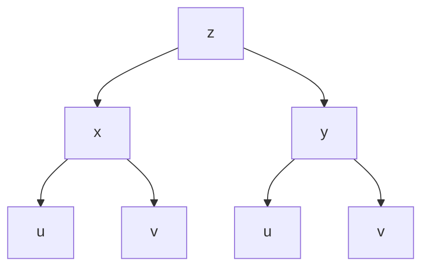
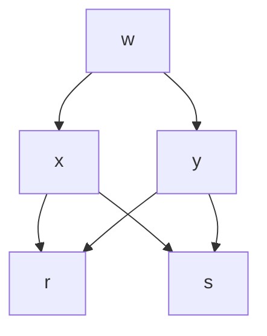

<!-- page 1 | Start here -->

## Partial Derivatives and Multivariable Calculus

Master limits, continuity, first and higher-order partial derivatives, chain rules for functions of multiple variables, and implicit differentiation.

**Before you start:** Single-variable limits and continuity; Basic differentiation rules (product, quotient, chain rule); Partial differentiation fundamentals.

### Your path through this module

1. **Limits and Continuity of Functions of Two Variables**: A limit in two variables must be independent of the path along which (x,y) approaches (a,b).
2. **Limits, Continuity, and Domain/Range Practice**: Using paths like y = mx to prove limit non-existence and sketching concentric circles or parabolas for level curves.
3. **First-Order Partial Derivatives and Slopes**: Partial derivatives represent directional slopes and rates of change along coordinate axes.
4. **Higher-Order Partial Derivatives**: Mixed partial derivatives commute under continuity conditions (f_xy = f_yx).
5. **Chain Rule for Functions of Two or More Variables**: Total derivative formulas aggregate contributions from all intermediate variable pathways using tree diagrams.
6. **Implicit Differentiation Using Partial Derivatives**: The ratio of negative partial derivatives (-f_x / f_y) yields the derivative of an implicit function directly.

<!-- page 2 | Limits and Continuity of Functions of Two Variables -->

# Limits and Continuity of Functions of Two Variables

Transitioning from single-variable calculus to multivariable calculus requires a shift in how we think about approach and destination. For a function of a single variable, $y = f(x)$, a point $x$ can approach a value $a$ from only two directions: from the left ($x \to a^-$) and from the right ($x \to a^+$). If both one-sided limits are equal, the single-variable limit exists. For a function of two variables, $z = f(x,y)$, the input point $(x,y)$ can approach a target point $(a,b)$ from an infinite number of directions in the two-dimensional $xy$$plane (along straight lines, parabolas, spirals, etc.). This makes the concept of a limit and continuity much richer and more rigorous.

## Limit of a Function of Two Variables

We define a function of two variables, $f(x,y)$, as a rule that assigns a real number $z$ to each ordered pair $(x,y)$ in a subset of $\mathbb{R}^2$ called the domain. The value $L$ is defined as the limit of $f(x,y)$ as $(x,y)$ approaches $(a,b)$, denoted as:

$$\lim_{(x,y) \to (a,b)} f(x,y) = L$$

This equation means that the distance between $f(x,y)$ and $L$ can be made arbitrarily small by making the Euclidean distance between the point $(x,y)$ and the point $(a,b)$ sufficiently small, but not equal to $(a,b)$ itself. In formal terms, for every $\epsilon > 0$, there exists a $\delta > 0$ such that if $0 < \sqrt{(x-a)^2 + (y-b)^2} < \delta$, then $$f(x,y) - L| < \epsilon$. The unit of distance in the $xy$$plane is dimensionless or measured in units of length, while $L$ has the physical units of the function $f(x,y)$.

## Path-Dependent Limits

Because $(x,y)$ can approach $(a,b)$ along any trajectory, a fundamental rule governs multivariable limits: **the limit must be unique regardless of the path of approach**. If $(x,y)$ approaches $(a,b)$ along two different paths and yields two different limiting values, the two-variable limit does not exist.

A powerful testing technique is to let $(x,y)$ approach the origin $(0,0)$ along straight-line paths given by $y = mx$, where $m$ is the slope of the line.

To visualize this approach path:
1. Draw an $xy$coordinate system with an origin at $(0,0)$.
2. Sketch a family of straight lines passing through the origin, representing $y = mx$ for various values of $m$.
3. Imagine sliding a point $(x,y)$ along one of these lines toward $(0,0)$ and observing the resulting value of $f(x,y)$.

Substituting $y = mx$ into $f(x,y)$ transforms the expression into a single-variable function of $x$. If the resulting limit depends on $m$, the limit depends on the path, proving that the limit does not exist.

## Continuity Conditions

Just as in single-variable calculus, continuity in two variables requires that the function has no breaks, jumps, or holes at a specific point. A function $f(x,y)$ is continuous at the point $(a,b)$ if three strict conditions are met:

1. **Defined:** The point $(a,b)$ lies within the domain of $f$, meaning $f(a,b)$ is a real number.
2. **Exists:** The limit $\lim_{(x,y) \to (a,b)} f(x,y)$ exists.
3. **Equal:** The limit equals the function value at that point:

$$\lim_{(x,y) \to (a,b)} f(x,y) = f(a,b)$$

If a function fails any of these three conditions at $(a,b)$, it is discontinuous at that point. Polynomials in $x$ and $y$ are continuous everywhere in $\mathbb{R}^2$, and rational functions are continuous everywhere on their domains where the denominator is non-zero.

## Worked Example

**Problem:** Evaluate the limit or show that it does not exist:

$$\lim_{(x,y) \to (0,0)} \frac{xy}{x^2 + y^2}$$

**Solution:**

1. **Test direct substitution:** Plugging in $(0,0)$ yields the indeterminate form $\frac{0}{0}$. We must evaluate the limit analytically.

2. **Test linear paths ($y = mx$):** Substitute $y = mx$ into the limit expression:

$$\lim_{x \to 0} \frac{x(mx)}{x^2 + (mx)^2}$$

3. **Simplify the expression:** Factor out $x^2$ from the numerator and denominator:

$$\lim_{x \to 0} \frac{m x^2}{x^2 (1 + m^2)} = \lim_{x \to 0} \frac{m}{1 + m^2} = \frac{m}{1 + m^2}$$

4. **Analyze the result:** The resulting limit depends explicitly on the slope $m$. If we approach along the x-axis ($m = 0$), the limit is $0$. If we approach along the line $y = x$ ($m = 1$), the limit is $\frac{1}{2}$.

5. **Conclusion:** Because different paths yield different limits, the limit does not exist.

## Remember

* A multivariable limit exists only if the same limiting value is obtained along every possible approach path.
* Testing linear paths $y = mx$ is a primary tool for proving that a limit does not exist when the result depends on $m$.
* Continuity at $(a,b)$ requires that the function is defined at the point, the limit exists as $(x,y) \to (a,b)$, and the limit matches the function value.

<!-- page 3 | Limits, Continuity, and Domain/Range Practice -->

## Limits, Continuity, and Domain/Range Practice

Bridge: Now that we understand the theory of limits and continuity, we will solve limit evaluations, path-dependent limit proofs, and sketch level curves.

The new idea: Using paths like $y = mx$ to prove limit non-existence and sketching concentric circles or parabolas for level curves.

Objectives: Evaluate limits using algebraic manipulation; Show non-existence of limits using path tests; Determine domains, ranges, and level curves.

Concepts to teach: Direct substitution; Rationalization; Path test for non-existence; Domain and Range; Level curves.

### Limits for Functions of Two Variables

A function $f(x,y)$ approaches the limit $L$ as ordered pair $(x,y)$ approaches $(x_0, y_0)$ and we write:
$$\lim_{(x,y)\to(a,b)} f(x,y) = L.$$

#### Solved Limit Problems

1. Evaluate $\lim_{(x,y)\to(0,1)} \frac{x-xy+3}{x^2y+5xy-y^3}$

$$\begin{aligned}
&= \frac{\lim_{(x,y)\to(0,1)} (x-xy+3)}{\lim_{(x,y)\to(0,1)} (x^2y+5xy-y^3)} = \frac{0 - 0\times 1 + 3}{0^2\times 1 + 5\times 0\times 1 - 1^3}\\[6pt]
&= \frac{3}{-1} = -3
\end{aligned}$$

2. Evaluate $\lim_{(x,y)\to(3,-4)} \sqrt{x^2+y^2}$

$$\begin{aligned}
&= \sqrt{\lim_{(x,y)\to(3,-4)} (x^2+y^2)} = \sqrt{3^2 + (-4)^2} = \sqrt{9+16} = \sqrt{25} = 5
\end{aligned}$$

3. Evaluate $\lim_{(x,y)\to(\pi/2,0)} \left( \frac{x}{\sin x} - \frac{\sin y}{y} \right)$

$$\begin{aligned}
&= \frac{\lim_{(x,y)\to(\pi/2,0)} x}{\lim_{(x,y)\to(\pi/2,0)} \sin x} - \frac{\lim_{(x,y)\to(\pi/2,0)} \sin y}{\lim_{(x,y)\to(\pi/2,0)} y}\\[6pt]
&= \frac{\pi/2}{\sin \pi/2} - \frac{\sin 0}{0} = \frac{\pi - 0}{\frac{2}{1}} = \frac{\pi}{2} - 1
\end{aligned}$$

4. Evaluate $\lim_{(x,y) \to (0,0)} \frac{x^2 - xy}{\sqrt{x} - \sqrt{y}}$

Initial direct substitution yields $\frac{0}{0}$. We rationalize the denominator:

$$\begin{aligned}
&= \lim_{(x,y) \to (0,0)} \frac{(x^2 - xy)(\sqrt{x} + \sqrt{y})}{(\sqrt{x})^2 - (\sqrt{y})^2} = \frac{x^2 \sqrt{x} + x^2 \sqrt{y} - xy \sqrt{x} - xy \sqrt{y}}{x - y}\\[6pt]
&= \frac{x(x - y)(\sqrt{x} + \sqrt{y})}{x - y} = 0(0 + 0) = 0
\end{aligned}$$

#### Proofs of Limit Non-Existence via Paths

1. Show that $\lim_{(x,y) \to (0,0)} \frac{x^2 - y^2}{x^2 + y^2}$ does not exist.

Let $(x,y) \to (0,0)$ along the path $y = mx$. Substituting this into the expression:

$$\lim_{x \to 0} \frac{x^2 - m^2 x^2}{x^2 + m^2 x^2} = \lim_{x \to 0} \frac{x^2 (1 - m^2)}{x^2 (1 + m^2)} = \frac{1 - m^2}{1 + m^2}$$

Since the resulting limit depends on the slope $m$, the limit approaches different values along different paths. Therefore, the limit does not exist.

2. Show that $\lim_{(x,y) \to (0,0)} \frac{xy}{x^2 + y^2}$ does not exist.

Let $(x,y) \to (0,0)$ along the path $y = mx$:

$$\lim_{x \to 0} \frac{x \cdot mx}{x^2 + m^2 x^2} = \frac{x^2 m}{x^2 (1 + m^2)} = \frac{m}{1 + m^2}$$

Since this limit depends on $m$, the limit does not exist.

---

### Continuity

A function $f(x,y)$ is continuous at $(x_0, y_0)$ if:
1. $f(x_0, y_0)$ is defined.
2. $\lim_{(x,y)\to(x_0, y_0)} f(x,y)$ exists.
3. $\lim_{(x,y)\to(x_0, y_0)} f(x,y) = f(x_0, y_0)$.

A function is continuous if it is continuous at every point of its domain.

#### Solved Continuity Problems

1. Show that $f(x,y) = \begin{cases} \frac{2xy}{x^2+y^2} & ; (x,y) \neq (0,0) \\ 0 & ; (x,y) = (0,0) \end{cases}$ is continuous at every point except the origin.

Given $f(0,0) = 0$. Evaluating the limit along the path $y = mx$:

$$\lim_{(x,y)\to(0,0)} \frac{2x\cdot mx}{x^2+m^2x^2} = \lim_{(x,y)\to(0,0)} \frac{2x^2m}{x^2(1+m^2)} = \frac{2m}{1+m^2}$$

Because the limit depends on the value of $m$, the limit does not exist at the origin. Thus, the function $f(x,y)$ is discontinuous at the origin.

2. Show that $f(x,y) = \begin{cases} \frac{y}{\sqrt{x^2+y^2}} & ; (x,y) \neq (0,0) \\ 0 & ; (x,y) = (0,0) \end{cases}$ is discontinuous at $(0,0)$.

Given $f(0,0) = 0$. Evaluating along the path $y = mx$ yields a path-dependent expression, proving the limit does not exist, and hence the function is discontinuous at $(0,0)$.

---

### Domain and Range

1. Find the domain and range of a function $f(x, y) = x^2 - y^2$.
* **Domain:** All real numbers $\mathbb{R}^2$, because there are no restrictions on $x$ and $y$.
* **Range:** All real numbers $\mathbb{R}$, because $x^2 - y^2$ can take any real value.

2. Find the domain and range of the function $f(x, y) = \frac{x+y}{x-y}$.
* **Domain:** $\mathbb{R}^2 - \{(x, y) \mid x = y\}$, because the denominator cannot be zero.
* **Range:** All real numbers $\mathbb{R}$.

---

### Level Curves

A level curve of a function $f(x, y)$ is a curve along which the function maintains a constant value. For a given constant $k$, the level curve is defined by the equation $f(x, y) = k$.

1. Find the graph and level curves of the function $f(x, y) = \sqrt{9 - x^2 - y^2}$ for $c = 0, 1, 2,$ and $3$.

$$\sqrt{9 - x^2 - y^2} = c \implies 9 - x^2 - y^2 = c^2 \implies x^2 + y^2 = 9 - c^2$$

* When $c = 0 \implies x^2 + y^2 = 9$
* When $c = 1 \implies x^2 + y^2 = 8$
* When $c = 2 \implies x^2 + y^2 = 5$
* When $c = 3 \implies x^2 + y^2 = 0$ (the origin)

> **Figure: Level curves of f(x, y) = sqrt(9 - x^2 - y^2)**
>
> Level curves of f(x, y) = sqrt(9 - x^2 - y^2). A set of concentric circles centered at the origin on a Cartesian coordinate system with x and y axes. The outermost circle is labelled c = 0 passing through points (-3, 0), (3, 0), (0, 3), and (0, -3). Inside are circles labelled c = 1, c = 2, and the innermost point at the origin is c = 3.

2. Find the level curves for the function $f(x, y) = x^2 + 2y$ for $k = -2, 0, 2$.

$$x^2 + 2y = k \implies x^2 = k - 2y$$

* For $k = -2 \implies x^2 = -2 - 2y$
* For $k = 0 \implies x^2 = -2y$
* For $k = 2 \implies x^2 = 2 - 2y$

> **Figure: Parabolas for level curves of f(x, y) = x^2 + 2y**
>
> Sketches of parabolas opening downwards representing level curves for k = 2, k = 0, and k = -2 for the function f(x, y) = x^2 + 2y, showing coordinate axes and equations.

3. Find the level curves of the function $f(x,y) = x^2+y^2$ passing through specific points.

$$f(x,y) = x^2+y^2 = 2^2+0^2 = 4$$

> **Figure: Sketch of a circle representing a level curve on an xy-plane**
>
> Sketch of a circle representing a level curve on an xy-plane. A Cartesian coordinate system with x and y axes showing a circle centered at the origin. Points marked on the axes are (2,0), (-2,0) (notated with possible typo -3,0), (0,2), and (0,-2).

<!-- page 4 | First-Order Partial Derivatives and Slopes -->

## First-Order Partial Derivatives and Slopes

### Introduction and Core Definitions
Building on single-variable calculus, we extend the concept of differentiation to functions of multiple variables. For a function of two variables $z = f(x,y)$, the derivative cannot be defined in a single direction because the surface exists in three-dimensional space. Instead, we hold one variable constant and differentiate with respect to the other variable.

#### Definition
The partial derivative of $z = f(x,y)$ with respect to $x$ is denoted as $\frac{\partial z}{\partial x}$ or $f_x$, defined by the limit:
$$\frac{\partial z}{\partial x} = \lim_{h \to 0} \frac{f(x+h, y) - f(x, y)}{h}$$

The partial derivative of $z = f(x,y)$ with respect to $y$ is denoted as $\frac{\partial z}{\partial y}$ or $f_y$, defined by the limit:
$$\frac{\partial z}{\partial y} = \lim_{h \to 0} \frac{f(x, y+h) - f(x, y)}{h}$$

### Geometric Interpretation: Slopes and Rates of Change

Let $z = f(x,y)$ represent a surface.
- The partial derivative $\frac{\partial z}{\partial x}$ represents the slope of the tangent line to the curve formed by intersecting the surface with the plane $y = \text{constant}$, evaluated in the $x$direction.
- The partial derivative $\frac{\partial z}{\partial y}$ represents the slope of the tangent line to the curve formed by intersecting the surface with the plane $x = \text{constant}$, evaluated in the $y$direction.
- These derivatives also measure the instantaneous rate of change of $z$ with respect to $x$ (holding $y$ constant) and with respect to $y$ (holding $x$ constant).

---

### Solved Problems

#### Example 1
**Problem:** Find the first-order partial derivatives of $f(x,y) = x^2y + 3xy^2$.

**Solution:**
- **With respect to $x$ (treating $y$ as a constant):**
$$\begin{aligned}
\frac{\partial f}{\partial x} &= y \cdot (2x) + 3y^2 \cdot (1) \\
&= 2xy + 3y^2
\end{aligned}$$

- **With respect to $y$ (treating $x$ as a constant):**
$$\begin{aligned}
\frac{\partial f}{\partial y} &= x^2 \cdot (1) + 3x \cdot (2y) \\
&= x^2 + 6xy
\end{aligned}$$

#### Example 2
**Problem:** Let $f(x, y) = e^{x^2 y^3} \sin(x^2 - y^2)$, find $f_x$ and $f_y$.

**Solution:**
Applying the product rule and chain rule:
$$\begin{aligned}
f_x &= \frac{\partial}{\partial x}\left(e^{x^2 y^3}\right) \sin(x^2 - y^2) + e^{x^2 y^3} \frac{\partial}{\partial x}\left(\sin(x^2 - y^2)\right) \\
&= (y^3 \cdot 2x e^{x^2 y^3}) \sin(x^2 - y^2) + e^{x^2 y^3} \cos(x^2 - y^2)(2x)
\end{aligned}$$
$$\begin{aligned}
f_y &= \frac{\partial}{\partial y}\left(e^{x^2 y^3}\right) \sin(x^2 - y^2) + e^{x^2 y^3} \frac{\partial}{\partial y}\left(\sin(x^2 - y^2)\right) \\
&= (3x^2 y^2 e^{x^2 y^3}) \sin(x^2 - y^2) + e^{x^2 y^3} \cos(x^2 - y^2)(-2y)
\end{aligned}$$

#### Example 3
**Problem:** Let $f(x,y) = \frac{x-y}{x^2+y^2}$, find $f_x$ and $f_y$.

**Solution:**
Using the quotient rule:
- **Derivative with respect to $x$:**
$$\begin{aligned}
f_x &= \frac{(x^2+y^2) \cdot 1 - (x-y) \cdot (2x)}{(x^2+y^2)^2} \\
&= \frac{x^2 + y^2 - 2x^2 + 2xy}{(x^2+y^2)^2} = \frac{y^2 - x^2 + 2xy}{(x^2+y^2)^2}
\end{aligned}$$

- **Derivative with respect to $y$:**
$$\begin{aligned}
f_y &= \frac{(x^2+y^2) \cdot (-1) - (x-y) \cdot (2y)}{(x^2+y^2)^2} \\
&= \frac{-x^2 - y^2 - 2xy + 2y^2}{(x^2+y^2)^2} = \frac{y^2 - x^2 - 2xy}{(x^2+y^2)^2}
\end{aligned}$$

#### Example 4
**Problem:** Find the $1^{\text{st}}$ order partial derivatives of $f(x, y) = \sqrt{x^2+y^2}$.

**Solution:**
$$\begin{aligned}
f_x &= \frac{1}{2\sqrt{x^2+y^2}} \cdot \frac{\partial}{\partial x}(x^2+y^2) = \frac{2x}{2\sqrt{x^2+y^2}} = \frac{x}{\sqrt{x^2+y^2}} \\
f_y &= \frac{1}{2\sqrt{x^2+y^2}} \cdot \frac{\partial}{\partial y}(x^2+y^2) = \frac{2y}{2\sqrt{x^2+y^2}} = \frac{y}{\sqrt{x^2+y^2}}
\end{aligned}$$

#### Example 5
**Problem:** Find the $1^{\text{st}}$ order partial derivatives of:
1. $f(x,y) = 2x^2 - 3y - 4$
2. $f(x,y) = (x+1)(y-2)$

**Solution:**
1. For $f(x,y) = 2x^2 - 3y - 4$:
   - $f_x = 4x - 0 - 0 = 4x$
   - $f_y = 0 - 3 - 0 = -3$

2. For $f(x,y) = (x+1)(y-2)$:
   - $f_x = (y-2) \cdot 1 = y - 2$
   - $f_y = (x+1) \cdot 1 = x + 1$

#### Example 6
**Problem:** Find the $1^{\text{st}}$ order partial derivative of $f(x,y) = \log (x^2 + y^2)$.

**Solution:**
$$\begin{aligned}
f_x &= \frac{1}{x^2+y^2} \cdot \frac{\partial}{\partial x}(x^2+y^2) = \frac{2x}{x^2+y^2} \\
f_y &= \frac{1}{x^2+y^2} \cdot \frac{\partial}{\partial y}(x^2+y^2) = \frac{2y}{x^2+y^2}
\end{aligned}$$

#### Example 7
**Problem:** Find the partial derivatives of $f(x,y) = e^{ax} \sin(by)$.

**Solution:**
$$\begin{aligned}
f_x &= \sin(by) \cdot \frac{\partial}{\partial x}\left(e^{ax}\right) = a e^{ax} \sin(by) \\
f_y &= e^{ax} \cdot \frac{\partial}{\partial y}\left(\sin(by)\right) = b e^{ax} \cos(by)
\end{aligned}$$

#### Example 8
**Problem:** Find the partial derivatives of $z = \sqrt{3x + 4y}$.

**Solution:**
$$\begin{aligned}
\frac{\partial z}{\partial x} &= \frac{1}{2\sqrt{3x + 4y}} \cdot 3 = \frac{3}{2\sqrt{3x + 4y}} \\
\frac{\partial z}{\partial y} &= \frac{1}{2\sqrt{3x + 4y}} \cdot 4 = \frac{2}{\sqrt{3x + 4y}}
\end{aligned}$$

#### Example 9
**Problem:** Find the partial derivatives of $f(x, y) = x e^{-y} + 5y$.

**Solution:**
$$\begin{aligned}
\frac{\partial f}{\partial x} &= e^{-y} \cdot (1) + 0 = e^{-y} \\
\frac{\partial f}{\partial y} &= x \cdot \left(-e^{-y}\right) + 5 = 5 - x e^{-y}
\end{aligned}$$

---

### Application Problems: Slopes and Rates of Change

#### Application 1
**Problem:** Find the slope of the surface $z = 10 - 4x^2 - 2y^2$ at the point $(1, 2)$ in the $x$direction and the $y$direction.

**Solution:**
- **In the $x$direction:**
$$\frac{\partial z}{\partial x} = 0 - 8x - 0 = -8x$$
Evaluating at $(1, 2)$:
$$\left.\frac{\partial z}{\partial x}\right|_{(1,2)} = -8(1) = -8$$

- **In the $y$direction:**
$$\frac{\partial z}{\partial y} = 0 - 0 - 4y = -4y$$
Evaluating at $(1, 2)$:
$$\left.\frac{\partial z}{\partial y}\right|_{(1,2)} = -4(2) = -8$$

#### Application 2
**Problem:** Find the rate of change of $z = \sin(y^2 - 4x)$ with respect to $y$ at the point $(3, 1)$.

**Solution:**
$$\frac{\partial z}{\partial y} = \cos(y^2 - 4x) \cdot (2y - 0) = 2y \cos(y^2 - 4x)$$
Evaluating at $(3, 1)$:
$$\left.\frac{\partial z}{\partial y}\right|_{(3, 1)} = 2(1) \cos(1^2 - 4(3)) = 2 \cos(1 - 12) = 2 \cos(-11) = 2 \cos(11)$$

<!-- page 5 | Higher-Order Partial Derivatives -->

## Higher-Order Partial Derivatives

Bridge: Having mastered first-order derivatives, we differentiate further to analyze curvature and verify symmetry of mixed partial derivatives. The new idea: Mixed partial derivatives commute under continuity conditions ($f_{xy} = f_{yx}$). Objectives: Compute second and third-order partial derivatives; Verify equality of mixed partial derivatives; Solve Laplace-type partial differential equations. Concepts to teach: Second-order partial derivatives; Mixed partial derivatives; Clairaut's theorem verification; Laplacian operator.

### Second-Order Partial Derivatives

Let $z = f(x, y)$. The $1^{\text{st}}$ order partial derivatives are $\frac{\partial z}{\partial x}$ and $\frac{\partial z}{\partial y}$. Differentiating these $1^{\text{st}}$ order derivatives with respect to $x$ and $y$ gives the $2^{\text{nd}}$ order partial derivatives:

1) $\frac{\partial}{\partial x}\left(\frac{\partial z}{\partial x}\right) = \frac{\partial^2 z}{\partial x^2} = f_{xx}$

2) $\frac{\partial}{\partial y}\left(\frac{\partial z}{\partial y}\right) = \frac{\partial^2 z}{\partial y^2} = f_{yy}$

3) $\frac{\partial}{\partial y}\left(\frac{\partial z}{\partial x}\right) = \frac{\partial^2 z}{\partial y \partial x} = f_{yx}$

4) $\frac{\partial}{\partial x}\left(\frac{\partial z}{\partial y}\right) = \frac{\partial^2 z}{\partial x \partial y} = f_{xy}$

### Solved Problems

#### Problem 1
Find all the $2^{\text{nd}}$ order partial derivatives for the function: $f(x, y) = x^3 y + 2xy^2$

Given:
- $f(x, y) = x^3 y + 2xy^2$

Find:
- All second-order partial derivatives ($f_{xx}, f_{yy}, f_{yx}, f_{xy}$)

Formula & Substitution:
$$\begin{aligned}
\frac{\partial f}{\partial x} &= \frac{\partial}{\partial x}\left(x^3 y + 2xy^2\right) = 3x^2y + 2y^2 \\[6pt]
\frac{\partial f}{\partial y} &= \frac{\partial}{\partial y}\left(x^3 y + 2xy^2\right) = x^3 + 4xy \\[6pt]
\frac{\partial^2 f}{\partial x^2} &= \frac{\partial}{\partial x}(3x^2y + 2y^2) = 6xy \\[6pt]
\frac{\partial^2 f}{\partial y^2} &= \frac{\partial}{\partial y}(x^3 + 4xy) = 4x \\[6pt]
\frac{\partial^2 f}{\partial y \partial x} &= \frac{\partial}{\partial y}\left(\frac{\partial f}{\partial x}\right) = \frac{\partial}{\partial y}\left(3x^2y + 2y^2\right) = 3x^2 + 4y \\[6pt]
\frac{\partial^2 f}{\partial x \partial y} &= \frac{\partial}{\partial x}\left(\frac{\partial f}{\partial y}\right) = \frac{\partial}{\partial x}\left(x^3 + 4xy\right) = 3x^2 + 4y
\end{aligned}$$

Result:
$f_{xx} = 6xy$, $f_{yy} = 4x$, $f_{yx} = 3x^2 + 4y$, $f_{xy} = 3x^2 + 4y$

---

#### Problem 2
If $f(x,y) = 2x^5y^3 + 5x + 7y$, find $\frac{\partial^2 f}{\partial x \partial y}$ and $\frac{\partial^2 f}{\partial y \partial x}$.

Given:
- $f(x,y) = 2x^5y^3 + 5x + 7y$

Find:
- $\frac{\partial^2 f}{\partial x \partial y}$ and $\frac{\partial^2 f}{\partial y \partial x}$

Formula & Substitution:
$$\begin{aligned}
\frac{\partial f}{\partial x} &= 10x^4 y^3 + 5 \\[6pt]
\frac{\partial f}{\partial y} &= 6x^5 y^2 + 7 \\[6pt]
\frac{\partial^2 f}{\partial x \partial y} &= \frac{\partial}{\partial x} \left( \frac{\partial f}{\partial y} \right) = \frac{\partial}{\partial x} \left(6x^5 y^2 + 7\right) = 30x^4 y^2 \\[6pt]
\frac{\partial^2 f}{\partial y \partial x} &= \frac{\partial}{\partial y} \left( \frac{\partial f}{\partial x} \right) = \frac{\partial}{\partial y} \left(10x^4 y^3 + 5\right) = 30x^4 y^2
\end{aligned}$$

Result:
Both mixed partial derivatives equal $30x^4 y^2$.

---

#### Problem 3
If $f(x,y) = x^3 y + e^{xy^2}$, show that $\frac{\partial^2 f}{\partial y \partial x} = \frac{\partial^2 f}{\partial x \partial y}$.

Given:
- $f(x,y) = x^3 y + e^{xy^2}$

Formula & Substitution:
$$\begin{aligned}
\frac{\partial f}{\partial x} &= 3x^2 y + y^2 e^{xy^2} \\[6pt]
\frac{\partial f}{\partial y} &= x^3 + 2yx e^{xy^2} \\[6pt]
\frac{\partial^2 f}{\partial y \partial x} &= \frac{\partial}{\partial y} \left( 3x^2 y + y^2 e^{xy^2} \right) = 3x^2 + 2y e^{xy^2} + 2xy^3 e^{xy^2} \\[6pt]
\frac{\partial^2 f}{\partial x \partial y} &= \frac{\partial}{\partial x} \left( x^3 + 2yx e^{xy^2} \right) = 3x^2 + 2y e^{xy^2} + 2xy^3 e^{xy^2}
\end{aligned}$$

Result:
$\frac{\partial^2 f}{\partial y \partial x} = \frac{\partial^2 f}{\partial x \partial y}$ verified successfully.

---

#### Problem 4
If $u = \frac{1}{\sqrt{x^2 + y^2 + z^2}}$, prove that $\frac{\partial^2 u}{\partial x^2} + \frac{\partial^2 u}{\partial y^2} + \frac{\partial^2 u}{\partial z^2} = 0$.

Given:
- $u = \left(x^2 + y^2 + z^2\right)^{-1/2}$

Formula & Substitution:
$$\begin{aligned}
\frac{\partial u}{\partial x} &= -x \left(x^2+y^2+z^2\right)^{-3/2} \\[6pt]
\frac{\partial^2 u}{\partial x^2} &= 3x^2 \left(x^2+y^2+z^2\right)^{-5/2} - \left(x^2+y^2+z^2\right)^{-3/2} \\[6pt]
\frac{\partial^2 u}{\partial y^2} &= 3y^2 \left(x^2+y^2+z^2\right)^{-5/2} - \left(x^2+y^2+z^2\right)^{-3/2} \\[6pt]
\frac{\partial^2 u}{\partial z^2} &= 3z^2 \left(x^2+y^2+z^2\right)^{-5/2} - \left(x^2+y^2+z^2\right)^{-3/2}
\end{aligned}$$

Summing the second derivatives:
$$\begin{aligned}
\nabla^2 u &= \left(3x^2 + 3y^2 + 3z^2\right) \left(x^2+y^2+z^2\right)^{-5/2} - 3 \left(x^2+y^2+z^2\right)^{-3/2} \\[6pt]
&= 3\left(x^2+y^2+z^2\right) \left(x^2+y^2+z^2\right)^{-5/2} - 3 \left(x^2+y^2+z^2\right)^{-3/2} \\[6pt]
&= 3\left(x^2+y^2+z^2\right)^{-3/2} - 3 \left(x^2+y^2+z^2\right)^{-3/2} = 0
\end{aligned}$$

Result:
Proved that $\frac{\partial^2 u}{\partial x^2} + \frac{\partial^2 u}{\partial y^2} + \frac{\partial^2 u}{\partial z^2} = 0$.

---

#### $Q_1$ Implicit Differentiation using Partials
Find $\frac{dy}{dx}$ if $u = x^2 + y^2 - a^2 = 0$.

$$\begin{aligned}
\frac{\partial u}{\partial x} &= 2x, \quad \frac{\partial u}{\partial y} = 2y \\[6pt]
\frac{dy}{dx} &= -\frac{\frac{\partial u}{\partial x}}{\frac{\partial u}{\partial y}} = -\frac{2x}{2y} = -\frac{x}{y}
\end{aligned}$$

---

#### $Q_3$ Third-Order Mixed Partial
If $f(x,y,z) = e^{xyz}$, find $\frac{\partial^3 f}{\partial x \partial y \partial z}$.

$$\begin{aligned}
\frac{\partial f}{\partial z} &= xy e^{xyz} \\[6pt]
\frac{\partial^2 f}{\partial y \partial z} &= \frac{\partial}{\partial y}(xy e^{xyz}) = x e^{xyz} + xy^2 z e^{xyz} \\[6pt]
\frac{\partial^3 f}{\partial x \partial y \partial z} &= \frac{\partial}{\partial x}\left(x e^{xyz} + x y^2 z e^{xyz}\right) = e^{xyz} \left[3xyz + x^2 y^2 z^2 + 1\right]
\end{aligned}$$

Result:
$\frac{\partial^3 f}{\partial x \partial y \partial z} = e^{xyz} \left(1 + 3xyz + x^2y^2z^2\right)$.

<!-- page 6 | Chain Rule for Functions of Two or More Variables -->

## Chain Rule for Functions of Two or More Variables

With partial derivatives established, we now tackle scenarios where intermediate variables depend on time or parameters. Total derivative formulas aggregate contributions from all intermediate variable pathways using tree diagrams.

### Chain Rule for Two Variables ($z = f(x(t), y(t))$)

Let $z = f(x, y)$ be a differentiable function of two variables $x$ and $y$, where $x = f(t)$ and $y = g(t)$ are differentiable functions of a single parameter $t$. Then $z$ is a function of $t$ alone, and its total derivative is given by:

$$\frac{dz}{dt} = \frac{\partial z}{\partial x} \cdot \frac{dx}{dt} + \frac{\partial z}{\partial y} \cdot \frac{dy}{dt}$$

> **Figure: Tree diagram for chain rule with two variables**
>
> Tree diagram representing the chain rule for a function of two variables. At the top root node is z, which branches into two intermediate nodes x (via branch labelled ∂z/∂x) and y (via branch labelled ∂z/∂y). From node x, a single branch extends downwards to variable t, labelled dx/dt. From node y, a single branch extends downwards to variable t, labelled dy/dt.

#### Solved Problems

**Q1.** Suppose that $z = 5x^3y^2$, $x = t^3$, $y = t^5$. Use the chain rule to find $\frac{dz}{dt}$ and check the result by expressing $z$ as a function of $t$ and differentiating directly.

* **Given:** $z = 5x^3y^2$, $x = t^3$, $y = t^5$
* **Find:** $\frac{dz}{dt}$

* **Formula:**
$$\frac{dz}{dt} = \frac{\partial z}{\partial x} \cdot \frac{dx}{dt} + \frac{\partial z}{\partial y} \cdot \frac{dy}{dt}$$

* **Substitution and Solution:**
$$\frac{\partial z}{\partial x} = 15x^2y^2, \quad \frac{\partial z}{\partial y} = 10x^3y, \quad \frac{dx}{dt} = 3t^2, \quad \frac{dy}{dt} = 5t^4$$

$$\frac{dz}{dt} = (15x^2y^2)(3t^2) + (10x^3y)(5t^4)$$

Substituting $x = t^3$ and $y = t^5$:

$$\frac{dz}{dt} = 45(t^3)^2(t^5)^2 \cdot t^2 + 50(t^3)^3 \cdot t^5 \cdot t^4 = 45t^{18} + 50t^{18} = 95t^{18}$$

* **Direct Check:**
$$z = 5(t^3)^3(t^5)^2 = 5t^9 t^{10} = 5t^{19}$$
$$\frac{dz}{dt} = 5 \times 19 t^{18} = 95t^{18}$$

* **Final Answer:** $\underline{95t^{18}}$

---

**Q2.** Suppose that $z = \log(3x^2+y)$, $x = \sqrt{t}$, $y = t^{1/3}$. Use the chain rule to find $\frac{dz}{dt}$.

* **Given:** $z = \ln(3x^2+y)$, $x = t^{1/2}$, $y = t^{1/3}$
* **Formula:**
$$\frac{dz}{dt} = \frac{\partial z}{\partial x} \cdot \frac{dx}{dt} + \frac{\partial z}{\partial y} \cdot \frac{dy}{dt}$$

* **Derivatives:**
$$\frac{\partial z}{\partial x} = \frac{6x}{3x^2+y}, \quad \frac{\partial z}{\partial y} = \frac{1}{3x^2+y}, \quad \frac{dx}{dt} = \frac{1}{2\sqrt{t}}, \quad \frac{dy}{dt} = \frac{1}{3}t^{-2/3}$$

* **Substitution:**
$$\frac{dz}{dt} = \left(\frac{6x}{3x^2+y}\right)\left(\frac{1}{2\sqrt{t}}\right) + \left(\frac{1}{3x^2+y}\right)\left(\frac{1}{3}t^{-2/3}\right)$$

---

**Q3.** The length ($x$) and width ($y$) of a rectangle are increasing at the rate of $1.5\text{ cm/sec}$ and $0.5\text{ cm s}^{-1}$ respectively. Find the rate at which the area is increasing at the instant when the length is $40\text{ cm}$ and width is $30\text{ cm}$.

* **Given:** $\frac{dx}{dt} = 1.5\text{ cm s}^{-1}$, $\frac{dy}{dt} = 0.5\text{ cm s}^{-1}$, $x = 40\text{ cm}$, $y = 30\text{ cm}$
* **Formula:** Area $A = xy$, hence:
$$\frac{dA}{dt} = \frac{\partial A}{\partial x} \cdot \frac{dx}{dt} + \frac{\partial A}{\partial y} \cdot \frac{dy}{dt}$$

* **Substitution:**
$$\frac{dA}{dt} = y \cdot \frac{dx}{dt} + x \cdot \frac{dy}{dt} = (30)(1.5) + (40)(0.5) = 45 + 20 = 65$$

* **Final Answer:** $\underline{65\text{ cm}^2\text{s}^{-1}}$

---

### Chain Rule for Partial Derivatives ($z = f(x(u,v), y(u,v))$)

Let $z = f(x, y)$ be a function of two variables where $x = x(u, v)$ and $y = y(u, v)$ are functions of $u$ and $v$. Then the partial derivatives with respect to intermediate variables are:

$$\frac{\partial z}{\partial u} = \frac{\partial z}{\partial x} \cdot \frac{\partial x}{\partial u} + \frac{\partial z}{\partial y} \cdot \frac{\partial y}{\partial u}$$

$$\frac{\partial z}{\partial v} = \frac{\partial z}{\partial x} \cdot \frac{\partial x}{\partial v} + \frac{\partial z}{\partial y} \cdot \frac{\partial y}{\partial v}$$

#### Solved Problems

**Q.** Express $\frac{\partial w}{\partial r}$ and $\frac{\partial w}{\partial s}$ in terms of $r$ and $s$ if $w = x^2 + y^2$, $x = r - s$, $y = r + s$.

* **Given:** $w = x^2 + y^2$, $x = r - s$, $y = r + s$
* **Derivatives:**
$$\frac{\partial w}{\partial x} = 2x, \quad \frac{\partial w}{\partial y} = 2y$$
$$\frac{\partial x}{\partial r} = 1, \quad \frac{\partial y}{\partial r} = 1, \quad \frac{\partial x}{\partial s} = -1, \quad \frac{\partial y}{\partial s} = 1$$

* **Substitution:**
$$\frac{\partial w}{\partial r} = (2x)(1) + (2y)(1) = 2(r - s) + 2(r + s) = 4r$$
$$\frac{\partial w}{\partial s} = (2x)(-1) + (2y)(1) = -2(r - s) + 2(r + s) = 4s$$

---

**Q.** Find the $1^{\text{st}}$ order partial derivatives of the function $w = x + 2y + z^2$, where $x = \frac{r}{s}$, $y = r^2 + \ln s$, $z = 2r$.

* **Formulas:**
$$\frac{\partial w}{\partial r} = \frac{\partial w}{\partial x}\frac{\partial x}{\partial r} + \frac{\partial w}{\partial y}\frac{\partial y}{\partial r} + \frac{\partial w}{\partial z}\frac{\partial z}{\partial r}$$

* **Intermediate Derivatives:**
$$\frac{\partial w}{\partial x} = 1, \quad \frac{\partial w}{\partial y} = 2, \quad \frac{\partial w}{\partial z} = 2z$$
$$\frac{\partial x}{\partial r} = \frac{1}{s}, \quad \frac{\partial y}{\partial r} = 2r, \quad \frac{\partial z}{\partial r} = 2$$
$$\frac{\partial x}{\partial s} = -\frac{r}{s^2}, \quad \frac{\partial y}{\partial s} = \frac{1}{s}, \quad \frac{\partial z}{\partial s} = 0$$

* **Solution:**
$$\frac{\partial w}{\partial r} = (1)\left(\frac{1}{s}\right) + (2)(2r) + (2z)(2) = \frac{1}{s} + 4r + 4(2r) = \frac{1}{s} + 12r$$
$$\frac{\partial w}{\partial s} = (1)\left(-\frac{r}{s^2}\right) + (2)\left(\frac{1}{s}\right) + (2z)(0) = -\frac{r}{s^2} + \frac{2}{s}$$

> **Figure: Tree diagram for partial derivatives of w with respect to x, y, z and r, s**
>
> A tree diagram showing w at the top branching into x, y, and z. Below x, it branches into r and s. Below y, it branches into r and s. Below z, it branches into r and s. Labels include partial derivative symbols along the branches.

> **Figure: Tree diagram for chain rule with w, x, y, z**
>
> A tree diagram showing w at the top branching into x, y, and z with partial derivatives. y branches down to x, and z branches down to x.

---

### Related Rates in Engineering Problems

Engineering applications often require tracking rates of change of physical dimensions. For instance, the volume of a right-circular cone is $V = \frac{1}{3}\pi x^2 y$, where $x$ is radius and $y$ is altitude. The time rate of change is given by:

$$\frac{dV}{dt} = \frac{\partial V}{\partial x} \cdot \frac{dx}{dt} + \frac{\partial V}{\partial y} \cdot \frac{dy}{dt}$$

**Example:** The altitude of a right-circular cone is increasing at $0.2\text{ m s}^{-1}$, and the radius of its base is decreasing at $0.3\text{ cm s}^{-1}$. Find the rate at which its volume changes when altitude is $15\text{ cm}$ and radius is $10\text{ cm}$.

* **Given:** $\frac{dx}{dt} = -0.3\text{ cm s}^{-1}$, $\frac{dy}{dt} = 0.2\text{ m s}^{-1} = 20\text{ cm s}^{-1}$ (or matched units), $y = 15\text{ cm}$, $x = 10\text{ cm}$
* **Formula:** $\frac{dV}{dt} = \left(\frac{2\pi xy}{3}\right)\frac{dx}{dt} + \left(\frac{1}{3}\pi x^2\right)\frac{dy}{dt}$
* **Result:** Substitution yields the net volumetric expansion rate with appropriate unit conversion.

<!-- page 7 | Implicit Differentiation Using Partial Derivatives -->

## Implicit Differentiation Using Partial Derivatives

### Bridge and Objectives
Having applied chain rules, we now use partial derivatives to simplify finding derivatives of implicitly defined functions. The primary objective is to find $\frac{dy}{dx}$ for implicitly defined functions using partial derivatives and to verify these results against standard single-variable calculus techniques.

### The Implicit Differentiation Formula
For a function of two variables defined implicitly by $f(x, y) = C$, or equivalently $f(x, y) - C = 0$, the derivative $\frac{dy}{dx}$ can be computed directly using the ratio of negative partial derivatives:

$$\frac{dy}{dx} = -\frac{\frac{\partial f}{\partial x}}{\frac{\partial f}{\partial y}} = -\frac{f_x}{f_y}$$

This approach directly stems from the multivariable chain rule, treating $y$ as a function of $x$.

### Solved Numerical Problems

**Q1** Using partial derivatives find $\frac{dy}{dx}$ if $x^3 + y^3 = 3axy$, and verify the result using implicit differentiation.

**Given:**
Equation: $x^3 + y^3 = 3axy$

**Find:**
$\frac{dy}{dx}$ using partial derivatives and standard implicit differentiation.

**Formula:**
$$\frac{dy}{dx} = -\frac{\frac{\partial f}{\partial x}}{\frac{\partial f}{\partial y}}$$

**Solution Part 1: Using Partial Derivatives**
Rewrite the equation in the form $f(x, y) = C$:
$$f(x, y) = x^3 + y^3 - 3axy = 0$$

Compute the partial derivative with respect to $x$:
$$\frac{\partial f}{\partial x} = \frac{\partial}{\partial x}(x^3 + y^3 - 3axy) = 3x^2 - 3ay$$

Compute the partial derivative with respect to $y$:
$$\frac{\partial f}{\partial y} = \frac{\partial}{\partial y}(x^3 + y^3 - 3axy) = 3y^2 - 3ax$$

Substitute into the implicit differentiation formula:
$$\frac{dy}{dx} = -\frac{3x^2 - 3ay}{3y^2 - 3ax} = \frac{3ay - 3x^2}{3y^2 - 3ax} = \frac{ay - x^2}{y^2 - ax}$$

**Solution Part 2: Verification Using Standard Implicit Differentiation**
Differentiate both sides of $x^3 + y^3 = 3axy$ with respect to $x$ using the product rule on the right-hand side:
$$\frac{d}{dx}(x^3) + \frac{d}{dx}(y^3) = 3a \frac{d}{dx}(xy)$$
$$3x^2 + 3y^2 \frac{dy}{dx} = 3a \left[x \cdot \frac{dy}{dx} + y\right]$$
$$3x^2 + 3y^2 \frac{dy}{dx} = 3ax \frac{dy}{dx} + 3ay$$

Group all terms containing $\frac{dy}{dx}$ on one side:
$$3y^2 \frac{dy}{dx} - 3ax \frac{dy}{dx} = 3ay - 3x^2$$
$$\frac{dy}{dx} \left[3y^2 - 3ax\right] = 3ay - 3x^2$$

Isolate $\frac{dy}{dx}$:
$$\frac{dy}{dx} = \frac{3ay - 3x^2}{3y^2 - 3ax} = \frac{ay - x^2}{y^2 - ax}$$

**Result:**
Both methods yield identical expressions for $\frac{dy}{dx}$.
