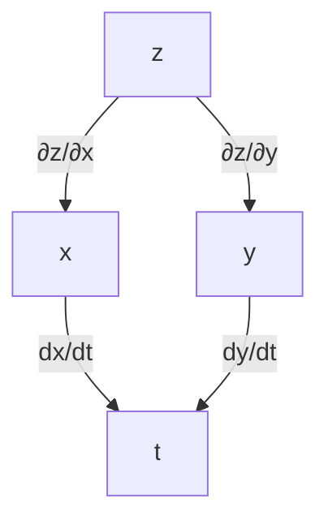
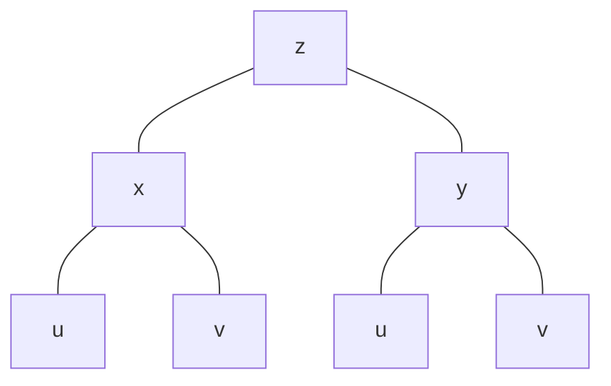
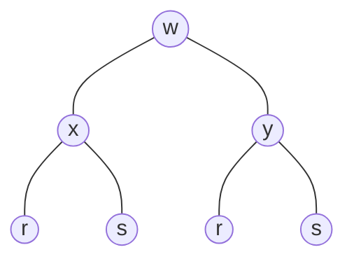
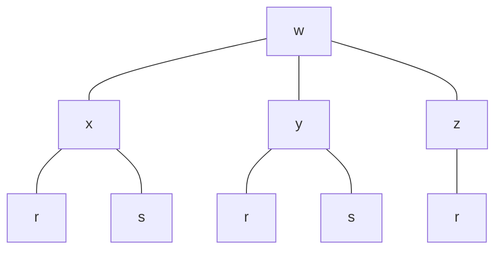

<!-- page 1 | Start here -->

# Module 2 at a glance

In Module 1 every function had **one** input, $f(x)$. Real quantities usually depend on **several** inputs. The height of a hill depends on where you stand east–west *and* north–south. The area of a rectangle depends on its length *and* its width. This module extends limits, continuity and derivatives to functions like $f(x,y)$.

> **The one new idea.** To study a function of several variables, **freeze all the variables except one**, then use the single-variable rules you already know.

## The path of the module

1. **Functions of two variables.** Domain, range, and the surface $z=f(x,y)$.
2. **Limits and continuity.** Now you can approach a point from *infinitely many directions*, and all of them must agree.
3. **Partial derivatives.** Differentiate with respect to one variable while the others stay constant. First order, then second order.
4. **Chain rule.** Differentiate through layers of dependence, using tree diagrams.
5. **Implicit differentiation.** Find $dy/dx$ from $F(x,y)=c$ with partial derivatives.
6. **Level curves.** Slice a surface at a constant height to see its shape in a flat picture.

## How to use these notes

- Each topic follows: **idea → rule → worked examples → common mistakes.**
- Cover the solutions and attempt each example first.
- Green boxes hold key ideas. Amber boxes marked **Watch out** hold the slips that cost marks.
- The last page has practice questions with answers and a formula sheet.

> **Prerequisites.** All of Module 1, especially the product, quotient and chain rules, and the derivatives of $e^x$, $\ln x$, $\sin x$, $\cos x$, $\tan x$ and $\sqrt{x}$.

---

<!-- page 2 | Functions of two variables -->

# Functions of two variables

## The idea

A function of two variables takes a **pair** $(x,y)$ and returns one number $z=f(x,y)$.

Plot $z$ as the height above the point $(x,y)$ of the flat $xy$-plane and you get a **surface**, the way a hill's height is drawn above a map.

## Domain and range

- **Domain:** all pairs $(x,y)$ for which the formula makes sense.
- **Range:** all the values $f(x,y)$ can take.

To find the domain, look for the usual trouble spots: division by zero, square roots of negatives, logarithms of non-positives.

### Example 1. $f(x,y)=x^2-y^2$

No restriction on $x$ or $y$, so the domain is all of $\mathbb{R}^2$.
Choosing $y=0$ gives any value $x^2\ge0$, and $x=0$ gives any value $-y^2\le0$, so every real number occurs. **Range $=\mathbb{R}$.**

### Example 2. $f(x,y)=\dfrac{x+y}{x-y}$

The denominator cannot be $0$, so we must have $x\neq y$.

**Domain:** $\mathbb{R}^2$ minus the line $y=x$, i.e. $\{(x,y)\mid x\neq y\}$.

**Range:** every real number $k$ can be reached. For instance $k=1$ is reached at $(x,0)$ with $x\neq0$, and $k=-1$ at $(0,y)$ with $y\neq0$. **Range $=\mathbb{R}$.**

### Example 3. $f(x,y)=\sqrt{9-x^2-y^2}$

The inside of the root must be $\ge0$: $x^2+y^2\le9$.

**Domain:** the disc of radius $3$ centred at the origin. **Range:** $0\le z\le3$. The surface is the **upper half of a sphere** of radius $3$.

> **Three variables work the same way.** $u=f(x,y,z)$ takes a triple and returns a number. You cannot draw its graph in 3D, but every rule in this module extends to it unchanged.

---

<!-- page 3 | Limits in two variables -->

# Limits of two-variable functions

## The idea

$$
\lim_{(x,y)\to(a,b)}f(x,y)=L
$$

means: $f(x,y)$ gets as close to $L$ as we like whenever $(x,y)$ is close enough to $(a,b)$ (but $(x,y)\neq(a,b)$).

On a line there are only two ways to approach a point: from the left or from the right. In the plane there are **infinitely many** (straight lines, curves, spirals...). The limit exists only if **every** way of approaching gives the same value.

## The limit laws still hold

Sum, difference, constant multiple, product, quotient (denominator limit $\ne0$), power and root rules all carry over from Module 1. So for nice functions, you simply **substitute**.

### Example 1

$$
\lim_{(x,y)\to(0,1)}\frac{x-xy+3}{x^2y+5xy-y^3}
=\frac{0-0\cdot1+3}{0+0-1}=\frac{3}{-1}=\mathbf{-3}
$$

### Example 2

$$
\lim_{(x,y)\to(3,-4)}\sqrt{x^2+y^2}=\sqrt{3^2+(-4)^2}=\sqrt{25}=\mathbf{5}
$$

### Example 3. Use a standard limit

$$
\lim_{(x,y)\to(\pi/2,\,0)}\left(\frac{x}{\sin x}-\frac{\sin y}{y}\right)
$$

The first term is fine: $\dfrac{\pi/2}{\sin(\pi/2)}=\dfrac\pi2$. The second term looks like $\frac00$ but it is the standard limit $\displaystyle\lim_{y\to0}\frac{\sin y}{y}=1$. So the answer is

$$
\frac\pi2-1
$$

> **Watch out.** Do not write "$\frac{\sin 0}{0}=\frac00$" and stop. That is the indeterminate form, not a value. Recognise it as $\frac{\sin y}{y}\to1$.

## When substitution gives $0/0$: simplify first

### Example 4

$$
\lim_{(x,y)\to(0,0)}\frac{x^2-xy}{\sqrt x-\sqrt y}
$$

Factor the top as $x(x-y)$ and rationalise the bottom with its conjugate $\sqrt x+\sqrt y$. Since $(\sqrt x-\sqrt y)(\sqrt x+\sqrt y)=x-y$:

$$
\frac{x(x-y)(\sqrt x+\sqrt y)}{x-y}=x(\sqrt x+\sqrt y)\ \longrightarrow\ 0\cdot(0+0)=\mathbf{0}
$$

---

<!-- page 4 | Limits that do not exist -->

# Showing a limit does not exist: the path test

## The idea

If you can find **two different paths** into the point along which $f$ approaches **different values**, then the limit does **not** exist.

> **Path test.** If $f(x,y)\to L_1$ along one path and $f(x,y)\to L_2\neq L_1$ along another path into the same point, then $\displaystyle\lim_{(x,y)\to(a,b)}f(x,y)$ does not exist.

The most useful family of paths through the origin is the set of lines $y=mx$. Substitute $y=mx$, simplify, and let $x\to0$. **If the answer still contains $m$, the limit depends on the direction, so it does not exist.**

## Example 1

Show that $\displaystyle\lim_{(x,y)\to(0,0)}\dfrac{x^2-y^2}{x^2+y^2}$ does not exist.

Along $y=mx$:

$$
\frac{x^2-m^2x^2}{x^2+m^2x^2}=\frac{x^2(1-m^2)}{x^2(1+m^2)}=\frac{1-m^2}{1+m^2}
$$

This depends on $m$. For example $m=0$ (the $x$-axis) gives $1$, while $m=1$ (the line $y=x$) gives $0$. **The limit does not exist.**

## Example 2

Show that $\displaystyle\lim_{(x,y)\to(0,0)}\dfrac{xy}{x^2+y^2}$ does not exist.

Along $y=mx$:

$$
\frac{x\cdot mx}{x^2+m^2x^2}=\frac{m}{1+m^2}
$$

Again it depends on $m$ ($m=0$ gives $0$; $m=1$ gives $\tfrac12$). **The limit does not exist.**

> **Watch out.** The path test can only **disprove** a limit. If every line $y=mx$ gives the *same* answer, that is **not** a proof that the limit exists, since a curved path like $y=x^2$ might still disagree. To prove existence, use substitution, algebra, or the sandwich theorem.

---

<!-- page 5 | Continuity -->

# Continuity

## Definition

$f(x,y)$ is **continuous at $(x_0,y_0)$** if

1. $f(x_0,y_0)$ is defined;
2. $\displaystyle\lim_{(x,y)\to(x_0,y_0)}f(x,y)$ exists;
3. $\displaystyle\lim_{(x,y)\to(x_0,y_0)}f(x,y)=f(x_0,y_0)$.

$f$ is **continuous** if it is continuous at every point of its domain. This is the same three-step check as in Module 1, now with a two-variable limit.

> **Handy fact.** Polynomials, $e^{x}$, $\sin$, $\cos$, and sums, products and compositions of continuous functions are continuous everywhere they are defined. A quotient is continuous wherever its denominator is not $0$. So trouble can only come from a point where the formula breaks down, like the origin in the examples below.

## Example 1

$$
f(x,y)=\begin{cases}\dfrac{2xy}{x^2+y^2}, & (x,y)\neq(0,0)\\[6pt]0, & (x,y)=(0,0)\end{cases}
$$

Show that $f$ is continuous everywhere **except the origin**.

- **Away from the origin**, $f$ is a quotient of polynomials with non-zero denominator, so it is continuous.
- **At the origin**, $f(0,0)=0$. Along $y=mx$:

$$
\frac{2x\cdot mx}{x^2+m^2x^2}=\frac{2m}{1+m^2}
$$

This depends on $m$ (for example $m=1$ gives $1$, but $m=0$ gives $0$), so the limit does not exist. Condition 2 fails.

**Conclusion:** $f$ is not continuous at $(0,0)$ and is continuous at every other point.

## Example 2

$$
f(x,y)=\begin{cases}\dfrac{y}{\sqrt{x^2+y^2}}, & (x,y)\neq(0,0)\\[6pt]0, & (x,y)=(0,0)\end{cases}
$$

Show that $f$ is discontinuous at $(0,0)$.

Along $y=mx$ with $x>0$ we have $\sqrt{x^2+m^2x^2}=x\sqrt{1+m^2}$, so

$$
\frac{y}{\sqrt{x^2+y^2}}=\frac{mx}{x\sqrt{1+m^2}}=\frac{m}{\sqrt{1+m^2}}
$$

This depends on $m$ (it is $0$ for $m=0$ and $\tfrac1{\sqrt2}$ for $m=1$). The limit does not exist, so **$f$ is discontinuous at the origin.**

> **Note.** Defining $f(0,0)=0$ by hand does not rescue continuity. A "patch" works only if it matches a limit that exists.

---

<!-- page 6 | Partial derivatives -->

# Partial derivatives

## The idea

For $z=f(x,y)$ there are two natural questions:

- *If I move only in the $x$-direction (keeping $y$ fixed), how fast does $z$ change?*
- *If I move only in the $y$-direction (keeping $x$ fixed), how fast does $z$ change?*

The answers are the **partial derivatives**.

## Definition

$$
\frac{\partial z}{\partial x}=\lim_{h\to0}\frac{f(x+h,\,y)-f(x,y)}{h},
\qquad
\frac{\partial z}{\partial y}=\lim_{h\to0}\frac{f(x,\,y+h)-f(x,y)}{h}
$$

Other notations for the same thing: $\dfrac{\partial z}{\partial x}=\dfrac{\partial f}{\partial x}=f_x$ and $\dfrac{\partial z}{\partial y}=\dfrac{\partial f}{\partial y}=f_y$.

## The working rule

> **To find $\dfrac{\partial f}{\partial x}$:** treat $y$ as a **constant** and differentiate with respect to $x$.
> **To find $\dfrac{\partial f}{\partial y}$:** treat $x$ as a **constant** and differentiate with respect to $y$.

Every rule from Module 1 (sum, product, quotient, chain) applies. A "constant" factor stays; a constant term disappears.

## Example 1

$f(x,y)=x^2y+3xy^2$

- $\dfrac{\partial f}{\partial x}$: treat $y$ as a constant. $\;x^2y\to2xy$ and $3xy^2\to3y^2$. So $f_x=\mathbf{2xy+3y^2}$.
- $\dfrac{\partial f}{\partial y}$: treat $x$ as a constant. $\;x^2y\to x^2$ and $3xy^2\to6xy$. So $f_y=\mathbf{x^2+6xy}$.

> **Watch out.** A variable you are *not* differentiating by is a constant, so it can be pulled out, and a term made only of those variables **vanishes**. For example, $\dfrac{\partial}{\partial x}(5y)=0$ and $\dfrac{\partial}{\partial x}(x\,e^{-y})=e^{-y}$.

---

<!-- page 7 | Partial derivatives: worked examples -->

# Partial derivatives: worked examples

## Products and exponentials

**1.** $f(x,y)=e^{x^2y^3}\sin(x^2-y^2)$. Product rule, plus the chain rule inside each factor.

$$
f_x=e^{x^2y^3}\cos(x^2-y^2)\cdot2x+\sin(x^2-y^2)\cdot e^{x^2y^3}\cdot2xy^3
$$

$$
\mathbf{f_x=2x\,e^{x^2y^3}\big[\cos(x^2-y^2)+y^3\sin(x^2-y^2)\big]}
$$

$$
f_y=e^{x^2y^3}\cos(x^2-y^2)\cdot(-2y)+\sin(x^2-y^2)\cdot e^{x^2y^3}\cdot3x^2y^2
$$

$$
\mathbf{f_y=y\,e^{x^2y^3}\big[-2\cos(x^2-y^2)+3x^2y\sin(x^2-y^2)\big]}
$$

**2.** $f(x,y)=e^{ax}\sin by$

$$
f_x=a\,e^{ax}\sin by,\qquad f_y=b\,e^{ax}\cos by
$$

**3.** $f(x,y)=x\,e^{-y}+5y$

$$
f_x=e^{-y},\qquad f_y=-x\,e^{-y}+5
$$

## Quotients

**4.** $f(x,y)=\dfrac{x-y}{x^2+y^2}$

$$
f_x=\frac{(x^2+y^2)\cdot1-(x-y)\cdot2x}{(x^2+y^2)^2}=\mathbf{\frac{y^2-x^2+2xy}{(x^2+y^2)^2}}
$$

$$
f_y=\frac{(x^2+y^2)(-1)-(x-y)\cdot2y}{(x^2+y^2)^2}=\mathbf{\frac{y^2-x^2-2xy}{(x^2+y^2)^2}}
$$

## Roots and logarithms

**5.** $f(x,y)=\sqrt{x^2+y^2}$

$$
f_x=\frac{2x}{2\sqrt{x^2+y^2}}=\mathbf{\frac{x}{\sqrt{x^2+y^2}}},\qquad f_y=\mathbf{\frac{y}{\sqrt{x^2+y^2}}}
$$

**6.** $f(x,y)=\log(x^2+y^2)$

$$
f_x=\frac{1}{x^2+y^2}\cdot2x=\mathbf{\frac{2x}{x^2+y^2}},\qquad f_y=\mathbf{\frac{2y}{x^2+y^2}}
$$

**7.** $z=\sqrt{3x+4y}$

$$
\frac{\partial z}{\partial x}=\frac{3}{2\sqrt{3x+4y}},\qquad\frac{\partial z}{\partial y}=\frac{4}{2\sqrt{3x+4y}}=\mathbf{\frac{2}{\sqrt{3x+4y}}}
$$

## Simple polynomials

**8.** $f(x,y)=2x^2-3y-4$: $\;f_x=\mathbf{4x}$, $\;f_y=\mathbf{-3}$.

**9.** $f(x,y)=(x+1)(y-2)$: $\;f_x=\mathbf{y-2}$, $\;f_y=\mathbf{x+1}$.

> **Watch out.** In example 7, the chain rule needs the derivative of the *inside* with respect to the variable you are using: $\frac{\partial}{\partial x}(3x+4y)=3$, but $\frac{\partial}{\partial y}(3x+4y)=4$. Do not mix them up.

---

<!-- page 8 | Slopes and rates of change -->

# Slopes and rates of change

## Geometric meaning

The surface $z=f(x,y)$ has a slope that depends on **which direction** you walk.

- $\dfrac{\partial z}{\partial x}$ is the **slope in the $x$-direction** (walking parallel to the $x$-axis, $y$ fixed).
- $\dfrac{\partial z}{\partial y}$ is the **slope in the $y$-direction** (walking parallel to the $y$-axis, $x$ fixed).

Equivalently, they are the **rates of change** of $z$ with respect to $x$ and to $y$.

> **Recipe.** (1) Find the partial derivative. (2) Substitute the point. (3) A positive answer means $z$ rises in that direction; negative means it falls.

## Example 1

Find the slopes of $z=10-4x^2-2y^2$ at $(1,2)$ in the $x$- and $y$-directions.

$$
\frac{\partial z}{\partial x}=-8x\ \Rightarrow\ \left.\frac{\partial z}{\partial x}\right|_{(1,2)}=\mathbf{-8}
$$

$$
\frac{\partial z}{\partial y}=-4y\ \Rightarrow\ \left.\frac{\partial z}{\partial y}\right|_{(1,2)}=\mathbf{-8}
$$

Both slopes are negative, so the surface slopes downward whether you walk in the positive $x$-direction or the positive $y$-direction from $(1,2)$.

## Example 2

Find the rate of change of $z=\sin(y^2-4x)$ with respect to $y$ at $(3,1)$.

$$
\frac{\partial z}{\partial y}=\cos(y^2-4x)\cdot2y
\ \Rightarrow\ 
\left.\frac{\partial z}{\partial y}\right|_{(3,1)}=2\cos(1-12)=2\cos(-11)=\mathbf{2\cos11}
$$

(since cosine is even, $\cos(-11)=\cos11$).

---

<!-- page 9 | Second-order partial derivatives -->

# Second-order partial derivatives

## The idea

Differentiate a first-order partial derivative once more. With two variables there are **four** second-order partials:

| Meaning | Notation |
| --- | --- |
| $x$ then $x$ | $\dfrac{\partial^2z}{\partial x^2}=f_{xx}$ |
| $y$ then $y$ | $\dfrac{\partial^2z}{\partial y^2}=f_{yy}$ |
| $x$ then $y$ | $\dfrac{\partial}{\partial y}\left(\dfrac{\partial z}{\partial x}\right)=\dfrac{\partial^2z}{\partial y\,\partial x}$ (a **mixed** partial) |
| $y$ then $x$ | $\dfrac{\partial}{\partial x}\left(\dfrac{\partial z}{\partial y}\right)=\dfrac{\partial^2z}{\partial x\,\partial y}$ (the other **mixed** partial) |

> **Reading the notation.** In $\dfrac{\partial^2z}{\partial y\,\partial x}$, read right to left: first $\partial x$, then $\partial y$. (Books differ on how they order the subscripts of $f_{xy}$ and $f_{yx}$. For the functions in this module the two mixed partials are always equal, so the order never changes your answer.)

> **Mixed partial theorem.** If the second partial derivatives are continuous, then $\dfrac{\partial^2f}{\partial x\,\partial y}=\dfrac{\partial^2f}{\partial y\,\partial x}$. This is a quick **check on your work**: compute both mixed partials and they should match.

## Example 1. All four partials of $f=x^3y+2xy^2$

First order:

$$
f_x=3x^2y+2y^2,\qquad f_y=x^3+4xy
$$

Second order:

$$
f_{xx}=\frac{\partial}{\partial x}(3x^2y+2y^2)=\mathbf{6xy}\qquad
f_{yy}=\frac{\partial}{\partial y}(x^3+4xy)=\mathbf{4x}
$$

$$
\frac{\partial^2f}{\partial y\,\partial x}=\frac{\partial}{\partial y}(3x^2y+2y^2)=\mathbf{3x^2+4y}\qquad
\frac{\partial^2f}{\partial x\,\partial y}=\frac{\partial}{\partial x}(x^3+4xy)=\mathbf{3x^2+4y}
$$

The two mixed partials agree ✓.

## Example 2. $f=2x^5y^3+5x+7y$

$$
f_x=10x^4y^3+5,\qquad f_y=6x^5y^2+7
$$

$$
f_{xx}=40x^3y^3,\qquad f_{yy}=12x^5y,\qquad
\frac{\partial^2f}{\partial x\,\partial y}=\frac{\partial^2f}{\partial y\,\partial x}=\mathbf{30x^4y^2}
$$

## Example 3. Show the mixed partials are equal for $f=x^3y+e^{xy^2}$

$$
f_x=3x^2y+y^2e^{xy^2},\qquad f_y=x^3+2xy\,e^{xy^2}
$$

Differentiate $f_x$ with respect to $y$ (product rule on $y^2e^{xy^2}$):

$$
\frac{\partial^2f}{\partial y\,\partial x}=3x^2+2y\,e^{xy^2}+y^2\cdot e^{xy^2}\cdot2xy=3x^2+2y\,e^{xy^2}+2xy^3e^{xy^2}
$$

Differentiate $f_y$ with respect to $x$ (product rule on $2xy\,e^{xy^2}$):

$$
\frac{\partial^2f}{\partial x\,\partial y}=3x^2+2y\,e^{xy^2}+2xy\cdot e^{xy^2}\cdot y^2=3x^2+2y\,e^{xy^2}+2xy^3e^{xy^2}
$$

The two expressions are identical. ✓

---

<!-- page 10 | Proving identities with partials -->

# Proving identities with partial derivatives

"Show that..." and "prove that..." questions ask you to compute some partials and then simplify to the target. The skill is **organised, careful differentiation**.

## Example 1. A third-order mixed partial

If $f=e^{xyz}$, find $\dfrac{\partial^3f}{\partial x\,\partial y\,\partial z}$.

Work from the inside out. First $z$, then $y$, then $x$:

$$
\frac{\partial f}{\partial z}=xy\,e^{xyz}
$$

$$
\frac{\partial^2f}{\partial y\,\partial z}=\frac{\partial}{\partial y}\big(xy\,e^{xyz}\big)=x\,e^{xyz}+xy\cdot xz\,e^{xyz}=x\,e^{xyz}+x^2yz\,e^{xyz}
$$

$$
\frac{\partial^3f}{\partial x\,\partial y\,\partial z}=\frac{\partial}{\partial x}\big(x\,e^{xyz}+x^2yz\,e^{xyz}\big)
=e^{xyz}+xyz\,e^{xyz}+2xyz\,e^{xyz}+x^2y^2z^2e^{xyz}
$$

$$
=\mathbf{e^{xyz}\big[1+3xyz+x^2y^2z^2\big]}
$$

## Example 2. Laplace's equation

If $u=\dfrac{1}{\sqrt{x^2+y^2+z^2}}$, prove that $\dfrac{\partial^2u}{\partial x^2}+\dfrac{\partial^2u}{\partial y^2}+\dfrac{\partial^2u}{\partial z^2}=0$.

> **Trick.** Write $r^2=x^2+y^2+z^2$ so $u=(r^2)^{-1/2}$. Powers are far easier than quotients.

First derivative in $x$ (chain rule, with $\frac{\partial}{\partial x}(r^2)=2x$):

$$
\frac{\partial u}{\partial x}=-\tfrac12(r^2)^{-3/2}\cdot2x=-x\,(r^2)^{-3/2}
$$

Second derivative (product rule, then chain rule again):

$$
\frac{\partial^2u}{\partial x^2}=-(r^2)^{-3/2}+(-x)\cdot\left(-\tfrac32\right)(r^2)^{-5/2}\cdot2x
=\mathbf{3x^2(r^2)^{-5/2}-(r^2)^{-3/2}}
$$

By symmetry (nothing special about $x$):

$$
\frac{\partial^2u}{\partial y^2}=3y^2(r^2)^{-5/2}-(r^2)^{-3/2},\qquad
\frac{\partial^2u}{\partial z^2}=3z^2(r^2)^{-5/2}-(r^2)^{-3/2}
$$

Add all three:

$$
\frac{\partial^2u}{\partial x^2}+\frac{\partial^2u}{\partial y^2}+\frac{\partial^2u}{\partial z^2}
=3\underbrace{(x^2+y^2+z^2)}_{r^2}(r^2)^{-5/2}-3(r^2)^{-3/2}=3(r^2)^{-3/2}-3(r^2)^{-3/2}=\mathbf{0}\ \checkmark
$$

## Example 3. Inverse tangents

If $u=x^2\tan^{-1}\dfrac yx-y^2\tan^{-1}\dfrac xy$, show that $\dfrac{\partial^2u}{\partial x\,\partial y}=\dfrac{x^2-y^2}{x^2+y^2}$.

Differentiate with respect to $y$ first. Use $\dfrac{d}{dy}\tan^{-1}\dfrac yx=\dfrac{1}{1+y^2/x^2}\cdot\dfrac1x=\dfrac{x}{x^2+y^2}$ and $\dfrac{\partial}{\partial y}\tan^{-1}\dfrac xy=\dfrac{1}{1+x^2/y^2}\cdot\left(-\dfrac{x}{y^2}\right)=-\dfrac{x}{x^2+y^2}$:

$$
\frac{\partial u}{\partial y}=x^2\cdot\frac{x}{x^2+y^2}-\left[2y\tan^{-1}\frac xy+y^2\cdot\left(-\frac{x}{x^2+y^2}\right)\right]
=\frac{x^3+xy^2}{x^2+y^2}-2y\tan^{-1}\frac xy
$$

The fraction simplifies: $\dfrac{x(x^2+y^2)}{x^2+y^2}=x$. So

$$
\frac{\partial u}{\partial y}=x-2y\tan^{-1}\frac xy
$$

Now differentiate with respect to $x$:

$$
\frac{\partial^2u}{\partial x\,\partial y}=1-2y\cdot\frac{1}{1+x^2/y^2}\cdot\frac1y=1-\frac{2y^2}{x^2+y^2}=\frac{x^2+y^2-2y^2}{x^2+y^2}=\mathbf{\frac{x^2-y^2}{x^2+y^2}}\ \checkmark
$$

> **Study tip.** Simplify after the first derivative whenever you can. Here it collapsed a messy expression to $x-2y\tan^{-1}(x/y)$ and made the second step easy.

---

<!-- page 11 | Chain rule: one parameter -->

# Chain rule with one parameter

## The idea

Suppose $z=f(x,y)$ and both $x$ and $y$ depend on a single variable $t$: $\ x=x(t)$, $y=y(t)$. Then $z$ is really a function of $t$ alone, and

> **Chain rule.**
> $$\frac{dz}{dt}=\frac{\partial z}{\partial x}\cdot\frac{dx}{dt}+\frac{\partial z}{\partial y}\cdot\frac{dy}{dt}$$

Reading it: $z$ changes with $t$ through $x$ **and** through $y$. Add up both routes.

## Tree diagram

Draw the dependencies as a tree. Write each derivative on its branch. To get $\frac{dz}{dt}$, **multiply along each path** from $z$ down to $t$ and **add the paths**.



Two paths reach $t$: $z\to x\to t$ and $z\to y\to t$. That gives the two terms of the formula.

> **Watch out.** Use **ordinary** $d$ for $\frac{dx}{dt}$ (one variable) and **curly** $\partial$ for $\frac{\partial z}{\partial x}$ (several variables). Also, if you substitute for $x$ and $y$ *before* differentiating, you get the same answer with no chain rule. This is a good way to check your work.

## Example 1. Check with direct substitution

$z=5x^3y^2$, $\ x=t^3$, $\ y=t^5$. Find $\dfrac{dz}{dt}$.

$$
\frac{\partial z}{\partial x}=15x^2y^2,\quad\frac{\partial z}{\partial y}=10x^3y,\quad\frac{dx}{dt}=3t^2,\quad\frac{dy}{dt}=5t^4
$$

$$
\frac{dz}{dt}=15(t^3)^2(t^5)^2\cdot3t^2+10(t^3)^3t^5\cdot5t^4=45t^{18}+50t^{18}=\mathbf{95t^{18}}
$$

**Check:** substitute first. $z=5(t^3)^3(t^5)^2=5t^{19}$, so $\dfrac{dz}{dt}=95t^{18}$ ✓.

## Example 2. A logarithm

$z=\ln(3x^2+y)$, $\ x=\sqrt t$, $\ y=t^{1/3}$. Find $\dfrac{dz}{dt}$.

$$
\frac{\partial z}{\partial x}=\frac{6x}{3x^2+y},\quad\frac{\partial z}{\partial y}=\frac{1}{3x^2+y},\quad\frac{dx}{dt}=\frac{1}{2\sqrt t},\quad\frac{dy}{dt}=\frac13t^{-2/3}
$$

On the path, $x=\sqrt t$ so $3x^2+y=3t+t^{1/3}$ and $6x\cdot\dfrac1{2\sqrt t}=\dfrac{6\sqrt t}{2\sqrt t}=3$. Then

$$
\frac{dz}{dt}=\frac{3}{3t+t^{1/3}}+\frac{\tfrac13t^{-2/3}}{3t+t^{1/3}}
=\mathbf{\frac{3+\tfrac13t^{-2/3}}{3t+t^{1/3}}}
$$

## Example 3. A moving point

Find $\dfrac{dw}{dt}$ for $w=x^2+y^2$ along the path $x=at^2$, $y=2at$.

$$
\frac{dw}{dt}=2x\cdot2at+2y\cdot2a=2(at^2)(2at)+2(2at)(2a)=\mathbf{4a^2t^3+8a^2t}
$$

## Example 4. Three variables

$w=\ln(x^2+y^2+z^2)$, $\ x=\cos t$, $\ y=\sin t$, $\ z=4\sqrt t$. Find $\dfrac{dw}{dt}$, and its value at $t=3$.

With three variables there are three paths:

$$
\frac{dw}{dt}=\frac{\partial w}{\partial x}\frac{dx}{dt}+\frac{\partial w}{\partial y}\frac{dy}{dt}+\frac{\partial w}{\partial z}\frac{dz}{dt}
=\frac{2x(-\sin t)+2y\cos t+2z\cdot\frac2{\sqrt t}}{x^2+y^2+z^2}
$$

On the path: $x^2+y^2+z^2=\cos^2t+\sin^2t+16t=1+16t$, and the numerator is $-2\cos t\sin t+2\sin t\cos t+2(4\sqrt t)\dfrac{2}{\sqrt t}=16$.

$$
\frac{dw}{dt}=\mathbf{\frac{16}{1+16t}},\qquad\left.\frac{dw}{dt}\right|_{t=3}=\frac{16}{49}
$$

## Example 5. When $x$ itself is the parameter

If $w=xy+yz$ where $y=\sin x$ and $z=e^x$, then $w$ depends on $x$ directly **and** through $y$ and $z$. The total derivative is

$$
\frac{dw}{dx}=\frac{\partial w}{\partial x}+\frac{\partial w}{\partial y}\frac{dy}{dx}+\frac{\partial w}{\partial z}\frac{dz}{dx}
$$

with $\dfrac{\partial w}{\partial x}=y$, $\ \dfrac{\partial w}{\partial y}=x+z$, $\ \dfrac{\partial w}{\partial z}=y$:

$$
\frac{dw}{dx}=y+(x+z)\cos x+y\,e^x
$$

At $x=0$: $y=\sin0=0$ and $z=e^0=1$, so $\dfrac{dw}{dx}=0+(0+1)\cdot1+0=\mathbf{1}$.

> **Note on the source.** The class notes evaluate "at $(0,1,2)$". That point is not on the curve, because at $x=0$ the curve passes through $(0,0,1)$. The answer $1$ is correct at $x=0$.

---

<!-- page 12 | Chain rule: two parameters -->

# Chain rule with two parameters

## The idea

Now let $x$ and $y$ each depend on **two** variables: $z=f(x,y)$ with $x=x(u,v)$ and $y=y(u,v)$. Then $z$ is a function of $u$ and $v$, and we get **two** partial derivatives:

> **Chain rule.**
> $$\frac{\partial z}{\partial u}=\frac{\partial z}{\partial x}\frac{\partial x}{\partial u}+\frac{\partial z}{\partial y}\frac{\partial y}{\partial u}$$
> $$\frac{\partial z}{\partial v}=\frac{\partial z}{\partial x}\frac{\partial x}{\partial v}+\frac{\partial z}{\partial y}\frac{\partial y}{\partial v}$$



To get $\frac{\partial z}{\partial u}$, follow **every path from $z$ down to a $u$** and add the products of the branch derivatives. For $\frac{\partial z}{\partial v}$, do the same for the $v$ leaves.

> **Memory aid.** One term for each middle variable. With middle variables $x$ and $y$ there are two terms; with $x$, $y$, $z$ there are three.

## Example 1

$z=x^2-y\tan x$, $\ x=\dfrac uv$, $\ y=uv$.

$$
\frac{\partial z}{\partial x}=2x-y\sec^2x,\quad\frac{\partial z}{\partial y}=-\tan x,\quad
\frac{\partial x}{\partial u}=\frac1v,\ \ \frac{\partial y}{\partial u}=v,\quad
\frac{\partial x}{\partial v}=-\frac u{v^2},\ \ \frac{\partial y}{\partial v}=u
$$

$$
\frac{\partial z}{\partial u}=(2x-y\sec^2x)\frac1v-v\tan x
$$

$$
\frac{\partial z}{\partial v}=(2x-y\sec^2x)\left(-\frac u{v^2}\right)-u\tan x
$$

Now put $x=u/v$ and $y=uv$ back in:

$$
\frac{\partial z}{\partial u}=\mathbf{\frac{2u}{v^2}-u\sec^2\frac uv-v\tan\frac uv}
$$

$$
\frac{\partial z}{\partial v}=\mathbf{\frac{u^2}{v}\sec^2\frac uv-\frac{2u^2}{v^3}-u\tan\frac uv}
$$

## Example 2. Substitute first when it simplifies

$z=e^{x^2y}$, $\ x=\sqrt{uv}$, $\ y=\dfrac1v$.

Look before you differentiate. On this path, $x^2y=(uv)\cdot\dfrac1v=u$, so $z=e^{u}$ and the answer is immediate:

$$
\frac{\partial z}{\partial u}=\mathbf{e^u},\qquad\frac{\partial z}{\partial v}=\mathbf{0}
$$

The chain rule gives the same result, and it is a good check. With $\frac{\partial z}{\partial x}=2xy\,e^{x^2y}$ and $\frac{\partial z}{\partial y}=x^2e^{x^2y}$:

$$
\frac{\partial z}{\partial u}=2xy\,e^{x^2y}\cdot\frac{v}{2\sqrt{uv}}+x^2e^{x^2y}\cdot0
=2\sqrt{uv}\cdot\frac1v\cdot e^{u}\cdot\frac{v}{2\sqrt{uv}}=e^u\ \checkmark
$$

$$
\frac{\partial z}{\partial v}=2xy\,e^{x^2y}\cdot\frac{u}{2\sqrt{uv}}+x^2e^{x^2y}\left(-\frac1{v^2}\right)
=\frac{u\,e^u}{v}-\frac{uv\,e^u}{v^2}=0\ \checkmark
$$

## Example 3

Express $\dfrac{\partial w}{\partial r}$ and $\dfrac{\partial w}{\partial s}$ in terms of $r$ and $s$, if $w=x^2+y^2$, $\ x=r-s$, $\ y=r+s$.



$$
\frac{\partial w}{\partial x}=2x,\ \ \frac{\partial w}{\partial y}=2y,\qquad
\frac{\partial x}{\partial r}=1,\ \ \frac{\partial y}{\partial r}=1,\qquad
\frac{\partial x}{\partial s}=-1,\ \ \frac{\partial y}{\partial s}=1
$$

$$
\frac{\partial w}{\partial r}=2x\cdot1+2y\cdot1=2(r-s)+2(r+s)=\mathbf{4r}
$$

$$
\frac{\partial w}{\partial s}=2x\cdot(-1)+2y\cdot1=-2(r-s)+2(r+s)=\mathbf{4s}
$$

Check by substituting first: $w=(r-s)^2+(r+s)^2=2r^2+2s^2$, so $w_r=4r$ and $w_s=4s$ ✓.

## Example 4. Three middle variables

$w=x+2y+z^2$, $\ x=\dfrac rs$, $\ y=r^2+\ln s$, $\ z=2r$.



Note that $z$ depends only on $r$, so there is **no** branch from $z$ to $s$.

$$
\frac{\partial w}{\partial x}=1,\ \ \frac{\partial w}{\partial y}=2,\ \ \frac{\partial w}{\partial z}=2z,\qquad
\frac{\partial x}{\partial r}=\frac1s,\ \ \frac{\partial y}{\partial r}=2r,\ \ \frac{\partial z}{\partial r}=2,\qquad
\frac{\partial x}{\partial s}=-\frac r{s^2},\ \ \frac{\partial y}{\partial s}=\frac1s
$$

$$
\frac{\partial w}{\partial r}=1\cdot\frac1s+2\cdot2r+2z\cdot2=\frac1s+4r+8r=\mathbf{\frac1s+12r}\qquad(z=2r)
$$

$$
\frac{\partial w}{\partial s}=1\cdot\left(-\frac r{s^2}\right)+2\cdot\frac1s=\mathbf{-\frac r{s^2}+\frac2s}
$$

---

<!-- page 13 | Related rates -->

# Applications: rates of change

The chain rule answers questions like *"if the inputs change at known rates, how fast does the output change?"*

> **Recipe.**
> 1. Name the variables and write down the given rates (with signs: a shrinking quantity has a **negative** rate).
> 2. Write the formula for the output.
> 3. Apply $\dfrac{d(\text{output})}{dt}=\dfrac{\partial}{\partial x}\cdot\dfrac{dx}{dt}+\dfrac{\partial}{\partial y}\cdot\dfrac{dy}{dt}$.
> 4. Substitute the values at the instant asked, and attach units.

## Example 1. Area of a rectangle

The length and width of a rectangle are increasing at $1.5$ cm/s and $0.5$ cm/s. How fast is the area increasing when the length is $40$ cm and the width is $30$ cm?

Let $x$ be the length and $y$ the width, so $A=xy$ and $\dfrac{dx}{dt}=1.5$, $\dfrac{dy}{dt}=0.5$.

$$
\frac{dA}{dt}=\frac{\partial A}{\partial x}\frac{dx}{dt}+\frac{\partial A}{\partial y}\frac{dy}{dt}=y(1.5)+x(0.5)=30(1.5)+40(0.5)=45+20=\mathbf{65\ cm^2/s}
$$

## Example 2. Volume of a cone

The altitude of a right circular cone is increasing at $0.2$ cm/s and the radius of its base is decreasing at $0.3$ cm/s. How fast is the volume changing when the altitude is $15$ cm and the radius is $10$ cm?

Let $r$ be the radius and $h$ the altitude. $\;V=\tfrac13\pi r^2h$, $\ \dfrac{dr}{dt}=-0.3$, $\ \dfrac{dh}{dt}=0.2$.

$$
\frac{\partial V}{\partial r}=\frac{2\pi rh}{3},\qquad\frac{\partial V}{\partial h}=\frac{\pi r^2}{3}
$$

$$
\frac{dV}{dt}=\frac{2\pi rh}{3}(-0.3)+\frac{\pi r^2}{3}(0.2)
=\frac{2\pi(10)(15)}{3}(-0.3)+\frac{\pi(100)}{3}(0.2)
=-30\pi+\frac{20\pi}{3}=\mathbf{-\frac{70\pi}{3}\ cm^3/s}
$$

The volume is **decreasing**, because the shrinking radius (which is squared) outweighs the growing height.

> **Note on the source.** The class notes give the altitude rate as $0.2\ \text{m s}^{-1}$ and then use $\text{cm s}^{-1}$. All the other lengths are in cm, so the units here are cm throughout.

## Example 3. Keeping a quantity constant

$z=2xy^2-3x^2y$. If $x$ is increasing at $2$ cm/s, how fast does $y$ change at the instant $x=3$, $y=1$, so that $z$ stays constant?

If $z$ is constant then $\dfrac{dz}{dt}=0$:

$$
0=\frac{\partial z}{\partial x}\frac{dx}{dt}+\frac{\partial z}{\partial y}\frac{dy}{dt}=(2y^2-6xy)(2)+(4xy-3x^2)\frac{dy}{dt}
$$

At $x=3$, $y=1$: $\ 2y^2-6xy=2-18=-16$ and $4xy-3x^2=12-27=-15$.

$$
0=(-16)(2)+(-15)\frac{dy}{dt}\ \Rightarrow\ -15\frac{dy}{dt}=32\ \Rightarrow\ \frac{dy}{dt}=\mathbf{-\frac{32}{15}\ cm/s}
$$

So $y$ must **decrease** at $\tfrac{32}{15}$ cm/s to compensate.

> **Watch out.** The class notes ended with $+\tfrac{32}{15}$, which has the wrong sign. When you move $-15\frac{dy}{dt}=32$, the sign of $\frac{dy}{dt}$ must come out negative.

## Bonus: simplify before you differentiate

A single-variable problem from the same class notes shows why simplifying first is so often smarter. Find $\dfrac{dy}{dx}$ and $\dfrac{d^2y}{dx^2}$ for $y=\dfrac{(3x^3+2x)(3x+5)}{x^4}$.

Do not use the quotient rule. Multiply out the top and divide term by term:

$$
y=\frac{9x^4+15x^3+6x^2+10x}{x^4}=9+15x^{-1}+6x^{-2}+10x^{-3}
$$

$$
\frac{dy}{dx}=-15x^{-2}-12x^{-3}-30x^{-4}=\mathbf{-\frac{15x^2+12x+30}{x^4}}
$$

$$
\frac{d^2y}{dx^2}=30x^{-3}+36x^{-4}+120x^{-5}=\mathbf{\frac{30x^2+36x+120}{x^5}}
$$

---

<!-- page 14 | Implicit differentiation -->

# Implicit differentiation with partial derivatives

## The idea

If a curve is given as $F(x,y)=c$ (a constant), you can find its slope $\dfrac{dy}{dx}$ **without solving for $y$**, using partial derivatives:

> $$\frac{dy}{dx}=-\frac{\;\dfrac{\partial F}{\partial x}\;}{\dfrac{\partial F}{\partial y}}=-\frac{F_x}{F_y}\qquad(F_y\neq0)$$

**Why it works.** Along the curve, $F(x,y(x))=c$ is constant, so $\dfrac{dF}{dx}=0$. The chain rule gives $F_x+F_y\dfrac{dy}{dx}=0$. Solve for $\dfrac{dy}{dx}$.

## Method

1. Move everything to one side so the equation reads $F(x,y)=0$ (or $=c$).
2. Compute $F_x$ (treat $y$ as constant) and $F_y$ (treat $x$ as constant).
3. Divide: $\dfrac{dy}{dx}=-\dfrac{F_x}{F_y}$.

This is usually faster and less error-prone than Module 1's implicit differentiation, since you never have to track $\frac{dy}{dx}$ inside the working.

## Example 1. The folium

Find $\dfrac{dy}{dx}$ if $x^3+y^3=3axy$, and verify using ordinary implicit differentiation.

**Using partial derivatives.** Let $F=x^3+y^3-3axy$.

$$
F_x=3x^2-3ay,\qquad F_y=3y^2-3ax
$$

$$
\frac{dy}{dx}=-\frac{3x^2-3ay}{3y^2-3ax}=\mathbf{\frac{ay-x^2}{y^2-ax}}
$$

**Verification (Module 1 method).** Differentiate both sides with respect to $x$:

$$
3x^2+3y^2\frac{dy}{dx}=3a\left(x\frac{dy}{dx}+y\right)
\ \Rightarrow\ \frac{dy}{dx}\,(3y^2-3ax)=3ay-3x^2
\ \Rightarrow\ \frac{dy}{dx}=\frac{ay-x^2}{y^2-ax}\ \checkmark
$$

Both methods agree.

## Example 2. A circle

$x^2+y^2=a^2$. Let $F=x^2+y^2-a^2$, so $F_x=2x$ and $F_y=2y$:

$$
\frac{dy}{dx}=-\frac{2x}{2y}=\mathbf{-\frac xy}
$$

> **Note on the source.** The class notes wrote this as "$\frac{du}{dx}$ if $u=x^2+y^2-a^2$". The intended question is the slope $\frac{dy}{dx}$ of the curve $x^2+y^2-a^2=0$.

> **Watch out.** Mind the **minus sign** in $-F_x/F_y$, and keep $F_x$ on top and $F_y$ on the bottom. Quick check on the circle: at $(a,0)$ the tangent is vertical, and the formula gives $F_y=0$, so $\frac{dy}{dx}$ is undefined, as it should be.

---

<!-- page 15 | Level curves -->

# Level curves

## The idea

Slice the surface $z=f(x,y)$ with a horizontal plane at height $c$. The curve where the plane meets the surface, seen from above, is a **level curve**. It is the set of all points where $f$ has the same value:

$$
f(x,y)=c
$$

This is how a **contour map** works. Each contour line joins points at the same height. Where level curves are packed close together, the surface is steep.

## Method

1. Set $f(x,y)=c$ for the given constant.
2. Rearrange into a familiar curve (line, circle, parabola, ...).
3. Sketch it, using a different $c$ for each curve.

## Example 1. A hemisphere

Find the level curves of $f(x,y)=\sqrt{9-x^2-y^2}$ for $c=0,1,2,3$.

$$
\sqrt{9-x^2-y^2}=c\ \Rightarrow\ 9-x^2-y^2=c^2\ \Rightarrow\ x^2+y^2=9-c^2
$$

| $c$ | Equation | Curve |
| --- | --- | --- |
| $0$ | $x^2+y^2=9$ | circle, radius $3$ |
| $1$ | $x^2+y^2=8$ | circle, radius $2\sqrt2\approx2.83$ |
| $2$ | $x^2+y^2=5$ | circle, radius $\sqrt5\approx2.24$ |
| $3$ | $x^2+y^2=0$ | the single point $(0,0)$ |

The level curves are **concentric circles** that shrink to the origin as $c$ rises to its maximum, $3$. That is exactly the top of the hemisphere.

```jsxgraph
{
  "boundingBox": [-3.6, 3.6, 3.6, -3.6],
  "axis": true,
  "points": [
    { "id": "O", "x": 0, "y": 0, "label": "c = 3" },
    { "id": "A", "x": 0, "y": 3, "label": "c = 0" },
    { "id": "B", "x": 2, "y": 2, "label": "c = 1" },
    { "id": "C", "x": -1, "y": -2, "label": "c = 2" }
  ],
  "segments": [],
  "circles": [
    { "center": "O", "radius": 3 },
    { "center": "O", "radius": 2.8284 },
    { "center": "O", "radius": 2.2361 }
  ],
  "functions": [],
  "title": "Level curves of the hemisphere: concentric circles for c = 0, 1, 2 and the origin for c = 3"
}
```

Notice that the circles for $c=0,1,2$ get **closer together near the edge**. The hemisphere is steepest there.

## Example 2. Parabolas

Find the level curves of $f(x,y)=x^2+2y$ for $k=-2,0,2$.

$$
x^2+2y=k\ \Rightarrow\ y=\frac{k-x^2}{2}
$$

Each is a **downward-opening parabola** with its vertex at $\left(0,\dfrac k2\right)$:

| $k$ | Equation | Vertex |
| --- | --- | --- |
| $-2$ | $x^2=-2-2y$ | $(0,-1)$ |
| $0$ | $x^2=-2y$ | $(0,0)$ |
| $2$ | $x^2=2-2y$ | $(0,1)$ |

They are the same parabola shifted up by $1$ for each increase of $2$ in $k$. (A parabola $x^2=-4ay$ opens downward; $x^2=+4ay$ opens upward.)

## Example 3. The level curve through a point

Find and sketch the level curve of $f(x,y)=x^2+y^2$ through the point $(2,0)$.

The level curve through a point has $c$ equal to the function's value **at that point**:

$$
c=f(2,0)=2^2+0^2=4\ \Rightarrow\ x^2+y^2=4
$$

This is the circle of radius $2$ centred at the origin. It passes through $(2,0)$, $(0,2)$, $(-2,0)$ and $(0,-2)$.

```jsxgraph
{
  "boundingBox": [-3.5, 3.5, 3.5, -3.5],
  "axis": true,
  "points": [
    { "id": "O", "x": 0, "y": 0, "label": "" },
    { "id": "P1", "x": 2, "y": 0, "label": "(2,0)" },
    { "id": "P2", "x": 0, "y": 2, "label": "(0,2)" },
    { "id": "P3", "x": -2, "y": 0, "label": "(-2,0)" },
    { "id": "P4", "x": 0, "y": -2, "label": "(0,-2)" }
  ],
  "segments": [],
  "circles": [{ "center": "O", "radius": 2 }],
  "functions": [],
  "title": "Level curve x² + y² = 4: a circle of radius 2"
}
```

> **Watch out.** A level curve is drawn in the **flat $xy$-plane**: it shows *where* the function takes the value $c$, not the height itself. The height $c$ is the label on the curve.

---

<!-- page 16 | Practice and formula sheet -->

# Practice questions and formula sheet

## Practice questions

Try these before checking the answers.

**A. Limits and continuity**

1. $\displaystyle\lim_{(x,y)\to(1,2)}\frac{x^2y+3}{x+y}$
2. Show that $\displaystyle\lim_{(x,y)\to(0,0)}\frac{x^2}{x^2+y^2}$ does not exist.
3. $f(x,y)=\dfrac{xy}{x^2+y^2}$ for $(x,y)\neq(0,0)$, $f(0,0)=0$. Is $f$ continuous at the origin?

**B. Partial derivatives**

4. Find $f_x$ and $f_y$ for $f=x^3-3xy^2+y^4$.
5. Find $f_x$ and $f_y$ for $f=\dfrac{x}{x^2+y^2}$.
6. For $f=x^2e^{y}+y\ln x$, find $f_{xx}$, $f_{yy}$ and both mixed partials.

**C. Chain rule**

7. $z=x^2y$, $x=t^2$, $y=t^3$. Find $\dfrac{dz}{dt}$.
8. $z=xy$, $x=u+v$, $y=u-v$. Find $\dfrac{\partial z}{\partial u}$ and $\dfrac{\partial z}{\partial v}$.

**D. Implicit differentiation and level curves**

9. Use partial derivatives to find $\dfrac{dy}{dx}$ for $x^2y+\sin y=x$.
10. Describe the level curves of $f(x,y)=x^2+y^2$ and of $g(x,y)=x-y$.

## Answers

1. $\dfrac{1\cdot2+3}{1+2}=\dfrac53$ (direct substitution).
2. Along $y=mx$: $\dfrac{x^2}{x^2+m^2x^2}=\dfrac{1}{1+m^2}$. This depends on $m$ ($1$ along the $x$-axis, $\tfrac12$ along $y=x$), so the limit does not exist.
3. No. Along $y=mx$ the limit is $\dfrac{m}{1+m^2}$, which depends on $m$, so the limit at the origin does not exist.
4. $f_x=3x^2-3y^2$, $\quad f_y=-6xy+4y^3$
5. $f_x=\dfrac{(x^2+y^2)-x\cdot2x}{(x^2+y^2)^2}=\dfrac{y^2-x^2}{(x^2+y^2)^2}$, $\quad f_y=\dfrac{-2xy}{(x^2+y^2)^2}$
6. $f_x=2xe^y+\dfrac yx$, $\ f_y=x^2e^y+\ln x$. Then $f_{xx}=2e^y-\dfrac y{x^2}$, $\ f_{yy}=x^2e^y$, and both mixed partials equal $2xe^y+\dfrac1x$.
7. $\dfrac{dz}{dt}=2xy\cdot2t+x^2\cdot3t^2=4t^6+3t^6=7t^6$. (Check: $z=t^4\cdot t^3=t^7$, so $\dfrac{dz}{dt}=7t^6$ ✓.)
8. $\dfrac{\partial z}{\partial u}=y\cdot1+x\cdot1=(u-v)+(u+v)=2u$, $\quad\dfrac{\partial z}{\partial v}=y\cdot1+x\cdot(-1)=(u-v)-(u+v)=-2v$
9. $F=x^2y+\sin y-x$. $F_x=2xy-1$, $F_y=x^2+\cos y$. So $\dfrac{dy}{dx}=-\dfrac{2xy-1}{x^2+\cos y}=\dfrac{1-2xy}{x^2+\cos y}$.
10. $x^2+y^2=c$: concentric circles about the origin (for $c>0$). $x-y=c$: parallel straight lines of slope $1$.

## Formula sheet

### Limits and continuity

| | |
| --- | --- |
| Two-variable limit | $\lim_{(x,y)\to(a,b)}f=L$ means $f\to L$ along **every** path |
| Substitution | works whenever the result is a number (laws as in Module 1) |
| Path test | two paths, two values $\Rightarrow$ the limit does not exist; try $y=mx$ |
| Continuity | $f(a,b)$ defined, limit exists, limit $=f(a,b)$ |

### Partial derivatives

| | |
| --- | --- |
| $\dfrac{\partial f}{\partial x}$ | differentiate in $x$, **treat $y$ as constant** |
| $\dfrac{\partial f}{\partial y}$ | differentiate in $y$, **treat $x$ as constant** |
| Second order | $f_{xx}$, $f_{yy}$, and two mixed partials, equal when continuous |
| Slopes | $\dfrac{\partial z}{\partial x}$ is the slope in the $x$-direction; $\dfrac{\partial z}{\partial y}$ in the $y$-direction |

### Chain rule

| Case | Formula |
| --- | --- |
| $z(x,y)$, $x(t)$, $y(t)$ | $\dfrac{dz}{dt}=\dfrac{\partial z}{\partial x}\dfrac{dx}{dt}+\dfrac{\partial z}{\partial y}\dfrac{dy}{dt}$ |
| $z(x,y)$, $x(u,v)$, $y(u,v)$ | $\dfrac{\partial z}{\partial u}=\dfrac{\partial z}{\partial x}\dfrac{\partial x}{\partial u}+\dfrac{\partial z}{\partial y}\dfrac{\partial y}{\partial u}$, and the same with $v$ |
| Three middle variables | add a third term for each extra path |

### Implicit differentiation and level curves

| | |
| --- | --- |
| Implicit | $F(x,y)=c\ \Rightarrow\ \dfrac{dy}{dx}=-\dfrac{F_x}{F_y}$ |
| Level curve | $f(x,y)=c$; through a point $(a,b)$ use $c=f(a,b)$ |
