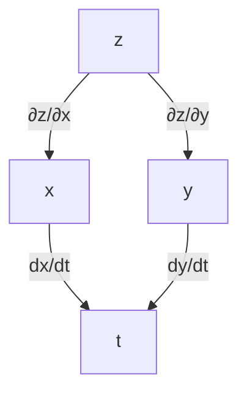
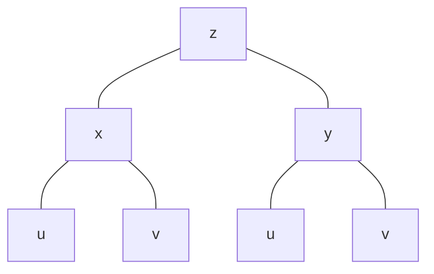
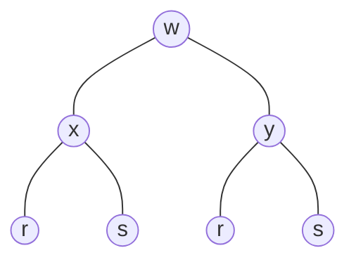

<!-- Source: GAMAT101_Mathematics-for-Information-Science-1_Module-2_ktunotes.in.pdf; page 1 -->

[Non-content page]

---

<!-- Source: GAMAT101_Mathematics-for-Information-Science-1_Module-2_ktunotes.in.pdf; page 2 -->

## Module 2: Partial Derivatives

### Limits for Functions Of Two Variables

A function $f(x, y)$ approaches the limit $L$, as ~~ordered po~~ $(x, y)$ approaches $(x_0, y_0)$ and we write
$$
\lim_{(x, y) \to (a, b)} f(x, y) = L
$$

**Q.** ~~Find limit ord~~
~~(x~~

1. Find $\lim_{(x, y) \to (0, 1)} \frac{x - xy + 3}{x^2 y + 5xy - y^3}$

$$
   \begin{aligned}
   &= \frac{\lim_{(x, y) \to (0, 1)} (x - xy + 3)}{\lim_{(x, y) \to (0, 1)} (x^2 y + 5xy - y^3)} = \frac{0 - 0 \times 1 + 3}{0^2 \times 1 + 5 \times 0 \times 1 - 1^3} \\[1em]
   &= \frac{3}{-1} = \underline{\underline{-3}}
   \end{aligned}
$$

2. $\lim_{(x, y) \to (3, -4)} \sqrt{x^2 + y^2}$

$$
   = \lim_{(x, y) \to (3, -4)} (\sqrt{x^2 + y^2}) = \sqrt{3^2 + -4^2} = \sqrt{9 + 16} = \sqrt{25} = \underline{\underline{5}}
$$

3. $\lim_{(x, y) \to (\pi/2, 0)} \left( x / \sin x - \frac{\sin y}{y} \right)$

$$
   \begin{aligned}
   &= \frac{\lim_{(x, y) \to (\pi/2, 0)} x}{\lim_{(x, y) \to (\pi/2, 0)} \sin x} - \frac{\lim_{(x, y) \to (\pi/2, 0)} \sin y}{\lim_{(x, y) \to (\pi/2, 0)} y} \\[1em]
   &= \frac{\pi/2}{\sin \pi/2} - \frac{\sin 0}{0} = \frac{\frac{\pi}{2}}{1} - \frac{0}{0} = ~~\frac{\frac{\pi}{2}}{0}~~ = \underline{\underline{\frac{\pi}{2} - 1}}
   \end{aligned}
$$

---

<!-- Source: GAMAT101_Mathematics-for-Information-Science-1_Module-2_ktunotes.in.pdf; page 3 -->

Q. Evaluate $(x, y) \to (0, 0) \frac{x^2 - xy}{\sqrt{x} - \sqrt{y}}$

$$
= \lim_{(x, y) \to (0, 0)} \frac{x^2 - xy}{\sqrt{x} - \sqrt{y}} = \frac{0^2 - 0 \times 0}{\sqrt{0} - \sqrt{0}} = 0
$$

$$
= \lim_{(x, y) \to (0, 0)} \frac{(x^2 - xy)(\sqrt{x} + \sqrt{y})}{(\sqrt{x})^2 - (\sqrt{y})^2} = \frac{x^2 \sqrt{x} + x^2 \sqrt{y} - xy \sqrt{x} - xy \sqrt{y}}{x - y}
$$

$$
= \frac{x(x - y)(\sqrt{x} + \sqrt{y})}{x - y} = 0(0 + 0) = 0
$$

---

Q. Show that $\lim_{(x, y) \to (0, 0)} \frac{x^2 - y^2}{x^2 + y^2}$ does not exist

$$
\frac{\lim_{(x, y) \to (0, 0)} x^2 - y^2}{\lim_{(x, y) \to (0, 0)} x^2 + y^2}
$$

Let $(x, y) \to (0, 0)$ along the path $y = mx$, then.

$$
\lim_{x \to 0} \frac{x^2 - m^2 x^2}{x^2 + m^2 x^2} = \lim_{x \to 0} \frac{x^2 (1 - m^2)}{x^2 (1 + m^2)}
$$

$$
= \frac{1 - m^2}{1 + m^2}
$$

Finally which this depends on the value of $m$

$\therefore$ the limit does not exist

---

Q. Show that $\lim_{(x, y) \to (0, 0)} \frac{xy}{x^2 + y^2}$ does not exist limit.

Let $(x, y) \to (0, 0)$ along the path $y = mx$ then,

$$
\lim_{x \to 0} \frac{x \cdot mx}{x^2 + m^2 x^2} = \frac{x^2 \cdot m}{x^2 (1 + m^2)} = \frac{m}{1 + m^2}
$$

the which depends on the value of $m$

$\therefore$ the limit does not exist

---

<!-- Source: GAMAT101_Mathematics-for-Information-Science-1_Module-2_ktunotes.in.pdf; page 4 -->

# Continuity

A function $f(x, y)$ is continuous at $(x_0, y_0)$ if:

1. $f(x_0, y_0)$ is defined.
2. $\lim_{(x, y) \to (x_0, y_0)} f(x, y)$ is exist
3. $\lim_{(x, y) \to (x_0, y_0)} f(x, y) = f(x_0, y_0)$

A function is continuous if it is continuous at every point of its domain.

**$Q_1$.** Show that $f(x, y) = \begin{cases} \frac{2xy}{x^2+y^2} & ; (x, y) \neq (0, 0) \\ 0 & ; (x, y) = (0, 0) \end{cases}$ is continuous at every point except the origin.

$$
f(0, 0) = 0
$$

$$
\lim_{(x, y) \to (x_0, y_0)} f(x, y) = \lim_{(x, y) \to (x_0, y_0)} \frac{2xy}{x^2+y^2} = \frac{0}{0}
$$

Let $(x, y) \to (0, 0)$ along the path $y = mx$.

$$
\begin{aligned}
= \lim_{(x, y) \to (0, 0)} \frac{2x \cdot mx}{x^2+m^2 x^2} &= \lim_{(x, y) \to (0, 0)} \frac{2x^2 m}{x^2(1+m^2)} = \lim_{(x, y) \to (0, 0)} \frac{2m}{(1+m^2)} \\
&= \frac{2m}{(1+m^2)}
\end{aligned}
$$

$\Rightarrow$ the function depends on the value  
$\therefore$ The function $f(x, y)$ is not continuous at the origin.

---

**$Q_2$.** Show that $f(x, y) = \begin{cases} y/\sqrt{x^2+y^2} & ; (x, y) \neq (0, 0) \\ 0 & ; (x, y) = (0, 0) \end{cases}$ is discontinuous at $(0, 0)$.

$$
f(0, 0) = 0
$$

$$
\lim_{(x, y) \to (0, 0)} f(x, y) = \lim_{(x, y) \to (0, 0)} \frac{y}{\sqrt{x^2+y^2}} = \frac{0}{0}
$$

Let $(x, y) \to (0, 0)$ along the path $y = mx$.

$$
= \lim_{(x, y) \to (0, 0)} \frac{mx}{\sqrt{x^2 + [illegible]}} = \lim \frac{mx}{\sqrt{[illegible]}} = \lim \frac{mx}{[illegible]}
$$

---

<!-- Source: GAMAT101_Mathematics-for-Information-Science-1_Module-2_ktunotes.in.pdf; page 5 -->

$$
= \frac{m}{\sqrt{1+m^2}}
$$

The function is not continuous at $(0,0)$

---

## Partial Derivatives

The partial derivative of $z = f(x,y)$ with respect to $x$ is $\frac{\partial z}{\partial x}$.

$$
\frac{\partial z}{\partial x} = \lim_{h \to 0} \frac{f(x+h, y) - f(x, y)}{h}
$$

The partial derivative of $z = f(x,y)$ with respect to $y$ is

$$
\frac{\partial z}{\partial y} = \lim_{h \to 0} \frac{f(x, y+h) - f(x, y)}{h}
$$

**NOTE:**

Let $z = f(x,y)$, the $1^{\text{st}}$ order partial derivatives are :

1) $\frac{\partial z}{\partial x}$ (diff. $z$ partially with $x$ keeping $y$ as constant)

2) $\frac{\partial z}{\partial y}$ (diff $z$ partially with respect to $y$ keeping $x$ as constant.)

**$Q_1$:** Suppose we have the fun. $f(x,y) = x^2 y + 3xy^2$. Find the derivatives with respect to $x$ and $y$.

$$
f(x,y) = x^2 y + 3xy^2
$$

$$
\frac{\partial f}{\partial x} = y \cdot 2x + 3y^2 \cdot 1
$$
$$
= \underline{\underline{2xy + 3y^2}}
$$

$$
\frac{\partial f}{\partial y} = x^2 \cdot 1 + 3x \cdot 2y
$$
$$
= \underline{\underline{x^2 + 6xy}}
$$

---

<!-- Source: GAMAT101_Mathematics-for-Information-Science-1_Module-2_ktunotes.in.pdf; page 6 -->

$Q_2$. Let $f(x, y) = e^{x^2 y^3} 
sin(x^2 - y^2)$, find $f_x$ and $f_y$.

$$
f_x = e^{x^2 y^3} \cdot \cos(x^2 - y^2) \cdot 2x + \sin(x^2 - y^2) \cdot e^{x^2 y^3} \cdot y^3(2x)
$$
$$
= 2x e^{x^2 y^3} \cos(x^2 - y^2) + 2x y^3 \sin(x^2 - y^2) \cdot e^{x^2 y^3}
$$

$$
f_y = e^{x^2 y^3} \cos(x^2 - y^2) \cdot (-2y) + \sin(x^2 - y^2) \cdot e^{x^2 y^3} \cdot x^2 \cdot 3y^2
$$
$$
= -2y e^{x^2 y^3} \cos(x^2 - y^2) + 3y^2 x^2 \sin(x^2 - y^2) e^{x^2 y^3}
$$

---

$Q_3$. Let $f(x, y) = \frac{x - y}{x^2 + y^2}$, find $f_x$ and $f_y$.

$$
f_x = \frac{(x^2 + y^2) \cdot 1 - (x - y) \cdot (2x + 0)}{(x^2 + y^2)^2}
$$
$$
= \frac{x^2 + y^2 - (2x^2 - 2xy)}{(x^2 + y^2)^2} = \frac{x^2 + y^2 - 2x^2 + 2xy}{(x^2 + y^2)^2}
$$
$$
= \frac{y^2 - x^2 + 2xy}{(x^2 + y^2)^2}
$$

$$
f_y = \frac{(x^2 + y^2)(0 - 1) - (x - y)(0 + 2y)}{(x^2 + y^2)^2}
$$
$$
= \frac{-x^2 - y^2 - (2xy - 2y^2)}{(x^2 + y^2)^2} = \frac{-x^2 - y^2 - 2xy + 2y^2}{(x^2 + y^2)^2}
$$
$$
= \frac{y^2 - x^2 - 2xy}{(x^2 + y^2)^2}
$$

---

$Q_4$. Find the $1^{\text{st}}$ order partial derivatives of the following functions.

$$
f(x, y) = \sqrt{x^2 + y^2}
$$

$$
f_x = \frac{1}{2\sqrt{x^2 + y^2}} \cdot 2x = \frac{x}{\sqrt{x^2 + y^2}}
$$

---

<!-- Source: GAMAT101_Mathematics-for-Information-Science-1_Module-2_ktunotes.in.pdf; page 7 -->

$$
f_y = \frac{1}{2\sqrt{x^2+y^2}} \cdot 2y = \underline{\frac{y}{\sqrt{x^2+y^2}}}
$$

---

**$Q_5$.** find the $1^{\text{st}}$ order partial derivatives of the following.

1) $f(x,y) = 2x^2 - 3y - 4$.

$f(x,y) = (x+1)(y-2) \rightarrow f_x = (y-2) \cdot 1 = \underline{(y-2)} \quad f_y = (x+1) \cdot 1 = \underline{(x+1)}$

1) $f(x,y) = 2x^2 - 3y - 4$

$$
f_x = 4x - 0 - 0 = \underline{4x}
$$

$$
f_y = 0 - 3 - 0 = \underline{-3}
$$

---

**$Q_6$.** Find the $1^{\text{st}}$ order partial derivative of $f(x,y) = \log(x^2+y^2)$

$$
f(x,y) = \log(x^2+y^2)
$$

\begin{align*}
f_x &= \frac{\partial}{\partial x} \log(x^2+y^2) \\
&= \frac{1}{x^2+y^2} \cdot \frac{\partial}{\partial x}(x^2+y^2) \\
&= \frac{1}{x^2+y^2} \cdot 2x = \underline{\frac{2x}{x^2+y^2}}
\end{align*}

\begin{align*}
f_y &= \frac{\partial}{\partial y}(\log(x^2+y^2)) \\
&= \frac{1}{x^2+y^2} (2y) = \underline{\frac{2y}{x^2+y^2}}
\end{align*}

---

**$Q_7$.** $f(x,y) = e^{ax} \sin by$

\begin{align*}
f_x &= \frac{\partial}{\partial x}(e^{ax} \sin by) \\
&= \sin by \cdot \frac{\partial}{\partial x}(e^{ax}) \\
&= \sin by \cdot e^{ax} \cdot a = \underline{a e^{ax} \sin by}
\end{align*}

\begin{align*}
f_y &= \frac{\partial}{\partial y}(e^{ax} \sin by) \\
&= e^{ax} \cdot \cos by \cdot b
\end{align*}

---

<!-- Source: GAMAT101_Mathematics-for-Information-Science-1_Module-2_ktunotes.in.pdf; page 8 -->

Q. $z = \sqrt{3x+4y}$

$$
\frac{\partial z}{\partial x} = \frac{\partial}{\partial x} (\sqrt{3x+4y}) = \frac{1}{2\sqrt{3x+4y}} \cdot 3 = \underline{\underline{\frac{3}{2\sqrt{3x+4y}}}}
$$

$$
\frac{\partial z}{\partial y} = \frac{\partial}{\partial y} (\sqrt{3x+4y}) = \frac{1}{2\sqrt{3x+4y}} \cdot 4^2 = \underline{\underline{\frac{2}{\sqrt{3x+4y}}}}
$$

---

$Q_9.$ $f(x, y) = x e^{-y} + 5y$

$$
\frac{\partial f}{\partial x} = \frac{\partial}{\partial x} (x e^{-y} + 5y) = e^{-y} \cdot 1 + 0 = \underline{\underline{e^{-y}}}
$$

$$
\frac{\partial f}{\partial y} = \frac{\partial}{\partial x} (x e^{-y} + 5y) = x \cdot e^{-y} \cdot -1 + 5 = \underline{\underline{5 - x e^{-y}}}
$$

---

### Slope Of the Curve

Let $z = f(x, y)$ be any curve, the slope of this curve in $x$-direction is $\frac{\partial z}{\partial x}$. Slope of this curve in $y$-direction is $\frac{\partial z}{\partial y}$. $\frac{\partial z}{\partial x}$ is also called the rate of change of $z$ wrt in $x$-direction, $\frac{\partial z}{\partial y}$ is also called the rate of change of $z$ in $y$-direction.

---

$Q_1.$ Find the ~~$\frac{dy}{dx}$~~$^{\to\text{slope}}$ of the surface $z = 10 - 4x^2 - 2y^2$ at the point $(1, 2)$ in the $x$-direction and the $y$-direction.

$$
\frac{\partial z}{\partial x} = 0 - 8x - 0 = -8x \implies \left.\frac{\partial z}{\partial x}\right|_{(1, 2)} = -8 \times 1 = \underline{\underline{-8}}
$$

$$
\frac{\partial z}{\partial y} = 0 - 0 - 4y = -4y \implies \left.\frac{\partial z}{\partial y}\right|_{(1, 2)} = -4 \times 2 = \underline{\underline{-8}}
$$

---

$Q_2.$ Find the rate of change of $z = \sin(y^2 - 4x)$ with respect to $y$ at the point $(3, 1)$.

$$
\frac{\partial z}{\partial y} = \cos(y^2 - 4x) \cdot (2y - 0)
$$
$$
= 2y \cos(y^2 - 4x)
$$
$$
\left.\frac{\partial z}{\partial y}\right|_{(3, 1)} = 2 \times 1 \cos(1 - 4 \times 3)
$$
$$
= 2 \cos(-11) = \underline{\underline{2 \cos 11}}
$$

---

<!-- Source: GAMAT101_Mathematics-for-Information-Science-1_Module-2_ktunotes.in.pdf; page 9 -->

# Second Order Partial Derivatives

Let $z = f(x, y)$ the $1^{\text{st}}$ order partial derivatives are $\frac{\partial z}{\partial x}$ and $\frac{\partial z}{\partial y}$. Again differentiate these $1^{\text{st}}$ order with respect to $x$ and $y$ we get $2^{\text{nd}}$ order partial derivatives.

1) $\frac{\partial}{\partial x}\left(\frac{\partial z}{\partial x}\right) = \frac{\partial^2 z}{\partial x^2} = f_{xx}$

2) $\frac{\partial}{\partial y}\left(\frac{\partial z}{\partial y}\right) = \frac{\partial^2 z}{\partial y^2} = f_{yy}$

$$
\left.
\begin{aligned}
\text{3) } \frac{\partial}{\partial y}\left(\frac{\partial z}{\partial x}\right) &= \frac{\partial^2 z}{\partial y \partial x} = f_{yx} \\
\text{4) } \frac{\partial}{\partial x}\left(\frac{\partial z}{\partial y}\right) &= \frac{\partial^2 z}{\partial x \partial y} = f_{xy}
\end{aligned}
\right\} \text{mixed fraction.}
$$

---

1) Find all the $2^{\text{nd}}$ order partial derivatives for the function, $f(x, y) = x^3 y + 2xy^2$

$$
\begin{aligned}
\Rightarrow \frac{\partial f}{\partial x} &= \frac{\partial}{\partial x}\left(x^3 y + 2xy^2\right) & \Rightarrow \frac{\partial f}{\partial y} &= \frac{\partial}{\partial y}\left(x^3 y + 2xy^2\right) \\
&= y \cdot 3x^2 + 2y^2 & &= x^3 \cdot 1 + 2x \cdot 2y \\
&= 3x^2 y + 2y^2 & &= x^3 + 4xy \\
\\\
\frac{\partial^2 f}{\partial x^2} &= 6xy + 0 & \Rightarrow \frac{\partial^2 f}{\partial y^2} &= 0 + 4x \\
&= 6xy & &= 4x
\end{aligned}
$$

$$
\begin{aligned}
\frac{\partial^2 f}{\partial y \partial x} &= \frac{\partial}{\partial y}\left(\frac{\partial f}{\partial x}\right) = \frac{\partial}{\partial y}\left(3x^2 y + 2y^2\right) \\
&= \frac{\partial}{\partial y}\left(3x^2 y\right) + \frac{\partial}{\partial y}\left(2y^2\right) \\
&= 3x^2 + 4y
\end{aligned}
$$

$$
\begin{aligned}
\frac{\partial^2 f}{\partial x \partial y} &= \frac{\partial}{\partial x}\left(\frac{\partial f}{\partial y}\right) \\
&= \frac{\partial}{\partial x}\left(x^3 + 4xy\right) \\
&= 3x^2 + 4y
\end{aligned}
$$

---

<!-- Source: GAMAT101_Mathematics-for-Information-Science-1_Module-2_ktunotes.in.pdf; page 10 -->

2) If $f(x,y) = 2x^5y^3 + 5x + 7y$, find $\frac{\partial^2 f}{\partial x \partial y}$ and $\frac{\partial^2 f}{\partial y \partial x}$.

$$
\begin{aligned}
\frac{\partial f}{\partial x} &= 10x^4y^3 + 5 + 0 \\
&= 10x^4y^3 + 5
\end{aligned}
\qquad
\begin{aligned}
\frac{\partial f}{\partial y} &= 6x^5y^2 + 0 + 7 \\
&= 6x^5y^2 + 7
\end{aligned}
$$

$$
\frac{\partial^2 f}{\partial x^2} = 40x^3y^3 \qquad \frac{\partial^2 f}{\partial y^2} = 12x^5y
$$

$$
\frac{\partial^2 f}{\partial x \partial y} = \frac{\partial}{\partial x}\left(\frac{\partial f}{\partial y}\right) = 30x^4y^2
$$

$$
\frac{\partial^2 f}{\partial y \partial x} = \frac{\partial}{\partial y}\left(\frac{\partial f}{\partial x}\right) = 30x^4y^2
$$

---

3) if $f(x,y) = x^3y + e^{xy^2}$ show that $\frac{\partial^2 f}{\partial y \partial x} = \frac{\partial^2 f}{\partial x \partial y}$.

$$
\frac{\partial f}{\partial x} = 3x^2y + e^{xy^2}\cdot y^2 = 3x^2y + y^2e^{xy^2}
$$

$$
\frac{\partial f}{\partial y} = x^3 + e^{xy^2}\cdot 2yx = x^3 + 2yxe^{xy^2}
$$

$$
\begin{aligned}
\frac{\partial^2 f}{\partial y \partial x} &= \frac{\partial}{\partial y}\left(\frac{\partial f}{\partial x}\right) = \frac{\partial}{\partial y}\left(3x^2y + y^2e^{xy^2}\right) \\
&= 0 + 2y\cdot e^{xy^2} + y^2\cdot e^{xy^2}\cdot x2y \\
&= 2ye^{xy^2} + 2xy^3e^{xy^2} + 3x^2
\end{aligned}
$$

$$
\begin{aligned}
\frac{\partial^2 f}{\partial x \partial y} &= \frac{\partial}{\partial x}\left(\frac{\partial f}{\partial y}\right) = \frac{\partial}{\partial x}\left(x^3 + 2yxe^{xy^2}\right) \\
&= \cancel{0 + 2yxe^{xy^2}} \quad 3x^2 + 2y \times 1\cdot e^{xy^2} + 2yx\cdot e^{xy^2}\cdot y^2 \\
&= 3x^2 + 2y^3xe^{xy^2} + 2ye^{xy^2}
\end{aligned}
$$

---

4) If $u = \frac{1}{\sqrt{x^2+y^2+z^2}}$, prove that $\frac{\partial^2 u}{\partial x^2} + \frac{\partial^2 u}{\partial y^2} + \frac{\partial^2 u}{\partial z^2} = 0$

> *Note:* Let $u = f(x,y,z)$ diff $u$ partially with respect to $x$ keeping $y$ and $z$ as constants.

~~$$\frac{\partial u}{\partial x} = \frac{1}{\sqrt{x^2+y^2+z^2}} \cdot 2x = \frac{x}{\sqrt{x^2+y^2+z^2}}$$~~

~~$$\frac{\partial^2 u}{\partial x^2} = \frac{\sqrt{x^2+y^2+z^2}\cdot 1 - \left(x \cdot \frac{1}{2\sqrt{x^2+y^2+z^2}}\right)}{\dots}$$~~

---

<!-- Source: GAMAT101_Mathematics-for-Information-Science-1_Module-2_ktunotes.in.pdf; page 11 -->

$$
= \frac{\sqrt{x^2+y^2+z^2} - \frac{x}{2\sqrt{x^2+y^2+z^2}}}{\left(\sqrt{x^2+y^2+z^2}\right)^2} = \frac{2(x^2+y^2+z^2) - x}{x \sqrt{x^2+y^2+z^2} \left(\sqrt{x^2+y^2+z^2}\right)^2}
$$

$$
= \frac{x^2+y^2+z^2 - x}{\sqrt{x^2+y^2+z^2}^3}
$$

---

$$
\frac{\partial u}{\partial y} = \dots
$$

$$
\begin{aligned}
\frac{\partial u}{\partial x} &= \frac{\partial}{\partial x}\left(x^2+y^2+z^2\right)^{-1/2} = -\frac{1}{2}\left(x^2+y^2+z^2\right)^{-3/2} \cdot 2x \\
&= -x\left(x^2+y^2+z^2\right)^{-3/2}
\end{aligned}
$$

$$
\begin{aligned}
\frac{\partial^2 u}{\partial x^2} &= \frac{\partial}{\partial x}\left(-x\left(x^2+y^2+z^2\right)^{-3/2}\right) \\
&= -x \cdot \left(-\frac{3}{2}\right)\left(x^2+y^2+z^2\right)^{-5/2} \cdot 2x + \left(x^2+y^2+z^2\right)^{-3/2} \cdot (-1) \\
&= 3x^2\left(x^2+y^2+z^2\right)^{-5/2} - \left(x^2+y^2+z^2\right)^{-3/2}
\end{aligned}
$$

$$
\begin{aligned}
\frac{\partial u}{\partial y} &= \frac{\partial}{\partial y}\left(x^2+y^2+z^2\right)^{-1/2} = -\frac{1}{2}\left(x^2+y^2+z^2\right)^{-3/2} \cdot 2y = -y\left(x^2+y^2+z^2\right)^{-3/2} \\
\frac{\partial^2 u}{\partial y^2} &= -y \cdot \left(-\frac{3}{2}\right)\left(x^2+y^2+z^2\right)^{-5/2} \cdot 2y + \left(x^2+y^2+z^2\right)^{-3/2} \cdot (-1) \\
&= 3y^2\left(x^2+y^2+z^2\right)^{-5/2} - \left(x^2+y^2+z^2\right)^{-3/2}
\end{aligned}
$$

$$
\begin{aligned}
\frac{\partial u}{\partial z} &= \frac{\partial}{\partial z}\left(x^2+y^2+z^2\right)^{-1/2} = -z\left(x^2+y^2+z^2\right)^{-3/2} \\
\frac{\partial^2 u}{\partial z^2} &= -z \cdot \left(-\frac{3}{2}\right)\left(x^2+y^2+z^2\right)^{-5/2} \cdot 2z + \left(x^2+y^2+z^2\right)^{-3/2} \cdot (-1) \\
&= 3z^2\left(x^2+y^2+z^2\right)^{-5/2} - \left(x^2+y^2+z^2\right)^{-3/2}
\end{aligned}
$$

$$
\begin{aligned}
\nabla^2 u &= 3x^2\left(x^2+y^2+z^2\right)^{-5/2} - \left(x^2+y^2+z^2\right)^{-3/2} + 3y^2\left(x^2+y^2+z^2\right)^{-5/2} - \left(x^2+y^2+z^2\right)^{-3/2} \\
&\quad + 3z^2\left(x^2+y^2+z^2\right)^{-5/2} - \left(x^2+y^2+z^2\right)^{-3/2} \\
&= \left(3x^2+3y^2+3z^2\right)\left(x^2+y^2+z^2\right)^{-5/2} - 3\left(x^2+y^2+z^2\right)^{-3/2}
\end{aligned}
$$

---

<!-- Source: GAMAT101_Mathematics-for-Information-Science-1_Module-2_ktunotes.in.pdf; page 12 -->

# Chain Rule for Two Variable

Let $z = f(x, y)$ be a function in 2 variable $x$ and $y$ and $x = f(t)$ and $y = g(t)$ then $z$ is a function of $t$ alone.

$$
\frac{dz}{dt} = \frac{\partial z}{\partial x} \cdot \frac{dx}{dt} + \frac{\partial z}{\partial y} \cdot \frac{dy}{dt}
$$





---

**Q.** Suppose that $z = 5x^3y^2$, $x = t^3$, $y = t^5$. Use the chain rule to find $\frac{dz}{dt}$ and check the result by expressing $z$ as a function of $t$ and diff. directly.

$$
\begin{aligned}
\frac{dz}{dt} &= \frac{\partial z}{\partial x} \cdot \frac{dx}{dt} + \frac{\partial z}{\partial y} \cdot \frac{dy}{dt} \\
&= 15x^2y^2 \cdot 3t^2 + 10x^3y \cdot 5t^4 \\
&= 45(t^3)^2(t^5)^2 \cdot t^2 + 10(t^3)^3 \cdot t^5 \cdot 5 \times t^4 \\
&= 45 t^6 t^{10} t^2 + 50 t^9 t^5 t^4 \\
&= 45 t^{18} + 50 t^{18} = \underline{\underline{95 t^{18}}}
\end{aligned}
$$

$$
\begin{aligned}
\frac{\partial z}{\partial x} &= 5 \times 3x^2 \cdot y^2 = \underline{\underline{15x^2y^2}} \\
\frac{\partial z}{\partial y} &= 5x^3 \cdot 2y = \underline{\underline{10x^3y}} \\
\frac{dx}{dt} &= \underline{\underline{3t^2}} \\
\frac{dy}{dt} &= \underline{\underline{5t^4}}
\end{aligned}
$$

$$
z = 5x^3y^2
$$
$$
\text{Sub. } x = t^3 \text{ and } y = t^5 \text{ in } z = 5x^3y^2
$$
$$
\Rightarrow z = 5(t^3)^3 \cdot (t^5)^2 = 5 t^9 t^{10} = 5 t^{19}
$$
$$
\frac{dz}{dt} = 19 \times 5 t^{18} = \underline{\underline{95 t^{18}}}
$$

---

**Q2.** Suppose that $z = \log(3x^2 + y)$, $x = \sqrt{t}$, $y = t^{1/3}$. Use chain rule to find $\frac{dz}{dt}$.

$$
\begin{aligned}
\frac{dz}{dt} &= \frac{\partial z}{\partial x} \cdot \frac{dx}{dt} + \frac{\partial z}{\partial y} \cdot \frac{dy}{dt} \\
&= \frac{6x}{3x^2 + y} \cdot \frac{1}{2\sqrt{t}} + \frac{1}{3x^2 + y} \cdot \frac{1}{3} t^{-2/3} \\
&= \frac{6x\sqrt{t}}{3(\sqrt{t})^2 + t^{1/3}} \cdot \frac{1}{2\sqrt{t}} + \frac{1}{3(\sqrt{t})^2 + t^{1/3}} \cdot \frac{1}{3} t^{-2/3} \\
&= \frac{6\sqrt{t}}{3t + t^{1/3}} \cdot \frac{1}{2\sqrt{t}} + \frac{1}{3t + t^{1/3}} \cdot \frac{1}{3} t^{-2/3}
\end{aligned}
$$

$$
\begin{aligned}
\frac{\partial z}{\partial x} &= \frac{1}{3x^2 + y} \cdot 6x = \underline{\underline{\frac{6x}{3x^2 + y}}} \\
\frac{\partial z}{\partial y} &= \frac{1}{3x^2 + y} \cdot 1 = \underline{\underline{\frac{1}{3x^2 + y}}} \\
\frac{dx}{dt} &= \underline{\underline{\frac{1}{2\sqrt{t}}}} \\
\frac{dy}{dt} &= \frac{1}{3} \cdot t^{-2/3}
\end{aligned}
$$

---

<!-- Source: GAMAT101_Mathematics-for-Information-Science-1_Module-2_ktunotes.in.pdf; page 13 -->

$$
\frac{6\sqrt{t}}{2\sqrt{t}(3t+t^{1/3})} + \frac{1}{3}t^{-2/3}\left(\frac{1}{3t+t^{1/3}}\right)
$$
$$
= \frac{1}{3t+t^{1/3}} \left( \frac{6\sqrt{t}}{2\sqrt{t}} + \frac{1}{3}t^{-2/3} \right)
$$
$$
= \frac{1}{3t+t^{1/3}} \left( 3 + \frac{1}{3}t^{-2/3} \right) = \frac{3}{3t+t^{1/3}} + \frac{t^{-2/3}}{3(3t+t^{1/3})}
$$

---

$Q_3$. The length and width of a rectangle are increasing at the rate of $1.5\text{ cm/sec}$ and $0.5\text{ cm s}^{-1}$ respectively. Find the rate at which the area is increasing at the instant when the length is $40\text{ cm}$ and width is $30\text{ cm}$ respectively.

Let $x$ and $y$ be the length and width of a rectangle.

$$
\frac{dx}{dt} = 1.5\text{ cm/sec} \qquad \frac{dy}{dt} = 0.5\text{ cm s}^{-1}
$$

$$
A = xy
$$

$$
\frac{dA}{dt} = \frac{\partial A}{\partial x} \cdot \frac{dx}{dt} + \frac{\partial A}{\partial y} \cdot \frac{dy}{dt}
$$

$$
= y \cdot 1.5 + x \cdot 0.5
$$

$$
= 30 \cdot 1.5 + 40 \cdot 0.5 = 45 + 20 = 65\text{ cm s}^{-1}
$$

### Chain Rule For Partial Derivatives

Let $z = f(x, y)$ be a function in 2 variables and $x = x(u, v)$ and $y = y(u, v)$ are functions in $u$ and $v$ therefore $z$ is a function of $u$ and $v$.

$$
\frac{\partial z}{\partial u} = \frac{\partial z}{\partial x} \cdot \frac{\partial x}{\partial u} + \frac{\partial z}{\partial y} \cdot \frac{\partial y}{\partial u}
$$

$$
\frac{\partial z}{\partial v} = \frac{\partial z}{\partial x} \cdot \frac{\partial x}{\partial v} + \frac{\partial z}{\partial y} \cdot \frac{\partial y}{\partial v}
$$




---

<!-- Source: GAMAT101_Mathematics-for-Information-Science-1_Module-2_ktunotes.in.pdf; page 14 -->

Q. Suppose that $z = x^2 - y\tan x$, $x = \frac{u}{v}$, $y = uv$. Use appropriate form of chain rule to find $\frac{\partial z}{\partial u}$ and $\frac{\partial z}{\partial v}$.

$$
\frac{\partial z}{\partial x} = 2x - y\sec^2 x \qquad\qquad \frac{\partial x}{\partial u} = \frac{v \cdot 1 - u \cdot 0}{v^2} = \frac{v}{v^2} = \frac{1}{v}
$$

$$
\frac{\partial z}{\partial y} = -\tan x \qquad\qquad \frac{\partial y}{\partial u} = v
$$

$$
\frac{\partial x}{\partial v} = \frac{v \cdot 0 - u \cdot 1}{v^2} = \frac{-u}{v^2} \qquad\qquad \frac{\partial y}{\partial v} = u
$$

$$
\begin{aligned}
\frac{\partial z}{\partial u} &= \frac{\partial z}{\partial x} \cdot \frac{\partial x}{\partial u} + \frac{\partial z}{\partial y} \cdot \frac{\partial y}{\partial u} \\
&= 2x - y\sec^2 x \cdot \frac{1}{v} + -\tan x \cdot v \\
&= 2x - y\sec^2 x - v\tan x = \frac{2 \times \frac{u}{v} - uv\sec^2 \frac{u}{v}}{v} - v\tan \frac{u}{v}
\end{aligned}
$$

$$
\begin{aligned}
\frac{\partial z}{\partial v} &= \frac{\partial z}{\partial x} \cdot \frac{\partial x}{\partial v} + \frac{\partial z}{\partial y} \cdot \frac{\partial y}{\partial v} \\
&= (2x - y\sec^2 x) \cdot \frac{-u}{v^2} + -\tan x \cdot u = -\left(\frac{2 \times u}{v} - y uv\sec^2\left(\frac{u}{v}\right)\right)\frac{u}{v^2} - u\tan\left(\frac{u}{v}\right)
\end{aligned}
$$

---

Q. Suppose that $z = e^{x^2 y}$, $x = \sqrt{uv}$, $y = \frac{1}{v}$. Use appropriate form of chain rule to find $\frac{\partial z}{\partial u}$ and $\frac{\partial z}{\partial v}$

$$
\frac{\partial z}{\partial x} = e^{x^2 y} \cdot 2xy = 2xy e^{x^2 y} \qquad\qquad \frac{\partial z}{\partial y} = e^{x^2 y} \cdot x^2 = x^2 e^{x^2 y}
$$

$$
\begin{aligned}
\frac{\partial x}{\partial u} &= \frac{1}{2\sqrt{uv}} \cdot v \\
&= \frac{v}{2\sqrt{uv}}
\end{aligned} \qquad\qquad \frac{\partial y}{\partial u} = 0
$$

---

<!-- Source: GAMAT101_Mathematics-for-Information-Science-1_Module-2_ktunotes.in.pdf; page 15 -->

$$
\frac{\partial x}{\partial v} = \frac{1}{2\sqrt{uv}} \cdot u = \frac{u}{2\sqrt{uv}} \qquad\qquad \frac{\partial y}{\partial v} = -\frac{1}{v^2} \cdot 1 = -\frac{1}{v^2}
$$

$$
\begin{aligned}
\frac{\partial z}{\partial u} &= 2xy e^{x^2 y} \cdot \frac{v}{2\sqrt{uv}} + x^2 e^{x^2 y} \cdot 0 \\
&= 2xy e^{xy} \frac{v}{2\sqrt{uv}} = 2\sqrt{uv} \cdot \frac{1}{v} \cdot e^{(\sqrt{uv})^2 \frac{1}{v}} \times \frac{v}{2\sqrt{uv}} = e^{\frac{(\sqrt{uv})^2}{v}} \\
&\qquad\qquad\qquad\qquad\qquad\qquad\qquad\qquad = e^{uv/v} = e^u
\end{aligned}
$$

$$
\begin{aligned}
\frac{\partial z}{\partial v} &= 2xy e^{x^2 y} \cdot \frac{u}{2\sqrt{uv}} + x^2 e^{x^2 y} \cdot \frac{-1}{v^2} \\
&= 2\sqrt{uv} \times \frac{1}{v} e^{(\sqrt{uv})^2 \cdot \frac{1}{v}} \cdot \frac{u}{2\sqrt{uv}} + (\sqrt{uv})^2 \cdot e^{(\sqrt{uv})^2 \cdot \frac{1}{v}} \cdot \frac{-1}{v^2} \\
&= \frac{u e^u}{v} - \frac{uv \cdot e^u}{v^2} = \frac{u e^u}{v} - \frac{u e^u}{v} \\
&= 0
\end{aligned}
$$

---

**Q.** Use chain rule to find the derivative $w = x^2 + y^2$ along the path $x = at^2$, $y = 2at$

$$
\begin{aligned}
\frac{\partial w}{\partial x} &= 2x & \frac{\partial w}{\partial y} &= 2y \\
\frac{dx}{dt} &= 2at & \frac{dy}{dt} &= 2a
\end{aligned}
$$

$$
\begin{aligned}
\frac{dw}{dt} &= 2x \times 2at + 2y \times 2a \\
&= 2 \times at^2 \times 2at + 2 \times 2at \times 2a \\
&= 4a^2 t^3 + 8a^2 t
\end{aligned}
$$

---

$$
\begin{aligned}
2xy e^{x^2 y} \cdot \frac{v}{2\sqrt{uv}} + x^2 e^{xy} \cdot 0 &= 2xy e^{xy} \frac{v}{2\sqrt{uv}} = xy e^{xy} \frac{v}{\sqrt{uv}} = \sqrt{uv} \cdot \frac{1}{v} \cdot e^{xy} \times \dots \\
&= e^{\frac{(\sqrt{uv})^2}{v}} = e^{\frac{uv}{v}} = e^u
\end{aligned}
$$

---

<!-- Source: GAMAT101_Mathematics-for-Information-Science-1_Module-2_ktunotes.in.pdf; page 16 -->

## Implicit Differentiation

$$
\frac{dy}{dx} = \frac{-\frac{\partial f}{\partial x}}{\frac{\partial f}{\partial y}}
$$

**$Q_1$** Using partial derivatives find $dy/dx$ if $x^3 + y^3 = \text{\sout{3xy} } 3axy$. and verify the result using implicit differentiation.

$$
\text{\sout{$\frac{dy}{dx} = -\frac{\partial f}{\partial x}$}} \qquad x^3 + y^3 = 3axy
$$

$$
f(x, y) = c
$$

$$
f(x, y) = x^3 + y^3 - 3axy
$$

$$
\frac{\partial f}{\partial x} = \frac{\partial}{\partial x}(x^3 + y^3 - 3axy)
$$

$$
= 3x^2 - 3ay
$$

$$
\frac{\partial f}{\partial y} = 3y^2 - 3ax
$$

$$
\frac{dy}{dx} = \frac{-\frac{\partial f}{\partial x}}{\frac{\partial f}{\partial y}} = \underline{\underline{\frac{-3x^2 - 3ay}{3y^2 - 3ax}}} =
$$

---

$$
x^3 + y^3 = 3axy
$$

$$
\frac{d}{dx}(x^3) + \frac{d}{dx}(y^3) = 3a \frac{d}{dx}(xy)
$$

$$
3x^2 + 3y^2 \frac{dy}{dx} = 3a \left[x \cdot \frac{dy}{dx} + y\right]
$$

$$
3x^2 + 3y^2 \frac{dy}{dx} = 3ax \frac{dy}{dx} + 3ay.
$$

\sout{$3x^2$}

$$
3y^2 \frac{dy}{dx} - 3ax \frac{dy}{dx} = 3ay - 3x^2
$$

$$
\frac{dy}{dx} [3y^2 - 3ax] = 3ay - 3x^2
$$

$$
\frac{dy}{dx} = \underline{\underline{\frac{3ay - 3x^2}{3y^2 - 3ax}}}
$$

---

<!-- Source: GAMAT101_Mathematics-for-Information-Science-1_Module-2_ktunotes.in.pdf; page 17 -->

$$
Q_2:\text{ find } \frac{du}{dx} \text{ if } u = x^2 + y^2 - a^2
$$

$$
f(x, y) = x^2 + y^2 - a^2
$$

$$
\frac{\partial u}{\partial x} = 2x \qquad \frac{\partial u}{\partial y} = 2y
$$

$$
\frac{du}{dx} = \underline{-\frac{2x}{2y}} = \underline{-\frac{x}{y}}
$$

---

$$
Q_3.\text{ If } f(x, y, z) = e^{xyz} \text{ find } \frac{\partial^3 f}{\partial x \partial y \partial z}
$$

$$
\frac{\partial^3 f}{\partial x \partial y \partial z} = \frac{\partial}{\partial x}\left(\frac{\partial^2 f}{\partial y \partial z}\right) = \frac{\partial}{\partial x}\left(\frac{\partial}{\partial y}\left(\frac{\partial f}{\partial z}\right)\right)
$$

$$
\frac{\partial f}{\partial z} = e^{xyz} \cdot xy = xy e^{xyz}
$$

$$
\frac{\partial^2 f}{\partial y \partial z} = \frac{\partial}{\partial y}\left(xy e^{xyz}\right)
$$

$$
= xy \cdot e^{xyz} \cdot xz + e^{xyz} \cdot x
$$

$$
= \underline{xy \cdot e^{xyz} xz + x e^{xyz}}
$$

$$
\frac{\partial^3 f}{\partial x \partial y \partial z} = \frac{\partial}{\partial x}\left(\frac{\partial^2 f}{\partial y \partial z}\right) = \frac{\partial}{\partial x}\left(x^2 y z e^{xyz} + x e^{xyz}\right)
$$

$$
= x^2 y z \cdot e^{xyz} \cdot yz + e^{xyz} \cdot 2xyz + x \cdot e^{xyz} \cdot yz + e^{xyz} \cdot 1
$$

$$
= x^2 y^2 z^2 e^{xyz} + 2xyz e^{xyz} + xyz e^{xyz} + e^{xyz}
$$

$$
= \underline{\underline{e^{xyz}\left[3xyz + x^2 y^2 z^2 + 1\right]}}
$$

---

$$
Q_4.\text{ If } u = x^2 \tan^{-1}(y/x) - y^2 \tan^{-1}(x/y), \text{ Show that } \frac{\partial^2 u}{\partial x \partial y} = \frac{x^2 - y^2}{x^2 + y^2}
$$

$$
\frac{\partial u}{\partial y} = \left[x^2 \cdot \frac{1}{1 + (y/x)^2} \cdot \frac{1}{x} + \tan^{-1}(y/x) \cdot 0\right] - \left[y^2 \frac{1}{1 + (x/y)^2} \left(-\frac{x}{y^2}\right) + \tan^{-1}(x/y) \cdot 2y\right]
$$

$$
= \frac{x^3}{x^2 + y^2} \cdot \frac{1}{x} - \frac{y^3 x}{y^2 + x^2} + \tan^{-1}(x/y) \cdot 2y
$$

---

<!-- Source: GAMAT101_Mathematics-for-Information-Science-1_Module-2_ktunotes.in.pdf; page 18 -->

$$
\frac{[3x^2+y^2] - [x^3+xy^2] \cdot 2x}{x^2+y^2} - \frac{2y^2}{y^2+x^2}
$$

$$
\frac{[3x^2+y^2 - 2x^4 - 2x^2y^2]}{x^2+y^2} - \frac{2y^2}{y^2+x^2} = \frac{x^2[3+y^2 - 2x^2 - 2y^2] - 2y^2}{x^2+y^2}
$$

$$
= \frac{x^2[3-y^2-2x^2] - 2y^2}{x^2+y^2} = \frac{x^2[3 - 2y^2 - 2x^2]}{x^2+y^2}
$$

$$
1 - \frac{2y^2}{y^2+x^2} = \frac{x^2+y^2 - 2y^2}{y^2+x^2} = \underline{\underline{\frac{x^2 - y^2}{x^2+y^2}}}
$$

---

The altitude of right circular cone is increasing at the rate of $0.2\text{ ms}^{-1}$, the radius of its base is decreasing at the rate $0.3\text{ cm s}^{-1}$. find the rate at which its volume is changing at the instant, when the altitude is $15\text{ cm}$ and radius is $10\text{ cm}$.

Let $x$ be the radius, $y$ be the altitude and $v$ is the volume.

$$
\frac{dx}{dt} = -0.3\text{ cm s}^{-1}
$$
$$
\frac{dy}{dt} = 0.2\text{ cm s}^{-1}
$$

$$
\text{V of cone} = \frac{1}{3}\pi r^2 h
$$

$$
v = \frac{1}{3}\pi x^2 y
$$

$$
\frac{\partial v}{\partial x} = \frac{1}{3}\pi 2xy = \underline{\underline{\frac{2\pi xy}{3}}}
$$

$$
\frac{\partial v}{\partial y} = \frac{1}{3}\pi x^2
$$

$$
\frac{dv}{dt} = \frac{\partial v}{\partial x}\cdot \frac{dx}{dt} + \frac{\partial v}{\partial y}\cdot \frac{dy}{dt}
$$

$$
= \frac{2\pi xy}{3}(-0.3) + \frac{1}{3}\pi x^2\cdot (0.2)
$$

$$
= \frac{0.2\pi x^2}{3} - \frac{0.6\cdot 2\pi xy}{3} = \frac{2\pi}{3}\left(0.2x^2 - 0.6xy\right)
$$

$$
= \frac{2\pi}{3}\left(0.2\times 10^2 - 0.6\times 10\times 15\right) = (20 - 90)\frac{2\pi}{3} = -\frac{140\pi}{3} = \underline{\underline{-\frac{70\pi}{3}\text{ cm}^3\text{s}^{-1}}}
$$

---

<!-- Source: GAMAT101_Mathematics-for-Information-Science-1_Module-2_ktunotes.in.pdf; page 19 -->

Given that $z = 2xy^2 - 3x^2y$ and $x$ is increasing at the rate of $2\text{ cm s}^{-1}$, find the rate at which $y$ changes at the instant when $x = 3\text{ cm}$ and $y = 1$ if $z$ remains constant.

$$
\frac{dx}{dt} = 2\text{ cm s}^{-1}
$$

$$
\frac{\partial z}{\partial x} = 2y^2 - 6xy
$$

$$
\frac{\partial z}{\partial y} = 4xy - 3x^2
$$

$$
\frac{dz}{dt} = \frac{\partial z}{\partial x} \cdot \frac{dx}{dt} + \frac{\partial z}{\partial y} \cdot \frac{dy}{dt}
$$

$$
0 = (2y^2 - 6xy) \cdot 2 + (4xy - 3x^2) \cdot \frac{dy}{dt}
$$

$$
0 = 4y^2 - 12xy + (4xy - 3x^2) \frac{dy}{dt}
$$

$$
-(4xy - 3x^2) \frac{dy}{dt} = 4y^2 - 12xy
$$

$$
(4 \times 3 \times 1 - 3 \times 3^2) \frac{dy}{dt} = -(4 \times 1^2 - 12 \times 3 \times 1)
$$

$$
(12 - 27) \frac{dy}{dt} = -(4 - 36)
$$

$$
\frac{dy}{dt} = \frac{-(-32)}{+15} = \frac{32}{15}
$$

---

Find the derivative of $y = \frac{(3x^3 + 2x)(3x + 5)}{x^4}$

$$
\frac{dy}{dx} = \frac{x^4 \cdot ((3x^3 + 2x \cdot 3) + (3x + 5)(9x^2 + 2)) - (3x^3 + 2x)(3x + 5) \cdot 4x^3}{(x^4)^2}
$$

$$
= \frac{x^4 \cdot (9x^3 + 6x + 27x^3 + 6x + 45x^2 + 10) - (3x^3 + 2x)(3x + 5)4x^3}{(x^4)^2}
$$

$$
= \frac{x^4 (36x^3 + 12x + 45x^2 + 10) - 4x^3 (3x^3 + 2x)(3x + 5)}{x^8}
$$

~~$$\frac{d^2y}{dx^2} = x^4 \cdot (108x^2 + 12 + 90x + 0) + (36x^3 + 12x + 45x^2 + 10) \cdot 4x^3 - 4x^3 \cdot [4x^3 \dots$$~~

$$
= \frac{x^4 (36x^3 + 12x + 45x^2 + 10) - 4x^3 (9x^4 + 15x^3 + 6x^2 + 10x)}{x^8}
$$

---

<!-- Source: GAMAT101_Mathematics-for-Information-Science-1_Module-2_ktunotes.in.pdf; page 20 -->

$$
= \frac{\cancel{36x^{12}} + 12x^5 + 45x^8 + 10x^4 - \cancel{36x^{12}} - 60x^{13} - 24x^6 - 40x^4}{x^8}
$$

$$
= \frac{12x^5 + 45x^8 - 60x^3 - 30x^4}{x^8}
$$

$$
= \frac{x^3(12x^2 + 45x^5 - 60 - 30x)}{x^8} = \frac{12x^2 + 45x^5 - 60 - 30x}{x^5}
$$

---

$$
= \frac{36x^7 + 12x^5 + 45x^6 + 10x^4 - 36x^7 - 60x^6 - 24x^5 - 40x^4}{x^8}
$$

$$
= \frac{-12x^5 - 15x^6 - 30x^4}{x^8} = \frac{x^3(12x^2 + 15x^3 - 30x)}{x^8} = \frac{-12x^2 - 15x^3 - 30x}{x^5}
$$

$$
\begin{aligned}
\frac{d^2y}{dx^2} &= \frac{x^5 \cdot (-24x - 45x^2 - 30) - (-12x^2 - 15x^3 - 30x) \cdot 5x^4}{x^{10}} \\[10pt]
&= \frac{-24x^6 - 45x^7 - 30x^5 + 60x^6 + 75x^7 + 150x^5}{x^{10}} \\[10pt]
&= \frac{36x^6 + 30x^7 + 120x^5}{x^{10}} = \frac{x^5(36x + 30x^2 + 120)}{x^{10}} = \underline{\underline{\frac{36x + 30x^2 + 120}{x^5}}}
\end{aligned}
$$

---

**Express $\frac{\partial w}{\partial r}$ and $\frac{\partial w}{\partial s}$ in terms of $r$ and $s$ if $w = x^2 + y^2$, $x = r - s$, $y = r + s$**





$$
\begin{aligned}
\frac{\partial w}{\partial x} &= 2x & \frac{\partial w}{\partial y} &= 2y \\[6pt]
\frac{\partial x}{\partial r} &= 1 & \frac{\partial y}{\partial r} &= 1 \\[6pt]
\frac{\partial x}{\partial s} &= -1 & \frac{\partial y}{\partial s} &= 1
\end{aligned}
$$

$$
\begin{aligned}
\frac{\partial w}{\partial r} &= \frac{\partial w}{\partial x} \cdot \frac{\partial x}{\partial r} + \frac{\partial w}{\partial y} \cdot \frac{\partial y}{\partial r} \\[6pt]
&= 2x \cdot 1 + 2y \cdot 1 \\[6pt]
&= 2x + 2y = 2(r - s) + 2(r + s) \\[6pt]
&= 2r - 2s + 2r + 2s = \underline{\underline{4r}}
\end{aligned}
$$

$$
\begin{aligned}
\frac{\partial w}{\partial s} &= \frac{\partial w}{\partial x} \cdot \frac{\partial x}{\partial s} + \frac{\partial w}{\partial y} \cdot \frac{\partial y}{\partial s} \\[6pt]
&= 2x \cdot -1 + 2y \cdot 1 \\[6pt]
&= 2y - 2x = 2(r + s) - 2(r - s) = 2r + 2s - 2r + 2s = \underline{\underline{4s}}
\end{aligned}
$$

---

<!-- Source: GAMAT101_Mathematics-for-Information-Science-1_Module-2_ktunotes.in.pdf; page 21 -->

Find the $1^{\text{st}}$ order partial derivatives of the function $w = x + 2y + z^2$, $x = r/s$, $y = r^2 + \ln s$, $z = 2r$.


$$
\frac{\partial w}{\partial x} = 1 \qquad \frac{\partial w}{\partial y} = 2 \qquad \frac{\partial w}{\partial z} = 2z
$$

$$
\frac{\partial x}{\partial r} = \frac{s \cdot 1 - r \cdot 0}{s^2} = \frac{s}{s^2} = \frac{1}{s}
$$

$$
\frac{\partial y}{\partial r} = 2r \qquad \frac{\partial z}{\partial r} = 2
$$

$$
\frac{\partial x}{\partial s} = \frac{s \cdot 0 - r \cdot 1}{s^2} = \frac{-r}{s^2} \qquad \frac{\partial y}{\partial s} = \frac{1}{s}
$$

$$
\begin{aligned}
\frac{\partial w}{\partial r} &= \frac{\partial w}{\partial x} \cdot \frac{\partial x}{\partial r} + \frac{\partial w}{\partial y} \cdot \frac{\partial y}{\partial r} + \frac{\partial w}{\partial z} \cdot \frac{\partial z}{\partial r} \\
&= 1 \cdot \frac{1}{s} + 2 \cdot 2r + 2z \cdot 2 = \frac{1}{s} + 4r + 4z \\
&= \frac{1}{s} + 4r + 4 \cdot 2r = \frac{1}{s} + 4r + 8r \\
&= \frac{1}{s} + 12r
\end{aligned}
$$

$$
\begin{aligned}
\frac{\partial w}{\partial s} &= 1 \cdot \frac{-r}{s^2} + 2 \times \frac{1}{s} \\
&= -r/s^2 + 2/s = \frac{-r}{s^2} + \frac{2}{s}
\end{aligned}
$$

---

Use chain rule to find $\frac{dw}{dx}$ at $(0, 1, 2)$ for $w = xy + yz$, $y = \sin x$, $z = e^x$


$$
\frac{\partial w}{\partial x} = y + 0 = y
$$

$$
\frac{\partial w}{\partial y} = x + z \qquad \frac{\partial w}{\partial z} = 0 + y = y
$$

$$
\frac{dw}{dx} = \frac{\partial w}{\partial x} + \frac{\partial w}{\partial y} \cdot \frac{dy}{dx} + \frac{\partial w}{\partial z} \cdot \frac{dz}{dx}
$$

---

<!-- Source: GAMAT101_Mathematics-for-Information-Science-1_Module-2_ktunotes.in.pdf; page 22 -->

$$
= \sin 0 + 0 \cos 0 + e^0 \cos 0 + \sin 0 \cdot e^0
$$
$$
= 1
$$

Use chain rule to find $\frac{dw}{dt}$ if $w = \ln(x^2+y^2+z^2)$, $x = \cos t$, $y = \sin t$, $z = 4\sqrt{t}$, $t = 3$.

$$
\begin{aligned}
\frac{\partial w}{\partial x} &= \frac{1}{x^2+y^2+z^2} \cdot 2x = \frac{2x}{x^2+y^2+z^2} & \frac{\partial x}{\partial t} &= -\sin t \\[1ex]
\frac{\partial w}{\partial y} &= \frac{2y}{x^2+y^2+z^2} & \frac{\partial y}{\partial t} &= \cos t \\[1ex]
\frac{\partial w}{\partial z} &= \frac{2z}{x^2+y^2+z^2} & \frac{\partial z}{\partial t} &= 4 \cdot \frac{1}{2\sqrt{t}} \cdot 1 = \frac{2}{\sqrt{t}}
\end{aligned}
$$

$$
\begin{aligned}
\frac{dw}{dt} &= \frac{2x}{x^2+y^2+z^2} \cdot -\sin t + \frac{2y}{x^2+y^2+z^2} \cdot \cos t + \frac{2z}{x^2+y^2+z^2} \cdot 2/\sqrt{t} \\[1.5ex]
&= \frac{2(\cos t) \cdot -\sin t}{\cos^2 t + \sin^2 t + 4\sqrt{t}} + \frac{2(\sin t) \cdot \cos t}{\cos^2 t + \sin^2 t + 4\sqrt{t}} + \frac{2(4\sqrt{t})}{\cos^2 t + \sin^2 t + 4\sqrt{t}} \cdot 2/\sqrt{t} \\[1.5ex]
&= \frac{-2\cos t \sin t + 2\sin t \cos t + 16}{1 + 4\sqrt{t}} = \frac{16}{1+(4\sqrt{t})^2} = \frac{16}{1+16t}
\end{aligned}
$$

$$
\left.\frac{dw}{dt}\right|_{t=3} = \frac{16}{1+(4\sqrt{3})^2} = \frac{16}{1+16\times 3} = \frac{16}{49}
$$

---

<!-- Source: GAMAT101_Mathematics-for-Information-Science-1_Module-2_ktunotes.in.pdf; page 23 -->

1) Find the domain and range of a function $f(x, y) = x^2 - y^2$.

The domain is all real numbers $\mathbb{R}^2$, because there are no restrictions on $x$ and $y$. The range is all real number $\mathbb{R}$ because $x^2 - y^2$ can take any real number.

2) Find the domain and range of the function $f(x, y) = \frac{x+y}{x-y}$.

The domain is $\mathbb{R}^2 - \{(x, y) \mid x = y\}$ because the denominator cannot be zero. The range is all real numbers $\mathbb{R}$ because the function can take any real value depending on the values of $x$ and $y$.

### Level Curves

A level curve of a function $f(x, y)$ is a curve along with a function as a constant value. For a given constant $k$, the level curve is defined by the eqn $f(x, y) = K$.

Find the graph, and the level curves of the fn. $f(x, y) = \sqrt{9 - x^2 - y^2}$ for $c = 0, 1, 2$, and $3$.

$$
f(x, y) = \sqrt{9 - x^2 - y^2}
$$
$$
f(x, y) = c
$$
$$
\sqrt{9 - x^2 - y^2} = c
$$
$$
9 - x^2 - y^2 = c^2
$$
$$
x^2 + y^2 = 9 - c^2
$$

when $c = 0 \Rightarrow x^2 + y^2 = 9$

when $c = 1 \Rightarrow x^2 + y^2 = 8$

when $c = 2 \Rightarrow x^2 + y^2 = 5$

" $c = 3 \Rightarrow x^2 + y^2 = 0 \rightarrow \text{origin}.$


2. Find the level curve for the fn $f(x, y) = x^2 + 2y$ for $k = -2, 0, 2$.

$$
f(x, y) = x^2 + 2y
$$
$$
f(x, y) = k
$$
$$
x^2 + 2y = k
$$

$$
\text{for } k = -2 \Rightarrow x^2 + 2y = -2 \Rightarrow x^2 = -2 - 2y
$$
$$
k = 0 \Rightarrow x^2 + 2y = 0 \Rightarrow x^2 = -2y
$$
$$
k = 2 \Rightarrow x^2 + 2y = 2 \Rightarrow x^2 = 2 - 2y
$$


---

<!-- Source: GAMAT101_Mathematics-for-Information-Science-1_Module-2_ktunotes.in.pdf; page 24 -->

3) Find and sketch the level curves of the fn $f(x,y) = x^2+y^2$ passing through the pt $(2,0)$

$$
f(x,y) = x^2+y^2 = 2^2+0^2 = 4
$$


```jsxgraph
{
  "boundingBox": [
    -3.5,
    3.5,
    3.5,
    -3.5
  ],
  "axis": true,
  "points": [
    {
      "id": "O",
      "x": 0,
      "y": 0,
      "label": ""
    },
    {
      "id": "P1",
      "x": 2,
      "y": 0,
      "label": "(2,0)"
    },
    {
      "id": "P2",
      "x": 0,
      "y": 2,
      "label": "(0,2)"
    },
    {
      "id": "P3",
      "x": -2,
      "y": 0,
      "label": "(-2,0)"
    },
    {
      "id": "P4",
      "x": 0,
      "y": -2,
      "label": "(0,-2)"
    }
  ],
  "segments": [],
  "circles": [
    {
      "center": "O",
      "radius": 2
    }
  ],
  "functions": [],
  "title": "Level curve x² + y² = 4: a circle of radius 2"
}
```
