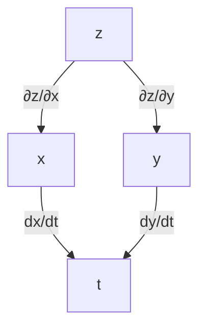
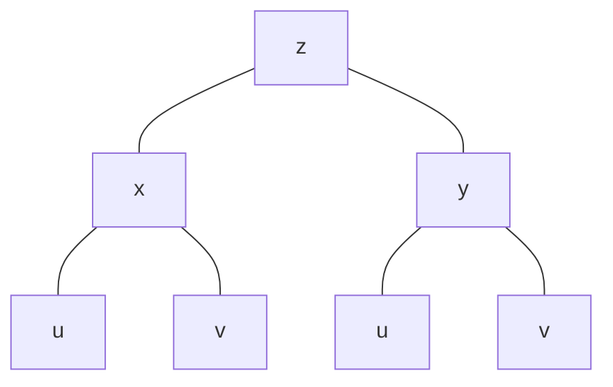
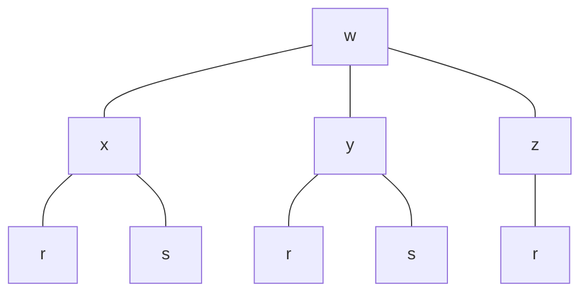
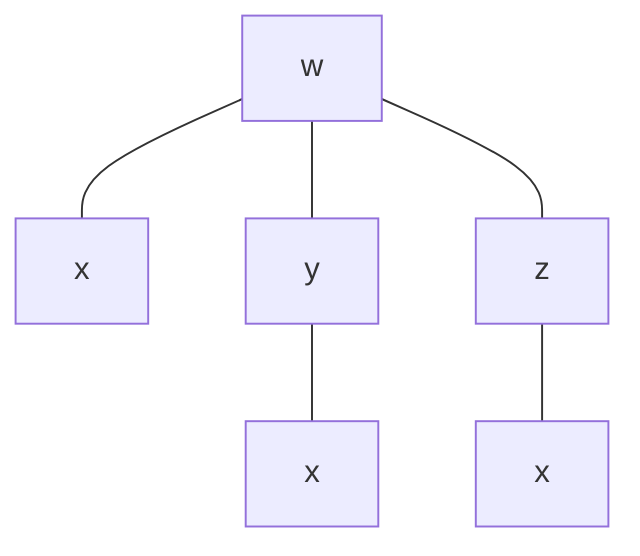

<!-- page 1 | Start here -->

# Module 2 at a glance

Module 1 was about functions of **one** variable. But area, volume, temperature on a metal plate and the height of a hillside all depend on **two or more** inputs. Module 2 takes the same story into higher dimensions, in the same order: **limits → derivatives → using derivatives**.

The one new difficulty is that with two inputs you can move in many directions. So every idea asks an extra question: *which direction?*

1. **Functions of two variables** $z=f(x,y)$: what they are and where they are defined.
2. **Limits and continuity**: now a point can be approached along infinitely many paths, not just from the left and right.
3. **Partial derivatives**: change one input, freeze the others.
4. **Chain rule and implicit differentiation**: how a change travels through a chain of dependent variables.
5. **Applications**: slopes of surfaces, related rates, and level curves.

## What you will be able to do

- State the domain and range of a function of two variables.
- Evaluate a two-variable limit, and prove one does **not** exist by comparing two paths.
- Decide whether a function is continuous at a point.
- Find first, second and mixed partial derivatives, and check that $f_{xy}=f_{yx}$.
- Use the chain rule with one or two parameters, and draw the tree diagram that organises it.
- Find $\dfrac{dy}{dx}$ for an implicit curve using partial derivatives.
- Solve related-rates problems with several changing quantities.
- Sketch the level curves of a function.

## How to use these notes

- Every topic has the same shape: **idea → rule → worked example → common mistakes.**
- Try each worked example yourself before reading the solution. Cover the answer and compare.
- Green boxes hold key ideas. Amber boxes marked **Watch out** hold the mistakes that cost marks.
- The last page has practice questions with answers, then a one-page formula sheet for revision.

## Where each topic sits

| Part | Topics |
| --- | --- |
| Functions | Domain, range |
| Limits and continuity | Limits along paths, the two-path test, continuity |
| Partial derivatives | First order, slope of a surface, second order, mixed partials |
| Chain rule | One parameter, two parameters, related rates |
| Implicit functions | $dy/dx=-f_x/f_y$ |
| Pictures | Level curves |

> **Prerequisites.** Everything from Module 1's differentiation: the power, product, quotient and chain rules, and the derivatives of $e^x$, $\ln x$, $\sin x$, $\cos x$, $\tan x$ and $\tan^{-1}x$. Partial derivatives are ordinary derivatives with a little bookkeeping, so these rules do all the work.

---

<!-- page 2 | Functions of two variables -->

# Functions of two variables

## The idea

A function of two variables turns each pair $(x,y)$ in its **domain** into exactly one number:

$$
z=f(x,y)
$$

Examples you already know: the area of a rectangle $A=xy$, the volume of a cone $V=\tfrac13\pi r^2h$, the distance from the origin $\sqrt{x^2+y^2}$.

The graph of $z=f(x,y)$ is a **surface** in space: above each point $(x,y)$ of the plane sits a point at height $z$.

## Domain and range

- The **domain** is the set of all $(x,y)$ for which $f(x,y)$ is defined. It is a region of the plane, not an interval.
- The **range** is the set of all values $f(x,y)$ can take.

The restrictions are the same as in one variable:

| Trouble | Rule |
| --- | --- |
| Division | the denominator must not be $0$ |
| Even root | the expression under it must be $\ge 0$ |
| Logarithm | the expression inside must be $>0$ |

**Example 1.** $f(x,y)=x^2-y^2$.

Nothing can go wrong, so the domain is all of $\mathbb{R}^2$. Every real number is a value: to get $k\ge0$ take $(\sqrt k,\,0)$, and to get $k<0$ take $(0,\,\sqrt{-k})$. So the range is $\mathbb{R}$.

**Example 2.** $f(x,y)=\dfrac{x+y}{x-y}$.

The denominator vanishes when $x=y$. The domain is the whole plane **except the line** $y=x$:

$$
\mathbb{R}^2\setminus\{(x,y): x=y\}
$$

Every real $k$ is a value: for $k\ne-1$ take $x=1,\ y=\dfrac{k-1}{k+1}$, and for $k=-1$ take $(0,1)$. So the range is $\mathbb{R}$.

**Example 3.** $f(x,y)=\sqrt{9-x^2-y^2}$.

The root needs $9-x^2-y^2\ge0$, that is $x^2+y^2\le9$. The domain is the **closed disc** of radius $3$ centred at the origin. The largest value is $f(0,0)=3$ and the smallest is $0$ (on the edge of the disc), so the range is $[0,3]$. This is the upper half of a sphere. You will meet it again under level curves.

> **Watch out.** Describe a domain with an equation or inequality in $x$ and $y$ ("$x\neq y$", "$x^2+y^2\le9$"). Writing it as an interval like "$x\neq0$" is not enough: the restriction usually involves **both** variables together.

---

<!-- page 3 | Limits -->

# Limits of functions of two variables

## The idea

$$
\lim_{(x,y)\to(a,b)}f(x,y)=L
$$

means: $f(x,y)$ gets as close to $L$ as you like whenever the point $(x,y)$ is close enough to $(a,b)$, but not equal to it.

On a number line you can only approach a point from two sides, left and right. In the plane you can approach $(a,b)$ along **infinitely many paths**: straight lines, parabolas, spirals.

> **Key idea.** The limit exists only if $f$ approaches the **same** number along **every** path to $(a,b)$. One path giving a different answer is enough to destroy the limit.

## Easy case: just substitute

The limit laws from Module 1 hold unchanged for $(x,y)\to(a,b)$: limits pass through sums, differences, constant multiples, products, quotients (denominator limit $\ne0$), powers and roots.

So for a polynomial, or a rational function whose denominator is not $0$ at the point, **substitute**.

**Example 1.** $\displaystyle\lim_{(x,y)\to(0,1)}\frac{x-xy+3}{x^2y+5xy-y^3}$

$$
\frac{0-0\cdot1+3}{0^2\cdot1+5\cdot0\cdot1-1^3}=\frac{3}{-1}=\mathbf{-3}
$$

**Example 2.** $\displaystyle\lim_{(x,y)\to(3,-4)}\sqrt{x^2+y^2}$

$$
\sqrt{3^2+(-4)^2}=\sqrt{9+16}=\sqrt{25}=\mathbf{5}
$$

This is the distance from $(3,-4)$ to the origin.

**Example 3.** $\displaystyle\lim_{(x,y)\to(\pi/2,\,0)}\left(\frac{x}{\sin x}-\frac{\sin y}{y}\right)$

Treat the two terms separately. The first is $\dfrac{\pi/2}{\sin(\pi/2)}=\dfrac{\pi}{2}$. The second gives $0/0$ on substitution, but it is the standard limit $\dfrac{\sin y}{y}\to1$ from Module 1. So the answer is

$$
\frac{\pi}{2}-1
$$

## When substitution gives $0/0$

Do what you did in Module 1: factorise and cancel, or use a difference of squares.

**Example 4.** $\displaystyle\lim_{(x,y)\to(0,0)}\frac{x^2-xy}{\sqrt{x}-\sqrt{y}}$

Substituting gives $0/0$. Factorise the top as $x(x-y)$ and write $x-y=(\sqrt x-\sqrt y)(\sqrt x+\sqrt y)$:

$$
\frac{x(x-y)}{\sqrt x-\sqrt y}=\frac{x(\sqrt x-\sqrt y)(\sqrt x+\sqrt y)}{\sqrt x-\sqrt y}=x(\sqrt x+\sqrt y)
$$

Now substitute: $0\cdot(0+0)=\mathbf{0}$. (The square roots mean $x,y\ge0$, and $x\ne y$ keeps the original fraction defined.)

## Showing a limit does not exist: the two-path test

> **Two-path test.** If $f$ approaches **different** values along two different paths into $(a,b)$, then $\displaystyle\lim_{(x,y)\to(a,b)}f(x,y)$ does not exist.

The standard choice for the origin is the family of lines through it, $y=mx$. Substitute $y=mx$, let $x\to0$, and see whether the answer depends on $m$. If it does, the limit does not exist.

**Example 5.** Show that $\displaystyle\lim_{(x,y)\to(0,0)}\frac{x^2-y^2}{x^2+y^2}$ does not exist.

Substituting gives $0/0$, so the limit laws are of no use. Put $y=mx$:

$$
\lim_{x\to0}\frac{x^2-m^2x^2}{x^2+m^2x^2}=\lim_{x\to0}\frac{x^2(1-m^2)}{x^2(1+m^2)}=\frac{1-m^2}{1+m^2}
$$

The answer depends on $m$. Along the $x$-axis ($m=0$) it is $1$, and along $y=x$ ($m=1$) it is $0$. Different paths, different values, so the limit **does not exist**.

**Example 6.** Show that $\displaystyle\lim_{(x,y)\to(0,0)}\frac{xy}{x^2+y^2}$ does not exist.

Put $y=mx$:

$$
\lim_{x\to0}\frac{x\cdot mx}{x^2+m^2x^2}=\frac{m}{1+m^2}
$$

This is $0$ for $m=0$ and $\tfrac12$ for $m=1$. The limit **does not exist**.

> **Watch out.** The two-path test can only prove that a limit does **not** exist. If every straight line gives the same value, that does **not** prove the limit exists, because a curve might disagree. For example $\dfrac{xy^2}{x^2+y^4}$ gives $0$ along every line $y=mx$, but along the parabola $x=y^2$ it equals $\dfrac{y^4}{2y^4}=\dfrac12$. So its limit at the origin does not exist.

---

<!-- page 4 | Continuity -->

# Continuity

## The idea

A function is continuous at a point when its graph has no break there: the value you would **expect** from the nearby points is the value the function **has**.

> **Definition.** $f(x,y)$ is **continuous at $(x_0,y_0)$** when all three hold:
>
> 1. $f(x_0,y_0)$ is defined.
> 2. $\displaystyle\lim_{(x,y)\to(x_0,y_0)}f(x,y)$ exists.
> 3. $\displaystyle\lim_{(x,y)\to(x_0,y_0)}f(x,y)=f(x_0,y_0)$.

$f$ is **continuous** if it is continuous at every point of its domain.

## What you can take for granted

- Polynomials are continuous everywhere.
- A rational function is continuous everywhere its denominator is not $0$.
- Sums, products, quotients (denominator $\ne0$) and compositions of continuous functions are continuous.

So trouble can only happen where a formula changes (a piecewise function), or where a denominator vanishes. Those are the points to test.

## Method

1. Away from the suspicious point the function is built from continuous pieces, so it is continuous there.
2. At the suspicious point, check the three conditions. Usually condition 2 is the one that fails: use the two-path test.

## Examples

**Example 1.** Show that

$$
f(x,y)=\begin{cases}\dfrac{2xy}{x^2+y^2}, & (x,y)\neq(0,0)\\[8pt] 0, & (x,y)=(0,0)\end{cases}
$$

is continuous everywhere except the origin.

*Away from the origin* it is a rational function with a non-zero denominator, so it is continuous.

*At the origin* $f(0,0)=0$ is defined. Along $y=mx$:

$$
\lim_{x\to0}\frac{2x\cdot mx}{x^2+m^2x^2}=\frac{2m}{1+m^2}
$$

This depends on $m$, so the limit does not exist and $f$ is **not continuous at the origin**. Changing the value of $f(0,0)$ cannot repair it, because there is no single limit to match.

**Example 2.** Show that

$$
f(x,y)=\begin{cases}\dfrac{y}{\sqrt{x^2+y^2}}, & (x,y)\neq(0,0)\\[8pt] 0, & (x,y)=(0,0)\end{cases}
$$

is discontinuous at $(0,0)$.

Along $y=mx$ with $x>0$ we have $\sqrt{x^2+m^2x^2}=x\sqrt{1+m^2}$, so

$$
\lim_{x\to0^+}\frac{mx}{x\sqrt{1+m^2}}=\frac{m}{\sqrt{1+m^2}}
$$

This depends on $m$ (it is $0$ for $m=0$ and $\tfrac1{\sqrt2}$ for $m=1$), so the limit does not exist and $f$ is **discontinuous at $(0,0)$**.

**Example 3.** Let $f(x,y)=x^2+y^2$ for $(x,y)\neq(0,0)$, and $f(0,0)=1$. Is $f$ continuous at the origin?

Conditions 1 and 2 hold: $f(0,0)=1$ is defined, and the limit is $0^2+0^2=0$. But condition 3 fails because $0\neq1$. So $f$ is **not continuous** at the origin. This is a *removable* break: redefining $f(0,0)=0$ would fix it.

> **Watch out.** "The limit exists" and "the function is continuous" are different statements. Example 3 has a limit and is still discontinuous. All **three** conditions must hold.

---

<!-- page 5 | Partial derivatives -->

# Partial derivatives

## The idea

For $z=f(x,y)$ there are two natural questions: how fast does $z$ change if I move in the $x$ direction (keeping $y$ fixed), and how fast if I move in the $y$ direction (keeping $x$ fixed)? The answers are the **partial derivatives**.

$$
\frac{\partial z}{\partial x}=\lim_{h\to0}\frac{f(x+h,\,y)-f(x,y)}{h}
\qquad
\frac{\partial z}{\partial y}=\lim_{h\to0}\frac{f(x,\,y+h)-f(x,y)}{h}
$$

Each is just the Module 1 definition of a derivative, applied to one variable while the other is frozen.

| Name | Common symbols |
| --- | --- |
| partial derivative with respect to $x$ | $\dfrac{\partial z}{\partial x},\quad \dfrac{\partial f}{\partial x},\quad f_x$ |
| partial derivative with respect to $y$ | $\dfrac{\partial z}{\partial y},\quad \dfrac{\partial f}{\partial y},\quad f_y$ |

The curly $\partial$ means "there are other variables around". A straight $d$ is only for functions of one variable.

## Method

> **Recipe.**
>
> - For $f_x$: treat $y$ as a **constant** and differentiate with respect to $x$ using the usual rules.
> - For $f_y$: treat $x$ as a **constant** and differentiate with respect to $y$.

A constant multiplier stays; a term with only the *other* variable is a constant and vanishes. For instance, with $x^2y$: differentiating in $x$ gives $2xy$ (the $y$ just rides along), and differentiating in $y$ gives $x^2$.

## Examples

**Example 1.** $f(x,y)=x^2y+3xy^2$

$$
f_x=2xy+3y^2\qquad f_y=x^2+6xy
$$

**Example 2.** $f(x,y)=2x^2-3y-4$

$$
f_x=4x\qquad f_y=-3
$$

The $-3y$ is constant in $x$, so it disappears from $f_x$. The $2x^2$ and $-4$ vanish from $f_y$.

**Example 3.** $f(x,y)=(x+1)(y-2)$. Treat the other bracket as a constant factor.

$$
f_x=y-2\qquad f_y=x+1
$$

**Example 4.** $f(x,y)=\sqrt{x^2+y^2}$. Chain rule on the root.

$$
f_x=\frac{1}{2\sqrt{x^2+y^2}}\cdot2x=\frac{x}{\sqrt{x^2+y^2}}\qquad
f_y=\frac{y}{\sqrt{x^2+y^2}}
$$

**Example 5.** $z=\sqrt{3x+4y}$

$$
\frac{\partial z}{\partial x}=\frac{1}{2\sqrt{3x+4y}}\cdot3=\frac{3}{2\sqrt{3x+4y}}\qquad
\frac{\partial z}{\partial y}=\frac{1}{2\sqrt{3x+4y}}\cdot4=\frac{2}{\sqrt{3x+4y}}
$$

**Example 6.** $f(x,y)=\log(x^2+y^2)$ (natural logarithm)

$$
f_x=\frac{1}{x^2+y^2}\cdot2x=\frac{2x}{x^2+y^2}\qquad
f_y=\frac{2y}{x^2+y^2}
$$

**Example 7.** $f(x,y)=e^{ax}\sin by$. Here $a$ and $b$ are constants.

$$
f_x=a\,e^{ax}\sin by\qquad f_y=b\,e^{ax}\cos by
$$

**Example 8.** $f(x,y)=x\,e^{-y}+5y$

$$
f_x=e^{-y}\qquad f_y=x\cdot e^{-y}\cdot(-1)+5=5-x\,e^{-y}
$$

**Example 9.** $f(x,y)=e^{x^2y^3}\sin(x^2-y^2)$. Product rule, with the chain rule inside each factor.

$$
\begin{aligned}
f_x&=e^{x^2y^3}\cos(x^2-y^2)\cdot2x+\sin(x^2-y^2)\cdot e^{x^2y^3}\cdot2xy^3\\
&=2x\,e^{x^2y^3}\cos(x^2-y^2)+2xy^3e^{x^2y^3}\sin(x^2-y^2)
\end{aligned}
$$

$$
\begin{aligned}
f_y&=e^{x^2y^3}\cos(x^2-y^2)\cdot(-2y)+\sin(x^2-y^2)\cdot e^{x^2y^3}\cdot3x^2y^2\\
&=-2y\,e^{x^2y^3}\cos(x^2-y^2)+3x^2y^2e^{x^2y^3}\sin(x^2-y^2)
\end{aligned}
$$

**Example 10.** $f(x,y)=\dfrac{x-y}{x^2+y^2}$. Quotient rule.

$$
f_x=\frac{(x^2+y^2)\cdot1-(x-y)\cdot2x}{(x^2+y^2)^2}=\frac{y^2-x^2+2xy}{(x^2+y^2)^2}
$$

$$
f_y=\frac{(x^2+y^2)\cdot(-1)-(x-y)\cdot2y}{(x^2+y^2)^2}=\frac{y^2-x^2-2xy}{(x^2+y^2)^2}
$$

## Three or more variables

Nothing changes. For $u=f(x,y,z)$, to find $u_x$ treat **both** $y$ and $z$ as constants, and so on.

> **Watch out.** Chain-rule factors are the usual thing to drop. In Example 5 the $3$ and the $4$ come from differentiating the inside $3x+4y$. In Example 8 the $-1$ comes from differentiating $-y$. And never write $d$ where you mean $\partial$.

---

<!-- page 6 | Slope and rate of change -->

# Slope and rate of change

## The idea

Take the surface $z=f(x,y)$ and a point $(a,b)$ in the plane.

- Slice the surface with the vertical plane $y=b$. You get an ordinary curve $z=f(x,b)$. Its slope at $x=a$ is $f_x(a,b)$.
- Slice with the plane $x=a$. The slope of that curve at $y=b$ is $f_y(a,b)$.

> **Meaning.** $\dfrac{\partial z}{\partial x}$ is the **slope of the surface in the $x$-direction**, and also the **rate of change of $z$ with respect to $x$** while $y$ is held fixed. Likewise $\dfrac{\partial z}{\partial y}$ for the $y$-direction.

To evaluate at a point, differentiate first, then substitute. The notation for "evaluated at $(a,b)$" is

$$
\left.\frac{\partial z}{\partial x}\right|_{(a,b)}
$$

> **Sign tells the story.** A positive value means $z$ is **rising** as you move in the positive direction. A negative value means it is **falling**. Zero means the surface is level in that direction.

## Examples

**Example 1.** Find the slope of the surface $z=10-4x^2-2y^2$ at $(1,2)$ in the $x$-direction and the $y$-direction.

$$
\frac{\partial z}{\partial x}=-8x\ \Rightarrow\ \left.\frac{\partial z}{\partial x}\right|_{(1,2)}=-8(1)=\mathbf{-8}
$$

$$
\frac{\partial z}{\partial y}=-4y\ \Rightarrow\ \left.\frac{\partial z}{\partial y}\right|_{(1,2)}=-4(2)=\mathbf{-8}
$$

The surface is a dome with its top at $(0,0,10)$. At $(1,2)$ it falls away at the same steepness in both directions.

**Example 2.** Find the rate of change of $z=\sin(y^2-4x)$ with respect to $y$ at $(3,1)$.

$$
\frac{\partial z}{\partial y}=\cos(y^2-4x)\cdot2y=2y\cos(y^2-4x)
$$

$$
\left.\frac{\partial z}{\partial y}\right|_{(3,1)}=2(1)\cos(1-12)=2\cos(-11)=\mathbf{2\cos 11}
$$

Cosine is even, so $\cos(-11)=\cos 11$. In radians this is about $0.009$, so at that point $z$ is almost flat in the $y$-direction.

> **Watch out.** Substitute the point **after** differentiating. If you put $y=1$ into $z$ first, then $y$ is a constant and differentiating with respect to $y$ just gives $0$.

---

<!-- page 7 | Higher-order derivatives -->

# Second-order partial derivatives

## The idea

A partial derivative is itself a function of $x$ and $y$, so we can differentiate again. A function of two variables has **four** second-order partial derivatives.

| Symbol | Means | In words |
| --- | --- | --- |
| $f_{xx}=\dfrac{\partial^2f}{\partial x^2}$ | $\dfrac{\partial}{\partial x}\!\left(\dfrac{\partial f}{\partial x}\right)$ | differentiate with respect to $x$ twice |
| $f_{yy}=\dfrac{\partial^2f}{\partial y^2}$ | $\dfrac{\partial}{\partial y}\!\left(\dfrac{\partial f}{\partial y}\right)$ | differentiate with respect to $y$ twice |
| $f_{xy}=\dfrac{\partial^2f}{\partial y\,\partial x}$ | $\dfrac{\partial}{\partial y}\!\left(\dfrac{\partial f}{\partial x}\right)$ | $x$ first, then $y$ |
| $f_{yx}=\dfrac{\partial^2f}{\partial x\,\partial y}$ | $\dfrac{\partial}{\partial x}\!\left(\dfrac{\partial f}{\partial y}\right)$ | $y$ first, then $x$ |

The last two are the **mixed** derivatives. The subscripts $f_{xy}$ read left to right, but the $\partial$ notation reads right to left. Some books swap the names, which is harmless here because of the next fact.

> **Mixed partials are equal.** If $f_{xy}$ and $f_{yx}$ are continuous, then $f_{xy}=f_{yx}$. Every function in this module satisfies that, so the order of differentiation does not matter. Use it as a **check**: compute both mixed derivatives and make sure they agree.

## Examples

**Example 1.** Find all second-order partial derivatives of $f(x,y)=x^3y+2xy^2$.

First order:

$$
f_x=3x^2y+2y^2\qquad f_y=x^3+4xy
$$

Second order:

$$
f_{xx}=6xy\qquad f_{yy}=4x
$$

$$
\frac{\partial^2f}{\partial y\,\partial x}=\frac{\partial}{\partial y}(3x^2y+2y^2)=3x^2+4y
\qquad
\frac{\partial^2f}{\partial x\,\partial y}=\frac{\partial}{\partial x}(x^3+4xy)=3x^2+4y
$$

The mixed derivatives agree.

**Example 2.** For $f(x,y)=2x^5y^3+5x+7y$ find the mixed derivatives.

$$
f_x=10x^4y^3+5\qquad f_y=6x^5y^2+7
$$

$$
\frac{\partial^2f}{\partial y\,\partial x}=30x^4y^2\qquad\frac{\partial^2f}{\partial x\,\partial y}=30x^4y^2
$$

(Also $f_{xx}=40x^3y^3$ and $f_{yy}=12x^5y$.)

**Example 3.** For $f(x,y)=x^3y+e^{xy^2}$ show that $\dfrac{\partial^2f}{\partial y\,\partial x}=\dfrac{\partial^2f}{\partial x\,\partial y}$.

$$
f_x=3x^2y+y^2e^{xy^2}\qquad f_y=x^3+2xy\,e^{xy^2}
$$

Differentiate $f_x$ with respect to $y$ (product rule on the second term):

$$
\frac{\partial^2f}{\partial y\,\partial x}=3x^2+2y\,e^{xy^2}+y^2\cdot e^{xy^2}\cdot2xy=3x^2+2y\,e^{xy^2}+2xy^3e^{xy^2}
$$

Differentiate $f_y$ with respect to $x$:

$$
\frac{\partial^2f}{\partial x\,\partial y}=3x^2+2y\,e^{xy^2}+2xy\cdot e^{xy^2}\cdot y^2=3x^2+2y\,e^{xy^2}+2xy^3e^{xy^2}
$$

They are equal. $\checkmark$

## Third order

Derivatives of any order work the same way. In $\dfrac{\partial^3f}{\partial x\,\partial y\,\partial z}$ read **right to left**: first $z$, then $y$, then $x$.

**Example 4.** If $f(x,y,z)=e^{xyz}$, find $\dfrac{\partial^3f}{\partial x\,\partial y\,\partial z}$.

$$
\frac{\partial f}{\partial z}=xy\,e^{xyz}
$$

$$
\frac{\partial^2f}{\partial y\,\partial z}=x\,e^{xyz}+xy\cdot xz\,e^{xyz}=(x+x^2yz)\,e^{xyz}
$$

$$
\begin{aligned}
\frac{\partial^3f}{\partial x\,\partial y\,\partial z}&=(1+2xyz)\,e^{xyz}+(x+x^2yz)\,yz\,e^{xyz}\\
&=e^{xyz}\left(1+2xyz+xyz+x^2y^2z^2\right)=\mathbf{e^{xyz}\left(1+3xyz+x^2y^2z^2\right)}
\end{aligned}
$$

## Proving an equation about derivatives

**Example 5. Laplace's equation.** If $u=\dfrac{1}{\sqrt{x^2+y^2+z^2}}$, prove that $\dfrac{\partial^2u}{\partial x^2}+\dfrac{\partial^2u}{\partial y^2}+\dfrac{\partial^2u}{\partial z^2}=0$.

Write $\rho=x^2+y^2+z^2$, so $u=\rho^{-1/2}$ and $\dfrac{\partial\rho}{\partial x}=2x$. Then

$$
\frac{\partial u}{\partial x}=-\tfrac12\rho^{-3/2}\cdot2x=-x\,\rho^{-3/2}
$$

$$
\frac{\partial^2u}{\partial x^2}=-\rho^{-3/2}+x\cdot\tfrac32\rho^{-5/2}\cdot2x=3x^2\rho^{-5/2}-\rho^{-3/2}
$$

By symmetry the $y$ and $z$ versions are $3y^2\rho^{-5/2}-\rho^{-3/2}$ and $3z^2\rho^{-5/2}-\rho^{-3/2}$. Add all three:

$$
\begin{aligned}
u_{xx}+u_{yy}+u_{zz}&=3(x^2+y^2+z^2)\rho^{-5/2}-3\rho^{-3/2}\\
&=3\rho\cdot\rho^{-5/2}-3\rho^{-3/2}=3\rho^{-3/2}-3\rho^{-3/2}=\mathbf{0}\ \checkmark
\end{aligned}
$$

**Example 6.** If $u=x^2\tan^{-1}\!\dfrac yx-y^2\tan^{-1}\!\dfrac xy$, show that $\dfrac{\partial^2u}{\partial x\,\partial y}=\dfrac{x^2-y^2}{x^2+y^2}$.

Differentiate with respect to $y$ first. For the first term:

$$
x^2\cdot\frac{1}{1+y^2/x^2}\cdot\frac1x=\frac{x^3}{x^2+y^2}
$$

For the second term (product rule):

$$
\frac{\partial}{\partial y}\left[y^2\tan^{-1}\frac xy\right]=2y\tan^{-1}\frac xy+y^2\cdot\frac{1}{1+x^2/y^2}\cdot\left(-\frac{x}{y^2}\right)=2y\tan^{-1}\frac xy-\frac{xy^2}{x^2+y^2}
$$

Subtract the second from the first, noting $x^3+xy^2=x(x^2+y^2)$:

$$
\frac{\partial u}{\partial y}=\frac{x^3+xy^2}{x^2+y^2}-2y\tan^{-1}\frac xy=x-2y\tan^{-1}\frac xy
$$

Now differentiate with respect to $x$:

$$
\frac{\partial^2u}{\partial x\,\partial y}=1-2y\cdot\frac{1}{1+x^2/y^2}\cdot\frac1y=1-\frac{2y^2}{x^2+y^2}=\frac{x^2+y^2-2y^2}{x^2+y^2}=\mathbf{\frac{x^2-y^2}{x^2+y^2}}\ \checkmark
$$

> **Study tip.** Simplify after the first derivative, before differentiating again. In Example 6 the whole expression collapses to $x-2y\tan^{-1}(x/y)$, which makes the second step easy.

> **Watch out.** For $f_{xx}$ you differentiate with respect to $x$ **again** and still treat $y$ as constant. And do not confuse $f_{xx}$ with $(f_x)^2$: they are different things.

---

<!-- page 8 | Chain rule: one parameter -->

# Chain rule, part 1: one parameter

## The idea

If $z=f(x,y)$ and both $x$ and $y$ depend on a single variable $t$, then $z$ ends up a function of $t$ alone. The chain rule finds $\dfrac{dz}{dt}$ without substituting first.

> **Chain rule (one parameter).** If $z=f(x,y)$, $x=x(t)$, $y=y(t)$, then
>
> $$\frac{dz}{dt}=\frac{\partial z}{\partial x}\cdot\frac{dx}{dt}+\frac{\partial z}{\partial y}\cdot\frac{dy}{dt}$$

## The tree diagram

Draw the dependencies as a tree: $z$ at the top, the variables it depends on below, and the parameter at the bottom.



> **How to read the tree.** Each path from $z$ down to $t$ contributes the **product** of the derivatives along its branches. Then **add** the paths. There are two paths here ($z\to x\to t$ and $z\to y\to t$), so two terms.

With three variables $w=f(x,y,z)$ there are three paths:

$$
\frac{dw}{dt}=\frac{\partial w}{\partial x}\frac{dx}{dt}+\frac{\partial w}{\partial y}\frac{dy}{dt}+\frac{\partial w}{\partial z}\frac{dz}{dt}
$$

## Method

1. Draw the tree.
2. Find the partial derivatives of the outer function with respect to each intermediate variable.
3. Find the derivative of each intermediate variable with respect to $t$.
4. Multiply along each branch, then add.
5. Substitute $x(t)$, $y(t)$, $\dots$ so the answer is in terms of $t$ (or the given value of $t$).

## Examples

**Example 1.** $z=5x^3y^2$, $x=t^3$, $y=t^5$. Find $\dfrac{dz}{dt}$, and check by substituting first.

$$
\frac{\partial z}{\partial x}=15x^2y^2\quad\frac{\partial z}{\partial y}=10x^3y\quad\frac{dx}{dt}=3t^2\quad\frac{dy}{dt}=5t^4
$$

$$
\begin{aligned}
\frac{dz}{dt}&=15x^2y^2\cdot3t^2+10x^3y\cdot5t^4\\
&=45(t^3)^2(t^5)^2\,t^2+50(t^3)^3\,t^5\,t^4\\
&=45t^{18}+50t^{18}=\mathbf{95t^{18}}
\end{aligned}
$$

*Check.* Substituting first, $z=5(t^3)^3(t^5)^2=5t^{19}$, so $\dfrac{dz}{dt}=95t^{18}$. $\checkmark$

**Example 2.** $z=\log(3x^2+y)$, $x=\sqrt t$, $y=t^{1/3}$. Find $\dfrac{dz}{dt}$.

$$
\frac{\partial z}{\partial x}=\frac{6x}{3x^2+y}\quad\frac{\partial z}{\partial y}=\frac{1}{3x^2+y}\quad\frac{dx}{dt}=\frac{1}{2\sqrt t}\quad\frac{dy}{dt}=\frac13t^{-2/3}
$$

With $x=\sqrt t$ we get $3x^2+y=3t+t^{1/3}$, so

$$
\frac{dz}{dt}=\frac{6\sqrt t}{3t+t^{1/3}}\cdot\frac{1}{2\sqrt t}+\frac{1}{3t+t^{1/3}}\cdot\frac13t^{-2/3}
=\frac{3+\tfrac13t^{-2/3}}{3t+t^{1/3}}
$$

Multiplying top and bottom by $3t^{2/3}$ tidies this to

$$
\frac{dz}{dt}=\mathbf{\frac{9t^{2/3}+1}{3t\left(3t^{2/3}+1\right)}}
$$

**Example 3.** Find $\dfrac{dw}{dt}$ for $w=x^2+y^2$ along the path $x=at^2$, $y=2at$.

$$
\frac{\partial w}{\partial x}=2x\quad\frac{\partial w}{\partial y}=2y\quad\frac{dx}{dt}=2at\quad\frac{dy}{dt}=2a
$$

$$
\frac{dw}{dt}=2(at^2)(2at)+2(2at)(2a)=\mathbf{4a^2t^3+8a^2t}
$$

(The path is a parabola, and $w$ is the squared distance from the origin along it.)

**Example 4.** Find $\dfrac{dw}{dt}$ at $t=3$ if $w=\ln(x^2+y^2+z^2)$, $x=\cos t$, $y=\sin t$, $z=4\sqrt t$.

$$
\frac{\partial w}{\partial x}=\frac{2x}{x^2+y^2+z^2}\quad\text{and similarly for }y,z;\qquad
\frac{dx}{dt}=-\sin t\quad\frac{dy}{dt}=\cos t\quad\frac{dz}{dt}=\frac{2}{\sqrt t}
$$

Substituting $x^2+y^2+z^2=\cos^2t+\sin^2t+16t=1+16t$:

$$
\begin{aligned}
\frac{dw}{dt}&=\frac{2\cos t(-\sin t)+2\sin t\cos t+2(4\sqrt t)\cdot\frac{2}{\sqrt t}}{1+16t}\\[4pt]
&=\frac{-2\sin t\cos t+2\sin t\cos t+16}{1+16t}=\frac{16}{1+16t}
\end{aligned}
$$

At $t=3$:

$$
\left.\frac{dw}{dt}\right|_{t=3}=\frac{16}{1+48}=\mathbf{\frac{16}{49}}
$$

> **Watch out.** Use $\partial$ for the outer function (it has several variables) and $d$ for the inner ones (each has only $t$). And do not forget the second path: stopping after the $x$ term is the commonest slip.

---

<!-- page 9 | Chain rule: two parameters -->

# Chain rule, part 2: two parameters

## The idea

Now let the intermediate variables depend on **two** parameters. If $z=f(x,y)$ with $x=x(u,v)$ and $y=y(u,v)$, then $z$ is a function of $u$ and $v$, and we need **partial** derivatives with respect to each.

> **Chain rule (two parameters).**
>
> $$\frac{\partial z}{\partial u}=\frac{\partial z}{\partial x}\cdot\frac{\partial x}{\partial u}+\frac{\partial z}{\partial y}\cdot\frac{\partial y}{\partial u}$$
>
> $$\frac{\partial z}{\partial v}=\frac{\partial z}{\partial x}\cdot\frac{\partial x}{\partial v}+\frac{\partial z}{\partial y}\cdot\frac{\partial y}{\partial v}$$



The tree rule is unchanged. For $\dfrac{\partial z}{\partial u}$: follow every path from $z$ down to **$u$**, multiply along each, add. For $\dfrac{\partial z}{\partial v}$: follow every path down to **$v$**.

## Examples

**Example 1.** $z=x^2-y\tan x$, $x=\dfrac uv$, $y=uv$. Find $\dfrac{\partial z}{\partial u}$ and $\dfrac{\partial z}{\partial v}$.

The pieces:

$$
\frac{\partial z}{\partial x}=2x-y\sec^2x\quad\frac{\partial z}{\partial y}=-\tan x
$$

$$
\frac{\partial x}{\partial u}=\frac1v\quad\frac{\partial x}{\partial v}=-\frac{u}{v^2}\quad\frac{\partial y}{\partial u}=v\quad\frac{\partial y}{\partial v}=u
$$

Combine:

$$
\frac{\partial z}{\partial u}=(2x-y\sec^2x)\cdot\frac1v+(-\tan x)\cdot v
=\frac{2x-y\sec^2x}{v}-v\tan x
$$

$$
\frac{\partial z}{\partial v}=(2x-y\sec^2x)\cdot\left(-\frac{u}{v^2}\right)+(-\tan x)\cdot u
$$

Finally replace $x=\dfrac uv$ and $y=uv$ to write the answers in $u$ and $v$:

$$
\frac{\partial z}{\partial u}=\mathbf{\frac{2u}{v^2}-u\sec^2\frac uv-v\tan\frac uv}
$$

$$
\frac{\partial z}{\partial v}=\mathbf{-\frac{2u^2}{v^3}+\frac{u^2}{v}\sec^2\frac uv-u\tan\frac uv}
$$

**Example 2.** $z=e^{x^2y}$, $x=\sqrt{uv}$, $y=\dfrac1v$. Find $\dfrac{\partial z}{\partial u}$ and $\dfrac{\partial z}{\partial v}$.

$$
\frac{\partial z}{\partial x}=2xy\,e^{x^2y}\quad\frac{\partial z}{\partial y}=x^2e^{x^2y}
$$

$$
\frac{\partial x}{\partial u}=\frac{v}{2\sqrt{uv}}\quad\frac{\partial x}{\partial v}=\frac{u}{2\sqrt{uv}}\quad\frac{\partial y}{\partial u}=0\quad\frac{\partial y}{\partial v}=-\frac1{v^2}
$$

Note that $x^2y=uv\cdot\dfrac1v=u$, so every exponential equals $e^{u}$.

$$
\frac{\partial z}{\partial u}=2xy\,e^{u}\cdot\frac{v}{2\sqrt{uv}}+0
=2\sqrt{uv}\cdot\frac1v\cdot\frac{v}{2\sqrt{uv}}\,e^{u}=\mathbf{e^{u}}
$$

$$
\frac{\partial z}{\partial v}=2xy\,e^{u}\cdot\frac{u}{2\sqrt{uv}}+x^2e^{u}\cdot\left(-\frac1{v^2}\right)
=\frac uv\,e^{u}-\frac{uv}{v^2}\,e^{u}=\mathbf{0}
$$

*Check.* Substituting first, $z=e^{x^2y}=e^{u}$ depends on $u$ only, so $z_u=e^u$ and $z_v=0$. $\checkmark$

**Example 3.** Express $\dfrac{\partial w}{\partial r}$ and $\dfrac{\partial w}{\partial s}$ in terms of $r$ and $s$, if $w=x^2+y^2$, $x=r-s$, $y=r+s$.

$$
\frac{\partial w}{\partial x}=2x\quad\frac{\partial w}{\partial y}=2y\quad
\frac{\partial x}{\partial r}=1\quad\frac{\partial y}{\partial r}=1\quad
\frac{\partial x}{\partial s}=-1\quad\frac{\partial y}{\partial s}=1
$$

$$
\frac{\partial w}{\partial r}=2x\cdot1+2y\cdot1=2(r-s)+2(r+s)=\mathbf{4r}
$$

$$
\frac{\partial w}{\partial s}=2x\cdot(-1)+2y\cdot1=-2(r-s)+2(r+s)=\mathbf{4s}
$$

*Check.* $w=(r-s)^2+(r+s)^2=2r^2+2s^2$, so $w_r=4r$ and $w_s=4s$. $\checkmark$

**Example 4. Three intermediate variables.** Find the first-order partial derivatives of $w=x+2y+z^2$, where $x=\dfrac rs$, $y=r^2+\ln s$, $z=2r$.

Here $z$ depends on $r$ only, so its branch reaches $r$ but not $s$.



$$
\frac{\partial w}{\partial x}=1\quad\frac{\partial w}{\partial y}=2\quad\frac{\partial w}{\partial z}=2z
$$

$$
\frac{\partial x}{\partial r}=\frac1s\quad\frac{\partial y}{\partial r}=2r\quad\frac{\partial z}{\partial r}=2\qquad
\frac{\partial x}{\partial s}=-\frac{r}{s^2}\quad\frac{\partial y}{\partial s}=\frac1s
$$

Three paths down to $r$, two paths down to $s$:

$$
\frac{\partial w}{\partial r}=1\cdot\frac1s+2\cdot2r+2z\cdot2=\frac1s+4r+8r=\mathbf{\frac1s+12r}
$$

$$
\frac{\partial w}{\partial s}=1\cdot\left(-\frac{r}{s^2}\right)+2\cdot\frac1s=\mathbf{-\frac{r}{s^2}+\frac2s}
$$

## When a variable plays two roles

Sometimes the final variable also appears directly in the function. Then it contributes **both** a direct path and the paths through the others.

**Example 5.** Find $\dfrac{dw}{dx}$ at $x=0$ for $w=xy+yz$, with $y=\sin x$ and $z=e^x$.



There are three paths from $w$ to $x$: directly, through $y$, and through $z$.

$$
\frac{dw}{dx}=\frac{\partial w}{\partial x}+\frac{\partial w}{\partial y}\cdot\frac{dy}{dx}+\frac{\partial w}{\partial z}\cdot\frac{dz}{dx}
$$

With $\dfrac{\partial w}{\partial x}=y$, $\dfrac{\partial w}{\partial y}=x+z$, $\dfrac{\partial w}{\partial z}=y$, $\dfrac{dy}{dx}=\cos x$, $\dfrac{dz}{dx}=e^x$:

$$
\frac{dw}{dx}=y+(x+z)\cos x+y\,e^x
$$

At $x=0$ we have $y=\sin0=0$ and $z=e^0=1$, so

$$
\left.\frac{dw}{dx}\right|_{x=0}=0+(0+1)(1)+0=\mathbf{1}
$$

*Check.* Substituting first, $w=x\sin x+e^x\sin x$. Its derivative at $0$ is $0+0+1+0=1$. $\checkmark$

> **Watch out.** In Example 5, $\dfrac{\partial w}{\partial x}$ (treat $y$ and $z$ as constants) and $\dfrac{dw}{dx}$ (let them vary with $x$) are **different** quantities. Also, the point in the original question, $(0,1,2)$, does not lie on this curve: the curve passes through $(0,0,1)$ at $x=0$.

---

<!-- page 10 | Related rates -->

# Related rates

## The idea

If a quantity $z$ depends on $x$ and $y$, and $x$ and $y$ are changing with time, the chain rule gives the rate at which $z$ changes:

$$
\frac{dz}{dt}=\frac{\partial z}{\partial x}\cdot\frac{dx}{dt}+\frac{\partial z}{\partial y}\cdot\frac{dy}{dt}
$$

## Method

1. Name the variables and write the formula $z=f(x,y)$ that links them.
2. List the **given rates** $\dfrac{dx}{dt}$, $\dfrac{dy}{dt}$. A quantity that is **decreasing** has a **negative** rate. A quantity that is **constant** has rate $0$.
3. Find $\dfrac{\partial z}{\partial x}$ and $\dfrac{\partial z}{\partial y}$.
4. Apply the chain rule, then substitute the values **at that instant**.
5. Answer with units, and say whether the quantity is increasing or decreasing.

## Examples

**Example 1. Area of a rectangle.** The length and width of a rectangle are increasing at $1.5\ \text{cm/s}$ and $0.5\ \text{cm/s}$. How fast is the area increasing when the length is $40\ \text{cm}$ and the width is $30\ \text{cm}$?

Let $x$ = length, $y$ = width, $A=xy$. Then $\dfrac{dx}{dt}=1.5$ and $\dfrac{dy}{dt}=0.5$, with $\dfrac{\partial A}{\partial x}=y$ and $\dfrac{\partial A}{\partial y}=x$.

$$
\frac{dA}{dt}=y\cdot1.5+x\cdot0.5=30(1.5)+40(0.5)=45+20=\mathbf{65\ \text{cm}^2/\text{s}}
$$

The units are square centimetres per second, because $A$ is an area.

**Example 2. Volume of a cone.** The height of a right circular cone is increasing at $0.2\ \text{cm/s}$ and the radius of its base is decreasing at $0.3\ \text{cm/s}$. How fast is the volume changing when the height is $15\ \text{cm}$ and the radius is $10\ \text{cm}$?

Let $x$ = radius, $y$ = height, $V=\tfrac13\pi x^2y$. The radius is decreasing, so $\dfrac{dx}{dt}=-0.3$, and $\dfrac{dy}{dt}=0.2$.

$$
\frac{\partial V}{\partial x}=\frac{2\pi xy}{3}\qquad\frac{\partial V}{\partial y}=\frac{\pi x^2}{3}
$$

$$
\frac{dV}{dt}=\frac{2\pi xy}{3}(-0.3)+\frac{\pi x^2}{3}(0.2)
$$

At $x=10$, $y=15$:

$$
\frac{dV}{dt}=\frac{2\pi(150)}{3}(-0.3)+\frac{\pi(100)}{3}(0.2)=-30\pi+\frac{20\pi}{3}=\mathbf{-\frac{70\pi}{3}\ \text{cm}^3/\text{s}}\approx-73.3\ \text{cm}^3/\text{s}
$$

The volume is **decreasing**: the shrinking radius (squared in the formula) wins over the growing height.

**Example 3. A quantity held constant.** Given $z=2xy^2-3x^2y$ and that $x$ is increasing at $2\ \text{cm/s}$, find the rate at which $y$ changes when $x=3$ and $y=1$, if $z$ stays constant.

Constant $z$ means $\dfrac{dz}{dt}=0$. With $\dfrac{\partial z}{\partial x}=2y^2-6xy$ and $\dfrac{\partial z}{\partial y}=4xy-3x^2$:

$$
0=(2y^2-6xy)\cdot2+(4xy-3x^2)\frac{dy}{dt}
$$

At $(3,1)$: $\dfrac{\partial z}{\partial x}=2-18=-16$ and $\dfrac{\partial z}{\partial y}=12-27=-15$. So

$$
0=(-16)(2)+(-15)\frac{dy}{dt}\ \Rightarrow\ \frac{dy}{dt}=\mathbf{-\frac{32}{15}\ \text{cm/s}}
$$

So $y$ is **decreasing** at about $2.13\ \text{cm/s}$.

> **Note on the source.** The handwritten page moved a bracket across the equals sign without flipping its sign and ended with $+\tfrac{32}{15}$. Working with the numbers substituted (as above) gives $-\tfrac{32}{15}$. It also gave the cone's height rate as $0.2\ \text{m/s}$, which must be $0.2\ \text{cm/s}$ to match the other units, and an intermediate line in the cone problem had $\tfrac{140\pi}{3}$ before arriving at the correct $\tfrac{70\pi}{3}$.

> **Watch out.** Check signs and units at the end. A decreasing quantity needs a **negative** rate going in. And every rate must be in the same units (here all in cm and seconds).

---

<!-- page 11 | Implicit differentiation -->

# Implicit differentiation

## The idea

Sometimes $y$ is given **implicitly** by an equation such as $x^3+y^3=3axy$, which you cannot solve neatly for $y$. Partial derivatives give a one-step formula for $\dfrac{dy}{dx}$.

> **Implicit differentiation formula.** If $f(x,y)=c$ defines $y$ as a function of $x$, then
>
> $$\frac{dy}{dx}=-\frac{\partial f/\partial x}{\partial f/\partial y}=-\frac{f_x}{f_y}\qquad(f_y\neq0)$$

## Why it works

Along the curve $f(x,y)=c$ the value of $f$ never changes, so $\dfrac{d}{dx}f(x,y)=0$. The chain rule (with $x$ playing both roles, as on the previous page) gives

$$
f_x\cdot1+f_y\cdot\frac{dy}{dx}=0
$$

and solving for $\dfrac{dy}{dx}$ gives the formula.

## Method

1. Move everything to one side so the equation reads $f(x,y)=0$ (or $=c$).
2. Find $f_x$ and $f_y$ as ordinary partial derivatives.
3. Write $\dfrac{dy}{dx}=-\dfrac{f_x}{f_y}$. Keep the minus sign in front of the **whole** fraction.

## Examples

**Example 1.** Using partial derivatives find $\dfrac{dy}{dx}$ if $x^3+y^3=3axy$. Then verify by ordinary implicit differentiation.

Let $f(x,y)=x^3+y^3-3axy$. Then

$$
f_x=3x^2-3ay\qquad f_y=3y^2-3ax
$$

$$
\frac{dy}{dx}=-\frac{3x^2-3ay}{3y^2-3ax}=\mathbf{\frac{ay-x^2}{y^2-ax}}
$$

*Verification.* Differentiate both sides of $x^3+y^3=3axy$ with respect to $x$:

$$
3x^2+3y^2\frac{dy}{dx}=3a\left(x\frac{dy}{dx}+y\right)
$$

Collect the $\dfrac{dy}{dx}$ terms:

$$
\frac{dy}{dx}\left(3y^2-3ax\right)=3ay-3x^2\ \Rightarrow\ \frac{dy}{dx}=\frac{3ay-3x^2}{3y^2-3ax}=\frac{ay-x^2}{y^2-ax}
$$

Both methods agree. $\checkmark$

> **Note on the source.** The handwritten page wrote the first answer as $\dfrac{-3x^2-3ay}{3y^2-3ax}$, which distributes the minus sign wrongly. It should be $-(3x^2-3ay)=-3x^2+3ay$. The second method on the page gave the correct result.

**Example 2.** Find $\dfrac{dy}{dx}$ for the circle $x^2+y^2=a^2$.

Let $f(x,y)=x^2+y^2-a^2$, so $f_x=2x$ and $f_y=2y$:

$$
\frac{dy}{dx}=-\frac{2x}{2y}=\mathbf{-\frac xy}
$$

This is the slope of the circle at $(x,y)$. It matches the geometry: the slope of a tangent to a circle is perpendicular to the radius, which has slope $y/x$.

> **Watch out.** Three things go wrong here. (1) Dropping the **minus sign**. (2) Putting $f_y$ on top and $f_x$ underneath: it is $f_x$ over $f_y$. (3) Forgetting that the formula needs the equation in the form $f(x,y)=c$, with **all** terms collected on one side first.

---

<!-- page 12 | Level curves -->

# Level curves

## The idea

A level curve is the set of points where a function takes one fixed value. Think of the contour lines on a map: each line joins places at the same height.

> **Definition.** A **level curve** of $f(x,y)$ is the curve
>
> $$f(x,y)=k$$
>
> for a constant $k$.

Level curves **never cross** (a point cannot have two different values of $f$). Where they are packed close together the surface is steep; where they are far apart it is gentle.

## Method

1. Set $f(x,y)=k$ for each requested value of $k$.
2. Simplify each equation into a recognisable curve: a line, circle, parabola, ellipse, and so on.
3. Sketch the curves together, labelling each with its $k$.
4. To find the level curve **through a given point**, substitute the point into $f$: that value is $k$.

## Examples

**Example 1.** Find the level curves of $f(x,y)=\sqrt{9-x^2-y^2}$ for $c=0,1,2,3$.

Set $\sqrt{9-x^2-y^2}=c$ and square both sides:

$$
9-x^2-y^2=c^2\ \Rightarrow\ x^2+y^2=9-c^2
$$

| $c$ | Equation | Curve |
| --- | --- | --- |
| $0$ | $x^2+y^2=9$ | circle of radius $3$ |
| $1$ | $x^2+y^2=8$ | circle of radius $2\sqrt2\approx2.83$ |
| $2$ | $x^2+y^2=5$ | circle of radius $\sqrt5\approx2.24$ |
| $3$ | $x^2+y^2=0$ | the single point $(0,0)$ |

```jsxgraph
{
  "boundingBox": [-3.5, 3.5, 3.5, -3.5],
  "axis": true,
  "points": [
    { "id": "O", "x": 0, "y": 0, "label": "c = 3" }
  ],
  "segments": [],
  "circles": [
    { "center": "O", "radius": 3 },
    { "center": "O", "radius": 2.8284 },
    { "center": "O", "radius": 2.2361 }
  ],
  "functions": [],
  "title": "Level curves of f(x, y) = √(9 − x² − y²): from the outside in, c = 0, 1, 2; the point at the centre is c = 3"
}
```

The graph of $f$ is the **upper half of a sphere** of radius $3$, and its level curves are the circles at each height. Notice they bunch together near the rim, where the surface is steepest.

> **Watch out.** For $c>3$ there is no level curve: $x^2+y^2=9-c^2$ would be negative. This matches the range $[0,3]$ found on the domain page. Also, $c$ must be $\ge0$ for $\sqrt{\cdot}=c$ to make sense.

**Example 2.** Find the level curves of $f(x,y)=x^2+2y$ for $k=-2,0,2$.

Set $x^2+2y=k$. Solving for $y$ gives a parabola:

$$
y=\frac{k-x^2}{2}
$$

| $k$ | Equation | Vertex |
| --- | --- | --- |
| $-2$ | $x^2=-2(y+1)$ | $(0,-1)$ |
| $0$ | $x^2=-2y$ | $(0,0)$ |
| $2$ | $x^2=-2(y-1)$ | $(0,1)$ |

```jsxgraph
{
  "boundingBox": [-3, 2.5, 3, -3.5],
  "axis": true,
  "points": [],
  "segments": [],
  "circles": [],
  "parabolas": [
    { "vertex": [0, 1], "a": -0.5, "label": "k = 2" },
    { "vertex": [0, 0], "a": -0.5, "label": "k = 0" },
    { "vertex": [0, -1], "a": -0.5, "label": "k = −2" }
  ],
  "functions": [],
  "title": "Level curves of f(x, y) = x² + 2y: parabolas opening downward"
}
```

They are identical parabolas, each shifted up by one unit for every increase of $2$ in $k$.

> **Parabola shape.** $x^2=4ay$ opens **upward** and $x^2=-4ay$ opens **downward** (here $4a=2$, and the minus sign gives downward).

**Example 3.** Find and sketch the level curve of $f(x,y)=x^2+y^2$ that passes through $(2,0)$.

Substitute the point to find the level:

$$
k=f(2,0)=2^2+0^2=4
$$

so the level curve is $x^2+y^2=4$: a circle of radius $2$ centred at the origin.

```jsxgraph
{
  "boundingBox": [-3.5, 3.5, 3.5, -3.5],
  "axis": true,
  "points": [
    { "id": "O", "x": 0, "y": 0, "label": "" },
    { "id": "P1", "x": 2, "y": 0, "label": "(2,0)" },
    { "id": "P2", "x": 0, "y": 2, "label": "(0,2)" },
    { "id": "P3", "x": -2, "y": 0, "label": "(-2,0)" },
    { "id": "P4", "x": 0, "y": -2, "label": "(0,-2)" }
  ],
  "segments": [],
  "circles": [
    { "center": "O", "radius": 2 }
  ],
  "functions": [],
  "title": "Level curve x² + y² = 4: a circle of radius 2"
}
```

---

<!-- page 13 | Practice and formula sheet -->

# Practice questions and formula sheet

## Practice questions

Try these without looking. Answers follow.

**A. Limits and continuity**

1. $\displaystyle\lim_{(x,y)\to(1,2)}\frac{x^2y}{x+y}$
2. Show that $\displaystyle\lim_{(x,y)\to(0,0)}\frac{x^2}{x^2+y^2}$ does not exist.
3. $\displaystyle\lim_{(x,y)\to(0,0)}\frac{x^2-y^2}{x-y}$
4. Let $f(x,y)=\dfrac{x^3}{x^2+y^2}$ for $(x,y)\ne(0,0)$ and $f(0,0)=0$. Is $f$ continuous at the origin? (Hint: compare $|f|$ with $|x|$.)

**B. Partial derivatives**

5. Find $f_x$ and $f_y$ for $f=x^3-3xy^2+e^{xy}$.
6. Find $z_x$ and $z_y$ for $z=\dfrac{x}{x^2+y^2}$.
7. Verify that $f_{xy}=f_{yx}$ for $f=x^2y^3+\sin(xy)$.
8. Show that $z=\ln(x^2+y^2)$ satisfies $z_{xx}+z_{yy}=0$.

**C. Chain rule**

9. Find $\dfrac{dz}{dt}$ for $z=x^2y$, $x=\cos t$, $y=\sin t$.
10. Find $\dfrac{\partial w}{\partial u}$ and $\dfrac{\partial w}{\partial v}$ for $w=xy$, $x=u+v$, $y=u-v$.

**D. Implicit differentiation.** Find $\dfrac{dy}{dx}$:

11. $x^2+xy+y^2=7$
12. $\sin(xy)=x+y$

**E. Rates, level curves, revision**

13. The radius of a cylinder is increasing at $0.5\ \text{cm/s}$ and its height is decreasing at $1\ \text{cm/s}$. How fast is the volume $V=\pi r^2h$ changing when $r=3\ \text{cm}$ and $h=10\ \text{cm}$?
14. Find the level curve of $f(x,y)=x^2+4y^2$ through $(2,1)$ and say what shape it is.
15. *From Module 1.* Find $\dfrac{d^2y}{dx^2}$ for $y=\dfrac{(3x^3+2x)(3x+5)}{x^4}$.

## Answers

1. $\dfrac{2}{3}$. Substitute: $\dfrac{1\cdot2}{1+2}$.
2. Along $y=mx$ the value is $\dfrac1{1+m^2}$: it is $1$ for $m=0$ and $\tfrac12$ for $m=1$. Different values, so the limit does not exist.
3. $0$. Factorise: $\dfrac{(x-y)(x+y)}{x-y}=x+y\to0$.
4. **Continuous.** $\left|\dfrac{x^3}{x^2+y^2}\right|\le\dfrac{|x|^3}{x^2}=|x|\to0=f(0,0)$, so by the sandwich theorem the limit equals $f(0,0)$.
5. $f_x=3x^2-3y^2+y\,e^{xy}$, $\quad f_y=-6xy+x\,e^{xy}$
6. $z_x=\dfrac{y^2-x^2}{(x^2+y^2)^2}$, $\quad z_y=-\dfrac{2xy}{(x^2+y^2)^2}$
7. $f_x=2xy^3+y\cos(xy)$ and $f_y=3x^2y^2+x\cos(xy)$. Both mixed derivatives equal $6xy^2+\cos(xy)-xy\sin(xy)$.
8. $z_x=\dfrac{2x}{x^2+y^2}$ gives $z_{xx}=\dfrac{2y^2-2x^2}{(x^2+y^2)^2}$. By symmetry $z_{yy}=\dfrac{2x^2-2y^2}{(x^2+y^2)^2}$. The sum is $0$.
9. $\dfrac{dz}{dt}=2xy(-\sin t)+x^2\cos t=\cos^3t-2\sin^2t\cos t$. (Check: $z=\cos^2t\sin t$.)
10. $w_u=y+x=2u$, $\quad w_v=y-x=-2v$. (Check: $w=u^2-v^2$.)
11. $\dfrac{dy}{dx}=-\dfrac{2x+y}{x+2y}$
12. With $f=\sin(xy)-x-y$: $\dfrac{dy}{dx}=-\dfrac{y\cos(xy)-1}{x\cos(xy)-1}=\dfrac{1-y\cos(xy)}{x\cos(xy)-1}$
13. $\dfrac{dV}{dt}=2\pi rh\cdot\dfrac{dr}{dt}+\pi r^2\cdot\dfrac{dh}{dt}=2\pi(30)(0.5)+\pi(9)(-1)=30\pi-9\pi=21\pi\approx66.0\ \text{cm}^3/\text{s}$ (increasing).
14. $k=4+4=8$. The level curve is $x^2+4y^2=8$, that is $\dfrac{x^2}{8}+\dfrac{y^2}{2}=1$: an **ellipse** with semi-axes $2\sqrt2$ (along $x$) and $\sqrt2$ (along $y$).
15. Simplify first: $y=9+\dfrac{15}{x}+\dfrac{6}{x^2}+\dfrac{10}{x^3}$. Then $y'=-\dfrac{15}{x^2}-\dfrac{12}{x^3}-\dfrac{30}{x^4}$ and $y''=\dfrac{30}{x^3}+\dfrac{36}{x^4}+\dfrac{120}{x^5}=\dfrac{30x^2+36x+120}{x^5}$.

> **Study tip.** In 15, expanding and dividing **before** differentiating turns a messy quotient rule into the power rule three times. Look for that shortcut whenever a quotient has a single-term denominator.

---

## Formula sheet

### Functions, limits and continuity

| | |
| --- | --- |
| Domain | no zero denominators, no even roots of negatives, no logs of non-positives |
| Limit | $\lim_{(x,y)\to(a,b)}f=L$ along **every** path |
| Substitution | works for polynomials, and rational functions with non-zero denominator |
| $0/0$ | factorise and cancel, or use $x-y=(\sqrt x-\sqrt y)(\sqrt x+\sqrt y)$ |
| Does not exist | two paths give different values; try $y=mx$ |
| Continuous at $(a,b)$ | $f(a,b)$ defined, limit exists, limit $=f(a,b)$ |

### Partial derivatives

$$
f_x=\lim_{h\to0}\frac{f(x+h,y)-f(x,y)}{h}\qquad f_y=\lim_{h\to0}\frac{f(x,y+h)-f(x,y)}{h}
$$

| | |
| --- | --- |
| $f_x$ | differentiate in $x$, treat $y$ as a constant |
| $f_y$ | differentiate in $y$, treat $x$ as a constant |
| Slope of surface | $f_x$ in the $x$-direction, $f_y$ in the $y$-direction |
| Second order | $f_{xx}$, $f_{yy}$, and mixed $f_{xy}=\dfrac{\partial^2f}{\partial y\,\partial x}$, $f_{yx}=\dfrac{\partial^2f}{\partial x\,\partial y}$ |
| Mixed partials | $f_{xy}=f_{yx}$ when they are continuous |
| Laplace's equation | $u_{xx}+u_{yy}+u_{zz}=0$ |

### Chain rule

| Situation | Formula |
| --- | --- |
| $z=f(x,y)$, $x(t)$, $y(t)$ | $\dfrac{dz}{dt}=z_x\dfrac{dx}{dt}+z_y\dfrac{dy}{dt}$ |
| $z=f(x,y)$, $x(u,v)$, $y(u,v)$ | $\dfrac{\partial z}{\partial u}=z_x\dfrac{\partial x}{\partial u}+z_y\dfrac{\partial y}{\partial u}$, and the same with $v$ |
| $w=f(x,y,z)$, all depend on $t$ | $\dfrac{dw}{dt}=w_x\dfrac{dx}{dt}+w_y\dfrac{dy}{dt}+w_z\dfrac{dz}{dt}$ |
| Variable in two roles | $\dfrac{dw}{dx}=\dfrac{\partial w}{\partial x}+\dfrac{\partial w}{\partial y}\dfrac{dy}{dx}+\dfrac{\partial w}{\partial z}\dfrac{dz}{dx}$ |
| Tree rule | multiply along each path, add the paths |

### Implicit differentiation and level curves

| | |
| --- | --- |
| Implicit | $f(x,y)=c\ \Rightarrow\ \dfrac{dy}{dx}=-\dfrac{f_x}{f_y}$ |
| Level curve | $f(x,y)=k$ |
| Through a point $(a,b)$ | take $k=f(a,b)$ |
| Related rates | quantity decreasing: negative rate. Held constant: rate $0$ |
