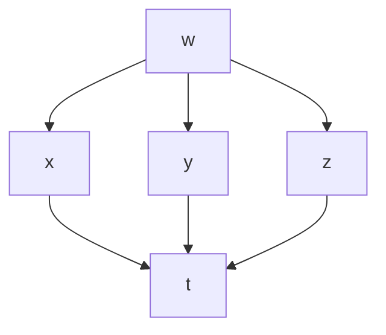

<!-- page 1 | Start here -->

# Module 3 at a glance

Module 2 taught you how to differentiate functions of two variables. Module 3 puts those derivatives to work, and extends them to **three** variables.

1. **The chain rule in three variables.** The same tree-diagram idea, now with three branches, and with unknown functions.
2. **Maxima and minima.** Use partial derivatives to find the highest and lowest values of a function: first the *local* peaks and valleys, then the *absolute* highest and lowest values on a closed region.
3. **The gradient.** One vector that collects all the partial derivatives and points uphill.
4. **Directional derivatives.** The rate of change in **any** direction, not just along the axes, and the direction of steepest climb.

## What you will be able to do

- Apply the chain rule to $w=f(x,y,z)$ when $x,y,z$ depend on one or several parameters.
- Prove identities for $u=f(x-y,\,y-z,\,z-x)$ without knowing $f$.
- Find critical points and classify them as local maxima, local minima or saddle points.
- Solve optimisation problems: smallest surface area, lowest cost.
- Find the absolute maximum and minimum of a function on a closed region.
- Compute $\nabla f$ at a point for two or three variables.
- Compute the rate of change of $f$ in any direction, and find the direction of fastest increase.

## How to use these notes

- Every topic has the same shape: **idea → rule → worked example → common mistakes.**
- Try each worked example yourself before reading the solution. Cover the answer and compare.
- Green boxes hold key ideas. Amber boxes marked **Watch out** hold the mistakes that cost marks.
- The last page has practice questions with answers, then a one-page formula sheet for revision.

## Where each topic sits

| Part | Topics |
| --- | --- |
| Chain rule | Three variables, several parameters, unknown functions |
| Local extrema | Critical points, the second-derivative test, saddle points, optimisation |
| Absolute extrema | Closed regions: interior points, edges and corners |
| Direction | Gradient, directional derivative, steepest ascent and descent |

> **Prerequisites.** Module 2: partial derivatives, second-order and mixed partials, and the two-variable chain rule. For the last three pages you also need to be happy adding vectors and taking dot products. The basics are recapped where they are first used.

---

<!-- page 2 | Chain rule: three variables -->

# The chain rule for three variables

## The idea

In Module 2 a function $z=f(x,y)$ had two paths down to its parameter. With $w=f(x,y,z)$ there are **three** intermediate variables, so three paths. The rule is the tree rule you already know: multiply along each path, add the paths.

> **Chain rule (one parameter).** If $w=f(x,y,z)$ and $x=x(t)$, $y=y(t)$, $z=z(t)$, then
>
> $$\frac{dw}{dt}=\frac{\partial w}{\partial x}\frac{dx}{dt}+\frac{\partial w}{\partial y}\frac{dy}{dt}+\frac{\partial w}{\partial z}\frac{dz}{dt}$$



Each path from $w$ down to $t$ contributes the product of the derivatives along it: $\dfrac{\partial w}{\partial x}\dfrac{dx}{dt}$, $\dfrac{\partial w}{\partial y}\dfrac{dy}{dt}$, $\dfrac{\partial w}{\partial z}\dfrac{dz}{dt}$. Add the three paths.

## Method

1. Find the three partial derivatives $\dfrac{\partial w}{\partial x}$, $\dfrac{\partial w}{\partial y}$, $\dfrac{\partial w}{\partial z}$.
2. Find the three ordinary derivatives $\dfrac{dx}{dt}$, $\dfrac{dy}{dt}$, $\dfrac{dz}{dt}$.
3. Multiply in pairs and add.
4. Substitute $x(t),y(t),z(t)$, or the given value of $t$, to finish.

## Examples

**Example 1.** Let $w=x^2y+yz^3$ with $x=t^2$, $y=e^t$, $z=\sin t$. Find $\dfrac{dw}{dt}$.

$$
\frac{\partial w}{\partial x}=2xy\quad\frac{\partial w}{\partial y}=x^2+z^3\quad\frac{\partial w}{\partial z}=3yz^2
\qquad
\frac{dx}{dt}=2t\quad\frac{dy}{dt}=e^t\quad\frac{dz}{dt}=\cos t
$$

$$
\frac{dw}{dt}=2xy\cdot2t+(x^2+z^3)\,e^t+3yz^2\cos t
$$

Substitute $x=t^2$, $y=e^t$, $z=\sin t$:

$$
\frac{dw}{dt}=\mathbf{4t^3e^t+\left(t^4+\sin^3t\right)e^t+3e^t\sin^2t\cos t}
$$

**Example 2.** Let $w=\sqrt{x^2+y^2+z^2}$ with $x=\cos\theta$, $y=\sin\theta$, $z=\tan\theta$. Find $\dfrac{dw}{d\theta}$ at $\theta=\dfrac\pi4$.

Write $\rho=\sqrt{x^2+y^2+z^2}$. Then $\dfrac{\partial w}{\partial x}=\dfrac x\rho$, and similarly for $y$ and $z$. The parameter derivatives are $-\sin\theta$, $\cos\theta$, $\sec^2\theta$.

$$
\frac{dw}{d\theta}=\frac{x(-\sin\theta)+y\cos\theta+z\sec^2\theta}{\rho}
$$

Now $x(-\sin\theta)+y\cos\theta=-\cos\theta\sin\theta+\sin\theta\cos\theta=0$, and $\rho=\sqrt{1+\tan^2\theta}=\sec\theta$. So

$$
\frac{dw}{d\theta}=\frac{\tan\theta\sec^2\theta}{\sec\theta}=\tan\theta\sec\theta
$$

At $\theta=\pi/4$ this is $1\cdot\sqrt2=\mathbf{\sqrt2}$.

*Check.* Substituting first, $w=\sqrt{1+\tan^2\theta}=\sec\theta$, so $\dfrac{dw}{d\theta}=\sec\theta\tan\theta$. $\checkmark$

**Example 3.** If $u=x^2+y^2+z^2$ with $x=e^t\cos t$, $y=e^t\sin t$, $z=e^t$, show that $\dfrac{du}{dt}=4e^{2t}$ using the chain rule, and verify by substituting first.

$$
\frac{dx}{dt}=e^t(\cos t-\sin t)\quad\frac{dy}{dt}=e^t(\cos t+\sin t)\quad\frac{dz}{dt}=e^t
$$

$$
\begin{aligned}
\frac{du}{dt}&=2x\cdot e^t(\cos t-\sin t)+2y\cdot e^t(\cos t+\sin t)+2z\cdot e^t\\
&=2e^{2t}\cos t(\cos t-\sin t)+2e^{2t}\sin t(\cos t+\sin t)+2e^{2t}\\
&=2e^{2t}\cos^2t-2e^{2t}\sin t\cos t+2e^{2t}\sin t\cos t+2e^{2t}\sin^2t+2e^{2t}\\
&=2e^{2t}(\cos^2t+\sin^2t)+2e^{2t}=\mathbf{4e^{2t}}
\end{aligned}
$$

*Verification.* Substituting first, $u=e^{2t}\cos^2t+e^{2t}\sin^2t+e^{2t}=2e^{2t}$, so $\dfrac{du}{dt}=4e^{2t}$. $\checkmark$

> **Watch out.** The last step of every example is substituting back. Leaving $x$, $y$, $z$ in the answer when the question asks for a function of $t$ (or a value at $t=3$) loses marks. And a quick substitute-first check, as in Examples 2 and 3, catches slips.

---

<!-- page 3 | Chain rule: several parameters -->

# The chain rule with several parameters

## The idea

If $w=f(x,y,z)$ and each of $x,y,z$ depends on several parameters, say $u$, $v$ and $m$, then $w$ has a partial derivative with respect to **each** parameter.

> **Chain rule (several parameters).** For $x=x(u,v,m)$, $y=y(u,v,m)$, $z=z(u,v,m)$:
>
> $$\frac{\partial w}{\partial u}=\frac{\partial w}{\partial x}\frac{\partial x}{\partial u}+\frac{\partial w}{\partial y}\frac{\partial y}{\partial u}+\frac{\partial w}{\partial z}\frac{\partial z}{\partial u}$$
>
> and the same with $v$, and with $m$, in place of $u$.

For each parameter: follow the three paths from $w$ down to that parameter, multiply along each, add.

## Method

1. Compute the three outer partials $\dfrac{\partial w}{\partial x},\dfrac{\partial w}{\partial y},\dfrac{\partial w}{\partial z}$.
2. Make a table of the intermediate derivatives: each of $x,y,z$ against each parameter. That is **nine** entries for three parameters.
3. For each parameter, take the dot-product style sum down its column.
4. Substitute $x,y,z$ in terms of the parameters at the end.

## Example: spherical coordinates

**Example 1.** Let $w=4x^2+4y^2+z^2$ with

$$
x=\rho\sin\phi\cos\theta\qquad y=\rho\sin\phi\sin\theta\qquad z=\rho\cos\phi
$$

Find $\dfrac{\partial w}{\partial\rho}$, $\dfrac{\partial w}{\partial\phi}$ and $\dfrac{\partial w}{\partial\theta}$.

The outer partials are $\dfrac{\partial w}{\partial x}=8x$, $\dfrac{\partial w}{\partial y}=8y$, $\dfrac{\partial w}{\partial z}=2z$. The nine intermediate derivatives:

| | $\rho$ | $\phi$ | $\theta$ |
| --- | --- | --- | --- |
| $x$ | $\sin\phi\cos\theta$ | $\rho\cos\phi\cos\theta$ | $-\rho\sin\phi\sin\theta$ |
| $y$ | $\sin\phi\sin\theta$ | $\rho\cos\phi\sin\theta$ | $\rho\sin\phi\cos\theta$ |
| $z$ | $\cos\phi$ | $-\rho\sin\phi$ | $0$ |

**With respect to $\rho$** (first column):

$$
\begin{aligned}
\frac{\partial w}{\partial\rho}&=8x\sin\phi\cos\theta+8y\sin\phi\sin\theta+2z\cos\phi\\
&=8\rho\sin^2\phi\cos^2\theta+8\rho\sin^2\phi\sin^2\theta+2\rho\cos^2\phi\\
&=8\rho\sin^2\phi+2\rho\cos^2\phi=\mathbf{2\rho\left(1+3\sin^2\phi\right)}
\end{aligned}
$$

**With respect to $\phi$** (second column):

$$
\begin{aligned}
\frac{\partial w}{\partial\phi}&=8x\cdot\rho\cos\phi\cos\theta+8y\cdot\rho\cos\phi\sin\theta+2z\cdot(-\rho\sin\phi)\\
&=8\rho^2\sin\phi\cos\phi\left(\cos^2\theta+\sin^2\theta\right)-2\rho^2\sin\phi\cos\phi\\
&=\mathbf{6\rho^2\sin\phi\cos\phi}
\end{aligned}
$$

**With respect to $\theta$** (third column):

$$
\begin{aligned}
\frac{\partial w}{\partial\theta}&=8x(-\rho\sin\phi\sin\theta)+8y(\rho\sin\phi\cos\theta)+0\\
&=-8\rho^2\sin^2\phi\sin\theta\cos\theta+8\rho^2\sin^2\phi\sin\theta\cos\theta=\mathbf{0}
\end{aligned}
$$

*Check.* Substituting first, $4(x^2+y^2)+z^2=4\rho^2\sin^2\phi+\rho^2\cos^2\phi=\rho^2\left(1+3\sin^2\phi\right)$. This has no $\theta$ in it, so $\dfrac{\partial w}{\partial\theta}=0$. Differentiating gives $2\rho(1+3\sin^2\phi)$ for $\rho$ and $6\rho^2\sin\phi\cos\phi$ for $\phi$. $\checkmark$

> **Note on the source.** The handwritten page used $\cos\theta$ instead of $\sin\phi\cos\theta$ for $\partial x/\partial\rho$ in the first line, which produced a wrong answer for $\partial w/\partial\rho$. The corrected value above is confirmed by the substitute-first check.

> **Watch out.** With nine intermediate derivatives it is easy to misplace one. A table like the one above keeps them in order. And look for **cancellations**: here every $\theta$ term cancels, which tells you straight away that $w$ does not depend on $\theta$.

---

<!-- page 4 | Chain rule with an unknown function -->

# The chain rule with an unknown function

## The idea

Sometimes $u$ is given as $f$ of some expressions, with **no formula for $f$**: for example $u=f(x-y,\ y-z,\ z-x)$. You cannot differentiate $f$ itself, but you can still say how $u$ responds to $x$, $y$ and $z$. The chain rule does it, with $\dfrac{\partial u}{\partial r}$, $\dfrac{\partial u}{\partial s}$, $\dfrac{\partial u}{\partial t}$ left as unknown symbols.

## Method

1. **Name** the inside expressions: $r=\dots$, $s=\dots$, $t=\dots$. Now $u=f(r,s,t)$.
2. Compute the **nine** partials of $r,s,t$ with respect to $x,y,z$.
3. Write $\dfrac{\partial u}{\partial x}=\dfrac{\partial u}{\partial r}\dfrac{\partial r}{\partial x}+\dfrac{\partial u}{\partial s}\dfrac{\partial s}{\partial x}+\dfrac{\partial u}{\partial t}\dfrac{\partial t}{\partial x}$, and likewise for $y$ and $z$.
4. Combine as the question asks. The unknown terms cancel in pairs.

## Examples

**Example 1.** If $u=f(x-y,\ y-z,\ z-x)$, show that $\dfrac{\partial u}{\partial x}+\dfrac{\partial u}{\partial y}+\dfrac{\partial u}{\partial z}=0$.

Put $r=x-y$, $s=y-z$, $t=z-x$. Then

$$
\frac{\partial r}{\partial x}=1\quad\frac{\partial r}{\partial y}=-1\quad\frac{\partial r}{\partial z}=0
\qquad
\frac{\partial s}{\partial x}=0\quad\frac{\partial s}{\partial y}=1\quad\frac{\partial s}{\partial z}=-1
\qquad
\frac{\partial t}{\partial x}=-1\quad\frac{\partial t}{\partial y}=0\quad\frac{\partial t}{\partial z}=1
$$

Apply the chain rule three times:

$$
\frac{\partial u}{\partial x}=u_r-u_t\qquad
\frac{\partial u}{\partial y}=-u_r+u_s\qquad
\frac{\partial u}{\partial z}=-u_s+u_t
$$

Add them: every term appears once with $+$ and once with $-$:

$$
\frac{\partial u}{\partial x}+\frac{\partial u}{\partial y}+\frac{\partial u}{\partial z}=(u_r-u_t)+(-u_r+u_s)+(-u_s+u_t)=\mathbf{0}\ \checkmark
$$

**Example 2.** If $u=f\!\left(\dfrac xy,\ \dfrac yz,\ \dfrac zx\right)$, show that $x\dfrac{\partial u}{\partial x}+y\dfrac{\partial u}{\partial y}+z\dfrac{\partial u}{\partial z}=0$.

Put $r=\dfrac xy$, $s=\dfrac yz$, $t=\dfrac zx$. The non-zero partials are

$$
\frac{\partial r}{\partial x}=\frac1y\quad\frac{\partial r}{\partial y}=-\frac{x}{y^2}\qquad
\frac{\partial s}{\partial y}=\frac1z\quad\frac{\partial s}{\partial z}=-\frac{y}{z^2}\qquad
\frac{\partial t}{\partial z}=\frac1x\quad\frac{\partial t}{\partial x}=-\frac{z}{x^2}
$$

Apply the chain rule, then **multiply each by its variable** so the powers cancel:

$$
x\frac{\partial u}{\partial x}=x\left(\frac1yu_r-\frac{z}{x^2}u_t\right)=\frac xy\,u_r-\frac zx\,u_t
$$

$$
y\frac{\partial u}{\partial y}=y\left(-\frac{x}{y^2}u_r+\frac1zu_s\right)=-\frac xy\,u_r+\frac yz\,u_s
$$

$$
z\frac{\partial u}{\partial z}=z\left(-\frac{y}{z^2}u_s+\frac1xu_t\right)=-\frac yz\,u_s+\frac zx\,u_t
$$

Add:

$$
x\,u_x+y\,u_y+z\,u_z=\left(\frac xy-\frac xy\right)u_r+\left(\frac yz-\frac yz\right)u_s+\left(\frac zx-\frac zx\right)u_t=\mathbf{0}\ \checkmark
$$

> **Why these come out zero.** In Example 1, $u$ depends only on the **differences** of $x,y,z$, so shifting all three by the same amount changes nothing, and the sum of the three rates of change is $0$. In Example 2, $u$ depends only on the **ratios**, so scaling all three by the same factor changes nothing, which gives the weighted sum $xu_x+yu_y+zu_z=0$.

> **Watch out.** Keep the unknown derivatives $u_r,u_s,u_t$ as symbols. Do not try to "evaluate" them. And in Example 2 remember to multiply by $x$, $y$, $z$ **before** adding: the cancellation only works after that.

---

<!-- page 5 | Local maxima and minima -->

# Local maxima and minima

## The idea

A **local maximum** is a point where $f$ is at least as large as at every nearby point: the top of a hill. A **local minimum** is the bottom of a valley. Together they are called **local** (or **relative**) **extrema**.

At the top of a smooth hill the ground is level in every direction. In particular, the slope in the $x$-direction and the slope in the $y$-direction are both zero.

> **Critical point.** A point $(a,b)$ is a **critical point** of $f(x,y)$ when
>
> $$f_x(a,b)=0\qquad\text{and}\qquad f_y(a,b)=0$$

Every local extremum is at a critical point. But not every critical point is an extremum, so we need a test.

## The second-derivative test

Compute the second derivatives at the critical point and form

$$
D=f_{xx}\,f_{yy}-\left(f_{xy}\right)^2
$$

(the determinant of second derivatives, often called the **Hessian**).

| Condition at $(a,b)$ | Conclusion |
| --- | --- |
| $D>0$ and $f_{xx}>0$ | **local minimum** |
| $D>0$ and $f_{xx}<0$ | **local maximum** |
| $D<0$ | **saddle point** |
| $D=0$ | the test **fails**: use another method |

A **saddle point** is a critical point that is a maximum in one direction and a minimum in another, like the middle of a horse's saddle or a mountain pass. It is neither a peak nor a valley.

> **Why $D>0$ is enough to look at $f_{xx}$ alone.** If $D>0$ then $f_{xx}f_{yy}>f_{xy}^2\ge0$, so $f_{xx}$ and $f_{yy}$ have the **same sign**. Checking one tells you both.

## Method

1. Find $f_x$ and $f_y$. Set both equal to $0$ and **solve** the pair of equations: these are the critical points.
2. Find $f_{xx}$, $f_{yy}$, $f_{xy}$.
3. At each critical point compute $D$, and if $D>0$ the sign of $f_{xx}$.
4. Classify. For the extreme **value**, substitute the point into $f$.

## Examples

**Example 1.** Find the relative extrema of $f(x,y)=x^2+y^2-2x-6y+14$.

$$
f_x=2x-2\quad f_y=2y-6
$$

Setting both to zero gives $x=1$, $y=3$, so the only critical point is $(1,3)$.

$$
f_{xx}=2\quad f_{yy}=2\quad f_{xy}=0\ \Rightarrow\ D=2\cdot2-0^2=4
$$

$D=4>0$ and $f_{xx}=2>0$, so $(1,3)$ is a **local minimum**. The minimum value is

$$
f(1,3)=1+9-2-18+14=\mathbf4
$$

**Example 2.** Find the relative extrema of $f(x,y)=xy-x^2-y^2-2x-2y+4$.

$$
f_x=y-2x-2\qquad f_y=x-2y-2
$$

Solve $y-2x-2=0$ and $x-2y-2=0$. From the first, $y=2x+2$. Substituting into the second: $x-4x-4-2=0$, so $x=-2$ and then $y=-2$. The critical point is $(-2,-2)$.

$$
f_{xx}=-2\quad f_{yy}=-2\quad f_{xy}=1\ \Rightarrow\ D=(-2)(-2)-1^2=3
$$

$D=3>0$ and $f_{xx}=-2<0$, so $(-2,-2)$ is a **local maximum**, with value

$$
f(-2,-2)=4-4-4+4+4+4=\mathbf8
$$

> **Watch out.** Four things go wrong here. (1) Forgetting the **square** in $D=f_{xx}f_{yy}-(f_{xy})^2$. (2) Reading $D>0$ as "minimum": you must also check the sign of $f_{xx}$. (3) Treating every critical point as an extremum: if $D<0$ it is a saddle. (4) Finding the extreme **value** by putting the point into $f_x$ or $D$ rather than into $f$ itself.

---

<!-- page 6 | Local extrema: worked examples -->

# Local extrema: worked examples

Each example finds the critical points, then classifies them with $D$. When there are several critical points, a table keeps the work tidy.

**Example 1.** Find the critical points of $f(x,y)=2xy-x^3-y^3$ and the extreme values.

$$
f_x=2y-3x^2\qquad f_y=2x-3y^2
$$

From $f_x=0$, $y=\dfrac{3x^2}{2}$. Substitute into $f_y=0$:

$$
2x-3\left(\frac{3x^2}{2}\right)^2=2x-\frac{27x^4}{4}=x\left(2-\frac{27x^3}{4}\right)=0
$$

So $x=0$ or $x^3=\dfrac{8}{27}$, that is $x=\dfrac23$. The critical points are $(0,0)$ and $\left(\dfrac23,\dfrac23\right)$.

$$
f_{xx}=-6x\quad f_{yy}=-6y\quad f_{xy}=2
$$

| Point | $f_{xx}$ | $f_{yy}$ | $f_{xy}$ | $D$ | Result |
| --- | --- | --- | --- | --- | --- |
| $(0,0)$ | $0$ | $0$ | $2$ | $-4$ | saddle point |
| $\left(\tfrac23,\tfrac23\right)$ | $-4$ | $-4$ | $2$ | $12$ | local maximum |

Maximum value:

$$
f\!\left(\tfrac23,\tfrac23\right)=\frac89-\frac8{27}-\frac8{27}=\frac{24-8-8}{27}=\mathbf{\frac8{27}}
$$

**Example 2.** Find the extreme values of $f(x,y)=3x^2-2xy+y^2-8y$.

$$
f_x=6x-2y\qquad f_y=-2x+2y-8
$$

Adding $f_x=0$ and $f_y=0$ gives $4x-8=0$, so $x=2$. Then $6(2)-2y=0$ gives $y=6$. The critical point is $(2,6)$.

$$
f_{xx}=6\quad f_{yy}=2\quad f_{xy}=-2\ \Rightarrow\ D=12-4=8>0,\ f_{xx}>0
$$

So $(2,6)$ is a **local minimum**, with value

$$
f(2,6)=12-24+36-48=\mathbf{-24}
$$

**Example 3.** Find the extreme values of $f(x,y)=x^3+3xy^2-15x^2-15y^2+72x$.

$$
f_x=3x^2+3y^2-30x+72\qquad f_y=6xy-30y=6y(x-5)
$$

$f_y=0$ gives **two cases**: $y=0$ or $x=5$.

*Case $y=0$.* Then $f_x=3(x^2-10x+24)=3(x-4)(x-6)=0$, so $x=4$ or $x=6$. Points: $(4,0)$ and $(6,0)$.

*Case $x=5$.* Then $f_x=75+3y^2-150+72=3y^2-3=0$, so $y=\pm1$. Points: $(5,1)$ and $(5,-1)$.

With $f_{xx}=6x-30$, $f_{yy}=6x-30$, $f_{xy}=6y$:

| Point | $f_{xx}$ | $f_{yy}$ | $f_{xy}$ | $D$ | Result |
| --- | --- | --- | --- | --- | --- |
| $(5,1)$ | $0$ | $0$ | $6$ | $-36$ | saddle point |
| $(5,-1)$ | $0$ | $0$ | $-6$ | $-36$ | saddle point |
| $(6,0)$ | $6$ | $6$ | $0$ | $36$ | local minimum |
| $(4,0)$ | $-6$ | $-6$ | $0$ | $36$ | local maximum |

Values: $f(6,0)=216-540+432=\mathbf{108}$ is the local minimum, and $f(4,0)=64-240+288=\mathbf{112}$ is the local maximum.

**Example 4.** Find the extreme values of $f(x,y)=4xy-x^4-y^4$.

$$
f_x=4y-4x^3\qquad f_y=4x-4y^3
$$

$f_x=0$ gives $y=x^3$. Substituting into $f_y=0$: $4x-4x^9=4x(1-x^8)=0$, so $x=0$ or $x=\pm1$. The critical points are $(0,0)$, $(1,1)$, $(-1,-1)$.

$$
f_{xx}=-12x^2\quad f_{yy}=-12y^2\quad f_{xy}=4
$$

| Point | $f_{xx}$ | $f_{yy}$ | $f_{xy}$ | $D$ | Result |
| --- | --- | --- | --- | --- | --- |
| $(0,0)$ | $0$ | $0$ | $4$ | $-16$ | saddle point |
| $(1,1)$ | $-12$ | $-12$ | $4$ | $128$ | local maximum |
| $(-1,-1)$ | $-12$ | $-12$ | $4$ | $128$ | local maximum |

Both maxima have value $f(1,1)=f(-1,-1)=4-1-1=\mathbf2$.

> **Solving the equations $f_x=f_y=0$.** This is usually the hard part. Three moves cover almost every question: **(1)** solve one equation for one variable and substitute into the other (Examples 1 and 4); **(2)** add or subtract the equations to eliminate a variable (Example 2); **(3)** if one equation factors, split into cases (Example 3). Always check that you have found **every** case: missing a critical point is the commonest loss of marks.

---

<!-- page 7 | Extrema with a parameter -->

# Extrema with a parameter

## The idea

When the function contains a constant such as $a$, the critical points and their type depend on $a$. Carry $a$ through the whole method, and let the **sign of $a$** decide between a maximum and a minimum at the end.

## Examples

**Example 1.** Discuss the maxima and minima of $f(x,y)=xy(a-x-y)$, where $a\neq0$.

Expand: $f=axy-x^2y-xy^2$.

$$
f_x=ay-2xy-y^2=y\,(a-2x-y)\qquad f_y=ax-x^2-2xy=x\,(a-x-2y)
$$

$f_x=0$ gives $y=0$ or $a-2x-y=0$. $f_y=0$ gives $x=0$ or $a-x-2y=0$. Combining the cases:

- $y=0$ and $x=0$: the point $(0,0)$.
- $y=0$ and $a-x-2y=0$: $x=a$, the point $(a,0)$.
- $x=0$ and $a-2x-y=0$: $y=a$, the point $(0,a)$.
- $a-2x-y=0$ and $a-x-2y=0$: subtracting gives $x=y$, then $3x=a$, the point $\left(\dfrac a3,\dfrac a3\right)$.

The second derivatives are

$$
f_{xx}=-2y\qquad f_{yy}=-2x\qquad f_{xy}=a-2x-2y
$$

| Point | $f_{xx}$ | $f_{yy}$ | $f_{xy}$ | $D$ |
| --- | --- | --- | --- | --- |
| $(0,0)$ | $0$ | $0$ | $a$ | $-a^2$ |
| $(a,0)$ | $0$ | $-2a$ | $-a$ | $-a^2$ |
| $(0,a)$ | $-2a$ | $0$ | $-a$ | $-a^2$ |
| $\left(\tfrac a3,\tfrac a3\right)$ | $-\tfrac{2a}3$ | $-\tfrac{2a}3$ | $-\tfrac a3$ | $\tfrac{a^2}3$ |

The first three have $D=-a^2<0$, so they are **saddle points**.

At $\left(\dfrac a3,\dfrac a3\right)$ we have $D=\dfrac{a^2}{3}>0$, and the sign of $f_{xx}=-\dfrac{2a}{3}$ depends on $a$:

- If $a>0$: $f_{xx}<0$, a **local maximum**.
- If $a<0$: $f_{xx}>0$, a **local minimum**.

The value there is $f\!\left(\tfrac a3,\tfrac a3\right)=\dfrac{a}{3}\cdot\dfrac a3\cdot\dfrac a3=\mathbf{\dfrac{a^3}{27}}$.

**Example 2.** Find the maxima and minima of $f(x,y)=x^3+y^3-3axy$, where $a\neq0$.

$$
f_x=3x^2-3ay\qquad f_y=3y^2-3ax
$$

$f_x=0$ gives $y=\dfrac{x^2}{a}$. Substituting into $f_y=0$:

$$
\frac{3x^4}{a^2}-3ax=\frac{3x}{a^2}\left(x^3-a^3\right)=0
$$

So $x=0$ or $x=a$, giving the critical points $(0,0)$ and $(a,a)$.

$$
f_{xx}=6x\qquad f_{yy}=6y\qquad f_{xy}=-3a
$$

| Point | $f_{xx}$ | $f_{yy}$ | $f_{xy}$ | $D$ | Result |
| --- | --- | --- | --- | --- | --- |
| $(0,0)$ | $0$ | $0$ | $-3a$ | $-9a^2$ | saddle point |
| $(a,a)$ | $6a$ | $6a$ | $-3a$ | $27a^2$ | see below |

At $(a,a)$, $D=36a^2-9a^2=27a^2>0$, and $f_{xx}=6a$:

- If $a>0$: $f_{xx}>0$, a **local minimum**.
- If $a<0$: $f_{xx}<0$, a **local maximum**.

In both cases the value is

$$
f(a,a)=a^3+a^3-3a\cdot a\cdot a=-a^3
$$

> **Note on the source.** The handwritten page gave the value as $a^3$. It is $2a^3-3a^3=\mathbf{-a^3}$: for $a=1$, $f(1,1)=1+1-3=-1$.

> **Watch out.** Do not assume $a>0$. State **both** cases (or say clearly "for $a>0$"), and remember that $D$ involves $a^2$, which is always positive, so it is the sign of $f_{xx}$ that carries the dependence on $a$.

---

<!-- page 8 | Optimisation problems -->

# Optimisation problems

## The idea

Many real questions ask for the **smallest cost**, the **least material**, the **largest volume**. The second-derivative test solves them once the quantity is written as a function of two variables.

## Method

1. Name the quantity to optimise (the **objective**), and name the variables.
2. Use any given condition (a fixed volume, a budget) to **eliminate** variables until the objective depends on two.
3. Find the critical points, and classify them with $D$.
4. Check that the answer makes sense: dimensions must be positive, quantities in range.

## Examples

**Example 1. Open box.** A rectangular box, open at the top, has volume $32\ \text{ft}^3$. Find its dimensions if the total surface area is least.

Let $x$ = length, $y$ = breadth, $z$ = height. The volume gives $xyz=32$, so $z=\dfrac{32}{xy}$. The surface area is a base plus four sides (no lid):

$$
S=xy+2yz+2xz=xy+\frac{64}{x}+\frac{64}{y}
$$

(since $2yz=\dfrac{64}{x}$ and $2xz=\dfrac{64}{y}$).

$$
S_x=y-\frac{64}{x^2}\qquad S_y=x-\frac{64}{y^2}
$$

$S_x=0$ gives $x^2y=64$ and $S_y=0$ gives $xy^2=64$. Subtracting, $xy(x-y)=0$. Since $x,y>0$, we get $x=y$, so $x^3=64$ and

$$
x=y=4\qquad z=\frac{32}{16}=2
$$

To classify:

$$
S_{xx}=\frac{128}{x^3}=2\quad S_{yy}=\frac{128}{y^3}=2\quad S_{xy}=1\ \Rightarrow\ D=2\cdot2-1=3>0,\ S_{xx}>0
$$

So the surface area is a **minimum** at $x=4$, $y=4$, $z=2$. The dimensions are $\mathbf{4\times4\times2}$ feet, and the least surface area is $16+16+16=48\ \text{ft}^2$.

**Example 2. Cost of two products.** A manufacturer makes $x$ units of product $A$ and $y$ units of product $B$ at a cost

$$
C(x,y)=x^2+y^2+4xy+10x+8y+50
$$

Find and classify the critical points to decide the minimum cost.

$$
C_x=2x+4y+10\qquad C_y=2y+4x+8
$$

Setting both to $0$: from $C_y=0$, $y=-2x-4$. Substituting into $C_x=0$: $2x-8x-16+10=0$, so $x=-1$ and $y=-2$. The critical point is $(-1,-2)$.

$$
C_{xx}=2\quad C_{yy}=2\quad C_{xy}=4\ \Rightarrow\ D=4-16=-12<0
$$

$D<0$, so $(-1,-2)$ is a **saddle point**: the cost has **no local minimum** there.

In practice $x,y\ge0$ and the critical point (with negative quantities) is not even in the allowed region. For $x,y\ge0$ every term of $C$ is non-negative, so the smallest cost is $C(0,0)=\mathbf{50}$, on the boundary. Boundary behaviour like this is the subject of the next page.

> **Watch out.** Always check that the critical point is **valid for the problem**: lengths and quantities cannot be negative. And a saddle point means "no optimum here", not "answer $0$".

---

<!-- page 9 | Absolute extrema -->

# Absolute maxima and minima

## The idea

The **absolute maximum** (or minimum) of $f$ on a region is the largest (smallest) value it takes **anywhere** in that region. It is different from a local extremum: a local maximum is only the highest point *nearby*.

> **Key idea.** A continuous function on a **closed, bounded region** (one that includes its edges, such as a filled triangle or rectangle) always has an absolute maximum and minimum. They occur either at a **critical point inside the region**, or **on the boundary**.

So we must search both places.

## Method

1. **Interior.** Find the critical points ($f_x=f_y=0$) and keep only those **inside or on** the region.
2. **Edges.** On each edge, substitute the edge's equation into $f$. This leaves a function of **one** variable. Find where its derivative is $0$.
3. **Corners.** Include every corner of the region.
4. **Compare.** Evaluate $f$ at all the candidate points. The largest value is the absolute maximum and the smallest is the absolute minimum.

You do not need the second-derivative test here: you simply compare values.

## Examples

**Example 1.** Find the absolute extrema of $f(x,y)=xy-4x$ on the triangle $R$ with vertices $(0,0)$, $(4,0)$, $(0,4)$.

```jsxgraph
{
  "boundingBox": [-1, 5, 5, -1],
  "axis": true,
  "points": [
    { "id": "O", "x": 0, "y": 0, "label": "O(0,0)" },
    { "id": "A", "x": 4, "y": 0, "label": "A(4,0)" },
    { "id": "B", "x": 0, "y": 4, "label": "B(0,4)" }
  ],
  "polygons": [{ "points": ["O", "A", "B"] }],
  "segments": [
    { "from": "O", "to": "A" },
    { "from": "O", "to": "B" },
    { "from": "A", "to": "B" }
  ],
  "circles": [],
  "functions": [],
  "title": "The triangular region R"
}
```

*Interior.* $f_x=y-4$ and $f_y=x$. Both vanish only at $(0,4)$, which is a **corner** of $R$, so it is a candidate but not an interior point.

*Edge $OA$* ($y=0$): $f=-4x$. Its derivative is the constant $-4$, so there is no critical point. The values run from $0$ at $O$ down to $-16$ at $A$.

*Edge $OB$* ($x=0$): $f=0$ everywhere on the edge.

*Edge $AB$* ($x+y=4$, so $y=4-x$): $f=x(4-x)-4x=-x^2$, with derivative $-2x$, which is zero only at $x=0$, the corner $B$.

*Candidates:*

| Point | $f$ |
| --- | --- |
| $(0,0)$ | $0$ |
| $(4,0)$ | $-16$ |
| $(0,4)$ | $0$ |

The **absolute maximum is $0$**, attained at $(0,0)$, $(0,4)$ and in fact along the whole edge $OB$. The **absolute minimum is $-16$** at $(4,0)$.

**Example 2.** Find the absolute extrema of $f(x,y)=x^2-2xy+2y$ on the rectangle $D:\ 0\le x\le3,\ 0\le y\le2$.

```jsxgraph
{
  "boundingBox": [-1, 3, 4, -1],
  "axis": true,
  "points": [
    { "id": "O", "x": 0, "y": 0, "label": "O(0,0)" },
    { "id": "A", "x": 3, "y": 0, "label": "A(3,0)" },
    { "id": "B", "x": 3, "y": 2, "label": "B(3,2)" },
    { "id": "C", "x": 0, "y": 2, "label": "C(0,2)" }
  ],
  "polygons": [{ "points": ["O", "A", "B", "C"] }],
  "segments": [
    { "from": "O", "to": "A" },
    { "from": "A", "to": "B" },
    { "from": "B", "to": "C" },
    { "from": "C", "to": "O" }
  ],
  "circles": [],
  "functions": [],
  "title": "The rectangular region D"
}
```

*Interior.* $f_x=2x-2y$, $f_y=-2x+2$. $f_y=0$ gives $x=1$, then $f_x=0$ gives $y=1$. The point $(1,1)$ lies inside $D$, and $f(1,1)=1-2+2=1$.

*Edges:*

- $OA$ ($y=0$): $f=x^2$, increasing, so no critical point.
- $AB$ ($x=3$): $f=9-6y+2y=9-4y$, derivative $-4\neq0$, so none.
- $BC$ ($y=2$): $f=x^2-4x+4=(x-2)^2$, derivative $2x-4=0$ at $x=2$. The point is $(2,2)$.
- $OC$ ($x=0$): $f=2y$, derivative $2\neq0$, so none.

*Candidates:*

| Point | $f$ |
| --- | --- |
| $(1,1)$ | $1$ |
| $(2,2)$ | $0$ |
| $(0,0)$ | $0$ |
| $(3,0)$ | $9$ |
| $(0,2)$ | $4$ |
| $(3,2)$ | $1$ |

The **absolute maximum is $9$** at $(3,0)$. The **absolute minimum is $0$**, at $(0,0)$ and $(2,2)$.

> **Note on the source.** The handwritten table had $f(1,1)=-1$. The correct value is $1-2+2=1$. The conclusions are unchanged, because $1$ lies between the extremes.

> **Watch out.** Do not forget the **corners**: they are where one-variable edge searches end, and they are often the answer (as with $(3,0)$ above). And discard any critical point that lies **outside** the region.

---

<!-- page 10 | Absolute extrema: more examples -->

# Absolute extrema: more examples

The method never changes: interior points, then each edge as a one-variable problem, then corners, then compare.

> **Edges made easy.** On a horizontal edge $y=c$ or a vertical edge $x=c$, just put the constant in. On a slanted edge, use its equation (such as $y=2-2x$) to eliminate one variable.

**Example 1.** Find the absolute extrema of $f(x,y)=x^2-3y^2-2x+6y$ on the square with vertices $(0,0)$, $(0,2)$, $(2,2)$, $(2,0)$.

```jsxgraph
{
  "boundingBox": [-1, 3, 3, -1],
  "axis": true,
  "points": [
    { "id": "O", "x": 0, "y": 0, "label": "O(0,0)" },
    { "id": "A", "x": 2, "y": 0, "label": "A(2,0)" },
    { "id": "B", "x": 2, "y": 2, "label": "B(2,2)" },
    { "id": "C", "x": 0, "y": 2, "label": "C(0,2)" }
  ],
  "polygons": [{ "points": ["O", "A", "B", "C"] }],
  "segments": [
    { "from": "O", "to": "A" },
    { "from": "A", "to": "B" },
    { "from": "B", "to": "C" },
    { "from": "C", "to": "O" }
  ],
  "circles": [],
  "functions": [],
  "title": "The square region"
}
```

*Interior.* $f_x=2x-2$, $f_y=-6y+6$, so the critical point is $(1,1)$, with $f=1-3-2+6=2$.

*Edges:*

- $OA$ ($y=0$): $f=x^2-2x$, derivative $2x-2=0$ at $x=1$. Point $(1,0)$, $f=-1$.
- $AB$ ($x=2$): $f=-3y^2+6y$, derivative $-6y+6=0$ at $y=1$. Point $(2,1)$, $f=3$.
- $CB$ ($y=2$): $f=x^2-2x$, so $x=1$. Point $(1,2)$, $f=-1$.
- $OC$ ($x=0$): $f=-3y^2+6y$, so $y=1$. Point $(0,1)$, $f=3$.

*Corners:* $f(0,0)=0$, $f(2,0)=0$, $f(2,2)=4-12-4+12=0$, $f(0,2)=-12+12=0$.

The **absolute maximum is $3$**, at $(2,1)$ and $(0,1)$. The **absolute minimum is $-1$**, at $(1,0)$ and $(1,2)$.

**Example 2.** Find the absolute extrema of $f(x,y)=x^2+y^2$ on the closed triangular plate bounded by $x=0$, $y=0$ and $y+2x=2$ in the first quadrant.

The vertices are $(0,0)$, $(1,0)$, $(0,2)$.

```jsxgraph
{
  "boundingBox": [-0.5, 2.5, 1.5, -0.5],
  "axis": true,
  "points": [
    { "id": "O", "x": 0, "y": 0, "label": "O(0,0)" },
    { "id": "A", "x": 1, "y": 0, "label": "A(1,0)" },
    { "id": "B", "x": 0, "y": 2, "label": "B(0,2)" }
  ],
  "polygons": [{ "points": ["O", "A", "B"] }],
  "segments": [
    { "from": "O", "to": "A" },
    { "from": "O", "to": "B" },
    { "from": "A", "to": "B" }
  ],
  "circles": [],
  "functions": [],
  "title": "The plate bounded by x = 0, y = 0 and y + 2x = 2"
}
```

*Interior.* $f_x=2x$, $f_y=2y$: the only critical point is $(0,0)$, a corner.

*Edge $OA$* ($y=0$): $f=x^2$, increasing. *Edge $OB$* ($x=0$): $f=y^2$, increasing. No critical points.

*Edge $AB$* ($y=2-2x$):

$$
f=x^2+(2-2x)^2=5x^2-8x+4\qquad f'=10x-8=0\ \Rightarrow\ x=\tfrac45,\ y=\tfrac25
$$

| Point | $f$ |
| --- | --- |
| $(0,0)$ | $0$ |
| $(1,0)$ | $1$ |
| $(0,2)$ | $4$ |
| $\left(\tfrac45,\tfrac25\right)$ | $\tfrac{16}{25}+\tfrac{4}{25}=\tfrac45$ |

The **absolute maximum is $4$** at $(0,2)$. The **absolute minimum is $0$** at $(0,0)$.

> **Note on the source.** The handwritten conclusion listed the maximum $4$ at both $(0,2)$ **and** $\left(\tfrac45,\tfrac25\right)$. But $f\!\left(\tfrac45,\tfrac25\right)=\tfrac45$, not $4$, so the maximum is at $(0,2)$ alone. (The point $\left(\tfrac45,\tfrac25\right)$ is the closest point of that edge to the origin.)

**Example 3.** Find the absolute extrema of $f(x,y)=x^2-xy+y^2+1$ on the closed triangular plate in the first quadrant bounded by $x=0$, $y=4$ and $y=x$.

The vertices are $(0,0)$, $(0,4)$, $(4,4)$.

```jsxgraph
{
  "boundingBox": [-1, 5, 5, -1],
  "axis": true,
  "points": [
    { "id": "O", "x": 0, "y": 0, "label": "O(0,0)" },
    { "id": "B", "x": 0, "y": 4, "label": "B(0,4)" },
    { "id": "A", "x": 4, "y": 4, "label": "A(4,4)" }
  ],
  "polygons": [{ "points": ["O", "B", "A"] }],
  "segments": [
    { "from": "O", "to": "B" },
    { "from": "B", "to": "A" },
    { "from": "O", "to": "A" }
  ],
  "circles": [],
  "functions": [],
  "title": "The plate bounded by x = 0, y = 4 and y = x"
}
```

*Interior.* $f_x=2x-y$ and $f_y=-x+2y$. Solving gives $x=y=0$, the corner $(0,0)$, with $f=1$.

*Edges:*

- $OB$ ($x=0$): $f=y^2+1$, increasing, no critical point.
- $BA$ ($y=4$): $f=x^2-4x+17$, derivative $2x-4=0$ at $x=2$. Point $(2,4)$, $f=13$.
- $OA$ ($y=x$): $f=x^2+1$, increasing, no critical point.

| Point | $f$ |
| --- | --- |
| $(0,0)$ | $1$ |
| $(0,4)$ | $17$ |
| $(4,4)$ | $17$ |
| $(2,4)$ | $13$ |

The **absolute maximum is $17$**, at $(0,4)$ and $(4,4)$. The **absolute minimum is $1$** at $(0,0)$.

**Example 4.** Find the absolute extrema of $f(x,y)=2x^2-4x+y^2-4y+1$ on the closed triangular plate bounded by $x=0$, $y=2$ and $y=2x$.

The vertices are $(0,0)$, $(0,2)$, $(1,2)$.

```jsxgraph
{
  "boundingBox": [-0.5, 2.5, 1.6, -0.5],
  "axis": true,
  "points": [
    { "id": "O", "x": 0, "y": 0, "label": "O(0,0)" },
    { "id": "B", "x": 0, "y": 2, "label": "B(0,2)" },
    { "id": "A", "x": 1, "y": 2, "label": "A(1,2)" }
  ],
  "polygons": [{ "points": ["O", "B", "A"] }],
  "segments": [
    { "from": "O", "to": "B" },
    { "from": "B", "to": "A" },
    { "from": "O", "to": "A" }
  ],
  "circles": [],
  "functions": [],
  "title": "The plate bounded by x = 0, y = 2 and y = 2x"
}
```

*Interior.* $f_x=4x-4$ and $f_y=2y-4$ give $(1,2)$, which is the corner $A$.

*Edges:*

- $OB$ ($x=0$): $f=y^2-4y+1$, derivative $2y-4=0$ at $y=2$, the corner $B$.
- $BA$ ($y=2$): $f=2x^2-4x-3$, derivative $4x-4=0$ at $x=1$, the corner $A$.
- $OA$ ($y=2x$): $f=6x^2-12x+1$, derivative $12x-12=0$ at $x=1$, again the corner $A$.

Every critical point on the edges is a corner, so only the corners matter:

| Point | $f$ |
| --- | --- |
| $(0,0)$ | $1$ |
| $(0,2)$ | $-3$ |
| $(1,2)$ | $-5$ |

The **absolute maximum is $1$** at $(0,0)$. The **absolute minimum is $-5$** at $(1,2)$.

> **Watch out.** When a critical point lands **on a corner** (as in Examples 2 to 4), it is not a separate extra candidate: it is simply that corner. Evaluate $f$ at every corner whether or not a critical point was found there.

---

<!-- page 11 | The gradient -->

# The gradient

## The idea

For a function $f(x,y)$ there are two partial derivatives, $f_x$ and $f_y$. The **gradient** packs them into a single **vector**:

$$
\nabla f=\frac{\partial f}{\partial x}\,\hat\imath+\frac{\partial f}{\partial y}\,\hat\jmath=\left(f_x,\ f_y\right)
$$

The symbol $\nabla$ is read "del". In three variables there is a third component:

$$
\nabla f=\frac{\partial f}{\partial x}\,\hat\imath+\frac{\partial f}{\partial y}\,\hat\jmath+\frac{\partial f}{\partial z}\,\hat k=\left(f_x,\ f_y,\ f_z\right)
$$

Here $\hat\imath,\hat\jmath,\hat k$ are the unit vectors along the $x$, $y$, $z$ axes.

> **Meaning.** At each point, $\nabla f$ is a vector that **points in the direction in which $f$ increases fastest**, and its length is how fast. It is also perpendicular to the level curve of $f$ through that point.

## Method

1. Differentiate $f$ with respect to each variable (partial derivatives, as in Module 2).
2. Write the results as a vector.
3. If a point is given, **then** substitute it into each component.

## Examples

**Example 1.** $f(x,y)=y-x$ at $(2,1)$.

$$
\nabla f=(-1,\ 1)\ \Rightarrow\ \nabla f(2,1)=\mathbf{-\hat\imath+\hat\jmath}
$$

**Example 2.** $f(x,y)=\ln(x^2+y^2)$ at $(1,1)$.

$$
\nabla f=\left(\frac{2x}{x^2+y^2},\ \frac{2y}{x^2+y^2}\right)\ \Rightarrow\ \nabla f(1,1)=\left(\frac22,\frac22\right)=\mathbf{\hat\imath+\hat\jmath}
$$

**Example 3.** $f(x,y)=\sqrt{2x+3y}$ at $(-1,2)$.

$$
\nabla f=\left(\frac{2}{2\sqrt{2x+3y}},\ \frac{3}{2\sqrt{2x+3y}}\right)=\left(\frac{1}{\sqrt{2x+3y}},\ \frac{3}{2\sqrt{2x+3y}}\right)
$$

At $(-1,2)$: $2x+3y=-2+6=4$ and $\sqrt4=2$, so

$$
\nabla f(-1,2)=\mathbf{\frac12\hat\imath+\frac34\hat\jmath}
$$

**Example 4.** $f(x,y)=\tan^{-1}\dfrac{\sqrt x}{y}$ at $(4,-2)$.

Use $\dfrac{d}{du}\tan^{-1}u=\dfrac1{1+u^2}$ with $u=\dfrac{\sqrt x}y$, so $1+u^2=\dfrac{y^2+x}{y^2}$:

$$
f_x=\frac{y^2}{y^2+x}\cdot\frac1{2y\sqrt x}=\frac{y}{2\sqrt x\,(y^2+x)}\qquad
f_y=\frac{y^2}{y^2+x}\cdot\left(-\frac{\sqrt x}{y^2}\right)=-\frac{\sqrt x}{y^2+x}
$$

At $(4,-2)$: $y^2+x=8$ and $\sqrt x=2$:

$$
f_x=\frac{-2}{2\cdot2\cdot8}=-\frac1{16}\qquad f_y=-\frac28=-\frac14\qquad\Rightarrow\qquad\nabla f(4,-2)=\mathbf{-\frac1{16}\hat\imath-\frac14\hat\jmath}
$$

**Example 5.** $f(x,y,z)=x^2+y^2-2z^2+z\ln x$ at $(1,1,1)$.

$$
\nabla f=\left(2x+\frac zx,\ \ 2y,\ \ -4z+\ln x\right)\ \Rightarrow\ \nabla f(1,1,1)=(2+1,\ 2,\ -4+0)=\mathbf{3\hat\imath+2\hat\jmath-4\hat k}
$$

**Example 6.** $f(x,y,z)=\log(x^2+y^2+z^2)$ at $(1,2,1)$.

$$
\nabla f=\frac{1}{x^2+y^2+z^2}\left(2x,\ 2y,\ 2z\right)
$$

At $(1,2,1)$ the denominator is $1+4+1=6$:

$$
\nabla f(1,2,1)=\frac16(2,4,2)=\mathbf{\frac13\hat\imath+\frac23\hat\jmath+\frac13\hat k}
$$

> **Watch out.** The gradient is a **vector**: give it as $a\hat\imath+b\hat\jmath$ (or as $(a,b)$), not as a single number. Substitute the point **after** differentiating. And keep the chain-rule factors (the $2$ and $3$ inside the root in Example 3).

---

<!-- page 12 | Directional derivatives -->

# Directional derivatives

## The idea

$f_x$ and $f_y$ give the rate of change of $f$ when you move along the $x$-axis or the $y$-axis. The **directional derivative** gives the rate of change when you move in **any** direction.

> **Directional derivative.** The rate of change of $f$ at a point in the direction of the **unit** vector $\hat u$ is
>
> $$D_{\hat u}f=\nabla f\cdot\hat u$$
>
> For $\hat u=(u_1,u_2)$ this is $f_xu_1+f_yu_2$, and in three variables $f_xu_1+f_yu_2+f_zu_3$.

The **sign** has the usual meaning: positive means $f$ is increasing in that direction, negative means decreasing.

## Vectors you need

- **Dot product.** For $\vec a=(a_1,a_2,a_3)$ and $\vec b=(b_1,b_2,b_3)$: $\ \vec a\cdot\vec b=a_1b_1+a_2b_2+a_3b_3$.
- **Vector between points.** The vector from $P$ to $Q$ is $\overrightarrow{PQ}=Q-P$. For $P(1,2,3)$ and $Q(3,4,5)$: $\overrightarrow{PQ}=(2,2,2)$.
- **Length.** $|\vec r|=\sqrt{x^2+y^2+z^2}$ for $\vec r=(x,y,z)$.
- **Unit vector.** $\hat a=\dfrac{\vec a}{|\vec a|}$ has length $1$ and the same direction as $\vec a$.

## Method

1. Find $\nabla f$ and evaluate it at the point.
2. If the direction is given as a vector $\vec v$ (or as "towards a point $Q$", so $\vec v=\overrightarrow{PQ}$), turn it into a **unit vector** $\hat u=\vec v/|\vec v|$.
3. Take the dot product $\nabla f\cdot\hat u$.

> **The most common mistake.** The direction vector **must be a unit vector**. If you are given $(1,1)$ or $(2,3)$, divide by its length first. The formula $\nabla f\cdot\hat u$ is only correct for a vector of length $1$.

## Examples

**Example 1.** $f(x,y)=x^2+y^2$ at $(1,1)$, in the direction $\hat u=\left(\dfrac1{\sqrt2},\dfrac1{\sqrt2}\right)$.

This $\hat u$ already has length $1$. $\nabla f=(2x,2y)$, so $\nabla f(1,1)=(2,2)$:

$$
D_{\hat u}f=2\cdot\frac1{\sqrt2}+2\cdot\frac1{\sqrt2}=\sqrt2+\sqrt2=\mathbf{2\sqrt2}
$$

**Example 2.** $f(x,y)=x^3-3xy+y^3$ at $(1,2)$, in the direction of $\vec v=(2,3)$.

$\nabla f=(3x^2-3y,\ 3y^2-3x)$, so $\nabla f(1,2)=(3-6,\ 12-3)=(-3,\ 9)$. The length is $|\vec v|=\sqrt{4+9}=\sqrt{13}$, so $\hat u=\dfrac{(2,3)}{\sqrt{13}}$:

$$
D_{\hat u}f=\frac{(-3)(2)+(9)(3)}{\sqrt{13}}=\frac{-6+27}{\sqrt{13}}=\mathbf{\frac{21}{\sqrt{13}}}
$$

**Example 3.** $f(x,y)=x^2y+3xy^2$ at $(1,2)$, in the direction of $\vec v=(1,1)$.

$\nabla f=(2xy+3y^2,\ x^2+6xy)$, so $\nabla f(1,2)=(4+12,\ 1+12)=(16,13)$. The vector $(1,1)$ has length $\sqrt2$, so $\hat u=\left(\dfrac1{\sqrt2},\dfrac1{\sqrt2}\right)$:

$$
D_{\hat u}f=\frac{16+13}{\sqrt2}=\mathbf{\frac{29}{\sqrt2}}\approx20.5
$$

> **Note on the source.** The handwritten page took the dot product with $(1,1)$ directly and wrote $29$. That vector is not a unit vector, so $29$ is $\sqrt2$ times too big. The correct answer is $\dfrac{29}{\sqrt2}$.

**Example 4.** $f(x,y)=e^x\sin y$ at $\left(0,\dfrac\pi2\right)$, in the direction of the unit vector $(0,1)$.

$\nabla f=(e^x\sin y,\ e^x\cos y)$, so $\nabla f\!\left(0,\tfrac\pi2\right)=(1,\ 0)$:

$$
D_{\hat u}f=(1)(0)+(0)(1)=\mathbf0
$$

In the $y$-direction the function is momentarily level there.

**Example 5. A hill.** The height of a hill is $h(x,y)=100-0.01x^2-0.02y^2$. A hiker at $(50,40)$ looks towards the point $(60,50)$. How steep is the hill in that direction?

$$
\nabla h=(-0.02x,\ -0.04y)\ \Rightarrow\ \nabla h(50,40)=(-1,\ -1.6)
$$

The direction of travel is $\overrightarrow{PQ}=(60-50,\ 50-40)=(10,10)$, with length $10\sqrt2$, so $\hat u=\left(\dfrac1{\sqrt2},\dfrac1{\sqrt2}\right)$:

$$
D_{\hat u}h=\frac{-1-1.6}{\sqrt2}=-\frac{2.6}{\sqrt2}\approx\mathbf{-1.84}
$$

The negative sign means the ground is **descending** in that direction, by about $1.84$ units of height per unit of horizontal distance.

> **Watch out.** (1) **Normalise** the direction. (2) Evaluate $\nabla f$ **at the given point** before taking the dot product. (3) For "towards a point $Q$", the direction is $Q-P$, not $P-Q$.

---

<!-- page 13 | Steepest ascent and descent -->

# Steepest ascent and descent

## The idea

At a point, the directional derivative depends on **which way** you go. Which direction gives the largest value, and what is that value? The dot product answers it. For the angle $\alpha$ between $\nabla f$ and $\hat u$:

$$
D_{\hat u}f=\nabla f\cdot\hat u=|\nabla f|\,|\hat u|\cos\alpha=|\nabla f|\cos\alpha
$$

This is biggest when $\cos\alpha=1$ (the directions agree) and smallest when $\cos\alpha=-1$ (opposite directions).

> **Properties of the gradient.** At a point where $\nabla f\neq\vec0$:
>
> - **Fastest increase** is in the direction of $\nabla f$, and the rate is $|\nabla f|$, the **maximum** value of the directional derivative.
> - **Fastest decrease** is in the direction of $-\nabla f$, and the rate is $-|\nabla f|$.
> - In a direction **perpendicular** to $\nabla f$ the rate of change is $0$ (you are walking along a level curve).

For a hill, $\nabla h$ points straight up the slope, and $-\nabla h$ points the way water would run down.

## Method

1. Find $\nabla f$ at the point.
2. Maximum rate: $|\nabla f|=\sqrt{f_x^2+f_y^2}$. Direction of fastest increase: $\dfrac{\nabla f}{|\nabla f|}$.
3. Direction of fastest decrease: $-\dfrac{\nabla f}{|\nabla f|}$.

## Examples

**Example 1.** For $f(x,y)=x^2-3xy+y^2$ at $(1,-1)$, find the maximum rate of change, the direction of fastest increase and of fastest decrease, and the directional derivative in the direction $\hat\imath-\hat\jmath$.

$$
\nabla f=(2x-3y,\ 2y-3x)\ \Rightarrow\ \nabla f(1,-1)=(2+3,\ -2-3)=(5,\ -5)
$$

$$
|\nabla f|=\sqrt{25+25}=\sqrt{50}=\mathbf{5\sqrt2}
$$

- **Fastest increase:** the direction of $\nabla f$, that is $\hat u=\dfrac{(1,-1)}{\sqrt2}$.
- **Fastest decrease:** the direction of $-\nabla f=(-5,5)$, that is $\dfrac{(-1,1)}{\sqrt2}$.

For the direction $\hat\imath-\hat\jmath$, the unit vector is $\hat u=\dfrac{(1,-1)}{\sqrt2}$, which is exactly the direction of $\nabla f$. So

$$
D_{\hat u}f=(5,-5)\cdot\frac{(1,-1)}{\sqrt2}=\frac{5+5}{\sqrt2}=\frac{10}{\sqrt2}=\mathbf{5\sqrt2}
$$

This equals $|\nabla f|$, as it must when you move in the direction of the gradient.

**Example 2.** Find the directional derivative of $f(x,y)=x\,e^y+\cos(xy)$ at $(2,0)$ in the direction of $\vec v=3\hat\imath-4\hat\jmath$.

$$
\nabla f=\left(e^y-y\sin(xy),\ \ x\,e^y-x\sin(xy)\right)
$$

At $(2,0)$: $\ \nabla f=(1-0,\ 2-0)=(1,2)$.

The length of $\vec v$ is $\sqrt{9+16}=5$, so $\hat u=\dfrac{(3,-4)}{5}$:

$$
D_{\hat u}f=\frac{(1)(3)+(2)(-4)}{5}=\frac{-5}{5}=\mathbf{-1}
$$

So $f$ is decreasing at rate $1$ in that direction. This is less steep than $|\nabla f|=\sqrt5$, the largest possible rate at this point, as it should be.

> **Watch out.** "Direction of fastest increase" means the **unit vector** $\nabla f/|\nabla f|$ (or simply the direction of $\nabla f$). "Maximum rate" means the **number** $|\nabla f|$. They are different answers to different questions: give the one that is asked.

---

<!-- page 14 | Practice and formula sheet -->

# Practice questions and formula sheet

## Practice questions

Try these without looking. Answers follow.

**A. Chain rule**

1. Find $\dfrac{dw}{dt}$ for $w=xy+yz+zx$ with $x=t$, $y=t^2$, $z=t^3$.
2. If $u=f(x^2-y^2,\ y^2-z^2,\ z^2-x^2)$, show that $\dfrac1x\dfrac{\partial u}{\partial x}+\dfrac1y\dfrac{\partial u}{\partial y}+\dfrac1z\dfrac{\partial u}{\partial z}=0$.

**B. Local extrema**

3. Find and classify the critical points of $f(x,y)=x^2+xy+y^2-3x-6y$.
4. Find and classify the critical points of $f(x,y)=x^3-3x+y^2$.
5. Three positive numbers add up to $30$. Find the largest possible product.

**C. Absolute extrema**

6. Find the absolute extrema of $f(x,y)=x^2+y^2-2x-4y$ on the square $0\le x\le3$, $0\le y\le3$.
7. Find the absolute extrema of $f(x,y)=xy$ on the triangle with vertices $(0,0)$, $(2,0)$, $(0,2)$.

**D. Gradient and directional derivatives**

8. Find $\nabla f$ at $(2,1)$ for $f(x,y)=x^2y-y^3$.
9. Find the directional derivative of $f(x,y)=x^2-xy+y^2$ at $(1,1)$ in the direction towards the point $(4,5)$.
10. Find the directional derivative of $g(x,y,z)=xyz$ at $(1,1,2)$ in the direction of $\vec v=(1,2,2)$.
11. For $f(x,y)=e^x\cos y$ at $\left(0,\dfrac\pi4\right)$, find the greatest rate of increase and the direction in which it occurs.

## Answers

1. $\dfrac{dw}{dt}=3t^2+4t^3+5t^4$. (Check: $w=t^3+t^4+t^5$.)
2. With $r=x^2-y^2$, $s=y^2-z^2$, $t=z^2-x^2$: $u_x=2x(u_r-u_t)$, $u_y=2y(-u_r+u_s)$, $u_z=2z(-u_s+u_t)$. Dividing by $x,y,z$ and adding gives $2[(u_r-u_t)+(-u_r+u_s)+(-u_s+u_t)]=0$.
3. $f_x=2x+y-3$, $f_y=x+2y-6$ give the point $(0,3)$. $D=2\cdot2-1=3>0$, $f_{xx}=2>0$: **local minimum**, value $f(0,3)=9-18=-9$.
4. $f_x=3x^2-3=0$ gives $x=\pm1$, and $f_y=2y=0$ gives $y=0$. $D=f_{xx}f_{yy}=6x\cdot2=12x$. At $(1,0)$: $D=12>0$, $f_{xx}=6>0$: **local minimum**, value $-2$. At $(-1,0)$: $D=-12<0$: **saddle point**.
5. Maximise $xyz$ with $z=30-x-y$, that is $f=xy(30-x-y)$. This is Example 1 on the parameter page with $a=30$: the maximum is at $x=y=z=10$, with product $\dfrac{a^3}{27}=\mathbf{1000}$.
6. Interior critical point $(1,2)$, $f=1+4-2-8=-5$. Edges: $y=0$ gives $x^2-2x$, point $(1,0)$, $f=-1$; $x=3$ gives $y^2-4y+3$, point $(3,2)$, $f=-1$; $y=3$ gives $x^2-2x-3$, point $(1,3)$, $f=-4$; $x=0$ gives $y^2-4y$, point $(0,2)$, $f=-4$. Corners: $f(0,0)=0$, $f(3,0)=3$, $f(3,3)=0$, $f(0,3)=-3$. **Absolute maximum $3$ at $(3,0)$; absolute minimum $-5$ at $(1,2)$.**
7. $f_x=y$, $f_y=x$: critical point $(0,0)$ (a corner). On the axes $f=0$. On $x+y=2$: $f=x(2-x)$, maximum at $x=1$, point $(1,1)$, value $1$. **Absolute maximum $1$ at $(1,1)$; absolute minimum $0$** (at $(0,0)$ and all along both axes).
8. $\nabla f=(2xy,\ x^2-3y^2)$, so $\nabla f(2,1)=(4,\ 1)=4\hat\imath+\hat\jmath$.
9. $\nabla f=(2x-y,\ 2y-x)=(1,1)$ at $(1,1)$. The direction is $(4-1,5-1)=(3,4)$, length $5$, so $\hat u=\left(\tfrac35,\tfrac45\right)$. $D_{\hat u}f=\dfrac{3+4}{5}=\dfrac75$.
10. $\nabla g=(yz,\ xz,\ xy)=(2,2,1)$ at $(1,1,2)$. $|\vec v|=\sqrt{1+4+4}=3$. $D_{\hat u}g=\dfrac{2\cdot1+2\cdot2+1\cdot2}{3}=\dfrac83$.
11. $\nabla f=(e^x\cos y,\ -e^x\sin y)=\left(\tfrac{\sqrt2}{2},\ -\tfrac{\sqrt2}{2}\right)$ at $\left(0,\tfrac\pi4\right)$. The greatest rate is $|\nabla f|=\sqrt{\tfrac12+\tfrac12}=\mathbf1$, in the direction $\dfrac{1}{\sqrt2}(1,-1)$.

> **Study tip.** For absolute extrema (6 and 7), write the candidate points in a table as you go. It is easy to forget a corner when the working is spread over several edges.

---

## Formula sheet

### Chain rule

| Situation | Formula |
| --- | --- |
| $w=f(x,y,z)$, all depend on $t$ | $\dfrac{dw}{dt}=w_x\dfrac{dx}{dt}+w_y\dfrac{dy}{dt}+w_z\dfrac{dz}{dt}$ |
| $x,y,z$ depend on $u,v,m$ | $\dfrac{\partial w}{\partial u}=w_x\dfrac{\partial x}{\partial u}+w_y\dfrac{\partial y}{\partial u}+w_z\dfrac{\partial z}{\partial u}$, same for $v$, $m$ |
| Unknown $f(r,s,t)$ | name $r,s,t$; chain rule; the unknowns cancel |
| Tree rule | multiply along each path, add the paths |

### Local extrema

| | |
| --- | --- |
| Critical point | $f_x=0$ and $f_y=0$ |
| Hessian | $D=f_{xx}f_{yy}-(f_{xy})^2$ |
| $D>0$, $f_{xx}>0$ | local **minimum** |
| $D>0$, $f_{xx}<0$ | local **maximum** |
| $D<0$ | **saddle point** |
| $D=0$ | test fails |
| Optimisation | eliminate variables with the constraint, then find and classify critical points |

### Absolute extrema on a closed region

1. Critical points **inside** the region.
2. Each **edge**: substitute its equation, find where the one-variable derivative is $0$.
3. All **corners**.
4. **Compare** $f$ at every candidate: largest is the maximum, smallest the minimum.

### Gradient and directional derivative

| | |
| --- | --- |
| Gradient | $\nabla f=(f_x,\ f_y)$, or $(f_x,\ f_y,\ f_z)$ in three variables |
| Direction vector | $\overrightarrow{PQ}=Q-P$ |
| Unit vector | $\hat u=\dfrac{\vec v}{|\vec v|}$ |
| Directional derivative | $D_{\hat u}f=\nabla f\cdot\hat u$ ($\hat u$ must be a **unit** vector) |
| Fastest increase | direction $\nabla f$, rate $|\nabla f|$ |
| Fastest decrease | direction $-\nabla f$, rate $-|\nabla f|$ |
| No change | direction perpendicular to $\nabla f$ |
