<!-- page 1 | Problem-solving strategies: definition, elements, and problem classification -->

## Problem-solving strategies: definition, elements, and problem classification

**Syllabus Overview**

Problem-solving strategies defined, importance of understanding multiple problem-solving strategies, trial and error, heuristics, means-ends analysis, and backtracking (working backward).

### Introduction to Problem Solving

A computer performs tasks by following instructions. To achieve the desired result, one must first understand the problem and then describe the required steps clearly. A problem is a situation whose solution is not immediately obvious.

A problem can be described using four core elements:

- Initial situation
- Goal
- Set of resources
- Commitment

When these elements are clear, a problem is well-defined; when one or more elements are unclear, the problem is ill-defined.

**Well-Defined Problems**

Well-defined problems have specific goals, clear constraints, and definite criteria for recognizing a solution.

**Ill-Defined Problems**

Ill-defined problems have unclear goals or constraints and may allow several reasonable solutions.

### Comparison of Well-Defined and Ill-Defined Problems

| No. | Well-defined Problems | Ill-defined Problems |
|---|---|---|
| 1. | Clear goals and objectives | Unclear and vague goals and objectives |
| 2. | Specific, measurable outcomes | Multiple, conflicting outcomes |
| 3. | Well-defined constraints | Ambiguous or uncertain constraints |
| 4. | Relevant data available | Insufficient data available |
| 5. | Single, identifiable solution | Multiple possible solutions |
| 6. | Logical, step-by-step approach | Requires creative, iterative approach |
| 7. | Example: Chess game | Example: Paint a beautiful picture |

### Case Analysis: Problem Categorization

#### Well-Defined Problem Scenarios

These problems have clear goals, a defined path to a solution, and specific criteria for determining when the problem is solved:

1. **Mathematical Equation:**
   - **Problem:** Solve the equation $2x+3=7$.
   - **Justification:** The problem has a clear goal (find the value of $x$), a specific method (solve for $x$ using algebraic rules), and a definite solution ($x=2$).

2. **Crossword Puzzle:**
   - **Problem:** Complete a standard crossword puzzle.
   - **Justification:** The crossword has a clear objective (fill in all the squares with the correct words), a specific set of rules, and a single correct solution.

3. **Recipe Execution:**
   - **Problem:** Bake a chocolate cake using a provided recipe.
   - **Justification:** The goal (bake a chocolate cake) is clear, the process is outlined step-by-step in the recipe, and success is measurable by the outcome (a baked cake that meets the description).

#### Ill-Defined Problem Scenarios

These problems are ambiguous, lack clear criteria for solutions, and often have multiple possible solutions:

1. **Designing a Sustainable City:**
   - **Problem:** How can we design a sustainable city for the future?
   - **Justification:** The problem is broad, with no single clear solution. Factors such as environmental impact, social equity, and economic viability must be balanced, and stakeholders may disagree about what counts as a sustainable city.

2. **Writing a Novel:**
   - **Problem:** Write a compelling novel that appeals to a broad audience.
   - **Justification:** The goal is subjective, the process varies widely, and success is difficult to measure because readers interpret appeal differently.

3. **Resolving Workplace Conflict:**
   - **Problem:** Resolve a conflict between two team members in the workplace.
   - **Justification:** The problem is complex with no single clear solution, involving interpersonal dynamics, emotions, and communication styles.

**Summary of Classification**

- **Well-Defined Problems** are structured, with a clear path and definitive solution.
- **Ill-Defined Problems** are open-ended, ambiguous, and often subjective.

Understanding the nature of the problem guides the selection of an appropriate strategy.

### Strategy Fundamentals

**Problem-Solving Strategy**

A problem-solving strategy is a planned approach for finding a solution. It helps define the problem, choose suitable steps, evaluate results, and adjust the approach when needed.

**Importance of Strategy Selection**

Knowing several problem-solving strategies allows practitioners to select the approach best suited to the task. Trial and error works when options are limited; an algorithm is preferred when steps are deterministic and known; heuristics assist when time or data is constrained. The ability to compare and pivot between strategies improves reasoning, flexibility, and overall solution quality.

Key benefits include:

- Adaptability
- Efficiency
- Improved outcomes
- Skill development

Commonly used problem-solving strategies include:

1. Trial and Error
2. Algorithm
3. Heuristics
4. Means-Ends Analysis
5. Backtracking

**Trial and Error**

Trial and error is an empirical problem-solving approach that involves testing a succession of different solutions and ruling out those that do not work. It is practical when the number of candidate solutions is very small.

Operational steps:

1. Identify the problem by clearly specifying the failure or issue.
2. Try a candidate solution.
3. Evaluate the outcome to determine if the solution succeeded.
4. Repeat with a different alternative if the attempt failed.

Examples:

1. Troubleshooting a non-functioning printer by sequentially checking ink levels, verifying that the paper tray is clear, and checking laptop connectivity.
2. Diagnosing phone malfunctions by consecutively restarting the device, toggling Wi-Fi, and resetting Bluetooth.

Although not the most time-efficient technique, trial and error remains widely applied for straightforward diagnostics.

### Systematic Problem-Solving Framework

**Problem Solving**

Problem solving is the process of transforming the description of a problem into an effective solution by applying domain knowledge and selecting appropriate strategies and implementation tools.

Core execution steps:

1. Define the problem.
2. Determine the root cause.
3. Identify, prioritize, and select alternative solutions.
4. Implement and verify the chosen solution.


### Polya's Four Phases of Problem Solving

#### Phase 1: Understanding the Problem

- Differentiate fact from opinion and specify underlying causes.
- Consult all involved parties for factual data.
- State the problem specifically.
- Draw a figure and introduce suitable notation.
- Identify violated standards or expectations, isolate where the problem lies, and avoid proceeding without data.

#### Phase 2: Devising a Plan

- Relate the situation to previously encountered or familiar problems with similar unknowns.
- Split the problem into smaller, simpler sub-problems.
- If the original problem cannot be solved directly, attempt a related, more general, or specialized sub-case.

#### Phase 3: Carrying Out the Plan

- Execute the planned steps and verify each stage.
- Ensure each step is demonstrably correct and valid.

#### Phase 4: Looking Back

- Check the result and determine whether it can be derived differently.
- Evaluate whether the result or method can be transferred to other problems.

### Additional Problem Classification Examples

#### Mathematical and Procedural Tasks (Well-Defined)

1. **Mathematical Equation:**
   - **Problem:** Solve the equation $2x+3=7$.
   - **Justification:** The problem has a clear goal (find the value of $x$), a specific method (solve for $x$ using algebraic rules), and a definite solution ($x=2$).

2. **Crossword Puzzle:**
   - **Problem:** Complete a standard crossword puzzle.
   - **Justification:** The goal is explicit (fill all squares with matching words) following fixed puzzle rules to reach a single solution.

3. **Recipe Execution:**
   - **Problem:** Bake a chocolate cake using a provided recipe.
   - **Justification:** The goal is clear, the procedure is defined step-by-step, and success is measurable against product specifications.

#### Complex Open-Ended Tasks (Ill-Defined)

1. **Designing a Sustainable City:**
   - **Problem:** How can we design a sustainable city for the future?
   - **Justification:** The problem is open-ended with balancing trade-offs between environmental impact, social equity, and economic feasibility.

2. **Writing a Novel:**
   - **Problem:** Write a compelling novel that appeals to a broad audience.
   - **Justification:** Success criteria are subjective, structural choices vary widely, and audience reception is multi-faceted.

3. **Resolving Workplace Conflict:**
   - **Problem:** Resolve a conflict between two team members in the workplace.
   - **Justification:** Resolving interpersonal dynamics depends on multiple situational and emotional variables without an algorithmic path.

### Core Value of Problem-Solving Strategies

- **Improves Critical Thinking:** Facilitates objective analysis and root-cause identification.
- **Systematic Approach:** Promotes structured methodologies over unsystematic guessing.
- **Saves Time and Effort:** Reduces unguided trial-and-error by applying targeted procedures.
- **Enhances Creativity:** Fosters exploration of alternate perspectives and representations.
- **Better Decision Making:** Supports reasoned evaluation of trade-offs among options.
- **Builds Confidence:** Provides repeatable frameworks for unfamiliar or difficult challenges.
- **Transferable Skill:** Applies uniformly across academic, technical, and professional domains.
- **Collaboration and Communication:** Establishes shared analytical vocabulary for teams.
- **Prepares for Challenges:** Equips individuals to navigate unexpected hurdles methodically.
- **Supports Continuous Learning:** Strengthens analytical reasoning with each resolved problem.

---

<!-- page 2 | Core problem-solving techniques: Trial and error, Heuristics, MEA, and Backtracking -->

## Core problem-solving techniques: Trial and error, Heuristics, MEA, and Backtracking

### Problem-Solving Strategies Overview

Commonly used problem-solving strategies include:

1. Trial and Error
2. Algorithm
3. Heuristics
4. Means-Ends Analysis
5. Backtracking

**Algorithm**

An algorithm is a finite, ordered set of unambiguous steps for solving a problem. A correct algorithm produces the required result for inputs within its stated assumptions; not every algorithm guarantees a solution for every possible input.

*Example: Algorithm for Baking a Cake*

1. Gather ingredients
2. Preheat Oven
3. Mix Ingredients
4. Prepare baking Pan
5. Pour Batter
6. Bake
7. Check for Doneness
8. Cool and Serve

When you run a search on the Internet, search engines like Google use algorithms to decide which entries will appear first in your list of results. Facebook also uses algorithms to decide which posts to display on your newsfeed.

**Heuristics**

Heuristics are practical shortcuts or rules of thumb that help us make decisions quickly, especially when time or information is limited. Unlike a complete algorithm, a heuristic does not guarantee the best or a correct answer; it offers a useful way to make progress. The impulse to use a heuristic typically occurs under one of five conditions:

- When one is faced with too much information
- When the time to make a decision is limited
- When the decision to be made is unimportant
- When there is access to very little information to use in making the decision
- When an appropriate heuristic happens to come to mind in the same moment

### Common Heuristic Strategies

**Breaking into Sub-Tasks**

Breaking a large goal or task into a series of smaller steps makes complex work manageable. For example, when completing a large research project, students typically follow these steps:

1. Brainstorm and develop a thesis or main topic.
2. Research the chosen topic and organize information into an outline.
3. Write a rough draft.
4. Revise and edit the rough draft.
5. Develop a final draft and organize the references list.
6. Proofread the work before turning in the project.

**Guess and Check**

Guess and check is a method that involves making an initial guess, checking if it solves the problem, and refining the guess based on outcomes. This method is particularly useful when a problem lacks an obvious direct solution and different possibilities can be tested.

The process follows four steps:

1. **Make an Initial Guess:** Start by guessing a possible solution based on current knowledge.
2. **Check the Guess:** Determine if the guess solves the problem.
3. **Refine the Guess:** If incorrect, use the feedback to make a better guess.
4. **Repeat:** Continue guessing, checking, and refining until reaching the correct solution.

*Example: Find the number that when added to 15, gives 32.*

1. Initial guess: 20.
2. Check: 15 + 20 = 35 (too large; refine downward).
3. Refined guess: 18.
4. Check: 15 + 18 = 33 (close, but still too large).
5. Refined guess: 17.
6. Check: 15 + 17 = 32 (correct solution).

**Working Backwards**

Working backwards is a heuristic where problem-solving begins by focusing on the desired end result and working in reverse order to determine the required starting point.

For example, to arrive at an important meeting by 3:00 PM:
- Travel time is 30 minutes, requiring departure by 2:30 PM.
- Preparation takes 1 hour, requiring getting ready by 1:30 PM.
- A prior task takes 1 hour, requiring that task to start by 12:30 PM.

### Means-Ends Analysis (MEA)

**Means-Ends Analysis**

Means-ends analysis compares the current state with the goal state, identifies differences between them, and chooses sub-goals (means) that progressively reduce those differences.

#### Example 1: The Tower of Hanoi Puzzle

The Tower of Hanoi consists of three rods: Source (A), Auxiliary (B), and Destination (C). Rod A contains disks stacked by size with the largest at the bottom. The objective is to transfer all disks from Rod A to Rod C while maintaining the proper size ordering.

Rules:
1. Only one disk can be transferred at a time.
2. Each move transfers only the uppermost disk from one rod to another.
3. A larger disk may never be placed on top of a smaller disk.


**Fig 1: Initial State**

The recursive procedure to solve the problem for $N$ disks is:

1. Move the top $N-1$ disks from rod A to rod B, using rod C as the auxiliary rod.
2. Move the largest disk from rod A to rod C.
3. Move the $N-1$ disks from rod B to rod C, using rod A as the auxiliary rod.

The minimum number of moves required to solve the puzzle is $2^N - 1$, where $N$ is the number of disks. For example, with 14 disks, the minimum number of moves is $(2^{14}) - 1 = 16383$.

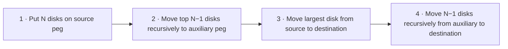

*Tower of Hanoi for $n = 3$:*


Minimum number of moves with 3 disks = $2^n-1 = 2^3-1 = 7$.

*Tower of Hanoi for $n = 4$:*


Minimum number of moves with 4 disks = $ 2^n - 1 = 2^4 - 1 = 15$.

#### Example 2: Road Trip from Trivandrum to Kashmir

Using means-ends analysis for long-distance travel planning:

1. **Define the Goal:** Drive from Trivandrum to Kashmir.
2. **Analyze Current State:** In Trivandrum with a vehicle ready.
3. **Identify Differences:** Total road distance is approximately 3,700 kilometers.
4. **Set Sub-Goals (Means):**
   - Determine fuel and rest stops.
   - Set daily driving targets of 500–600 km.
   - Select the optimal highway route.
5. **Implement Daily Segment Plan:**
   - Day 1: Trivandrum to Bangalore (~720 km), refuel in Madurai.
   - Day 2: Bangalore to Hyderabad (~570 km), refuel in Anantapur.
   - Day 3: Hyderabad to Nagpur (~500 km), refuel in Adilabad.
   - Day 4: Nagpur to Jhansi (~580 km), refuel in Sagar.
   - Day 5: Jhansi to Agra (~290 km), refuel in Gwalior; visit Taj Mahal.
   - Day 6: Agra to Chandigarh (~450 km), refuel in Karnal.
   - Day 7: Chandigarh to Jammu (~350 km), refuel in Pathankot.
   - Day 8: Jammu to Srinagar, Kashmir (~270 km).
6. **Adjust as Needed:** Monitor traffic, weather, and road conditions along the route.

**Backtracking**

Backtracking is a problem-solving technique that builds candidates incrementally and abandons ("backtracks" from) any candidate path as soon as it determines the path cannot lead to a valid solution.

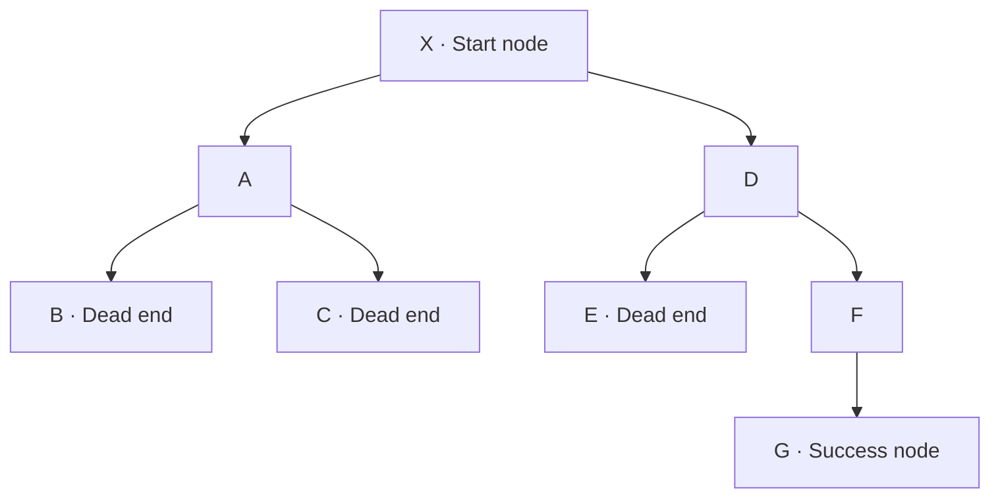

In the path search problem above, the start node is X and the destination is G:

1. Path X-A-B hits a dead end; backtrack to node A.
2. Path X-A-C hits a dead end; backtrack to root X.
3. Path X-D-E hits a dead end; backtrack to node D.
4. Path X-D-F-G successfully reaches the destination node G.

When a path reaches a dead end, return to the most recent choice point and try an untested option. Continue until a solution is found or all possibilities are exhausted. Standard examples include maze solving and Sudoku. (Repeatedly guessing a device PIN is not a practical example because devices lock after fixed unsuccessful attempts.)

### The Problem-Solving Process and Model of Computation

**Basic Model of a Computer**

Computer science solves real-world and abstract problems using computational models. To solve problems effectively with computers, we utilize the standard information processing model established by the Von Neumann architecture.

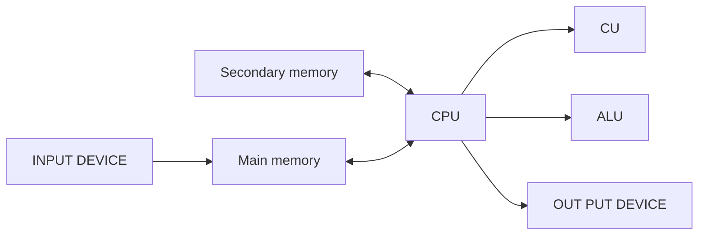

**BLOCK DIAGRAM OF A DIGITAL COMPUTER**

### Detailed Problem-Solving Techniques

**Trial and Error**

Trial and error is a fundamental problem-solving technique where various candidate solutions are attempted and discarded if unsuccessful until an acceptable solution is discovered. It is suitable when available solution options are few and well-bounded.

Steps in trial and error:

1. **Identify the problem:** Clearly define the issue.
2. **Try a solution:** Attempt a candidate option.
3. **Evaluate the outcome:** Determine if the problem is resolved.
4. **Repeat:** If the attempt failed, select and test another option.

*Everyday Examples:*
- Troubleshooting a malfunctioning printer by testing ink levels, checking for paper jams, and verifying cable or wireless connections.
- Diagnosing a phone issue by restarting the device, toggling Wi-Fi, or cycling Bluetooth.

*Password Recovery Example:*
1. **Initial Attempts:** Try standard passwords ("password123", "Qwerty2024").
2. **Learning from Mistakes:** When common passwords fail, try personal combinations (birthdates, pet names).
3. **Refinement:** Recall formatting patterns (e.g., favorite quote with special characters such as "ToBeOrNotToBe!").
4. **Success:** Systematically reach the valid password: "ToBeOrNotToBe!2024".

**Algorithm (Formal Definition)**

An algorithm is a finite, ordered set of unambiguous steps for solving a problem that terminates with a solution for valid inputs within its specification.

**Heuristics (Revisited)**

Heuristics serve as cognitive strategies that reduce decision complexity when complete information is unavailable. Conditions favoring heuristic decisions include information overload, severe time constraints, low-stakes decisions, or limited data availability.

*Guess and Check Worked Example:*

To find the number that produces 32 when added to 15:
- Initial guess: 20 -> $15+20=35$ (too large).
- Refined guess: 18 -> $15+18=33$ (close, but too large).
- Refined guess: 17 -> $15+17=32$ (exact match).

**Tower of Hanoi (Formal Recurrence)**


**Fig 1: Initial State**

The recurrence procedure for $N$ disks requires:

1. Move top $N-1$ disks from rod A to rod B via auxiliary rod C.
2. Move largest disk from rod A to rod C.
3. Move $N-1$ disks from rod B to rod C via auxiliary rod A.

The minimal move sequence is governed by $2^N - 1$, where $N$ represents disk count; for 14 disks, the total is $(2^{14}) - 1 = 16383$ moves.

The step-by-step recursive breakdown for $N=4$ disks is illustrated below:


Tower of Hanoi solutions for small disk sets:


Minimum moves for 3 disks = $2^n-1= 2^3-1=7$.


Minimum moves for 4 disks = $2^n-1= 2^4-1=15$.

**Road Trip Segment Distances (MEA Route Details)**

- Segment 2: Bangalore to Hyderabad (approx. $570\text{ km}$).
- Segment 3: Hyderabad to Nagpur (approx. $500\text{ km}$).
- Segment 4: Nagpur to Jhansi (approx. $580\text{ km}$).
- Segment 5: Jhansi to Agra (approx. $290\text{ km}$).
- Segment 6: Agra to Chandigarh (approx. $450\text{ km}$).
- Segment 7: Chandigarh to Jammu (approx. $350\text{ km}$).
- Segment 8: Jammu to Srinagar, Kashmir (approx. $270\text{ km}$).

**State-Space Search Backtracking**


In systematic state-space exploration, whenever a path hits a dead end, execution rolls back to the most recent decision point to test alternative branches.

### Strategic Importance and Evaluation

**Benefits of Multiple Problem-Solving Strategies**

- **Adaptability:** Different problem classes demand different tools; familiarity with multiple strategies enables dynamic switching when an approach stalls.
- **Efficiency:** Matching the correct strategy to the domain reduces operational time and computational overhead.
- **Improved Outcomes:** Exploring diverse analytical paths increases the likelihood of finding optimal solutions.
- **Skill Development:** Practicing multiple paradigms sharpens algorithmic reasoning, critical thinking, and design fluency.

---

<!-- page 3 | Computer as a model of computation and Von Neumann architecture -->

## Computer as a model of computation and Von Neumann architecture

The model assumes a single CPU (Central Processing Unit). Many computers today have multiple CPUs, allowing this model to be duplicated multiple times within a single system.

**Instruction Execution Cycle**

An instruction execution cycle (fetch–decode–execute cycle) is the process by which a computer retrieves a program instruction from memory, determines what actions to perform, and carries out those actions to produce meaningful output.

The cycle is summarized in sequential steps:

1. **Fetch** the next instruction from memory.
2. **Decode** the instruction to determine the required operation.
3. **Execute** the operation.
4. **Store** the result in a register or memory, when needed.

This cycle repeats for each subsequent instruction.

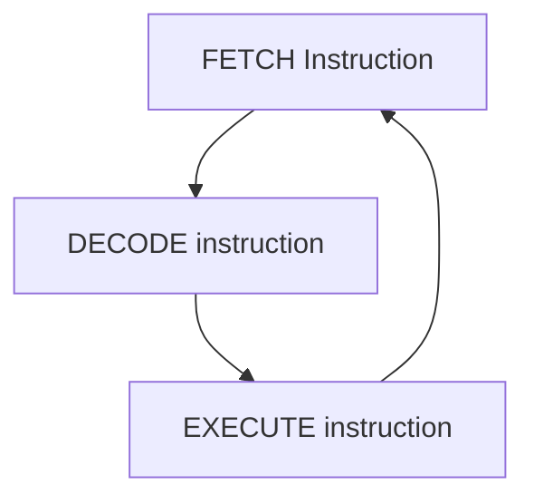

A typical computer architecture comprises three main components:

1. **Input/Output (I/O) Unit**
2. **Central Processing Unit (CPU)**
3. **Memory Unit**

The I/O unit consists of input and output devices. Input devices accept data from the user for the CPU to process. Output devices transfer processed data (information) to the user. The memory unit stores input data, instructions required for processing, and output information.

### Input Devices

Input devices allow users to enter data into the computer for processing. Data can take the form of text, audio, video, and other media.

**Human Data Entry Devices**

Human data entry devices require the user to enter data directly by typing or pointing:

- **Keyboard**: The most common typing device.
- **Mouse**: A pointing device where moving the device moves a display pointer (cursor).
- **Trackball**: An alternative to a mouse featuring a top-mounted ball used to move the cursor.
- **Joystick**: A device with a stick whose directional movement controls cursor position.
- **Graphics tablet**: A device that converts hand-drawn artwork into digital data.

**Source Data Entry Devices**

Source data entry devices collect data directly at the source and feed machine-readable data into the computer:

- **Audio input devices**: Capture speech or sound via microphones.
- **Video input devices**: Capture video or still images via webcams and digital cameras.
- **Optical input devices**: Capture data using optical sensors, such as barcode scanners and image scanners.

### Output Devices

Output devices convert processed digital data into human-understandable information.

**Hard Copy Devices**

Hard copy devices produce physical output on paper or other surfaces that can be stored permanently and read without a computer:

- **Printer**: Prints text and images on paper (e.g., drum, inkjet, laser printers).
- **Plotter**: Produces large architectural or engineering drawings using fine pens (e.g., flatbed and drum plotters).

**Soft Copy Devices**

Soft copy devices generate transient electronic output via visual displays, audio units, or video units:

- **Monitor**: The primary visual display device of a computer.
- **Video output devices**: Project images or video onto large screens via projectors.
- **Audio output devices**: Produce sound using speakers, headphones, or headsets.

### Central Processing Unit

**Central Processing Unit (CPU)**

The Central Processing Unit (CPU) is the primary processor of a computer. It comprises an Arithmetic Logic Unit (ALU), a Control Unit (CU), and internal registers.

**Arithmetic Logic Unit (ALU)**

The Arithmetic Logic Unit performs operations via two dedicated sub-units:

- **Arithmetic unit**: Executes operations such as addition, subtraction, multiplication, and division.
- **Logic unit**: Executes comparisons and logical decisions.

**Registers**

Registers are small, high-speed storage locations within the CPU used to hold temporary data, addresses, and instructions:

- **Accumulator (ACC)**: Stores the immediate results of arithmetic and logical operations.
- **Instruction Register (IR)**: Holds the instruction currently being executed.
- **Program Counter (PC)**: Holds the memory address of the next instruction to be fetched.

**Control Unit (CU)**

The Control Unit manages and coordinates all computer operations:

- Generates internal control signals.
- Fetches instructions from memory, decodes them, and directs the ALU during execution.
- Manages communication with I/O devices.
- Determines timing for fetching data, executing operations, and storing results.

**Memory Unit**

The memory unit provides storage space for data, instructions, and intermediate processing results organized in a hierarchical structure.

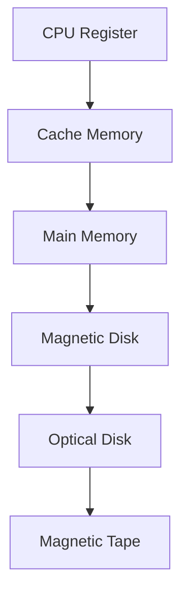

*Memory Hierarchy*

Computer memory is categorized into internal and external memory:

**Internal Memory**

Internal memory resides directly on the motherboard or within the CPU:

1. **Registers**: High-speed, small-capacity storage units within the CPU.
2. **Primary Memory**: The main addressable memory space:
   - **Random Access Memory (RAM)**: Volatile memory that stores running programs and working data; contents are lost if power is interrupted.
   - **Read-Only Memory (ROM)**: Non-volatile memory containing permanent system instructions such as bootstrap routines.
3. **Cache Memory**: High-speed buffer memory placed between RAM and the CPU to store frequently accessed data and instructions.

**External Memory**

External memory consists of secondary storage devices located outside the processor bus:

1. **Magnetic Tape**: Sequential-access storage medium with magnetic coating.
2. **Magnetic Disk**: Direct-access storage coated with magnetic material, such as hard disk drives.
3. **Optical Disk**: Storage media read and written by laser light, including CDs and DVDs.

### Computer as a Model of Computation

**Problem Solving**

Problem solving is the sequential process of analyzing information related to a given situation and generating appropriate response options.

Complex computations iterate through input, processing, and output phases. Problem solving follows six defined stages:

1. **Understanding the problem**
2. **Formulating a model**
3. **Developing an algorithm**
4. **Writing the program**
5. **Testing the program**
6. **Evaluating the solution**

#### Understanding the Problem

The initial phase focuses on determining input requirements, output goals, and processing operations.

**Example 1: Finding the sum of two numbers**

- **Input requirements**: Two numeric values of any valid type (integer, real, or whole number).

### Von Neumann Architecture


*Block Diagram of a Digital Computer*

The model assumes a single CPU, which can be duplicated within multi-core and multi-processor modern architectures.

**Instruction Execution Cycle**

The CPU executes instructions sequentially through a standard cycle:

1. **Fetch**: Retrieve the instruction from memory.
2. **Decode**: Interpret the instruction and determine the required operation.
3. **Execute**: Carry out the decoded operation via CPU components.
4. **Store**: Write the result back to memory or send it to an output device.


A typical architecture contains three primary functional units:

1. **Input/Output (I/O) Unit**
2. **Central Processing Unit (CPU)**
3. **Memory Unit**

The I/O unit contains input devices to collect user data and output devices to convey processed information. The memory unit retains instructions, current data, and final output.

**Input Devices Classification**

1. **Human data entry devices**:
   - **Keyboard**: Standard text entry device.
   - **Mouse**: Common pointing device controlling an on-screen cursor.
   - **Trackball**: Pointing device with a top-mounted roller ball.
   - **Joystick**: Directional lever used for cursor positioning.
   - **Graphics tablet**: Digitizer converting hand-drawn input to digital formats.

2. **Source data entry devices**:
   - **Audio input devices**: Sound input via microphones.
   - **Video input devices**: Visual feed via video cameras and webcams.
   - **Optical input devices**: Data collection via barcode readers and optical scanners.

**Output Devices Classification**

1. **Hard copy devices**:
   - **Printer**: Produces persistent text or graphic prints on paper (e.g., drum, inkjet, laser).
   - **Plotter**: High-precision drafting on large sheets using pens.

2. **Soft copy devices**:
   - **Monitor**: Primary visual display interface.
   - **Video output devices**: Projection devices displaying data onto large viewing surfaces.
   - **Audio output devices**: Sound reproduction devices including speakers and headphones.

**CPU Components**

The CPU processes instructions using two functional units and dedicated register storage:

- **Arithmetic Logic Unit (ALU)**: Executes computations and comparisons.

    a. **Arithmetic unit** – performs arithmetic operations like addition, subtraction, multiplication, and division, on the data.

- **Logic unit**: Handles logical evaluations and comparisons.
- **Registers**:
  - **Accumulator (ACC)**: Holds intermediate arithmetic and logic results.
  - **Instruction Register (IR)**: Stores the active instruction being executed.
  - **Program Counter (PC)**: Tracks the address of the next instruction to process.
- **Control Unit (CU)**: Coordinates hardware operations, dispatches signals, coordinates I/O, and sequences instruction flow.

**Memory System Hierarchy**


*Memory Hierarchy*

Memory is split into internal and external tiers:

- **Internal Memory**:
  1. **Registers**: Ultra-fast storage inside the processor.
  2. **Primary Memory**:
     - **RAM**: Fast volatile memory holding active programs and transient data.
     - **ROM**: Non-volatile memory holding permanent startup routines.
  3. **Cache Memory**: High-speed memory buffering transactions between the CPU and RAM.

- **External Memory**:
  1. **Magnetic tape**: Sequential-access storage medium.
  2. **Magnetic disk**: Random-access storage plates (e.g., hard disk).
  3. **Optical disk**: Optical storage media (e.g., CD, DVD).

### Problem-Solving Framework

Problem solving follows six standard stages:

1. Understanding the problem
2. Formulating a model
3. Developing an algorithm
4. Writing the program
5. Testing the program
6. Evaluating the solution

**Understanding the Problem**

Analyzing a computational problem requires defining input requirements, necessary processing, and expected output.

- **Example 1**: Finding the sum of two numbers requires two numerical inputs across real, integer, or whole number domains.

---

<!-- page 4 | The six-step problem-solving process and algorithm development -->

## The six-step problem-solving process and algorithm development

### Understanding the Problem

**Output Requirements**

Output requirements define the expected results corresponding to given inputs. If real numbers are supplied as input, the obtained output will be real; if integers are supplied, the output will be integer.

**Processing Considerations**

Processing considerations define the computational path needed to reach the solution from the given inputs.

### Formulating a Model

The formulation step focuses on the processing mechanism of the problem. A computational model or formula must be identified or developed to transform input data into the desired result. Assuming the input data consists of two integers, `Number1` and `Number2`:

$$
\text{Sum} = \text{Number1} + \text{Number2}
$$

This step determines how available data is utilized to compute the final answer.

### Developing an Algorithm

**Algorithm**

An algorithm is a precise sequence of instructions or steps for solving a particular problem.

To develop an algorithm, instructions must be expressed in a form understandable to anyone analyzing the process. Two standard representations are:

1. **Pseudocode**: An informal representation of an algorithm without strict programming syntax.
2. **Flowchart**: A diagrammatic or graphical representation of an algorithm.

#### Algorithm: Addition of Two Numbers

1. Start
2. Input the first number
3. Input the second number
4. Add the two numbers
5. Display the result
6. End

#### Pseudocode: Addition of Two Numbers

1. Start
2. Input Number1
3. Input Number2
4. Sum = Number1 + Number2
5. Output Sum
6. End

#### Flowchart


### Writing the Program

Writing a program, also known as coding or implementing an algorithm, is the process of converting an algorithm into instructions that a computer can execute.

Python implementation:

- $\text{n1} = 21$
- $\text{n2} = 7$
- $\text{sum} = \text{n1} + \text{n2}$
- `print('Sum =', sum)`

After writing code, test it with diverse inputs. Debug and compile the program to resolve issues discovered during testing.

**Debugging**

Debugging is the method of finding and fixing errors in a program.

**Compiling**

Compiling is the process of converting a program into instructions that can be understood by the computer.

### Testing the Program

Testing verifies whether the written and compiled program performs its intended task accurately across various inputs.

- Running a program directs the computer to evaluate the compiled instructions.
- If the program runs correctly, the expected output is produced.
- If output is incorrect, the issue may stem from an incorrect implementation or a flaw in the underlying algorithm.

**Bugs**

Bugs are errors in a program that cause it to produce incorrect or undesirable results.

### Evaluating the Solution

Once the program executes, evaluate the output against the original problem requirements:

1. Ensure the output is formatted appropriately as a solution.
2. Examine whether the result aligns with the original intent.
3. Determine whether all problem specifications are satisfied.

### Example 2: Class Average Grade Calculation

#### Understanding the Problem

- **Input Requirements**: Collect all grades (e.g., entered via keyboard). Identify the format (numerical ranges 0–100 or letter grades A–F), type (integers or floating-point values), and how missing data or absences are handled.
- **Output Requirements**: Present results to the monitor or printer in a specified format (number, letter grade, or chart).
- **Processing Considerations**: Sum all valid grades and divide by the total student count.

#### Formulating a Model

When grades are provided as integers or real numbers $x1, x2, \dots, xn$ representing percentage marks, the computational model is:

$Average 1 = (x1 + x2 + x3 + \dots + xn) / n$ where the output ranges from 0 to 100.

Letter grades cannot be averaged directly; they must first map to numeric values:

$$
\begin{matrix}
A + = 12 & A = 11 & A- = 10 & B + = 9 \\
B = 8 & B- = 7 & C + = 6 & C = 5 \\
C- = 4 & D + = 3 & D = 2 & D- = 1 & F = 0
\end{matrix}
$$

If the assigned numeric values are $y1, y2, \dots, yn$, the corresponding computational model is:

$Average 2 = (y1 + y2 + y3 + \dots + yn) / n$ where the result ranges from 0 to 12.

To express this result as a percentage:

$$
\text{Percentage} = \frac{\text{Average on the 0--12 scale}}{12} \times 100
$$

#### Developing an Algorithm

**Step-by-Step Algorithm**:

1. Start
2. Read number of students, `n`
3. Read the marks of `n` students
4. Compute average using the formula
5. Display Average
6. Stop

**Pseudocode**:

1. Start
2. Input `n`
3. Input marks `x1, x2, x3, ..., xn`
4. `Average = (x1 + x2 + x3 + ... + xn) / n`
5. Output `Average`
6. End

#### Flowchart

```mermaid
flowchart TD
A([Start]) --> B[x1, x2, ..., xn, Average]
B --> C[/Read x1, x2, ..., xn/]
C --> D[Average = (x1 + x2 + ... + xn) / n]
D --> E[/Print Average/]
E --> F([Stop])
```

#### Implementation and Testing

```python
# Program in Python

n = int(input("Enter the number of students: "))
total = 0
for student in range(n):
    mark = float(input(f"Enter mark for student {student + 1}: "))
    total += mark
average = total / n
print(f"Average mark: {average:.2f}")
```

Testing involves validating outputs against a suite of sample student scores.

### Example 3: Case Study — Discriminant Calculator

1. **Understanding the Problem**: Input the coefficients `a`, `b`, and `c` of a quadratic equation. Output the discriminant `d`.
2. **Formulating a Model**:

$$
D = b^2 - 4ac
$$

3. **Developing an Algorithm**:
   1. Start
   2. Read `(a, b, c)`
   3. `d = b*b - 4*a*c`
   4. Print `(d)`
   5. Stop

4. **Writing the Program**:

   ```python
   #Input the coefficients
   a = int(input("Enter the value of first coefficient"))
   b = int(input("Enter the value of second coefficient"))
   c = int(input("Enter the value of third coefficient"))
   ```

```python
#Find the discriminant
d = (b**2) - (4*a*c)
#Print the discriminant
print(d)
```

5. **Testing the Program**: Compare actual outputs against expected results using a test suite:

| Sl No | a | b | c | d |
|---:|---:|---:|---:|---:|
| 1 | 10 | 2 | 5 | -196 |
| 2 | 5 | 7 | 1 | 29 |
| 3 | 2 | 4 | 2 | 0 |
| 4 | 1 | 1 | 1 | -3 |
| 5 | 3 | 2 | 5 | -56 |
| 6 | 2 | 8 | 2 | 48 |

### Essentials of Python Programming Overview

Syllabus coverage includes creating and using variables, numeric and string data types, the `math` module, basic I/O with `print` and `input`, and operator precedence.

**Programming Languages**

Programming languages are formal systems used to write programs that provide precise representations of algorithms and control computer behavior. Each language possesses unique keywords and syntax rules.

#### Categories of Programming Languages

**Machine Language**

Machine language is the native low-level binary language understood directly by computer hardware. Programs consist exclusively of 0s and 1s, execute rapidly without translation, but are machine-dependent.

If opcode and operands each occupy 4 bits and addition is encoded as `1010`, adding 3 (`0011`) and 6 (`0110`) is represented as:

$$
\underbrace{1010}_{\text{add}} \underbrace{0011}_{3} \underbrace{0110}_{6}
$$

**Assembly Language**

Assembly language is an intermediate low-level language that replaces binary opcodes with readable symbolic names called mnemonic codes (such as `ADD` or `SUB`). For example, adding 3 and 6 is written as `ADD 3, 6`.

**High-Level Language**

High-level languages provide English-like syntax and abstract mathematical expressions, making programs simpler to read, write, and maintain across different hardware platforms (e.g., C, Java, Python). For example, adding 3 and 6 is written as `3 + 6`.

**Translator Software**

Translator software converts source code written in assembly or high-level languages into machine-executable target code.

1. **Assembler**: Converts assembly language mnemonics into machine code.
2. **Compiler**: Translates entire high-level programs into machine code prior to execution.
3. **Interpreter**: Executes high-level programs statement by statement at runtime.

### Problem-Solving and Algorithm Review

**Output and Processing Review**

Formulating an appropriate computational model maps the problem inputs to required outputs. For two input integers `Number1` and `Number2`:

$$
\text{Sum} = \text{Number1} + \text{Number2}
$$

#### Flowchart Review


#### Python Implementation Review

$$
\begin{aligned}
        \text{n1} &= 21 \\
        \text{n2} &= 7 \\
        \text{sum} &= \text{n1} + \text{n2} \\
        \text{print}('&\text{Sum} = \text{', sum)}
        \end{aligned}
$$

Testing, debugging, and solution evaluation ensure that the resulting code executes reliably across boundary cases.

### Class Average Case Study Review

For numerical scores $x_1, x_2, \dots, x_n$, the average model is:

$Average1 = (x_1 + x_2 + x_3 + \dots + x_n) / n$

For letter grades converted to numerical equivalents:

$$
\begin{align*}
A+ &= 12 & A &= 11 & A- &= 10 & B+ &= 9 \
B &= 8 & B- &= 7 & C+ &= 6 & C &= 5 \
C- &= 4 & D+ &= 3 & D &= 2 & D- &= 1 & F &= 0
\end{align*}
$$

Using assigned values $y_1, y_2, \dots, y_n$:

$Average2 = (y_1 + y_2 + \dots + y_n) / n$

Converted to a percentage:

$$
\boldsymbol{Average\ (in\ percentage) = (Average_2 / 13)}
$$

Pseudocode sequence with inputs $x_1, x_2, x_3, ..., x_n$:

1. Start
2. Input `n`
3. Input marks `x1, x2, ..., xn`
4. `Average = (x1 + x2 + ... + xn) / n`
5. Output `Average`
6. End

#### Average Calculation Flowchart

```mermaid
flowchart TD
A([Start]) --> B[x1, x2, ..., xn, Average]
B --> C[/Read x1, x2, ..., xn/]
C --> D[Average = (x1 + x2 + .... + xn) / n]
D --> E[/Print Average/]
E --> F([Stop])
```

#### Average Calculation Program

```python
# Program in Python
n = int(input("Enter number"))
total = 0
for student in range(n):
    mark = float(input(f"Enter mark for student {student + 1}: "))
    total += mark
average = total / n
print(f"Average mark: {average:.2f}")
```

### Discriminant Calculator Review

Model formula:

$$
D = b^2 - 4ac
$$

Python implementation:

```python
#Input the coefficients
a = int(input("Enter the value of first coefficient"))
b = int(input("Enter the value of second coefficient"))
c = int(input("Enter the value of third coefficient"))
```

```python
# Find the discriminant
d = (b**2) - (4*a*c)
# Print the discriminant
print(d)
```

Verification suite:


### Language Architecture and Type Checking

Binary machine code format:

$$
1010 \underbrace{0011}_{\text{add}} \underbrace{0110}_{3} \underbrace{\quad}_{6}
$$


In high-level languages, addition is written concisely as $3+6$.

**Static Programming Language**

Static programming languages verify variable types at compile time (e.g., C, C++, Java). Explicit type declarations are required, enabling early error detection and optimized execution speeds.

**Dynamic Programming Language**

Dynamic programming languages resolve variable types at runtime (e.g., Python, JavaScript, PHP), eliminating the need for explicit type declarations before assignment.

---

<!-- page 5 | Python introduction, execution models, and translator software -->

## Python introduction, execution models, and translator software

### Compiler versus Interpreter

| Compiler | Interpreter |
| :--- | :--- |
| A traditional compiler translates the program (often as a whole) | An interpreter executes program instructions through a runtime |
| Intermediate Object Code is **Generated** | No Intermediate Object Code is **Generated** |
| **Memory Requirement : More** (Since Object Code is Generated) | **Memory Requirement is Less** |
| Program need not be **compiled** every time | Every time higher level program is converted into lower level program |
| Errors are displayed after entire program is checked | Errors are displayed for every instruction interpreted (if any) |
| **Example :** C Compiler | **Example :** BASIC |

**Python**

Python is a general-purpose, high-level, interpreted programming language developed by *Guido van Rossum* in the late 1980s at the National Research Institute for Mathematics and Computer Science in the Netherlands. Python is one of the most popular and widely used programming languages, utilized for console-based, GUI-based, web programming, and data analysis tasks. It is named after the comedy television show *Monty Python's Flying Circus*.

### Features of Python

| No. | Python feature | No. | Python feature |
|---:|---|---:|---|
| 1 | Easy to Learn and Use | 8 | Easy to Maintain |
| 2 | Expressive Language | 9 | Extensible Feature |
| 3 | Interpreted Language | 10 | High-Level Language |
| 4 | Cross-platform Language | 11 | Broad Standard Library |
| 5 | Free and Open Source | 12 | Dynamic Typed |
| 6 | Object-Oriented Language | 13 | GUI Support |
| 7 | Interactive | 14 | Databases Support |

### Applications of Python

Python is a general-purpose programming language applied across multiple domains:

* **Data Science**: Python libraries like NumPy, Pandas, and Matplotlib are used for data analysis and visualization.
* **Web Applications**: Python frameworks like Django and Pyramid simplify the development and deployment of web applications.
* **Desktop GUI Applications**
* **Software Development**
* **Scientific and Numeric Computations**
* **Business Applications**
* **Audio or Video Based Applications**

### Execution Modes in Python

There are two major Python versions: Python 2 and Python 3. Python 3 is semantically cleaner and supports newer language features. After installation, programs can be interpreted and executed in two primary ways:

1. Using the interactive interpreter prompt
2. Using a script file

#### Interactive Interpreter Prompt

The interactive prompt allows statement-by-statement execution. It is suited for immediate feedback on individual lines of code. To start interactive mode, open a terminal or command prompt and enter `python3`.

```text
Microsoft Windows [Version 6.1.7601]
Copyright (c) 2009 Microsoft Corporation. All rights reserved.

C:\Users\Madhu>python3
Python 3.8.3 (tags/v3.8.3:6f8c832, May 13 2020, 22:20:19) [MSC v.1925 32 bit (Intel)] on win32
Type "help", "copyright", "credits" or "license" for more information.
>>> print("Hello")
Hello
>>> print("Welcome to Python")
Welcome to Python
>>>
```

The Python shell is an interactive environment where statements are executed immediately upon entry. Launch it by entering `python3` (or `python` depending on the installation environment):

`user@Ubuntu2204LTS:~$ python3`
`Python 3.10.12 (main, Jul 29 2024, 16:56:48) [GCC 11.4.0] on linux`
`Type "help", "copyright", "credits" or "license" for more information`

The `>>>` prompt marks the line where statements can be entered. When a statement is submitted, the interpreter processes it, returns any output, and displays a fresh prompt:

`>>> "Welcome to the world of Python programming"`
`'Welcome to the world of Python programming'`
`>>>`

#### Script Files

Script files are used to execute multi-line programs together rather than command by command. Program statements are saved into a plain text file using the `.py` extension.

```python
print("Hello !")
print("Welcome to Python Programming")
```

```
Hello !
Welcome to Python Programming
```

#### Running as a Script

1. Combine statements into a script file and save it with a `.py` extension (for example, `sample.py`).
2. Use a text editor (such as `gedit` or `vim`) to edit script contents.
3. Open a terminal in the file's directory and run the script:

$$
\mathbf{python3\ First.py}
$$

Executing this command runs the script and outputs the results to the terminal.

* Dynamically typed: variables do not require explicit type declarations, making code faster and simpler to write.

**Compile Time**

Compile time is the period during which program source code is translated from human-readable text into machine code. Errors detected at this stage are compile-time errors (such as syntax errors, missing colons, or improper variable declarations), checked by the compiler.

**Runtime**

Runtime is the period during which a compiled or interpreted program is actively executing. Errors detected during execution are runtime errors, handled by the interpreter or runtime environment.

**Translator Software**

Translator software converts programs written in assembly or high-level languages into machine code (binary 0s and 1s) that the CPU can execute. The initial input is known as source code, and the generated machine instructions form the target or object code.

Translators are categorized into three main types:

1. **Assembler**: Converts assembly language programs into executable machine code.
2. **Compiler**: Translates entire high-level language source files into machine code before execution.
3. **Interpreter**: Executes instructions directly through a runtime system, either line by line or via an intermediate representation.

### Compiler and Interpreter Differences

| Compiler | Interpreter |
| :--- | :--- |
| A traditional compiler translates the program (often as a whole) | Interpreter takes single instruction as input |
| Intermediate Object Code is **Generated** | No Intermediate Object Code is **Generated** |
| Memory Requirement: **More** (since object code is generated) | Memory Requirement is **Less** |
| Program need not be **compiled** every time | Every time higher level program is converted into lower level program |
| Errors are displayed after entire program is checked | Errors are displayed for every instruction interpreted (if any) |
| **Example :** C Compiler | **Example :** BASIC |

**Python Language Overview**

Python is a general-purpose, high-level, interpreted programming language created by **Guido van Rossum** in the late 1980s at the National Research Institute for Mathematics and Computer Science in the Netherlands. It supports diverse application domains, including console tools, desktop GUIs, web development, and data analysis. Its name comes from the television series *Monty Python's Flying Circus*.

### Feature Overview


### Application Domains

Python is a versatile general-purpose language used across multiple specializations:

* **Data Science**: Supported by specialized packages like NumPy, Pandas, and Matplotlib for data processing and graphical output.
* **Web Applications**: Accelerated through web frameworks such as Django and Pyramid.
* **Desktop GUI Applications**
* **Software Development**
* **Scientific and Numeric Computations**
* **Business Applications**
* **Audio or Video Based Applications**

### Script and Interactive Environments

Python programs are commonly executed via the interactive interpreter prompt or by running stored script files across Python 2 or Python 3 installations.

#### Python Interactive Shell


The Python shell provides direct, interactive evaluation of language statements. Starting `python3` displays initial environment details followed by the primary shell prompt:

*user@Ubuntu2204LTS:~$ python3*
*Python 3.10.12 (main, Jul 29 2024, 16:56:48) [GCC 11.4.0] on linux*
*Type "help", "copyright", "credits" or "license" for more information*

The prompt symbol `>>>` awaits input commands:

`>>> "Welcome to the world of Python programming"`
`'Welcome to the world of Python programming'`
`>>>`

#### Stored Script Execution

Script files allow saving multiple lines of Python instructions into `.py` files for batch execution.


#### Script Execution Steps

1. Write instructions and save the source file with a `.py` extension (e.g., `First.py`).
2. Create and edit the source text using an editor such as `gedit` or `vim`.
3. Open a command terminal in the file's working directory and execute the script:

$$
\text{python3 First.py}
$$

The interpreter runs the script and outputs the resulting data directly to standard output.

---

<!-- page 6 | Python syntax fundamentals: comments, character set, and tokens -->

## Python syntax fundamentals: comments, character set, and tokens

### Running a Python Script

**Example**

Suppose you have written a script `sample.py` to display the message “My first Python program!”. This is how you run it (the second line shows the output):

_user@Ubuntu2204LTS:~$ python3 First.py_

**My first Python program!**

### Source Code Comments

**Comments**

Comments are used in a programming language to describe the program or to hide some part of code from the interpreter. A comment is not an executable part of the program, but it enhances interactivity and makes the program readable.

Python supports two types of comments:
1. Single Line Comment
2. Multi Line Comment

**Single-Line Comments**

Single-line comments begin with the `#` symbol. When a user wants to specify a single-line comment, the line must start with `#`.

**Example**

```python
# This is single line comment
print("Hello Python")
```

**Output**

```
Hello Python
```

**Multi-Line Comments**

Multi-line comments can be specified inside triple quotes (`'''` or `"""`).

**Example**

```python
"""This is
   Multiline
   Comment"""
print("Hello Python")
```

**Output**

```
Hello Python
```

### Character Set Standards

**Character Set**

A character set is a set of valid characters acceptable by a programming language in scripting.

The Python character set consists of:
- **Alphabets**: All uppercase (`A`–`Z`) and lowercase (`a`–`z`) letters.
- **Digits**: All digits `0`–`9`.
- **Special Symbols**: Python supports special symbols including: `"` `'` `;` `:` `!` `~` `@` `#` `$` `%` `^` `` ` `` `&` `*` `(` `)` `_` `+` `-` `=` `{` `}` `[` `]` `\`
- **White Spaces**: Whitespace characters including tab space, blank space, newline, and carriage return.

---

### Lexical Units

**Tokens**

A token is the smallest individual unit in a Python program. All statements and instructions in a program are built with tokens.

The various tokens in Python include:

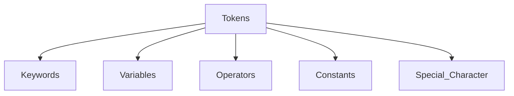

**Keywords**

Keywords (reserved words) are words that have special meaning or significance in a programming language. They cannot be used as variable names, function names, or for any other arbitrary purpose.

| | | | | |
|---|---|---|---|---|
| False | class | finally | is | return |
| None | continue | for | lambda | try |
| True | def | from | nonlocal | while |
| and | del | global | not | with |
| as | elif | if | or | yield |
| assert | else | import | pass | |
| break | except | in | raise | |

**Identifiers**

Identifiers are the names given to any variable, function, class, list, method, or object for identification.

Rules to name an identifier:
1. Python is **case-sensitive**, meaning case matters in naming identifiers (for example, `geeks` and `Geeks` are two distinct identifiers).
2. Identifiers must start with an uppercase letter (`A`–`Z`), a lowercase letter (`a`–`z`), or an underscore (`_`).

---

### Extended Examples and Review

**Script Execution Review**

Suppose you have written a script `sample.py` to display the message “My first Python program!”. Running it at the terminal displays the output:

_user@Ubuntu2204LTS:~$ python3 First.py_

_My first Python program!_

**Comment Syntax Overview**

Comments describe code logic or temporarily prevent code execution. Python comments do not affect execution and fall into two formats:
1. Single Line Comment
2. Multi Line Comment

**Single-Line Example**

Single-line comments start with `#`.

```python
# This is single line comment
print("Hello Python")
```

**Output**

Hello Python

**Multi-Line Example**

Multi-line comments are specified within triple quotes.

```python
'''This is
   Multiline
   Comment'''
print("Hello Python")
```

**Output**

Hello Python

**Character Set Summary**

A character set defines all valid characters permitted in Python source code:
- **Alphabets**: Capital (`A`–`Z`) and lowercase (`a`–`z`) letters.
- **Digits**: Numeric digits `0`–`9`.
- **Special Symbols**: Python supports characters like `"` `` ` `` `1` `;` `:` `!` `~` `@` `#` `$` `%` `^` `&` `*` `(` `)` `_` `+` `-` `=` `{` `}` `[` `]` `\`
- **WhiteSpaces**: Characters such as tab space, blank space, newline, and carriage return.

---

**Token Classification**

A token is the smallest individual unit in a Python program, forming the building block for all instructions.

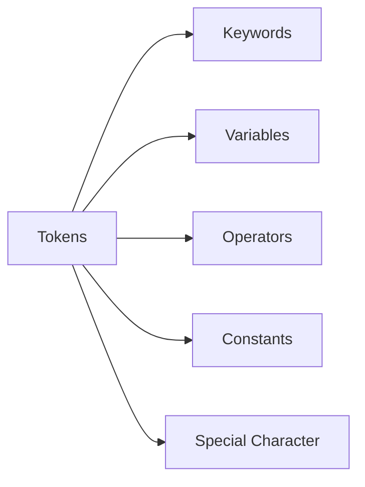

**Reserved Keywords**

Keywords carry reserved meaning within Python and cannot serve as identifiers or variable names.


**Identifier Conventions**

Identifiers uniquely label variables, functions, classes, and collections.

Rules for valid identifiers:
1. Python is case-sensitive; case variations like `geeks` and `Geeks` represent different identifiers.
2. Identifiers must start with a capital letter (`A`–`Z`), a lowercase letter (`a`–`z`), or an underscore (`_`).

---

<!-- page 7 | Variables, dynamic typing, and type conversion -->

## Variables, dynamic typing, and type conversion

**Identifier Rules**

An identifier must begin with a letter or an underscore (`_`).

- It cannot start with any other character.
- Except for letters and underscores, digits can be part of an identifier but cannot be the first character.
- Any other special characters or whitespaces are strictly prohibited.
- An identifier cannot be a keyword.

### Valid and Invalid Identifiers

| IDENTIFIER | VALID? | REASON IF INVALID |
| :--- | :---: | :--- |
| `totalSales` | Yes | |
| `total_Sales` | Yes | |
| `total.Sales` | No | Cannot contain period |
| `4thQtrSales` | No | Cannot begin with digit |
| `totalSale$` | No | Cannot contain $ |

### Variable Declaration and Initialization

**Variables**

A variable is a named memory location in which we can store values for a particular program. In other words, a variable is a name used to refer to a memory location. A variable is also known as an identifier and is used to hold a value. In Python, when a value is assigned to a variable, that variable is declared automatically without requiring an explicit data type specification.

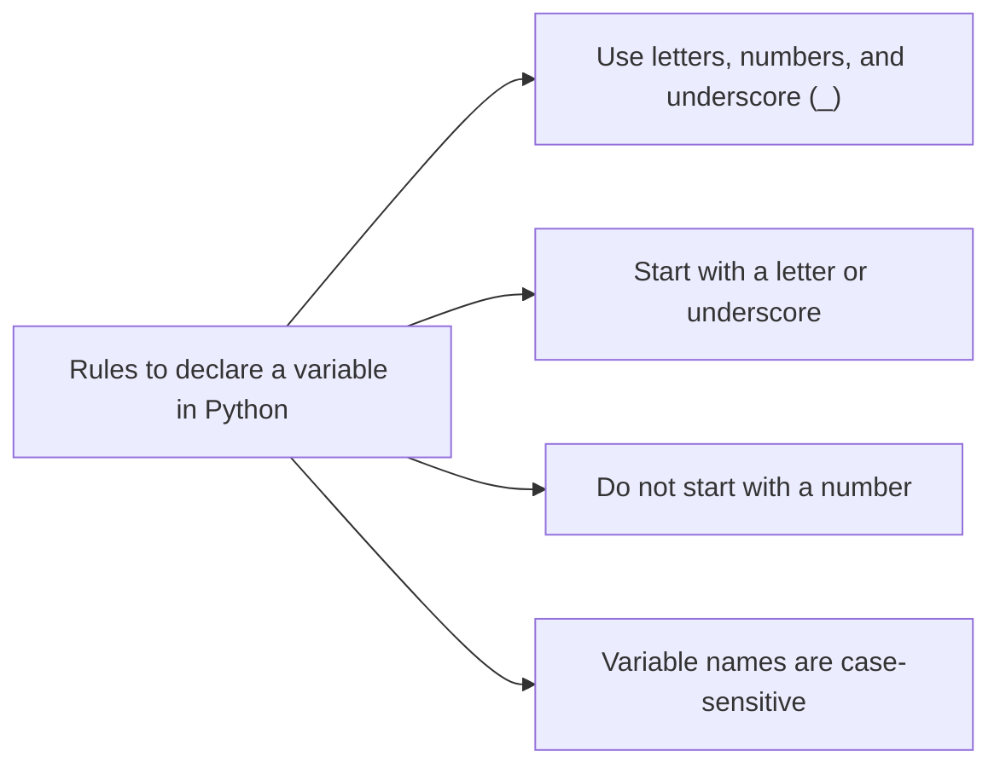

### Naming Conventions and Rules

Rules for forming identifiers:

- An identifier can begin with a letter or an underscore (`_`).
- It cannot start with any other character.
- Except for letters and underscores, digits can be part of an identifier but cannot be the first character.
- Any other special characters or whitespaces are strictly prohibited.
- An identifier cannot be a keyword.


### Memory and Variable Concept

**Variable**

A variable is a named memory location used to store program values. It serves as an identifier referring to a specific memory location. In Python, assigning any value automatically declares the variable without needing explicit type declarations.


### Variable Demonstration

**Example: Vardemo.py**

```python
a=10 #integer
b="StudyGlance" #string
c=12.5 #float

print(a)
print(b)
print(c)
```

Output:

```
$python3 Vardemo.py
10
StudyGlance
12.5
```

### Multiple Assignment

Python allows assigning a single value to multiple variables, or multiple values to multiple variables in a single statement.

#### Assigning a Single Value to Multiple Variables

**Example: Vardemo1.py**

```python
x=y=z=50
print(x)
print(y)
print(z)
```

Output:

```
$python3 Vardemo1.py
50
50
50
```

#### Assigning Multiple Values to Multiple Variables

**Example: Vardemo2.py**

```python
a,b,c=5,10,15
print(a)
print(b)
print(c)
```

Output:

```
$python3 Vardemo2.py
5
10
15
```

**Literals**

Literals are constants that represent fixed values in Python programs and can hold various data types. The syntax and usage of a literal depend on its specific category.

Categories of literals in Python include:
- String literals
- Numeric literals (integer, float, complex)
- Boolean literals
- Literal collections (list, tuple, set, dictionary)

### Data Types and Dynamic Typing

**Data Types**

Data types specify the kind of data stored in variables. Python is dynamically typed, meaning variable types are not explicitly declared.

The interpreter implicitly binds each value with its data type at runtime. Python provides the built-in `type()` function to inspect the data type of any variable.

```mermaid
flowchart LR
A[Python Data Types] --> B[Numbers]
A --> C[Bool\nTrue, False]
A --> D[Set\n{2, 4, 6}]
A --> E[Dict\n{1:'a', 2:'b'}]
A --> F[Sequence]
B --> B1[Int\n20]
B --> B2[Float\n35.75]
B --> B3[complex\n1+3j]
F --> F1[String\n'Jessa']
F --> F2[List\n[2, 'a', 5.7]]
F --> F3[Tuple\n(3, 4.5, 'b')]
```

**Numeric Data Types**

Numeric data types represent values that contain numeric quantities. A numeric value can be an integer, a floating-point number, or a complex number.

Python provides three numeric data types:
1. `int`
2. `float`
3. `complex`


**Example Program**

```python
num1 = 5
print(num1, 'is of type', type(num1))
num2 = 2.0
print(num2, 'is of type', type(num2))
num3 = 1 + 2j
print(num3, 'is of type', type(num3))
```

Output:

```text
5 is of type <class 'int'>
2.0 is of type <class 'float'>
(1+2j) is of type <class 'complex'>
```

### Type Conversion

**Implicit Type Conversion**

Implicit type conversion (coercion) occurs automatically when Python converts one data type to another without explicit user instructions. This typically happens during operations involving mixed data types to prevent type errors and preserve precision.

```python
x = 5
# int
y = 2.5
# float
z = x + y # x is implicitly converted to float
print(z) # Output: 7.5
print(type(z)) # <class 'float'>
```

**Explicit Type Conversion**

Explicit type conversion (type casting) occurs when the programmer manually converts a value from one data type to another using built-in conversion functions. Functions used include `int()`, `float()`, `str()`, `complex()`, and `bool()`.

```python
x = "15"
y = int(x)
print(y + 5)
print(type(y))

z = float(y)
print(z)
print(type(z))
# str
# Output: 15
# <class 'int'>

# explicitly convert int to float
# Output: 10.0
# <class 'float'>
```

---

<!-- page 8 | Data types: numeric, sequence, mapping, set, and boolean -->

## Data types: numeric, sequence, mapping, set, and boolean

**Example: Vardemo.py**

```python
a=10 #integer
b="StudyGlance" #string
c=12.5 #float
print(a)
print(b)
print(c)
```

**Output:**

```
$python3 Vardemo.py
10
StudyGlance
12.5
```

**Multiple Assignment**

Python allows us to assign a value to multiple variables and multiple values to multiple variables in a single statement, which is also known as multiple assignment.

### Multiple Assignment Examples

**Assign single value to multiple variables:**

**Example: Vardemo1.py**

```python
x=y=z=50
print(x)
print(y)
print(z)
```

**Output:**

```
$python3 Vardemo1.py
50
50
50
```

**Assign multiple values to multiple variables:**

**Example: Vardemo2.py**

```python
a,b,c=5,10,15
print(a)
print(b)
print(c)
```

**Output:**

```
$python3 Vardemo2.py
5
10
15
```

**Literals**

Python literals are data representations that can hold any value type, such as strings, numbers, and collections. The way literals are used depends on their specific type.

Literal types used in Python programs include:

- String literals
- Numeric literals (integer, float, complex)
- Boolean literals
- Literal collections (list, tuple, set, dictionary)

**Data Types**

Data types specify what type of data is stored in variables. Variables can hold values of different data types. Python is dynamically typed, so the variable type does not need to be declared explicitly.

The interpreter implicitly binds the value with its data type. Python provides the `type()` function to check the type of any variable.

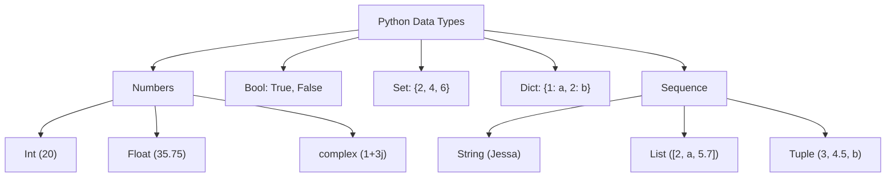

### Numeric Data Types

**Numeric Types**

The numeric data type in Python represents values that have numerical magnitude. A numeric value can be an integer, a floating-point number, or a complex number.

Python supports three numeric types:

1. **int**
2. **float**
3. **complex**

| Type | Description | Example |
| --- | --- | --- |
| **int** | Whole number, positive or negative, without decimals, of unlimited length. | `a = 10`<br>`b = -12`<br>`c = 123456789` |
| **float** | Floating-point number, positive or negative, containing one or more decimals. | `X = 1.0`<br>`Y = 12.3`<br>`Z = -13.4` |
| **complex** | Complex numbers written with a `j` as the imaginary component. | `A = 2+5j`<br>`B = -3+4j`<br>`C = -6j` |

**Program**

```python
num1 = 5
print(num1, 'is of type', type(num1))
num2 = 2.0
print(num2, 'is of type', type(num2))
num3 = 1 + 2j
print(num3, 'is of type', type(num3))
```

**Output**

```
5 is of type <class 'int'>
2.0 is of type <class 'float'>
(1+2j) is of type <class 'complex'>
```

### Type Conversion

**Type Casting**

Python provides explicit type conversion functions to directly convert one data type to another, a process referred to as type casting.

Python supports the following conversion functions:

1. `int()`: Converts compatible data types to an integer.
2. `float()`: Converts compatible data types to a floating-point number.
3. `str()`: Converts any data type to a string representation.

| Program | Output |
| --- | --- |
| ```python
#convert from int to float:
x = float(1)

#convert from float to int:
y = int(2.8)

#convert from int to complex:
z = complex(1)

print(x)
print(y)
print(z)

print(type(x))
print(type(y))
print(type(z))
``` | ```
1.0
2
(1+0j)
<class 'float'>
<class 'int'>
<class 'complex'>
``` | |

**Escape Sequence**

An escape sequence is a sequence of characters treated specially when encountered inside a string literal. It begins with a backslash (`\`) and represents a special character.

| Code | Result |
| --- | --- |
| `\'` | Single Quote |
| `\\` | Backslash |
| `\n` | New Line |
| `\r` | Carriage Return |
| `\t` | Tab |
| `\b` | Backspace |
| `\f` | Form Feed |

**Example**

```python
1 print("Hello\nWorld")
2 print("Hello\tWorld")
3 print("This is a backslash: \\")
4 print('It\'s a beautiful day')
5 print("She said, \"Hello!\"")
```

```
Output
Hello
World
Hello   World
This is a backslash: \
It's a beautiful day
She said, "Hello!"
```

### Sequence Data Types

**Sequence Types**

A sequence is an ordered collection of items. Depending on the sequence type, items may be individual characters or values of varying data types. Sequences store multiple values in an organized and efficient manner.

Standard sequence data types include:

- String
- List
- Tuple

**String**

A string is a collection of one or more characters represented using single, double, or triple quotes.

```python
# Creating a String
# with single Quotes
String1 = 'Welcome to the Geeks World'
print('String with the use of Single Quotes: ')
print(String1)

# with double Quotes
String1 = "I'm a Geek"
print("\nString with the use of Double Quotes: ")
print(String1)

# with triple Quotes
String1 = '''I'm a Geek and I live in a world of "Geeks"'''
print("\nString with the use of Triple Quotes: ")
print(String1)
```

**Output:**

```
String with the use of Single Quotes:
Welcome to the Geeks World

String with the use of Double Quotes:
I'm a Geek

String with the use of Triple Quotes:
I'm a Geek and I live in a world of "Geeks"

=== Code Execution Successful ===
```

**List**

A list is an ordered sequence of data written using square brackets (`[]`) and commas (`,`). Lists are mutable, meaning their values can be modified during execution.

```python
# Creating a List
List = []
print("Blank List: ")
print(List)

# Creating a List of numbers
List = [10, 20, 14]
print("\nList of numbers: ")
print(List)
```

**Output:**

```
Blank List:
[]

List of numbers:
[10, 20, 14]
```

**Tuple**

A tuple is an ordered sequence of data similar to a list, but it is immutable and write-protected. Tuple elements are enclosed in parentheses (`()`) separated by commas.

```python
var = ("Geeks", "for", "Geeks")
print(var)
```

**Output:**

```text
('Geeks', 'for', 'Geeks')
```

### Mapping and Set Types

**Dictionary**

A dictionary is a mapping of unique keys to values. In modern Python, dictionaries preserve insertion order and are written within curly braces using `key:value` pairs.

**Program**

```python
capitals = {"USA":"Washington D.C.","France":"Paris", "India" : "New Delhi"}
print(type(capitals))
```

**Output**

```text
<class 'dict'>
```

**Set**

A set is an unordered collection of unique items defined by comma-separated values inside curly braces (`{}`).

```python
thisset = {"apple", "banana", "cherry"}
print(thisset)
```

**Output**

```text
{'apple', 'banana', 'cherry'}
```

### Boolean Type

**Boolean**

A boolean data type holds one of two possible values, `True` or `False`, representing truth values in Boolean algebra.

```text
Input: 1==1
Output: True
Input: 2<1
Output: False
```

```python
# Returns False as x is not equal to y
x = 5
y = 10
print(bool(x==y))
```

**Output**

```text
False
```

### The Math Module

**Module**

A module provides logical organization for Python code by grouping related functions and variables together. The `math` module is an in-built library designed to simplify mathematical operations.

To access its functions, import the module using:

$$
\textbf{import math}
$$

**math.sqrt()**

The `math.sqrt()` function calculates and returns the square root of a given number.

   ```text
   >>> math.sqrt(100)
   10.0
   >>> math.sqrt(3)
   1.7320508075688772
   ```

### Advanced Escape Sequence Handling

**Escape Sequences in Detail**

An escape sequence begins with a backslash (`\`) followed by a character to produce a non-standard interpretation. For example, `\r` moves the cursor to the beginning of the line without advancing downward; `\b` moves the cursor back one space to overwrite the preceding character; and `\f` advances to a form feed or page break in supporting consoles.


**Example**

```python
print("Hello\nWorld")
print("Hello\tWorld")
print("This is a backslash: \\")
print('It\'s a beautiful day')
print("She said, \"Hello!\"")
```

**Output**

```text
Hello
World
Hello   World
This is a backslash: \
It's a beautiful day
She said, "Hello!"
```

### Sequence Representation and Visualizations

Sequences organize items into ordered indexed positions.

- String
- List
- Tuple

**String Representation**

A string consists of characters enclosed in quotes.


**List Mutability**

A list maintains mutable ordered items in square brackets.


**Tuple Immutability**

A tuple stores write-protected ordered values within parentheses.

```python
var = ("Geeks", "for", "Geeks")
print(var)
```

**Output:**

```
('Geeks', 'for', 'Geeks')
```

### Dictionary, Set, and Boolean Operations

**Dictionary Mapping**

A dictionary maps distinct keys to values while maintaining insertion order.

**Program**

```python
capitals = {"USA":"Washington D.C.","France":"Paris", "India" :"New Delhi"}
print(type(capitals))
```

**Output**

`<class 'dict'>`

**Set Structure**

A set contains unique, unordered elements within curly braces.

```python
thisset = {"apple", "banana", "cherry"}
print(thisset)
```

**Output**

```
{'apple', 'banana', 'cherry'}
```

**Boolean Logic**

A boolean evaluation yields either `True` or `False`.

```
Input: 1==1
Output: True
Input: 2<1
Output: False
```

```python
# Returns False as x is not equal to y
x = 5
y = 10
print(bool(x==y))
```

**Output**

```
False
```

### Mathematical Calculations

The `math` module provides standard mathematical functions and constants.

$$
\mathbf{\textit{import math}}
$$

**Square Root Method**

The `math.sqrt()` method computes the square root of a numeric argument.

    ```
    >>> math.sqrt(100)
    10.0
    >>> math.sqrt(3)
    1.7320508075688772
    ```

---

<!-- page 9 | Standard library math module and basic I/O operations -->

## Standard library math module and basic I/O operations

### Standard Math Functions

**math.ceil()**

math.ceil() approximates the given number to the smallest integer, greater than or equal to the given floating point number.

>>> math.ceil(4.5867)
5

**math.floor()**

math.floor() returns the greatest integer less than or equal to the input.

>>> math.floor(4.5687)
4

**math.fabs()**

math.fabs() returns the absolute value of x.

>>> math.fabs(-5.5)
5.5

**math.pi**

math.pi is a constant containing the value of PI (3.14...).

>>> x = math.pi
>>> print(x)
3.14...

**math.factorial()**

math.factorial() is used for finding the factorial of a given number in a single line.

>>> a = 5
>>> print("The factorial of", a, "is", math.factorial(a))
The factorial of 5 is 120

**math.gcd()**

math.gcd() is used to find the greatest common divisor of two numbers.

>>> a = 15
>>> b = 5
>>> print ("The gcd of 5 and 15 is : ")
>>> print (math.gcd(b, a))
The gcd of 5 and 15 is : 5

### Logarithmic and Power Functions

**math.exp()**

math.exp() is used to calculate the power of e.

>>> test = 4
>>> print (math.exp(test))
54.598150033144236

**math.pow()**

math.pow() receives two float arguments, raises the first to the second, and returns the result. In other words, pow(2,3) is equivalent to 2**3.

>>> math.pow(2,4)
16.0

**math.log()**

math.log() is used to calculate the logarithmic value of a with base b.

>>> print ("The value of log 2 with base 3 is : ")
>>> print (math.log(2,3))
The value of log 2 with base 3 is : 0.6309297535714574

### Trigonometric and Angular Functions

**Trigonometric Functions**

sin(), cos(), and tan() return the sine, cosine, and tangent of the value passed as the argument.

PROGRAM

```python
import math
a = math.pi/6
print ("The value of sine of pi/6 is : ", end="")
print (math.sin(a))
print ("The value of cosine of pi/6 is : ", end="")
print (math.cos(a))
print ("The value of tangent of pi/6 is : ", end="")
print (math.tan(a))
```

OUTPUT

The value of sine of pi/6 is : 0.49999999999999994
The value of cosine of pi/6 is : 0.8660254037844387
The value of tangent of pi/6 is : 0.5773502691896257

### Basic I/O: input() and print()

Python offers several built-in functions that make it easy to create a program quickly. Two of the most commonly used built-in functions are the input() and print() functions, used for frequent input and output operations, respectively.

**Python Input**

Python input enables programmers to obtain data from a user. The simplest method is the input() function, which pauses program execution to let the user type a line of information from the keyboard. When the user hits "Enter", the input is read and returned as a string.

Syntax:

$$
\text{input}([\langle\textit{prompt}\rangle])
$$

where the prompt is an optional string displayed for the user.

EXAMPLE

```python
>>> name = input ('What is your name? - ')
>>> print ('Hello,', name)
```

What is your name? - John
Hello, John

The input() function always returns a string. Convert it with int() or float() when the program needs a number.

EXAMPLE

```python
>>> number = input ('What is your number? ')
```

What is your number? 45

```python
>>> number
```

'45'

```python
>>> int(number)
```

45

```python
>>> float(number)
```

45.0

Or:

>>> price = float(input("Enter the price of each item"))
>>> print(price)
Enter the price of each item 50
50.0

For taking multiple inputs from the user in a single line, use the split() function.

EXAMPLE

>>> x, y = input("Enter two numbers: ").split()
>>> print("No. of boys: ", x)
>>> print("No. of girls: ", y)
Enter two numbers: 23 22
No. of boys: 23
No. of girls: 22

**Python Output**

Python output presents data back to the user once the program accepts and processes it. You can display output data directly to the console or show it on a screen using the print() function.

Syntax:

$$
\text{print}(\text{<obj>},...,\text{<obj>})
$$

Using the above syntax, multiple objects can be passed into print() separated by commas.

EXAMPLE

>>> print(100)
100

>>> num = 65
>>> print ('The value of the number is', num)
The value of the number is 65

Another Syntax:

```python
print(*objects, sep=' ', end='\n', file=sys.stdout, flush=False)
```

EXAMPLE

# Python program to illustrate print()
# Passing sep and end parameters
>>> num = 7
>>> print('James Bond ', num, sep = '--> 00', end = '\n\n\n')
>>> a = 2
>>> print('Value of a: ', a, sep = '000', end = '\n')
>>> print('Car', 'Bike', 'Train', 'Plane', sep = ' | ', end = '\n\n')

OUTPUT

James Bond --> 007

Value of a: 0002

Car | Bike | Train | Plane

### Python Operators and Precedence

**Python Operators**

Python operators are special symbols or keywords that carry out operations on values and variables. They serve as a basis for expressions used to modify data and execute computations.

A simple example is given by the expression $4 + 5$ is equal to 9. Here, 4 and 5 are called operands and $+$ is called operator.

**Types of Python Operators**

Python language supports various types of operators:

1. Arithmetic Operators
2. Comparison (Relational) Operators

### Additional Mathematical Operations Reference

**math.ceil()**

math.ceil() approximates the given number to the smallest integer, greater than or equal to the given floating point number.

>>> math.ceil(4.5867)
5

**math.floor()**

math.floor() returns the greatest integer less than or equal to the input.

>>> math.floor(4.5687)
4

**math.fabs()**

math.fabs() returns the absolute value of x.

>>> math.fabs(-5.5)
5.5

**math.pi**

math.pi gives an approximation of π (about 3.14159). It is a constant, so do not call it like a function.

>>> x = math.pi
>>> print(x)
3.14...

**math.factorial()**

math.factorial() finds the factorial of a given number in a single line.

>>> a = 5
>>> print("The factorial of", a, "is", math.factorial(a))
The factorial of 5 is 120

**math.gcd()**

math.gcd() finds the greatest common divisor of two numbers.

>>> a = 15
>>> b = 5
>>> print ("The gcd of 5 and 15 is : ")
>>> print (math.gcd(b, a))
The gcd of 5 and 15 is : 5

**math.exp()**

math.exp() calculates the power of e.

>>> test = 4
>>> print (math.exp(test))
54.598150033144236

**math.pow()**

math.pow() receives two float arguments, raises the first to the second, and returns the result. In other words, pow(2,3) is equivalent to 2**3.

>>> math.pow(2,4)
16.0

**math.log()**

math.log() calculates the logarithmic value of a with base b.

>>> print ("The value of log 2 with base 3 is : ")
>>> print (math.log(2,3))
The value of log 2 with base 3 is : 0.6309297535714574

**Trigonometric Evaluation**

sin(), cos(), and tan() return the sine, cosine, and tangent of the value passed as argument.

PROGRAM

import math
a = math.pi/6
print ("The value of sine of pi/6 is : ", end="")
print (math.sin(a))
print ("The value of cosine of pi/6 is : ", end="")
print (math.cos(a))
print ("The value of tangent of pi/6 is : ", end="")
print (math.tan(a))

OUTPUT

The value of sine of pi/6 is : 0.49999999999999994
The value of cosine of pi/6 is : 0.8660254037844387
The value of tangent of pi/6 is : 0.5773502691896257

### Advanced I/O Handling Details

Python offers several built-in functions that make it easy to create a program quickly. Two of the most commonly used built-in functions are the input() and print() functions, used for frequent input and output operations, respectively.

**input() Execution**

input() pauses program execution to let the user type a line of information from the keyboard. When the user hits "Enter", the input is read and returned as a string.

Syntax:

$$
\text{input}([<\text{prompt}>])
$$

where the prompt is an optional string displayed for the user.

EXAMPLE

```python
>>>name = input ('What is your name? - ')
>>>print ('Hello,', name)
```

What is your name? - John
Hello, John

By default, the input() function accepts only string arguments. However, we can convert this to a number by using the int() or float() functions.

EXAMPLE

```python
>>>number = input ('What is your number? ')
```

What is your number? 45

```python
>>> number
```

'45'

```python
>>> int(45)
```

45

```python
>>> float(45)
```

45.0

46

Or

```python
>>> price=float(input("Enter the price of each item"))
>>> print(price)
Enter the price of each item 50
50.0
```

For taking multiple inputs from the user in a single line we use the function split().

EXAMPLE

```python
>>> x,y=input("Enter two numbers: ").split()
>>> print("No. of boys: ", x)
>>> print("No. of girls: ", y)
Enter two numbers: 23 22
No. of boys: 23
No. of girls: 22
```

**print() Formatting**

print() displays output data to the screen once a program accepts input and processes the data.

Syntax:

$$
\mathbf{print(<obj>, \dots, <obj>)}
$$

Using the above syntax, we can pass several objects ($<obj>$) in the print() function by separating them with a comma.

EXAMPLE

```python
>>> print(100)

100

>>> num = 65
>>> print ('The value of the number is', num)
```

The value of the number is 65

Another Syntax:

```python
print(*objects, sep=' ', end='\n', file=sys.stdout, flush=False)
```

EXAMPLE

# Python program to illustrate print()
# Passing sep and end parameters

```python
>>> num = 7
>>> print('James Bond ', num, sep = '--> 00', end = '\n\n\n')
>>> a = 2
>>> print('Value of a: ', a, sep = '000', end = '\n')
>>> print('Car', 'Bike', 'Train', 'Plane', sep = ' | ', end = '\n\n')
```

OUTPUT

```text
James Bond --> 007

Value of a: 0002

Car | Bike | Train | Plane
```

### Expression Evaluation and Operators

**Operators and Operands**

Operators are special symbols or keywords that carry out operations on values and Python variables. They serve as a basis for expressions, which are used to modify data and execute computations.

Simple answer can be given using the expression $4 + 5$ is equal to 9. Here, $4$ and $5$ are called operands and $+$ is called operator.

**Operator Classification**

Python language supports various types of operators, which are:

1. Arithmetic Operators
2. Comparison (Relational) Operators

---

<!-- page 10 | Python operators: arithmetic, relational, and assignment -->

## Python operators: arithmetic, relational, and assignment

3. Assignment Operators
4. Logical Operators
5. Bitwise Operators
6. Membership Operators
7. Identity Operators

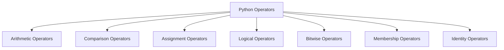

### Arithmetic Operators

**Python Arithmetic Operators**

Python arithmetic operators are commonly used to carry out mathematical operations including addition, subtraction, multiplication, and division.

* They are compatible with integers, variables, and expressions.
* In addition to the standard arithmetic operators, there are operators for modulus, exponentiation, and floor division.

| Operator | Name | Example |
| :--- | :--- | :--- |
| + | Addition | $10 + 20 = 30$ |
| - | Subtraction | $20 - 10 = 10$ |
| * | Multiplication | $10 * 20 = 200$ |
| / | Division | $20 / 10 = 2$ |
| % | Modulus | $22 \% 10 = 2$ |
| ** | Exponent | $4**2 = 16$ |
| // | Floor Division | $9 // 2 = 4$ |

### Arithmetic Operators Demonstration

```python
a = 21
b = 10
# Addition
print ("a + b :", a + b)
# Subtraction
print ("a - b :", a - b)
# Multiplication
print ("a * b :", a * b)
# Division
print ("a / b :", a / b)
# Modulus
print ("a % b :", a % b)
# Exponent
print ("a ** b :", a ** b)
# Floor Division
print ("a // b :", a // b)
```

This code defines the two variables "a" and "b." It then applies several arithmetic operations to them (including addition, subtraction, multiplication, division, modulus, exponentiation, and floor division) and outputs the results.

**Output**

a + b : 31\
a - b : 11\
a * b : 210\
a / b : 2.1\
a % b : 1\
a ** b : 16679880978201\
a // b : 2

### Comparison Operators

**Python Comparison Operators**

Python comparison operators are used to compare two values. Based on the comparison, they produce a Boolean value (True or False).

### Assignment Operators

**Python Assignment Operators**

Python assignment operators are used to assign values to variables in Python. The single equal symbol ($=$) is the most fundamental assignment operator. It assigns the value on the operator's right side to the variable on the operator's left side.

| Operator | Name | Example |
| :--- | :--- | :--- |
| $=$ | Assignment Operator | $a = 10$ |
| $+=$ | Addition Assignment | $a += 5$ (Same as $a = a + 5$) |
| $-=$ | Subtraction Assignment | $a -= 5$ (Same as $a = a - 5$) |
| $*=$ | Multiplication Assignment | $a *= 5$ (Same as $a = a * 5$) |
| $/=$ | Division Assignment | $a /= 5$ (Same as $a = a / 5$) |
| $\%=$ | Remainder Assignment | $a \%= 5$ (Same as $a = a \% 5$) |
| $* *=$ | Exponent Assignment | $a **= 2$ (Same as $a = a ** 2$) |
| $//=$ | Floor Division Assignment | $a //= 3$ (Same as $a = a // 3$) |

**Assignment Operators Execution**

# Assignment Operator
a = 10

# Addition Assignment
a += 5
print ("a += 5 :", a)

# Subtraction Assignment
a -= 5
print ("a -= 5 :", a)

# Multiplication Assignment
a *= 5
print ("a *= 5 :", a)

# Division Assignment
a /= 5
print ("a /= 5 :", a)

# Remainder Assignment
a %= 3
print ("a %= 3 :", a)

# Exponent Assignment
a **= 2
print ("a **= 2 :", a)

# Floor Division Assignment
a //= 3
print ("a //= 3 :", a)

The Python assignment operators are shown in this code in the Python Editor. It begins with the value of 'a' equal to 10, and then goes through the steps of addition, subtraction, multiplication, division, remainder, exponentiation, and floor division, updating 'a' as necessary and outputting the results.

**Output**

a += 5 : 105

a -= 5 : 100

a *= 5 : 500

a /= 5 : 100.0

a %= 3 : 1.0

a **= 2 : 1.0

a //= 3 : 0.0

### Bitwise Operators

**Python Bitwise Operators**

Python bitwise operators execute operations on individual bits of binary integers. They work with integer binary representations, performing logical operations on each bit location. Python includes various bitwise operators, such as AND (&), OR (|), NOT (~), XOR (^), left shift (<<), and right shift (>>).

| Operator | Name | Example |
| :--- | :--- | :--- |
| & | Binary AND | Sets each bit to 1 if both bits are 1 |
| \| | Binary OR | Sets each bit to 1 if one of the two bits is 1 |
| ^ | Binary XOR | Sets each bit to 1 if only one of two bits is 1 |

3. Assignment Operators
4. Logical Operators
5. Membership Operators
6. Identity Operators
7.


### Arithmetic Operations Reference

**Arithmetic Operators**

Mathematical operations including addition, subtraction, multiplication, and division are commonly carried out using Python arithmetic operators.

* They are compatible with integers, variables, and expressions.
* In addition to the standard arithmetic operators, there are operators for modulus, exponentiation, and floor division.

| Operator | Name | Example |
| :--- | :--- | :--- |
| + | Addition | $10 + 20 = 30$ |
| - | Subtraction | $20 - 10 = 10$ |
| * | Multiplication | $10 * 20 = 200$ |
| / | Division | $20 / 10 = 2$ |
| % | Modulus | $22 \% 10 = 2$ |
| ** | Exponent | $4 ** 2 = 16$ |
| // | Floor Division | $9 // 2 = 4$ |

**Arithmetic Operations Script**

a = 21
b = 10

# Addition
print ("a + b : ", a + b)

# Subtraction
print ("a - b : ", a - b)

# Multiplication
print ("a * b : ", a * b)

# Division
print ("a / b : ", a / b)

# Modulus
print ("a % b : ", a % b)

# Exponent
print ("a ** b : ", a ** b)

# Floor Division
print ("a // b : ", a // b)

This code defines the two variables "a" and "b." It then applies several arithmetic operations to them (including addition, subtraction, multiplication, division, modulus, exponentiation, and floor division) and outputs the results.

**Output**

a + b : 31

a - b : 11

a * b : 210

a / b : 2.1

a % b : 1

a ** b : 16679880978201

a // b : 2

### Comparison Operations Reference

**Comparison Operators**

To compare two values, Python comparison operators are needed. Based on the comparison, they produce a Boolean value (True or False).

| Operator | Name | Example |
| :--- | :--- | :--- |
| ==, !=, >, < | Equal | $4 == 5$ is not true. |
| >=, <= | Not Equal | $4 != 5$ is true. |
| | Greater Than | $4 > 5$ is not true. |
| | Less Than | $4 < 5$ is true. |
| | Greater than or Equal to | $4 >= 5$ is not true. |
| | Less than or Equal to | $4 <= 5$ is true. |

**Comparison Example Script**

a = 4
b = 5

# Equal
print ("a == b :", a == b)

# Not Equal
print ("a != b :", a != b)

# Greater Than
print ("a > b :", a > b)

# Less Than
print ("a < b :", a < b)

# Greater Than or Equal to
print ("a >= b :", a >= b)

# Less Than or Equal to
print ("a <= b :", a <= b)

This code compares the values of python variables 'a' and 'b' and prints if they are equal, not equal, greater than, less than, more than or equal to, and less than or equal to each other.

**Output**

```
a == b : False
a != b : True
a > b : False
a < b : True
a >= b : False
a <= b : True
```

### Assignment Operations Reference

**Assignment Operators**

Python assignment operators are used to assign values to variables in Python. The single equal symbol ($=$) is the most fundamental assignment operator. It assigns the value on the operator's right side to the variable on the operator's left side.

| Operator | Name | Example |
| :--- | :--- | :--- |
| $=$ | Assignment Operator | $a = 10$ |
| $+=$ | Addition Assignment | $a += 5$ (Same as $a = a + 5$) |
| $-=$ | Subtraction Assignment | $a -= 5$ (Same as $a = a - 5$) |
| $*=$ | Multiplication Assignment | $a *= 5$ (Same as $a = a * 5$) |
| $/=$ | Division Assignment | $a /= 5$ (Same as $a = a / 5$) |
| $\%=$ | Remainder Assignment | $a \%= 5$ (Same as $a = a \% 5$) |
| $**=$ | Exponent Assignment | $a **= 2$ (Same as $a = a ** 2$) |
| $//=$ | Floor Division Assignment | $a //= 3$ (Same as $a = a // 3$) |

### Assignment Operators Demonstration

```python
# AssignmentOperator
a = 10
# Addition Assignment
a += 5
print ("a += 5 :", a)
# Subtraction Assignment
a -= 5
print ("a -= 5 :", a)
# Multiplication Assignment
a *= 5
print ("a *= 5 :", a)
# Division Assignment
a /= 5
print ("a /= 5 :",a)
# Remainder Assignment
```

a %= 3
print ("a %= 3 : ", a)

# Exponent Assignment
a **= 2
print ("a **= 2 : ", a)

# Floor Division Assignment
a //= 3
print ("a //= 3 : ", a)

The Python assignment operators are shown in this code in the **Python Editor**. It begins with the value of 'a' equal to 10, and then goes through the steps of addition, subtraction, multiplication, division, remainder, exponentiation, and floor division, updating 'a' as necessary and outputting the results.

**Output**

a += 5 : 105

a -= 5 : 100

a *= 5 : 500

a /= 5 : 100.0

a %= 3 : 1.0

a **= 2 : 1.0

a //= 3 : 0.0

### Bitwise Operations Reference

**Bitwise Operators**

Python bitwise operators execute operations on individual bits of binary integers. They work with integer binary representations, performing logical operations on each bit location. Python includes various bitwise operators, such as AND (&), OR (|), NOT (~), XOR (^), left shift (<<), and right shift (>>).

| Operator | Name | Example |
| :--- | :--- | :--- |
| & | Binary AND | Sets each bit to 1 if both bits are 1 |
| \| | Binary OR | Sets each bit to 1 if one of the two bits is 1 |
| ^ | Binary XOR | Sets each bit to 1 if only one of two bits is 1 |

---

<!-- page 11 | Advanced operators: bitwise, logical, identity, and membership -->

## Advanced operators: bitwise, logical, identity, and membership

### Bitwise Operators

| Operator | Name | Description |
| :--- | :--- | :--- |
| ~ | Binary Ones Complement | Inverts all the bits |
| << | Binary Left Shift | Shift left by pushing zeros in from the right and let the leftmost bits fall off |
| >> | Binary Right Shift | Shift right by pushing copies of the leftmost bit in from the left, and let the rightmost bits fall off |

**Bitwise Operations Example**

a = 60 # 60 = 0011 1100

b = 13 # 13 = 0000 1101

# Binary AND

c = a & b # 12 = 0000 1100

print ("a & b : ", c)

# Binary OR

c = a | b # 61 = 0011 1101

print ("a | b : ", c)

# Binary XOR

c = a ^ b # 49 = 0011 0001

print ("a ^ b : ", c)

# Binary Ones Complement

c = ~a # -61 = 1100 0011

print ("~a : ", c)

# Binary Left Shift

c = a << 2; # 240 = 1111 0000

print ("a << 2 : ", c)

# Binary Right Shift

c = a >> 2; # 15 = 0000 1111

print ("a >> 2 : ", c)

The binary representations of the numbers 'a and b' are subjected to bitwise operations in this code. It displays the results of binary AND, OR, XOR, Ones Complement, Left Shift, and Right Shift operations.

**Output**

a & b : 12

a | b : 61

a ^ b : 49

~a : -61

a >> 2 : 240

a >> 2 : 15

### Logical Operators

**Python Logical Operators**

Python logical operators are used to compose Boolean expressions and evaluate their truth values. They are required for the creation of conditional statements as well as for managing the flow of execution in programs.

Python provides three basic logical operators:

1. AND
2. OR
3. NOT

| Operator | Description | Example |
| :--- | :--- | :--- |
| and Logical AND | If both of the operands are true then the condition becomes true. | (a and b) is true. |
| or Logical OR | If any of the two operands is non-zero then the condition becomes true. | (a or b) is true. |
| not Logical NOT | Used to reverse the logical state of its operand | Not(a and b) is false. |

**Example: Logical Operators**

```python
x = 5
y = 10
if x > 3 and y < 15:
    print("Both x and y are within the specified range")
```

The code assigns the values 5 and 10 to variables x and y. It determines whether x is larger than 3 and y is less than 15. If both conditions are met, it writes "Both x and y are within the specified range."

**Output**

Both x and y are within the specified range

### Membership Operators

**Python Membership Operators**

Python membership operators are used to determine whether or not a certain value occurs within a sequence. They make it simple to determine the membership of elements in various Python data structures such as lists, tuples, sets, and strings.

Python includes two primary membership operators:

1. `in`
2. `not in`

| Operator | Description | Example |
| :--- | :--- | :--- |
| in | Evaluates to true if it finds a variable in the specified sequence and false otherwise. | x in y, here in results in a 1 if x is a member of sequence y. |
| not in | Evaluates to true if it does not find a variable in the specified sequence and false otherwise. | x not in y, here not in results in a 1 if x is not a member of sequence y. |

**Example: Membership Operators**

```python
fruits = ["apple", "banana", "cherry"]
print("banana" in fruits)
```

The code defines a list of fruits and tests to see if the word "banana" appears in the list. If it is present, "True" is printed on screen.

**Output**

```
True
```

### Identity Operators

**Python Identity Operators**

Python identity operators are used to compare two objects' memory addresses rather than their values. If the two objects refer to the same memory address, they evaluate to True; otherwise, they evaluate to False.

Python includes two identity operators:

1. `is`
2. `is not`

| Operator | Description | Example |
| :--- | :--- | :--- |
| is | Evaluates to true if the variables on either side of the operator point to the same object and false otherwise | x is y, here are results in 1 if id(x) equals id(y) |
| is not | Evaluates to false if the variables on either side of the operator point to the same object and true otherwise | x is not y, there are no results in 1 if id(x) is not equal to id(y). |

**Example: Identity Operators**

```python
x = 10
```

y = 5

print(x is y)

The expression `x is y` checks whether `x` and `y` refer to the same object. Use `==` to compare their values; for example, `x == y` is `False` here.

**Output**

False

### Operator Precedence

When an expression or statement involves multiple operators, it is resolved using standard operator precedence:

| Precedence | Operator sign | Operator name |
| :--- | :--- | :--- |
| Highest | `**` | Exponentiation |
| | `+X`, `-X`, `~X` | Unary positive, unary negative, bitwise negation |
| | `*`, `/`, `//`, `%` | Multiplication, division, floor division, modulus |
| | `+`, `-` | Addition, subtraction |
| | `<<`, `>>` | Left-shift, right-shift |
| | `&` | Bitwise AND |
| | `^` | Bitwise XOR |
| | `|` | Bitwise OR |
| | `==`, `!=`, `<`, `<=`, `>`, `>=`, `is`, `is not` | Comparison, Identity |
| | `not` | Boolean NOT |
| | `and` | Boolean AND |
| Lowest | `or` | Boolean OR |

Example 5.4. Consider the assignment statement

$R = A + 3 < B * 1 \text{ or } C \text{ and } D$

Let the values of the variables be $A = 1, B = 5, C = -1, \text{ and } D = \text{ True}$. Figure 5.1 shows the structure of the evaluation. The numbers shown in the circle denote the order in which the various operators are applied. The final result is 1, which is assigned to R.

College

### Bitwise Shift and Complement Reference

| Operator | Name | Description |
| :--- | :--- | :--- |
| ~ | Binary Ones Complement | Inverts all the bits |
| << | Binary Left Shift | Shift left by pushing zeros in from the right and let the leftmost bits fall off |
| >> | Binary Right Shift | Shift right by pushing copies of the leftmost bit in from the left, and let the rightmost bits fall off |

**Example of Python Bitwise Operators**

```python
a = 60 # 60 = 0011 1100
b = 13 # 13 = 0000 1101
# Binary AND
c = a & b # 12 = 0000 1100
print ("a & b : ", c)
# Binary OR
c = a | b # 61 = 0011 1101
print ("a | b : ", c)
# Binary XOR
c = a ^ b # 49 = 0011 0001
print ("a ^ b : ", c)
# Binary Ones Complement
c = ~a # -61 = 1100 0011
print ("~a : ", c)
# Binary Left Shift
c = a << 2; # 240 = 1111 0000
print ("a << 2 : ", c)
# Binary Right Shift
c = a >> 2; # 15 = 0000 1111
print ("a >> 2 : ", c)
```

The binary representations of the numbers 'a and b' are subjected to bitwise operations in this code. It displays the results of binary AND, OR, XOR, Ones Complement, Left Shift, and Right Shift operations.

**Output**

```text
a & b : 12
a | b : 61
a ^ b : 49
~a : -61
```

a >> 2 : 240

a >> 2 : 15

### Logical Operations Reference

* Python logical operators are used to compose Boolean expressions and evaluate their truth values.
* They are required for the creation of conditional statements as well as for managing the flow of execution in programs.
* Python has three basic logical operators: AND, OR, and NOT.

| Operator | Description | Example |
| :--- | :--- | :--- |
| and Logical AND | If both of the operands are true then the condition becomes true. | (a and b) is true. |
| or Logical OR | If any of the two operands is non-zero then the condition becomes true. | (a or b) is true. |
| not Logical NOT | Used to reverse the logical state of its operand | Not(a and b) is false. |

**Example of Logical Operators**

x = 5 y = 10 if x > 3 and y < 15: print("Both x and y are within the specified range") The code assigns the values 5 and 10 to variables x and y. It determines whether x is larger than 3 and y is less than 15. If both conditions are met, it writes "Both x and y are within the specified range."

**Output**

Both x and y are within the specified range

### Membership Operations Reference

* Python membership operators are used to determine whether or not a certain value occurs within a sequence.
* They make it simple to determine the membership of elements in various Python data structures such as lists, tuples, sets, and strings.
* Python has two primary membership operators: the in and not in operators.

| Operator | Description | Example |
| :--- | :--- | :--- |
| in | Evaluates to true if it finds a variable in the specified sequence and false otherwise. | x in y, here in results in a 1 if x is a member of sequence y. |
| not in | Evaluates to true if it does not find a variable in the specified sequence and false otherwise. | x not in y, here not in results in a 1 if x is not a member of sequence y. |

**Example of Membership Operators**

fruits = ["apple", "banana", "cherry"]

print("banana" in fruits)

The code defines a list of fruits and tests to see if the word "banana" appears in the list. If it is present, "True" is printed on screen.

**Output**

True

### Identity Operations Reference

* Python identity operators are used to compare two objects' memory addresses rather than their values.
* If the two objects refer to the same memory address, they evaluate to True; otherwise, they evaluate to False.
* Python includes two identity operators: the is and is not operators.

| Operator | Description | Example |
| :--- | :--- | :--- |
| is | Evaluates to true if the variables on either side of the operator point to the same object and false otherwise | x is y, here are results in 1 if id(x) equals id(y) |
| is not | Evaluates to false if the variables on either side of the operator point to the same object and true otherwise | x is not y, there are no results in 1 if id(x) is not equal to id(y). |

**Example of Identity Operators**

x = 10

y = 5 print(x is y) The expression `x is y` checks whether `x` and `y` refer to the same object. Use `==` to compare their values; for example, `x == y` is `False` here.

**Output**

False

### Evaluation Order Reference

When an expression or statement involves multiple operators then it will be resolve using the following operator precedence chart :


Example 5.4. Consider the assignment statement

$R = A + 3 < B * 1 \text{ or } C \text{ and } D$

Let the values of the variables be $A = 1, B = 5, C = -1$, and $D = \text{True}$. Figure 5.1 shows the structure of the evaluation. The numbers shown in the circle denote the order in which the various operators are applied. The final result is 1, which is assigned to R.

---

<!-- page 12 | Operator precedence, associativity, and expression evaluation trees -->

## Operator precedence, associativity, and expression evaluation trees

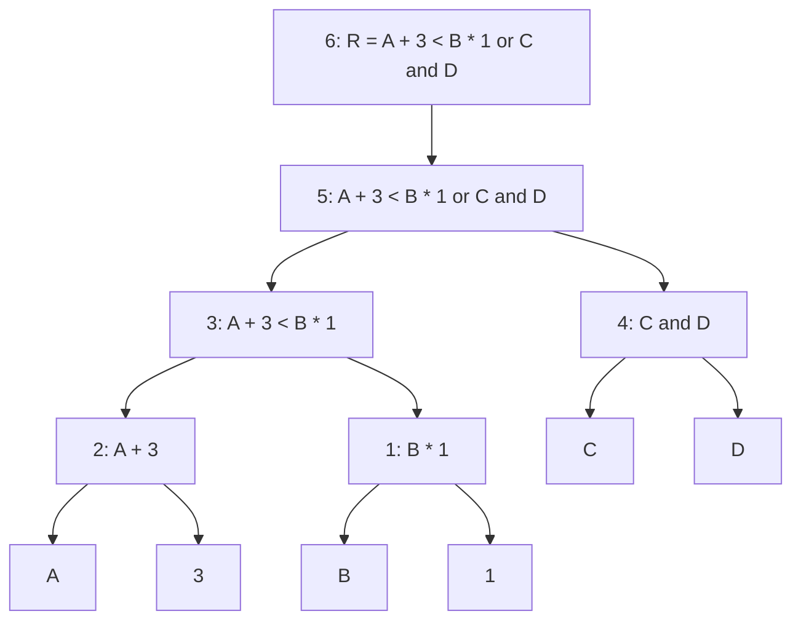

### Evaluation of an Arithmetic Expression

| Order | Operation | Resultant |
|---:|---|---:|
| 1 | `B*1` | 5 |
| 2 | `A+3` | 4 |
| 3 | `A+3 < B*1` | 1 |
| 4 | `C&&D` | 1 |
| 5 | `A+3 < B*1 || C&&D` | 1 |
| 6 | `R = A+3 < B*1 || C&&D` | 1 |

---

$$
R = A + 3 < B * 1 \text{ or } C \text{ and } D
$$


| Order | Operation | Resultant |
| :---: | :---: | :---: |
| 1 | $B * 1$ | 5 |
| 2 | $A + 3$ | 4 |
| 3 | $A + 3 < B * 1$ | 1 |
| 4 | $C \& \& D$ | 1 |
| 5 | $A + 3 < B * 1 \, || \, C \& \& D$ | 1 |
| 6 | $R = A + 3 < B * 1 \, || \, C \& \& D$ | 1 |

Evaluation of an arithmetic expression

53

---

---

<!-- page 13 | Worked practice problems and university examination questions -->

## Worked practice problems and university examination questions

### Short Answer Questions (Part A)

#### 1. Jigsaw Puzzle via Trial and Error

**Trial and Error Method**

Trial and error is a problem-solving technique where different possibilities are tried, and errors are eliminated until the correct solution is found.

Steps to solve a jigsaw puzzle:

1. Sort the pieces by edges, corners, and colors.
2. Assemble the border frame using edge and corner pieces.
3. Work on distinct sections by grouping similar colors or patterns.
4. Test and fit pieces through systematic trial and error.
5. Combine assembled clusters and fill the remaining gaps.

#### 2. Checking Numeric String Input

To verify whether a string consists entirely of numeric characters, use string methods such as `isdigit()` or `isnumeric()`.

```python
# Input string
input_string = "12345"

# Check if the input is numeric
if input_string.isdigit():
    print(f"The input '{input_string}' is numeric.")
else:
    print(f"The input '{input_string}' is not numeric.")
```

#### 3. Problem-Solving Strategy Selection

**Sudoku Puzzle (Final Cells)**

Backtracking is the most suitable strategy. It is effective for problems involving complex constraints. You can systematically try placing candidate numbers in empty cells and backtrack whenever a conflict arises, exploring valid branches efficiently.

**Family Trip Planning**

Means-ends analysis is the most suitable strategy. This approach breaks down the overarching goal into manageable subproblems (destination, flights, accommodation) and resolves difference reductions while honoring budget constraints.

#### 4. Python Expression Evaluation

Evaluate the following expressions:

1. `(50 - 5 * 6) // 4`
2. not $(10 < 5)$ or $(5 == 5)$
3. `True and 5`

**Evaluation Steps:**

- **Expression 1:** $(50-5*6)//4$
  1. Inside parentheses: $5*6=30$
  2. Subtraction: $50-30=20$
  3. Floor division: $20//4=5$ (Result: `5`)

- **Expression 2:** `not` $(10 < 5) \rightarrow$ evaluates to `False`, so `not False` evaluates to $(\text{False}) \rightarrow$. The second comparison $(5 == 5) \rightarrow$ evaluates to `True`. Thus, `True or True` $\rightarrow$ evaluates to `True`.

- **Expression 3:** In a logical `and` operation, if the first operand is truthy, Python evaluates and returns the second operand. Since `True` is truthy $\rightarrow$, the expression evaluates to `5`.

### Long Answer Questions (Part B)

#### 1(a). Backtracking Applied to Sudoku

**Backtracking**

Backtracking is a problem-solving strategy in which a solution is constructed incrementally. Whenever the current path violates a constraint and cannot lead to a valid solution, the algorithm backtracks to undo the previous step and attempt the next available alternative.

**Backtracking Procedure for Sudoku:**

1. **Choose an empty cell:** Select the next unassigned cell in the grid.
2. **Try candidate numbers:** For numbers 1 through 9, check whether placing the candidate satisfies row, column, and 3x3 subgrid constraints.
3. **Assign and recurse:** If valid, assign the candidate number and recursively attempt to fill the remaining cells.
4. **Backtrack:** If no valid number can be placed in the current cell, clear the cell and return to the previous cell to try its next candidate.
5. **Termination:** The process terminates when all cells are filled (success) or all candidates are exhausted without a solution.

#### 1(b). Heuristic Approach to Restaurant Selection

**Heuristics**

Heuristics are rule-of-thumb strategies or shortcuts used to make rapid, satisfactory decisions without exhaustively evaluating every possibility.

1. **Define Key Criteria:** Determine the critical decision factors, such as price range, proximity, cuisine type, and customer ratings.
2. **Gather Data:** Collect relevant information from food delivery apps, online review portals, and recommendations from peers.
3. **Apply Heuristic Rules:** Apply practical decision rules to prune alternatives rapidly:
   - Rule 1: "Filter only restaurants with aggregate ratings of 4.0 stars or higher."
   - Rule 2: "Limit selection to venues within a 3 km radius to minimize transit time."
4. **Make the Final Decision:** Select the top-ranked option matching all heuristic thresholds.

#### 2(a). Means-Ends Analysis for Software Development

**Means-Ends Analysis**

Means-ends analysis reduces the difference between the current state and the goal state by establishing intermediate subgoals and selecting operators to achieve them.

1. **Identify the Goal:** Build a fully functional, integrated campus management system.
2. **Decompose into Subproblems (Means):**
   - *Student Management Module:* Maintain enrollment and student profile records.
   - *Attendance Module:* Record, calculate, and report attendance metrics.
   - *Examination Module:* Process course schedules, marks, and grade sheets.
   - *Library Module:* Track book cataloging, issues, and returns.
   - *Administration Module:* Handle staff records, circulars, and notifications.
3. **Execution Plan:**
   - *Requirement Analysis:* Elicit specifications from administrative staff, faculty, and students.
   - *System Design:* Define architecture, data models, and module interfaces.
   - *Iterative Implementation:* Code and unit-test modules in priority order.
   - *Integration:* Connect modules into a unified database and interface.
   - *Testing and Verification:* Validate system consistency against edge cases.
   - *Deployment and Maintenance:* Roll out the system into production with user training.

#### 2(b). Radius Calculation from Circle Area

Given the area of a circle, the radius is calculated using the formula $r = \sqrt{\frac{\text{area}}{\pi}}$ using Python's `math` module.

```python
import math
area = float(input("Enter the area:"))
if area > 0:
    radius = math.sqrt(area/math.pi)
    print("The radius is", radius)
else:
    print("Error: the area must be positive")
```

#### 3(a). Six Problem-Solving Steps: Area of a Circle

| Step | Description |
|---|---|
| 1 | Understand the problem (find area, radius given) |
| 2 | Identify inputs/outputs (radius $\to$ area) |
| 3 | Plan / formula ($A = \pi \times r^2$) |
| 4 | Sub-problems (input $\to$ square $\to$ multiply $\to$ output) |
| 5 | Implement (calculate area using program or formula) |
| 6 | Review / verify (check result correctness) |

1. **Understand the Problem:** Read requirements to identify given parameters and expected results. Here, calculate the area of a circle given its radius.
2. **Identify Inputs and Outputs:**
   - Input: Radius ($r$)
   - Output: Area ($A$)
3. **Devise a Plan:** Apply the geometric formula $\text{Area} = \pi \times r^2$.
4. **Decompose into Subproblems:**
   - Read radius value from user.
   - Compute radius squared.
   - Multiply result by $\pi$.
   - Display calculated area.
5. **Implement the Plan:** Execute the computation programmatically.

```python
import math
r = float(input("Enter radius of the circle: "))
area = math.pi * r**2
print(f"Area of the circle is: {area}")
```

6. **Review and Verify:** Validate output against known test values. For instance, if radius $= 5$, then $\text{area} \approx 78.54$, verifying formula accuracy.

#### 3(b). Basic Python Data Types

**Integer (`int`)**

Whole numbers, positive or negative, without fractional parts.

$$
\begin{aligned}
  \text{age} &= 25 \\
  \text{year} &= -2025
  \end{aligned}
$$

**Floating-Point (`float`)**

Real numbers containing a decimal point.

$$
\begin{aligned}
\text{price} &= 99.99 \\
\text{temperature} &= -4.5
\end{aligned}
$$

**String (`str`)**

An ordered sequence of characters enclosed within single or double quotation marks.

$$
\begin{aligned}
\text{name} &= "\text{Alice}" \\
\text{greeting} &= '\text{Hello, World!}'
\end{aligned}
$$

#### 4(a). Algorithms vs. Heuristics

**Algorithm**

An algorithm is an unambiguous, step-by-step procedure that guarantees a correct solution to a problem when carried out.

- Follows deterministic rules.
- Guarantees precision and correctness.
- May be computationally expensive or slow for large search spaces.

**Heuristic**

A heuristic is a rule-of-thumb strategy that finds a good-enough solution quickly without guaranteeing theoretical optimality.

- Uses shortcuts or informed approximations.
- Drastically reduces search time.
- Suitable for complex, large, or NP-hard problem domains.

**Comparison Example:**

- *Problem:* Selecting a dinner restaurant in an unfamiliar city.
- *Algorithmic Approach:* Scrape and inspect every restaurant menu, price listing, and review across the city $\rightarrow$ select the absolute optimal choice (accurate but prohibitive).
- *Heuristic Approach:* Ask a local resident for their favorite nearby spot $\rightarrow$ dine there (rapid, practical, and satisfactory).

#### 4(b). Converting Minutes to Hours and Minutes

Given an integer representing total minutes, integer division `//` extracts total hours, while the modulus operator `%` extracts the remaining minutes.

```python
minutes = int(input("Enter time in minutes:"))
hours = minutes // 60
remaining_minutes = minutes % 60
print(f"{hours} hour(s) and {remaining_minutes} minute(s)")
```
