<!-- page 1 | Module 1 · source page 2 -->

# UCEST 105: ALGORITHMIC THINKING WITH PYTHON

# MODULE 1

## SYLLABUS MODULE 1 PART 1

**PROBLEM-SOLVING STRATEGIES:-** Problem-Solving strategies defined, Importance of understanding multiple problem-solving strategies, Trial and Error, Heuristics, Means-Ends Analysis, and Backtracking ( Working backward).

## INTRODUCTION

A computer performs tasks by following instructions. To get the result we want, we first need to understand the problem and then describe the required steps clearly. A problem is a situation whose solution is not immediately obvious.

A problem can be described using four elements:

- Initial situation
- Goal
- Set of resources
- Commitment.

When these elements are clear, a problem is well-defined; when one or more are unclear, it may be ill-defined. Problems are commonly grouped into two types:

1. **Well-defined problems** have specific goals, clear constraints, and criteria for recognizing a solution.
2. **Ill-defined problems** have unclear goals or constraints and may allow several reasonable solutions.

### Q1. Differentiate between Well-defined problems and Ill-defined problems.

| | Well-defined Problems | Ill-defined Problems |
|---|---|---|
| 1. | Clear goals and Objectives | Unclear and Vague goals and Objectives |
| 2. | Specific, measurable outcomes | Multiple , conflicting outcomes |
| 3. | Well defined constraints | Ambiguous or uncertain constraints |


<!-- page 2 | Module 1 · source page 3 -->

| | | |
|---|---|---|
| 4. | Relevant data available | Insufficient data available |
| 5. | Single, Identifiable Solution | Multiple possible solutions |
| 6. | Logical, step by step approach | Requires creative, iterative approach |
| 7. | Ex : Chess Game | Ex: Paint a beautiful picture |

*Q2. State any three Well-defined and Ill-defined problems, Justify your answer.*

### **Well-Defined Problems**
These problems have clear goals, a defined path to a solution, and specific criteria for determining when the problem is solved. Let's explore three examples:

1. **Mathematical Equation:**
   - **Problem:** Solve the equation $2x+3=7$.
   - **Why it's Well-Defined:** The problem has a clear goal (find the value of $x$), a specific method (solve for $x$ using algebraic rules), and a definite solution ($x=2$).

2. **Crossword Puzzle:**
   - **Problem:** Complete a standard crossword puzzle.
   - **Why it's Well-Defined:** The crossword has a clear objective (fill in all the squares with the correct words), a specific set of rules, and a single correct solution.

3. **Recipe Execution:**
   - **Problem:** Bake a chocolate cake using a provided recipe.
   - **Why it's Well-Defined:** The goal (bake a chocolate cake) is clear, the process is outlined step-by-step in the recipe, and success is measurable by the outcome (a baked cake that meets the description).

### **Ill-Defined Problems**
These problems are ambiguous, lack clear criteria for solutions, and often have multiple possible solutions. Here are three examples:

1. **Designing a Sustainable City:**
   - **Problem:** How can we design a sustainable city for the future?
   - **Why it's Ill-Defined:** The problem is broad, with no single clear solution. Factors such as environmental impact, social equity, and economic viability must be balanced, and stakeholders may disagree about what counts as a sustainable city.


<!-- page 3 | Module 1 · source page 4 -->

2. **Writing a Novel:**

- **Problem:** Write a compelling novel that appeals to a broad audience.
- **Why it's Ill-Defined:** The goal is subjective (what is "compelling"?), the process can vary widely, and success is difficult to measure. Different readers may have different interpretations of what makes the novel appealing.

3. **Resolving Workplace Conflict:**

- **Problem:** Resolve a conflict between two team members in the workplace.
- **Why it's Ill-Defined:** The problem is complex with no clear solution. It involves interpersonal dynamics, emotions, and communication styles, and what works in one situation might not work in another. Multiple solutions may exist, and the "right" one depends on various factors.

**Summary**

- **Well-Defined Problems** are structured, with a clear path and solution.
- **Ill-Defined Problems** are open-ended, ambiguous, and often subjective.

Understanding the nature of the problem helps in choosing the right approach to solving it.

**Problem-Solving strategies defined**

A problem-solving strategy is a planned approach for finding a solution. It helps us define the problem, choose suitable steps, evaluate the result, and adjust the approach when needed.

**Importance of Understanding Problem solving Strategies**

Knowing several problem-solving strategies helps us choose an approach that fits the task. Trial and error can work when there are few options; an algorithm is useful when the steps are known; heuristics can help when time or information is limited. Being able to compare and change strategies improves flexibility, reasoning, and the chance of finding a workable solution.


<!-- page 4 | Module 1 · source page 5 -->

Benefits include :-

- Adaptability
- Efficiency
- Improved Outcomes
- Skill Development

Steps Involved in Problem Solving:- Identify the problem, Define the problem, List all the possible solutions, Evaluate options and Implement the solution.

Problem Solving Strategies

Commonly used problem-solving strategies include

1. Trial and Error
2. Algorithm
3. Heuristics
4. Means-Ends Analysis
5. Backtracking

1. Trial and Error

A trial-and-error approach to problem-solving involves trying a number of different solutions and ruling out those that do not work. This approach can be a good option if you have a very limited number of options available. Using trial and error, one has to try different solutions until the problem is solved.

Steps :
1. Identify the problem – Start by clearly defining the issue
2. Try a solution – Attempt a possible solution
3. Evaluate the outcome – Check if the solution worked.
4. Repeat – If the solution failed, try a different one.

Example
1. In terms of a broken printer for example, one could try checking the ink levels, and if that doesn’t work, you could check to make sure the paper tray isn’t jammed. Or maybe the printer isn’t actually connected to a laptop.
2. Restarting phone, turning off WiFi, turning off bluetooth in order to determine why your phone is malfunctioning.

Although trial and error is not typically one of the most time-efficient strategies, it is a commonly used one.


<!-- page 5 | Module 1 · source page 6 -->

## 2. Algorithm

An algorithm is a finite, ordered set of unambiguous steps for solving a problem. A correct algorithm produces the required result for inputs within its stated assumptions; not every algorithm guarantees a solution for every possible input.

*Example: Algorithm for Baking a Cake*

1. Gather ingredients
2. Preheat Oven
3. Mix Ingredients
4. Prepare baking Pan
5. Pour Batter
6. Bake
7. Check for Doneness
8. Cool and Serve

When you run a search on the Internet, search engines like Google use algorithms to decide which entries will appear first in your list of results. Facebook also uses algorithms to decide which posts to display on your newsfeed.

## 3. Heuristics

A heuristic is a practical shortcut or rule of thumb that can help us make a decision quickly, especially when time or information is limited. Unlike a complete algorithm, a heuristic does not guarantee the best or a correct answer; it offers a useful way to make progress. Different types of heuristics are used in different types of situations, but the impulse to use a heuristic occurs when one of five conditions is met:-
- When one is faced with too much information
- When the time to make a decision is limited
- When the decision to be made is unimportant
- When there is access to very little information to use in making the decision
- When an appropriate heuristic happens to come to mind in the same moment

Different types of heuristics are :

### a. Breaking a large goal or task into a series of smaller steps.

For example : For completing a large research project, they typically start by
- students typically brainstorm, develop a thesis or main topic,
- research the chosen topic, organize their information into an outline,
- write a rough draft


<!-- page 6 | Module 1 · source page 7 -->

MODULE 1 \hfill UCEST105: Algorithmic thinking with Python

- revise and edit the rough draft, develop a final draft, organize the references list
- proofread their work before turning in the project.

The large task becomes less overwhelming when it is broken down into a series of small steps.

b. Guess and Check

This method involves making a guess, checking if it solves the problem, and refining the guess based on outcomes. This method is particularly useful when the problem doesn't have an obvious solution, and you can try different possibilities until you find the correct one.

How Guess and Check Works:

1. Make an Initial Guess: Start by guessing a possible solution based on what you know.
2. Check the Guess: Determine if your guess solves the problem.
3. Refine the Guess: If the guess is incorrect, use the information you gained from checking to make a better guess.
4. Repeat: Continue guessing, checking, and refining until you find the correct solution.

Example : Find the number that when added to 15, gives 32.

Solution :-
- Initially make a guess as the number is 20.
- Check the guess, 15+20=35, since 35 is larger than the expected answer, refine the guess based on the outcome.
- Now refine the guess taking the number as 18.
- Check the guess 15+18=33.
- Now the answer is very close.
- Again lower the guess to 17 and check, 15+17=32, and the guess is now correct.

c. Working backwards

This is a useful heuristic in which you begin solving the problem by focusing on the end result.

Consider this example: Imagine you need to arrive at an important meeting by 3.00pm. To plan your day using the working backwards heuristic, you need to start from the end result and think about the steps needed to get there. You consider that it takes 30 minutes to get to the meeting location, so you need to leave by 2.30pm. Before that you need an hour to prepare, so you start getting ready at 1.30pm. If you also want to finish a task that takes an hour before getting ready, you need to start that by 12.30pm. By working backwards, you effectively plan your day to ensure you arrive at the meeting on time.

6 \hfill Prepared by, Shabana V Subair, Asst. Prof., KMEA Engg. College


<!-- page 7 | Module 1 · source page 8 -->

4. Means Ends Analysis (MEA)

Means-ends analysis compares the current state with the goal, identifies the differences, and chooses smaller actions (sub-goals) that reduce those differences.

Example 1 : The Tower of Hanoi problem.

The **Tower of Hanoi** is a mathematical puzzle. There are three rods, source(A), Auxiliary (B) and Destination(C). Rod A contains a set of disks stacked to resemble a tower, with the largest disk at the bottom and the smallest disk at the top. **Fig:- 1** Illustrate the initial configuration of the rods for 3 disks. The objective is to transfer the entire tower of disks in rod A to rod C maintaining the same order of the disks.

**Rules:**

1. Only one disk can be transferred at a time.
2. Each move consists of taking the upper disk from one of the rods and placing it on the top of another rod i.e. a disk can only be moved if it is the uppermost disk of the rod.
3. Never a larger disk is placed on a smaller disk during the transfer.


**Fig 1:- Initial State**

The solution to the puzzle calls for an application of recursive functions and recurrence relations.

A recursive procedure for the solution of the problem for N number of disks is as follows:

1. Move the top $N-1$ disks from rod A to rod B, using rod C as the auxiliary rod.
2. Move the largest disk from rod A to rod C.
3. Move the $N-1$ disks from rod B to rod C, using rod A as the auxiliary rod.

The minimum number of moves required to solve a Tower of Hanoi puzzle is given by $2^N - 1$, where N is the number of disks. i.e., if there are 14 disks, then minimum number of moves needed = $(2^{14}) - 1 = 16383$.

The pictorial representation of the recursive procedure for N=4 disks is shown in Fig 2:-


<!-- page 8 | Module 1 · source page 9 -->

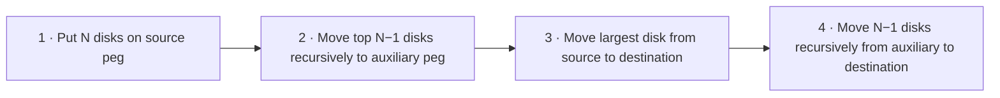

Example of Tower of Hanoi for n=3.


Minimum number of moves with 3 disks= $2^n-1 = 2^3-1 = 7$.


<!-- page 9 | Module 1 · source page 10 -->

Example of Tower of Hanoi for n=4.


Minimum number of moves with 4 disks=$ 2^n - 1 = 2^4 - 1 = 15$.

Example 2: Imagine you want to plan a road trip from Trivandrum to Kashmir. Here is how you might use means-ends analysis:

A. Define the Goal: Your ultimate goal is to drive from Trivandrum to Kashmir.
B. Analyze the Current State: You start in Trivandrum with your car ready to go.
C. Identify the Differences: The primary difference is the distance between Trivandrum and Kashmir, which is approximately 3,700 kilometers.
D. Set Sub-Goals (Means):
   a. Fuel and Rest Stops: Determine where you will need to stop for fuel and rest.
   b. Daily Driving Targets: Break the trip into daily segments, driving 500-600 kms per day.
   c. Route Planning: Choose the most efficient and scenic route, considering highways, weather conditions, and places you want to visit.
E. Implement the Plan:
   a. Day 1: Drive from Trivandrum to Bangalore, Karnataka (approx. 720 km). Refuel in Madurai, Tamil Nadu. Overnight stay in Bangalore.


<!-- page 10 | Module 1 · source page 11 -->

b. Day 2: Drive from Bangalore to Hyderabad, Telangana (approx. 570 km). Refuel in Anantapur, Andhra Pradesh. Overnight stay in Hyderabad.
c. Day 3: Drive from Hyderabad to Nagpur, Maharashtra (approx. 500 km). Refuel in Adilabad, Telangana. Overnight stay in Nagpur.
d. Day 4: Drive from Nagpur to Jhansi, Uttar Pradesh (approx. 580 km). Refuel in Sagar, Madhya Pradesh. Overnight stay in Jhansi.
e. Day 5: Drive from Jhansi to Agra, Uttar Pradesh (approx. 290 km). Refuel in Gwalior, Madhya Pradesh. Overnight stay in Agra. Visit the Taj Mahal.
f. Day 6: Drive from Agra to Chandigarh (approx. 450 km). Refuel in Karnal, Haryana. Overnight stay in Chandigarh.
g. Day 7: Drive from Chandigarh to Jammu (approx. 350 km). Refuel in Pathankot, Punjab. Overnight stay in Jammu.
h. Day 8: Drive from Jammu to Srinagar, Kashmir (approx. 270 km).
F. Adjust as Needed: Throughout the trip, you may need to make adjustments based on traffic, road conditions, or personal preferences.

By breaking down the long journey into smaller segments and addressing each part systematically, you can effectively plan and complete the road trip. This method ensures that you stay on track and make steady progress toward your final destination, despite the complexity and distance of the trip.

5. Backtracking
Backtracking is a problem solving technique that involves trying different options until the right solution is found. Backtracking algorithms are problem solving strategies that explore various options to find the optimal solution. They operate by testing different paths, and if a path doesn't lead to a solution they backtrack and try another route until they find the correct one. Backtracking can also be defined as a technique that involves finding a solution incrementally by trying different options and undoing them if they lead to a dead end.

Example given below:-

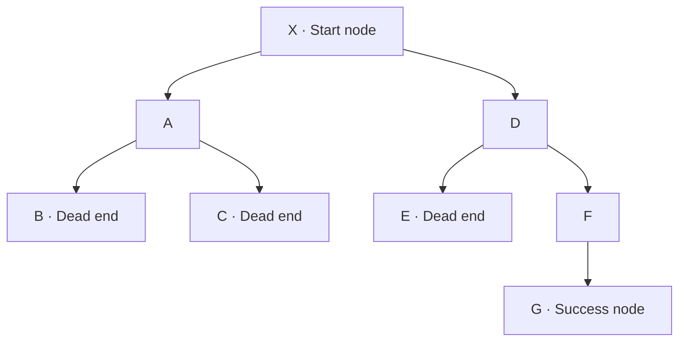


<!-- page 11 | Module 1 · source page 12 -->

In the above problem, the Start node is X and destination node is G. We first move through the route X-A-B but it reaches a dead end, then we backtrack again and select another path X-A-C, it also encounters a dead end. Try different paths X-D-E, also reach a dead end. Next we move through X-D-F-G and reach the destination node.

When a path reaches a dead end, return to the most recent choice point and try an untested option. Continue until a solution is found or every option has been explored. Examples include solving a maze or a Sudoku puzzle. (Repeatedly guessing a phone PIN is not a good example: devices may lock after too many attempts.)

SYLLABUS MODULE - 1 PART - 2

THE PROBLEM-SOLVING PROCESS:- Computer as a model of computation, Understanding the problem, Formulating a model, Developing an algorithm, Writing the program, Testing the program, and Evaluating the solution.

Basic Model of a Computer
Computer science is all about solving problems with computers. The problems that we want to solve can come from any real-world problem or from the abstract world. We need to have a standard systematic approach to solving problems. Since we will be using computers to solve problems, it is important to first understand the computer's information processing model.

Von Neumann Architecture

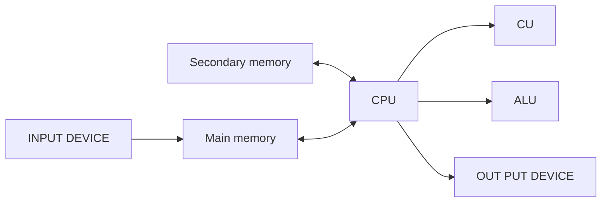

BLOCK DIAGRAM OF A DIGITAL COMPUTER


<!-- page 12 | Module 1 · source page 13 -->

The model shown in figure below assumes a single CPU (Central Processing Unit). Many computers today have multiple CPUs, so it can be imagined the model in the figure can be duplicated multiple times within the computer.

### INSTRUCTION EXECUTION CYCLE

CPU executes an instruction in a series of steps called *instruction execution cycle*. An instruction cycle (sometimes called a **fetch–decode–execute** cycle) is the process by which a computer retrieves a program instruction from its memory, determines what actions to perform, and carries out those actions to produce meaningful output.

The cycle is commonly summarized as fetch, decode, and execute. Some descriptions include a separate write-back step for saving a result:

1. **Fetch** the next instruction from memory.
2. **Decode** the instruction to determine the required operation.
3. **Execute** the operation.
4. **Store** the result in a register or memory, when needed.

This cycle is then repeated for the next instruction.

<center><b>Instruction Execution Cycle</b></center>

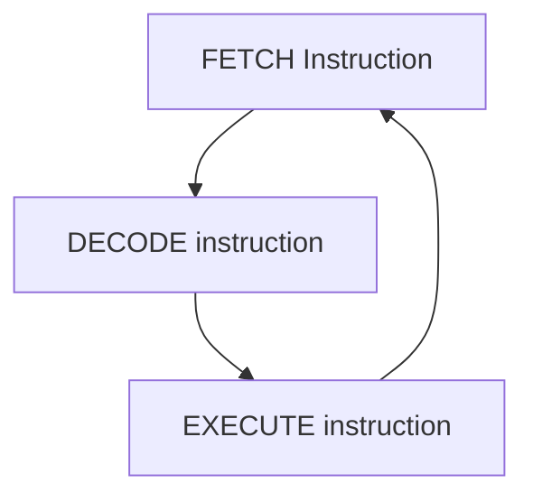

A typical computer architecture comprises of three main components:

1. **Input/Output (I/O) Unit**
2. **Central Processing Unit (CPU)**
3. **Memory Unit**


<!-- page 13 | Module 1 · source page 14 -->

The I/O unit consists of the input unit and output devices. The input devices accept data from the user, which the CPU processes. The output devices transfer the processed data (information) to the user. The memory unit is used to store the input data, the instructions required to process the input, and the output information.

### Input devices

Input devices allow users to input data into the computer for processing. The data input to a computer can be in the form of text, audio, video, etc. Input devices are classified into two categories:

**1. Human data entry devices** -- the user enters data into the computer by typing or pointing a device to a particular location. Some examples are

   a. **Keyboard** -- the most common typing device.
   
   b. **Mouse** -- the most common pointing device. You move the mouse around on a mouse pad and a small pointer called cursor follows your movements on the computer screen.
   
   c. **Trackball** -- an alternative to a mouse which has a ball on the top. The cursor on the computer screen moves in the direction in which the ball is moved.
   
   d. **Joystick** -- has a stick whose movement determines the cursor position.
   
   e. **Graphics tablet** -- converts hand-drawn images into a format suitable for computer processing.

**2. Source data entry devices** -- They use special equipment to collect data at the source, create machine-readable data, and feed them directly into the computer. This category comprises:

   a. **Audio input devices** -- It uses human voice or speech to give input. Microphones are an example.
   
   b. **Video input devices** -- They accept input in the form of video or images. Video cameras and webcams are examples.
   
   c. **Optical input devices** -- They use optical technology (light source) to input the data into computers. Some common optical input devices are scanners and barcode readers.


<!-- page 14 | Module 1 · source page 15 -->

## Output devices

An output device takes processed data from the computer and converts them into information that can be understood by humans. The output could be on paper or can be audio, video, etc. Output devices are classified as follows:

1. **Hard copy devices** – The output obtained on paper or any surface is called hard copy output. The hard copy can be stored permanently and is portable. The hard copy output can be read or used without a computer. Examples in this category include:

   a. **Printer** – prints information on paper. The information could be textual or even images. Drum printers, laser printers, and inkjet printers are some commonly used printer types.

   b. **Plotter** – used to produce very large drawings on paper using very fine pens. Flatbed plotters and drum plotters are two types of plotters.

2. **Soft Copy Devices** – Generates a soft copy of the output on a visual display (monitor), audio unit, or video unit. The soft copy can be stored and sent via e-mail to other users. It also allows corrections to be made. The soft copy output requires a computer to be read or used. This category comprises:

   a. **Monitor** – the primary output device of a computer.

   b. **Video output devices** – produce output in the form of video or images. An example is a screen image projector or data projector that displays information from the computer onto a large white screen.

   c. **Audio output devices** – speakers, headsets, or headphones, are used for audio output (in the form of sound) from a computer.

## Central Processing Unit

The Central Processing Unit (CPU) or the processor, is known as the brain of a computer. It consists of an Arithmetic Logic Unit (ALU) and a Control Unit (CU). In addition, the CPU also has a set of registers which are temporary storage areas for holding data and instructions.

### I. Arithmetic Logic Unit

This unit consists of two sub-units, namely arithmetic and logic units.

   a. **Arithmetic unit** – performs arithmetic operations like addition, subtraction, multiplication, and division, on the data.


<!-- page 15 | Module 1 · source page 16 -->

b. **Logic unit** -- performs logical operations like comparisons of data values.

## II. Registers

Registers are high-speed storage areas within the CPU but have the least storage capacity. They store data, instructions, addresses, and intermediate results of processing. Some of the commonly used registers are:

a. **Accumulator (ACC)** -- stores the result of arithmetic and logic operations.

b. **Instruction Register (IR)** -- holds the instruction that is currently being executed.

c. **Program Counter (PC)** -- holds the address of the next instruction to be processed.

## III. Control Unit

This unit manages and coordinates the operations of all parts of the computer. The functions of this unit are:

* generate control signals.
* obtain instructions from the memory, interpret them, and then direct the ALU to execute those instructions.
* communicate with I/O devices.
* decides when to fetch the data and instructions, what operation to perform, where to store the results.

### Memory unit

Memory is the storage space in a computer where data to be processed and instructions required for processing are stored. The various memories can be organized hierarchically called memory hierarchy as shown in figure below.

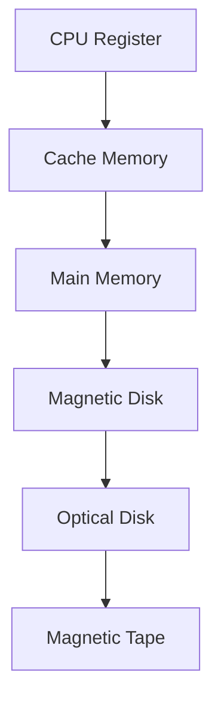

Fig:- Memory Hierarchy


<!-- page 16 | Module 1 · source page 17 -->

Memory is primarily of two types:

I. **Internal Memory**: memories that reside on the motherboard.

Internal memory includes:

1. **Registers** -- high-speed storage areas within the CPU.

2. **Primary memory** -- main memory of the computer. It is categorized into two:
   a. **Random Access Memory (RAM)** -- used for storing data and instructions during the operation of a computer. Data to be processed is brought to RAM from input devices or secondary memory. It is a volatile memory, because stored data may get lost if it is not saved. After processing, the results are stored in RAM before being sent to the output device.

   b. **Read Only Memory (ROM)** -- a non-volatile primary memory. It does not lose its content when the power is switched off. ROM, as the name implies, has only reading capability and no write capability. After the information is stored in ROM, it is permanent and cannot be modified. Therefore, ROM is used to store the data that does not require a change, for example, the boot information (means computer's startup process).

3. **Cache memory** -- placed between RAM and CPU and stores the data and instructions that are frequently used.

II. **External memory**: memories that are outside the motherboard.

External memory includes:

1. **Magnetic tape** -- a plastic tape with magnetic coating mounted. It is a sequential access device, meaning that the data can be read only in the order in which it is stored.

2. **Magnetic disk** -- a thin plastic or metallic circular plate coated with magnetic oxide and encased in a protective cover. Hard disk is an example.


<!-- page 17 | Module 1 · source page 18 -->

3. **Optical disk** – a flat circular disk coated with reflective plastic material that can be altered by laser light. CDs and DVDs are examples.

### Computer as a model of computation

Regarding problem solving, we will apply the above model for simple computations. For larger and more complex problems, we need to iterate (i.e., repeat) the input/process/output stages multiple times in sequence.

**Definition:** Problem Solving is the sequential process of analyzing information related to a given situation and generating appropriate response options.

In solving a problem, there are some well-defined steps to be followed. It is noted that the problem is easily solved by simply getting the input, computing something and producing the output. We now examine the **steps to problem solving** within the context of various examples.

<u>Steps involved in problem solving</u>

1. **Understanding the problem**

2. **Formulating a model**

3. **Developing an algorithm**

4. **Writing the program**

5. **Testing the program**

6. **Evaluating the solution**

<u>Understanding the problem</u>

* The First Step in Problem Solving
  * It may sound simple, but the first step in solving any problem is to fully understand it.
* Identifying Input, Output and Processing Needs

**EXAMPLE 1:- Finding sum of two numbers**

* INPUT REQUIREMENTS

  We need to understand the input we require to solve the problem. For the given example, input requirement is two numbers whether it can be of any type, like real number, integer number or whole number.


<!-- page 18 | Module 1 · source page 19 -->

* OUTPUT REQUIREMENTS
  Next we need to understand the output to obtain corresponding to the input given. if we are giving real numbers as input the output obtained will be real, or if it is integer then output will be integer.
* PROCESSING CONSIDERATIONS
  We also need to understand how to reach the solution from the input given i.e, to understand a path to reach the solution.

Formulating a model

* The next step is to understand the processing part of the problem.
* In the example given, the sum of two numbers is to be computed. A model is thus needed for computing the sum of two numbers. If there is no such "formula", one must be developed.
* Assuming that the input data is two integer numbers Number1, Number2 representing a two numbers
  $$\text{Sum} = \text{Number1} + \text{Number2}$$
The main point to understand this step in the problems solving process is that it is all about figuring out how to make use of the available data to compute an answer.

Developing an algorithm

* Next step is to develop a precise plan of what the computer is expected to do.
* An **algorithm** is a set of steps for solving a particular problem, or
  An **algorithm** is a precise sequence of instructions for solving a problem.
* To develop an algorithm, the instructions must be represented in a way that is understandable to a person who is trying to figure out the steps involved.
* Two commonly used representations for an algorithm is by using
  i. **Pseudo code** :- an informal representation of an algorithm without using any programming syntax
  ii. **Flowchart** :- a diagrammatic representation of an algorithm
* Example: - Let's use a simple math problem to develop an algorithm, a pseudo code and a flow chart
  * Algorithm
    
    Step 1: Start
    Step 2: Input the first number
    Step 3: Input the second number
    Step 4: Add the two numbers
    Step 5: Display the result


<!-- page 19 | Module 1 · source page 20 -->

* Step 6: End
* Pseudo code

    1. Start
    2. Input Number1
    3. Input Number2
    4. Sum = Number1 + Number2
    5. Output Sum
    6. End

* Flow chart


Writing the Program

* Once the algorithm is defined, the next step is to convert it into a form that a computer can execute. This process is known as **writing the program, coding, or implementing an algorithm**.
* The next step is to transform the algorithm into a set of instructions that can be understood by the computer. Writing a program is often called "coding" or "implementing an algorithm".
* Program in Python
    * $\text{n1} = 21$
    * $\text{n2} = 7$
    * $\text{sum} = \text{n1} + \text{n2}$
    * $\text{print('Sum =', \text{sum})$


<!-- page 20 | Module 1 · source page 21 -->

- After writing the code, test it with various inputs to ensure it works as expected. Debug and compile the program to find issues or errors that arise during testing.
- **Debugging** is the method of **finding and fixing errors**.
- **Compiling** is the process of **converting a program into instructions that can be understood by the computer**.

<u>Testing the Program</u>

- Once a program has been written and compiled, the next critical step is to ensure that whether the program performs the intended task correctly. Testing the program involves running it with various inputs to verify its accuracy and reliability.
- Running a program is the process of telling the computer to evaluate the compiled instructions.
- If the program runs correctly, the expected output should be displayed.
- If the program doesn't run correctly for some inputs then the user has to go back to the algorithm development step that handles all situations that could arise.
  - If the output is incorrect, it could be due to the algorithm not being properly implemented in the program. or
  - A flaw or a bug in the algorithm itself, which does not account for certain situations.
  - **Bugs** are errors in a program that cause it to produce incorrect or undesirable results.

<u>Evaluating the Solution</u>

- Once a program produces a result, revisit the original problem.
- Ensure the output is formatted as a proper solution.
- Examine if the result aligns with the original intent.
- Determine if the output meets the problem's requirements.
  - Remember that the computer executes instructions as given. The user must interpret results to determine effectiveness.

**EXAMPLE 2: Calculate the average grade for all students in a class.**

<u>Understanding the problem</u>

INPUT REQUIREMENT: get all the grades ... possibly by typing them in via the keyboard
- Key Questions:
  - What input data/information is available?
  - What does the data represent, and in what format?
  - Is anything missing from the data?
  - Do I have everything needed to solve the problem?


<!-- page 21 | Module 1 · source page 22 -->

MODULE 1				UCEST105: Algorithmic thinking with Python

* Example: Grades as Input:
  * Grades could be numbers (0-100) or letter grades (A-F).
  * If the grade is represented in number then it can be whole integer(eg:- 73) or real number(e g:- 73.45)
  * Consider how to handle missing grades (eg: - if we do not have the grade for absent students: for instance should we be able to include that person in our average calculation as 0 or ignore them when computing the average)?

OUTPUT REQUIREMENTS: output the answer to either the monitor, or to the printer

* What output is needed, and in what format (text, number, graph)?
* Example: Should the result be a number, a letter grade, or a pie chart

PROCESSING CONSIDERATIONS: Add them all up and compute the average grade. Understand the processing steps required to achieve the desired output. This understanding guides the problem-solving process.

**Formulating a model**

In the example given, the average of the incoming grades is to be computed. A model (or formula) is thus needed for computing the average of a bunch of numbers. If there is no such "formula", one must be developed.

Assuming that the input data is a bunch of integers or real numbers $x1, x2, \dots, xn$ representing a grade percentage, the following computational model may apply:

$Average 1 = (x1 + x2 + x3 + \dots + xn) / n$ where the output will be a number from 0 to 100.

Letter grades (such as A, B−, and C+) cannot be averaged directly. One possible model is to map each letter grade to a numeric value, then average those values. The mapping must match the grading system being used.
* Convert letter grades to numerical equivalents
$$
\begin{matrix}
A + = 12 & A = 11 & A- = 10 & B + = 9 \\
B = 8 & B- = 7 & C + = 6 & C = 5 \\
C- = 4 & D + = 3 & D = 2 & D- = 1 & F = 0
\end{matrix}
$$
* If it is assumed that these newly assigned grade numbers are $y1, y2, \dots, yn$, then the following computational model may be used:

$Average 2 = (y1 + y2 + y3 + \dots + yn) / n$ where the result will be a number from 0 to 12.

If we want the output in percentage, you can convert it as:

$$\text{Percentage} = \frac{\text{Average on the 0--12 scale}}{12} \times 100$$


<!-- page 22 | Module 1 · source page 23 -->

The main point to understand this step in the problems solving process is that it is all about figuring out how to make use of the available data to compute an answer.

**Developing an algorithm:**

**Algorithm**

STEP 1: Start

STEP 2: Read number of students, n

STEP 2: Read the marks of n students

STEP 3: Compute average using the formula

STEP 4: Display Average

STEP 5: Stop

**Pseudo code**

1. Start

2. Input n

3. Input the marks of n students, x1, x2, x3, ..., xn

4. Average = (x1 + x2 + x3 + ... + xn) / n

5. Output Average

6. End

**Flow chart**

**Average of n numbers**

```mermaid
flowchart TD
A([Start]) --> B[x1, x2, ..., xn, Average]
B --> C[/Read x1, x2, ..., xn/]
C --> D[Average = (x1 + x2 + ... + xn) / n]
D --> E[/Print Average/]
E --> F([Stop])
```


<!-- page 23 | Module 1 · source page 24 -->

**Writing the program:**

```python
# Program in Python

n = int(input("Enter the number of students: "))
total = 0
for student in range(n):
    mark = float(input(f"Enter mark for student {student + 1}: "))
    total += mark
average = total / n
print(f"Average mark: {average:.2f}")
```

**Test the program:** You create a test suite with various types of numbers and check whether the output obtained is correct or not.

**EXAMPLE 3 : - A case study - The Discriminant calculator**

1. **Understanding the problem:** Here we formally define the problem by specifying the inputs and output.
   Input: The three coefficients a, b and c of the quadratic equation
   Output: The discriminant value D for the quadratic equation

2. **Formulating a model:** Develop a mathematical model for the solution, that is identify the mathematical expression for the quadratic equation discriminant D:
   $$D = b^2 - 4ac$$

3. **Developing an algorithm:** A possible algorithm (actually, a pseudocode) for our discriminant problem is given below:
   STEP 1: Start
   STEP 2: Read (a,b,c)
   STEP 3: d = b*b - 4*a*c
   STEP 4: Print (d)
   STEP 5: Stop

4. **Writing the program:** The Python program to calculate the discriminant is as follows:
   ```python
   #Input the coefficients
   a = int(input("Enter the value of first coefficient"))
   b = int(input("Enter the value of second coefficient"))
   c = int(input("Enter the value of third coefficient"))
   ```


<!-- page 24 | Module 1 · source page 25 -->

```python
#Find the discriminant
d = (b**2) - (4*a*c)
#Print the discriminant
print(d)
```

5. **Testing the program:** You create a test suite similar to the one shown in Table 1.2. Each row denotes a set of inputs (a,b, and c) and the expected output (d) with which the actual output is to be compared.

| Sl No | a | b | c | d |
|---:|---:|---:|---:|---:|
| 1 | 10 | 2 | 5 | -196 |
| 2 | 5 | 7 | 1 | 29 |
| 3 | 2 | 4 | 2 | 0 |
| 4 | 1 | 1 | 1 | -3 |
| 5 | 3 | 2 | 5 | -56 |
| 6 | 2 | 8 | 2 | 48 |

## SYLLABUS MODULE - 1 PART - 3

**ESSENTIALS OF PYTHON PROGRAMMING:**- Creating and using variables in Python, Numeric and String data types in Python, Using the math module, Using the Python Standard Library for handling basic I/O - print, input, Python operators and their precedence.

### Essentials of Python Programming

### INTRODUCTION

#### PROGRAMMING LANGUAGES

Programming languages are used to write programs that provide precise representations of algorithms and control the behavior of a computer. Each language has a unique set of keywords (words that it understands) and syntax (rules) for organizing program instructions.

Programming languages fall into three categories:

1. **Machine language:**- is what the computer can understand, but it is difficult for the programmer to understand. Machine languages consist of binary numbers only. No translation of the program is needed and it can be executed very fast. It is machine-dependent ie. A machine-level program written for one type of computer may not work on another type.


<!-- page 25 | Module 1 · source page 26 -->

Example 3.1. Assume that the opcode and operands occupy 4 bits each and that the opcode for addition is 1010, then to add 3 and 6, the binary code would be
$$\underbrace{1010}_{\text{add}} \underbrace{0011}_{3} \underbrace{0110}_{6}$$

2. **Assembly language:**- falls in between machine language and high-level language. It is similar to machine language, but easier to write code because it allows the programmer to use symbolic names (like ADD, SUB) for operations called **mnemonic codes** that are much easier to remember.

**Example :** *If the mnemonic code for addition is ADD, then to add 3 and 6, the assembly level code will be ADD 3, 6.*

_Machine languages and assembly languages are also called **low level languages**._

3. **High-level language:**- is easier to understand and use for the programmer but difficult for the computer. The programs written in high-level languages contain English-like statements as well as programming.

Eg:- C, FORTRAN, Pascal, Java, Python etc. that enables a programmer to write programs. High level language programs are easier to write, read, and understand. They are easily portable from one computer to another, since they are not machine-dependent.

**Example :** *To add 3 and 6, the high level language code will be 3+6.*

Here '+' is the operator for addition.

**TRANSLATOR SOFTWARE**

The computer can understand only machine code (strings of 0's and 1's). Thus when the program is written in other languages (assembly or high-level languages) has to be converted to machine code. This conversion is called **translation** and is performed by the translator software.

The original program is called **source code**, and the translated code (object code) is the **target code.**

There are three types of translator software as discussed below:

1. **Assembler :** is a software that converts a program written in assembly language into machine code.
2. **Compiler :** is a software that translates programs written in high-level language to machine code.
3. **Interpreter :** An interpreter executes a program through a runtime system. The exact process depends on the language implementation; it may process statements incrementally or use an intermediate representation.


<!-- page 26 | Module 1 · source page 27 -->

*Q: Differentiate between Compiler and Interpreter.*

| Compiler | Interpreter |
| :--- | :--- |
| A traditional compiler translates the program (often as a whole) | An interpreter executes program instructions through a runtime |
| Intermediate Object Code is **Generated** | No Intermediate Object Code is **Generated** |
| **Memory Requirement : More** (Since Obiect Code is Generated) | **Memory Requirement is Less** |
| Program need not be **compiled** every time | Every time higher level program is converted into lower level program |
| Errors are displayed after entire program is checked | Errors are displayed for every instruction interpreted (if any) |
| **Example :** C Compiler | **Example :** BASIC |

## INTRODUCTION TO PYTHON

Python is a **general purpose, high-level, interpreted** programming language developed by *Guido van Rossum* in the late 1980s at the National Research Institute for Mathematics and Computer Science in the Netherlands. Python is one of the most popular and widely used programming languages used for a set of tasks including **Console based, GUI based, web programming and data analysis**. Python is named after the comedy television show Monty Python's Flying Circus.

## FEATURES OF PYTHON

| No. | Python feature | No. | Python feature |
|---:|---|---:|---|
| 1 | Easy to Learn and Use | 8 | Easy to Maintain |
| 2 | Expressive Language | 9 | Extensible Feature |
| 3 | Interpreted Language | 10 | High-Level Language |
| 4 | Cross-platform Language | 11 | Broad Standard Library |
| 5 | Free and Open Source | 12 | Dynamic Typed |
| 6 | Object-Oriented Language | 13 | GUI Support |
| 7 | Interactive | 14 | Databases Support |


<!-- page 27 | Module 1 · source page 28 -->

## APPLICATIONS OF PYTHON

Python is a general purpose programming language. It is widely applied in various fields.
* **Data Science** : Python libraries like Numpy, Pandas, and Matplotlib are used for data analysis and visualization.
* **Web Applications** : Python frameworks like Django, and Pyramid, make the development and deployment of Web Applications easy.
* **Desktop GUI Applications**
* **Software Development**
* **Scientific and Numeric computations**
* **Business Applications**
* **Audio or Video based Applications.**

## START PROGRAMMING WITH PYTHON

There are two major Python versions, those are Python 2 and Python 3. Python 3 is more semantically correct and supports newer features. After successful installation of python software we can interpret or execute python script / program.

Python programs are commonly run in two ways:

1. **Using Interactive interpreter prompt**
2. **Using a script file**

### Using Interactive interpreter prompt:

Python provides us the feature to execute the python statement one by one at the interactive prompt. It is preferable in the case where we are concerned about the output of each line of our python program. To open the interactive mode, open the terminal (or command prompt) and type python3.

#### Through Command Prompt or Python Shell

```text
Microsoft Windows [Version 6.1.7601]
Copyright (c) 2009 Microsoft Corporation. All rights reserved.

C:\Users\Madhu>python3
Python 3.8.3 (tags/v3.8.3:6f8c832, May 13 2020, 22:20:19) [MSC v.1925 32 bit (Intel)] on win32
Type "help", "copyright", "credits" or "license" for more information.
>>> print("Hello")
Hello
>>> print("Welcome to Python")
Welcome to Python
>>>
```


<!-- page 28 | Module 1 · source page 29 -->

The Python shell is an interactive environment where you can enter statements and see their results immediately. Open a terminal and run `python3` (on some systems, use `python`) to start it.

`user@Ubuntu2204LTS:~$ python3`
`Python 3.10.12 (main, Jul 29 2024, 16:56:48) [GCC 11.4.0] on linux`
`Type "help", "copyright", "credits" or "license" for more information`

The symbol `>>>` is called the **shell prompt**. This symbol prompts you for Python statements. When you enter a statement in the shell, the Python interpreter processes it and displays the result, if any, then followed by a new prompt as shown below:

`>>> "Welcome to the world of Python programming"`
`'Welcome to the world of Python programming'`
`>>>`

### Using Script File

Interpreter prompt is good to run the individual statements of the code. However if we want to execute multiple python statements at a time instead of executing one by one, then we can use script files. We need to write our script into a file which can be executed later. For this purpose, open an editor like notepad, create a file named `filename.py` (python used `.py` extension) and write the python script in it.

```python
print("Hello !")
print("Welcome to Python Programming")
```

```
Hello !
Welcome to Python Programming
```

### Running as a script

1. Combine all the statements that you wish to execute into a Python program. Program is known as a script and should be saved with the **"py"** extension, for example `sample.py`.
2. You may use some text editor to create your script. **gedit**, **vim** are some of the editors that you can probably use.
3. Then open a terminal in the directory where the script is stored. To run your script (assuming the name is First.py), just give
$$\mathbf{python3\ First.py}$$

Now the script will be executed and you get the desired output.


<!-- page 29 | Module 1 · source page 30 -->

**Example** : Suppose you have written a script sample.py to display the message “My first Python program!”. This is how you run it (The second line below shows the output):

_user@Ubuntu2204LTS:~$ python3 First.py_

**My first Python program!**

## Comments in Python
- Comments are used in a programming language to describe the program or to hide some part of code from the interpreter.
- Comment is not a part of the program, but it enhances the interactivity of the program and makes the program readable.
- Python supports two types of comments:
  1. Single Line Comment
  2. Multi Line Comment

### Single Line Comment:
In case user wants to specify a single line comment, then comment must start with **'#'**

**Example:**
```python
# This is single line comment
print("Hello Python")
```
**Output:**
```
Hello Python
```

### Multi Line Comment:
Multi lined comment can be given inside triple quotes.

**Example:**
```python
"""This is
   Multiline
   Comment"""
print("Hello Python")
```
**Output:**
```
Hello Python
```

## Python Character Sets

A character set is a set of valid characters acceptable by a programming language in scripting.

### Character set
- Alphabets: All capital (A-Z) and small (a-z) alphabets.
- Digits: All digits 0-9.
- Special Symbols: Python supports all kind of special symbols like, " ' ; : ! ~ @ # $ % ^ ` & * ( ) _ + - = { } [ ] \
- White Spaces: White spaces like tab space, blank space, newline, and carriage return.


<!-- page 30 | Module 1 · source page 31 -->

## Python tokens

* A token is the smallest individual unit in a python program.
* All statements and instructions in a program are built with tokens.
* The various tokens in python are :

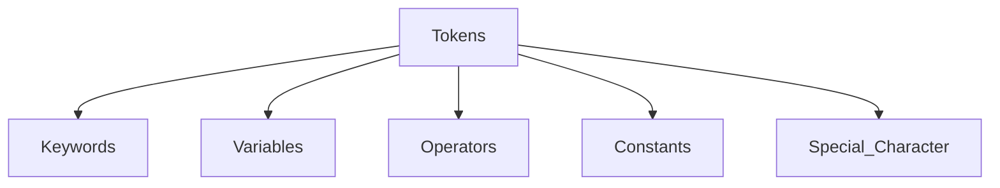

1. **Keyword (Reserved words)**
   * Keywords are words that have some special meaning or significance in a programming language.
   * They can't be used as variable names, function names, or for any other random purpose.

| | | | | |
|---|---|---|---|---|
| False | class | finally | is | return |
| None | continue | for | lambda | try |
| True | def | from | nonlocal | while |
| and | del | global | not | with |
| as | elif | if | or | yield |
| assert | else | import | pass | |
| break | except | in | raise | |

2. **Identifiers**
   * Identifiers are the names given to any variable, function, class, list, methods, etc. for their identification.
   * Python has some rules and regulations to name an identifier.
   * Rules to name an identifier:-
     * Python is **case-sensitive**. So case matters in naming identifiers. And hence **geeks** and **Geeks** are two different identifiers.
     * Identifiers start with a capital letter (A-Z) , a small letter (az) or an


<!-- page 31 | Module 1 · source page 32 -->

underscore(_).  
- It can't start with any other character.
- Except for letters and underscore, digits can also be a part of an identifier but can't be the first character of it.
- Any other special characters or whitespaces are strictly prohibited in an identifier.
- An identifier can't be a keyword.

### Valid and Invalid Identifiers

| IDENTIFIER | VALID? | REASON IF INVALID |
| :--- | :---: | :--- |
| `totalSales` | Yes | |
| `total_Sales` | Yes | |
| `total.Sales` | No | Cannot contain period |
| `4thQtrSales` | No | Cannot begin with digit |
| `totalSale$` | No | Cannot contain $ |

## Creating and using variables in Python

### Variable in Python
- A variable is a named memory location in which we can store values for the particular program. In other words, Variable is a name which is used to refer to memory location.
- Variable also known as **identifier** and used to hold value.
- In Python, when we assign any value to the variable that variable is declared automatically. Also, we don't need to specify the type of variable in Python.

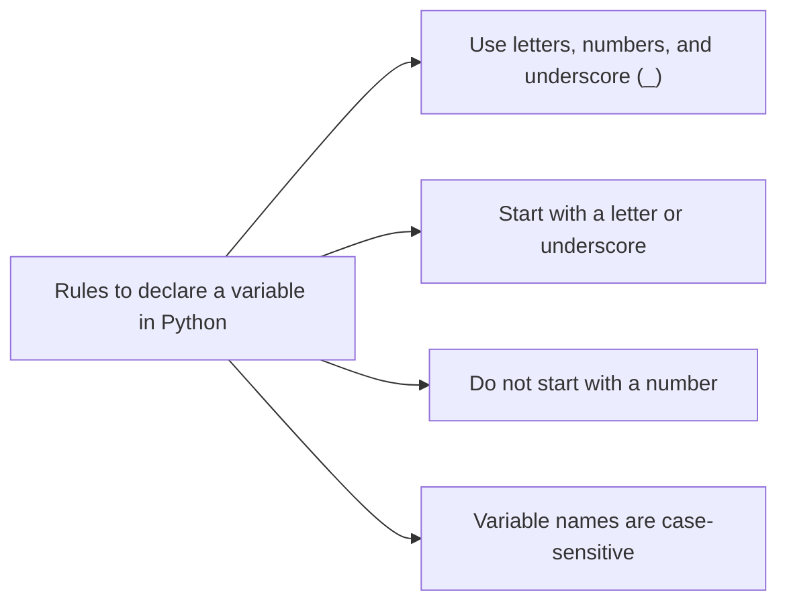

## EXAMPLE


<!-- page 32 | Module 1 · source page 33 -->

**Example: Vardemo.py**
```python
a=10 #integer
b="StudyGlance" #string
c=12.5 #float
print(a)
print(b)
print(c)
```

**output:**
```
$python3 Vardemo.py
10
StudyGlance
12.5
```

- Python allows us to assign a value to multiple variables and multiple values to multiple variables in a single statement which is also known as multiple assignment.

### EXAMPLE

**Assign single value to multiple variables :**

**Example: Vardemo1.py**
```python
x=y=z=50
print(x)
print(y)
print(z)
```

**output:**
```
$python3 Vardemo1.py
50
50
50
```

**Assign multiple values to multiple variables :**

**Example: Vardemo2.py**
```python
a,b,c=5,10,15
print(a)
print(b)
print(c)
```

**output:**
```
$python3 Vardemo2.py
5
10
15
```

### 3. Literals (Constants)

- Python literals are a data type and can hold any value type, such as strings, numbers, and more
- The way of using literals depends on its type.
- The various types of literals used in the Python program are as follows:
  - String literals
  - Numeric literals - integer, float, complex
  - Boolean literals
  - Literal Collections - list, tuple, set, dictionary

## Numeric and String data types in Python

### 4. Data Types

- Data Types specifies what type of data will be stored in variables.
- Variables can hold values of different data types.
- Python is dynamically typed, hence we need not define the type of the variable while declaring it.


<!-- page 33 | Module 1 · source page 34 -->

- The interpreter implicitly binds the value with its type.
- Python provides us the **type()** function which enables us to check the type of the variable.

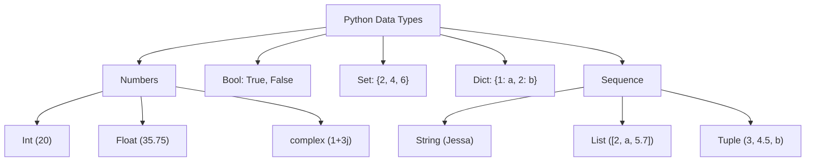

## A. Numeric datatype

- The numeric data type in Python represents the data that has a numeric value.
- A numeric value can be an integer, a floating number, or even a complex number.
- There are three numeric types in Python:
  1. **int**
  2. **float**
  3. **complex**

| | |
| --- | --- |
| **1. int:**<br>Int, or integer, is a whole number, positive or negative, without decimals, of unlimited length. | **Example:**<br>a=10<br>b=-12<br>c=123456789 |
| **2. float:**<br>Float or "floating point number" is a number, positive or negative, containing one or more decimals. | **Example:**<br>X=1.0<br>Y=12.3<br>Z=-13.4 |
| **3. complex:**<br>Complex numbers are written with a "j" as the imaginary part. | **Example:**<br>A=2+5j<br>B=-3+4j<br>C=-6j |

33
College


<!-- page 34 | Module 1 · source page 35 -->

EXAMPLE

**PROGRAM**

```python
num1 = 5
print(num1, 'is of type', type(num1))
num2 = 2.0
print(num2, 'is of type', type(num2))
num3 = 1 + 2j
print(num3, 'is of type', type(num3))
```

**OUTPUT**

```
5 is of type <class 'int'>
2.0 is of type <class 'float'>
(1+2j) is of type <class 'complex'>
```

**Type Conversion in Python**

* Python provides Explicit type conversion functions to directly convert one data type to another. It is also called as **Type Casting** in Python
* Python supports following functions
  1. `int()` : This function converts any data type to integer.
  2. `float()` : This function is used to convert any data type to a floating point number.
  3. `str()` : This function is used to convert any data type to a string.

EXAMPLE

**PROGRAM** | **OUTPUT**
---|---
```python
#convert from int to float:
x = float(1)

#convert from float to int:
y = int(2.8)

#convert from int to complex:
z = complex(1)

print(x)
print(y)
print(z)

print(type(x))
print(type(y))
print(type(z))
``` | ```
1.0
2
(1+0j)
<class 'float'>
<class 'int'>
<class 'complex'>
```


<!-- page 35 | Module 1 · source page 36 -->

## Escape sequence

The escape sequence is a sequence of characters treated as special when the Python interpreter encounters it in the string literal. An escape sequence begins with a backslash (\) and represents a special character inside a string.

| Code | Result |
|---|---|
| `\'` | Single Quote |
| `\\` | Backslash |
| `\n` | New Line |
| `\r` | Carriage Return |
| `\t` | Tab |
| `\b` | Backspace |
| `\f` | Form Feed |

## EXAMPLE

```python
1 print("Hello\nWorld")
2 print("Hello\tWorld")
3 print("This is a backslash: \\")
4 print('It\'s a beautiful day')
5 print("She said, \"Hello!\"")
```

```
Output
Hello
World
Hello   World
This is a backslash: \
It's a beautiful day
She said, "Hello!"
```

## B. Sequence Data Types in Python

- A sequence is an ordered collection of items. Depending on the type, its items may be characters or values of different data types.
- Sequences allow storing of multiple values in an organized and efficient fashion.
- There are several sequence data types of Python:


<!-- page 36 | Module 1 · source page 37 -->

- String
- List
- Tuple

a. String:- A string is a collection of one or more characters. Strings are represented by either single, double or triple quotes.

EXAMPLE

```python
# Creating a String
# with single Quotes
String1 = 'Welcome to the Geeks World'
print('String with the use of Single Quotes: ')
print(String1)

# with double Quotes
String1 = "I'm a Geek"
print("\nString with the use of Double Quotes: ")
print(String1)

# with triple Quotes
String1 = '''I'm a Geek and I live in a world of "Geeks"'''
print("\nString with the use of Triple Quotes: ")
print(String1)
```

Output:
```
String with the use of Single Quotes:
Welcome to the Geeks World

String with the use of Double Quotes:
I'm a Geek

String with the use of Triple Quotes:
I'm a Geek and I live in a world of "Geeks"

=== Code Execution Successful ===
```

b. List

List is an ordered sequence of some data written using square brackets([]) and commas(,).
List is mutable (means values in the list can be changed during execution time).

EXAMPLE

```python
# Creating a List
List = []
print("Blank List: ")
print(List)

# Creating a List of numbers
List = [10, 20, 14]
print("\nList of numbers: ")
print(List)
```

Output:
```
Blank List:
[]

List of numbers:
[10, 20, 14]
```


<!-- page 37 | Module 1 · source page 38 -->

c. Tuple

The tuple is another data type which is a sequence of data similar to a list. But it is immutable. That means data in a tuple is write-protected. Data in a tuple is written using parentheses and commas.

EXAMPLE

```python
var = ("Geeks", "for", "Geeks")
print(var)
```

Output:

```text
('Geeks', 'for', 'Geeks')
```

## C. Dictionary

A dictionary is a mapping of unique keys to values. In modern Python, dictionaries preserve insertion order. Dictionaries are written within curly braces in the form **key:value**.

PROGRAM

```python
capitals = {"USA":"Washington D.C.","France":"Paris", "India" : "New Delhi"}
print(type(capitals))
```

OUTPUT

```text
<class 'dict'>
```

## D. Set

Set is an unordered collection of unique items defined by values separated by commas inside braces {}.

```python
thisset = {"apple", "banana", "cherry"}
print(thisset)
```

OUTPUT

```text
{'apple', 'banana', 'cherry'}
```


<!-- page 38 | Module 1 · source page 39 -->

## E. Boolean

Boolean data type that has one of two possible values (usually denoted True and False) which is intended to represent the two truth values of Boolean algebra.

EXAMPLE

```text
Input: 1==1
Output: True
Input: 2<1
Output: False
```

```python
# Returns False as x is not equal to y
x = 5
y = 10
print(bool(x==y))
```

**Output**

```text
False
```

## Using the math module

* A module is a logical organization of Python code. Related code is grouped into a module which makes the code easier to understand and use.
* Math module is an in-built Python library made to simplify mathematical tasks in Python.
* It consists of various mathematical constants and functions that can be used after importing the math module.
* To use math function, command given below is used

$$\textbf{import math}$$

* Various functions in math module are:-

NUMERIC FUNCTIONS

1. `math.sqrt()`

   The `math.sqrt()` method returns the square root of a given number.
   ```text
   >>> math.sqrt(100)
   10.0
   >>> math.sqrt(3)
   1.7320508075688772
   ```


<!-- page 39 | Module 1 · source page 40 -->

2. math.ceil()

    The ceil() function approximates the given number to the smallest integer, greater than or equal to the given floating point number.
    >>> math.ceil(4.5867)
    5

3. math.floor()

    The `math.floor()` function returns the greatest integer less than or equal to the input.
    >>> math.floor(4.5687)
    4

4. math.fabs()

    Returns the absolute value of x
    >>> math.fabs(-5.5)
    5.5

5. math.pi

    A constant containing the value of PI (3.14...)
    >>> x = math.pi
    >>> print(x)
    3.14...

6. math.factorial()

    Used for finding factorial of a given in a single line
    >>> a=5
    >>> print("The factorial of", a, "is", math.factorial(a))
    The factorial of 5 is 120

7. math.gcd()

    Used to find the greatest common divisor of two numbers
    >>> a = 15
    >>> b = 5
    >>> print ("The gcd of 5 and 15 is : ")
    >>> print (math.gcd(b, a))
    The gcd of 5 and 15 is : 5


<!-- page 40 | Module 1 · source page 41 -->

LOGARITHMIC AND POWER FUNCTION

8. `math.exp()`

Used to calculate the power of e

>>> test = 4
>>> print (math.exp(test))
54.598150033144236

9. `math.pow()`

The `math.pow()` method receives two float arguments, raises the first to the second and returns the result. In other words, pow(2,3) is equivalent to 2\*\*3.
>>> math.pow(2,4)
16.0

10. `math.log()`

Used to calculate the logarithmic value of a with base b
>>> print ("The value of log 2 with base 3 is : ")
>>> print (math.log(2,3))
The value of log 2 with base 3 is : 0.6309297535714574

TRIGONOMETRIC AND ANGULAR FUNCTION

`sin()`, `cos()`, and `tan()` functions return the sine, cosine, and tangent of value passed as the argument.

PROGRAM

```python
import math
a = math.pi/6
print ("The value of sine of pi/6 is : ", end="")
print (math.sin(a))
print ("The value of cosine of pi/6 is : ", end="")
print (math.cos(a))
print ("The value of tangent of pi/6 is : ", end="")
print (math.tan(a))
```

OUTPUT

The value of sine of pi/6 is : 0.49999999999999994
The value of cosine of pi/6 is : 0.8660254037844387
The value of tangent of pi/6 is : 0.5773502691896257


<!-- page 41 | Module 1 · source page 42 -->

## Using the Python Standard Library for handling basic I/O - input(), print()

Python offers us several built-in functions that make it easy to create a program quickly. Two of the most commonly used built-in functions are the **input()** and **print()** functions that are used for frequent input and output operations, respectively.

### Python Input

To run an application, programmers often need to obtain input in Python from a user. The simplest way to do this is to use the **input()** function. The function pauses program execution to let the user type a line of information from the keyboard. When the user hits "Enter", the input is read and returned as a string.

Syntax:-

$$\text{input}([\langle\textit{prompt}\rangle])$$

where the prompt is an optional string that we wish to display for the user.

### EXAMPLE

```python
>>> name = input ('What is your name? - ')
>>> print ('Hello,', name)
```

**What is your name? - John**  
**Hello, John**

The `input()` function always returns a string. Convert it with `int()` or `float()` when the program needs a number.

### EXAMPLE

```python
>>> number = input ('What is your number? ')
```

**What is your number? 45**  
```python
>>> number
```
**'45'**  
```python
>>> int(number)
```
**45**  
```python
>>> float(number)
```
**45.0**


<!-- page 42 | Module 1 · source page 43 -->

Or

>>>price=float(input("Enter the price of each item"))
>>>print(price)

Enter the price of each item 50
50.0

For taking multiple inputs from the user in a single line we use the function split().

EXAMPLE

>>>x,y=input("Enter two numbers: ").split()
>>>print("No. of boys: ", x)
>>>print("No. of girls: ", y)
Enter two numbers: 23 22
No. of boys: 23
No. of girls: 22

Python Output

Once a program accepts input in Python and processes the data, it needs to present the data back to the user as output. You can choose to display the data output to the console directly or show it on a screen.

We use the print() function to display the output data to the (screen).

Syntax:-

$$\text{print}(\text{<obj>},...,\text{<obj>})$$

Using the above syntax, we can pass several objects (<obj>) in the print() function by separating them with a comma.

EXAMPLE
>>>print(100)

100

>>>num = 65
>>>print ('The value of the number is', num)


<!-- page 43 | Module 1 · source page 44 -->

The value of the number is 65

Another Syntax:-
$$\text{print(*objects, sep=' ', end='\n', file=sys.stdout, flush=False)}$$

EXAMPLE

# Python program to illustrate print()
# Passing sep and end parameters
>>>num = 7
>>>print('James Bond ', num, sep = '--> 00', end = '\n\n\n')
>>>a = 2
>>>print('Value of a: ', a, sep = '000', end = '\n')
>>>print('Car', 'Bike', 'Train', 'Plane', sep = ' | ', end = '\n\n')

OUTPUT

James Bond --> 007

Value of a: 0002

Car | Bike | Train | Plane

Python operators and their precedence

In Python, operators are **special symbols or keywords** that carry out operations on values and python variables. They serve as a basis for expressions, which are used to modify data and execute computations. Python contains several operators, each with its unique purpose.

Simple answer can be given using the expression $4 + 5$ is equal to 9. Here, 4 and 5 are called **operands** and $+$ is called **operator**.

Types of Python Operators

Python language supports various types of operators, which are:

1. **Arithmetic Operators**
2. **Comparison (Relational) Operators**


<!-- page 44 | Module 1 · source page 45 -->

3. Assignment Operators
4. Logical Operators
5. Bitwise Operators
6. Membership Operators
7. Identity Operators

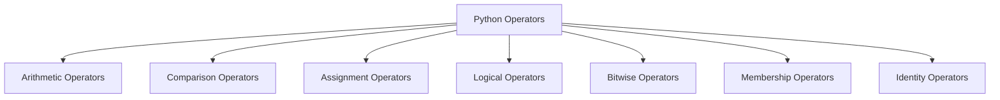

## 1. Python Arithmetic Operators

- Mathematical operations including addition, subtraction, multiplication, and division are commonly carried out using Python arithmetic operators.
- They are compatible with integers, variables, and expressions.
- In addition to the standard arithmetic operators, there are operators for modulus, exponentiation, and floor division.

| Operator | Name | Example |
| :--- | :--- | :--- |
| + | Addition | $10 + 20 = 30$ |
| - | Subtraction | $20 - 10 = 10$ |
| * | Multiplication | $10 * 20 = 200$ |
| / | Division | $20 / 10 = 2$ |
| % | Modulus | $22 \% 10 = 2$ |
| ** | Exponent | $4**2 = 16$ |
| // | Floor Division | $9 // 2 = 4$ |


<!-- page 45 | Module 1 · source page 46 -->

### Example of Python Arithmetic Operators

```python
a = 21
b = 10
# Addition
print ("a + b :", a + b)
# Subtraction
print ("a - b :", a - b)
# Multiplication
print ("a * b :", a * b)
# Division
print ("a / b :", a / b)
# Modulus
print ("a % b :", a % b)
# Exponent
print ("a ** b :", a ** b)
# Floor Division
print ("a // b :", a // b)
```

This code defines the two variables "a" and "b." It then applies several arithmetic operations to them (including addition, subtraction, multiplication, division, modulus, exponentiation, and floor division) and outputs the results.

**Output**

a + b : 31\
a - b : 11\
a * b : 210\
a / b : 2.1\
a % b : 1\
a ** b : 16679880978201\
a // b : 2

### 2. Python Comparison Operators

* To compare two values, Python comparison operators are needed.
* Based on the comparison, they produce a Boolean value (True or False).


<!-- page 46 | Module 1 · source page 48 -->

3. Python Assignment Operators

* Python assignment operators are used to assign values to variables in Python.
* The single equal symbol ($=$) is the most fundamental assignment operator.
* It assigns the value on the operator's right side to the variable on the operator's left side.

| Operator | Name | Example |
| :--- | :--- | :--- |
| $=$ | Assignment Operator | $a = 10$ |
| $+=$ | Addition Assignment | $a += 5$ (Same as $a = a + 5$) |
| $-=$ | Subtraction Assignment | $a -= 5$ (Same as $a = a - 5$) |
| $*=$ | Multiplication Assignment | $a *= 5$ (Same as $a = a * 5$) |
| $/=$ | Division Assignment | $a /= 5$ (Same as $a = a / 5$) |
| $\%=$ | Remainder Assignment | $a \%= 5$ (Same as $a = a \% 5$) |
| $* *=$ | Exponent Assignment | $a **= 2$ (Same as $a = a ** 2$) |
| $//=$ | Floor Division Assignment | $a //= 3$ (Same as $a = a // 3$) |

Example of Python Assignment Operators
\# Assignment Operator
a = 10
\# Addition Assignment
a += 5
print ("a += 5 :", a)
\# Subtraction Assignment
a -= 5
print ("a -= 5 :", a)
\# Multiplication Assignment
a *= 5
print ("a *= 5 :", a)
\# Division Assignment
a /= 5
print ("a /= 5 :",a)
\# Remainder Assignment


<!-- page 47 | Module 1 · source page 49 -->

a %= 3
print ("a %= 3 :", a)
# Exponent Assignment
a **= 2
print ("a **= 2 :", a)
# Floor Division Assignment
a //= 3
print ("a //= 3 :", a)

The Python assignment operators are shown in this code in the Python Editor. It begins with the value of 'a' equal to 10, and then goes through the steps of addition, subtraction, multiplication, division, remainder, exponentiation, and floor division, updating 'a' as necessary and outputting the results.

**Output**

a += 5 : 105

a -= 5 : 100

a *= 5 : 500

a /= 5 : 100.0

a %= 3 : 1.0

a **= 2 : 1.0

a //= 3 : 0.0

**4. Python Bitwise Operators**

- Python bitwise operators execute operations on individual bits of binary integers.
- They work with integer binary representations, performing logical operations on each bit location.
- Python includes various bitwise operators, such as AND (\&), OR (|), NOT (~), XOR (^), left shift (<<), and right shift (>>).

| Operator | Name | Example |
|---|---|---|
| \& | Binary AND | Sets each bit to 1 if both bits are 1 |
| | Binary OR | Sets each bit to 1 if one of the two bits is 1 |
| ^ | Binary XOR | Sets each bit to 1 if only one of two bits is 1 |

48


<!-- page 48 | Module 1 · source page 50 -->

| Operator | Name | Description |
| :--- | :--- | :--- |
| ~ | Binary Ones Complement | Inverts all the bits |
| << | Binary Left Shift | Shift left by pushing zeros in from the right and let the leftmost bits fall off |
| >> | Binary Right Shift | Shift right by pushing copies of the leftmost bit in from the left, and let the rightmost bits fall off |

Example of Python Bitwise Operators

a = 60 # 60 = 0011 1100

b = 13 # 13 = 0000 1101

# Binary AND

c = a & b # 12 = 0000 1100

print ("a & b : ", c)

# Binary OR

c = a | b # 61 = 0011 1101

print ("a | b : ", c)

# Binary XOR

c = a ^ b # 49 = 0011 0001

print ("a ^ b : ", c)

# Binary Ones Complement

c = ~a # -61 = 1100 0011

print ("~a : ", c)

# Binary Left Shift

c = a << 2; # 240 = 1111 0000

print ("a << 2 : ", c)

# Binary Right Shift

c = a >> 2; # 15 = 0000 1111

print ("a >> 2 : ", c)

The binary representations of the numbers 'a and b' are subjected to bitwise operations in this code. It displays the results of binary AND, OR, XOR, Ones Complement, Left Shift, and Right Shift operations.

Output

a & b : 12

a | b : 61

a ^ b : 49

~a : -61


<!-- page 49 | Module 1 · source page 51 -->

a >> 2 : 240

a >> 2 : 15

### 5. Python Logical Operators

- Python logical operators are used to compose Boolean expressions and evaluate their truth values.
- They are required for the creation of conditional statements as well as for managing the flow of execution in programs.
- Python has three basic logical operators: AND, OR, and NOT.

| Operator | Description | Example |
| :--- | :--- | :--- |
| and Logical AND | If both of the operands are true then the condition becomes true. | (a and b) is true. |
| or Logical OR | If any of the two operands is non-zero then the condition becomes true. | (a or b) is true. |
| not Logical NOT | Used to reverse the logical state of its operand | Not(a and b) is false. |

### Example of Python Logical Operators

```python
x = 5
y = 10
if x > 3 and y < 15:
    print("Both x and y are within the specified range")
```

The code assigns the values 5 and 10 to variables x and y. It determines whether x is larger than 3 and y is less than 15. If both conditions are met, it writes "Both x and y are within the specified range."

**Output**

Both x and y are within the specified range

### 6. Python Membership Operators

- Python membership operators are used to determine whether or not a certain value occurs within a sequence.
- They make it simple to determine the membership of elements in various Python data structures such as lists, tuples, sets, and strings.


<!-- page 50 | Module 1 · source page 52 -->

- Python has two primary membership operators: the in and not in operators.

| Operator | Description | Example |
| --- | --- | --- |
| in | Evaluates to true if it finds a variable in the specified sequence and false otherwise. | x in y, here in results in a 1 if x is a member of sequence y. |
| not in | Evaluates to true if it does not find a variable in the specified sequence and false otherwise. | x not in y, here not in results in a 1 if x is not a member of sequence y. |

**Example of Python Membership Operators**
```python
fruits = ["apple", "banana", "cherry"]
print("banana" in fruits)
```

The code defines a list of fruits and tests to see if the word "banana" appears in the list. If it is present, "True" is printed on screen.

**Output**
```
True
```

### 7. Python Identity Operators

- Python identity operators are used to compare two objects' memory addresses rather than their values.
- If the two objects refer to the same memory address, they evaluate to True; otherwise, they evaluate to False.
- Python includes two identity operators: the is and is not operators.

| Operator | Description | Example |
| --- | --- | --- |
| is | Evaluates to true if the variables on either side of the operator point to the same object and false otherwise | x is y, here are results in 1 if id(x) equals id(y) |
| is not | Evaluates to false if the variables on either side of the operator point to the same object and true otherwise | x is not y, there are no results in 1 if id(x) is not equal to id(y). |

**Example of Python Identity Operators**
```python
x = 10
```


<!-- page 51 | Module 1 · source page 53 -->

MODULE 1	UCEST105: Algorithmic thinking with Python

y = 5
print(x is y)
The expression `x is y` checks whether `x` and `y` refer to the same object. Use `==` to compare their values; for example, `x == y` is `False` here.

**Output**

False

### OPERATOR PRECEDENCE

When an expression or statement involves multiple operators then it will be resolve using the following operator precedence chart:

| Precedence | Operator sign | Operator name |
|---|---|---|
| Highest | `**` | Exponentiation |
|  | `+X`, `-X`, `~X` | Unary positive, unary negative, bitwise negation |
|  | `*`, `/`, `//`, `%` | Multiplication, division, floor division, modulus |
|  | `+`, `-` | Addition, subtraction |
|  | `<<`, `>>` | Left-shift, right-shift |
|  | `&` | Bitwise AND |
|  | `^` | Bitwise XOR |
|  | `&#124;` | Bitwise OR |
|  | `==`, `!=`, `<`, `<=`, `>`, `>=`, `is`, `is not` | Comparison, Identity |
|  | `not` | Boolean NOT |
|  | `and` | Boolean AND |
| Lowest | `or` | Boolean OR |

Example 5.4. Consider the assignment statement

$R = A + 3 < B * 1 \text{ or } C \text{ and } D$

Let the values of the variables be $A = 1, B = 5, C = -1, \text{ and } D = \text{ True}$. Figure 5.1 shows the structure of the evaluation. The numbers shown in the circle denote the order in which the various operators are applied. The final result is 1, which is assigned to R.

College


<!-- page 52 | Module 1 · source page 54 -->

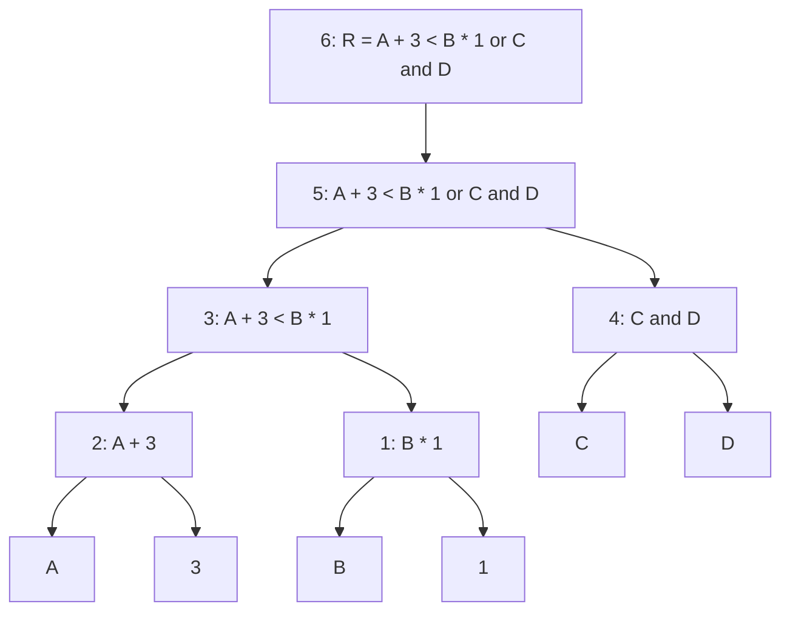

| Order | Operation | Resultant |
|---:|---|---:|
| 1 | `B*1` | 5 |
| 2 | `A+3` | 4 |
| 3 | `A+3 < B*1` | 1 |
| 4 | `C&&D` | 1 |
| 5 | `A+3 < B*1 || C&&D` | 1 |
| 6 | `R = A+3 < B*1 || C&&D` | 1 |

Evaluation of an arithmetic expression


<!-- page 53 | Module 1 · source page 2 -->

MODULE 1						UCEST105: Algorithmic thinking with Python

# UCEST 105: ALGORITHMIC THINKING WITH PYTHON

## MODULE 1

**SYLLABUS MODULE 1 PART 1 PROBLEM-SOLVING STRATEGIES: - Problem-**

**Solving strategies defined,**
**Importance of understanding multiple problem-solving strategies, Trial and Error,**
**Heuristics, Means-Ends Analysis, and Backtracking ( Working backward).**

### PROBLEM SOLVING

**Definition:** Problem solving is the process of transforming the description of a
problem into the solution by using our knowledge and by relying on our ability to
select and use appropriate problem-solving strategies and tools to implement.

### STEPS:

- Problem solving is the act of defining a problem;

- Determining the cause of the problem;

- Identifying, prioritizing, and selecting alternatives for a solution;

- And then implementing a solution.


**Problem Solving Chart**

### Phases of Problem-solving Strategies

#### Phase 1: Understanding the problem.

- Differentiate fact from opinion, Specify underlying causes.

- Consult each faction involved for information.

- State the problem specifically.

- Draw a figure. Introduce suitable notation if required.

1


<!-- page 54 | Module 1 · source page 3 -->

MODULE 1	UCEST105: Algorithmic thinking with Python

- Identify what standard or expectation is violated Determine in which process the problem lies and avoid trying to solve the problem without data.

**Phase 2: Devising a plan.**

- Have you seen the same problem or in a slightly different form?.
- Do you know a related problem with given known.
- Look at the unknown! Try to think of a familiar problem having the same or similar unknown. - Split the problem into smaller, simpler sub-problems. - If you cannot solve the proposed problem , solve some related problem or solve a more general problem. Or a special case of the problem. Or solve a part of the problem. **Phase 3: Carrying out the plan.**

- Carrying out your plan of the solution, check each step.
- Can you see clearly that the step is correct?
- Can you prove that it is correct?

**Phase 4: Looking back**

- Can you check the result?
- Can you derive the result differently?
- Can you use the result, or the method, for some other problem?

**Classes of Problems**

Problems can be classified into two categories 1. Well-defined problems 2. Ill-defined problems.

1. **Well-defined problems** have specific goals, clear constraints, and criteria for recognizing a solution.
2. **Ill-defined problems** have unclear goals or constraints and may allow several reasonable solutions.


<!-- page 55 | Module 1 · source page 4 -->

Q1. Differentiate between Well-defined problems and Ill-defined problems.

| *Well-defined Problems* | *Ill-defined Problems* |
| :--- | :--- |
| 1. Clear goals and Objectives | Unclear and Vague goals and Objectives |
| 2. Specific, measurable outcomes | Multiple , conflicting outcomes |
| 3. Well defined constraints | Ambiguous or uncertain constraints |
| 4. Relevant data available | Insufficient data available |
| 5. Single , Identifiable Solution | Multiple possible solutions |
| 6. Logical, step by step approach | Requires creative, iterative approach |
| 7e Ex:Chess game | Ex: Paint a beautiful picture |


<!-- page 56 | Module 1 · source page 5 -->

## Well-Defined Problems
These problems have clear goals, a defined path to a solution, and specific criteria for determining when the problem is solved. Let's explore three examples:

1. **Mathematical Equation:**
   - **Problem:** Solve the equation $2x+3=7$.
   - **Why it's Well-Defined:** The problem has a clear goal (find the value of $x$), a specific method (solve for $x$ using algebraic rules), and a definite solution ($x=2$).

2. **Crossword Puzzle:**
   - **Problem:** Complete a standard crossword puzzle.
   - **Why it's Well-Defined:** The goal is clear (fill in all the squares with the correct words), a specific set of rules, and a single correct solution.

3. **Recipe Execution:**
   - **Problem:** Bake a chocolate cake using a provided recipe.
   - **Why it's Well-Defined:** The goal (bake a chocolate cake) is clear, the process is outlined step-by-step in the recipe, and success is measurable by the outcome (a baked cake that meets the description).

## Ill-Defined Problems
These problems are ambiguous, lack clear criteria for solutions, and often have multiple possible solutions. Here are three examples:

1. **Designing a Sustainable City:**
   - **Problem:** How can we design a sustainable city for the future?
   - **Why it's Ill-Defined:** The problem is broad, with no single clear solution. Various factors like environmental impact, social equity, and 2. **Writing a Novel:**
   - **Problem:** Write a compelling novel that appeals to a broad audience.
   - **Why it's Ill-Defined:** The goal is subjective (what is "compelling"?), the process can vary widely, and success is difficult to measure. Different readers may have different interpretations of what makes the novel appealing.


<!-- page 57 | Module 1 · source page 6 -->

3. **Resolving Workplace Conflict:**

* **Problem:** Resolve a conflict between two team members in the workplace.
* **Why it's Ill-Defined:** The problem is complex with no clear solution. It involves interpersonal dynamics, emotions, and communication styles, and what works in one situation might not work in another. Multiple solutions may exist, and the "right" one depends on various factors.

**Summary**

* **Well-Defined Problems** are structured, with a clear path and solution.
* **Ill-Defined Problems** are open-ended, ambiguous, and often subjective.

Understanding the nature of the problem helps in choosing the right approach to solving it.

**Importance of Understanding Problem solving Strategies**

* **Improves Critical Thinking** -- Helps analyse a situation logically and identify the root cause of problems.
* **Systematic Approach** -- Encourages step-by-step methods instead of random guessing.
* **Saves Time and Effort** -- Reduces trial-and-error, making solutions faster and more efficient.
* **Enhances Creativity** -- Promotes exploring multiple ways to approach a problem.
* **Better Decision Making** -- Assists in evaluating alternative solutions and selecting the most effective one.
* **Builds Confidence** -- Knowing strategies gives confidence to tackle complex or unfamiliar problems.
* **Transferable Skill** -- Useful across academics, professional work, and real-life situations.
* **Collaboration and Communication** -- Helps in working with teams by following a structured problem-solving language.
* **Prepares for Challenges** -- Equips individuals to handle unexpected obstacles logically.
* **Supports Continuous Learning** -- Each solved problem strengthens analytical and reasoning skills.


<!-- page 58 | Module 1 · source page 7 -->

**Problem Solving Strategies**

Commonlyusedproblem-solving strategies include

1. **Trial and Error**
2. **Algorithm**
3. **Heuristics**
4. **Means-Ends Analysis**
5. **Backtracking**

### 1. Trial and Error

A trial-and-error approach to problem-solving involves trying a number of different solutions and ruling out those that do not work. This approach can be a good option if you have a very limited number of options available. Using trial and error, one has to try different solutions until the problem is solved.

Steps :

1. **Identify the problem** – Start by clearly defining the issue
2. **Try a solution** – Attempt a possible solution
3. **Evaluate the outcome** – Check if the solution worked.
4. **Repeat** – If the solution failed, try a different one.

Example 1:

1. In terms of a broken printer for example, one could try checking the ink levels, and if that doesn't work, you could check to make sure the paper tray isn't jammed. Or maybe the printer isn't actually connected to a laptop.
2. Restarting phone, turning off WiFi, turning off bluetooth in order to determine why your phone is malfunctioning.

Although trial and error is not typically one of the most time-efficient strategies, it is a commonly used one.

Example 2:Recover password

1. **Initial Attempts:** You start by trying passwords you commonly use. Eg: "password123," "Qwerty2024," etc
2. **Learning from Mistakes:** None of these initial attempts work. You try variations incorporating your birthdate, pet's name, or favorite sports team.


<!-- page 59 | Module 1 · source page 8 -->

3. **Refinement:** After several failed attempts, you remember you recently started using a new format for your passwords, combining a favorite quote with special characters. You attempted various combinations, such as "ToBeOrNotToBe!" and other combinations.

4. **Success:** Eventually, through persistent trial and error, you hit upon the correct password: "ToBeOrNotToBe!2024."

2. **Algorithm**
An algorithm is a finite, ordered set of unambiguous steps for solving a problem. A correct algorithm produces the required result for inputs within its stated assumptions; not every algorithm guarantees a solution for every possible input.
*Example: Algorithm for Baking a Cake*

1. Gather ingredients
2. Preheat Oven
3. Mix Ingredients
4. Prepare baking Pan
5. Pour Batter
6. Bake
7. Check for Doneness
8. Cool and Serve

When you run a search on the Internet, search engines like Google use algorithms to decide which entries will appear first in your list of results. Facebook also uses algorithms to decide which posts to display on your newsfeed.

3. **Heuristics**
A heuristic is another type of problem-solving strategy that allows us to make decisions quickly without having all the relevant information. It can be thought of as mental shortcuts that are used to solve problems. A "rule of thumb" is an example of a heuristic. Such a rule saves the person time and energy when making a decision. Different types of heuristics are used in different types of situations, but the impulse to use a heuristic occurs when one of five conditions is met:-

* When one is faced with too much information
* When the time to make a decision is limited
* When the decision to be made is unimportant
* When there is access to very little information to use in making the decision
* When an appropriate heuristic happens to come to mind in the same moment


<!-- page 60 | Module 1 · source page 9 -->

Different types of heuristics are :

a. **Breaking a large goal or task into a series of smaller steps.**

For example : For completing a large research project, they typically start by

* students typically brainstorm, develop a thesis or main topic,
* research the chosen topic, organize their information into an outline,
* write a rough draft

* revise and edit the rough draft, develop a final draft, organize the references

* Proofread the final draft before submitting the project.

The large task becomes less overwhelming when it is broken down into a series of small steps.

b. **Guess and Check** This method involves making a guess, checking if it solves the problem, and refining the
guess based on outcomes. This method is particularly useful when the problem doesn't have an obvious solution, and you can try different possibilities until you find the correct one.

How Guess and Check Works:

1. Make an Initial Guess: Start by guessing a possible solution based on what you know.
2. Check the Guess: Determine if your guess solves the problem.
3. Refine the Guess: If the guess is incorrect, use the information you gained from checking to make a better guess.
4. Repeat: Continue guessing, checking, and refining until you find the correct solution.

Example : Find the number that when added to 15, gives 32.

Solution :-

* Initially make a guess as the number is 20.
* Check the guess, $15+20=35$, since 35 is larger than the expected answer, refine the guess based on the outcome.
* Now refine the guess taking the number as 18.
* Check the guess $15+18=33$.
* Now the answer is very close.
* Again lower the guess to 17 and check, $15+17=32$, and the guess is now correct.


<!-- page 61 | Module 1 · source page 10 -->

MODULE 1	UCEST105: Algorithmic thinking with Python

c. **Working backwards** This is a useful heuristic in which you begin solving the problem by focusing on the end result. Consider this example: Imagine you need to arrive at an important meeting by 3.00pm. To plan your day using the working backwards heuristic, you need to start from the end result and think about the steps needed to get there. You consider that it takes 30 minutes to get to the meeting location, so you need to leave by 2.30pm. Before that you need an hour to prepare,so you start getting ready at 1.30pm. If you also want to finish a task that takes an hour before getting ready, you need to start that by 12.30pm. By working backwards, you effectively plan your day to ensure you arrive at the meeting on time.

4. **Means Ends Analysis (MEA)**

Means-ends analysis compares the current state with the goal, identifies the differences, and chooses smaller actions (sub-goals) that reduce those differences.

Example 1 : The Tower of Hanoi problem.

The **Tower of Hanoi** is a mathematical puzzle. There are three rods, source(A), Auxiliary (B) and Destination(C). Rod A contains a set of disks stacked to resemble a tower, with the largest disk at the bottom and the smallest disk at the top. **Fig:- 1** Illustrate the initial configuration of the rods for 3 disks. The objective is to transfer the entire tower of disks in rod A to rod C maintaining the same order of the disks.

**Rules:**

1. Only one disk can be transferred at a time.
2. Each move consists of taking the upper disk from one of the rods and placing it on the top of another rod i.e. a disk can only be moved if it is the uppermost disk of the rod.
3. Never a larger disk is placed on a smaller disk during the transfer.


**Fig 1:- Initial State**

9

Free notes, papers & syllabus at ktunotes.in	Page 9 / 65


<!-- page 62 | Module 1 · source page 11 -->

The solution to the puzzle calls for an application of recursive functions and recurrence relations.

A recursive procedure for the solution of the problem for N number of disks is as follows:

1. Move the top $N-1$ disks from rod A to rod B, using rod C as the auxiliary rod.
2. Move the largest disk from rod A to rod C.
3. Move the $N-1$ disks from rod B to rod C, using rod A as the auxiliary rod.

The minimum number of moves required to solve a Tower of Hanoi puzzle is given by $2^N - 1$, where $N$ is the number of disks, i.e., if there are 14 disks, then the minimum number of moves needed = $(2^{14}) - 1 = 16383$.

The pictorial representation of the recursive procedure for $N=4$ disks is shown in Fig 2:-


<!-- page 63 | Module 1 · source page 12 -->

Example of Tower of Hanoi for n=3.


Minimum number of moves with 3 disks= $2^n-1= 2^3-1=7$.

Example of Tower of Hanoi for n=4.


Minimum number of moves with 4 disks= $2^n-1= 2^4-1=15$.


<!-- page 64 | Module 1 · source page 13 -->

Example 2: Imagine you want to plan a road trip from Trivandrum to Kashmir. Here is how you might use means-ends analysis:

A. Define the Goal: Your ultimate goal is to drive from Trivandrum to Kashmir.
B. Analyze the Current State: You start in Trivandrum with your car ready to go.
C. Identify the Differences: The primary difference is the distance between Trivandrum and Kashmir, which is approximately 3,700 kilometers.
D. Set Sub-Goals (Means):
   a. Fuel and Rest Stops: Determine where you will need to stop for fuel and rest.
   b. Daily Driving Targets: Break the trip into daily segments, driving 500-600 kms per day.
   c. Route Planning: Choose the most efficient and scenic route, considering highways, weather conditions, and places you want to visit.
E. Implement the Plan:
   a. Day 1: Drive from Trivandrum to Bangalore, Karnataka (approx. 720 km). Refuel in Madurai, Tamil Nadu. Overnight stay in Bangalore.


<!-- page 65 | Module 1 · source page 14 -->

b. Day 2: Drive from Bangalore to Hyderabad, Telangana (approx. $570\text{ km}$). Refuel in Anantapur, Andhra Pradesh. Overnight stay in Hyderabad.
c. Day 3: Drive from Hyderabad to Nagpur, Maharashtra (approx. $500\text{ km}$). Refuel in Adilabad, Telangana. Overnight stay in Nagpur.
d. Day 4: Drive from Nagpur to Jhansi, Uttar Pradesh (approx. $580\text{ km}$). Refuel in Sagar, Madhya Pradesh. Overnight stay in Jhansi.
e. Day 5: Drive from Jhansi to Agra, Uttar Pradesh (approx. $290\text{ km}$). Refuel in Gwalior, Madhya Pradesh. Overnight stay in Agra. Visit the Taj Mahal.
f. Day 6: Drive from Agra to Chandigarh (approx. $450\text{ km}$). Refuel in Karnal, Haryana. Overnight stay in Chandigarh.
g. Day 7: Drive from Chandigarh to Jammu (approx. $350\text{ km}$). Refuel in Pathankot, Punjab. Overnight stay in Jammu.
h. Day 8: Drive from Jammu to Srinagar, Kashmir (approx. $270\text{ km}$).  
F. Adjust as Needed: Throughout the trip, you may need to make adjustments based on traffic, road conditions, or personal preferences.

By breaking down the long journey into smaller segments and addressing each part systematically, you can effectively plan and complete the road trip. This method ensures that you stay on track and make steady progress toward your final destination, despite the complexity and distance of the trip.

5. Backtracking
Backtracking is a problem solving technique that involves trying different options until the right solution is found. Backtracking algorithms are problem solving strategies that explore various options to find the optimal solution. They operate by testing different paths, and if a path doesn't lead to a solution they backtrack and try another route until they find the correct one. Backtracking can also be defined as a technique that involves finding a solution incrementally by trying different options and undoing them if they lead to a dead end.

Example given below:-


<!-- page 66 | Module 1 · source page 15 -->

In the above problem, the Start node is X and destination node is G. We first move through the route X-A-B but it reaches a dead end, then we backtrack again and select another path X-A-C, it also encounters a dead end. Try different paths X-D-E, also reach a dead end. Next we move through X-D-F-G and reach the destination node.

When a path reaches a dead end, return to the most recent choice point and try an untested option. Continue until a solution is found or every option has been explored. Examples include solving a maze or a Sudoku puzzle. (Repeatedly guessing a phone PIN is not a good example: devices may lock after too many attempts.)

**Importance of Understanding Multiple Problem-Solving Strategies**

Different problems often require different approaches, and being familiar with multiple strategies allows for greater flexibility and adaptability. For example, some problems might be best solved through a systematic trial and error method, while others might benefit from a more analytical approach like means-ends analysis. By knowing several strategies, one can quickly switch tactics when one method does not work, increasing the chances of finding a successful solution.

**Benefits of Multiple Problem-Solving Strategies**

- **Adaptability:** Different problems require different approaches which allows for flexibility and adaptability in problem solving.
- **Efficiency:** Some strategies are more effective for specific types of problems. They can save time and resources.
- **Improved Outcomes:** Diverse strategies offer multiple perspectives and potential solutions, increasing the likelihood of finding optimal solutions.
- **Skill Development:** Exposure to various strategies enhances cognitive skills, critical thinking, and creativity

**SYLLABUS MODULE - 1 PART - 2**

**THE PROBLEM-SOLVING PROCESS:- Computer as a model of computation, Understanding the problem, Formulating a model, Developing an algorithm, Writing the program, Testing the program, and Evaluating the solution.**

Basic Model of a Computer Computer science is all about solving problems with computers. The problems that we want to solve can come from any real-world problem or from the abstract world. We need to have a standard systematic approach to solving problems. Since we will be using computers to solve problems, it is important to first understand the computer's information processing model.


<!-- page 67 | Module 1 · source page 16 -->

## Von Neumann Architecture


BLOCK DIAGRAM OF A DIGITAL COMPUTER

The model shown in figure below assumes a single CPU (Central Processing Unit). Many computers today have multiple CPUs, so it can be imagined the model in the figure can be duplicated multiple times within the computer.


<!-- page 68 | Module 1 · source page 17 -->

**INSTRUCTION EXECUTION CYCLE** CPU executes an instruction in a series of steps called *instruction execution cycle*. An instruction cycle (sometimes called a *fetch–decode– execute cycle*) is the process by which a computer retrieves a program instruction from its memory, determines what actions to perform, and carries out those actions to produce meaningful output.

The cycle comprises the following steps:

1. *Fetch* the instruction from memory 2. *Decode* the instruction, and the operation to be performed is thus identified. 3. *Execute* the instruction, performing the operation identified in the decode step by the CPU. 4. *Store* the result in the main memory, or send it to an output device.

This cycle is then repeated for the next instruction.

**Instruction Execution Cycle**


A typical computer architecture comprises of three main components:

**1. Input/Output (I/O) Unit**

**2. Central Processing Unit (CPU)**

**3. Memory Unit**


<!-- page 69 | Module 1 · source page 18 -->

The I/O unit consists of the input unit and output devices. The input devices accept data from the user, which the CPU processes. The output devices transfer the processed data (information) to the user. The memory unit is used to store the input data, the instructions required to process the input, and the output information. **Input devices** Input devices allow users to input data into the computer for processing. The data input to a computer can be in the form of text, audio, video, etc. Input devices are classified into two categories:

**1. Human data entry devices** -- the user enters data into the computer by typing or pointing a device to a particular location. Some examples are

a. **Keyboard** -- the most common typing device.

b. **Mouse** -- the most common pointing device. You move the mouse around on a mouse pad and a small pointer called cursor follows your movements on the computer screen.

c. **Trackball** -- an alternative to a mouse which has a ball on the top. The cursor on the computer screen moves in the direction in which the ball is moved.

d. **Joystick** -- has a stick whose movement determines the cursor position.

e. **Graphics tablet** -- converts hand-drawn images into a format suitable for computer processing.

**2. Source data entry devices** --They use special equipment to collect data at the source, create machine-readable data, and feed them directly into the computer. This category comprises:

a.**Audio input devices** -- It uses human voice or speech to give input. Microphones are an example.

b. **Video input devices** -- They accept input in the form of video or images. Video cameras and webcams are examples.

c.**Optical input devices** -- They use optical technology (light source) to input the data into computers. Some common optical input devices are scanners and barcode readers.


<!-- page 70 | Module 1 · source page 19 -->

MODULE 1	UCEST105: Algorithmic thinking with Python

**Output devices** An output device takes processed data from the computer and converts them into information that can be understood by humans. The output could be on paper or can be audio, video, etc. Output devices are classified as follows:

1. **Hard copy devices** – The output obtained on paper or any surface is called hard copy output. The hard copy can be stored permanently and is portable. The hard copy output can be read or used without a computer. Examples in this category include:

    a. **Printer** – prints information on paper. The information could be textual or even images. Drum printers, laser printers, and inkjet printers are some commonly used printer types.
    b. **Plotter** – used to produce very large drawings on paper using very fine pens. Flatbed plotters and drum plotters are two types of plotters.

2. **Soft Copy Devices** – Generates a soft copy of the output on a visual display (monitor), audio unit, or video unit. The soft copy can be stored and sent via e-mail to other users. It also allows corrections to be made. The soft copy output requires a computer to be read or used. This category comprises:

    a. **Monitor** – the primary output device of a computer.
    b. **Video output devices** – produce output in the form of video or images. An example is a screen image projector or data projector that displays information from the computer onto a large white screen.
    c. **Audio output devices** – speakers, headsets, or headphones, are used for audio output (in the form of sound) from a computer.

**Central Processing Unit** The Central Processing Unit (CPU) or the processor, is known as the brain of a computer. It consists of an Arithmetic Logic Unit (ALU) and a Control Unit (CU). In addition, the CPU also has a set of registers which are temporary storage areas for holding data and instructions.

I. **Arithmetic Logic Unit**

This unit consists of two sub-units, namely arithmetic and logic units.

    a. **Arithmetic unit** – performs arithmetic operations like addition, subtraction, multiplication, and division, on the data.


<!-- page 71 | Module 1 · source page 20 -->

b. **Logic unit** – performs logical operations like comparisons of data values.

## II. Registers

Registers are high-speed storage areas within the CPU but have the least storage capacity. They store data, instructions, addresses, and intermediate results of processing. Some of the commonly used registers are:

a. **Accumulator (ACC)** – stores the result of arithmetic and logic operations.

b. **Instruction Register (IR)** – holds the instruction that is currently being executed.

c. **Program Counter (PC)** – holds the address of the next instruction to be processed.

## III. Control Unit

This unit manages and coordinates the operations of all parts of the computer. The functions of this unit are:

* generate control signals.
* obtain instructions from the memory, interpret them, and then direct the ALU to execute those instructions.
* communicate with I/O devices.
* decides when to fetch the data and instructions, what operation to perform, where to store the results.

**Memory unit** Memory is the storage space in a computer where data to be processed and instructions required for processing are stored. The various memories can be organized hierarchically called memory hierarchy as shown in figure below.


Fig:- Memory Hierarchy


<!-- page 72 | Module 1 · source page 21 -->

Memory is primarily of two types:

I. **Internal Memory**: memories that reside on the motherboard.

Internal memory includes:

1. **Registers** – high-speed storage areas within the CPU.

2. **Primary memory** – main memory of the computer. It is categorized into two:
   a. **Random Access Memory (RAM)** – used for storing data and instructions during the operation of a computer. Data to be processed is brought to RAM from input devices or secondary memory. It is a volatile memory, because stored data may get lost if it is not saved. After processing, the results are stored in RAM before being sent to the output device.
   b. **Read Only Memory (ROM)** – a non-volatile primary memory. It does not lose its content when the power is switched off. ROM, as the name implies, has only reading capability and no write capability. After the information is stored in ROM, it is permanent and cannot be modified. Therefore, ROM is used to store the data that does not require a change, for example, the boot information (means computer's startup process).

3. **Cache memory** – placed between RAM and CPU and stores the data and instructions that are frequently used.

II. **External memory**: memories that are outside the motherboard.

External memory includes:

1. **Magnetic tape** – a plastic tape with magnetic coating mounted. It is a sequential access device, meaning that the data can be read only in the order in which it is stored.

2. **Magnetic disk** – a thin plastic or metallic circular plate coated with magnetic oxide and encased in a protective cover. Hard disk is an example.

3. **Optical disk** – a flat circular disk coated with reflective plastic material that can be altered by laser light. CDs and DVDs are examples.


<!-- page 73 | Module 1 · source page 22 -->

### Computer as a model of computation

Regarding problemsolving, we will apply the above model for simple computations. For larger and more complex problems, we need to iterate (i.e., repeat) the input/process/output stages multiple times in sequence. **Definition: Problem Solving is the sequential process of analyzing information related to a given situation and generating appropriate response options.** In solving a problem, there are some well-defined steps to be followed. It is noted that the problem is easily solved by simply getting the input, computing something and producing the output. We now examine **the steps to problem solving** within the context of various examples. **Steps involved in problem solving**

1. Understanding the problem
2. Formulating a model
3. Developing an algorithm
4. Writing the program
5. Testing the program
6. Evaluating the solution

### Understanding the problem

- The First Step in Problem Solving
  - It may sound simple, but the first step in solving any problem is to fully understand it.
- Identifying Input, Output and Processing Needs

**EXAMPLE 1:- Finding sum of two numbers**

- **INPUT REQUIREMENTS**

  We need to understand the input we require to solve the problem. For the given example, input requirement is two numbers whether it can be of any type, like real number, integer number or whole number.


<!-- page 74 | Module 1 · source page 23 -->

* OUTPUT REQUIREMENTS Next we need to understand the output to obtain corresponding to the input given. if we are giving real numbers as input the output obtained will be real, or if it is integer then output will be integer. PROCESSING CONSIDERATIONS
* We also need to understand how to reach the solution from the input given i.e, to understand a path to reach the solution.

Formulating a model

* The next step is to understand the processing part of the problem. In the example
* given, the sum of two numbers is to be computed. A model is thus needed for computing the sum of two numbers. If there is no such "formula", one must be developed. Assuming that the input data is two integer numbers Number1,
* Number2
  representing a two numbers
  $$\text{Sum} = \text{Number1} + \text{Number2}$$

The main point to understand this step in the problems solving process is that it is all about figuring out how to make use of the available data to compute an answer.

Developing an algorithm

* Next step is to develop a precise plan of what the computer is expected to do.
* An algorithm is a set of steps for solving a particular problem, or
* An algorithm is a precise sequence of instructions for solving a problem.

To develop an algorithm, the instructions must be represented in a way that is understandable to a person who is trying to figure out the steps involved.

Two commonly used representations for an algorithm is by using

  i. **Pseudo code** :- an informal representation of an algorithm without using any programming syntax

  ii. **Flowchart** :- a diagrammatic representation of an algorithm

* Example: - Let's use a simple math problem to develop an algorithm, a pseudo code and a flow chart

  * Algorithm
  
    Step 1: Start
    
    Step 2: Input the first number
    
    Step 3: Input the second number
    
    Step 4: Add the two numbers
    
    Step 5: Display the result


<!-- page 75 | Module 1 · source page 24 -->

- Step 6: End
- Pseudo code
    1. Start
    2. Input Number1
    3. Input Number2
    4. Sum = Number1 + Number2
    5. Output Sum
    6. End

- Flow chart

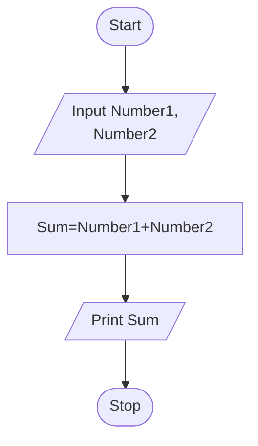

Writing the Program
- Once the algorithm is defined, the next step is to convert it into a form that a computer can execute. This process is known as **writingtheprogram,coding,or implementing an algorithm.**
- The next step is to transform the algorithm into a set of instructions that can be understood by the computer. Writing a program is often called **"coding" or "implementing an algorithm"**.
    - Program in Python
        $$\begin{aligned}
        \text{n1} &= 21 \\
        \text{n2} &= 7 \\
        \text{sum} &= \text{n1} + \text{n2} \\
        \text{print}('&\text{Sum} = \text{', sum)}
        \end{aligned}$$


<!-- page 76 | Module 1 · source page 25 -->

- After writing the code, test it with various inputs to ensure it works as expected. Debug and compile the program to find issues or errors that arise during testing.
- Debugging is the method of finding and fixing errors.
- Compiling is the process of converting a program into instructions that can be understood by the computer.

Testing the Program

- Once a program has been written and compiled, the next critical step is to ensure that whether the program performs the intended task correctly. Testing the program involves running it with various inputs to verify its accuracy and reliability.
- Running a program is the process of telling the computer to evaluate the compiled instructions.
- If the program runs correctly, the expected output should be displayed.
If the program doesn't run correctly for some inputs then the user has to go back to the algorithm development step that handles all situations that could arise.
    - If the output is incorrect, it could be due to the algorithm not being properly implemented in the program. or
    - A flaw or a bug in the algorithm itself, which does not account for certain situations.
- Bugs are errors in a program that cause it to produce incorrect or undesirable results.

Evaluating the Solution

- Once a program produces a result, revisit the original problem.
- Ensure the output is formatted as a proper solution.
- Examine if the result aligns with the original intent.
- Determine if the output meets the problem's requirements.
    - Remember that the computer executes instructions as given. The user must interpret results to determine effectiveness.

EXAMPLE 2: Calculate the average grade for all students in a class.

Understanding the problem

INPUT REQUIREMENT get all the grades ... possibly by typing them in via the keyboard

- Key Questions:
    - What input data/information is available?
    - What does the data represent, and in what format?
    - Is anything missing from the data?
    - Do I have everything needed to solve the problem?


<!-- page 77 | Module 1 · source page 26 -->

* Example: Grades as Input:
  * Grades could be numbers (0-100) or letter grades (A-F).
  * If the grade is represented in number then it can be whole integer(eg:- 73) or real number(e g:- 73.45)
  * Consider how to handle missing grades (eg: - if we do not have the grade for absent students: for instance should we be able to include that person in our average calculation as 0 or ignore them when computing the average)?

OUTPUT REQUIREMENTS: output the answer to either the monitor, or to the printer
* What output is needed, and in what format (text, number, graph)?
* Example: Should the result be a number, a letter grade, or a pie chart

PROCESSING CONSIDERATIONS: Add them all up and compute the average grade.

Understand the processing steps required to achieve the desired output. This understanding guides the problem-solving process.

**Formulating a model**

In the example given, the average of the incoming grades is to be computed. A model (or formula) is thus needed for computing the average of a bunch of numbers. If there is no such "formula", one must be developed.

Assuming that the input data is a bunch of integers or real numbers $x_1, x_2, \dots, x_n$, representing a grade percentage, the following computational model may apply:

$Average1 = (x_1 + x_2 + x_3 + \dots + x_n) / n$ where the output will be a number from 0 to 100.

Letter grades (such as A, B−, and C+) cannot be averaged directly. One possible model is to map each letter grade to a numeric value, then average those values. The mapping must match the grading system being used.

* Convert letter grades to numerical equivalents
$$\begin{align*}
A+ &= 12 & A &= 11 & A- &= 10 & B+ &= 9 \ 
B &= 8 & B- &= 7 & C+ &= 6 & C &= 5 \ 
C- &= 4 & D+ &= 3 & D &= 2 & D- &= 1 & F &= 0
\end{align*}$$

* If it is assumed that the newly assigned grade numbers are $y_1, y_2, \dots, y_n$, then the following computational model may be used:

$Average2 = (y_1 + y_2 + \dots + y_n) / n$ where the result will be a number from 0 to 12.

If we want the output in percentage, you can convert it as:

$$\boldsymbol{Average\ (in\ percentage) = (Average_2 / 13)}$$


<!-- page 78 | Module 1 · source page 27 -->

The main point to understand this step in the problems solving process is that it is all about figuring out how to make use of the available data to compute an answer.

**Developing an algorithm:**

**Algorithm**

STEP 1: Start

STEP 2: Read number of students, n

STEP 2: Read the marks of n students

STEP 3: Compute average using the formula

STEP 4: Display Average

STEP 5: Stop

**Pseudo code**

1. Start

2. Input n

3. Input the marks of n students, $x_1, x_2, x_3, ..., x_n$

4. Average=(x1+x2+x3+...+xn)/n

5. Output Average

6. End

**Flow chart**

Average of n numbers

```mermaid
flowchart TD
A([Start]) --> B[x1, x2, ..., xn, Average]
B --> C[/Read x1, x2, ..., xn/]
C --> D[Average = (x1 + x2 + .... + xn) / n]
D --> E[/Print Average/]
E --> F([Stop])
```


<!-- page 79 | Module 1 · source page 28 -->

**Writing the program:**

```python
# Program in Python
n = int(input("Enter number"))
total = 0
for student in range(n):
    mark = float(input(f"Enter mark for student {student + 1}: "))
    total += mark
average = total / n
print(f"Average mark: {average:.2f}")
```

**Test the program:** You create a test suite with various types of numbers and check whether the output obtained is correct or not.

**EXAMPLE 3 : - A case study - The Discriminant calculator**

1. **Understanding the problem :** Here we formally define the problem by specifying the inputs and output.
   Input: The three coefficients a, b and c of the quadratic equation
   Output: The discriminant value D for the quadratic equation

2. **Formulating a model:** Develop a mathematical model for the solution, that is identify the mathematical expression for the quadratic equation discriminant D:
   $$D = b^2 - 4ac$$

3. **Developing an algorithm:** A possible algorithm (actually, a pseudocode) for our discriminant problem is given below:
   STEP 1: Start
   STEP 2: Read (a,b,c)
   STEP 3: d = b*b-4*a*c
   STEP 4: Print (d)
   STEP 5: Stop

4. **Writing the program:** The Python program to calculate the discriminant is as follows:

```python
#Input the coefficients
a = int(input("Enter the value of first coefficient"))
b = int(input("Enter the value of second coefficient"))
c = int(input("Enter the value of third coefficient"))
```


<!-- page 80 | Module 1 · source page 29 -->

#Find the discriminant
d = (b**2) - (4*a*c)
#Print the discriminant
print(d)

5. **Testing the program:** You create a test suite similar to the one shown in Table 1.2. Each row denotes a set of inputs (a,b, and c) and the expected output (d) with which the actual output is to be compared.


**SYLLABUS MODULE - 1 PART - 3**

**ESSENTIALS OF PYTHON PROGRAMMING:**- Creating and using variables in Python, Numeric and String data types in Python, Using the math module, Using the Python Standard Library for handling basic I/O - print, input, Python operators and their precedence.

**Essentials of Python Programming**

**INTRODUCTION**

**PROGRAMMING LANGUAGES**

*Programming languages* are used to write programs that provide precise representations of algorithms and control the behavior of a computer. Each language has a unique set of keywords (words that it understands) and syntax (set of rules) to organize the program instructions.

Programming languages fall into three categories:

1. **Machine language:**- is what the computer can understand, but it is difficult for the programmer to understand. Machine languages consist of binary numbers only. No translation of the program is needed and it can be executed very fast. It is machine-dependent ie. A machine-level program written for one type of computer may not work on another type.


<!-- page 81 | Module 1 · source page 30 -->

MODULE 1	UCEST105: Algorithmic thinking with Python

Example 3.1. Assume that the opcode and operands occupy 4 bits each and that the opcode for addition is 1010, then to add 3 and 6, the binary code would be
$$1010 \underbrace{0011}_{\text{add}} \underbrace{0110}_{3} \underbrace{\quad}_{6}$$


2. **Assembly language:-** falls in between machine language and high-level language. It is similar to machine language, but easier to write code because it allows the programmer to use symbolic names (like ADD, SUB) for operations called **mnemonic codes** that are much easier to remember. **Example :** If the mnemonic code for addition is ADD, then to add 3 and 6, the assembly level code will be ADD 3,6.

*Machine languages and assembly languages are also called low level languages.*

3. **High-level language:-** is easier to understand and use for the programmer but difficult for the computer. The programs written in high-level languages contain English-like statements as well as programming.

Eg:- C, FORTRAN, Pascal, Java, Python etc. that enables a programmer to write programs. High level language programs are easier to write, read, and understand. They are easily portable from one computer to another, since they are not machine-dependent. Two types- static and dynamic

**Example :** To add 3 and 6, the high level language code will be $3+6$.

Here '+' is the operator for addition.

**Static programming language:**

* The type of variable is checked at compile time eg: c, c++, java
* Must declare variable types before using them
* Error caught earlier (before execution)
* Program run faster because compiler knows the variable type in advance

**Dynamic programming language:**

* The type of variable is checked at run time eg: python, Java script, PHP

29


<!-- page 82 | Module 1 · source page 31 -->

- No need to declare types explicitly - Easier and faster to write code

**Compile time:** The time when the program is being translated from human readable code into machine code. Error formed here are called compile-time error. Checked by compiler **Eg:** syntax error, missing colon, wrong variable declaration etc.

**Runtime:** The time when the program is actually running after compilation. Error formed here is known as run time error. Checked by interpreter or run time environment.

### TRANSLATOR SOFTWARE

The computer can understand only machine code (strings of 0's and 1's). Thus when the program is written in other languages (assembly or high-level languages) has to be converted to machine code. This conversion is called **translation** and is performed by the translator software.

The original program is called **source code**, and the translated code (object code) is the **target code**.

There are three types of translator software as discussed below:

1. **Assembler:** is a software that converts a program written in assembly language into machine code.
2. **Compiler:** is a software that translates programs written in high-level language to machine code.
3. **Interpreter:** An interpreter executes a program through a runtime system. The exact process depends on the language implementation; it may process statements incrementally or use an intermediate representation.


<!-- page 83 | Module 1 · source page 32 -->

*Q: Differentiate between Compiler and Interpreter.*

| Compiler | Interpreter |
| --- | --- |
| A traditional compiler translates the program (often as a whole) | Interpreter Takes **Single** instruction as input. |
| Intermediate Object Code is **Generated** | No Intermediate Object Code is **Generated** |
| Memory Requirement : **More** (Since Object Code is Generated) | Memory Requirement is **Less** |
| Program need not be **compiled** every time | Every time higher level program is converted into lower level program |
| Errors are displayed after entire program is checked | Errors are displayed for every **instruction** interpreted (if any) |
| **Example :** C Compiler | **Example :** BASIC |

**INTRODUCTION TO PYTHON**

Python is a general-purpose, high-level, interpreted programming language created by **Guido van Rossum** in the late 1980s at the National Research Institute for Mathematics and Computer Science in the Netherlands. Python is one of the most popular and widely used programming languages used for a set of tasks including **Console based, GUI based, web programming and data analysis**. Python is named after the comedy television show Monty Python's Flying Circus.

**FEATURES OF PYTHON**


<!-- page 84 | Module 1 · source page 33 -->

## APPLICATIONS OF PYTHON

Python is a general purpose programming language. It is widely applied in various fields.
- **Data Science**: Python libraries like Numpy, Pandas, and Matplotlib are used for data analysis and visualization.
- **Web Applications**: Python frameworks like Django, and Pyramid, make the development and deployment of Web Applications easy.
- **Desktop GUI Applications**
- **Software Development**
- **Scientific and Numeric computations**
- **Business Applications**
- **Audio or Video based Applications.**

## START PROGRAMMING WITH PYTHON

There are two major Python versions, those are Python 2 and Python 3. Python 3 is more semantically correct and supports newer features. After successful installation of python software we can interpret or execute python script / program.

Python programs are commonly run in two ways:

1. Using Interactive interpreter prompt
2. Using a script file

### Using Interactive interpreter prompt:

Python provides us the feature to execute the python statement one by one at the interactive prompt. It is preferable in the case where we are concerned about the output of each line of our python program. To open the interactive mode, open the terminal (or command prompt) and type python3.

#### Through Command Prompt or Python Shell


<!-- page 85 | Module 1 · source page 34 -->

The **Python shell** is an interactive terminal-based environment wherein you can directly communicate with the Python interpreter. First, you open a terminal and type python3.
Now the shell turns up with a welcome message as shown below.

*user@Ubuntu2204LTS:~$ python3*
*Python 3.10.12 (main, Jul 29 2024, 16:56:48) [GCC 11.4.0] on linux*
*Type "help", "copyright", "credits" or "license" for more information*

The symbol `>>>` is called the **shell prompt**. This symbol prompts you for Python statements. When you enter a statement in the shell, the Python interpreter processes it and displays the result, if any, then followed by a new prompt as shown below: `>>>`"Welcometo theworld ofPythonprogramming""WelcometotheworldofPythonprogramming">>>

### Using Script File

Interpreter prompt is good to run the individual statements of the code. However if we want to execute multiple python statements at a time instead of executing one by one, then we can use script files. We need to write our script into a file which can be executed later. For this purpose, open an editor like notepad, create a file named filename.py (python used .py extension) and write the python script in it.


### Running as a script

1. Combine all the statements that you wish to execute into a Python program. Program is known as a script and should be saved with the **"py"** extension, for example sample.py.

2. You may use some text editor to create your script. gedit, vim are some of the editors that you can probably use.

3. Then open a terminal in the directory where the script is stored. To run your script (assuming the name is First.py), just give

$$\text{python3 First.py}$$

Now the script will be executed and you get the desired output.


<!-- page 86 | Module 1 · source page 35 -->

_Example :_ Suppose you have written a script sample.py to display the message “My first Python program!”. This is how you run it (The second line below shows the output):

_user@Ubuntu2204LTS:~$ python3 First.py_

_My first Python program!_

## Comments in Python

* Comments are used in a programming language to describe the program or to hide some part of code from the interpreter.
* Comment is not a part of the program, but it enhances the interactivity of the program and makes the program readable.
* Python supports two types of comments:
  1. Single Line Comment
  2. Multi Line Comment

### Single Line Comment:
In case user wants to specify a single line comment, then comment must start with `#`

**Example:**
```python
# This is single line comment
print("Hello Python")
```

**Output:**

Hello Python

### Multi Line Comment:
Multi lined comment can be given inside triple quotes.

**Example:**
```python
'''This is
   Multiline
   Comment'''
print("Hello Python")
```

**Output:**

Hello Python

## Python Character Sets

A character set is a set of valid characters acceptable by a programming language in scripting.

### Character set

* Alphabets: All capital (A-Z) and small (a-z) alphabets.
* Digits: All digits 0-9.
* Special Symbols: Python supports all kind of special symbols like, " ` 1 ; : ! ~ @ # $ % ^ ` & * ( ) _ + - = { } [ ] \
* WhiteSpaces: Whitespaces like tabspace, blankspace, newline, and carriagereturn.


<!-- page 87 | Module 1 · source page 36 -->

## Python tokens

* A token is the smallest individual unit in a python program.
* All statements and instructions in a program are built with tokens.
* The various tokens in python are :

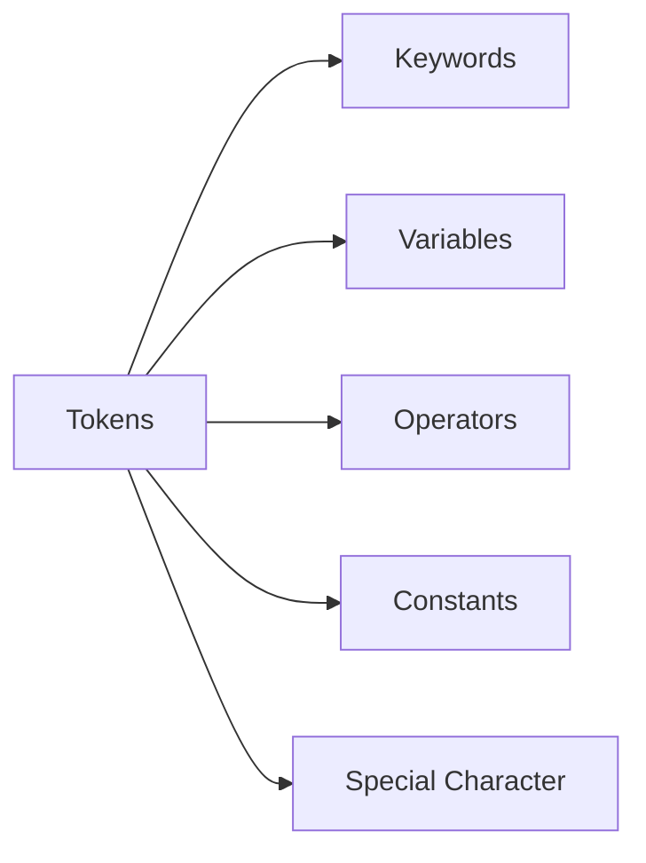

## 1. Keyword(Reservedwords)

* Keywords are words that have some special meaning or significance in a programming language.
* They can't be used as variable names, function names, or for any other random purpose.


## 2. Identifiers

* Identifiers are the names given to any variable, function, class, list, methods, etc. for their identification.
* Python has some rules and regulations to name an identifier.
* Rules to name an identifier:-
  * Python is case-sensitive. So case matters in naming identifiers. And hence
  * geeks and Geeks are two different identifiers.
* Identifiers start with a capital letter (A-Z) , a small letter (az) or an

35


<!-- page 88 | Module 1 · source page 37 -->

underscore(_).
- It can't start with any other character.
- Except for letters and underscore, digits can also be a part of an identifier but can't be the first character of it.
- Any other special characters or whitespaces are strictly prohibited in an identifier.
- An identifier can't be a keyword.


## Creating and using variables in Python

### Variable in Python
- A variable is a named memory location in which we can store values for the particular program. In other words, Variable is a name which is used to refer to memory location. Variable also known as **identifier** and used to hold value. In Python, when we assign
- any value to the variable that variable is declared
- automatically. Also, we don't need to specify the type of variable in Python.


## EXAMPLE


<!-- page 89 | Module 1 · source page 38 -->

**Example: Vardemo.py**
```python
a=10 #integer
b="StudyGlance" #string
c=12.5 #float

print(a)
print(b)
print(c)
```
output:
```
$python3 Vardemo.py
10
StudyGlance
12.5
```

* Python allows us to assign a value to multiple variables and multiple values to multiple variables in a single statement which is also known as multiple assignment.

EXAMPLE

**Assign single value to multiple variables :**

**Example: Vardemo1.py**
```python
x=y=z=50
print(x)
print(y)
print(z)
```
output:
```
$python3 Vardemo1.py
50
50
50
```

**Assign multiple values to multiple variables :**

**Example: Vardemo2.py**
```python
a,b,c=5,10,15
print(a)
print(b)
print(c)
```
output:
```
$python3 Vardemo2.py
5
10
15
```

3. Literals(Constants)
* Python literals are a data type and can hold any value type, such as strings, numbers, and more
* The way of using literals depends on its type.
* The various types of literals used in the Python program are as follows:
  * String literals
  * Numeric literals - integer, float, complex
  * Boolean literals
  * Literal Collections - list, tuple, set, dictionary

Numeric and String data types in Python

4. DataTypes
* Data Types specifies what type of data will be stored in variables.
* Variables can hold values of different data types.
* Python is dynamically typed, hence we need not define the type of the variable while declaring it.


<!-- page 90 | Module 1 · source page 39 -->

- The interpreter implicitly binds the value with its type.
- Python provides us the type() function which enables us to check the type of the variable.

```mermaid
flowchart LR
A[Python Data Types] --> B[Numbers]
A --> C[Bool\nTrue, False]
A --> D[Set\n{2, 4, 6}]
A --> E[Dict\n{1:'a', 2:'b'}]
A --> F[Sequence]
B --> B1[Int\n20]
B --> B2[Float\n35.75]
B --> B3[complex\n1+3j]
F --> F1[String\n'Jessa']
F --> F2[List\n[2, 'a', 5.7]]
F --> F3[Tuple\n(3, 4.5, 'b')]
```

A. Numeric datatype

- The numeric data type in Python represents the data that has a numeric value.
- A numeric value can be an integer, a floating number, or even a complex number.
- There are three numeric types in Python:
  1. **int**
  2. **float**
  3. **complex**


<!-- page 91 | Module 1 · source page 40 -->

EXAMPLE
PROGRAM

```python
num1 = 5
print(num1, 'is of type', type(num1))
num2 = 2.0
print(num2, 'is of type', type(num2))
num3 = 1 + 2j
print(num3, 'is of type', type(num3))
```

OUTPUT

```text
5 is of type <class 'int'>
2.0 is of type <class 'float'>
(1+2j) is of type <class 'complex'>
```

Type Conversion in Python

**1.Implicit TypeConversion (TypeCasting / Coercion)**
* Definition: Python automatically converts one data type to another without user intervention.
* When it happens: Usually when performing operations between different data types.
* Purpose: To avoid type errors and ensure smooth calculations.

```python
x = 5 
# int
y = 2.5 
# float
z = x + y # x is implicitly converted to float
print(z) # Output: 7.5
print(type(z)) # <class 'float'>
```

**2. Explicit Type Conversion (Type Casting)**
* Definition: Programmer manually converts one data type to another using built-in functions.
Functions Used: `int()`, `float()`, `str()`, `complex()`, `bool()`.
* Purpose: To control type conversion according to program needs.

```python
x = "15"
y = int(x)
print(y + 5) 
print(type(y))

z = float(y)
print(z)
print(type(z))
# str
# Output: 15
# <class 'int'>

# explicitly convert int to float
# Output: 10.0
# <class 'float'>
```


<!-- page 92 | Module 1 · source page 41 -->

## Escape sequence

The escape sequence is a sequence of characters treated as special when the Python interpreter encounters it in the string literal. The escape sequence is represented using the backslash (`\`) followed by the character. \r:Moves the cursor to the beginning of the current line without advancing to the next line. \b:Moves the cursor one position backward, effectively deleting the previous character. \f:Advances the cursor to the next page. In modern consoles, it often acts like a new line or is ignored.


### EXAMPLE

```python
print("Hello\nWorld")
print("Hello\tWorld")
print("This is a backslash: \\")
print('It\'s a beautiful day')
print("She said, \"Hello!\"")
```

Output

```text
Hello
World
Hello   World
This is a backslash: \
It's a beautiful day
She said, "Hello!"
```

## B. Sequence Data Types in Python

- A sequence is an ordered collection of items. Depending on the type, its items may be characters or values of different data types.
- Sequences allow storing of multiple values in an organized and efficient fashion.
- There are several sequence data types of Python:


<!-- page 93 | Module 1 · source page 42 -->

- String
- List
- Tuple

a. String:- A string is a collection of one or more characters. Strings are represented by either single, double or triple quotes.

EXAMPLE


b. List

List is an ordered sequence of some data written using square brackets([]) and commas(,).

List is mutable (means values in the list can be changed during execution time).

EXAMPLE


<!-- page 94 | Module 1 · source page 43 -->

c. Tuple

The tuple is another data type which is a sequence of data similar to a list. But it is immutable. That means data in a tuple is write-protected. Data in a tuple is written using parentheses and commas. EXAMPLE

```python
var = ("Geeks", "for", "Geeks")
print(var)
```

**Output:**
```
('Geeks', 'for', 'Geeks')
```

**C. Dictionary**

A dictionary is a mapping of unique keys to values. In modern Python, dictionaries preserve insertion order. Dictionaries are written within curly braces in the form **key:value**.

**PROGRAM**

```python
capitals = {"USA":"Washington D.C.","France":"Paris", "India" :"New Delhi"}
print(type(capitals))
```

**OUTPUT**

`<class 'dict'>`

**D. Set**

Set is an unordered collection of unique items defined by values separated by commas inside braces `{}`.

```python
thisset = {"apple", "banana", "cherry"}
print(thisset)
```

**OUTPUT**

```
{'apple', 'banana', 'cherry'}
```


<!-- page 95 | Module 1 · source page 44 -->

## E. Boolean

Boolean data type that has one of two possible values (usually denoted True and False) which is intended to represent the two truth values of Boolean algebra.

EXAMPLE

```
Input: 1==1
Output: True
Input: 2<1
Output: False
```

```python
# Returns False as x is not equal to y
x = 5
y = 10
print(bool(x==y))
```

Output

```
False
```

## Using the math module

- A module is a logical organization of Python code. Related code is grouped into a module which makes the code easier to understand and use.
- Math module is an in-built Python library made to simplify mathematical tasks in Python.
- It consists of various mathematical constants and functions that can be used after importing the math module.
- To use math function, command given below is used

$$\mathbf{\textit{import math}}$$

- Various functions in math module are:-

NUMERIC FUNCTIONS

1. math.sqrt()

    The math.sqrt() method returns the square root of a given number.
    
    ```
    >>> math.sqrt(100)
    10.0
    >>> math.sqrt(3)
    1.7320508075688772
    ```


<!-- page 96 | Module 1 · source page 45 -->

2. math.ceil()

The ceil() function approximates the given number to the smallest integer, greater than or equal to the given floating point number.

>>> math.ceil(4.5867)
5

3. math.floor()

The `math.floor()` function returns the greatest integer less than or equal to the input.

>>> math.floor(4.5687)
4

4. math.fabs()

Returns the absolute value of x

>>> math.fabs(-5.5)
5.5

5. `math.pi`

The `math.pi` constant gives an approximation of π (about 3.14159). It is a constant, so do not call it like a function.

>>> x = math.pi
>>> print(x)
3.14...

6. math.factorial()

Used for finding factorial of a given in a single line

>>> a=5
>>> print("The factorial of", a, "is", math.factorial(a))

The factorial of 5 is 120

7. math.gcd()

Used to find the greatest common divisor of two numbers

>>> a = 15
>>> b = 5
>>> print ("The gcd of 5 and 15 is : ")
>>> print (math.gcd(b, a))

The gcd of 5 and 15 is : 5


<!-- page 97 | Module 1 · source page 46 -->

LOGARITHMIC AND POWER FUNCTION

8. math.exp()

Used to calculate the power of e

>>> test = 4
>>> print (math.exp(test))
54.598150033144236

9. math.pow()

The math.pow() method receives two float arguments, raises the first to the second and returns the result. In other words, pow(2,3) is equivalent to 2**3.

>>> math.pow(2,4)
16.0

10. math.log()

Used to calculate the logarithmic value of a with base b

>>> print ("The value of log 2 with base 3 is : ")
>>> print (math.log(2,3))
The value of log 2 with base 3 is : 0.6309297535714574

TRIGONOMETRIC AND ANGULAR FUNCTION

sin(), cos(), and tan() functions return the sine, cosine, and tangent of value passed as the argument.

PROGRAM

import math
a = math.pi/6
print ("The value of sine of pi/6 is : ", end="")
print (math.sin(a))
print ("The value of cosine of pi/6 is : ", end="")
print (math.cos(a))
print ("The value of tangent of pi/6 is : ", end="")
print (math.tan(a))

OUTPUT

The value of sine of pi/6 is : 0.49999999999999994
The value of cosine of pi/6 is : 0.8660254037844387
The value of tangent of pi/6 is : 0.5773502691896257


<!-- page 98 | Module 1 · source page 47 -->

## Using the Python Standard Library for handling basic I/O - input(), print()

Python offers us several built-in functions thatmake it easy tocreate aprogramquickly. Two of the most commonly used built-in functions are the **input()** and **print()** functions that are used for frequent input and output operations, respectively.

### Python Input

To run an application, programmers often need to obtain input in Python from a user. The simplest way to do this is to use the **input()** function. Thefunctionpausesprogramexecution to let the user type a line of information from the keyboard. When the user hits “Enter”, the input is read and returned as a string.

Syntax:-

$$\text{input}([<\text{prompt}>])$$

where the prompt is an optional string that we wish to display for the user.

#### EXAMPLE

```python
>>>name = input ('What is your name? - ')
>>>print ('Hello,', name)
```
What is your name? - John
Hello, John

By default, the input() function accepts only string arguments. However, we can convert this to a number by using the int() of float() functions.

#### EXAMPLE

```python
>>>number = input ('What is your number? ')
```
What is your number? 45

```python
>>> number
```
'45'

```python
>>> int(45)
```
45

```python
>>> float(45)
```
45.0

46


<!-- page 99 | Module 1 · source page 48 -->

Or

```python
>>> price=float(input("Enter the price of each item"))
>>> print(price)
Enter the price of each item 50
50.0
```

For taking multiple inputs from the user in a single line we use the function `split()`.

**EXAMPLE**

```python
>>> x,y=input("Enter two numbers: ").split()
>>> print("No. of boys: ", x)
>>> print("No. of girls: ", y)
Enter two numbers: 23 22
No. of boys: 23
No. of girls: 22
```

## Python Output

Once a program accepts input in Python and processes the data, it needs to present the data back to the user as output. You can choose to display the data output to the console directly or show it on a screen.

We use the **print()** function to display the output data to the (screen).

Syntax:-

$$\mathbf{print(<obj>, \dots, <obj>)}$$

Using the above syntax, we can pass several objects ($<obj>$) in the `print()` function by separating them with a comma.

**EXAMPLE**

```python
>>> print(100)

100

>>> num = 65
>>> print ('The value of the number is', num)
```


<!-- page 100 | Module 1 · source page 49 -->

The value of the number is 65

Another Syntax:-
$$\mathbf{print}(\text{\*objects, sep=' ', end='\n', file=sys.stdout, flush=False})$$

### EXAMPLE

# Python program to illustrate print()
# Passing sep and end parameters
```python
>>> num = 7
>>> print('James Bond ', num, sep = '--> 00', end = '\n\n\n')
>>> a = 2
>>> print('Value of a: ', a, sep = '000', end = '\n')
>>> print('Car', 'Bike', 'Train', 'Plane', sep = ' | ', end = '\n\n')
```

### OUTPUT

```text
James Bond --> 007

Value of a: 0002

Car | Bike | Train | Plane
```

## Python operators and their precedence

In Python, operators are **special symbols or keywords** that carry out operations on values and python variables. They serve as a basis for expressions, which are used to modify data and execute computations. Python contains several operators, each with its unique purpose.

Simple answer can be given using the expression $4 + 5$ is equal to 9. Here, $4$ and $5$ are called operands and $+$ is called operator.

### Types of Python Operators

Python language supports various types of operators, which are:

1. **Arithmetic Operators**
2. **Comparison (Relational) Operators**


<!-- page 101 | Module 1 · source page 50 -->

3. Assignment Operators
4. Logical Operators
5. Membership Operators
6. Identity Operators
7. 


## 1. Python Arithmetic Operators

* Mathematical operations including addition, subtraction, multiplication, and division are commonly carried out using Python arithmetic operators.
* They are compatible with integers, variables, and expressions.
* In addition to the standard arithmetic operators, there are operators for modulus, exponentiation, and floor division.

| Operator | Name | Example |
| --- | --- | --- |
| + | Addition | $10 + 20 = 30$ |
| - | Subtraction | $20 - 10 = 10$ |
| * | Multiplication | $10 * 20 = 200$ |
| / | Division | $20 / 10 = 2$ |
| % | Modulus | $22 \% 10 = 2$ |
| ** | Exponent | $4 ** 2 = 16$ |
| // | Floor Division | $9 // 2 = 4$ |


<!-- page 102 | Module 1 · source page 51 -->

### Example of Python Arithmetic Operators

a = 21 b = 10

# Addition
print ("a + b : ", a + b)

# Subtraction
print ("a - b : ", a - b)

# Multiplication
print ("a * b : ", a * b)

# Division
print ("a / b : ", a / b)

# Modulus
print ("a % b : ", a % b)

# Exponent
print ("a ** b : ", a ** b)

# Floor Division
print ("a // b : ", a // b)

This code defines the two variables "a" and "b." It then applies several arithmetic operations to them (including addition, subtraction, multiplication, division, modulus, exponentiation, and floor division) and outputs the results.

**Output**

a + b : 31

a - b : 11

a * b : 210

a / b : 2.1

a % b : 1

a ** b : 16679880978201

a // b : 2

### 2. Python Comparison Operators

- To compare two values, Python comparison operators are needed.
- Based on the comparison, they produce a Boolean value (True or False).

50


<!-- page 103 | Module 1 · source page 52 -->

| Operator | Name | Example |
| --- | --- | --- |
| ==, !=, >, < | Equal | $4 == 5$ is not true. |
| >=, <= | Not Equal | $4 != 5$ is true. |
| | Greater Than | $4 > 5$ is not true. |
| | Less Than | $4 < 5$ is true. |
| | Greater than or Equal to | $4 >= 5$ is not true. |
| | Less than or Equal to | $4 <= 5$ is true. |

Example of Python Comparison Operators a = 4 b = 5 # Equal print ("a == b :", a == b) # Not Equal print ("a != b :", a != b) # Greater Than print ("a > b :", a > b)
# Less Than
print ("a < b :", a < b)
# Greater Than or Equal to
print ("a >= b :", a >= b)
# Less Than or Equal to
print ("a <= b :", a <= b)

This code compares the values of python variables 'a' and 'b' and prints if they are equal, not equal, greater than, less than, more than or equal to, and less than or equal to each other.

**Output**
```
a == b : False
a != b : True
a > b : False
a < b : True
a >= b : False
a <= b : True
```


<!-- page 104 | Module 1 · source page 53 -->

## 3. Python Assignment Operators

- Python assignment operators are used to assign values to variables in Python.
- The single equal symbol ($=$) is the most fundamental assignment operator.
- It assigns the value on the operator's right side to the variable on the operator's left side.

| Operator | Name | Example |
| :--- | :--- | :--- |
| $=$ | Assignment Operator | $a = 10$ |
| $+=$ | Addition Assignment | $a += 5$ (Same as $a = a + 5$) |
| $-=$ | Subtraction Assignment | $a -= 5$ (Same as $a = a - 5$) |
| $*=$ | Multiplication Assignment | $a *= 5$ (Same as $a = a * 5$) |
| $/=$ | Division Assignment | $a /= 5$ (Same as $a = a / 5$) |
| $\%=$ | Remainder Assignment | $a \%= 5$ (Same as $a = a \% 5$) |
| $**=$ | Exponent Assignment | $a **= 2$ (Same as $a = a ** 2$) |
| $//=$ | Floor Division Assignment | $a //= 3$ (Same as $a = a // 3$) |

Example of Python Assignment Operators

```python
# AssignmentOperator
a = 10
# Addition Assignment
a += 5
print ("a += 5 :", a)
# Subtraction Assignment
a -= 5
print ("a -= 5 :", a)
# Multiplication Assignment
a *= 5
print ("a *= 5 :", a)
# Division Assignment
a /= 5
print ("a /= 5 :",a)
# Remainder Assignment
```

47


<!-- page 105 | Module 1 · source page 54 -->

a %= 3 print ("a %= 3 : ", a) # Exponent Assignment a **= 2 print ("a **= 2 : ", a) # Floor Division Assignment a //= 3 print ("a //= 3 : ", a)

The Python assignment operators are shown in this code in the **Python Editor**. It begins with the value of 'a' equal to 10, and then goes through the steps of addition, subtraction, multiplication, division, remainder, exponentiation, and floor division, updating 'a' as necessary and outputting the results.

**Output**

a += 5 : 105

a -= 5 : 100

a *= 5 : 500

a /= 5 : 100.0

a %= 3 : 1.0

a **= 2 : 1.0

a //= 3 : 0.0

4. Python Bitwise Operators

* Python bitwise operators execute operations on individual bits of binary integers.
* They work with integer binary representations, performing logical operations on each bit location.
* Python includes various bitwise operators, such as AND (&), OR (|), NOT (~), XOR (^), left shift (<<), and right shift (>>).

| Operator | Name | Example |
| --- | --- | --- |
| & | Binary AND | Sets each bit to 1 if both bits are 1 |
| \| | Binary OR | Sets each bit to 1 if one of the two bits is 1 |
| ^ | Binary XOR | Sets each bit to 1 if only one of two bits is 1 |


<!-- page 106 | Module 1 · source page 55 -->

---|---
~ | Binary Ones Complement | Inverts all the bits
<< | Binary Left Shift | Shift left by pushing zeros in from the right and let the leftmost bits fall off
>> | Binary Right Shift | Shift right by pushing copies of the leftmost bit in from the left, and let the rightmost bits fall off

**Example of Python Bitwise Operators**
```python
a = 60 # 60 = 0011 1100
b = 13 # 13 = 0000 1101
# Binary AND
c = a & b # 12 = 0000 1100
print ("a & b : ", c)
# Binary OR
c = a | b # 61 = 0011 1101
print ("a | b : ", c)
# Binary XOR
c = a ^ b # 49 = 0011 0001
print ("a ^ b : ", c)
# Binary Ones Complement
c = ~a # -61 = 1100 0011
print ("~a : ", c)
# Binary Left Shift
c = a << 2; # 240 = 1111 0000
print ("a << 2 : ", c)
# Binary Right Shift
c = a >> 2; # 15 = 0000 1111
print ("a >> 2 : ", c)
```
The binary representations of the numbers 'a and b' are subjected to bitwise operations in this code. It displays the results of binary AND, OR, XOR, Ones Complement, Left Shift, and Right Shift operations.

**Output**

```text
a & b : 12
a | b : 61
a ^ b : 49
~a : -61
```


<!-- page 107 | Module 1 · source page 56 -->

a >> 2 : 240
a >> 2 : 15

### 5. Python Logical Operators

* Python logical operators are used to compose Boolean expressions and evaluate their truth values.
* They are required for the creation of conditional statements as well as for managing the flow of execution in programs.
* Python has three basic logical operators: AND, OR, and NOT.

| Operator | Description | Example |
| :--- | :--- | :--- |
| and Logical AND | If both of the operands are true then the condition becomes true. | (a and b) is true. |
| or Logical OR | If any of the two operands is non-zero then the condition becomes true. | (a or b) is true. |
| not Logical NOT | Used to reverse the logical state of its operand | Not(a and b) is false. |

### Example of Python Logical Operators

x = 5 y = 10 if x > 3 and y < 15: print("Both x and y are within the specified range") The code assigns the values 5 and 10 to variables x and y. It determines whether x is larger than 3 and y is less than 15. If both conditions are met, it writes "Both x and y are within the specified range."

**Output**

Both x and y are within the specified range

### 6. Python Membership Operators

* Python membership operators are used to determine whether or not a certain value occurs within a sequence.
* They make it simple to determine the membership of elements in various Python data structures such as lists, tuples, sets, and strings.


<!-- page 108 | Module 1 · source page 57 -->

* Python has two primary membership operators: the in and not in operators.

| Operator | Description | Example |
| --- | --- | --- |
| in | Evaluates to true if it finds a variable in the specified sequence and false otherwise. | x in y, here in results in a 1 if x is a member of sequence y. |
| not in | Evaluates to true if it does not find a variable in the specified sequence and false otherwise. | x not in y, here not in results in a 1 if x is not a member of sequence y. |

**Example of Python Membership Operators**
fruits = ["apple", "banana", "cherry"]
print("banana" in fruits)

The code defines a list of fruits and tests to see if the word "banana" appears in the list. If it is present, "True" is printed on screen.

**Output**

True

### 7. Python Identity Operators

* Python identity operators are used to compare two objects' memory addresses rather than their values.
* If the two objects refer to the same memory address, they evaluate to True; otherwise, they evaluate to False.
* Python includes two identity operators: the is and is not operators.

| Operator | Description | Example |
| --- | --- | --- |
| is | Evaluates to true if the variables on either side of the operator point to the same object and false otherwise | x is y, here are results in 1 if id(x) equals id(y) |
| is not | Evaluates to false if the variables on either side of the operator point to the same object and true otherwise | x is not y, there are no results in 1 if id(x) is not equal to id(y). |

**Example of Python Identity Operators**
x = 10


<!-- page 109 | Module 1 · source page 58 -->

y = 5 print(x is y) The expression `x is y` checks whether `x` and `y` refer to the same object. Use `==` to compare their values; for example, `x == y` is `False` here.

**Output**

False

**OPERATOR PRECEDENCE**

When an expression or statement involves multiple operators then it will be resolve using the following operator precedence chart :


Example 5.4. Consider the assignment statement

$R = A + 3 < B * 1 \text{ or } C \text{ and } D$

Let the values of the variables be $A = 1, B = 5, C = -1$, and $D = \text{True}$. Figure 5.1 shows the structure of the evaluation. The numbers shown in the circle denote the order in which the various operators are applied. The final result is 1, which is assigned to R.


<!-- page 110 | Module 1 · source page 59 -->

$$R = A + 3 < B * 1 \text{ or } C \text{ and } D$$


| Order | Operation | Resultant |
| :---: | :---: | :---: |
| 1 | $B * 1$ | 5 |
| 2 | $A + 3$ | 4 |
| 3 | $A + 3 < B * 1$ | 1 |
| 4 | $C \& \& D$ | 1 |
| 5 | $A + 3 < B * 1 \, || \, C \& \& D$ | 1 |
| 6 | $R = A + 3 < B * 1 \, || \, C \& \& D$ | 1 |

Evaluation of an arithmetic expression

53


<!-- page 111 | Module 1 · source page 60 -->

# Previous Year Questions and Answers

## Part A (3 MARKS)

1. You are asked to solve a jigsaw puzzle without a reference picture. How will you solve it using trial and error method?

A.

Trial and Error Method: It is a problem-solving technique where different possibilities are tried, and errors are eliminated until the correct solution is found.

Steps to solve jigsaw puzzle:
1. Sort the pieces (edges, corners, colors).
2. Assemble the frame using edge and corner pieces.
3. Work on sections by grouping similar colors/patterns.
4. Test and fit pieces through trial and error.
5. Combine clusters and fill remaining gaps.

2. Given the input "12345", write a Python code snippet to check if it is numeric

A.
Can use the isdigit() function or isnumeric() or similar functions

```python
# Input string
input_string = "12345"

# Check if the input is numeric
if input_string.isdigit():
    print(f"The input '{input_string}' is numeric.")
else:
    print(f"The input '{input_string}' is not numeric.")
```

3. Identify the most suitable problem-solving strategies for the following use cases. Justify your answer:

i) You are solving a complex Sudoku puzzle and are unsure how to proceed as you approach the final few cells.

ii) You are tasked with planning a family trip that involves selecting a destination, booking flights, and finding accommodation within a budget.

A.

i) **Sudoku Puzzle: Backtracking Strategy:** Use **backtracking**. **Justification:** Backtracking is effective for problems involving constraints like Sudoku. You can systematically try placing numbers in cells and backtrack if you encounter conflicts, ensuring that all possibilities are explored efficiently.

ii) **Planning a Family Trip: Means-Ends Analysis Strategy:** Use **means-ends analysis**. **Justification:** This strategy involves breaking down the goal (planning the trip) into smaller tasks (destination, flights, accommodation) and solving each subproblem while considering constraints like the budget, making it an efficient approach for multi-step problems.

4. What will be the result of the following expressions in Python?

i) (50 - 5 * 6) // 4

54


<!-- page 112 | Module 1 · source page 61 -->

ii) not $(10 < 5)$ or $(5 == 5)$
iii) True and 5

A.

(i) Expression:
$(50-5*6)//4$
1. Inside parentheses:
$5*6=30$
2. Subtraction:
$50-30=20$
3. Floor division by 4:
$20//4=5$
Answer is 5

(ii)
Check $(10 < 5) \rightarrow$ **False**
not $(\text{False}) \rightarrow$ **True**
Check $(5 == 5) \rightarrow$ **True**
Now expression is: True or True $
ightarrow$ **True**

(iii) In and, if the first value is truthy, Python returns the second value.
Here, True is truthy $
ightarrow$ so it returns 5

PART B(9 MARKS)

1. a) Explain how backtracking strategy can be applied to solve Sudoku problem?(5 marks)

A) Backtracking is a problem-solving strategy in which we build a solution step by step, and whenever we find that the current step cannot lead to a valid solution, we **go back (backtrack)** and try another option.


<!-- page 113 | Module 1 · source page 62 -->

Backtracking Approach:

1. Choose an empty cell: Pick the next empty cell in the Sudoku grid.

2. Try numbers: For each number from 1 to 9, check if placing the number in the current empty cell satisfies the Sudoku rules (row, column, and 3x3 subgrid constraints).

3. Check constraints: If the number doesn't violate any constraints:

Place the number.

Move to the next empty cell and repeat the process.

4. Backtrack if necessary: If a conflict arises (i.e., no valid number can be placed in the current cell), backtrack by undoing the last placed number and try the next possible number for the previous cell.

5. Termination:

If all cells are filled correctly, the puzzle is solved.

If no valid number can be placed in an empty cell after backtracking through all possibilities, the puzzle has no solution (or you've made an error earlier).

b) Your college is located in a metropolitan city and you are new to that city. You would like out for dinner with your friends. Explain how heuristics approach can be used to find the best restaurant for dinner

A) Heuristics are simple rules or shortcuts used to make quick and efficient decisions instead of checking all possibilities

1. Define the Key Criteria
- What it means: Decide what factors or standards are most important for making the decision.
- Example: If you're choosing a restaurant, key criteria could be price, location, cuisine type, and customer reviews.
- Why it matters: This gives you a clear focus on what really matters, so you don't get distracted by irrelevant details.

2. Gather Data (Source of Information)
- What it means: Collect information related to the criteria you defined.
- Sources: Websites, reviews, friends' recommendations, personal experience, menus, maps, ratings,
- Why it matters:
Example: Check online reviews, see the restaurant's menu online, ask friends for their experiences.
3. Apply Heuristic Rules: you can only make a good decision if you have accurate and sufficient information

- What it means: Use simple "rules of thumb" or shortcuts to quickly evaluate options.
- Example:
  - "Choose the restaurant with the highest rating above 4 stars."
  - "Pick the closest restaurant to save travel time."
- Why it matters: Heuristics simplify complex decisions, helping you make a reasonable choice without analyzing every tiny detail.


<!-- page 114 | Module 1 · source page 63 -->

**4. Make the Final Decision**

* **What it means:** Choose the option that best fits your criteria after considering the data and applying heuristics.
* **Example:** You decide on the restaurant that is highly rated, within your budget, and serves the cuisine you want.
* **Why it matters:** This is the outcome of your structured decision-making process.

2. a) You are asked to develop new campus management software for your college. How will you apply Means-Ends Analysis to develop the software? (5 marks)

A) **1. Identify the Goal (1 mark)**
* **Goal:** Develop a fully functional campus management software for the college.
* **Discussion:** The goal is the end state we want to achieve — a software system that manages student records, attendance, exams, library, and other administrative functions efficiently.

    **2. Define the Means / Sub-Problems (1 mark)**
* **Sub-problems (Means):** To reach the main goal, break it down into smaller tasks:
  1. **Student Management Module:** Store and update student details.
  2. **Attendance Module:** Record and track student attendance.
  3. **Examination Module:** Manage exams, marks, and results.
  4. **Library Module:** Track books issued, returned, and available.
  5. **Administration Module:** Manage staff, notices, and events.
* **Explanation:** Each sub-problem is a "means" to achieve part of the main goal. Solving all sub-problems gradually brings you closer to the final software.

    **3. Plan How to Reach the Goal (3 marks)**
* **Step 1: Analyze Requirements**
  * Collect information from staff and students about what features are needed.
* **Step 2: Design System Modules**
  * Create a blueprint showing how each sub-problem/module will function and interact.
* **Step 3: Develop Modules Iteratively**
  * Implement each module separately (e.g., first Student Management, then Attendance).
* **Step 4: Integrate Modules**
  * Combine all modules into a single system.
* **Step 5: Test and Refine**
  * Test the software for errors and improve functionality.
* **Step 6: Deploy and Maintain**
* Make the software live for the college and provide ongoing support.

b) Given the area of a circle. Write a Python program to calculate the radius of the circle using the *math* module.

a)


<!-- page 115 | Module 1 · source page 64 -->

MODULE 1 	 UCEST105: Algorithmic thinking with Python

```python
import math
area = float(input("Enter the area:"))
if area > 0:
    radius = math.sqrt(area/math.pi)
    print("The radius is", radius)
else:
    print("Error: the area must be positive")
```

3. a) Walk through the six problem-solving steps to calculate the area of a circle. (6marks)
A)

| | |
|---|---|
| 1 | Understand the problem (find area, radius given) |
| 2 | Identify inputs/outputs (radius $\to$ area) |
| 3 | Plan / formula ($A = \pi \times r^2$) |
| 4 | Sub-problems (input $\to$ square $\to$ multiply $\to$ output) |
| 5 | Implement (calculate area using program or formula) |
| 6 | Review / verify (check result correctness) |

1. Understand the Problem

Step: Read the problem carefully. Identify what is given and what needs to be found.

Example: The problem asks for the area of a circle, given the radius.

2. Identify the Inputs and Outputs

Step: Determine the inputs needed and the output expected.

Inputs: Radius of the circle ($r$)

Output: Area of the circle ($A$)

3. Devise a Plan / Choose Formula

Step: Decide how to solve the problem.

Formula: $\text{Area} = \pi \times r^2$

4. Break into Sub-Problems

58


<!-- page 116 | Module 1 · source page 65 -->

Step: Divide the problem into smaller steps:

Read the radius from the user.

Square the radius.

Multiply by $\pi$.

Display the result.

5. Implement the Plan

Step: Carry out the calculations step by step using a program or manual computation.

```python
import math
r = float(input("Enter radius of the circle: "))
area = math.pi * r**2
print(f"Area of the circle is: {area}")
```

6. Review / Verify the Solution (1 mark)

Step: Check if the result makes sense.

Example: If radius $= 5$, $\text{area} \approx 78.54$, which is reasonable.

b) What are the basic data types in Python? Provide examples for each

A)

1. Integer (int)

* Whole numbers, positive or negative, without decimals.

  Example:

  $$\begin{aligned}
  \text{age} &= 25 \\
  \text{year} &= -2025
  \end{aligned}$$

2. Float (float)

Numbers with decimal points.

Example:

$$\begin{aligned}
\text{price} &= 99.99 \\
\text{temperature} &= -4.5
\end{aligned}$$

3. String (str)

Sequence of characters enclosed in single (' ') or double (" ") quotes.

Example:

$$\begin{aligned}
\text{name} &= "\text{Alice}" \\
\text{greeting} &= '\text{Hello, World!}'
\end{aligned}$$


<!-- page 117 | Module 1 · source page 66 -->

4. a) What is the difference between algorithms and heuristics in problem-solving? Provide an example where heuristics lead to a faster solution than an algorithm.

A)

1. Algorithms
- **Definition:** A step-by-step, systematic procedure to solve a problem.
- **Characteristics:**
  - Follows a fixed set of rules.
  - Guarantees a correct solution if followed properly.
  - May take longer for complex problems.
- **Example:** Calculating the factorial of a number using a loop.

2. Heuristics
- **Definition:** A problem-solving approach using rules of thumb, shortcuts, or educated guesses.
- **Characteristics:**
  - Does not guarantee a perfect solution.
  - Provides a quicker solution.
  - Useful for complex or poorly defined problems.
- **Example:** Choosing the shortest route on a map using "take roads that look shortest" rather than calculating every possible path.

3. **Example Where Heuristics Lead to Faster Solution**
- **Problem:** Finding a restaurant in a new city.
- **Algorithmic Approach:** Check all restaurants, compare menus, prices, reviews $\rightarrow$ choose the best one (accurate but time-consuming).
- **Heuristic Approach:** Ask a friend for a popular nearby restaurant $\rightarrow$ choose it (faster, good enough).

b) Write a Python program to convert the time input in minutes to hours and minutes.

For example, 85 minutes is 1 hour 25 minutes

A)

```python
minutes = int(input("Enter time in minutes:"))
hours = minutes // 60
remaining_minutes = minutes % 60
print(f"{hours} hour(s) and {remaining_minutes} minute(s)")
```