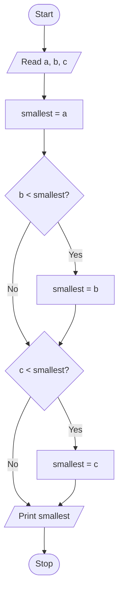
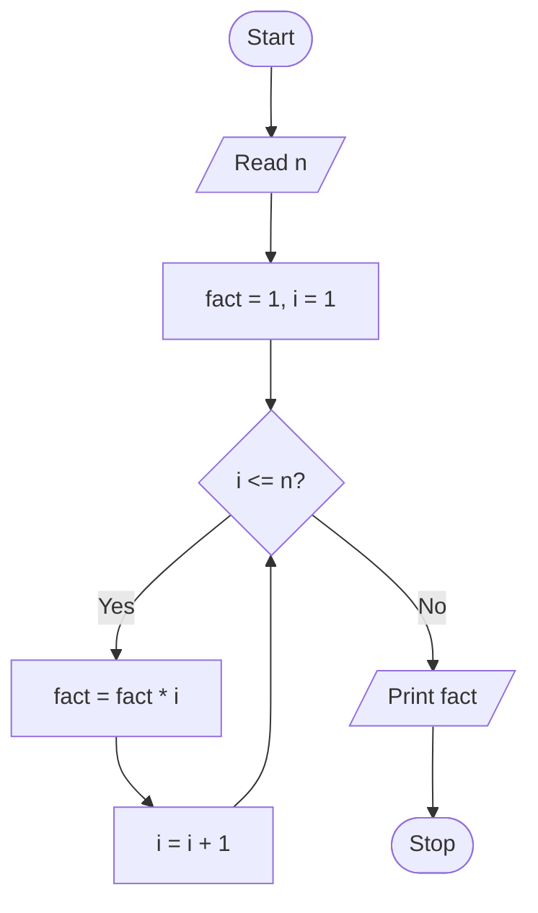
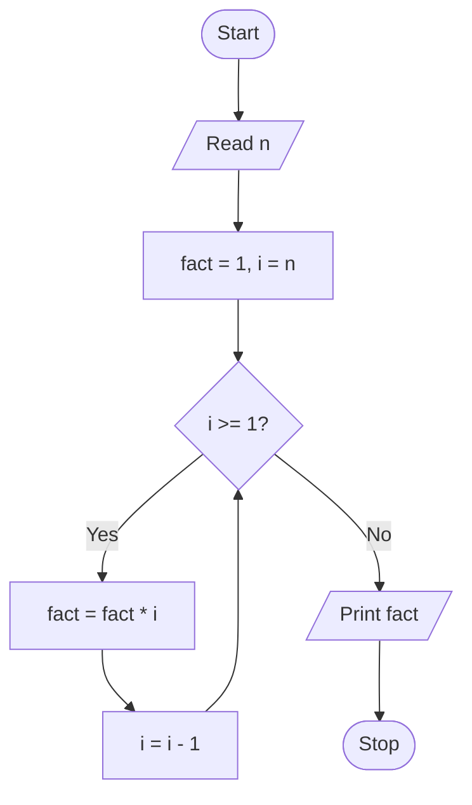
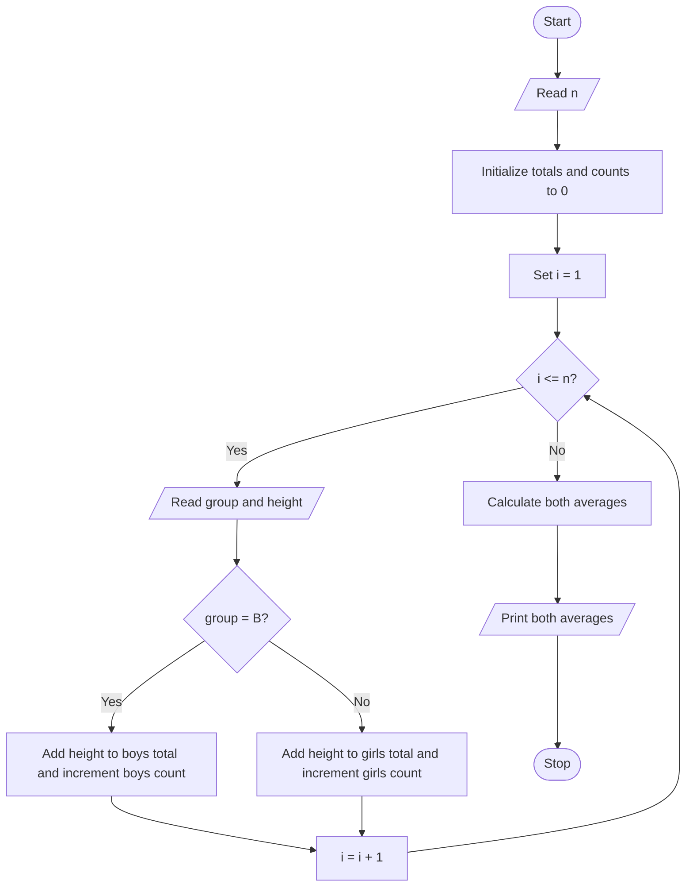
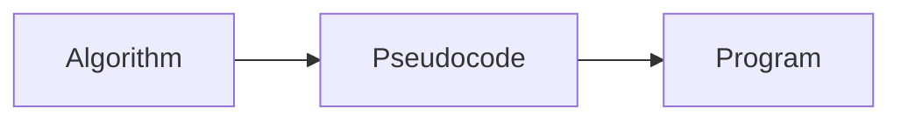
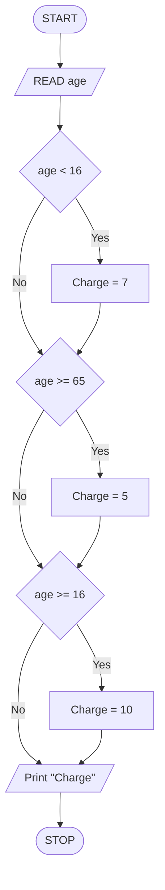
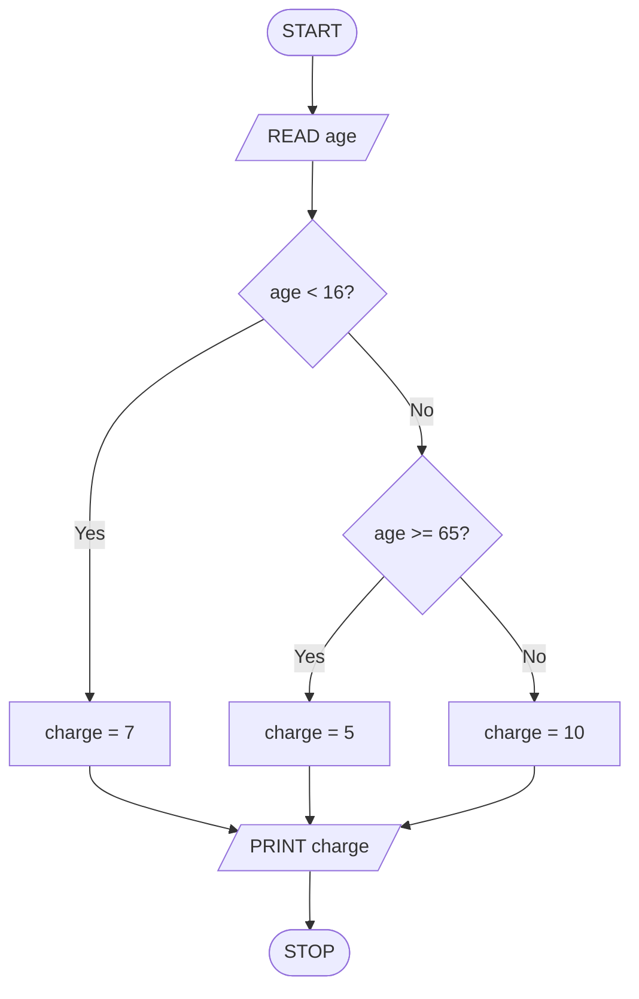
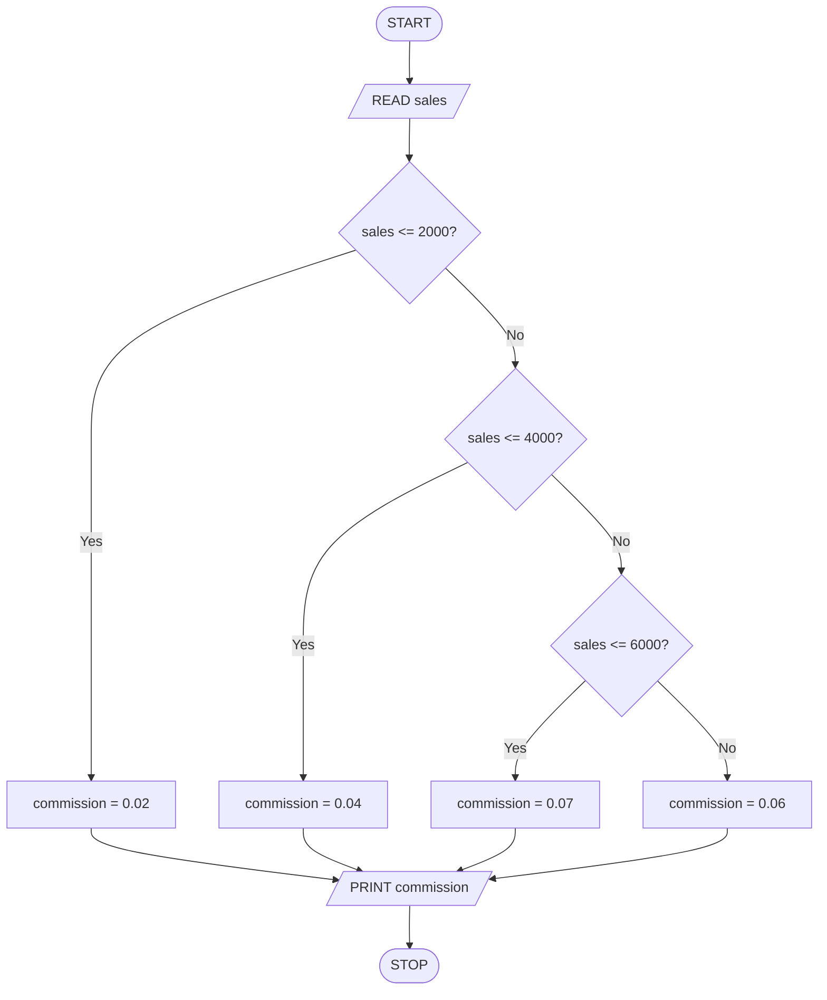

<!-- page 1 | Module 2 · source page 4 -->

# Module 2

- ALGORITHM AND PSEUDOCODE REPRESENTATION:- Meaning and Definition of Pseudocode, Reasons for using pseudocode, The main constructs of pseudocode - Sequencing, selection (if-else structure, case structure) and repetition (for, while, repeat-until loops), Sample problems

- FLOWCHARTS :- Symbols used in creating a Flowchart - start and end, arithmetic calculations, input/output operation, decision (selection), module name (call), for loop (Hexagon), flow-lines, on-page connector, off-page connector.


<!-- page 2 | Module 2 · source page 6 -->

# Flowchart symbols: start, stop, and flow lines

Flowcharts use standardized symbols to represent the steps and decisions in an algorithm. Arrows show the order in which the steps are followed.

* Terminator : A terminator symbol is used to represent the beginning and end of an algorithm


* Connector Lines: Connector lines are used to connect symbols in the flowchart.
  * The direction of the arrow indicates the next step.


<!-- page 3 | Module 2 · source page 7 -->

## Flowchart symbols

# Flowchart symbols: processing and input/output

* **Process:** A process symbol : represents an activity. It represents a particular step of an algorithm.
  * The symbol contains text which describes the step.


* **Data:** A data symbol represents data used in the algorithm. It is also used to represent the input and output
  * The symbol contains text which describes the step.
  * Multiple inputs can be read or multiple data can be initialised in the same symbol


<!-- page 4 | Module 2 · source page 8 -->

# Flowchart symbols: decisions and connectors

▶ Decision: A symbol used to branch into different steps based on condition

  ▶ Based on whether the condition succeeds or fails, connector lines connect to different points in the flowchart.


▶ On page and Off Page References: Symbols used when the entire flowchart cannot fit on the same page fully.


<!-- page 5 | Module 2 · source page 9 -->

# Flowchart symbols: modules and loops

▶ Rectangle with vertical side-lines denotes a module. A module is a collection of statements written to achieve a task. It is known by the name function in the programming domain.


▶ Hexagon denotes a **for** loop. The symbol shown here is the representation of the loop: **for** count = $A$ **to** $B$ **by** $S$.


<!-- page 6 | Module 2 · source page 10 -->

# Flowchart

## Problem 2.1 To find simple interest.

$$\text{SIMPLEINTEREST}$$

1. Start
2. $\text{READ}(principal, rate, years)$
3. $SI = (principal * rate * years) / 100$
4. $\text{PRINT}(SI)$
5. Stop.

```mermaid
flowchart TD
    A([Start]) --> B[/READ(principal, rate, years)/]
    B --> C[SI = (principal * rate * years)/100]
    C --> D[/Print SI/]
    D --> E([Stop])
```


<!-- page 7 | Module 2 · source page 11 -->

# Flowchart

## Problem 2.2 To determine the larger of two numbers.

$$\text{LargerTwo}$$

1. Start
2. $\text{READ}(a, b)$
3. $\textbf{if } (a > b)$
4. $\quad \text{large} = a$
5. $\textbf{else}$
6. $\quad \text{large} = b$
7. $\textbf{endif}$
8. $\text{PRINT}(\text{large})$
9. Stop.

```mermaid
flowchart TD
A([Start]) --> B[/READ(a, b)/]
B --> C{a > b?}
C -->|TRUE| D[large = a]
C -->|FALSE| E[large = b]
D --> F[/PRINT(large)/]
E --> F
F --> G([Stop])
```


<!-- page 8 | Module 2 · source page 12 -->

# Flowchart example: find the smallest of three numbers

```text
SMALLEST
1. START
2. READ a, b, c
3. SET smallest = a
4. IF b < smallest THEN
       SET smallest = b
   END IF
5. IF c < smallest THEN
       SET smallest = c
   END IF
6. PRINT smallest
7. STOP
```




<!-- page 9 | Module 2 · source page 13 -->

# Flowchart

\u25ba To determine the entry-ticket fare in a zoo based on age as follows:

| Age | Fare |
| :--- | :---: |
| $< 10$ | $7$ |
| $\ge 10 \text{ and } < 60$ | $10$ |
| $\ge 60$ | $5$ |

$$\text{TICKETFARE}$$
1. $\text{Start}$
2. $\text{READ}(age)$
3. $\mathbf{if} \ (age < 10)$
4. $\quad fare = 7$
5. $\mathbf{else} \ \mathbf{if} \ (age < 60)$
6. $\quad fare = 10$
7. $\mathbf{else}$
8. $\quad fare = 5$
9. $\mathbf{endif}$
10. $\text{PRINT}(fare)$
11. $\text{Stop}$

```mermaid
flowchart TD
    Start([Start]) --> Read[/READ\(age\)/]
    Read --> Cond1{age < 10?}
    Cond1 -- TRUE --> Fare7[fare = 7]
    Cond1 -- FALSE --> Cond2{age < 60?}
    Cond2 -- TRUE --> Fare10[fare = 10]
    Cond2 -- FALSE --> Fare5[fare = 5]
    Fare7 --> Print[/PRINT\(fare\)/]
    Fare10 --> Print
    Fare5 --> Print
    Print --> Stop([Stop])
```


<!-- page 10 | Module 2 · source page 14 -->

# Flowchart

## To print the colour based on a code value as follows:

| Grade | Message |
| :--- | :--- |
| $R$ | Red |
| $G$ | Green |
| $B$ | Blue |
| Any other value | Wrong code |

```text
PRINTCOLOUR
1  Start
2  READ(code)
3  caseof (code)
4    case ‘R’:
5      PRINT(“Red”)
6      break
7    case ‘G’:
8      PRINT(“Green”)
9      break
10   case ‘B’:
11     PRINT(“Blue”)
12     break
13   default :
14     PRINT(“Wrong code”)
15 endcase
16 Stop
```

```mermaid
flowchart TD
    Start([Start]) --> Read[READ(code)]
    Read --> Case{caseof
code}
    Case -->|'R'| PrintRed[PRINT("Red")]
    Case -->|'G'| PrintGreen[PRINT("Green")]
    Case -->|'B'| PrintBlue[PRINT("Blue")]
    Case -->|default| PrintWrong[PRINT("Wrong code")]
    PrintRed --> Stop([Stop])
    PrintGreen --> Stop
    PrintBlue --> Stop
    PrintWrong --> Stop
```


<!-- page 11 | Module 2 · source page 15 -->

# Flowchart example: calculate a factorial

For a non-negative integer $n$, the factorial is $n! = n \times (n-1) \times \cdots \times 2 \times 1$, and $0! = 1$.

```text
FACTORIAL
1. START
2. READ n
3. SET fact = 1
4. FOR i = 1 TO n
       SET fact = fact * i
   END FOR
5. PRINT fact
6. STOP
```




<!-- page 12 | Module 2 · source page 16 -->

## Factorial with a descending counter

The same result can be found by starting at $n$ and counting down to 1. Initializing `fact` to 1 also handles $n=0$, because the loop then runs zero times.

```text
FACTORIAL
1. START
2. READ n
3. SET fact = 1
4. FOR i = n DOWN TO 1
       SET fact = fact * i
   END FOR
5. PRINT fact
6. STOP
```




<!-- page 13 | Module 2 · source page 17 -->

# Flowchart example: average height by group

This algorithm records each student's group and height, then calculates a separate average for each group. Assume both groups have at least one student; otherwise, the average for an empty group is undefined.

```text
AVERAGE HEIGHT
1. START
2. READ n
3. SET boys_total = 0, boys_count = 0
4. SET girls_total = 0, girls_count = 0
5. FOR i = 1 TO n
       READ group, height
       IF group = "B" THEN
           SET boys_total = boys_total + height
           SET boys_count = boys_count + 1
       ELSE
           SET girls_total = girls_total + height
           SET girls_count = girls_count + 1
       END IF
   END FOR
6. SET boys_average = boys_total / boys_count
7. SET girls_average = girls_total / girls_count
8. PRINT boys_average, girls_average
9. STOP
```




<!-- page 14 | Module 2 · source page 18 -->

# References

- https://www.scaler.com/topics/how-to-write-pseudo-code/
- Algorithmic Thinking with Python - Ajeesh Ramanujan, Narasimhan T


<!-- page 15 | Module 2 · source page 2 -->

# Module 2

## Algorithm, Pseudo code, Flowchart

### Algorithm

An algorithm is a finite, ordered sequence of clear instructions for solving a problem. It may take input, process it, and produce the required output.

### General Format

1. Start
2. Read input
3. Store the input in variables
4. Calculate and perform the process.
5. Store the result in variable.
6. Print result.
7. Stop.

### Rules for writing an algorithm

1. It should begin with instruction to accept inputs
2. Each and every instruction should be precise and unambiguous.


<!-- page 16 | Module 2 · source page 3 -->

## Example: compare three numbers

```text
READ a, b, c
IF a > b AND a > c THEN
    PRINT a, "is greatest"
ELSE IF b > c THEN
    PRINT b, "is greatest"
ELSE
    PRINT c, "is greatest"
END IF
```

## Example: area and perimeter of a square

For side length $a$, the area is $a^2$ and the perimeter is $4a$.

```text
READ a
SET area = a * a
SET perimeter = 4 * a
PRINT area, perimeter
```


<!-- page 17 | Module 2 · source page 4 -->

## Example: swap two values

A temporary variable preserves the first value while the two values are exchanged.

```text
READ a, b
SET temp = a
SET a = b
SET b = temp
PRINT a, b
```


<!-- page 18 | Module 2 · source page 5 -->

Pseudo code

Pseudocode describes an algorithm in concise, structured language. It is designed for people to read, so it is not tied to the exact syntax of a programming language and cannot be executed directly.



Pseudocode bridges an algorithm and its implementation: it makes the planned steps clear before they are translated into program code.

Reason for using pseudo code

- It is easy to read and understand
- It helps plan code before implementation
- It is a good middle point between flowchart and program code.
- It is helpful for documentation
- It can reveal gaps in the logic before coding.


<!-- page 19 | Module 2 · source page 6 -->

## Rules for writing pseudocode

1. Use consistent keywords for commands and control structures.
2. Put one instruction on each line.
3. Indent nested steps to show the structure clearly.
4. Close each block with a matching keyword such as `END IF`, `END WHILE`, or `END FOR`.
5. Keep the notation independent of any one programming language.
6. Use names that describe the problem.
7. Keep the steps simple, concise, and readable.

### Example: find the greatest of three numbers

```text
READ a, b, c
SET greatest = a
IF b > greatest THEN
    SET greatest = b
END IF
IF c > greatest THEN
    SET greatest = c
END IF
PRINT greatest
```


<!-- page 20 | Module 2 · source page 7 -->

## Flowchart symbols

A flowchart shows an algorithm's steps and their order. Arrows connect symbols and show the direction of flow.

- **Terminator (oval):** start or stop.
- **Input/output (parallelogram):** read data or display a result.
- **Process (rectangle):** calculate or assign a value.
- **Decision (diamond):** test a condition and branch, often on Yes/No.

The diagrams below illustrate the common symbols.


**Start/Stop**


**Input/Output**


**Process**


**Decision**


<!-- page 21 | Module 2 · source page 8 -->

## Pseudocode constructs: sequence, selection, and repetition

### Sequence

Instructions run in order, from top to bottom.

### Selection

Selection chooses which instructions to run based on a condition. Common forms include a simple `IF`, an `IF/ELSE`, an `IF/ELSE IF` chain, and nested conditions.

### Repetition

Repetition runs a group of instructions multiple times. Common loop forms include `WHILE`, `FOR`, and `REPEAT/UNTIL`.


<!-- page 22 | Module 2 · source page 9 -->

## Simple and nested conditions

A simple `IF` runs its body only when the condition is true. `IF/ELSE` selects one of two branches.

```text
IF condition THEN
    statements
END IF

IF condition THEN
    statements when true
ELSE
    statements when false
END IF
```

A nested condition is an `IF` inside another conditional block:

```text
IF outer_condition THEN
    IF inner_condition THEN
        statements
    END IF
END IF
```


<!-- page 23 | Module 2 · source page 10 -->

## Multiple choices with `ELSE IF`

An `ELSE IF` chain tests conditions in order. The first true branch runs; if none match, the `ELSE` branch runs.

```text
IF grade = "A" THEN
    PRINT "Excellent"
ELSE IF grade = "B" THEN
    PRINT "Good"
ELSE IF grade = "C" THEN
    PRINT "Average"
ELSE
    PRINT "Review the grade"
END IF
```

Only one matching branch is selected.


<!-- page 24 | Module 2 · source page 11 -->

## Case selection and parity checks

A case structure is useful when one value is compared with several specific alternatives.

```text
READ colour_code
CASE colour_code OF
    "R": PRINT "Red"
    "G": PRINT "Green"
    "B": PRINT "Blue"
    OTHERWISE: PRINT "Unknown colour code"
END CASE
```

### Example: test whether an integer is odd or even

```text
READ number
IF number MOD 2 = 0 THEN
    PRINT "Even"
ELSE
    PRINT "Odd"
END IF
```


<!-- page 25 | Module 2 · source page 12 -->

## Example: calculate a factorial with a loop

For a non-negative integer $n$, $n! = n \times (n-1) \times \cdots \times 2 \times 1$, and $0! = 1$.

```text
READ n
SET factorial = 1
FOR i = 1 TO n
    SET factorial = factorial * i
END FOR
PRINT factorial
```

When $n=0$, the loop does not run and the initialized result remains 1.


<!-- page 26 | Module 2 · source page 13 -->

## Problem-solving example: solve a jigsaw puzzle

When the reference picture is unavailable, trial and error can help narrow the choices. Use clues from shape, colour, and neighbouring pieces to avoid random attempts.

1. Separate edge and corner pieces from the rest.
2. Build the border using pieces with straight edges.
3. Group interior pieces by colour or pattern.
4. Try a piece in a likely location; if it does not fit, set it aside and test another.
5. Join matching clusters and use the combined shape and image as new clues.
6. Continue until the remaining gaps are filled, revisiting earlier choices when necessary.


<!-- page 27 | Module 2 · source page 14 -->

## Problem-solving example: choose a restaurant using heuristics

A heuristic is a shortcut for narrowing a choice quickly; it does not prove that the chosen restaurant is the best. For example:

1. Filter for places that are nearby and open at the planned time.
2. Check recent reviews and the menu.
3. Compare the price with your budget.
4. Ask someone local for a recommendation if you are still unsure.
5. Choose a suitable option and confirm its location and availability before leaving.

These rules reduce the options quickly. If the choice matters more, compare more information before deciding.


<!-- page 28 | Module 2 · source page 15 -->

Algorithm for finding factorial

Step 1: Start

Step 2: Read the 'n'

Step 3: Initialize $i=1$ and $fact=1$

Step 4: Calculate $fact = fact 	imes i$

Step 5: Increment the value of $i$, $i = i + 1$

Step 6: Check whether, $i <= n$, then goto Step 4

else

Print the value of 'Factorial'

Step 7: Stop.

Flowchart of odd number


<!-- page 29 | Module 2 · source page 16 -->

Illustrate a problem to find the amount of charge people of varying ages for a concert ticket. Person is under 16 the charge is $7. When the person is 65 or over the charge is $5. All others are charged $10.

| Age | Charge |
| --- | --- |
| $\text{Age} < 16$ | 7 |
| $\text{Age} \ge 65$ | 5 |
| $\text{Age} \ge 16$ and $\text{Age} < 65$ | 10 |

Algorithm

Step 1 : Start

Step 2 : Read age

Step 3 : If $age < 16$, set `charge = 7`.

Step 4 : Else if $age \ge 65$, set `charge = 5`.

Step 5 : Otherwise, set `charge = 10`.

Step 6 : Print `charge`.

Step 6 : Stop.


<!-- page 30 | Module 2 · source page 17 -->




<!-- page 31 | Module 2 · source page 18 -->

Algorithm

Step 1: Start

Step 2: Read age

Step 3: If age < 16, set charge = 7.

Step 4: Else if age >= 65, set charge = 5.

Step 5: Else set charge = 10.

Step 6: Print charge.

Step 7: Stop.

Pseudo code

1. START

2. READ age

3. IF age < 16, THEN

Set charge = 7

4. ELSE IF age >= 65, THEN

Set charge = 5

5. ELSE

Set charge = 10

6. PRINT charge

7. STOP


<!-- page 32 | Module 2 · source page 19 -->




<!-- page 33 | Module 2 · source page 20 -->

## Flowchart symbols: standard shapes

A flowchart shows the steps of an algorithm and the order in which they occur. Arrows connect the symbols and show the direction of flow.

- **Terminator (oval):** start or stop.
- **Input/output (parallelogram):** read data or display a result.
- **Process (rectangle):** calculate or assign a value.
- **Decision (diamond):** test a condition and branch, often on Yes/No.

The diagrams below illustrate the common shapes.


<!-- page 34 | Module 2 · source page 21 -->

Step 5: Else if Sales <= 6000, set commission to 0.07.

Step 6: Else set commission to 0.06.

Step 7: Print commission.

Step 8: Stop.

Pseudocode

1. START
2. READ sales
3. IF sales <= 2000 THEN
       commission = 0.02
   ELSE IF sales <= 4000 THEN
       commission = 0.04
   ELSE IF sales <= 6000 THEN
       commission = 0.07
   ELSE
       commission = 0.06
   END IF
4. PRINT commission
5. STOP


<!-- page 35 | Module 2 · source page 22 -->

Flowchart:




<!-- page 36 | Module 2 · source page 23 -->

## Repeat-until loops

A repeat-until loop runs its body first, then checks its condition. It always runs at least once and stops when the condition becomes true.

```text
REPEAT
    statements
UNTIL condition
```

For example, to print 1 through 10:

```text
SET i = 1
REPEAT
    PRINT i
    SET i = i + 1
UNTIL i > 10
```


<!-- page 37 | Module 2 · source page 24 -->

## Example: repeat-until loop and minimum of three numbers

A repeat-until loop checks its condition after executing the body, so its body runs at least once.

```text
SET i = 1
REPEAT
    PRINT i
    SET i = i + 1
UNTIL i > 10
```

To find the smallest of three numbers, initialize the current minimum to the first value and compare the other two values with it:

```text
READ a, b, c
SET smallest = a
IF b < smallest THEN
    SET smallest = b
END IF
IF c < smallest THEN
    SET smallest = c
END IF
PRINT smallest
```


<!-- page 38 | Module 2 · source page 25 -->

## Flowchart symbols: module calls and loops

A **predefined process** symbol represents a call to a named procedure, function, or module. A **loop** symbol can represent a repeated operation, such as a counter running from a start value to an end value.

To calculate the sum of the first $n$ positive integers:

```text
SUM NATURAL NUMBERS
1. START
2. READ n
3. SET i = 1, sum = 0
4. WHILE i <= n
       SET sum = sum + i
       SET i = i + 1
   END WHILE
5. PRINT sum
6. STOP
```


<!-- page 39 | Module 2 · source page 26 -->

Flowchart symbols

The module name of call symbol is used to represent a call to a subroutine or functions or module within a flowchart. It is used to call separate redefined process or set of operations.


Hexagon (for-loop symbol)

It represents an iterative process. It involves repeating a set of instructions for a specific number of times.

Algorithm: sum the first $n$ natural numbers

Step 1 : Start

Step 2 : Initialize $i=1$ and $sum=0$.

Step 3 : REPEAT

$$Sum = Sum + i$$

$$i = i + 1$$

UNTIL $i > n$

Step 4 : Print Sum

Step 5 : Stop.


<!-- page 40 | Module 2 · source page 27 -->

## Example: calculate the average age of students

Read each student's age once, keep a running total, and divide by the number of students. Assume $n > 0$.

```text
AVERAGE AGE
1. START
2. READ n
3. SET sum = 0, i = 1
4. REPEAT
       READ age
       SET sum = sum + age
       SET i = i + 1
   UNTIL i > n
5. SET average = sum / n
6. PRINT average
7. STOP
```


<!-- page 41 | Module 2 · source page 28 -->

## While loops

A `while` loop checks its condition before each iteration. The body may run zero times if the condition is false at the start.

```text
WHILE condition DO
    statements
END WHILE
```

Print the integers from 1 through $n$:

```text
SET i = 1
WHILE i <= n DO
    PRINT i
    SET i = i + 1
END WHILE
```

A `for` loop is useful when the values or number of repetitions are known in advance. A countdown loop uses a decreasing step.


<!-- page 42 | Module 2 · source page 29 -->

## For loops and step values

A counter loop specifies its starting value, stopping value, and optional step. The end value is included in this pseudocode convention; Python's `range()` instead excludes its stop value.

```text
FOR i = 1 TO n
    PRINT i
END FOR

FOR i = 10 DOWN TO 1 STEP -1
    PRINT i
END FOR
```


<!-- page 43 | Module 2 · source page 30 -->

## Selection and repetition: syntax patterns

Pseudocode makes control flow explicit. Indent the statements inside each block and close every block with its matching keyword.

```text
IF condition THEN
    statements
ELSE
    statements
END IF

WHILE condition DO
    statements
END WHILE

FOR each item in sequence DO
    statements
END FOR
```

For example, `FOR i = 1 TO n` repeats a known number of times, while `WHILE condition` repeats until its condition becomes false.


<!-- page 44 | Module 2 · source page 31 -->

## The Python `range()` function

`range()` produces integers from a start value up to, but not including, the stop value. The step may be positive or negative.

```python
list(range(5))          # [0, 1, 2, 3, 4]
list(range(1, 10, 2))   # [1, 3, 5, 7, 9]
list(range(10, 0, -1))  # [10, 9, 8, ..., 1]
```

A `for` loop can use the same ranges without building a list first:

```python
for i in range(1, 6):
    print(i)
```


<!-- page 45 | Module 2 · source page 32 -->

## Examples: accumulation and repetition

### Sum the first ten positive integers

```python
total = 0
for number in range(1, 11):
    total += number
print(total)  # 55
```

### Print the multiplication table of nine

```python
for multiplier in range(1, 11):
    print(f"{multiplier} × 9 = {multiplier * 9}")
```


<!-- page 46 | Module 2 · source page 33 -->

## Example: assign a grade with `if` and `elif`

The conditions are checked from top to bottom. Once one condition matches, the remaining branches are skipped.

```python
mark = int(input("Enter the mark: "))

if mark >= 90:
    grade = "A"
elif mark >= 80:
    grade = "B"
elif mark >= 70:
    grade = "C"
elif mark >= 60:
    grade = "D"
else:
    grade = "F"

print(f"Grade: {grade}")
```

### Example: determine whether a year is a leap year

A year is a leap year when it is divisible by 400, or when it is divisible by 4 but not by 100.

```python
year = int(input("Enter a year: "))
if year % 400 == 0 or (year % 4 == 0 and year % 100 != 0):
    print("Leap year")
else:
    print("Not a leap year")
```


<!-- page 47 | Module 2 · source page 34 -->

## Example: solve a quadratic equation

For $ax^2 + bx + c = 0$, the discriminant $D = b^2 - 4ac$ determines the roots. This example prints real roots and handles the case where $a=0$.

```python
import math

a = float(input("Enter a: "))
b = float(input("Enter b: "))
c = float(input("Enter c: "))

if a == 0:
    print("This is not a quadratic equation.")
else:
    discriminant = b**2 - 4 * a * c
    if discriminant > 0:
        root1 = (-b + math.sqrt(discriminant)) / (2 * a)
        root2 = (-b - math.sqrt(discriminant)) / (2 * a)
        print("Two real roots:", root1, "and", root2)
    elif discriminant == 0:
        print("One real root:", -b / (2 * a))
    else:
        print("There are no real roots.")
```

The complex roots for a negative discriminant can be found with `cmath.sqrt()`.


<!-- page 48 | Module 2 · source page 35 -->

## List indexing and slicing

```python
fruits = ["apple", "mango", "grapes"]
print(fruits[1:3])   # ['mango', 'grapes']
print(fruits[-1])    # 'grapes'
print(fruits[-3:-1]) # ['apple', 'mango']
print(fruits[1:])    # ['mango', 'grapes']
print(fruits[:2])    # ['apple', 'mango']

fruits[1] = "orange"
print(fruits)        # ['apple', 'orange', 'grapes']
fruits[1:2] = ["cherry", "pineapple"]
print(fruits)        # ['apple', 'cherry', 'pineapple', 'grapes']
```


<!-- page 49 | Module 2 · source page 36 -->

## Sorting and iterating over a list

```python
fruits = ["apple", "mango", "grapes"]
fruits.sort()
print(fruits)  # ['apple', 'grapes', 'mango']

fruits.sort(reverse=True)
print(fruits)  # ['mango', 'grapes', 'apple']

for fruit in fruits:
    print(fruit)

for i in range(len(fruits)):
    print(i, fruits[i])
```

## NumPy arrays

NumPy is an optional third-party library for working with arrays. Install it before using this example.

```python
import numpy as np

arr = np.array([1, 2, 3, 4])
print(arr)        # [1 2 3 4]
print(type(arr))  # <class 'numpy.ndarray'>
```


<!-- page 50 | Module 2 · source page 37 -->

## Replacing part of a list with slice assignment

A slice assignment replaces the selected range with items from an iterable. The replacement may contain a different number of items, changing the list length. Use a list even when replacing the slice with one item.

```python
numbers = [10, 20, 30, 40, 50]

numbers[1:3] = [35, 45]
print(numbers)  # [10, 35, 45, 40, 50]

numbers[1:3] = [23, 27, 28]
print(numbers)  # [10, 23, 27, 28, 40, 50]

numbers[1:3] = [68]
print(numbers)  # [10, 68, 40, 50]
```