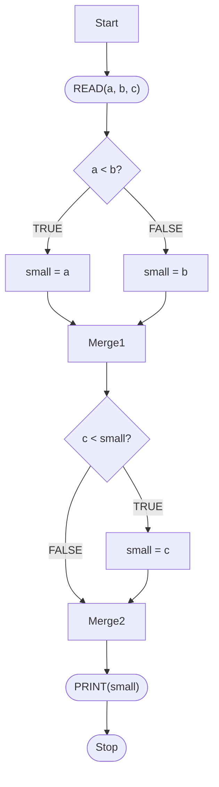
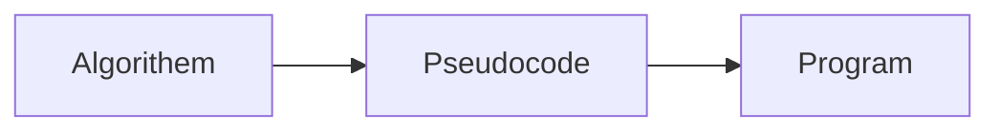
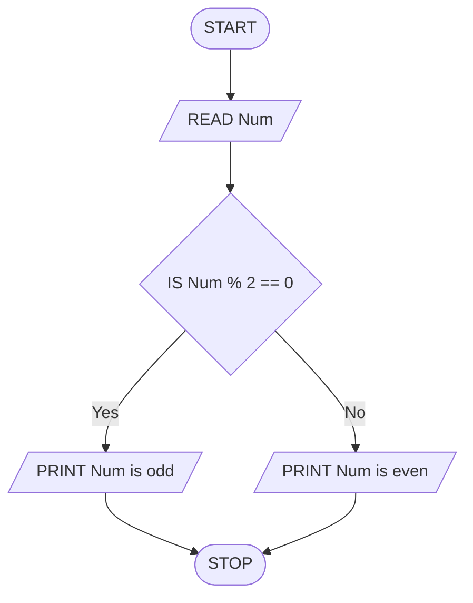
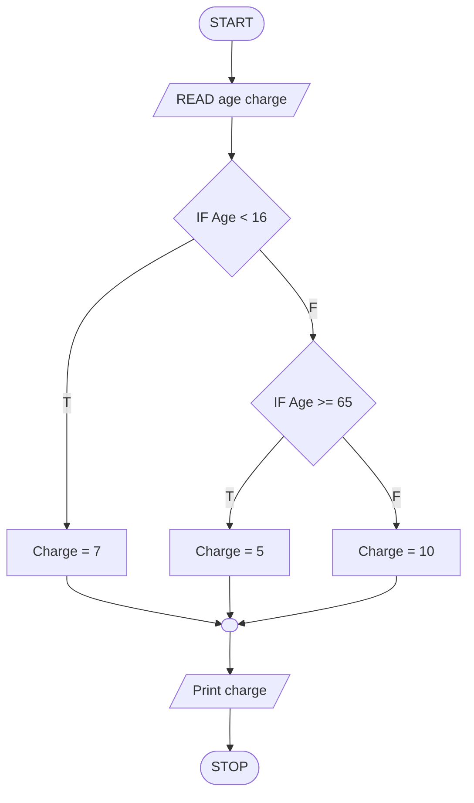
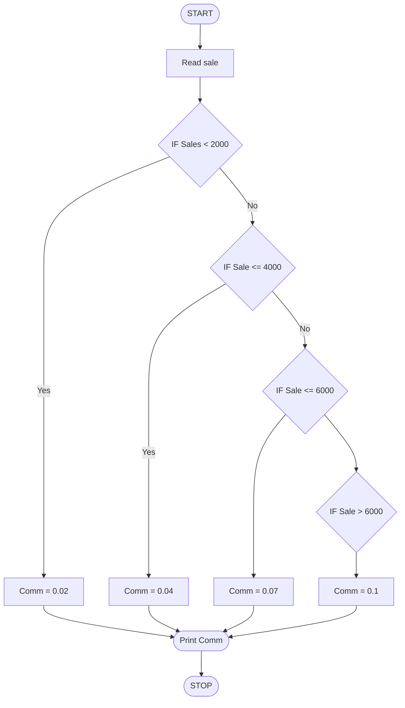
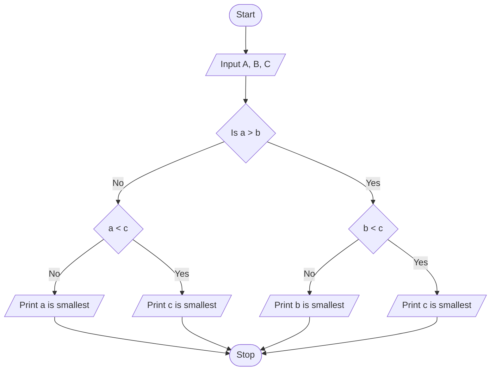

<!-- page 1 | Module 2 · source page 1 -->

[Non-content page]

---

---

<!-- page 2 | Module 2 · source page 2 -->

[Non-content page]

---

---

<!-- page 3 | Module 2 · source page 3 -->

[Non-content page]

---

---

<!-- page 4 | Module 2 · source page 4 -->

# Module 2

- ALGORITHM AND PSEUDOCODE REPRESENTATION:- Meaning and Definition of Pseudocode, Reasons for using pseudocode, The main constructs of pseudocode - Sequencing, selection (if-else structure, case structure) and repetition (for, while, repeat-until loops), Sample problems

- FLOWCHARTS :- Symbols used in creating a Flowchart - start and end, arithmetic calculations, input/output operation, decision (selection), module name (call), for loop (Hexagon), flow-lines, on-page connector, off-page connector.

---

---

<!-- page 5 | Module 2 · source page 5 -->

[Non-content page]

---

---

<!-- page 6 | Module 2 · source page 6 -->

# Flowchart

* Flowcharts use standardized symbols to visually represent various aspects of an algorithm or a process.

* Terminator : A terminator symbol is used to represent the beginning and end of an algorithm


* Connector Lines: Connector lines are used to connect symbols in the flowchart.
  * The direction of the arrow indicates the next step.


---

---

<!-- page 7 | Module 2 · source page 7 -->

# Flowchart

* **Process:** A process symbol : represents an activity. It represents a particular step of an algorithm.
  * The symbol contains text which describes the step.


* **Data:** A data symbol represents data used in the algorithm. It is also used to represent the input and output
  * The symbol contains text which describes the step.
  * Multiple inputs can be read or multiple data can be initialised in the same symbol


---

---

<!-- page 8 | Module 2 · source page 8 -->

# Flowchart

▶ Decision: A symbol used to branch into different steps based on condition

  ▶ Based on whether the condition succeeds or fails, connector lines connect to different points in the flowchart.


▶ On page and Off Page References: Symbols used when the entire flowchart cannot fit on the same page fully.


---

---

<!-- page 9 | Module 2 · source page 9 -->

# Flowchart

▶ Rectangle with vertical side-lines denotes a module. A module is a collection of statements written to achieve a task. It is known by the name function in the programming domain.


▶ Hexagon denotes a **for** loop. The symbol shown here is the representation of the loop: **for** count = $A$ **to** $B$ **by** $S$.


---

---

<!-- page 10 | Module 2 · source page 10 -->

# Flowchart

## Problem 2.1 To find simple interest.

$$\text{SIMPLEINTEREST}$$

1. Start
2. $\text{READ}(principal, rate, years)$
3. $SI = (principal * rate * years) / 100$
4. $\text{PRINT}(SI)$
5. Stop.


```mermaid
flowchart TD
    A([Start]) --> B[/READ(principal, rate, years)/]
    B --> C[SI = (principal * rate * years)/100]
    C --> D[/Print SI/]
    D --> E([Stop])
```

---

---

<!-- page 11 | Module 2 · source page 11 -->

# Flowchart

## Problem 2.2 To determine the larger of two numbers.

$$\text{LargerTwo}$$

1. Start
2. $\text{READ}(a, b)$
3. $\textbf{if } (a > b)$
4. $\quad \text{large} = a$
5. $\textbf{else}$
6. $\quad \text{large} = b$
7. $\textbf{endif}$
8. $\text{PRINT}(\text{large})$
9. Stop.


```mermaid
flowchart TD
A([Start]) --> B[/READ(a, b)/]
B --> C{a > b?}
C -->|TRUE| D[large = a]
C -->|FALSE| E[large = b]
D --> F[/PRINT(large)/]
E --> F
F --> G([Stop])
```

---

---

<!-- page 12 | Module 2 · source page 12 -->

# Flowchart

## To determine the smallest of three numbers.

```
SMALLESTTHREE
1 Start
2 READ(a, b, c)
3 if (a < b)
4     small = a
5 else
6     small = b
7 endif
8 if (c < small)
9     small = c
10 endif
11 PRINT(small)
12 Stop.
```




---

---

<!-- page 13 | Module 2 · source page 13 -->

# Flowchart

\u25ba To determine the entry-ticket fare in a zoo based on age as follows:

| Age | Fare |
| :--- | :---: |
| $< 10$ | $7$ |
| $\ge 10 \text{ and } < 60$ | $10$ |
| $\ge 60$ | $5$ |

$$\text{TICKETFARE}$$
1. $\text{Start}$
2. $\text{READ}(age)$
3. $\mathbf{if} \ (age < 10)$
4. $\quad fare = 7$
5. $\mathbf{else} \ \mathbf{if} \ (age < 60)$
6. $\quad fare = 10$
7. $\mathbf{else}$
8. $\quad fare = 5$
9. $\mathbf{endif}$
10. $\text{PRINT}(fare)$
11. $\text{Stop}$


```mermaid
flowchart TD
    Start([Start]) --> Read[/READ\(age\)/]
    Read --> Cond1{age < 10?}
    Cond1 -- TRUE --> Fare7[fare = 7]
    Cond1 -- FALSE --> Cond2{age < 60?}
    Cond2 -- TRUE --> Fare10[fare = 10]
    Cond2 -- FALSE --> Fare5[fare = 5]
    Fare7 --> Print[/PRINT\(fare\)/]
    Fare10 --> Print
    Fare5 --> Print
    Print --> Stop([Stop])
```

---

---

<!-- page 14 | Module 2 · source page 14 -->

# Flowchart

## To print the colour based on a code value as follows:

| Grade | Message |
| :--- | :--- |
| $R$ | Red |
| $G$ | Green |
| $B$ | Blue |
| Any other value | Wrong code |

```text
PRINTCOLOUR
1  Start
2  READ(code)
3  caseof (code)
4    case ‘R’:
5      PRINT(“Red”)
6      break
7    case ‘G’:
8      PRINT(“Green”)
9      break
10   case ‘B’:
11     PRINT(“Blue”)
12     break
13   default :
14     PRINT(“Wrong code”)
15 endcase
16 Stop
```


```mermaid
flowchart TD
    Start([Start]) --> Read[READ(code)]
    Read --> Case{caseof
code}
    Case -->|'R'| PrintRed[PRINT("Red")]
    Case -->|'G'| PrintGreen[PRINT("Green")]
    Case -->|'B'| PrintBlue[PRINT("Blue")]
    Case -->|default| PrintWrong[PRINT("Wrong code")]
    PrintRed --> Stop([Stop])
    PrintGreen --> Stop
    PrintBlue --> Stop
    PrintWrong --> Stop
```

---

---

<!-- page 15 | Module 2 · source page 15 -->

# Flowchart

## To find the factorial of a number

**Solution:** The factorial of a number $n$ is defined as $n! = n 	imes n-1 	imes 	imes 	imes 2 	imes 1$.

FACTORIAL
1. Start
2. $\text{READ}(n)$
3. $\text{fact} = 1$
4. $\text{for } \text{var} = n \text{ downto } 1$
5. $\quad \text{fact} = \text{fact} * \text{var}$
6. $\text{endfor}$
7. $\text{PRINT}(fact)$
8. Stop


```mermaid
flowchart TD
    A([Start]) --> B[/READ\(n\)/]
    B --> C[fact = 1]
    C --> D{var < 1}
    D -- No --> E[fact = fact * var]
    E --> F((var))
    F --> D
    D -- Yes --> G[/PRINT\(fact\)/]
    G --> H([Stop])
```

---

---

<!-- page 16 | Module 2 · source page 16 -->

# Flowchart

## To find the factorial of a number

**Solution:** The factorial of a number $n$ is defined as $n! = n \times n-1 \times \dots \times 2 \times 1$.

FACTORIAL

1. $\text{Start}$
2. $\text{READ}(n)$
3. $\text{fact} = 1$
4. $\mathbf{for}\ var = n\ \mathbf{downto}\ 1$
5. $\quad \text{fact} = \text{fact} * \text{var}$
6. $\mathbf{endfor}$
7. $\text{PRINT}(fact)$
8. $\text{Stop}$


```mermaid
flowchart TD
    A([Start]) --> B[/READ(n)/]
    B --> C[fact = 1]
    C --> D{var - 1}
    D -- n --> E[fact = fact * var]
    E --> F((var))
    F --> D
    D -- 1 --> G[/PRINT(fact)/]
    G --> H([Stop])
```

---

---

<!-- page 17 | Module 2 · source page 17 -->

# Flowchart

▶ To find the average height of boys and average height of girls in a class of n students.

```text
AVERAGEHEIGHT
 1  Start
 2  READ(n)
 3  btotal = 0
 4  bcount = 0
 5  gtotal = 0
 6  gcount = 0
 7  for var = 1 to n
 8      READ(gender, height)
 9      if (gender == 'M')
10          btotal = btotal + height
11          bcount = bcount + 1
12      else
13          gtotal = gtotal + height
14          gcount = gcount + 1
15      endif
16  endfor
17  bavg = btotal / bcount
18  gavg = gtotal / gcount
19  PRINT(bavg, gavg)
20  Stop
```


```mermaid
flowchart TD
    A([Start]) --> B[/READ\(n\)/]
    B --> C[bcount = 0
gcount = 0
btotal = 0
gtotal = 0]
    C --> D{var = 1 \n to \n n}
    D -->|loop| E[/READ\(gender, height\)/]
    E --> F{gender == 'M'}
    F -->|True| G[btotal = btotal + height
bcount = bcount + 1]
    F -->|False| H[gtotal = gtotal + height
gcount = gcount + 1]
    G --> I((var))
    H --> I
    I -->|Next var| D
    D -->|Done| J[bavg = btotal / bcount
gavg = gtotal / gcount]
    J --> K[/PRINT\(gavg, bavg\)/]
    K --> L([Stop])
```

---

---

<!-- page 18 | Module 2 · source page 18 -->

# References

- https://www.scaler.com/topics/how-to-write-pseudo-code/
- Algorithmic Thinking with Python - Ajeesh Ramanujan, Narasimhan T

---

---

<!-- page 19 | Module 2 · source page 19 -->

[Non-content page]

---

---

<!-- page 20 | Module 2 · source page 1 -->

[Non-content page]

---

---

<!-- page 21 | Module 2 · source page 2 -->

# Module - 2

## Algorithm, Pseudo code, Flowchart

### Algorithm

Algorithm is an ordered sequence of finite well-defined instruction for completing a task. An algorithm is a step by step procedure to describe how a problem can be solved. Then, it takes a set of inputs and produce a desired output.

### General Format

1. Start
2. Read input
3. Store the input in variables
4. Calculate and perform the process.
5. Store the result in variable.
6. Print result.
7. Stop.

### Rules to right an algorithm

1. It should begin with instruction to accept inputs
2. Each and every instruction should be precise and unambiguous.

---

---

<!-- page 22 | Module 2 · source page 3 -->

3. Instruction should be sufficiently basic.

4. The total time to carry out all steps must be finite.

5. After the algorithm terminates the desired output must be obtained.

Step 1: Start

Step 2: Read 3 numbers $a, b, c$

Step 3: Check whether $a > b$, if true go to step 4

else go to step 5

Step 4: Check whether $a > c$, if true print $a$ is greater

else print $c$ is greater.

Step 5: Check whether $b > c$, if true, $b$ is greater.

else $c$ is greater.

Step 6: Stop.

$\Rightarrow$ Algorithm to find the area and perimeter of square.

Step 1: Start

Step 2: Read the side of the square as $a$

Step 3: Calculate area of square

using formula, $a * a$

---

---

<!-- page 23 | Module 2 · source page 4 -->

Step 4 : Perimeter of the square

     using formula, $4 * a$

Step 5 : Print area and Perimeter

Step 6 : Stop

=> Algorithem to swap two numbers

Step 1 : Start

Step 2 : Read two numbers $a$ and $b$

Step 3 : Swap the numbers to an extra variable `temp`

     Go to step 4

Step 4 : Set `temp = a`

Step 5 : Set `a = b`

Step 6 : `b = temp`

Step 7 : Print swapped values $a$ and $b$

Step 8 : Stop.

Pseudo code

Step 1 : START

Step 2 : READ `a, b`

Step 3 : CREATE `temp` variable

Step 4 : SET `temp = a`

Step 5 : `a = b`

Step 6 : `b = temp`

Step 7 : PRINT `a, b`

Step 8 : STOP

---

---

<!-- page 24 | Module 2 · source page 5 -->

Pseudo code

It is an implementation of an algorithm in the form of annotation and informative text written in english but it has no syntax and it can't be compiled or interpreted by the computer, like programing language.





It act as a bridge between program and algorithm or flowchart. The main goal of Pseudo code is to explain what each line of program should do. So it makes the code construction easier for the program.

Reason for using pseudo code

- It is easier to read and understand
- It simplifies code development
- It is a good middle point between flowchart and program code.
- It is helpful for documentation
- It allows for quick bug detection.

---

---

<!-- page 25 | Module 2 · source page 6 -->

Rules for writing Pseudo code

1. Capitalize initial word [Command|Keywords|construct]
2. Make only one statement per line
3. Indent to show heirarchy, improve readability and show nested construct.
4. Always end multiline section using END keyword.
5. Keep your statement independent of programing language.
6. Use the naming domain of the problem not that of implementation.
7. Keep it simple concise and readable.

$\Rightarrow$ Pseudo code for largest of 3 numbers

1. START
2. READ a, b, c
3. IF a>b AND a>c the value of a>b, then.THEN
	GOTO Step 4
ELSE
	GOTO Step 5
4. IF the value of a>c, THEN
	PRINT "a is greater"
ELSE
	PRINT "c is greater"

In the case of adding first
name and second name together,
instead of,

name = first + last

we use,

APPEND = first, last

---

---

<!-- page 26 | Module 2 · source page 7 -->

5. IF the value of b > c, THEN

    PRINT "b is greater"

    Go To step 6

ELSE

    PRINT "c is greater"

    Go To step 6

6. STOP.

Flow Chart

    Flowchart is a diagrammatic representation of algorithm, that depicts sequence of steps or operation required to solve a problem or task.

- It uses various symbols for actions, decisions, or events connected by arrows to indicate the flow of control from one step to another (top to bottom).

Symbols


 - Start/Stop


 - Input/Output


 - Process


 - Condition

---

---

<!-- page 27 | Module 2 · source page 8 -->

Constraint of pseudo code

1. Sequencing
2. Selecting
3. Repetation

Sequencing

Execution happens line by line top to bottom

Selection

Used for decision making.

IF

1. Simple if
2. IF then else
3. IF then else-if then

4. Nested if

Simple if

Used only when you want to execute something if the condition is true.

IF then else

Used when you want one action for true and another action for false.

IF then else if then

Used for multiple mutually exclusive condition (Multiple choices).

---

---

<!-- page 28 | Module 2 · source page 9 -->

Nested if

If statement inside another if statement.

Syntax of simple if

IF CONDITION THEN

    STATEMENT

END IF

Eg:- IF (a==10) THEN

    PRINT "The value of a is 10"

END IF

Syntax of if else

IF CONDITION THEN

    STATEMENT || true

ELSE

    STATEMENT || false

END IF

Eg:- IF (a==10) THEN

    PRINT "the value of a is 10"

ELSE

    PRINT "the value of a is not 10"

END IF

---

---

<!-- page 29 | Module 2 · source page 10 -->

Syntax of IF-else IF

IF CONDITION THEN

    true statement

ELSE IF CONDITION THEN

    true statement

ELSE

    false statement

END IF

END IF

Ex: IF a==10 THEN

    PRINT "The value of a is 10"

ELSE IF a==15 THEN

    PRINT "The value of a is 15"

ELSE

    PRINT "The value of a is not 15 and not 10"

END IF

END IF

Nested if

IF CONDITION THEN

    IF CONDITION THEN

        true statement

    END IF

END IF

---

---

<!-- page 30 | Module 2 · source page 11 -->

Eg:- IF a==10 THEN

$$\quad$$ IF a<15 THEN

$$\quad\quad$$ PRINT "The value of a is less than 15"

$$\quad$$ END IF

END IF

~~Case 'GRADE OF'~~

SWITCH

CASE 'GRADE OF'

'A' : PRINT "Excellent"

'B' : PRINT "Good"

'C' : PRINT "Average"

'D' : PRINT "Poor"

OTHERWISE : PRINT "Fail"

END CASE

Write a algorithm check whether a number is odd or even.

Step 1 : Start

Step 2 : Read a number, 'num'

Step 3 : Check whether the ('number' % 2 == 0), then

$$\quad$$ P Print "the number is even"

---

---

<!-- page 31 | Module 2 · source page 12 -->

else

Print "the number is odd"

Step 4: Stop

Pseudo_code

1. START

2. READ the number, `num`

3. IF `num % 2 == 0` then

PRINT "the number is even"

ELSE

PRINT "the number is odd"

END IF

4. STOP

Find factorial of a numbers. Write the algorithm

Step 1 : Start

Step 2 : Read the number, `num`

Step 3 : $n = n * (n-1) * (n-2) * (n-3) * 	ext{.....} * (n-(n-1))$

$$
\begin{align*}
1! &= 1 \times 1\\
2! &= 1 \times 2\\
3! &= 1 \times 2 \times 3\\
4! &= 1 \times 2 \times 3 \times 4
\end{align*}
$$

$$
\begin{align*}
&n\\
1! &= 1\\
2! &= i \times (i+1)\\
3! &= i \times (i+1)
\end{align*}
$$

---

---

<!-- page 32 | Module 2 · source page 13 -->

You are asked to solve a jigsaw puzzle without a reference picture. How will you solve it using trial and error method.

At First sort out the pieces corresponding
To solve a jigsaw puzzle without a reference picture using trial and error method.

1. Sort the Pieces
   Separate edge and corner piece and group others.

2. Assemble the Frame
   Use the edge and corner pieces to build puzzle's border.

3. Work on Specific Section
   Focus on area with similar colours or design or pattern.

4. Test for fit and use elimination
   Try different pieces if one doesn't fit
Properly remove it and try another

5. Combine clusters
   When two small assemblies align in pattern
or shape connect them and confirm the combined fit

---

---

<!-- page 33 | Module 2 · source page 14 -->

6. Fill the gaps

Using neighbouring colour or shape clue test pieces one by one with elimination and continue filling the empty spaces until the puzzel is completed.

Your college is located in a metropolitan city. You are new to the city, you would like to go out for the dinner explain how heuristic approach can be used to find the best restuarent for dinner.

1. Make a list of restuarents rating above 4.0 on google
2. Choose the restuarents near to the your locality
3. Check the menu and quality of the food.
4. Make a budget and check whether the expense is within the budget.
5. For further confirmation ask opinion from the locals
6. Contact the restuarent for knowing the proper location and availability of food.
7. Choose the modes of transportation and routes for dreaming reaching there at proper time.

---

---

<!-- page 34 | Module 2 · source page 15 -->

Algorithm for finding factorial

Step 1: Start

Step 2: Read the 'n'

Step 3: Initialize $i=1$ and $fact=1$

Step 4: Calculate $fact = fact 	imes i$

Step 5: Increment the value of $i$, $i = i + 1$

Step 6: Check whether, $i <= n$, then goto Step 4

else

Print the value of 'Factorial'

Step 7: Stop.

Flowchart of odd number




---

---

<!-- page 35 | Module 2 · source page 16 -->

Illustrate a problem to find the amount of charge people of varying ages for a concert ticket. Person is under 16 the charge is $7. When the person is 65 or over the charge is $5. All others are charged $10.

| Age | Charge |
| --- | --- |
| $\text{Age} < 16$ | 7 |
| $\text{Age} \ge 65$ | 5 |
| $\text{Age} \ge 16$ and $\text{Age} < 65$ | 10 |

Algorithm

Step 1 : Start

Step 2 : Read the variable age and charge

Step 3 : If $\text{Age} < 16$, then

$\text{Charge} = 7$

Step 4 : If $\text{Age} \ge 65$, then

$\text{Charge} = 5$

Step 5 : If $\text{Age} \ge 16$ and $\text{age} < 65$

$\text{Charge} = 10$

Step 6 : Stop.

---

---

<!-- page 36 | Module 2 · source page 17 -->


---

---

<!-- page 37 | Module 2 · source page 18 -->

Algorithem

Step 1: Start

Step 2: Read the variable age and charge

Step 3: If age < 16, then charge = 7

Step 4: Else if age >= 65, then

charge = 5

Step 5: Else Else

charge = 10

Step 6: Stop.

Pseudo code

1. START

2. READ age, charge

3. IF age < 16, THEN

Set charge = 7

4. ELSE IF age >= 65, THEN

Set charge = 5

5. ELSE

Set charge = 10

6. PRINT charge

7. STOP

---

---

<!-- page 38 | Module 2 · source page 19 -->



---

---

<!-- page 39 | Module 2 · source page 20 -->

Problem to calculate the commision rate to the sales person, given the amount of sales. Then the sale person has sold $\le \$2000$ worth of goods, commision is $2\%$. The sales total is more than $\$2000$ and $\le \$4000$. The commision is $4\%$. When the sales total is more than $\$4000$ and less th $\le$ to $\$6000$. The commision is $7\%$. When the person has sold more than $\$6000$ the commision is $6\%$.

| Sales | Commission |
|---|---|
| $\text{Sales} \le 2000$ | $2\%$ $\quad$ $0.02$ |
| $\text{Sales} > 2000 \text{ AND} \newline \text{Sales} \le 4000$ | $4\%$ $\quad$ $0.04$ |
| $\text{Sales} > 4000 \text{ AND} \newline \text{Sales} \le 6000$ | $7\%$ $\quad$ $0.07$ |
| $\text{Sales} > 6000$ | $6\%$ $\quad$ $0.1$ |

Algorithm

Step 1: Start

Step 2: Read variable Sales and commission

Step 3: If $\text{Sales} \le 200$, then

$\quad$ $\text{commission} = 0.02$

Step 4: If $\text{Sales} > 2000 \text{ AND } \text{Sales} \le 4000$, then

$\quad$ $\text{Commission} = 0.04$

---

---

<!-- page 40 | Module 2 · source page 21 -->

Step 5 : If Sales > 4000 AND Sale <= 6000, then,

Commission = 0.07

Step 6 : If Sales > 6000 then,

Commission = 0.1

Step 7: Stop

Pseudo code

1. START

2. READ the sales, commission

---

---

<!-- page 41 | Module 2 · source page 22 -->

Flowchart:




---

---

<!-- page 42 | Module 2 · source page 23 -->

Repeat Until

Repeat until loop is a looping construct that repeats a block of statement until a condition becomes true.

- The loop will always run atleast once because the condition is checked at the end.
- Excecution stops when the condition becomes true.

Syntax

REPEAT

<statement>

UNTIL <condition>

Algorithem

Step 1 : Start

Step 2 : Initialise variable, <if any>

Step 3 : REPEAT

Step 3.1: <statement to execute repeatedly>

Step 4 : UNTIL <Condition become TRUE>

Step 5 : Stop

---

---

<!-- page 43 | Module 2 · source page 24 -->

1. Start
2. Initialise $i = 1$
3. REPEAT
   Print $i$
   $i = i + 1$
4. UNTIL $i > 10$
5. Stop

Great
Smallest of $3$ numbers

Algorithm
Step 1: Start

Step 2: Read three num $a, b, c$

Step 3: Check whether $a < b$ and $a < c$

Print "a is smallest"

Step 4: Check whether $b < a$ and $b < c$

Print "b is smallest"

Step 5: Check whether $c < a$ and $c < b$

Print "c is smallest"

Step 6: Stop.

---

---

<!-- page 44 | Module 2 · source page 25 -->

Pseudo code

1. START
2. READ 3 numbers
3. IF ($a < b$ and $a < c$)
   
   PRINT ("a is smallest")

4. IF ($b < a$ and $b < c$)
   
   PRINT ("b is smallest")

5. IF ($c < a$ and $c < b$)
   
   PRINT ("c is smallest")

6. END IF
7. STOP.

Flowchart




---

---

<!-- page 45 | Module 2 · source page 26 -->

Symbols for Flowchart

The module name of call symbol is used to represent a call to a subroutine or functions or module within a flowchart. It is used to call separate redefined process or set of operations.


Hexogon (for loop symbol)

It is used for represent iterative process. It involves repeating a set of instructions for a specific number of times.

Sum of $n$ Natural numbers Algorithm

Step 1 : Start

Step 2 : Initialise $i=1$, $Sum=0$

Step 3 : REPEAT

$$Sum+1 = i$$

$$i+=1$$

Until $i > n$

Step 4 : Print Sum

Step 5 : Stop.

---

---

<!-- page 46 | Module 2 · source page 27 -->

Write an algorithm to find the average of age of students in the class.

Step 1: Start

Step 2: Read n number of students

Step 3: Initialise i = 1

Step 4: REPEAT

    Read age
    Sum = Sum + age
    i = i + 1

UNTIL i > n

Step 5: average = Sum / n

Step 6: Print average

Step 7: Stop

Syntax of while

WHILE

WHILE $\langle$Condition$\rangle$

    True statement

END WHILE

While is an entry control loop. It is used to implement indefinite iteration. While loop is a conditional construct that execute a block of statement again and

---

---

<!-- page 47 | Module 2 · source page 28 -->

again till the condition remains true. Whenever the condition is evaluated to false, then it will exit the loop or loop will terminate.

Write the algorithm to print $n$ numbers using while

Step 1: Start

Step 2: intialise variable $i=1$

Step 3:

Step 4: WHILE $i <= n$

$$\quad \text{Print } (i)$$
$$\quad i = i + 1$$

Step 5: Stop

Syntax

Syntax of For loop

$$\quad \text{For counter variable} = \text{begin to end}$$
$$\quad \text{Statements}$$
$$\quad \text{END FOR}$$

Counting down

For counter variable = end to begin

$$\quad \text{Statements}$$

END FOR

---

---

<!-- page 48 | Module 2 · source page 29 -->

For loop with step value

Counter variable = begin to end step value

Statements

End FOR

Write an algorithm to print n number using For loop.

Step 1 : Start

Step 2 : Intialise i = 1

Step 3 : For i = 1 to n

Print i

End FOR

Step 4 : Stop

[illegible]

---

---

<!-- page 49 | Module 2 · source page 30 -->

IF Syntax

IF <Condition>:
	True statement

IF ELSE Syntax

IF <Condition>
	True statement

ELSE:
	False statement

Nested IF Syntax

IF <Condition>
	IF <Condition>:
		True statement

While Syntax

WHILE <Condition>:
	Statements

FOR Syntax

FOR variable in iterable expression:
	quotes to execute.

FOR i in range()

---

---

<!-- page 50 | Module 2 · source page 31 -->

Range(stop)

Range(start, stop)

Range(start, stop, step)

Eg:- `for i in range(5)`

`print i`

Output

`0, 1, 2, 3, 4`

Eg:- `for i in range(1, 10, 2)`

`print i`

Output

`1, 3, 5, 7, 9`

Eg:- `for i in range(10, 1, -1)`

`print`

Output

`10, 9, 8, 7, 6`

[illegible]

[illegible]

[illegible]

[illegible]

---

---

<!-- page 51 | Module 2 · source page 32 -->

Sum of first 10 numbers with for

```python
For i in range (1,11):
    Sum += i

Print(Sum).
```

$
ightarrow$ Multiplication table of nine.

```python
a = 9

For i in range (1,11):
    Print (i, "x", a, "=", i*a)

num = 9

for i in range (1,11):
    Print (i, "x9 =", num * i)
    Print (i, "x9 =", 9 * i)
```

$
ightarrow$ Write a program to print a grade of a student.

```python
Mark = int(input("Enter the mark:"))

if mark >= 90:
    Print ("The Grade is A")

if mark >= 80 and mark < 90:
    Print ("The Greade is B")
```

---

---

<!-- page 52 | Module 2 · source page 33 -->

if mark >= 70 and < 80:

    print("The grade is C")

if mark >= 60 and < 70:

    print("The grade is D")

Other wise

Else :

    Print("FAIL")

Leap year

Year = int(input("Enter year"))

if year % 4 == 0:

    if year % 400 == 0:

        if year % 100 == 0:

            Print("Its a leap year!")

    ELSE:

        Print(year, "is not a leap year")

else:

    Print("Its not a leap year")

Quad

a = float(input("Enter a value"))

b = float(input("Enter b value"))

---

---

<!-- page 53 | Module 2 · source page 34 -->

Quadratic Equation

```python
import math

print("Enter the coefficients for the quadratic equation")
print("ax^2 + bx + c = 0")

a = float(input("Enter coefficient 'a': "))
b = float(input("Enter coefficient 'b': "))
c = float(input("Enter coefficient 'c': "))

discriminant = (b**2) - (4 * a * c)

if discriminant > 0:
    root_1 = (-b + math.sqrt(discriminant)) / (2 * a)
    root_2 = (-b - math.sqrt(discriminant)) / (2 * a)
    print("Two distinct real roots:")
    print(root_1)
    print(root_2)

elif discriminant == 0:
    root = -b / (2 * a)
    print("One real root:")
    print(root)

else:
    print("The equation has no real roots (the roots are complex).")
```

---

---

<!-- page 54 | Module 2 · source page 35 -->

Slicing

fruits = ["apple", "mango", "grapes"]

Print(fruits[1:3])

    o/p -> mango, grapes

Print(fruits[-1])

    o/p -> grapes

Print(fruits[-3,-1])

    o/p -> apple, mango

Print(fruits[1:])

    o/p -> mango, grapes

Print(fruits[:2])

    o/p -> apple, mango

Print(fruits[1,2])

    o/p -> "orange" replace

Print(fruits)

    apple, orange, grapes.

fruit[1:3] = "Cherry", "Pineapple"

    o/p -> apple, cherry, Pineapple, grapes

---

---

<!-- page 55 | Module 2 · source page 36 -->

Sort

Fruit = (apple, mango, grapes)

Fruit.sort()

o/p (apple, grapes, mango)

fruits.sort(reverse = True)

Print(fruit)

Reverse()

fruit.reverse()

o/p (grapes, mango, apple)

For x in fruits

Print(x)

o/p
Apple
Mango
Grapes

For i in range (len(fruits))

Print(fruits[i])

NumPy

import numpy as np

arr = np.array([1, 2, 3, 4])

Print(arr)

o/p
1 2 3 4

---

---

<!-- page 56 | Module 2 · source page 37 -->

print(type(arr))

o/p

`<class 'nd.array'>`

```python
Num = [10, 20, 30, 40, 50]

Num[1:3] = 20, 30

Num[-3:-1] = 30, 40

Num[:3] = 10, 20, 30

Num[1:] = 20, 30, 40, 50

Num = [10, 20, 30, 40, 50]

Num[1:3] = [35, 45]
```

o/p $
ightarrow$ `10, 35, 45, 40, 50`

```python
Num[1:3] = [23, 27, 28]
```

o/p $
ightarrow$ `10, 23, 27, 28, 40, 50`

```python
Num[1:3] = 68
```

`10, 68, 28, 40, 50`
