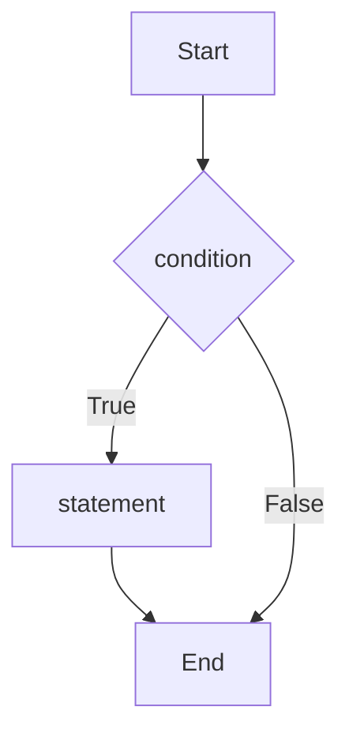
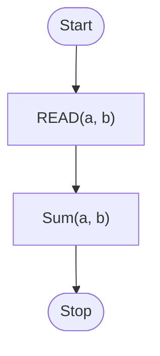
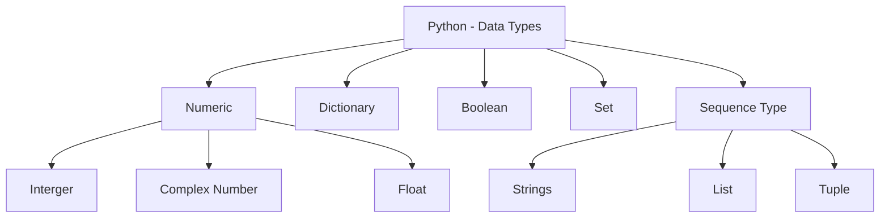

<!-- page 1 | Module 3 · source page 1 -->

[Non-content page]

---

---

<!-- page 2 | Module 3 · source page 2 -->

## Module 3
### Control structures

- Control structures are essential tools in programming that allow developers to control the flow of their code.
- They determine how and when certain sections of code are executed based on specified conditions.

3 types of control structures:

1. **Sequential control structures**
2. **Selection/Decision making control structure**
3. **Looping/ repetition control structure**

### 1. Sequence control structure

Sequence control structure refers to the line-by-line execution by which statements are executed sequentially, in the same order in which they appear in the program.

Eg: Python program to show how a sequential control structure works

```python
1.  # Execution flow will be the same as the code is written, and there is no hidden flow
2. a = 20
3. b = 10
4. c = a - b
5. d = a + b
6. e = a * b
7. print("The result of the subtraction is: ", c)
8. print("The result of the addition is: ", d)
9. print("The result of the multiplication is: ", e)
```

**Output:**

```text
The result of the subtraction is: 10
The result of the addition is :30
The result of the multiplication is: 200
```

### 2. Selection statements- Allow the computer to make choices.

- Allow the computer to make choices.
- Decision making- decides whether to execute or skip a bunch of programming statements.
- This structure is used for making decisions by checking conditions and branching

Forms of decision control structures:

a. **If–statement(One-way selection statement)**

b. **If–else: statement(Two-way selection statement)**

c. **If – elif – else: statement (Also known as ladder if-else statement)( Multi-way selection statement)**

a. **(One-way selection statement)**- An alternative syntax for testing whether a number x is a single-digit number or not.

```python
>>> x=int(input("Enter a number"))
Enter a number8
>>> if 0<x<10:
...     print(x,"is a positive single digit.")
...
8 is a positive single digit.
```

**The syntax of the If statements is:**

If(condition):

$$\quad\quad\text{statements}$$




---

---

<!-- page 3 | Module 3 · source page 3 -->

b. **Two-way selection statement**- if-else statement

To check if a person is major or minor.
> >>> age=12
> 
> >>> if age>=18:
> ... 	print("Major")
> ... else:
> ... 	print("Minor")
> Minor


The syntax of "If-Else statements" is:

If(condition):
			Statements
else:
		statements

Eg: Assume we need to define more than 2 conditions, as obtained in the grading of an exam. In that case we can grade S, A, B, C, D or E (6 options)

print("Enter the marks obtained by a student and you will get the equivalent grade")
mark=int(input())
if mark>=90 & mark<=100:
	print("Congrats you have achieved S grade")
elif mark>=80 & mark<=90:
	print("Congrats you have achieved A grade")
elif mark>=70 & mark<=80:
	print("Congrats you have achieved B grade")
elif mark>=60 & mark<=70:
	print("Congrats you have achieved C grade")
elif mark>=50 & mark<=60:
	print("Congrats you have achieved D grade")
elif mark>=40 & mark<=50:
	print("Congrats you have achieved A grade")
else:
	print("Sorry you have failed the exam")

c. **Multi-way selection statement**

Achieved through the if-elif-else statement.

Code compares two variables

> >>> x=10
> >>> y=5
> >>> if x < y:
> ... 	print(x, "is less than", y)
> ... elif x > y:
> ... 	print(x, "is greater than", y)
> ... else:
> ... 	print(x, "and", y, "are equal")
> 10 is greater than 5

<u>**Output**</u>  
*Enter the marks obtained by a student and you will get the equivalent grade*  
98  
*Congrats you have achieved S grade*

**3. Repetition statements or loops-** allow you to execute a block of code multiple times. Python supports two types of loops -

A. Those that repeat an action a fixed number of times (**definite iteration**)
B. Those that act until a condition becomes false (**conditional iteration**).

**A. Definite iteration: The for loop**

* It is the control statement supporting definite iteration.

---

---

<!-- page 4 | Module 3 · source page 4 -->

* Loops that count through a range of numbers are called count-controlled loops.
 * We use **for** in association with the **range()** function that dictates the number of iterations.
 * range(k) when used with for causes the loop to iterate $k$ times.
 * range(5)- counts from 0 to 4, not 5. (But it iterate 5 times, specifically 0,1,2,3,4)
 * end = " " - Python interpreter will append whitespace following the count value, instead of the default newline character ('\n')


RANGE
The range() function in Python generates a sequence of numbers, which is commonly used for iteration in loops.

range(start, stop, step)
 * **start (optional):** The value of the first number in the sequence (inclusive). Defaults to 0 if not provided.
 * **stop:** The value at which to stop the sequence (exclusive). This parameter is required.
 * **step (optional):** The difference between each number in the sequence. Defaults to 1 if not provided.

Eg: for i in range(5):

    print(i)
    * Output: 0 1 2 3 4
    * This generates numbers from 0 up to, but not including, 5.

Start and Stop:
for i in range(2, 6):

    print(i)
    * Output: 2 3 4 5
    * This generates numbers from 2 up to, but not including, 6.

Start, Stop, and Step:
for i in range(1, 10, 2):

    print(i)
    * Output: 1 3 5 7 9
    * This generates numbers from 1 up to, but not including, 10, with a step of 2.

Negative Step:
for i in range(10, 0, -2):

    print(i)
    * Output: 10 8 6 4 2
    * This generates numbers from 10 down to 1, decreasing by 2 each time.

To print numbers from 0 to 4, you write:

```
>>> for i in range(5):

...     print(i)
...
0
1
2
3
4
```


 * When the step size is negative, the loop variable
 * is decremented by that amount in each iteration.

B.Conditional Iteration: The while loop
 * The while loop repeats a block of code as long as the condition is True. It's useful when you don't know exactly how many times you want the loop to run,


3 | Page

---

---

<!-- page 5 | Module 3 · source page 5 -->

but you want it to continue until some condition is met.
- While loop can modify to achieve the functionality of *exit-controlled loop* in Python.

**Nested loops-**
A nested loop is a loop inside another loop. This allows you to perform more complex tasks, such as iterating over multi-dimensional data structures (like matrices or lists of lists), or running a loop for each iteration of another loop.

a. for loop inside a while loop
c. while loop inside a while
b. for loop inside another for loop
d. while loop inside a for loop

The enclosing loop is called the **outer loop**, and the other loop is called the **inner loop**. The inner loop will be executed once for each iteration of the outer loop

```python
>>> for i in range(1,5):  #This is the outer loop
...     for j in range(1,5):  #This is the inner loop
...         print(j, end=" ")
...     print()
...
```

Output:
```
1 2 3 4
1 2 3 4

1 2 3 4
1 2 3 4
```

**Loop control statements**
- three loop control statements
- that control the flow of execution in a loop
- **break statement, continue statement, pass statement**

| break statement | Continue statement | Pass statement |
| :--- | :--- | :--- |
| used to terminate loops | used to bypass the remainder of the current iteration through a loop. | The pass statement is equivalent to the statement "Do nothing". |
| Any statements inside the loop following the break will be neglected and the control goes out of the loop. | The loop does not terminate when a continue statement is encountered. | used when a statement is required syntactically but the program requires no action. |
| break stops the current iteration and skips the succeeding iterations (if any) and passes the control to the first statement following (outside) the loop. | Rather, the remaining loop statements are skipped and the control proceeds directly to the next pass through the loop. | Nothing happens when pass is executed. It results in a NOP (No OPeration). After the pass is executed, control proceeds as usual to the next statement in the loop. |
| ```python
for num in range(1,5):
    if num%2==0:
        print(num,"is even")
        break
    print("The number is",num)
print("Outside the loop")
``` | ```python
for num in range(1,5):
    if num%2==0:
        print(num,"is even")
        continue
    print("The number is",num)
print("Outside the loop")
``` | ```python
for num in range(1,5):
    if num%2==0:
        print(num,"is even")
        pass
    print("The number is",num)
print("Outside the loop")
``` |
| The number is 1
2 is even
Outside the loop | The number is 1
2 is even
The number is 3
4 is even
Outside the loop | The number is 1
2 is even
The number is 2
The number is 3
4 is even
The number is 4
Outside the loop |

<u>Short-Circuit Evaluation in Python</u>
- **Short-circuit evaluation** is a behavior in logical operations where the second operand of a logical operator is not evaluated if the result can be determined from the first operand alone. This happens in logical `and` and `or` operations.

---

---

<!-- page 6 | Module 3 · source page 6 -->

- **Short-circuit evaluation** is often used to simplify conditions in if, while, and for loops. By placing the most likely condition to be True or False first, you can optimize performance and avoid unnecessary computation.
- This approach allows Python to sometimes determine the value of a Boolean expression before it has fully evaluated all of its operands, improving efficiency and helping to avoid errors.

### **Advantages of Short-Circuit Evaluation:**

#### **Performance Optimization:**

- If the second operand is a complex expression or involves a function call, **short-circuit evaluation** can save computational resources by avoiding unnecessary evaluation of the second operand. This can improve the performance of the program, especially when dealing with large or computationally expensive operations.

#### **Avoiding Errors:**

- Short-circuit evaluation can help avoid errors when the second operand depends on the first operand. For instance, if the first condition checks for None or some invalid state, the second condition might raise an error if it tries to access an attribute of None. By short-circuiting the evaluation, you can prevent this error.

Short circuit evaluation can be useful in avoiding errors. For example, consider the following code causing zero division error:

```python
>>> a=10
>>> b=0
>>> print(a/b)
Traceback (most recent call last):
  File "<stdin>", line 1, in <module>
ZeroDivisionError: division by zero
```

Now let us modify the code to exploit the short circuit evaluation to avoid the zero division error. The modified code follows:

```python
>>> a=10
>>> b=0
>>> if b>0 and a/b>0:
...     print(a/b)
... 
>>>
```

Since $b > 0$ evaluates to false, short-circuit evaluation helps skip determining a/b in the latter part of the condition within the if statement. Had short-circuit evaluation not been in place, a/b>0 would have raised an error.

### **Functions**

A **function** is a reusable block of code that performs a specific task.

**Decomposition-** Decomposition means breaking a big problem into smaller, manageable parts.

**Modularity-** Modularity means organizing your decomposed pieces into separate, independent modules (files or components).

---

---

<!-- page 7 | Module 3 · source page 7 -->

Each module has a specific purpose. A module is a named, self-contained block of statements that carries out some specific, well-defined task.

### Motivations for modularization

1. **Promotes re-use:** If the system functionality is divided into modules, other systems can reuse them. Thus, a programmer can build on whatothers have already done, instead of starting from scratch. This also eliminates redundancy (duplication of code) to a great extent.
2. **Hides complexity:** Since a module is self-contained, it does whatever it is intended to. If you want the functionality provided by a module, you access the module and get it done, without worrying about how the functionality is achieved. This mechanism is called *abstraction*.
3. **Supports division of labour:** Ideally, each module achieves a single goal. A complex task could be divided into simpler sub-tasks, each of which can be performed by individual modules. This promotes parallel operation with different teams working on separate modules, speeding up the entire process with improved collaboration among the teams.
4. **Improves debugging and testing:** Since modules have minimal interaction among themselves, you can isolate a module and investigate it separately to pinpoint errors, if any. Each of the modules can be individually tested for correctness and efficiency. This reduces the risk when the modules are integrated to build the big picture.
5. **Contributes to scalability:** New modules can be added to an existing system to enhance its functionality. This makes the system scalable without having to redesign the entire thing.
6. **Reduces development costs:** The reuse of existing modules contributes to cost savings in development. Also, the self-containment aspect of modules makes the system maintenance cost-effective and productive.

In the world of Python, modules are known as **functions**. The portion of the function code that implements its functionality is known as *function definition*. For built-in functions, the definitions are provided by the interpreter itself. But, with user-defined functions, it is the duty of the programmer to define them. When we want to use the functionality provided by a function, we access it (technically known as a *function call*) by its name.

### The anatomy of functions

A function should be "defined" before its first use. To define a function, you specify its name and then write the logic for implementing its functionality.
- Function definition begins with the keyword `def` followed by the function name. Then you have the parameter list – a comma-separated list of arguments enclosed in a pair of parentheses. This line of the function definition is called **header**.
- The block of statements that constitute the function logic (statement-1 to return-statement) is called **function body**.
- The final statement `return` exits a function.
- The header has to end with a colon, and the body has to be indented.
- The parameters and the return statement are optional, i.e., you could write a function without these.

```python
def function-name(parameter-list):
    statement-1
    statement-2
    .
    .
    statement-n
    return-statement
```

To use its functionality of functiona, you need to call it.
```python
>>> def printName(): #This is how you define a function
...
    name=input("Enter your name")
    print("Hi",name,"! Welcome to the world of functions!")
>>> printName() #This is how you call a function
Enter your nameSam
Hi Sam ! Welcome to the world of functions!
```

---

---

<!-- page 8 | Module 3 · source page 8 -->

## Arguments and return value

Arguments are the way you supply data to a function for processing. The function performs the operations on the received data and produces the result which is given back through the return statement. The value that is given back is known as the **return value**. Technically, you say that a function "receives" one or more arguments and "returns" a result. The parameters in the function definitions are called **formal parameters**, and those in the function call are called **actual parameters**.
The arguments and the return value are both optional.

### Function with no arguments and no return value

```python
>>> def sum():
...     a=int(input("Enter an integer"))
...     b=int(input("Enter another integer"))
...     s=a+b
...     print("The sum of the entered integers is",s)

>>> sum()
Enter an integer6
Enter another integer8
The sum of the entered integers is 14
```

### Function with arguments but no return value

```python
>>> def sum(c,d):
...     s=c+d
...     print("The sum of the entered integers is",s)

>>> a=int(input("Enter an integer"))
Enter an integer3
>>> b=int(input("Enter another integer"))
Enter another integer5
>>> sum(a,b)
The sum of the entered integers is 8
```

### Function with return value but no arguments

```python
>>> def sum():
...     a=int(input("Enter an integer"))
...     b=int(input("Enter another integer"))
...     s=a+b
...     return s

>>> print("The sum of the entered integers is",sum())
Enter an integer4
Enter another integer7
The sum of the entered integers is 11
```

### Function with arguments and return value

```python
>>> def sum(c,d):
...     s=c+d
...     return s
...
>>> a=int(input("Enter an integer"))
Enter an integer10
>>> b=int(input("Enter another integer"))
Enter another integer15
>>> print("The sum of the entered integers is",sum(a,b))
The sum of the entered integers is 25
```

---

---

<!-- page 9 | Module 3 · source page 9 -->

## Algorithm and flowchart for modules

An example that inputs two numbers, adds them, and prints the sum:

$$egin{aligned}
&	ext{ADDINTEGERS} \
&1 	 	ext{READ}(a, b) \
&2 	 	ext{SUM}(a, b)

denote

$$egin{aligned}
&	ext{SUM}(a, b) \
&1 	 s = a + b \
&2 	 	ext{PRINT}(s)





```mermaid
flowchart TD
Start([Sum(a, b)]) --> Compute["S = a + b"]
Compute --> Print["Print(S)"]
Print --> Return([Return])
```


**To print the absolute value of an integer.**
```python
def absoluteValue(x):
    if x < 0:
        return -x
    else:
        return x

num=int(input("Enter a number"))
abs=absoluteValue(num)
print("The absolute value of",num,"is",abs)
```

**To check whether a number is even or not.**
```python
def isEven(n):
    if n%2==0:
        return True
    else:
        return False

num=int(input("Enter a number"))
r=isEven(num)
if r==True:
    print(num,"is even")
else:
    print(num,"is odd")
```

**To print $n$ lines of the following pattern.**

1
1 3
1 3 5
1 3 5 7

```python
def printPattern(n):
    for i in range(1,n+1):
        #each value of i corresponds to one line
        for j in range(1,2*i,2): #for printing numbers on a particular row
            print(j,end=" ")
        print() #to go to next line after printing one row

n=int(input("Enter the number of lines"))
```

## Sequence Data Type

In Python, **sequence data types** are types of data that store a collection of items in an ordered way. The order means that each item has a specific position, which allows us to access each item by its index (or position) in the sequence.

---

---

<!-- page 10 | Module 3 · source page 10 -->




Here are the main sequence data types in Python:
1. Strings
2. List
3. Tuple

Strings

A string is a **sequence** of zero or more characters. Each character in the string occupies one byte of memory, and the last character is always '\0' which is called the **null character**. The terminating null character is important because it is the way by which, the Python interpreter knows where the string ends. Figure shows how a string "Hello World" is stored in memory. Notice the null character at the end. The figure also shows how the character positions are numbered starting with 0 from the left end or starting with -1 from the right end. Each character position is known as an **index**. The null character position is not numbered. It is not considered a part of the string; its sole purpose is to know the string boundary


To know the length of a string, you use the len() method
>>> str="Hello World"
>>> **print(len(str))**
11

### **The subscript operator**

To print a single character out of the string, you should use the **subscript operator**. The subscript operator (also called bracket operator) is denoted by `[ ]`. You just want to mention the index whose character you want to print.
>>> str="Algorithmic thinking"
>>> **print(str[0])**
A
>>> **print(str[5])**
i
>>> **print(str[11])**
>>> **print(str[18])**
n
>>> **print(str[20])**
Traceback (most recent call last):
File "<stdin>", line 1, in <module>
IndexError: string index out of range
(the string length is 20; this means that the last index is 19. Thus, if you try to print the character in the 20th position, you get an error.)
>>> **print(str[19])**
g

Python also allows negative subscript values. In this case, you need to count backward from -1 to access characters from the right end of the string.

---

---

<!-- page 11 | Module 3 · source page 11 -->

>>> str="Try out!"
>>> print(str[-1])
!
>>> print(str[-3])
u
>>> print(str[-9])
Traceback (most recent call last):
File "<stdin>", line 1, in <module>
IndexError: string index out of range
(The reason for the error is that strings are **immutable**, which means you can't change an existing string.)

### Traversing a string

Accessing the string characters one at a time, starting from the beginning and moving towards the end, is called **traversal**. The for loop comes in handy for this:
>>> str="Hi there"
>>> for c in str:
...     print(c)
...
H
i
t
h
e
r
e

### Concatenation and repetition operators

The + operator performs **concatenation**, which means joining the strings by linking them end-to-end.
>>> str1="Python"
>>> str2="Program"
>>> print(str1+str2)
PythonProgram

Note that the concatenation operator does not insert any white space between the joined strings.

The \* operator performs repetition. It repeats a given string some fixed number of times. The left operand for \* is the string to be repeated, and the right operand is an integer denoting the number of times the string is to be repeated.
>>> str="Order!"
>>> print(str*3)
Order!Order!Order!

### String slicing

To extract a substring out of a given string, you should use subscript operator [:]. The operator [n:m] returns the part of the string starting at position n and ending at position m-1.
>>> languages="Python, Java and C++"
>>> print(languages[0:6])
Python
>>> print(languages[8:12])
Java
>>> print(languages[17:20])
C++
If n$\ge$m, the operator [n:m] results in an empty string.
>>> languages="Python, Java and C++"
>>> print(languages[4:4])

>>>
The indices n and m in the operator [n:m] are optional. If you omit the first index n, the slice starts at the beginning of the string. If you omit the second index m, the slice goes to the end of the string.

---

---

<!-- page 12 | Module 3 · source page 12 -->

>>> languages="Python, Java and C++"
>>> print(languages[:6])
Python
>>> print(languages[17:])
C++
When m is omitted, supplying a negative value to the index n prints the last few characters of the string.
To be specific, str[-k:] prints the last k characters of str.
>>> languages="Python, Java and C++"
>>> print(languages[-3:])
C++
Omitting both indices n and m prints the full string.
>>> languages="Python, Java and C++"
>>> print(languages[:])
Python, Java and C++
In addition to mentioning start and end indices in the slicing operator, you can also specify the step that denotes the distance between the characters you want to include in the resultant string. Suppose you want to print every alternate character in a string str, you just use the operator [::2].
>>> languages="Python, Java and C++"
>>> print(languages[::2])
Pto,Jv n +

Since the start and end indices are omitted, the slice starts from the beginning of the string and goes to its end. Since the step is mentioned as 2, every alternate character will be selected.

Comparison operators on strings
The comparison operators work on strings as well. To see if two strings are equal, we simply use the equality operator:
>>> str1="python"
>>> str2="pythen"
>>> print(str1==str2)
False
>>> str2="python"
>>> print(str1==str2)
True

Other comparison operations are useful for determining the lexicographic (alphabetical) order of strings. The comparison operator when used with strings compares the ASCII values of the corresponding characters in the strings. Since the ASCII values are assigned in increasing order, a character that has a lower ASCII value precedes (comes before alphabetically) another character with a higher ASCII value.
>>> str1="C"
>>> str2="Java"
>>> if str1 < str2:
...     print(str1,"comes before",str2)
... elif str2 < str1:
...     print(str2,"comes before",str1)
... else:
...     print("The two strings are the same")
...
C comes before Java

The in operator
in is a boolean operator that takes two strings and returns True if the first appears as a substring in the second and False otherwise.
>>> str1="C"
>>> str2="C++"
>>> str3="Python"
>>> print(str1 in str2)

---

---

<!-- page 13 | Module 3 · source page 13 -->

True
>>> print(str1 in str3)
False
>>> print(str2 in str1)
False
The in operator can be used to print the characters that are present in (common to) two given strings
>>> str1="algorithms"
>>> str2="problem solving"
>>> for c in str1:
...     if c in str2:
...         print(c,end=" ")
...
l g o r i m s

## The string module
The string module contains **string methods** that can be used to manipulate strings.
To use them, you have to first import the module:
`import string`

| String method | Purpose |
| :--- | :--- |
| `s.count(sub, start, end)` | Returns the number of non-overlapping occurrences of substring `sub` in the portion of `s` starting from `start` and ending at `end-1`. |
| `s.find(sub, start, end)` | Returns the index of the first occurrence of the substring `sub` in the portion of `s` starting from `start` and ending at `end-1`. |
| `s.replace(old, new, count)` | Returns a copy of `s` with all occurrences of substring `old` replaced by `new`. If the optional argument `count` is given, only the first `count` occurrences are replaced. |
| `s.isalpha()` | Returns `True` if `s` contains only letters or `False` otherwise. |
| `s.isdigit()` | Returns `True` if `s` contains only digits or `False` otherwise. |
| `s.lower()` | Returns a copy of `s` converted to lower-case. |
| `s.upper()` | Returns a copy of `s` converted to upper-case. |

The parameters `start` and `end` are optional in the methods `find()` and `count()`. If not present, the entire string is considered.
`find()` returns -1 if the substring to be searched is not present in the given string.

Eg
```python
>>> import string
>>> s="malayalam"
>>> str1="string"
>>> str2="STR2"
>>> print(s.find("al"))
```
1

---

---

<!-- page 14 | Module 3 · source page 14 -->

>>> print(s.find("al",2))
5
>>> print(s.find("al",2,5))
-1
>>> print(s.count("al"))
2
>>> print(s.count("al",2))
1
>>> print(s.count("al",2,5))
0
>>> print(s.replace("la","pq"))
mapqyapqm
>>> print(s.replace("la","pq",1))
mapqyalam
>>> print(str1.isalpha())
True
>>> print(str2.isalpha())
False
>>> print(str1.upper())
STRING
>>> print(str2.lower())
str2

In addition to string methods, the string module also provides several string constants;
>>> import string
>>> print(string.ascii_lowercase)
abcdefghijklmnopqrstuvwxyz
>>> print(string.ascii_uppercase)
ABCDEFGHIJKLMNOPQRSTUVWXYZ
>>> print(string.ascii_letters)
abcdefghijklmnopqrstuvwxyzABCDEFGHIJKLMNOPQRSTUVWXYZ
>>> print(string.digits)
0123456789

You can use these constants to test whether a character is upper-case or lower case, or whether it is a digit.
>>> import string
>>> ch='p'
>>> print(ch in string.ascii_lowercase)
True

**To count the occurrences of a character in a string without using the count method.**

```python
str=input("Enter a string")
ch=input("Enter the character to search for")
count=0
for char in str:
    if char==ch:
        count+=1
print(ch,"occurs",count,"times in",str)
```

## Lists

A list is an ordered set of data values. The values that make up a list are called its **elements** or **items**. The logical structure of a list is similar to that of a string. Each item in the list has a unique index that specifies its position and the items are ordered by their positions. Unlike strings, where each element is a character, the items in a list can be of different data types.

---

---

<!-- page 15 | Module 3 · source page 15 -->

## Creating lists

To create a new list; you simply enclose the elements in a pair of square brackets
```python
>>> newlist=[10,"hi",3.14]
>>> print(newlist)
[10, 'hi', 3.14]
>>> mynest=[2,4,[1,3]]
>>> print(mynest)
[2, 4, [1, 3]]
```
As in `mynest` above, a list can have another list as its element. Such a list is called **nested list**. The list `[1,3]` which is an element of `mynest` is called a **member list**. A list that contains no elements is called an empty list, denoted as `[ ]`.
Lists of integers can also be built using the `range()` and `list()` functions.
```python
>>> digits=list(range(10))
>>> print(digits)
[0, 1, 2, 3, 4, 5, 6, 7, 8, 9]
>>> naturals=list(range(1,11))
>>> print(naturals)
[1, 2, 3, 4, 5, 6, 7, 8, 9, 10]
>>> mul5=list(range(10,50,5))
>>> print(mul5)
[10, 15, 20, 25, 30, 35, 40, 45]
```
Once a list is created, you can determine its length (number of elements in the list) using the `len()` method.
In the case of a nested list, the member list will be counted as a single element.
```python
>>> languages=["C","Java","Python","C++"]
>>> print(len(languages))
4
>>> breakfast=["dosa","chapathi",["bread","butter","jam"]]
>>> print(len(breakfast))
3
```
## Accessing list elements and traversal

List indices work the same way as string indices. Thus you can use the subscript operator to access the list elements.
```python
>>> newnest=[10, 20, [25, 30], 40]
>>> print(newnest[0])
10
>>> print(newnest[2])
[25, 30]
>>> print(newnest[-1])
40
>>> print(newnest[4])
Traceback (most recent call last):
  File "<stdin>", line 1, in <module>
IndexError: list index out of range
>>> print(newnest[5-4])
20
>>> print(newnest[1.0])
Traceback (most recent call last):
  File "<stdin>", line 1, in <module>
TypeError: list indices must be integers or slices, not float
>>> print(newnest[-5])
Traceback (most recent call last):
  File "<stdin>", line 1, in <module>
IndexError: list index out of range
```

---

---

<!-- page 16 | Module 3 · source page 16 -->

You could also use an expression as an index in the subscript operator, as in newnest[5-4]
The interpreter will evaluate the expression to determine the index. Printing the list by specifying its name in the print method displays the list elements enclosed in a pair of brackets. To display the entire list without the brackets themselves, you should traverse the list printing the elements one by one.
>>> prime=[2,3,5,7,11]
>>> for p in prime:
...     print(p,end=" ")
...
2 3 5 7 11

### List Comprehension
Creating a new list from an existing list is called **list comprehension**. Assume you have a list of numbers from which you want to create another list consisting only of odd numbers in the original list. This can be done by using a for loop to traverse the original list and copying the odd numbers to a second list. But with list comprehension.

```python
>>> numbers = [1, 28, 73, 4, 100, 358, 75, 208]
>>> odd = [num for num in numbers if num%2 != 0]
>>> print(odd)
[1, 73, 75]
```

The statement `odd = [num for num in numbers if num%2 != 0]` essentially directs the interpreter to iterate through the list numbers and copy all odd numbers to another list odd.

Suppose, now you need to create a list of two-digit even numbers
```python
>>> even2dig = [num for num in range(10,100) if num%2 == 0]
>>> print(even2dig)
[10, 12, 14, 16, 18, 20, 22, 24, 26, 28, 30, 32, 34, 36, 38,
40, 42, 44, 46, 48, 50, 52, 54, 56, 58, 60, 62, 64, 66, 68,
70, 72, 74, 76, 78, 80, 82, 84, 86, 88, 90, 92, 94, 96, 98]
```

### List operations

The `+` operator concatenates lists:
```python
>>> prime=[2,3,5,7]
>>> composite=[4,6,8,10]
>>> numbers=prime+composite
>>> print(numbers)
[2, 3, 5, 7, 4, 6, 8, 10]
```
The `*` operator repeats a list a given number of times:
```python
>>> binary=[0,1]
>>> bytesequence=binary*4
>>> print(bytesequence)
[0, 1, 0, 1, 0, 1, 0, 1]
```
Equality operator works well on lists. It checks if two lists have the same elements.
```python
>>> even=[2,4,6,8]
>>> mul2=[2,4,6,8]
>>> print(even==mul2)
True
>>> composite=[4,6,8]
>>> print(even==composite)
False
```
Other relational operators also work with lists. Consider:
```python
>>> prime=[2,3,5]
>>> even=[2,4,6]
>>> print(prime>even)
False
```

---

---

<!-- page 17 | Module 3 · source page 17 -->

Python starts by comparing the first element from each list. If they are equal, it goes on to the next element, and so on, until it finds the first pair of elements that are different and determines the relation between them. In the above example, prime[0] == even[0]. Next, prime[1] and even[1] are compared. Thus the resulting relation is '<' and prime > even is thus False. Note that once the result is determined, the subsequent elements are skipped.

>>> prime=[2,3,7]
>>> even=[2,4,6]
>>> print(prime>even)
False

Membership operators can be applied to a list as well.

>>> even=[2,4,6,8]
>>> composite=[4,6,8]
>>> print(2 in even)
True
>>> print(2 in composite)
False
>>> print(3 not in composite)
True

### List slices

The slice operator on a list follows the same rules as applied to strings.

>>> sequence=["strings","lists","tuples","bytearrays",
"bytesequences","range objects"]
>>> print(sequence[:])
['strings', 'lists', 'tuples', 'bytearrays', 'bytesequences',
'range objects']
>>> print(sequence[1:4])
['lists', 'tuples', 'bytearrays']
>>> print(sequence[:3])
['strings', 'lists', 'tuples']
>>> print(sequence[3:])
['bytearrays', 'bytesequences', 'range objects']

### List mutations

Unlike strings, lists are **mutable**. In other words, a list is updatable – elements can be inserted, removed, or replaced. You use the subscript operator to replace an element at a given position:

>>> even=[2,4,5,8]
>>> even[2]=6
>>> print(even)
[2, 4, 6, 8]

You can also replace a single list item with a new list.

>>> even=[2,4,6,8]
>>> even[3]=[8,10]
>>> print(even)
[2, 4, 6, [8, 10]]

### Slice operator and mutations

The slice operator is a nice tool to mutate lists in terms of replacing, inserting, or removing list elements.

#### Replacing elements

You can use the slice operator to replace a single element or multiple elements in a list.

>>> composite=[13,17,19,23,25,27,37,41]
>>> composite[4:6]=[29,31]
>>> print(composite)
[13, 17, 19, 23, 29, 31, 37, 41]
>>> odd=[1,3,5,8]

---

---

<!-- page 18 | Module 3 · source page 18 -->

>>> odd[3:4]=[7]
>>> print(odd)
[1, 3, 5, 7]

### Inserting elements

The slice operator is useful for inserting new elements into a list at the desired location:
>>> prime=[2,3,5,7,13,17,19]
>>> prime[4:4]=[11]
>>> print(prime)
[2, 3, 5, 7, 11, 13, 17, 19]
>>> composite=[2,10,12]
>>> composite[1:1]=[4,6,8]
>>> print(composite)
[2, 4, 6, 8, 10, 12]

### Removing elements

The slice operator can also be used to remove elements from a list by assigning the empty list to them
>>> composite[3:4]=[]
>>> print(composite)
[3, 5, 7, 11]
>>> composite=[29,31,33,35,37]
>>> composite[2:4]=[]
>>> print(composite)
[29, 31, 37]

### Using del keyword for deletion

Assigning a list element to an empty list for deletion is cumbersome. As an alternative, Python provides the del keyword exclusively for deletion.

>>> composite=[3,5,7,9,11]
>>> del composite[3]
>>> print(composite)
[3, 5, 7, 11]
>>> composite=[29,31,33,35,37]
>>> del composite[2:4]
>>> print(composite)
[29, 31, 37]

>>> del composite[6]
Traceback (most recent call last):
File "<stdin>", line 1, in <module>
IndexError: list assignment index out of range
As illustrated above, del causes a runtime error if the index is out of range.

### List methods

The list type includes several methods for inserting and removing elements.

---

---

<!-- page 19 | Module 3 · source page 19 -->

| List method | Purpose |
|---|---|
| `L.index(element)` | Returns the position of element in the list L. It produces an error if there is no such element. |
| `L.insert(position, element)` | Inserts element at position if position is less than the length of L. Otherwise, inserts element at the end of L. |
| `L.append(element)` | Inserts element at the end of L. |
| `L.extend(aList)` | Inserts the elements of the list aList to the end of L. |
| `L.remove(element)` | Removes element from the list L. It throws an error if there is no such element. |
| `L.pop()` | Removes and returns the element at the end of L. |
| `L.pop(position)` | Removes and returns the element at position in the list L. |
| `L.count(element)` | Returns the number of times element appears in the list L. |
| `L.sort(element)` | Sorts (arrange in ascending order) the elements of the list L. |
| `L.reverse()` | Reverses the elements of the list L. |


```python
>>> a = [66.25, 333, 333, 7, 1, 1234.5]
>>> print("Index of 1 is", a.index(1))
Index of 1 is 4
>>> print("Index of 333 is", a.index(333))
Index of 333 is 1
>>> a.insert(2, 4587)
>>> a.insert(8, -55)
>>> print("After inserting 4587 and -55, the list is", a)
After inserting 4587 and -55, the list is [66.25, 333, 4587, 333, 7, 1, 1234.5, -55]
>>> a.append(200)
>>> print("The list on appending 200 is", a)
The list on appending 200 is [66.25, 333, 4587, 333, 7, 1, 1234.5, -55, 200]
>>> a.sort()
>>> print("The list after sorting is", a)
The list after sorting is [-55, 1, 7, 66.25, 200, 333, 333, 1234.5, 4587]
>>> b = ['a', 25.47, 'c', 7, 18]
>>> a.extend(b)
>>> print("The list a after extending with elements of b is", a)
The list a after extending with elements of b is [-55, 1, 7, 66.25, 200, 333, 333, 1234.5, 4587, 'a', 25.47, 'c', 7, 18]
>>> a.remove(1)
>>> print("The list a after removing 1 is", a)
The list a after removing 1 is [-55, 7, 66.25, 200, 333, 333, 1234.5, 4587, 'a', 25.47, 'c', 7, 18]
>>> a.remove(333)
>>> print("The list a after removing 333 is", a)
The list a after removing 333 is [-55, 7, 66.25, 200, 333, 1234.5, 4587, 'a', 25.47, 'c', 7, 18]
>>> x = a.pop()
>>> print("The element popped from the list a is", x)
The element popped from the list a is 18
```

---

---

<!-- page 20 | Module 3 · source page 20 -->

>>> a.pop(6)
4587
>>> print("The list a after popping element at position 6 is",a)
The list a after popping element at position 6 is [-55, 7,
66.25, 200, 333, 1234.5, 'a', 25.47, 'c', 7]
>>> print("The list a has",a.count(7),"occurrences of 7")
The list a has 2 occurrences of 7
>>> a.reverse()
>>> print("The list a in reverse is ",a)
The list a in reverse is
[7, 'c', 25.47, 'a', 1234.5, 333,
200, 66.25, 7, -55]

### Lists and functions

A function can be made to return multiple values using lists. This is done by defining the function to return a list of values instead of a single value as in the normal case.
>>> def printTop3(list):
...     list.sort()
...     list.reverse()
...     top3=[list[i] for i in range(3)]
...     return(top3)
...
>>> mylist=[23,1,78,50,100,-5]
>>> printTop3(mylist)
[100, 78, 50]

### Strings and lists

To construct a list out of the characters from a string, you can use list() method
>> str="two words"
>>> strlist=list(str)
>>> print(strlist)
['t', 'w', 'o', ' ', 'w', 'o', 'r', 'd', 's']
If you want to split a multi-word string into its constituent words and construct a list out of those words, you should use the split() method:
>>> str="two words"
>>> strwords=str.split()
>>> print(strwords)
['two', 'words']
In the above example, the white space where you split the string is known as the **delimiter**. If you want to specify a different delimiter, you can pass that character (or even a string) as an argument to the split() method.
>>> str="two words"
>>> wsplit=str.split('w')
>>> print(wsplit)
['t', 'o', 'ords']
>>> wosplit=str.split('wo')
>>> print(wosplit)
['t', '', 'rds']
Notice that the delimiter doesn't appear in the list.

The join() method works in the opposite sense of split(). It concatenates a list of strings by inserting a "separator" between them. The following code uses a blank space as the separator.
>>> sep=" "
>>> wordlist=["three", "word", "string"]

---

---

<!-- page 21 | Module 3 · source page 21 -->

>>> str=sep.join(wordlist)
>>> print(str)
three word string

The following code uses a hyphen as a separator.
>>> sep="-"
>>> wordlist=["three", "word", "string"]
>>> str=sep.join(wordlist)
>>> print(str)
three-word-string

### **Tuples**

A tuple is a sequence of values that resembles a list, except that a tuple is **immutable**. You create a tuple by enclosing its elements in parentheses instead of square brackets. (Strictly speaking, the enclosing parentheses are optional, but are included to improve readability.) The elements are to be separated by commas. Following are some examples:
t = ('a', 'b', 'c', 'd', 'e')
s = ('g', 2, 7, 8.978)
To create a tuple with a single element, we have to include a comma at the end, even though there is only one value. Without the comma, Python treats the element as a string in parentheses. The following code illustrates this:
>>> t1=('a',)
>>> t2=('a')
>>> print(type(t1))
<class 'tuple'>
>>> print(type(t2))
<class 'str'>

### **Tuple creation**

A tuple can be created by enclosing its elements in parentheses. Another way to create a tuple is to use the tuple() function.
>>> t1=tuple("string")
>>> print(t1)
('s', 't', 'r', 'i', 'n', 'g')
>>> t2=tuple([1,2,3])
>>> print(t2)
(1, 2, 3)
>>> t3=tuple()
>>> print(t3)
()
>>> t4=tuple([4])
>>> print(t4)
(4,)
In the above example, t3 is an empty tuple. Also, notice how t4 is printed with comma at the end.

### **Tuple operations**

Most of the operators and functions used with lists can be used similarly with tuples.
>>> lan=tuple("python")
>>> print(lan[0])
p
>>> print(lan[1:4])
('y', 't', 'h')
But, unlike lists, tuples are immutable -- you are bound to get error when you try to modify the tuple contents.
>>> lan=tuple("python")
>>> lan[0]='P'
Traceback (most recent call last):

---

---

<!-- page 22 | Module 3 · source page 22 -->

File "<stdin>", line 1, in <module>
TypeError: 'tuple' object does not support item assignment
Python provides a quick way to swap two variables a and b without using any third temporary variable:
>>> a,b=5,10
>>> print(a,b)
5 10
>>> a,b=b,a
>>> print(a,b)
10 5
This is known as tuple assignment.

## The numpy package and arrays

NumPy stands for Numerical Python. It is an excellent package for advanced computing in Python like linear algebra, Fourier transforms, and random simulation. This package also provides extensive support for arrays. An array is a homogeneous collection of data items, unlike lists and tuples that are heterogeneous.
As always, if you want to use the components in NumPy, you should first import the package. NumPy is usually imported with the np alias name:
import numpy as np
Now the NumPy package can be referred to as np instead of numpy.

### Creating arrays

To create an array, you use the array() method of numpy package .
>>> import numpy as np
>>> arr = np.array([1, 2, 3, 4, 5, 6])
>>> print(arr)
[1 2 3 4 5 6]
You can also create matrices (two-dimensional arrays) with array() method:
>>> mat = np.array([[1, 2, 3], [4, 5, 6]])
>>> print(mat)
[[1 2 3]
 [4 5 6]]
To know the dimensions of an array, you use the ndim attribute in NumPy.

>>> arr = np.array([1, 2, 3, 4, 5])
>>> print(arr.ndim)
1
>>> mat = np.array([[1, 2, 3], [4, 5, 6]])
>>> print(mat.ndim)
2
To know the size across each dimension, you use the shape attribute:

>>> arr = np.array([1, 2, 3, 4, 5])
>>> mat = np.array([[1, 2, 3], [4, 5, 6]])
>>> print(mat.shape)
(2, 3)
>>> print(arr.shape)
(6,)
The first output (2, 3) means that the array mat has 2 elements in the first dimension (2 rows) and 3 elements in the second dimension (3 columns). The second output (6,) means that the array arr has 6 elements in the first dimension and no elements in the second dimension.

---

---

<!-- page 23 | Module 3 · source page 23 -->

### Accessing array elements

Indexing and slicing work the same way with arrays as with other sequences like lists, and tuples.
```python
>>> arr = np.array([1,2,3,4,5,6])
>>> mat = np.array([[1, 2, 3], [4, 5, 6]])
>>> print(arr[3])
```
4
```python
>>> print(arr[2:5])
```
[3 4 5]
```python
>>> print(mat[1])
```
[4 5 6]
```python
>>> print(mat[0,2])
```
3
```python
>>> print(mat[0][2])
```
3
```python
>>> print(arr[-2])
```
5
```python
>>> print(mat[-1,2])
```
6
```python
>>> print(mat[-2,-3])
```
1
```python
>>> print(arr[-2:])
```
[5 6]
```python
>>> print(arr[1:5:2])
```
[2 4]
```python
>>> print(arr[:5:2])
```
[1 3 5]
```python
>>> print(mat[:2:2])
```
[[1 2 3]]

#### for loop is used to traverse the array:

```python
>>> arr = np.array([1,2,3,4,5,6])
>>> mat = np.array([[1, 2, 3], [4, 5, 6]])
>>> for elt in arr:
...     print(elt,end=" ")
...
```
1 2 3 4 5 6
```python
>>> for row in mat:
...     print(row)
...
```
[1 2 3]
[4 5 6]
```python
>>> for row in mat:
...     for elt in row:
...         print(elt,end=" ")
...
```
1 2 3 4 5 6
```python
>>> for row in mat:
...     for elt in row:
...         print(elt,end=" ")
...     print("")
...
```
1 2 3
4 5 6

---

---

<!-- page 24 | Module 3 · source page 24 -->

Changing array dimensions

Changing the array dimensions means to increase or decrease the number of dimensions. For this, you use the reshape() method.
>>> arr = np.array([1,2,3,4,5,6])
>>> mat = np.array([[1, 2, 3], [4, 5, 6]])
>>> mat.reshape(1,6)
array([[1, 2, 3, 4, 5, 6]])
>>> arr.reshape(3,2)
array([[1, 2],
       [3, 4],
       [5, 6]])
When you convert a one-dimensional array into a two-dimensional array, there should be enough number of elements to fill all the rows.
Otherwise, you will end up with an error.
>>> arr = np.array([1,2,3,4,5])
>>> arr.reshape(2,3)
Traceback (most recent call last):
File "<stdin>", line 1, in <module>
ValueError: cannot reshape array of size 5 into shape (2,3)
As the error itself mentions, you cannot convert a one-dimensional array with 5 elements to a two-dimensional array of 6 elements (2 rows and 3 columns).

Matrix operations


>>> mat1 = np.array([[1,2],[3,4]])
>>> mat2 = np.array([[5,6],[7,8]])
>>> print(np.add(mat1,mat2))
[[6 8]
 [10 12]]
>>> print(np.subtract(mat1,mat2))
[[-4 -4]
 [-4 -4]]
>>> print(np.matmul(mat1,mat2))
[[19 22]
 [43 50]]
>>> print(mat1.T)
[[1 3]
 [2 4]]
>>> print(mat2.T)
[[5 7]
 [6 8]]

Sets

A set is a collection of items just as tuples or lists but unlike the other two, a set is unordered; the items in a set do not have a defined order.

Creating a set and accessing its elements
A set is created by enclosing the items in a pair of braces.

---

---

<!-- page 25 | Module 3 · source page 25 -->

>>> directions={'east','west','south','north'}
>>> print(directions)
{'east', 'south', 'north', 'west'}

Notice that since the items are unordered in a set, each time you print the set, the output may be different concerning the order of the elements. You can also use the `set` method to create a set from a list or a tuple

>>> numbers=set([1,2,3,4])
>>> print(numbers)
{1, 2, 3, 4}
>>> vowels=set(('a','e','i','o','u'))
>>> print(vowels)
{'o', 'u', 'a', 'e', 'i'}

The items in a set aren't associated with index or position. This means it is impossible to print an arbitrary element of the set.

>>> vowels=set(('a','e','i','o','u'))
>>> vowels[2]
Traceback (most recent call last):
File "<stdin>", line 1, in <module>
TypeError: 'set' object is not subscriptable

**To traverse the set, use a `for` loop:**

>>> for char in vowels:
...     print(char,end=" ")
...
o u a e i

Sets do not allow duplicate elements. The duplicates are automatically removed even if you supply non-unique values.

>>> fibonacci={0,1,1,2,3,5}
>>> print(fibonacci)
{0, 1, 2, 3, 5}

### Adding and removing set elements

To add a single element to a set, you use the `add()` method:

>>> even={2,4,8,10}
>>> even.add(6)
>>> print(even)
{2, 4, 6, 8, 10}

To add multiple items to a set, the `update()` method is to be used:

>>> odd={1,3,7,9,13,15}
>>> odd.update({5,11})
>>> print(odd)
{1, 3, 5, 7, 9, 11, 13, 15}

To remove an item from a set, you should use the `remove()` method:

>>> primes={3,5,7,9,11}
>>> primes.remove(9)
>>> print(primes)
{3, 5, 7, 11}

If the item to be removed is not present in the set, `remove()` will raise an error:

>>> primes={3,5,7,11}
>>> primes.remove(2)
Traceback (most recent call last):
File "<stdin>", line 1, in <module>
KeyError: 2

---

---

<!-- page 26 | Module 3 · source page 26 -->

A second way to remove an item from a set is to use the `discard()` method which works the same way as remove. The difference between these two methods is that `discard()` will not raise an error if the item to be removed doesn't exist in the set unlike `remove()`.
```python
>>> primes={3,5,7,9,11}
>>> primes.discard(9)
>>> print(primes)
{3, 5, 7, 11}
>>> primes.discard(2)
>>> print(primes)
{3, 5, 7, 11}
```
To remove all the set items at once, you can use the `clear()` method
```python
>>> primes={3,5,7,9,11}
>>> primes.clear()
>>> print(primes)
set()
```
The keyword `del` can be used to delete the set itself, that is, after the `del` operation, the set will not exist anymore. Any subsequent access to the set will throw an error
```python
>>> primes={3,5,7,9,11}
>>> del primes
>>> print(primes)
Traceback (most recent call last):
File "<stdin>", line 1, in <module>
NameError: name 'primes' is not defined
```

### Sets and relational operators

The relational operators can be used to check the relationship (subset, superset, etc) between two sets.


```python
>>> digits={0,1,2,3,4,5,6,7,8,9}
>>> natural={1,2,3,4,5,6,7,8,9,10}
>>> even={0,2,4,6,8}
>>> odd={1,3,5,7,9}
>>> prime={3,5,7}
>>> composite={4,6,8}
>>> print(even<natural)
False
>>> print(odd<digits)
True
>>> print(prime<=odd)
True
>>> print(digits>=even)
True
>>> print(composite==even)
False
>>> print(prime!=odd)
True
```

---

---

<!-- page 27 | Module 3 · source page 27 -->

### Mathematical set operations on Python sets

Python supports all the mathematical set operations (union, intersection, etc.)

```python
>>> positive={1,2,3,4,5}
>>> negative={-5,-4,-3,-2,-1}
>>> numbers=positive.union(negative)
>>> print(numbers)
{1, 2, 3, 4, 5, -2, -5, -4, -3, -1}
>>> even={2,4,6,8,10}
>>> mul3={3,6,9,12}
>>> even={2,4,6,8,10,12}
>>> mul6=even.intersection(mul3)
>>> print(mul6)
{12, 6}
>>> mul15={0,15,30,45}
>>> mul5={0,5,10,15,20,25,30,25,40,45}
>>> mul5.intersection_update(mul15)
>>> print(mul5)
{0, 45, 30, 15}
>>> mul4={4,8,12,16,-4,-12,-20}
>>> mul8={8,16,-40,-120}
>>> mul4only=mul4.difference(mul8)
>>> print(mul4only)
{4, 12, -20, -12, -4}
>>> mul4.difference_update(mul8)
>>> print(mul4)
{-4, 4, -12, -20, 12}
>>> numbers={-3,-2,-1,0,1,2,3}
>>> natural={1,2,3,4,5}
>>> integers=numbers.symmetric_difference(natural)
>>> print(integers)
{0, 4, 5, -1, -3, -2}
>>> numbers.symmetric_difference(natural)
>>> print(numbers)
{0, 4, 5, -1, -3, -2}
```

| Set method | Meaning |
| --- | --- |
| A.union(B) | returns a new set $S = A 	ext{ } 	ext{\cup} 	ext{ } B$ |
| A.intersection(B) | returns a new set $S = A 	ext{ } 	ext{\cap} 	ext{ } B$ |
| A.intersection_update(B) | changes the set A to $A 	ext{ } 	ext{\cap} 	ext{ } B$ |
| A.difference(B) | returns a new set $S = A - B$ |
| A.difference_update(B) | changes the set A to $A - B$ |
| A.symmetric_difference(B) | returns a new set $S = (A - B) 	ext{ } 	ext{\cup} 	ext{ } (B - A)$ |
| A.symmetric_difference_update(B) | changes the set A to $(A - B) 	ext{ } 	ext{\cup} 	ext{ } (B - A)$ |


### Dictionaries

A dictionary associates a set of **keys** with **data values**. For example, the words in a standard English Dictionary comprise a set of keys, whereas their associated meanings are the data values. Thus a dictionary is a mapping between a set of keys and a set of values. Each key maps to a value. The association of a key and a value is called a **key-value pair**, sometimes called an **item** or an **entry**.

A Python dictionary is written as a sequence of key/value pairs separated by commas and the entire sequence is enclosed in a pair of braces. Each key is separated from its value by a colon (:). Such a list of key-value pairs enclosed in a pair of braces is known as a **dictionary literal**.

---

---

<!-- page 28 | Module 3 · source page 28 -->

>>> stud = {'Name': 'Ram', 'Age': 18, 'Class': 'S1'}
>>> print(stud)
{'Name': 'Ram', 'Age': 18, 'Class': 'S1'}

Here Name, Age and Class are keys whereas Ram, 18 and S1 are the corresponding values. An empty dictionary without any items is written as {}.

Keys are unique within a dictionary although values need not be. Although the entries may appear to be ordered in a dictionary, this ordering is not the same, each time we print the entries. In general, the order of items in a dictionary is unpredictable.

**Dictionary operations**

**Accessing values**

The subscript operator is used to obtain the value associated with a key
>>> stud = {'Name': 'Ram', 'Age': 18, 'Class': 'S1'}
>>> print("I am",stud['Name'],"aged",stud['Age'],"and I am studying in",stud['Class'])
I am Ram aged 18 and I am studying in S1

However, if the key is not present in the dictionary, Python raises an error:
>>> stud = {'Name': 'Ram', 'Age': 18, 'Class': 'S1'}
>>> print(stud['College'])
Traceback (most recent call last):
File "<stdin>", line 1, in <module>
KeyError: 'College'

**Traversing a dictionary**

A simple for loop can be used to traverse a dictionary:
>>> stud = {'Name': 'Ram', 'Age': 18, 'Class': 'S1'}
>>> for key in stud:
...     print(key,"-",stud[key])
...
Name - Ram
Age - 18
Class - S1

The key-value pairs need not be always printed in the order you gave.

**Inserting keys and updating key values**

You should use the subscript operator to add a new key/value pair to the dictionary
>>> stud['College']="Engineering college"
>>> print(stud)
{'Name': 'Ram', 'Age': 18, 'Class': 'S1', 'College':
'Engineering college'}

The subscript is also used to replace the value of an existing key:
stud = {'Name': 'Ram', 'Age': 18, 'Class': 'S1'}
>>> stud['Age']=19
>>> print(stud)
{'Name': 'Ram', 'Age': 19, 'Class': 'S1'}

**Removing keys**

To remove a key from a dictionary, use the del operator. The corresponding key-value pair will be removed.

**Miscellaneous operations**

The len() function returns the number of key-value pairs in a dictionary:
>>> stud = {'Name': 'Ram', 'Age': 18, 'Class': 'S1'}
>>> print(len(stud))
3

---

---

<!-- page 29 | Module 3 · source page 29 -->

3

The `in` operator can be used to know if a key exists in the dictionary.
>>> stud = {'Name': 'Ram', 'Age': 18, 'Class': 'S1'}
>>> print('Age' in stud)
True
>>> print('College' in stud)
False

### Dictionary methods- with `dict` denoting the dictionary

| Dictionary method | Purpose |
| --- | --- |
| `dict.get(key, default)` | Returns the value if the key exists or returns the default if the key does not exist. Displays "None" if the default is omitted and the key does not exist. |
| `dict.pop(key, default)` | Removes the key and returns the value if the key exists or returns the text `default` if the key does not exist. Raises an error if the default is omitted and the key does not exist. |
| `dict.keys()` | Returns a list of the keys. |
| `dict.values()` | Returns a list of values. |
| `dict.items()` | Returns a list of tuples containing the key and value pairs. |
| `dict.clear()` | Removes all the items from the dictionary. |

>>> stud = {'Name': 'Ram', 'Age': 18, 'Class': 'S1'}
>>> print(stud.get('Name'))
Ram
>>> print(stud.get('College'))
None
>>> print(stud.get('College','Oops!!No such key!'))
Oops!!No such key!
>>> stud.pop('College')
Traceback (most recent call last):
File "<stdin>", line 1, in <module>
KeyError: 'College'
>>> stud.pop('Age')
18
>>> print(stud)
{'Name': 'Ram', 'Class': 'S1'}
>>> print(stud.keys())
dict_keys(['Name', 'Class'])
>>> print(stud.values())
dict_values(['Ram', 'S1'])
>>> print(stud.items())
dict_items([('Name', 'Ram'), ('Class', 'S1')])
>>> stud.clear()
>>> print(stud)
